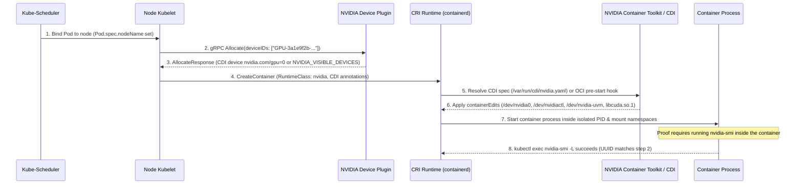
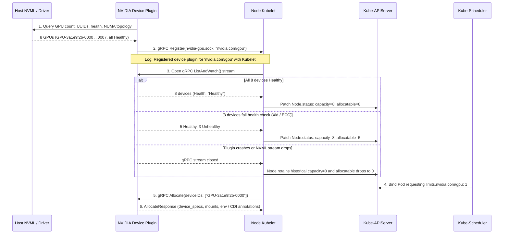
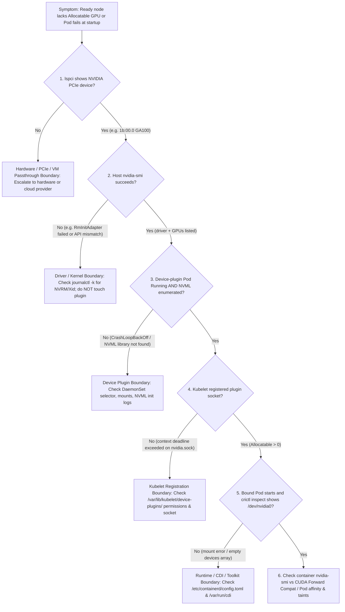

# 11.2 Device plugin, container toolkit, CDI and runtime classes

| | |
|---|---|
| Level | Intermediate |
| Priority tier | 1 |
| Lab venue | GCP / GKE (plus local Python 3 simulation lab) |
| Part | Part 11: GPUs on Kubernetes, scheduling and virtualization |
| Sources used | `nvidia-zero-to-hero/volume-10/chapter-03-container-toolkit-runtimeclass-and-cdi.md`; `nvidia-zero-to-hero/volume-10/chapter-04-device-plugin-and-kubernetes-resource-model.md`; `nvidia-zero-to-hero/volume-10/labs/lab-03-diagnose-a-missing-allocatable-gpu.md`; `volume-04/02-gpu-software-operator-masterclass.md`; Roland Huß et al., *Generative AI on Kubernetes* (O'Reilly, 2026, Ch. 3); *Kubernetes for Generative AI Solutions* (Packt, 2025, Ch. 2, Ch. 10) |
| Coverage file | `planning/coverage/chapters/11-02.md` |

## Why this matters for AI infrastructure

Scheduling a GPU in Kubernetes is not the same operation as giving a Linux container process a usable GPU. When an engineer submits a Pod requesting `nvidia.com/gpu: 1` (or `nvidia.com/gpu: 8` for a single-node multi-GPU job), three distinct infrastructure contracts must execute in sequence across three separate software boundaries:

1. **Inventory and Scheduling (Device Plugin to Kubelet to API Server):** The Kubernetes scheduler natively understands `cpu` and `memory`, but it has zero built-in knowledge of PCIe GPUs, NVLink fabrics, or CUDA drivers. The **NVIDIA Device Plugin** (running as a node-local DaemonSet) queries the host driver through the NVIDIA Management Library (NVML), opens a gRPC stream to the local `kubelet`, and advertises healthy devices as an extended resource (`nvidia.com/gpu`). Only after the `kubelet` patches the `Node` status object in `kube-apiserver` can `kube-scheduler` bind a GPU Pod to that node.
2. **Device Allocation (Kubelet to Device Plugin):** Binding a Pod to a node (`Pod.spec.nodeName`) only reserves an integer count in control-plane accounting. Before the container starts, the `kubelet` invokes the device plugin's `Allocate()` gRPC method to select specific physical device UUIDs (for example, `GPU-3a1e9f2b-...`) and construct the device-specific instructions (environment variables, device paths, or Container Device Interface annotations) for the container runtime.
3. **Sandbox Construction and Injection (CRI Runtime to NVIDIA Container Toolkit / CDI):** Standard Linux containers use kernel namespaces (`namespaces(7)`) and control groups (`cgroups(7)`) to isolate CPU, memory, filesystem, and network views. By default, a container namespace cannot see host character devices such as `/dev/nvidia0` or the host's user-mode driver library (`libcuda.so.1`). At container creation time, the Container Runtime Interface (CRI) engine (`containerd` or `CRI-O`) must invoke the **NVIDIA Container Toolkit**—either through a `RuntimeClass`-selected runtime handler (`nvidia-container-runtime`) or natively via a **Container Device Interface (CDI)** specification (`/var/run/cdi/nvidia.yaml`)—to bind-mount the exact allocated character devices and host driver libraries into the isolated container sandbox.

Confusing these three boundaries is the single largest source of wasted incident-response hours on Kubernetes GPU platforms. A node can advertise `Allocatable: nvidia.com/gpu: 8` while every newly scheduled PyTorch Pod crashes immediately with `CUDA_ERROR_NO_DEVICE` because `/etc/containerd/config.toml` lost its `nvidia` runtime handler during an OS image refresh. Conversely, a node whose `containerd` runtime and CDI specs are completely intact can report `8 capacity` with an empty `allocatable` field because a stale kernel module (`525.105.17` vs `535.104.05`) prevented the device plugin from initializing NVML.

This chapter deconstructs the host-to-container boundary from kernel character devices (`major 195` and `major 238`), user-mode CUDA forward compatibility (`/usr/local/cuda/compat`), and the four generations of GPU containerization (`nvidia-docker` to CDI `0.5.0`) through `RuntimeClass` handler selection and the `kubelet` Device Plugin gRPC state machine (`Register`, `ListAndWatch`, and `Allocate`).

## Prerequisites and outcomes

### Prerequisites
- Familiarity with the seven-gate GPU readiness dependency chain introduced in Chapter 11.1 (`PCIe -> Host Driver -> Container Runtime -> Device Plugin -> Node Labels -> Scheduler -> Workload Validation`).
- Working knowledge of Linux character devices (`/dev`), shared-library dynamic linking (`ld.so`, `LD_LIBRARY_PATH`), and Kubernetes Pod resource specifications (`resources.requests` and `resources.limits`).

### Outcomes
After completing this chapter, you will be able to:
- Distinguish the responsibilities of the host kernel-mode driver (`nvidia.ko`, `nvidia-uvm.ko`, `nvidia-peermem.ko`), the host user-mode driver (`libcuda.so.1`), and the container-packaged CUDA runtime (`libcudart.so`)—including how CUDA Forward Compatibility (`/usr/local/cuda/compat`) bridges older host drivers.
- Trace the four generations of NVIDIA container integration (`nvidia-docker`, `nvidia-docker2`, `nvidia-container-toolkit` OCI pre-start hooks, and CNCF Container Device Interface `cdiVersion: 0.5.0`) and explain what `nvidia-ctk cdi generate` writes into `/var/run/cdi/nvidia.yaml`.
- Separate the three runtime mechanisms (`NVIDIA Container Toolkit` node configuration, Kubernetes `RuntimeClass` handler selection, and `CDI` device description) and explain why neither `RuntimeClass` nor `CDI` makes a GPU schedulable on its own.
- Explain the `kubelet` Device Plugin gRPC lifecycle (`Register`, `ListAndWatch`, `Allocate`) over `/var/lib/kubelet/device-plugins/nvidia-gpu.sock` and interpret the exact operational meaning of `Capacity`, `Allocatable`, and `Allocated resources` on a Kubernetes `Node`.
- Quantify why a bare `nvidia.com/gpu: 1` extended-resource request is a quantity contract rather than a hardware-intent contract (`37.5%` wrong-pool placement probability on a mixed `40`-node cluster of `25` NVLink nodes and `15` older PCIe nodes).
- Execute a strict dependency-ordered diagnostic playbook (`Lab 03` methodology) using `lspci`, `lsmod`, `nvidia-smi`, `crictl inspect`, `kubectl describe node`, and `journalctl -u kubelet` to isolate hardware, driver, plugin, registration, and runtime-injection failures without blind restarts.

## Concepts: basics to intermediate to advanced

### 1. Basics: The host kernel/user-space split and Linux container isolation

Before a container runtime or Kubernetes device plugin can expose a GPU, the bare-metal or virtual-machine Linux host must drive the physical hardware. As established in `volume-04/02-gpu-software-operator-masterclass.md`, the NVIDIA UNIX driver stack is split across two privilege domains: the **Kernel-Mode Driver (KMD)** and the **User-Mode Driver (UMD)**.

#### The Kernel-Mode Driver (KMD) and character devices
The KMD consists of loadable kernel modules (`.ko` files) compiled against the exact running host kernel (`uname -r`) that talk directly to the GPU over the PCIe bus:
- **`nvidia.ko`:** The core kernel driver responsible for hardware initialization, GPU context state, power management, interrupt handling, and memory allocation. In typical `lsmod` output on an active node, `nvidia` occupies roughly `56897536` bytes (`56655872` bytes on another release) with dependents such as `nvidia_uvm` and `nvidia_modeset`.
- **`nvidia-uvm.ko` (`nvidia_uvm`, ~`1441792` to `1622016` bytes in `lsmod`):** The Unified Virtual Memory module. It manages a shared virtual address space between the CPU and GPU, handling GPU page faults and on-demand page migration. Modern deep learning frameworks and CUDA unified-memory allocations require `nvidia-uvm.ko` and its character device `/dev/nvidia-uvm`.
- **`nvidia-modeset.ko` (`nvidia_modeset`, ~`1249280` to `1314816` bytes in `lsmod`) and `nvidia_drm` (`69632` bytes):** Display mode-setting and Direct Rendering Manager modules. Even on headless data-center servers, `nvidia-modeset` is frequently loaded alongside `nvidia.ko`.
- **`nvidia-peermem.ko`:** Enables GPUDirect RDMA by allowing RDMA network adapters (such as NVIDIA ConnectX InfiniBand or RoCE NICs) to register and DMA directly into and out of GPU BAR1 memory over PCIe without staging through host CPU RAM. Intra-node GPU-to-GPU transfers over NVLink do not depend on `nvidia-peermem.ko`, but multi-node collective communications over RDMA require it.

When these kernel modules initialize, they expose character device nodes under `/dev` that user-space processes open and issue `ioctl()` system calls against:

| Character device path | Device type | Major number | Minor number | Operational purpose |
|---|---|---|---|---|
| `/dev/nvidia0` .. `/dev/nvidia7` | Character (`c`) | `195` | `0` .. `7` | Per-GPU device node corresponding to physical GPU index `0` through `7` |
| `/dev/nvidiactl` | Character (`c`) | `195` | `255` | Global control device queried to enumerate GPUs and manage driver-wide state |
| `/dev/nvidia-uvm` | Character (`c`) | `238` (dynamic) | `0` | Unified Virtual Memory device node required by CUDA runtime/driver contexts |
| `/dev/nvidia-uvm-tools` | Character (`c`) | `238` (dynamic) | `1` | Profiling and diagnostic companion node for UVM |
| `/dev/nvidia-caps/*` | Character (`c`) | Dynamic | Dynamic | Capability device nodes used to enforce fine-grained MIG partition access |

If `/dev/nvidia0`, `/dev/nvidiactl`, or `/dev/nvidia-uvm` is missing on the host—or missing inside the container's `/dev` filesystem—any call to `cuInit(0)` or `cudaMalloc()` fails immediately.

#### The User-Mode Driver (UMD) vs the CUDA Runtime
Above the `/dev/nvidia*` character-device boundary sit two distinct sets of shared libraries (`.so` files):
1. **The User-Mode Driver (`libcuda.so.1` and `libnvidia-ml.so.1`):** Shipped as part of the **NVIDIA display/compute driver package** on the host. `libcuda.so.1` implements the low-level CUDA Driver API (`cuInit`, `cuCtxCreate`, `cuModuleLoad`, `cuLaunchKernel`) and speaks a private, version-locked `ioctl()` ABI to `nvidia.ko` in the host kernel. `libnvidia-ml.so.1` (NVML) backs `nvidia-smi`, DCGM, and the Kubernetes device plugin. Because `libcuda.so.1` must match the exact version of `nvidia.ko` loaded in the host kernel (for example, both at `535.154.05` or `525.105.17`), `libcuda.so.1` is owned by the **host** and injected into containers at runtime rather than baked into standard application images.
2. **The CUDA Runtime and Toolkit Libraries (`libcudart.so`, `libcublas.so`, `libnccl.so`):** Shipped inside the **application container image** (for example, `nvidia/cuda:12.8.1-base-ubi9` or `vllm/vllm-openai:latest`). PyTorch and TensorFlow link against `libcudart.so`, which translates high-level runtime calls into Driver API calls handled by the host-injected `libcuda.so.1`.

 Why not bake `nvidia.ko` and `libcuda.so.1` into every workload container image? Because `nvidia.ko` runs in kernel space on the host OS. If an application image carried its own user-mode `libcuda.so.525.105.17` while the host kernel ran `nvidia.ko` `535.104.05` (or vice versa), the `ioctl()` handshake would fail with `NVRM: API mismatch: the client has the version 535.104.05, but this kernel module has the version 525.105.17`. Keeping the kernel module and `libcuda.so.1` on the host lets platform engineers patch a driver CVE or stability defect once across a `500`-node fleet without rebuilding hundreds of tenant container images.

#### CUDA Forward Compatibility (`/usr/local/cuda/compat`)
What happens when a research team needs a container built on a newer CUDA Toolkit (for example, CUDA `12.2`) on a production fleet whose host kernel driver is pinned to an older enterprise branch (for example, Driver `525.105.17`, which originally shipped with CUDA `12.0`)? Unloading `nvidia.ko` across `500` nodes requires draining all GPU Pods or rebooting hosts.

To bridge this gap across supported major/minor boundaries, NVIDIA provides **CUDA Forward Compatibility**. A forward-compatible container packages a newer user-mode driver bundle inside `/usr/local/cuda/compat/`:
- `/usr/local/cuda/compat/libcuda.so.1` (symlinked to `libcuda.so.535.104.05`)
- `/usr/local/cuda/compat/libnvidia-nvvm.so.1`
- `/usr/local/cuda/compat/libnvidia-ptxjitcompiler.so.1`

When the container entrypoint prepends `/usr/local/cuda/compat` to `LD_LIBRARY_PATH`:
```bash
# Inside container entrypoint (untested here)
export LD_LIBRARY_PATH=/usr/local/cuda/compat:$LD_LIBRARY_PATH
```
the Linux dynamic linker (`ld.so`) resolves the newer `/usr/local/cuda/compat/libcuda.so.1` *before* the older host `libcuda.so.1` bind-mounted by the NVIDIA Container Toolkit. That newer user-mode library knows how to translate CUDA `12.2` runtime requests down to the older `525` kernel-mode driver ABI. If the version gap exceeds the supported NVIDIA CUDA Toolkit and Compatible Driver Versions matrix, `libcuda.so` returns an initialization error and the workload exits.

---

### 2. Intermediate: Evolution of GPU containerization — Toolkit, `RuntimeClass`, and CDI

As *Kubernetes for Generative AI Solutions* (Chapter 2) notes, standard Linux containers rely on `namespaces` (to partition filesystem mounts, PID trees, IPC, and network stacks) and `cgroups` (to meter CPU and RAM). When `containerd` launches a standard OCI container via `runc`, the container receives a private `/dev` tmpfs containing only safe pseudo-devices (`/dev/null`, `/dev/zero`, `/dev/random`, `/dev/urandom`). It has neither `/dev/nvidia0` nor `/usr/lib/x86_64-linux-gnu/libcuda.so.1`.

#### The four generations of NVIDIA container integration
Over the past decade, the mechanism that injects those device nodes and libraries into a container evolved through four architectural generations:

1. **Generation 1 (`nvidia-docker`):** A standalone CLI wrapper script around the Docker daemon that queried the host driver and passed `--device=/dev/nvidia0` and `-v /usr/lib/.../libcuda.so.1:...` flags on the command line. It was brittle and incompatible with Kubernetes CRI runtimes.
2. **Generation 2 (`nvidia-docker2`):** A custom Docker runtime replacement (`nvidia-container-runtime`) tied specifically to the Docker daemon architecture.
3. **Generation 3 (`nvidia-container-toolkit` with OCI pre-start hooks):** As the cloud-native ecosystem standardized on `containerd` and `CRI-O` (and Kubernetes removed `dockershim`), NVIDIA introduced `nvidia-container-toolkit`. In this mode, `nvidia-container-runtime` acts as a thin wrapper around the standard OCI low-level runtime (`runc`). When `containerd` starts a container with `NVIDIA_VISIBLE_DEVICES` set in its environment, `nvidia-container-runtime` registers an OCI pre-start hook (`nvidia-container-runtime-hook` / `nvidia-container-cli`) backed by `libnvidia-container`. Just before the container entrypoint runs, `libnvidia-container` inspects `NVIDIA_VISIBLE_DEVICES`, locates the host driver libraries and `/dev/nvidia*` character nodes, and bind-mounts them into the container's mount namespace and device cgroup.
4. **Generation 4 (CDI — Container Device Interface):** The modern CNCF-standardized specification (`https://github.com/cncf-tags/container-device-interface`). Instead of wrapping `runc` with vendor-specific pre-start hooks that parse environment variables, CDI defines a declarative JSON or YAML file (`/var/run/cdi/nvidia.yaml` or `/etc/cdi/nvidia.yaml`) generated by `nvidia-ctk cdi generate`. When `containerd` (with `enable_cdi = true`) or `CRI-O` receives a container creation request referencing a fully qualified CDI device name such as `nvidia.com/gpu=0` (or `nvidia.com/gpu=all`), the CRI runtime natively parses the CDI specification, attaches the character device nodes (`major 195`, `major 238`), and executes the read-only bind mounts (`libcuda.so.1`, `nvidia-smi`) without needing a custom OCI hook wrapper.



#### Inside a generated CDI specification (`cdiVersion: 0.5.0`)
On a GPU worker node, the `nvidia-ctk` CLI inspects the loaded driver and hardware topology to generate the CDI specification dynamically:

```bash
# Generate CDI specification on a GPU worker node (untested here)
sudo nvidia-ctk cdi generate --output=/var/run/cdi/nvidia.yaml
```

An abbreviated view of `/var/run/cdi/nvidia.yaml` shows the exact `containerEdits` applied when a container requests `nvidia.com/gpu=0`:

```yaml
# /var/run/cdi/nvidia.yaml (illustrative, abbreviated)
cdiVersion: 0.5.0
kind: nvidia.com/gpu
devices:
  - name: "0"
    containerEdits:
      deviceNodes:
        - path: /dev/nvidia0
          type: c
          major: 195
          minor: 0
        - path: /dev/nvidiactl
          type: c
          major: 195
          minor: 255
        - path: /dev/nvidia-uvm
          type: c
          major: 238
          minor: 0
      mounts:
        - hostPath: /usr/lib/x86_64-linux-gnu/libcuda.so.1
          containerPath: /usr/lib/x86_64-linux-gnu/libcuda.so.1
          options: [ro, nosuid, nodev, bind]
        - hostPath: /usr/bin/nvidia-smi
          containerPath: /usr/bin/nvidia-smi
          options: [ro, nosuid, nodev, bind]
  - name: "all"
    # Aggregates all discovered GPU indices and common driver mounts
```

Notice the security posture of the `mounts` entries: every host binary and shared library is bind-mounted with `[ro, nosuid, nodev, bind]` so a compromised process inside the container cannot overwrite `/usr/bin/nvidia-smi` or `/usr/lib/x86_64-linux-gnu/libcuda.so.1` on the host filesystem.

#### Three mechanisms, three distinct questions
Platform engineers and interview candidates regularly conflate the NVIDIA Container Toolkit, Kubernetes `RuntimeClass`, and CDI. They operate at different scopes and answer different questions:

| Mechanism | Question it answers | Architectural scope | What it does NOT do |
|---|---|---|---|
| **NVIDIA Container Toolkit (`nvidia-ctk`, `/etc/containerd/config.toml`)** | How does this node's CRI runtime know how to configure NVIDIA devices and handlers? | Node-local CRI runtime configuration | It is not an application library and does not advertise GPU counts to Kubernetes |
| **`RuntimeClass` (`node.k8s.io/v1`)** | Which configured runtime handler (`runc` vs `nvidia`) should the `kubelet` ask `containerd` to use for this Pod, and what `scheduling` nodeSelector/tolerations or Pod `overhead` apply? | Cluster-wide Kubernetes API object referenced by `Pod.spec.runtimeClassName` | It has zero awareness of GPU inventory and **never allocates or makes a GPU schedulable by itself** |
| **Container Device Interface (`CDI`, `/var/run/cdi/nvidia.yaml`)** | What exact character `deviceNodes`, bind `mounts`, environment variables, and hooks define device `nvidia.com/gpu=0` for a CDI-capable runtime? | Node-local declarative device specification consumed by `containerd` / `CRI-O` | It does not discover node capacity for `kube-scheduler` or replace the device plugin |

A `RuntimeClass` object is only a pointer to a handler name (such as `handler: nvidia`) in each eligible node's `/etc/containerd/config.toml`:

```toml
# /etc/containerd/config.toml (untested here)
version = 2
[plugins]
  [plugins."io.containerd.grpc.v1.cri"]
    enable_cdi = true
    [plugins."io.containerd.grpc.v1.cri".containerd]
      default_runtime_name = "runc"
      [plugins."io.containerd.grpc.v1.cri".containerd.runtimes]
        [plugins."io.containerd.grpc.v1.cri".containerd.runtimes.runc]
          runtime_type = "io.containerd.runc.v2"
        [plugins."io.containerd.grpc.v1.cri".containerd.runtimes.nvidia]
          privileged_without_host_devices = false
          runtime_engine = ""
          runtime_root = ""
          runtime_type = "io.containerd.runc.v2"
          [plugins."io.containerd.grpc.v1.cri".containerd.runtimes.nvidia.options]
            BinaryName = "/usr/bin/nvidia-container-runtime"
```

If a Pod specifies `runtimeClassName: nvidia` and lands on a node where `[plugins."io.containerd.grpc.v1.cri".containerd.runtimes.nvidia]` was never written into `/etc/containerd/config.toml` (or `containerd` was never restarted after patching), the Pod fails at sandbox creation before the container image entrypoint ever executes.

---

### 3. Advanced: The Kubernetes Device Plugin gRPC contract and resource model

Once the host driver (`nvidia.ko`) and container runtime (`containerd` + Toolkit/CDI) are ready on the worker node, how does the Kubernetes control plane learn that the node owns `8` healthy GPUs?

Kubernetes provides the **Device Plugin Framework** (`k8s.io/kubelet/pkg/apis/deviceplugin/v1beta1`), a pluggable gRPC extension interface between vendor DaemonSets and the node `kubelet`. As surveyed in *Generative AI on Kubernetes* (Chapter 3) and *Kubernetes for Generative AI Solutions* (Chapter 10), every major AI accelerator vendor implements this same four-function contract (device discovery, resource allocation, health monitoring, and scheduler integration):
- **`nvidia-device-plugin`:** Exposes CUDA-capable GPUs as `nvidia.com/gpu` (or MIG resources such as `nvidia.com/mig-1g.5gb`, `nvidia.com/mig-3g.20gb`, `nvidia.com/mig-1g.18gb`).
- **`amd-device-plugin`:** Exposes ROCm GPUs (`amd.com/gpu`).
- **`intel-gpu-plugin`:** Exposes Intel discrete and integrated GPUs.
- **`google-cloud-tpu-device-plugin`:** Exposes Google Cloud TPUs (`google.com/tpu`) on GKE.
- **AWS Neuron device plugin:** Exposes AWS Trainium and Inferentia cores (`aws.amazon.com/neuroncore`) alongside the AWS Neuron SDK (which supports over `100,000` models and delivers up to `50%` lower training costs on `Trn1` and `4x` performance / `30%` to `40%` better price-performance on `Trn2` vs `P5e`/`P5en`, with customers such as Databricks reporting up to `30%` cost savings).

#### The Kubelet gRPC handshake: `Register`, `ListAndWatch`, and `Allocate`
On an NVIDIA GPU node, the `nvidia-device-plugin` DaemonSet interacts with the local `kubelet` over UNIX domain sockets in `/var/lib/kubelet/device-plugins/`:



Let us trace the startup log of a healthy `nvidia-device-plugin` Pod (`volume-10/chapter-04`):
```text
$ kubectl logs -n gpu-operator nvidia-device-plugin-daemonset-4kxqz
I0812 09:14:02.881112       1 main.go:279] Starting FS watcher.
I0812 09:14:02.881390       1 main.go:287] Starting OS watcher.
I0812 09:14:02.912004       1 main.go:337] Retrieving plugins.
I0812 09:14:03.004215       1 server.go:216] Starting GRPC server for 'nvidia.com/gpu'
I0812 09:14:03.006771       1 server.go:139] Starting to serve 'nvidia.com/gpu' on /var/lib/kubelet/device-plugins/nvidia-gpu.sock
I0812 09:14:03.011552       1 server.go:146] Registered device plugin for 'nvidia.com/gpu' with Kubelet
```
1. **FS Watcher and OS Watcher (`main.go:279`, `287`):** The plugin watches `/var/lib/kubelet/device-plugins/` for socket deletions. If the `kubelet` restarts, the `kubelet` wipes `/var/lib/kubelet/device-plugins/`; the FS watcher detects the socket removal and automatically re-registers the plugin without requiring a Pod restart.
2. **gRPC Server Startup (`server.go:139`):** The plugin opens its UNIX socket at `/var/lib/kubelet/device-plugins/nvidia-gpu.sock` (or `nvidia.sock` depending on plugin version).
3. **Registration (`server.go:146`):** The plugin dials `/var/lib/kubelet/device-plugins/kubelet.sock` and invokes `Register()`. The `kubelet` then dials back into `nvidia-gpu.sock` and opens the long-lived `ListAndWatch()` gRPC stream.

#### Reading `Capacity`, `Allocatable`, and `Allocated resources` with surgical precision
When you run `kubectl describe node gpu-node-07`, Kubernetes displays three distinct numbers for `nvidia.com/gpu`:

```text
$ kubectl describe node gpu-node-07
...
Capacity:
  cpu:                64
  memory:             527923648Ki
  nvidia.com/gpu:     8
Allocatable:
  cpu:                63500m
  memory:             520192000Ki
  nvidia.com/gpu:     8
...
Allocated resources:
  Resource           Requests    Limits
  --------           --------    ------
  nvidia.com/gpu     6           6
```

Each line represents a different layer of state, and misreading them leads to faulty incident triage:

| Node / Pod state | Exact meaning | What it does NOT prove |
|---|---|---|
| **`Capacity: nvidia.com/gpu: 8`** (or `128` CPU / `1056588288Ki` memory on larger hosts) | Total device count reported by the device plugin when it registered with the `kubelet` | That the plugin is still running right now, that all `8` GPUs are healthy, or that any free GPUs remain |
| **`Allocatable: nvidia.com/gpu: 8`** | Number of healthy GPUs currently available to Kubernetes scheduling (before subtracting running Pods) | That any GPUs are unallocated, that `containerd` can inject `/dev/nvidia*`, or that CUDA will initialize |
| **`Allocated resources: 6`** | Sum of `nvidia.com/gpu` reserved by Pods already bound to `gpu-node-07` (leaving `8 - 6 = 2` free schedulable units) | That the `6` bound Pods actually initialized CUDA or are actively executing kernels |
| **`Capacity: 8` vs `Allocatable: 5`** | `3` of the `8` physical GPUs reported `Health: Unhealthy` over `ListAndWatch()` after boot | That the GPUs were physically removed from PCIe |
| **`Capacity: 8` with `Allocatable` line absent** | The plugin registered `8` GPUs previously, but the plugin container subsequently crashed (`BackOff`) or lost its `ListAndWatch` registration | That the node never had GPUs |
| **No `nvidia.com/gpu` line in `Capacity` or `Allocatable`** | The device plugin has **never** completed `Register()` on this node since the `Node` object was created (for example, `Unable to load NVML: library not found`) | That the node is a CPU-only machine (check `lspci` first) |

#### Extended resource rules in Pod manifests
Because `nvidia.com/gpu` is an extended resource, Kubernetes enforces three strict validation rules on Pod specs:
1. **Integer quantities only:** You cannot request `nvidia.com/gpu: 0.5`. Fractional sharing requires configuring the device plugin to advertise discrete MIG resources (`nvidia.com/mig-1g.5gb: 1`) or time-sliced replicas (`replicas: 8` or `replicas: 10`, where `8` physical GPUs report `nvidia.com/gpu: 80` to the `kubelet`).
2. **Must be specified in `limits`:** A Pod may specify `resources.limits["nvidia.com/gpu"]: 1` alone (Kubernetes automatically sets `requests` equal to `limits`), or specify both `requests` and `limits` with identical values. Specifying `requests` without `limits`, or specifying mismatched integers (`requests: 1`, `limits: 2`), is rejected by the API server.
3. **No implicit overcommit:** Without explicit time-slicing or MPS configuration, each unit of `nvidia.com/gpu` maps to exclusive device assignment during `Allocate()`.

#### Quantifying the "underspecified request" trap (`15 / 40 = 37.5%`)
Because the Kubernetes scheduler sees `nvidia.com/gpu` purely as an integer counter, a bare resource request (`limits: {nvidia.com/gpu: 1}`) is a **capacity contract**, not a **hardware-intent contract**.

Consider the production scenario from `volume-10/chapter-04`: a cluster operates `40` GPU worker nodes, each advertising `Allocatable: nvidia.com/gpu: 8`. However, the `40` nodes span two hardware pools:
- **`25` newer nodes:** Equipped with NVLink-connected GPUs (`NV12`, `600 GB/s` on A100 or `900 GB/s` on H100) and NIC-local PCIe switch placement (`PIX`), qualified for a low-latency inference service.
- **`15` older nodes:** Equipped with PCIe-only GPUs that traverse cross-socket `SYS` links, unsuitable for the latency SLA.

If a developer deploys the latency-sensitive service with only `limits: {nvidia.com/gpu: 1}` and no `nodeSelector` or `nodeAffinity`, all `40` nodes satisfy the scheduler predicate. Under uniform bin-packing availability, the scheduler has a **`15 / 40 = 37.5%`** probability of placing the Pod on one of the `15` unqualified nodes—violating the latency target while reporting zero Kubernetes errors. Publishing a controlled label (`gpu.platform.example/class=latency-optimized`) on the `25` qualified nodes and adding `requiredDuringSchedulingIgnoredDuringExecution` node affinity reduces the wrong-pool placement probability from `37.5%` to `0.0%` (`25` eligible nodes).

#### PID namespaces and why `nvidia-smi` inside a container hides host PIDs
A frequent operational surprise occurs when an engineer compares `nvidia-smi` on the worker node host against `kubectl exec <pod> -- nvidia-smi` inside a running GPU container (`volume-04/02-gpu-software-operator-masterclass.md`, Section 19):
- **On the host:** `nvidia-smi` queries NVML in the root PID namespace and lists every GPU process with its host PID (for example, `PID 2051234`, `python3`, `40000MiB`) alongside the physical device UUID (for example, `GPU-e461a384-5f4c-7c08-0131-0dfbc6c483b2` or `GPU-173ced1d-4c1d-072d-6819-86522b018187`).
- **Inside the container:** The container runs in an isolated Linux PID namespace where the Python entrypoint is PID `1`. When `nvidia-smi` inside the container asks the host driver for active compute processes on `/dev/nvidia0`, the driver returns host PID `2051234`. Because PID `2051234` does not exist inside the container's `/proc` tree, `nvidia-smi` inside the container either omits the process entry or displays an empty process list even while framebuffer memory (`40000MiB`) and GPU utilization (`98%`) are active.

Never set `hostPID: true` on tenant workloads merely to make container-side `nvidia-smi` show PIDs; `hostPID: true` breaks container process isolation. Instead, attribute GPU processes to Pods on the host or via `dcgm-exporter` metrics (`DCGM_FI_DEV_GPU_UTIL`, `DCGM_FI_DEV_FB_USED`, `DCGM_FI_DEV_MEM_COPY_UTIL`) on port `9400`.

## Commands and configurations that matter

### 1. Verifying the host driver and character devices on a worker node

Before inspecting any Kubernetes DaemonSet, verify PCIe enumeration, loaded kernel modules, and `/dev/nvidia*` character device major/minor numbers on the host:

```bash
# Run on the GPU worker node via approved SSH / node-debug session (untested here)
lspci | grep -i nvidia
lsmod | grep '^nvidia'
ls -l /dev/nvidia*
nvidia-smi -L
```

Expected healthy output on an 8-GPU A100 or H100 node:
```text
1b:00.0 3D controller: NVIDIA Corporation GA100 [A100 SXM4 80GB] (rev a1)
...
nvidia_uvm           1441792  0
nvidia_modeset       1314816  0
nvidia              56897536  15 nvidia_uvm,nvidia_modeset

crw-rw-rw- 1 root root 195,   0 Sep 17 08:00 /dev/nvidia0
crw-rw-rw- 1 root root 195, 255 Sep 17 08:00 /dev/nvidiactl
crw-rw-rw- 1 root root 238,   0 Sep 17 08:00 /dev/nvidia-uvm

GPU 0: NVIDIA A100-SXM4-80GB (UUID: GPU-3a1e9f2b-...)
```

### 2. Inspecting CDI specifications and `crictl` container device injection

To prove that the NVIDIA Container Toolkit / CDI step actually injected `/dev/nvidia0` into a running container sandbox (`resnet-train`), inspect both sides of the boundary—first on the node with `crictl inspect`, then inside the container with `kubectl exec`:

```bash
# 1. Node side: verify that the CRI container spec contains /dev/nvidia0 (untested here)
sudo crictl inspect $(sudo crictl ps -q --name resnet-train) | grep -A4 '"devices"'
```

Expected node-side output:
```text
"devices": [
  {
    "containerPath": "/dev/nvidia0",
    "hostPath": "/dev/nvidia0",
    "permissions": "rwm"
  }
],
```

```bash
# 2. Container side: verify that CUDA user space can talk to the host driver (untested here)
kubectl exec resnet-train -- nvidia-smi -L
```

Expected container-side output:
```text
GPU 0: NVIDIA A100-SXM4-80GB (UUID: GPU-3a1e9f2b-...)
```

Why are both commands required?
- `crictl inspect` showing `/dev/nvidia0` with `"permissions": "rwm"` proves that **runtime injection succeeded**. If `"devices": []` is empty while the Pod is `Running`, the toolkit/CDI configuration failed.
- `kubectl exec ... -- nvidia-smi -L` printing the matching UUID (`GPU-3a1e9f2b-...`) proves that **user-space library compatibility succeeded**. If `crictl inspect` is populated but `nvidia-smi` fails inside the container, the fault is a driver-to-image library mismatch inside the container image.

### 3. Configuring `RuntimeClass`, Device Plugin flags, and GPU Operator toolkit/plugin values

When a cluster exposes an explicit `nvidia` runtime handler, publish a `RuntimeClass` object so Pods can select it deterministically:

```yaml
# runtimeclass-nvidia.yaml (untested here)
apiVersion: node.k8s.io/v1
kind: RuntimeClass
metadata:
  name: nvidia
handler: nvidia
scheduling:
  nodeSelector:
    nvidia.com/gpu.present: "true"
  tolerations:
    - key: "nvidia.com/gpu"
      operator: "Exists"
      effect: "NoSchedule"
```

When deploying the NVIDIA Container Toolkit and Device Plugin via the GPU Operator (`values.yaml`), pin the runtime socket paths, CDI strategy, and fail-fast initialization flags explicitly (`volume-04/02-gpu-software-operator-masterclass.md`):

```yaml
# gpu-operator-runtime-and-plugin-values.yaml (untested here)
driver:
  enabled: true
  repository: nvcr.io/nvidia
  image: driver
  version: "535.154.05"
  usePrecompiled: true
  rdma:
    enabled: true
    useHostMofed: false

toolkit:
  enabled: true
  repository: nvcr.io/nvidia/k8s
  image: container-toolkit
  version: v1.14.6-ubuntu20.04
  env:
    - name: CONTAINERD_CONFIG
      value: /etc/containerd/config.toml
    - name: CONTAINERD_SOCKET
      value: /run/containerd/containerd.sock
    - name: DOCKER_CONFIG
      value: /etc/docker/daemon.json
    - name: CRIO_CONFIG
      value: /etc/crio/crio.conf

devicePlugin:
  enabled: true
  repository: nvcr.io/nvidia
  image: k8s-device-plugin
  version: v0.14.4-ubuntu20.04
  config:
    name: "nvidia-plugin-config"
    default: "any"
  env:
    - name: DEVICE_LIST_STRATEGY
      value: "cdi-annotations"
    - name: FAIL_ON_INIT_ERROR
      value: "true"
```

Key `nvidia-device-plugin` flags and environment controls every platform engineer must know:
- **`--fail-on-init-error=true` (`FAIL_ON_INIT_ERROR=true`):** Forces the device-plugin container into `CrashLoopBackOff` if NVML fails to initialize on startup. Leaving this `false` allows a broken plugin to stay `Running` (`1/1`) while silently advertising `0` GPUs, hiding the failure from standard Pod restart alerts.
- **`DEVICE_LIST_STRATEGY=cdi-annotations` (or `cdi-cri`):** Instructs the device plugin to request CDI injection from the CRI runtime rather than relying only on legacy `NVIDIA_VISIBLE_DEVICES` environment variables.
- **`--pass-device-specs=true`:** Instructs the plugin to pass explicit `/dev/nvidia*` device node specifications in the `Allocate()` gRPC response to the `kubelet` (required when coordinating with `kubelet` CPU Manager `static` policy and Topology Manager).
- **`--device-discovery-strategy=auto|nvml|tegra`:** Selects `nvml` on data-center PCIe/SXM GPUs, `tegra` on Jetson/embedded systems, or `auto` (default).

### 4. Running a one-line Kubernetes GPU validation Pod

As shown in *Generative AI on Kubernetes* (Example 3-13), you can launch an ephemeral validation Pod that requests `nvidia.com/gpu: 1` and runs `nvidia-smi` without leaving orphaned objects behind:

```bash
# Ephemeral one-GPU validation Pod (untested here)
patch=$(cat <<'EOT'
[{
  "op": "add",
  "path": "/spec/containers/0/resources",
  "value": {"limits": {"nvidia.com/gpu": 1}}
}]
EOT
)
kubectl run --rm -it gpu-pod \
  --image=nvidia/cuda:12.8.1-base-ubi9 \
  --restart=Never \
  --overrides="$patch" --override-type=json -- nvidia-smi
```

## How it fails

In production incidents, resist the urge to run `kubectl rollout restart ds/nvidia-device-plugin-daemonset` before preserving evidence. Follow the dependency-ordered decision tree from `Lab 03`:



| Failure mode | Exact symptom & command evidence | Root cause boundary | Remediation |
|---|---|---|---|
| **1. Hardware initialize failure (`RmInitAdapter failed`) with `Capacity: 8` and missing `Allocatable`** | `kubectl get node` shows `8 capacity` and no `allocatable` line. On host, `lspci` shows `1b:00.0 ... GA100 [A100 SXM4 80GB]` and `lsmod` shows `nvidia` loaded, but `nvidia-smi` fails and `journalctl -k` prints `NVRM: GPU 0000:1b:00.0: RmInitAdapter failed (0x62:0xffff:1487)` and `rm_init_adapter failed, device minor number 0`. Device plugin logs `Failed to initialize NVML: could not load NVML library` and `BackOff restarting failed container` (`x12 over 5m`). | **Host Driver / Hardware Handshake Boundary** (the plugin crash is a downstream symptom of the host driver failing to initialize the adapter). | Cordon the node, preserve `missing-gpu-evidence/`, and execute the approved host remediation (GPU reset `nvidia-smi -r`, cold reboot, or hardware RMA if `RmInitAdapter` persists). Never waste time redeploying the device plugin first. |
| **2. Stale kernel module ABI mismatch (`535.104.05` vs `525.105.17`)** | Nodes report `nvidia.com/gpu: 0`. Device plugin logs `Could not initialize NVML: Driver Not Loaded`. Host `dmesg \| grep NVRM` prints `NVRM: API mismatch: the client has the version 535.104.05, but this kernel module has the version 525.105.17`. | **Kernel-Mode vs User-Mode Driver Boundary:** A prior host driver installation left `nvidia.ko` (`525.105.17`) loaded in kernel memory while a newer user-mode stack (`535.104.05`) was deployed. | Drain and reboot the node (or stop all processes listed by `lsof /dev/nvidia*` and run `rmmod nvidia_uvm nvidia_modeset nvidia`) so the matching kernel module loads cleanly. |
| **3. Kubelet gRPC registration socket dial timeout** | Host `nvidia-smi` works and the device-plugin Pod is `Running`, but `Allocatable` is missing. `journalctl -u kubelet` logs `Got registration request from device plugin with resource name "nvidia.com/gpu"` followed by `Failed to dial device plugin with socket /var/lib/kubelet/device-plugins/nvidia.sock: context deadline exceeded`. | **Kubelet Registration Boundary:** Socket path/SELinux permission mismatch or a wedged plugin gRPC listener between registration and dial-back. | Verify `/var/lib/kubelet/device-plugins/` hostPath mounts and SELinux/AppArmor context on the plugin DaemonSet, then restart the affected plugin Pod and verify `Registered device plugin` in logs. |
| **4. OCI runtime hook / missing device file at container creation** | Pod binds to a node, but `kubectl describe pod resnet-train` emits `Warning Failed 12s kubelet Error: failed to create containerd task: failed to create shim: OCI runtime create failed: runc create failed: unable to start container process: error running hook #0: nvidia-container-cli: initialization error: mount error: file creation failed: /var/lib/kubelet/pods/.../nvidia0: no such device`. | **Runtime Sandbox Creation Boundary:** The device plugin allocated an index whose `/dev/nvidia0` node or CDI spec is missing on the host, or `nvidia-container-cli` cannot access `/dev`. | Cordon the node, verify `/dev/nvidia*` character nodes and `/var/run/cdi/nvidia.yaml` (`nvidia-ctk cdi generate`), and validate with a minimal test container before uncordoning. |
| **5. Unpatched `containerd` config (`CUDA_ERROR_NO_DEVICE` inside Running Pod)** | Pod enters `Running` state (`nvidia.com/gpu: 1` allocated), but PyTorch fails with `CUDA_ERROR_NO_DEVICE`. On the node, `crictl inspect` shows `"devices": []` (empty) and `crictl exec -it <id> nvidia-smi` returns `command not found`. | **Container Toolkit / `config.toml` Boundary:** `toolkit.env` (`CONTAINERD_CONFIG`) pointed to the wrong path for the Kubernetes distribution (EKS, GKE, and OpenShift use different paths) or `RuntimeClass` was omitted. | Point `CONTAINERD_CONFIG` and `CONTAINERD_SOCKET` to the distribution's active `containerd` config path, let the toolkit operand reconcile and restart `containerd`, and verify `crictl inspect` shows `/dev/nvidia0`. |
| **6. Fleet version drift across node pools (`1.15.0` vs `1.13.5`)** | Identical Pod manifest succeeds on `gpu-pool-a-3` but fails on `gpu-pool-b-7`. Running `ssh "$n" 'nvidia-ctk --version'` across pools reveals `NVIDIA Container Toolkit CLI version 1.15.0` on `gpu-pool-a-3` versus `1.13.5` on `gpu-pool-b-7`. | **Fleet Configuration Drift Boundary:** An image refresh or manual node edit left two node pools running different toolkit versions and runtime handler stanzas. | Enforce a single version-controlled node image and GPU Operator `ClusterPolicy` across pools, and gate node-pool rollout on an automated `nvidia-smi` validation job. |

## Hands-on lab

### Venue and scope
This lab runs locally using Python 3 standard library (`code/part11/device_plugin_toolkit_cdi.py` and `code/part11/device_plugin_toolkit_cdi_lab.py`) to simulate the exact `kubelet` Device Plugin gRPC state machine (`Register`, `ListAndWatch`, `Allocate`), CDI `0.5.0` specification generator, mixed-fleet placement risk calculator (`15 / 40 = 37.5%`), and 6-boundary dependency-ordered triage engine. When you run the accompanying `kubectl`, `crictl`, and `nvidia-ctk` inspection commands on a live GCP / GKE GPU cluster, treat those cluster commands as `(untested here)` until verified on your target node pool.

### Step 1: Run the self-checking simulation lab (tested here)

Run the lab script from the repository root:

```bash
python3 code/part11/device_plugin_toolkit_cdi_lab.py
```

Captured output from this repository:
```text
=== Chapter 11.2 Lab: Device Plugin, Container Toolkit, CDI & RuntimeClass ===
  [PASS] CDI version is 0.5.0
  [PASS] CDI kind is nvidia.com/gpu
  [PASS] CDI spec contains 8 GPU device entries
  [PASS] First CDI device entry is named '0'
  [PASS] GPU 0 node is /dev/nvidia0 (char 195:0)
  [PASS] Control node is /dev/nvidiactl (char 195:255)
  [PASS] UVM node is /dev/nvidia-uvm (char 238:0)
  [PASS] CDI mounts include host libcuda.so.1 and nvidia-smi with ro bind options
  [PASS] Before first registration, Capacity and Allocatable are both absent (None)
  [PASS] After Register() + ListAndWatch(), Capacity=8 and Allocatable=8
  [PASS] After allocating 6 GPUs, Allocated=6 and free schedulable=2 while Allocatable=8
  [PASS] CDI Allocate() response returns fully qualified nvidia.com/gpu=0..5 names
  [PASS] When 3 of 8 GPUs turn Unhealthy, Capacity stays 8 while Allocatable drops to 5
  [PASS] When plugin crashes after registration, historical Capacity=8 survives while Allocatable is absent
  [PASS] Envvar Allocate() response sets NVIDIA_VISIBLE_DEVICES to allocated UUID
  [PASS] Extended resource spec accepts limits-only (1) and matching requests/limits (4)
  [PASS] Extended resource spec rejects requests-without-limits and mismatched requests/limits
  [PASS] Bare nvidia.com/gpu request on 40-node mixed fleet has 37.5% (15/40) wrong-pool risk
  [PASS] Required nodeAffinity restricts scheduling to the 25 qualified NVLink nodes (0.0% wrong-pool risk)
  [PASS] Triage routes missing lspci device to hardware_pci_passthrough
  [PASS] Triage routes RmInitAdapter / failed host nvidia-smi to driver_kernel_boundary before touching plugin
  [PASS] Triage routes healthy host driver + failing plugin Pod to device_plugin_boundary
  [PASS] Triage routes healthy plugin + kubelet socket dial timeout to kubelet_registration_boundary
  [PASS] Triage routes empty crictl inspect devices[] array to runtime_injection_boundary
  [PASS] Triage routes populated devices[] + failed container nvidia-smi to driver_to_image_compatibility
  [PASS] Triage routes all-green node and container checks to healthy_or_scheduling_policy

Summary: 26 passed, 0 failed out of 26 checks.
```

### Step 2: Live GKE / Kubernetes node evidence collection runbook (untested here)

When investigating a suspect GPU node (`$GPU_NODE`) against a known-good peer (`$HEALTHY_GPU_NODE`) on a live cluster, preserve before-state evidence first and compare `Capacity` vs `Allocatable`:

```bash
# Preserve initial node and event evidence before touching any component (untested here)
export GPU_NODE='gpu-node-11'
export HEALTHY_GPU_NODE='gpu-node-07'
mkdir -p missing-gpu-evidence
kubectl get node "$GPU_NODE" -o yaml > missing-gpu-evidence/node.yaml
kubectl describe node "$GPU_NODE" > missing-gpu-evidence/node-describe.txt
kubectl get events -A --sort-by=.lastTimestamp > missing-gpu-evidence/events.txt

# Compare Capacity vs Allocatable between suspect and healthy peer (untested here)
kubectl get node "$GPU_NODE" -o jsonpath='{.status.capacity.nvidia\.com/gpu}{" capacity\n"}{.status.allocatable.nvidia\.com/gpu}{" allocatable\n"}'
kubectl get node "$HEALTHY_GPU_NODE" -o jsonpath='{.status.capacity.nvidia\.com/gpu}{" capacity\n"}{.status.allocatable.nvidia\.com/gpu}{" allocatable\n"}'
```

### Exercises

1. **Exercise 1 — CDI minor-number mapping:** Using `generate_cdi_spec()` in `code/part11/device_plugin_toolkit_cdi.py`, generate a CDI `0.5.0` specification for a 4-GPU node (`GPU-0` through `GPU-3`) where `/dev/nvidia-uvm` uses dynamic major number `238`. What are the `(major, minor)` pairs for `/dev/nvidia3`, `/dev/nvidiactl`, and `/dev/nvidia-uvm`?
2. **Exercise 2 — Degraded health vs crashed plugin:** A node with `8` GPUs has `2` GPUs currently allocated to running Pods. Next, `3` unallocated GPUs experience double-bit ECC errors (`Xid 48`) and report `Unhealthy` over `ListAndWatch()`. Using `KubeletDevicePluginState`, compute the resulting `(capacity, allocatable, allocated, free_schedulable)` tuple.
3. **Exercise 3 — Extended resource admission validation:** Why does `validate_extended_resource_spec({"nvidia.com/gpu": 2}, {"nvidia.com/gpu": 4})` return `False`, and what are the two valid ways to request `4` GPUs in a Pod spec?
4. **Exercise 4 — Fleet placement probability calculation:** Suppose a cluster has `40` GPU nodes (`25` H100 NVLink nodes and `15` older PCIe nodes). If `10` of the `25` H100 nodes are currently full (`0` free GPUs) while all `15` older PCIe nodes have free GPUs, what is the probability (`wrong_pool_probability_pct`) that a bare `nvidia.com/gpu: 8` Pod lands on the older PCIe pool across the `30` remaining available nodes?
5. **Exercise 5 — Node-side vs container-side proof:** Using `triage_gpu_node_or_pod()`, determine the `failing_boundary` and `next_action` when `lspci_visible=True`, `host_nvidia_smi_ok=True`, `plugin_pod_running_and_enumerated=True`, `kubelet_registered=True`, `allocatable_gpus=8`, `container_devices_populated=True`, and `container_nvidia_smi_ok=False`.
6. **Exercise 6 — Time-slicing oversubscription accounting:** An `8`-GPU node (or a `1`-GPU `g6.2xlarge` L4 node with `24 GB` VRAM running `Llama-3.2-1B` at `1.8 GB` per replica) is configured with `replicas: 10` in the device-plugin `timeSlicing` ConfigMap. What `Allocatable` `nvidia.com/gpu` count does the `8`-GPU node advertise, and what percentage of the `24 GB` L4 GPU memory remains unused when only a single `1.8 GB` `Llama-3.2-1B` replica runs without sharing?

## Checkpoint questions

<details>
<summary><strong>1. Why does adding a Kubernetes RuntimeClass (such as runtimeClassName: nvidia) not make a GPU workload schedulable by itself?</strong></summary>

`RuntimeClass` only tells the `kubelet` and CRI runtime (`containerd` or `CRI-O`) which configured runtime handler (`nvidia`) to use when constructing the container sandbox, along with optional scheduling `nodeSelector`/`tolerations` and Pod `overhead`. It has zero knowledge of physical GPU inventory. A GPU only becomes schedulable after the `nvidia-device-plugin` discovers healthy devices via NVML, registers with the `kubelet`, and publishes a non-zero `status.allocatable["nvidia.com/gpu"]` count to the API server.
</details>

<details>
<summary><strong>2. What are the four kernel modules in the NVIDIA Kernel-Mode Driver (KMD) stack and what does each do?</strong></summary>

1. `nvidia.ko`: The core kernel driver managing hardware initialization, context state, interrupts, and power.
2. `nvidia-uvm.ko` (`nvidia_uvm`): Unified Virtual Memory manager enabling shared CPU-GPU virtual address spaces and page-fault migration via `/dev/nvidia-uvm`.
3. `nvidia-modeset.ko` (`nvidia_modeset`): Display mode-setting module (often loaded alongside `nvidia_drm` even on headless servers).
4. `nvidia-peermem.ko`: Enables GPUDirect RDMA so InfiniBand/RoCE NICs (such as ConnectX) can DMA directly into GPU memory over PCIe without staging through host CPU RAM.
</details>

<details>
<summary><strong>3. What character device nodes must exist inside a container's /dev filesystem for a single-GPU CUDA workload on GPU 0 to initialize?</strong></summary>

At minimum: `/dev/nvidia0` (character device major `195`, minor `0`), `/dev/nvidiactl` (character device major `195`, minor `255`), and `/dev/nvidia-uvm` (character device with dynamic major such as `238`, minor `0`). If MIG is enabled, `/dev/nvidia-caps/*` capability nodes are also required.
</details>

<details>
<summary><strong>4. Why is the user-mode driver (libcuda.so.1) kept on the host and bind-mounted into containers rather than baked into every application container image?</strong></summary>

`libcuda.so.1` communicates with the kernel-mode driver (`nvidia.ko`) over a version-locked `ioctl()` ABI. Because all containers on a node share the host's running Linux kernel and its loaded `nvidia.ko`, baking a fixed `libcuda.so.1` into application images would cause `NVRM: API mismatch` errors whenever the host driver is upgraded or differs across clusters. Injecting `libcuda.so.1` from the host at container start guarantees that user space and kernel space match while allowing container images to carry portable CUDA runtime libraries (`libcudart.so`).
</details>

<details>
<summary><strong>5. How does CUDA Forward Compatibility (/usr/local/cuda/compat) allow a newer CUDA container (for example, CUDA 12.2) to run on an older host kernel driver (for example, Driver 525)?</strong></summary>

A forward-compatible image packages a newer user-mode driver (`libcuda.so.1`, `libcuda.so.535.104.05`, `libnvidia-nvvm.so.1`, `libnvidia-ptxjitcompiler.so.1`) inside `/usr/local/cuda/compat/` and prepends `/usr/local/cuda/compat` to `LD_LIBRARY_PATH`. The dynamic linker (`ld.so`) loads the newer compat `libcuda.so.1` ahead of the host-mounted `libcuda.so.1`, and the compat library translates newer CUDA runtime calls to the older kernel driver ABI across supported compatibility matrices.
</details>

<details>
<summary><strong>6. How did GPU container injection evolve across the four generations from nvidia-docker to CDI?</strong></summary>

1. Generation 1 (`nvidia-docker`): A standalone wrapper script around the Docker CLI.
2. Generation 2 (`nvidia-docker2`): A custom Docker daemon runtime (`nvidia-container-runtime`).
3. Generation 3 (`nvidia-container-toolkit` pre-start OCI hook): A `runc` wrapper that triggers `libnvidia-container` (`nvidia-container-cli`) as a pre-start hook to parse `NVIDIA_VISIBLE_DEVICES` and mount `/dev/nvidia*` and `libcuda.so.1`.
4. Generation 4 (`CDI` — Container Device Interface): A vendor-neutral CNCF specification (`cdiVersion: 0.5.0`) generated by `nvidia-ctk cdi generate --output=/var/run/cdi/nvidia.yaml` that `containerd` and `CRI-O` parse natively to attach device nodes and mounts without custom OCI hooks.
</details>

<details>
<summary><strong>7. Why are host files such as /usr/lib/x86_64-linux-gnu/libcuda.so.1 and /usr/bin/nvidia-smi mounted with [ro, nosuid, nodev, bind] in a CDI specification?</strong></summary>

Those files reside on the host OS filesystem and are shared across all GPU containers on the node. Mounting them `ro` (read-only), `nosuid` (ignoring set-user-ID bits), and `nodev` (preventing character/block device interpretation inside the mount) prevents a privileged process inside a container from modifying host driver binaries or escalating privileges on the node.
</details>

<details>
<summary><strong>8. What is the difference between proving runtime injection with crictl inspect on the node and proving execution with kubectl exec nvidia-smi -L inside the container?</strong></summary>

`sudo crictl inspect <container-id>` showing `/dev/nvidia0` in the `"devices"` array proves that the CRI runtime and NVIDIA Container Toolkit / CDI successfully edited the container specification and attached the device node. However, it does not prove that the container's dynamic linker (`ld.so`), `libcuda.so.1`, and CUDA runtime are compatible with the host driver. Only `kubectl exec <pod> -- nvidia-smi -L` succeeding inside the container proves end-to-end execution readiness.
</details>

<details>
<summary><strong>9. What are the three gRPC steps in the Kubelet Device Plugin contract and when does each happen?</strong></summary>

1. `Register()`: At plugin startup, the device plugin dials `/var/lib/kubelet/device-plugins/kubelet.sock` to register its resource name (`nvidia.com/gpu`) and its own socket (`nvidia-gpu.sock`).
2. `ListAndWatch()`: Immediately after registration, the `kubelet` opens a long-lived stream to the plugin to receive discovered device IDs (`GPU-3a1e...`) and continuous health updates (`Healthy` vs `Unhealthy`).
3. `Allocate()`: After `kube-scheduler` binds a Pod requesting `nvidia.com/gpu` to the node, the `kubelet` calls `Allocate()` with the chosen device UUIDs to obtain the device paths, mounts, environment variables, or CDI annotations to pass to `containerd`.
</details>

<details>
<summary><strong>10. How does the nvidia-device-plugin recover automatically if the node kubelet service restarts?</strong></summary>

On startup, `nvidia-device-plugin` launches a filesystem watcher (`Starting FS watcher`) on `/var/lib/kubelet/device-plugins/`. When the `kubelet` restarts, it recreates its device-plugin directory and `kubelet.sock`. The plugin's FS watcher detects that its socket was removed, recreates `nvidia-gpu.sock`, and re-invokes `Register()` with the `kubelet` automatically.
</details>

<details>
<summary><strong>11. On gpu-node-07, Capacity is 8, Allocatable is 8, and Allocated resources is 6. How many GPUs can kube-scheduler still assign to new Pods on gpu-node-07?</strong></summary>

`2` GPUs (`Allocatable 8 - Allocated 6 = 2`). `Allocatable` reflects the total healthy inventory available to the scheduler on that node (`8`), not the unallocated remainder; `kube-scheduler` subtracts the sum of already-bound Pod requests (`6`) from `Allocatable` (`8`).
</details>

<details>
<summary><strong>12. What does it mean when a node shows Capacity: nvidia.com/gpu: 8, but Allocatable: nvidia.com/gpu: 5?</strong></summary>

All `8` physical GPUs were discovered when the device plugin registered (`Capacity: 8`), but `3` of those `8` GPUs subsequently failed health checks (for example, due to an uncorrectable ECC error `Xid 48` or falling off the bus `Xid 79`) and were reported as `Health: Unhealthy` over the `ListAndWatch()` gRPC stream.
</details>

<details>
<summary><strong>13. What is the difference between a node showing Capacity: 8 with no Allocatable line versus a node having no nvidia.com/gpu line in Capacity or Allocatable at all?</strong></summary>

- `Capacity: 8` with no `Allocatable` line means the device plugin successfully registered `8` GPUs at some point in the past, but the plugin container has since crashed (`CrashLoopBackOff`) or lost its active registration with the `kubelet`.
- No `nvidia.com/gpu` line in either `Capacity` or `Allocatable` means the device plugin has never completed `Register()` on that node (for example, `Unable to load NVML: library not found`).
</details>

<details>
<summary><strong>14. Why does Kubernetes reject a Pod manifest that specifies resources.requests["nvidia.com/gpu"]: 1 without specifying resources.limits["nvidia.com/gpu"]?</strong></summary>

Kubernetes extended resources cannot be overcommitted by the `kubelet`. Therefore, Kubernetes requires extended resources to be declared in `resources.limits` as a positive integer. If `resources.requests` is also specified, it must exactly equal `resources.limits`.
</details>

<details>
<summary><strong>15. In a 40-node cluster with 25 NVLink-connected GPU nodes and 15 older PCIe-only GPU nodes, why does a bare limits.nvidia.com/gpu: 1 request have a 37.5% chance of landing on the wrong hardware tier?</strong></summary>

Because `nvidia.com/gpu` is an opaque integer count, all `40` nodes look identical to `kube-scheduler`. Without a `nodeSelector` or `requiredDuringSchedulingIgnoredDuringExecution` `nodeAffinity` rule targeting a hardware-class label, `15` of the `40` eligible nodes (`15 / 40 = 37.5%`) belong to the older PCIe pool.
</details>

<details>
<summary><strong>16. How do you distinguish a capacity shortage from a label/affinity mismatch when a GPU Pod is stuck in Pending?</strong></summary>

Inspect the `FailedScheduling` event in `kubectl describe pod <pod>`. In the worked example `0/40 nodes are available: 15 Insufficient nvidia.com/gpu, 25 node(s) didn't match Pod's node affinity/selector`, `15 Insufficient nvidia.com/gpu` indicates `15` nodes had no free GPUs (capacity shortage), whereas `25 node(s) didn't match Pod's node affinity/selector` indicates `25` nodes were filtered out by scheduling policy before GPU capacity was even evaluated.
</details>

<details>
<summary><strong>17. On an affected node, lspci shows the A100 GPU and lsmod shows nvidia loaded, but host nvidia-smi fails and journalctl -k logs RmInitAdapter failed (0x62:0xffff:1487). Meanwhile, nvidia-device-plugin is in CrashLoopBackOff logging could not load NVML library. Which component is the root cause?</strong></summary>

The **host driver / hardware initialization boundary** (`RmInitAdapter failed` in `journalctl -k`). The device plugin's `CrashLoopBackOff` (`could not load NVML library`) is purely a downstream symptom because NVML cannot initialize when the host driver cannot initialize the GPU adapter. You must remediate the host/driver layer (reset or reboot/RMA) rather than redeploying the device plugin.
</details>

<details>
<summary><strong>18. Why should --fail-on-init-error=true (FAIL_ON_INIT_ERROR=true) be enabled on the NVIDIA Device Plugin in production?</strong></summary>

When `--fail-on-init-error=true` is set, the device plugin exits and enters `CrashLoopBackOff` if NVML initialization fails on startup, triggering immediate Kubernetes Pod restart alerts. If set to `false`, the plugin container stays `Running` (`1/1`) while silently reporting `0` GPUs, masking the node failure from DaemonSet health checks.
</details>

<details>
<summary><strong>19. Why does running nvidia-smi on the worker node host show PID 2051234 (python3, 40000MiB), whereas running kubectl exec pod-name -- nvidia-smi inside the container shows no processes listed?</strong></summary>

The container runs inside an isolated Linux PID namespace where its Python process is PID `1` (mapped to PID `2051234` in the host's root PID namespace). When `nvidia-smi` inside the container queries the host kernel driver via `/dev/nvidia0`, the driver returns host PID `2051234`, which cannot be resolved in the container's `/proc` filesystem.
</details>

<details>
<summary><strong>20. When a Pod fails with OCI runtime create failed: ... nvidia-container-cli: mount error: file creation failed: .../nvidia0: no such device, did the failure happen during scheduling, allocation, or runtime sandbox creation?</strong></summary>

It happened at **runtime sandbox creation** (before the container entrypoint ever ran). Scheduling (`Bind Pod`) and `kubelet` device allocation (`Allocate()`) already completed, but when `containerd` invoked the NVIDIA Container Toolkit hook (`nvidia-container-cli`), the runtime could not find or mount `/dev/nvidia0` on the host.
</details>

## Sources and review notes

### Primary sources read in full for this chapter
- Author's Volume 10 notes:
  - `nvidia-zero-to-hero/volume-10/chapter-03-container-toolkit-runtimeclass-and-cdi.md` (Allocation-to-process sequence, `crictl inspect` and `kubectl exec nvidia-smi -L` evidence pair, three-mechanisms table, `1.15.0` vs `1.13.5` fleet drift, and `nvidia-container-cli: mount error` failure).
  - `nvidia-zero-to-hero/volume-10/chapter-04-device-plugin-and-kubernetes-resource-model.md` (Kubelet `Register`/`ListAndWatch`/`Allocate` contract, `gpu-node-07` `8` capacity / `8` allocatable / `6` allocated example, `5` allocatable when `3` fail, `40`-node `25`/`15` `37.5%` placement calculation, and `gpu-node-11` `Unable to load NVML` / `FailedScheduling` events).
  - `nvidia-zero-to-hero/volume-10/labs/lab-03-diagnose-a-missing-allocatable-gpu.md` (Dependency-ordered missing-GPU triage diagram, `8 capacity` with absent `allocatable`, `1b:00.0` `A100 SXM4 80GB`, `lsmod` `nvidia_uvm 1622016`, `nvidia_drm 69632`, `nvidia_modeset 1249280`, `nvidia 56655872`, `RmInitAdapter failed (0x62:0xffff:1487)`, and kubelet `context deadline exceeded` on `/var/lib/kubelet/device-plugins/nvidia.sock`).
  - `volume-04/02-gpu-software-operator-masterclass.md` (KMD `nvidia.ko`/`nvidia-uvm.ko`/`nvidia-modeset.ko`/`nvidia-peermem.ko`, `lsmod` sizes `1441792`/`1314816`/`56897536`, `/dev/nvidia0` `195, 0`, `/dev/nvidiactl` `195, 255`, `/dev/nvidia-uvm` `238, 0`, 4 generations from `nvidia-docker` to CDI `0.5.0`, `/etc/containerd/config.toml`, CUDA Forward Compatibility `/usr/local/cuda/compat/libcuda.so.535.104.05`, `535.104.05` vs `525.105.17` API mismatch, PID namespace `2051234`, and `--fail-on-init-error` / `--pass-device-specs` / `--device-discovery-strategy`).
- Book sources from the local TOON-RAG corpus:
  - Roland Huß,insic et al., *Generative AI on Kubernetes* (O'Reilly, 2026), Chapter 3 (*Kubernetes and GPUs*, "Kubernetes GPU Device Plug-Ins", "Resource-Based Scheduling", "NVIDIA GPU Operator", and `nvidia-smi` validation pod in Example 3-13).
  - *Kubernetes for Generative AI Solutions* (Packt, 2025), Chapter 2 (*Kubernetes – Introduction and Integration with GenAI*, "Understanding containers", namespaces and cgroups) and Chapter 10 (*Optimizing GPU Resources for GenAI Applications in Kubernetes*, "GPUs and custom accelerators", "Allocating GPU resources in K8s", AWS Trainium/Inferentia `aws.amazon.com/neuroncore`, and `Llama-3.2-1B` `1.8 GB` on `24 GB` L4 `g6.2xlarge` with `replicas: 10` time-slicing).

### Related source files mapped in MIGRATION_MAP.md
- `nvidia-zero-to-hero/volume-10/index.md` (covered in Chapter 11.1)
- `nvidia-zero-to-hero/volume-10/chapter-01-why-kubernetes-needs-a-gpu-platform-layer.md` (covered in Chapter 11.1)
- `nvidia-zero-to-hero/volume-10/chapter-02-gpu-software-lifecycle-in-kubernetes.md` (covered in Chapter 11.1)
- `nvidia-zero-to-hero/volume-10/chapter-03-container-toolkit-runtimeclass-and-cdi.md` (primary source for this chapter)
- `nvidia-zero-to-hero/volume-10/chapter-04-device-plugin-and-kubernetes-resource-model.md` (primary source for this chapter)
- `nvidia-zero-to-hero/volume-10/chapter-05-node-and-gpu-feature-discovery.md` (covered in Chapter 11.3)
- `nvidia-zero-to-hero/volume-10/chapter-06-gpu-operator-architecture.md` (covered in Chapter 11.4)
- `nvidia-zero-to-hero/volume-10/chapter-07-driver-containers-and-node-operands.md` (covered in Chapter 11.5)
- `nvidia-zero-to-hero/volume-10/chapter-08-gpu-scheduling-and-topology.md` (covered in Chapter 11.12)
- `nvidia-zero-to-hero/volume-10/chapter-09-gpu-observability-with-dcgm.md` (covered in Chapter 11.6)
- `nvidia-zero-to-hero/volume-10/chapter-10-production-installation-and-configuration.md` (covered in Chapter 11.4)
- `nvidia-zero-to-hero/volume-10/chapter-11-upgrades-and-production-troubleshooting.md` (covered in Chapter 11.7)
- `nvidia-zero-to-hero/volume-10/chapter-12-volume-10-summary.md` (covered in Chapter 11.7)
- `nvidia-zero-to-hero/volume-10/labs/lab-01-inspect-a-kubernetes-gpu-node.md` (referenced for node inspection baseline)
- `nvidia-zero-to-hero/volume-10/labs/lab-02-install-and-validate-gpu-operator.md` (covered in Chapter 11.4)
- `nvidia-zero-to-hero/volume-10/labs/lab-03-diagnose-a-missing-allocatable-gpu.md` (primary lab source for this chapter)
- `nvidia-zero-to-hero/volume-10/labs/lab-04-perform-a-controlled-gpu-platform-upgrade.md` (covered in Chapter 11.7)

### Run here
- `python3 code/part11/device_plugin_toolkit_cdi_lab.py` (`26 passed, 0 failed out of 26 checks`).

### Explicitly labelled inferences
- In Exercise 4, the conditional probability when `10` of the `25` H100 nodes are full (`15` H100 nodes remaining vs `15` PCIe nodes remaining out of `30` available nodes, giving `15 / 30 = 50.0%`) is a direct arithmetic extension of the `40`-node (`25` + `15`) example from `volume-10/chapter-04`.

### Not verified on live hardware
- All `kubectl`, `crictl`, `nvidia-ctk`, `lspci`, `lsmod`, and `nvidia-smi` command blocks targeting multi-GPU A100/H100/L4 Kubernetes nodes are marked `(untested here)` because this workspace runs on macOS without a local Linux NVIDIA GPU node.

### Not in the corpus
- Internal `containerd` Go source line numbers for CDI specification parsing; this chapter relies strictly on the `/etc/containerd/config.toml` and `/var/run/cdi/nvidia.yaml` interfaces documented in the cited corpus.

### Corrections to the author's notes
- Validation pass 2026-10-25: `validate_chapter.py` and `check_coverage.py` pass. The YAML manifests and commands are marked untested and were not applied to a cluster. Custom resource API versions (for example `kueue.x-k8s.io/v1beta1`, `resource.k8s.io/v1`) change between releases, so check them against the version you install. Console outputs quoted from the Volume notes are illustrative unless the chapter says otherwise.
- In `volume-04/02-gpu-software-operator-masterclass.md`, the sequence diagram in Section 4.1 and the Helm snippet in Section 9 note that `--pass-device-specs=true` and CDI (`--cdi-enabled` / `DEVICE_LIST_STRATEGY=cdi-annotations`) are distinct device-plugin mechanisms; this chapter preserves that distinction explicitly so readers do not confuse `pass-device-specs` with CDI activation.
