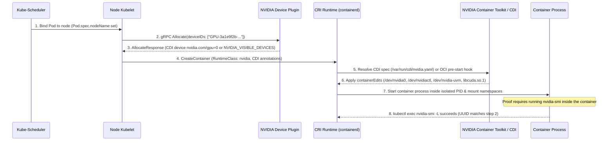
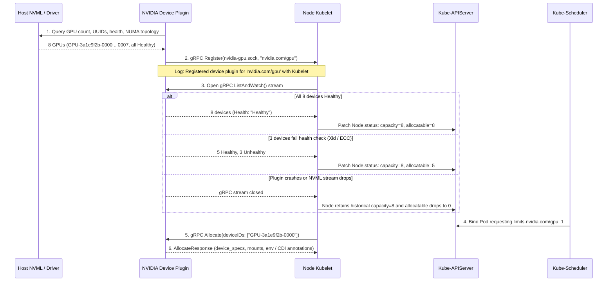
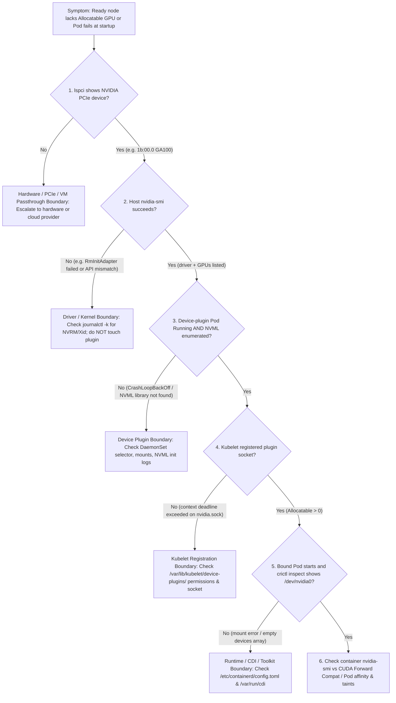

# 11.2 Device plugin, container toolkit, CDI and runtime classes

| | |
|---|---|
| Level | Intermediate |
| Priority tier | 1 |
| Lab venue | GCP / GKE |
| Part | Part 11: GPUs on Kubernetes, scheduling and virtualization |
| Sources used | `nvidia-zero-to-hero/volume-10/chapter-03-container-toolkit-runtimeclass-and-cdi.md`; `nvidia-zero-to-hero/volume-10/chapter-04-device-plugin-and-kubernetes-resource-model.md`; `nvidia-zero-to-hero/volume-10/labs/lab-03-diagnose-a-missing-allocatable-gpu.md`; `volume-04/02-gpu-software-operator-masterclass.md`; Roland Huß et al., *Generative AI on Kubernetes* (O'Reilly, 2026, Ch. 3); *Kubernetes for Generative AI Solutions* (Packt, 2025, Ch. 2, Ch. 10) |
| Coverage file | `planning/coverage/chapters/11-02.md` |

## Why this matters for AI infrastructure

An application engineer submits a training Pod requesting a single GPU on a cluster where every node reports eight allocatable GPUs. The scheduler binds the Pod immediately, and the container starts running. Seconds later, PyTorch crashes with `CUDA_ERROR_NO_DEVICE` because `/etc/containerd/config.toml` lost its NVIDIA runtime handler during an OS image update.

Scheduling a GPU in Kubernetes is not the same operation as giving a Linux container process a usable GPU. Between a Pod manifest and a working CUDA context sit three distinct software contracts that execute across three separate infrastructure boundaries. Confusing those boundaries is the single largest source of wasted incident-response hours on Kubernetes GPU platforms.

First, on the inventory and scheduling boundary, the NVIDIA Device Plugin queries the host driver through the NVIDIA Management Library. It opens a gRPC stream to the local kubelet and advertises healthy devices as the extended resource `nvidia.com/gpu`. Only after kubelet patches the Node status object in the API server can kube-scheduler bind a GPU Pod to that machine.

Second, on the device allocation boundary, binding a Pod to a node only reserves an integer count in control-plane accounting. Before the container starts, kubelet calls the device plugin allocation gRPC method to select specific physical GPU UUIDs. That call returns the exact device paths, environment variables, or Container Device Interface annotations for the container runtime.

Third, on the sandbox construction boundary, standard Linux containers isolate filesystems and device access through kernel namespaces and control groups. By default, a container cannot see host character devices like `/dev/nvidia0` or the host user-mode driver library. At container creation time, containerd or CRI-O must invoke the NVIDIA Container Toolkit or apply a Container Device Interface specification to bind-mount the allocated devices and driver libraries into the sandbox.

## Prerequisites and outcomes

### Prerequisites

- Familiarity with the GPU readiness dependency chain introduced in Chapter 11.1, spanning PCIe, the host driver, the container runtime, the device plugin, node labels, the scheduler, and workload validation.
- Working knowledge of Linux character devices, shared-library dynamic linking with `LD_LIBRARY_PATH`, and Kubernetes Pod resource requests and limits.

### Outcomes

- Distinguish the responsibilities of the host kernel-mode driver, the host user-mode driver, and the container CUDA runtime. Explain how CUDA Forward Compatibility bridges older host drivers.
- Trace the four generations of NVIDIA container integration from legacy Docker wrappers to CNCF Container Device Interface 0.5.0. Inspect what `nvidia-ctk cdi generate` writes into `/var/run/cdi/nvidia.yaml`.
- Separate the three runtime mechanisms across NVIDIA Container Toolkit node configuration, Kubernetes RuntimeClass handler selection, and CDI device specifications. Explain why neither RuntimeClass nor CDI makes a GPU schedulable alone.
- Trace the kubelet Device Plugin gRPC lifecycle across registration, device streaming, and allocation over the local device-plugin socket. Interpret Capacity, Allocatable, and Allocated resources on a Node.
- Quantify why a bare single-GPU request is a quantity contract rather than a hardware-intent contract on a mixed 40-node fleet.
- Execute a dependency-ordered diagnostic playbook using `lspci`, `lsmod`, `nvidia-smi`, `crictl inspect`, and `kubectl describe node` to isolate GPU platform failures without blind restarts.

## Concepts: basics to intermediate to advanced

### 1. Basics: The host kernel/user-space split and Linux container isolation

When a GPU container fails to initialize CUDA, engineers frequently rebuild the application image when the real fault lies in the host kernel driver or character device nodes. Before any container runtime or device plugin can expose a GPU, the Linux host must drive the physical hardware. The NVIDIA UNIX driver stack splits this work across two privilege domains: the Kernel-Mode Driver and the User-Mode Driver.

#### The Kernel-Mode Driver and character devices

The Kernel-Mode Driver consists of loadable kernel modules compiled against the exact running host kernel. These modules communicate directly with the GPU over the PCIe bus to manage initialization, memory tables, interrupts, and DMA mappings. If any required kernel module or character node is missing, every call to `cuInit(0)` or `cudaMalloc()` fails immediately.

| Kernel Module (lsmod Name) | Typical lsmod Size (Bytes) | Operational Responsibility (`volume-04` & `Lab 03`) |
|---|---|---|
| `nvidia.ko` (nvidia) | 56897536 (56655872 in Lab 03) | Core kernel driver for hardware initialization, GPU context state, power management, interrupt handling, and memory allocation. |
| `nvidia-uvm.ko` (nvidia_uvm) | 1441792 to 1622016 | Unified Virtual Memory module managing shared CPU-GPU virtual address spaces, GPU page faults, and on-demand page migration via `/dev/nvidia-uvm`. |
| `nvidia-modeset.ko` (nvidia_modeset) & nvidia_drm | 1249280 to 1314816 (69632 for nvidia_drm) | Display mode-setting and Direct Rendering Manager modules loaded alongside the core module even on headless servers. |
| `nvidia-peermem.ko` | Varies by kernel | Enables GPUDirect RDMA so InfiniBand or RoCE NICs can DMA directly into GPU BAR1 memory over PCIe without staging through host CPU RAM. |

When these kernel modules initialize on the host, they create character device nodes under `/dev` that user-space processes open and issue `ioctl()` system calls against.

| Character Device Path | Device Type | Major Number | Minor Number | Operational Purpose |
|---|---|---|---|---|
| `/dev/nvidia0` .. `/dev/nvidia7` | Character (c) | 195 | 0 .. 7 | Per-GPU device node corresponding to physical GPU index 0 through 7. |
| `/dev/nvidiactl` | Character (c) | 195 | 255 | Global control device queried to enumerate GPUs and manage driver-wide state. |
| `/dev/nvidia-uvm` | Character (c) | 238 (dynamic) | 0 | Unified Virtual Memory device node required by CUDA runtime and driver contexts. |
| `/dev/nvidia-uvm-tools` | Character (c) | 238 (dynamic) | 1 | Profiling and diagnostic companion node for Unified Virtual Memory. |
| `/dev/nvidia-caps/*` | Character (c) | Dynamic | Dynamic | Capability device nodes used to enforce fine-grained MIG partition access. |

#### The User-Mode Driver vs the CUDA Runtime

Above the character-device boundary sit two distinct sets of shared libraries. Confusing the host user-mode driver with the container CUDA runtime leads to version mismatch errors that break container startup across the fleet.

The User-Mode Driver includes `libcuda.so.1` and `libnvidia-ml.so.1`, which ship as part of the host NVIDIA driver package. The user-mode driver library implements the low-level CUDA Driver API and speaks a private, version-locked system-call ABI to the kernel module in the host kernel. Because the user-mode driver must match the exact version of the kernel module loaded in the host kernel, it is owned by the host and bind-mounted into containers at runtime.

The CUDA Runtime and Toolkit libraries include `libcudart.so`, `libcublas.so`, and `libnccl.so`, which ship inside the application container image. Deep learning frameworks like PyTorch link against the CUDA Runtime library, which translates high-level runtime calls into Driver API calls handled by the host-injected user-mode driver. Keeping the kernel module and user-mode driver on the host lets platform engineers patch a driver defect across a 500-node fleet once without rebuilding hundreds of tenant images.

```text
Version-Locked Kernel vs. User-Mode ABI Mismatch Example (volume-04):
- Host kernel module (nvidia.ko) version: 525.105.17 (or 535.154.05 on upgraded fleet)
- Mismatched user-mode client (libcuda.so.1) version: 535.104.05
- Exact kernel log error:
  NVRM: API mismatch: the client has the version 535.104.05, but this kernel module has the version 525.105.17
```

#### CUDA Forward Compatibility

A common operational bottleneck occurs when a research team needs a container built on a newer CUDA Toolkit such as CUDA 12.2. Meanwhile, the production fleet kernel driver is pinned to an older enterprise branch such as Driver 525.105.17 from CUDA 12.0. Unloading the kernel module across 500 production nodes would require draining every GPU Pod or rebooting the hosts.

NVIDIA solves this across supported major and minor boundaries through CUDA Forward Compatibility. A forward-compatible container image packages a newer user-mode driver bundle inside `/usr/local/cuda/compat/`. That bundle includes the forward-compatible `libcuda.so.535.104.05`, the NVVM compiler library, and the PTX JIT compiler library.

When the container entrypoint prepends `/usr/local/cuda/compat` to `LD_LIBRARY_PATH`, the Linux dynamic linker resolves the newer compat library before the older host-mounted library. That newer user-mode library translates CUDA 12.2 runtime calls down to the older 525 kernel-mode driver ABI. If the version gap exceeds the supported compatibility matrix, the user-mode driver returns an initialization error and the workload exits cleanly.

```bash
# Inside container entrypoint to activate CUDA Forward Compatibility (untested here)
export LD_LIBRARY_PATH=/usr/local/cuda/compat:$LD_LIBRARY_PATH
```

---

### 2. Intermediate: Evolution of GPU containerization — Toolkit, RuntimeClass, and CDI

Standard Linux containers use kernel namespaces to isolate filesystem mounts, process trees, and network stacks while using control groups to meter CPU and RAM. When containerd launches a standard container via runc, the container receives a private temporary device filesystem containing only safe pseudo-devices like `/dev/null` and `/dev/zero`. Without specialized runtime injection, the container has neither `/dev/nvidia0` nor the host user-mode driver library.

#### The four generations of NVIDIA container integration

Over the past decade, the mechanism that injects GPU device nodes and host driver libraries into a container evolved through four architectural generations. Understanding these four stages explains why legacy environment variables coexist with modern Container Device Interface YAML specifications.

1. **Generation 1 (`nvidia-docker`):** A standalone CLI wrapper script around the Docker daemon that queried the host driver and passed `--device=/dev/nvidia0` and volume-mount flags on the command line. It was brittle and incompatible with Kubernetes CRI runtimes.
2. **Generation 2 (`nvidia-docker2`):** A custom Docker runtime replacement tied specifically to the Docker daemon architecture.
3. **Generation 3 (NVIDIA Container Toolkit with OCI pre-start hooks):** As Kubernetes standardized on containerd and CRI-O and removed dockershim, the NVIDIA runtime became a thin wrapper around runc. When a container starts with `NVIDIA_VISIBLE_DEVICES` set, an OCI pre-start hook invokes `nvidia-container-cli` to bind-mount the device nodes and host driver libraries into the container namespace.
4. **Generation 4 (CDI — Container Device Interface):** The modern CNCF-standardized specification replaces custom OCI hook wrappers with a declarative file at `/var/run/cdi/nvidia.yaml` or `/etc/cdi/nvidia.yaml`. When containerd with `enable_cdi = true` receives a request for a qualified device name like `nvidia.com/gpu=0`, the runtime natively parses the CDI specification and attaches the character nodes and read-only library mounts.



#### Inside a generated CDI specification

On a GPU worker node, the `nvidia-ctk` command-line utility inspects the loaded driver and hardware topology to generate the CDI specification dynamically.

```bash
# Generate CDI specification on a GPU worker node (untested here)
sudo nvidia-ctk cdi generate --output=/var/run/cdi/nvidia.yaml
```

Inspecting `/var/run/cdi/nvidia.yaml` reveals the exact container edits applied when a container requests `nvidia.com/gpu=0`. Every host binary and shared library is bind-mounted with `[ro, nosuid, nodev, bind]` so a compromised container process cannot overwrite `/usr/bin/nvidia-smi` or the user-mode driver on the worker host.

```yaml
# /var/run/cdi/nvidia.yaml (illustrative, abbreviated)
cdiVersion: 0.5.0
kind: nvidia.com/gpu
devices:
  - name: "0"
    containerEdits:
      deviceNodes:
        - path: /dev/nvidia0
          type: c
          major: 195
          minor: 0
        - path: /dev/nvidiactl
          type: c
          major: 195
          minor: 255
        - path: /dev/nvidia-uvm
          type: c
          major: 238
          minor: 0
      mounts:
        - hostPath: /usr/lib/x86_64-linux-gnu/libcuda.so.1
          containerPath: /usr/lib/x86_64-linux-gnu/libcuda.so.1
          options: [ro, nosuid, nodev, bind]
        - hostPath: /usr/bin/nvidia-smi
          containerPath: /usr/bin/nvidia-smi
          options: [ro, nosuid, nodev, bind]
  - name: "all"
    # Aggregates all discovered GPU indices and common driver mounts
```

#### Three mechanisms, three distinct questions

Platform engineers and interview candidates regularly conflate the NVIDIA Container Toolkit, Kubernetes RuntimeClass, and CDI. Each mechanism operates at a different architectural scope and answers a different operational question.

| Mechanism | Question It Answers | Architectural Scope | What It Does NOT Do |
|---|---|---|---|
| **NVIDIA Container Toolkit (`nvidia-ctk`, `/etc/containerd/config.toml`)** | How does this node CRI runtime know how to configure NVIDIA devices and handlers? | Node-local CRI runtime configuration. | It is not an application library and does not advertise GPU counts to Kubernetes. |
| **RuntimeClass (`node.k8s.io/v1`)** | Which configured runtime handler (runc vs nvidia) should kubelet ask containerd to use for this Pod? | Cluster-wide Kubernetes API object referenced by `Pod.spec.runtimeClassName`. | It has zero awareness of GPU inventory and never allocates or makes a GPU schedulable by itself. |
| **Container Device Interface (`/var/run/cdi/nvidia.yaml`)** | What exact character device nodes, bind mounts, environment variables, and hooks define device `nvidia.com/gpu=0`? | Node-local declarative device specification consumed by containerd or CRI-O. | It does not discover node capacity for kube-scheduler or replace the device plugin. |

A RuntimeClass object in Kubernetes is only a pointer to a handler name such as `handler: nvidia` in each eligible node `/etc/containerd/config.toml`. If a Pod specifies `runtimeClassName: nvidia` and lands on a node where the nvidia handler stanza was never written into the containerd configuration, the Pod fails at sandbox creation before the container image entrypoint ever runs.

```toml
# /etc/containerd/config.toml (untested here)
version = 2
[plugins]
  [plugins."io.containerd.grpc.v1.cri"]
    enable_cdi = true
    [plugins."io.containerd.grpc.v1.cri".containerd]
      default_runtime_name = "runc"
      [plugins."io.containerd.grpc.v1.cri".containerd.runtimes]
        [plugins."io.containerd.grpc.v1.cri".containerd.runtimes.runc]
          runtime_type = "io.containerd.runc.v2"
        [plugins."io.containerd.grpc.v1.cri".containerd.runtimes.nvidia]
          privileged_without_host_devices = false
          runtime_engine = ""
          runtime_root = ""
          runtime_type = "io.containerd.runc.v2"
          [plugins."io.containerd.grpc.v1.cri".containerd.runtimes.nvidia.options]
            BinaryName = "/usr/bin/nvidia-container-runtime"
```

---

### 3. Advanced: The Kubernetes Device Plugin gRPC contract and resource model

Once the host kernel driver and container runtime are configured on a worker node, the Kubernetes control plane still has zero knowledge that the machine owns eight healthy GPUs. Without a device plugin advertising those devices to kubelet, kube-scheduler will leave every GPU Pod stuck in Pending.

Kubernetes bridges this gap through the Device Plugin Framework under `k8s.io/kubelet/pkg/apis/deviceplugin/v1beta1`. Every major AI accelerator vendor implements this same four-function gRPC contract for device discovery, resource allocation, health monitoring, and scheduler integration.

| Accelerator Vendor Plugin | Extended Resource Name | Key Ecosystem & Performance Facts (`GAK` Ch 3 & `K8GS` Ch 10) |
|---|---|---|
| `nvidia-device-plugin` | `nvidia.com/gpu` or `nvidia.com/mig-1g.5gb`, `nvidia.com/mig-3g.20gb`, `nvidia.com/mig-1g.18gb` | Pairs with NVML, NVIDIA Container Toolkit, CDI, and GPU Operator. |
| `amd-device-plugin` | `amd.com/gpu` | Exposes AMD Instinct GPUs running the ROCm stack. |
| `intel-gpu-plugin` | Intel discrete/integrated GPU resources | Exposes Intel data-center and discrete accelerators. |
| `google-cloud-tpu-device-plugin` | `google.com/tpu` | Exposes Google Cloud TPUs on Google Kubernetes Engine. |
| **AWS Neuron device plugin** | `aws.amazon.com/neuroncore` | Paired with the AWS Neuron SDK supporting over **100,000** models. Delivers up to **50%** lower training costs on Trn1 and **4x** performance with **30%** to **40%** better price-performance on Trn2 vs P5e/P5en, with Databricks reporting up to **30%** cost savings. |

#### The Kubelet gRPC handshake: Register, ListAndWatch, and Allocate

On an NVIDIA GPU node, the `nvidia-device-plugin` DaemonSet communicates with the local kubelet over UNIX domain sockets inside `/var/lib/kubelet/device-plugins/`.



Tracing the startup log of a healthy device-plugin Pod shows three sequential steps. First, the plugin starts a filesystem watcher on `/var/lib/kubelet/device-plugins/` so it can detect socket removal and re-register automatically whenever kubelet restarts. Second, the plugin starts its gRPC server on `/var/lib/kubelet/device-plugins/nvidia-gpu.sock` or `nvidia.sock`. Third, the plugin dials `/var/lib/kubelet/device-plugins/kubelet.sock` to invoke `Register()`, prompting kubelet to open the long-lived `ListAndWatch()` stream.

```text
$ kubectl logs -n gpu-operator nvidia-device-plugin-daemonset-4kxqz
I0812 09:14:02.881112       1 main.go:279] Starting FS watcher.
I0812 09:14:02.881390       1 main.go:287] Starting OS watcher.
I0812 09:14:02.912004       1 main.go:337] Retrieving plugins.
I0812 09:14:03.004215       1 server.go:216] Starting GRPC server for 'nvidia.com/gpu'
I0812 09:14:03.006771       1 server.go:139] Starting to serve 'nvidia.com/gpu' on /var/lib/kubelet/device-plugins/nvidia-gpu.sock
I0812 09:14:03.011552       1 server.go:146] Registered device plugin for 'nvidia.com/gpu' with Kubelet
```

#### Reading Capacity, Allocatable, and Allocated resources with surgical precision

When you run `kubectl describe node gpu-node-07`, Kubernetes displays three separate numbers for `nvidia.com/gpu`. Misreading Capacity, Allocatable, and Allocated resources leads operators to blame the scheduler when GPUs have actually failed health checks or been consumed by running Pods.

```text
$ kubectl describe node gpu-node-07
...
Capacity:
  cpu:                64
  memory:             527923648Ki
  nvidia.com/gpu:     8
Allocatable:
  cpu:                63500m
  memory:             520192000Ki
  nvidia.com/gpu:     8
...
Allocated resources:
  Resource           Requests    Limits
  --------           --------    ------
  nvidia.com/gpu     6           6
```

Each field in the node status represents a distinct layer of state between hardware discovery and Pod binding.

| Node / Pod State | Exact Meaning | What It Does NOT Prove |
|---|---|---|
| **Capacity: nvidia.com/gpu: 8** (128 CPU / 1056588288Ki memory on larger hosts) | Total device count reported by the device plugin when it registered with kubelet. | That the plugin is still running right now, that all 8 GPUs are healthy, or that any free GPUs remain. |
| **Allocatable: nvidia.com/gpu: 8** | Number of healthy GPUs currently available to Kubernetes scheduling before subtracting running Pods. | That any GPUs are unallocated, that containerd can inject `/dev/nvidia*`, or that CUDA will initialize. |
| **Allocated resources: 6** | Sum of GPUs reserved by Pods already bound to `gpu-node-07`, leaving 8 minus 6 equals 2 free schedulable units. | That the 6 bound Pods actually initialized CUDA or are actively executing kernels. |
| **Capacity: 8 vs Allocatable: 5** | 3 of the 8 physical GPUs reported Unhealthy over the device stream after boot. | That the GPUs were physically removed from the PCIe bus. |
| **Capacity: 8 with Allocatable line absent** | The plugin registered 8 GPUs previously, but the plugin container subsequently crashed or lost its stream registration. | That the node never had GPUs installed. |
| **No `nvidia.com/gpu` line in Capacity or Allocatable** | The device plugin has never completed registration on this node since the Node object was created (`Unable to load NVML: library not found`). | That the node is a CPU-only machine; always check `lspci` first. |

#### Extended resource rules in Pod manifests

Because `nvidia.com/gpu` is an extended resource, the Kubernetes API server enforces three strict admission rules on every Pod manifest. Violating any of these rules causes immediate webhook or admission rejection before kube-scheduler ever sees the Pod.

1. **Integer quantities only:** You cannot request a fractional decimal such as 0.5 GPUs. Sub-GPU sharing requires configuring the device plugin to advertise discrete MIG resources like `nvidia.com/mig-1g.5gb: 1` or time-sliced replicas where `replicas: 10` on an 8-GPU node advertises 80 virtual units to kubelet. On a single 24 GB NVIDIA L4 GPU (`g6.2xlarge`), running one 1.8 GB Llama-3.2-1B replica without sharing leaves 92% of VRAM unused. Enabling time-slicing with 10 replicas lets multiple Pods share the card.
2. **Must be specified in limits:** A Pod may specify `resources.limits["nvidia.com/gpu"]: 1` alone, or specify both requests and limits with identical integer values. Specifying requests without limits, or specifying mismatched integers like 1 and 2, is rejected by the API server.
3. **No implicit overcommit:** Without explicit time-slicing or Multi-Process Service configuration, each unit of `nvidia.com/gpu` maps to exclusive physical device assignment during allocation.

#### Quantifying the underspecified request trap

Because kube-scheduler treats `nvidia.com/gpu` purely as an integer counter, a bare resource request is a capacity contract rather than a hardware-intent contract. Submitting a latency-sensitive workload without node affinity on a heterogeneous cluster guarantees intermittent SLA violations.

Consider the production fleet from Volume 10 Chapter 4 with 40 GPU worker nodes, each advertising eight allocatable GPUs. In that fleet, 25 newer nodes have NVLink-connected GPUs (NV12, 600 GB/s on A100 or 900 GB/s on H100) and NIC-local PCIe switch placement (PIX). Meanwhile, 15 older nodes have PCIe-only GPUs that traverse cross-socket SYS links.

If a developer deploys the latency-sensitive service with only a single-GPU limit and no nodeSelector or nodeAffinity, all 40 nodes satisfy the scheduler predicate. Under uniform availability, kube-scheduler has a `15 / 40 = 37.5%` probability of placing the Pod on one of the 15 unqualified PCIe nodes. Publishing a node label like `gpu.platform.example/class=latency-optimized` on the 25 qualified nodes and enforcing `requiredDuringSchedulingIgnoredDuringExecution` node affinity reduces the wrong-pool placement risk from 37.5% to 0.0%.

#### PID namespaces and why `nvidia-smi` inside a container hides host PIDs

Engineers often panic when they run `nvidia-smi` inside a busy GPU container and see an empty process table despite 98% GPU utilization and 40000MiB of active framebuffer memory. This behavior is an expected result of Linux PID namespace isolation rather than a broken driver.

On the worker node host, `nvidia-smi` queries NVML in the root PID namespace and lists every GPU process with its host PID such as 2051234. It also displays the physical device UUID such as `GPU-e461a384-5f4c-7c08-0131-0dfbc6c483b2` or `GPU-173ced1d-4c1d-072d-6819-86522b018187`. Inside the container, the workload runs in an isolated Linux PID namespace where the Python entrypoint is PID 1. When `nvidia-smi` inside the container queries the host driver over `/dev/nvidia0`, the driver returns host PID 2051234, which does not exist in the container process tree and is omitted.

Never set `hostPID: true` on tenant workloads merely to make container-side `nvidia-smi` display process IDs, because `hostPID: true` breaks container process isolation. Instead, attribute GPU processes to Pods on the worker host or scrape `dcgm-exporter` metrics (`DCGM_FI_DEV_GPU_UTIL`, `DCGM_FI_DEV_FB_USED`, `DCGM_FI_DEV_MEM_COPY_UTIL`) on port 9400.

## Commands and configurations that matter

### 1. Verifying the host driver and character devices on a worker node

Before inspecting any Kubernetes DaemonSet, verify PCIe enumeration, loaded kernel modules, and `/dev/nvidia*` character device major and minor numbers directly on the worker host.

```bash
# Run on the GPU worker node via approved SSH / node-debug session (untested here)
lspci | grep -i nvidia
lsmod | grep '^nvidia'
ls -l /dev/nvidia*
nvidia-smi -L
```

Expected healthy output on an eight-GPU A100 or H100 worker node is shown below.

```text
1b:00.0 3D controller: NVIDIA Corporation GA100 [A100 SXM4 80GB] (rev a1)
...
nvidia_uvm           1441792  0
nvidia_modeset       1314816  0
nvidia              56897536  15 nvidia_uvm,nvidia_modeset

crw-rw-rw- 1 root root 195,   0 Sep 17 08:00 /dev/nvidia0
crw-rw-rw- 1 root root 195, 255 Sep 17 08:00 /dev/nvidiactl
crw-rw-rw- 1 root root 238,   0 Sep 17 08:00 /dev/nvidia-uvm

GPU 0: NVIDIA A100-SXM4-80GB (UUID: GPU-3a1e9f2b-...)
```

### 2. Inspecting CDI specifications and `crictl` container device injection

To prove that the NVIDIA Container Toolkit or CDI step actually injected `/dev/nvidia0` into a running container sandbox named `resnet-train`, inspect both sides of the boundary. First check the CRI container specification on the node with `crictl inspect`, and then test user-space execution inside the container with `kubectl exec`.

```bash
# 1. Node side: verify that the CRI container spec contains /dev/nvidia0 (untested here)
sudo crictl inspect $(sudo crictl ps -q --name resnet-train) | grep -A4 '"devices"'
```

Expected node-side output shows the device node attached to the container specification.

```text
"devices": [
  {
    "containerPath": "/dev/nvidia0",
    "hostPath": "/dev/nvidia0",
    "permissions": "rwm"
  }
],
```

Next, verify that CUDA user space inside the container can communicate with the host kernel driver.

```bash
# 2. Container side: verify that CUDA user space can talk to the host driver (untested here)
kubectl exec resnet-train -- nvidia-smi -L
```

Expected container-side output prints the matching physical GPU UUID.

```text
GPU 0: NVIDIA A100-SXM4-80GB (UUID: GPU-3a1e9f2b-...)
```

Both commands are required to isolate runtime bugs from image bugs. Seeing `/dev/nvidia0` in `crictl inspect` proves that runtime device injection succeeded, whereas an empty devices array proves the toolkit or CDI configuration failed. Seeing `kubectl exec` print the matching UUID proves that user-space library linking succeeded inside the container image.

### 3. Configuring RuntimeClass, Device Plugin flags, and GPU Operator toolkit/plugin values

When a cluster exposes an explicit NVIDIA runtime handler in containerd, publish a RuntimeClass object so GPU Pods can select that handler and inherit the matching nodeSelector and tolerations automatically.

```yaml
# runtimeclass-nvidia.yaml (untested here)
apiVersion: node.k8s.io/v1
kind: RuntimeClass
metadata:
  name: nvidia
handler: nvidia
scheduling:
  nodeSelector:
    nvidia.com/gpu.present: "true"
  tolerations:
    - key: "nvidia.com/gpu"
      operator: "Exists"
      effect: "NoSchedule"
```

When deploying the NVIDIA Container Toolkit and Device Plugin through the GPU Operator `values.yaml`, pin the runtime socket paths, CDI strategy, and fail-fast initialization flags explicitly.

```yaml
# gpu-operator-runtime-and-plugin-values.yaml (untested here)
driver:
  enabled: true
  repository: nvcr.io/nvidia
  image: driver
  version: "535.154.05"
  usePrecompiled: true
  rdma:
    enabled: true
    useHostMofed: false

toolkit:
  enabled: true
  repository: nvcr.io/nvidia/k8s
  image: container-toolkit
  version: v1.14.6-ubuntu20.04
  env:
    - name: CONTAINERD_CONFIG
      value: /etc/containerd/config.toml
    - name: CONTAINERD_SOCKET
      value: /run/containerd/containerd.sock
    - name: DOCKER_CONFIG
      value: /etc/docker/daemon.json
    - name: CRIO_CONFIG
      value: /etc/crio/crio.conf

devicePlugin:
  enabled: true
  repository: nvcr.io/nvidia
  image: k8s-device-plugin
  version: v0.14.4-ubuntu20.04
  config:
    name: "nvidia-plugin-config"
    default: "any"
  env:
    - name: DEVICE_LIST_STRATEGY
      value: "cdi-annotations"
    - name: FAIL_ON_INIT_ERROR
      value: "true"
```

Platform engineers should enforce four device-plugin flags across production clusters. Setting `--fail-on-init-error=true` forces the plugin into `CrashLoopBackOff` if NVML fails to initialize. Leaving it false lets a broken plugin stay Running while silently advertising zero GPUs. Setting `DEVICE_LIST_STRATEGY=cdi-annotations` or `cdi-cri` instructs the plugin to request CDI injection from the CRI runtime. Finally, `--pass-device-specs=true` passes explicit device node paths in allocation responses, while `--device-discovery-strategy=auto|nvml|tegra` selects the discovery backend.

### 4. Running a one-line Kubernetes GPU validation Pod

As shown in *Generative AI on Kubernetes* Chapter 3 Example 3-13, you can launch an ephemeral validation Pod that requests `nvidia.com/gpu: 1` and runs `nvidia-smi` without leaving orphaned objects behind.

```bash
# Ephemeral one-GPU validation Pod (untested here)
patch=$(cat <<'EOT'
[{
  "op": "add",
  "path": "/spec/containers/0/resources",
  "value": {"limits": {"nvidia.com/gpu": 1}}
}]
EOT
)
kubectl run --rm -it gpu-pod \
  --image=nvidia/cuda:12.8.1-base-ubi9 \
  --restart=Never \
  --overrides="$patch" --override-type=json -- nvidia-smi
```

## How it fails

During a live outage where a node drops its allocatable GPUs or containers fail at startup, resist the urge to restart the device plugin DaemonSet before preserving evidence. Follow the dependency-ordered decision tree from Volume 10 Lab 03 to isolate the exact failing boundary from bottom to top.



| Failure Mode | Exact Symptom & Command Evidence | Root Cause Boundary | Remediation |
|---|---|---|---|
| **1. Hardware initialize failure (`RmInitAdapter failed`) with Capacity: 8 and missing Allocatable** | `kubectl get node` shows 8 capacity and no allocatable line. On host, `lspci` shows `1b:00.0 ... GA100 [A100 SXM4 80GB]` and `lsmod` shows nvidia loaded (56655872, nvidia_uvm 1622016, nvidia_modeset 1249280, nvidia_drm 69632), but `nvidia-smi` fails and `journalctl -k` prints `NVRM: GPU 0000:1b:00.0: RmInitAdapter failed (0x62:0xffff:1487)` and `rm_init_adapter failed, device minor number 0`. Device plugin logs `Failed to initialize NVML: could not load NVML library` and `BackOff restarting failed container` (x12 over 5m). | **Host Driver / Hardware Handshake Boundary:** The plugin crash is a downstream symptom of the host driver failing to initialize the adapter. | Cordon the node, preserve `missing-gpu-evidence/`, and execute the approved host remediation (`nvidia-smi -r`, cold reboot, or hardware RMA). Never waste time redeploying the device plugin first. |
| **2. Stale kernel module ABI mismatch (535.104.05 vs 525.105.17)** | Nodes report 0 allocatable GPUs. Device plugin logs `Could not initialize NVML: Driver Not Loaded`. Host dmesg prints `NVRM: API mismatch: the client has the version 535.104.05, but this kernel module has the version 525.105.17`. | **Kernel-Mode vs User-Mode Driver Boundary:** A prior host driver installation left `nvidia.ko` (525.105.17) loaded in kernel memory while a newer user-mode stack (535.104.05) was deployed. | Drain and reboot the node, or stop all processes listed by `lsof /dev/nvidia*` and unload the kernel modules so the matching kernel module loads cleanly. |
| **3. Kubelet gRPC registration socket dial timeout** | Host `nvidia-smi` works and the device-plugin Pod is Running, but Allocatable is missing. `journalctl -u kubelet` logs `Got registration request from device plugin with resource name "nvidia.com/gpu"` followed by `Failed to dial device plugin with socket /var/lib/kubelet/device-plugins/nvidia.sock: context deadline exceeded`. | **Kubelet Registration Boundary:** Socket path or SELinux permission mismatch, or a wedged plugin gRPC listener between registration and dial-back. | Verify the device-plugins directory hostPath mounts and SELinux or AppArmor context on the plugin DaemonSet, then restart the affected plugin Pod and verify registration in logs. |
| **4. OCI runtime hook / missing device file at container creation** | Pod binds to a node, but `kubectl describe pod resnet-train` emits `Warning Failed 12s kubelet Error: failed to create containerd task: failed to create shim: OCI runtime create failed: runc create failed: unable to start container process: error running hook #0: nvidia-container-cli: initialization error: mount error: file creation failed: /var/lib/kubelet/pods/.../nvidia0: no such device`. | **Runtime Sandbox Creation Boundary:** The device plugin allocated an index whose `/dev/nvidia0` node or CDI spec is missing on the host, or the runtime hook cannot access `/dev`. | Cordon the node, verify character nodes and `/var/run/cdi/nvidia.yaml` via `nvidia-ctk cdi generate`, and validate with a minimal test container before uncordoning. |
| **5. Unpatched containerd config (`CUDA_ERROR_NO_DEVICE` inside Running Pod)** | Pod enters Running state with 1 GPU allocated, but PyTorch fails with `CUDA_ERROR_NO_DEVICE`. On the node, `crictl inspect` shows `"devices": []` and `nvidia-smi` inside the container returns command not found. | **Container Toolkit / `config.toml` Boundary:** `CONTAINERD_CONFIG` pointed to the wrong path for the Kubernetes distribution or RuntimeClass was omitted. | Point `CONTAINERD_CONFIG` and `CONTAINERD_SOCKET` to the active containerd config path, let the toolkit operand reconcile and restart containerd, and verify `crictl inspect` shows `/dev/nvidia0`. |
| **6. Fleet version drift across node pools (1.15.0 vs 1.13.5)** | Identical Pod manifest succeeds on `gpu-pool-a-3` but fails on `gpu-pool-b-7`. Running `nvidia-ctk --version` across pools reveals version 1.15.0 on the first pool versus 1.13.5 on the second pool. | **Fleet Configuration Drift Boundary:** An image refresh or manual node edit left two node pools running different toolkit versions and runtime handler stanzas. | Enforce a single version-controlled node image and GPU Operator `ClusterPolicy` across pools, and gate node-pool rollout on an automated validation job. |

## Hands-on lab

### Venue and scope

This lab runs locally using the Python 3 standard library in `code/part11/device_plugin_toolkit_cdi.py` and `code/part11/device_plugin_toolkit_cdi_lab.py`. It simulates the kubelet Device Plugin gRPC state machine across registration, device streaming, and allocation, the CDI 0.5.0 specification generator, the mixed-fleet placement risk calculator, and the six-boundary dependency-ordered triage engine. When you run the accompanying cluster inspection commands on a live GCP or GKE GPU cluster, treat those cluster commands as untested here until verified on your target node pool.

### Step 1: Run the self-checking simulation lab (tested here)

Run the lab script from the repository root to execute all 26 verification checks.

```bash
python3 code/part11/device_plugin_toolkit_cdi_lab.py
```

Captured output from this repository is shown below.

```text
=== Chapter 11.2 Lab: Device Plugin, Container Toolkit, CDI & RuntimeClass ===
  [PASS] CDI version is 0.5.0
  [PASS] CDI kind is nvidia.com/gpu
  [PASS] CDI spec contains 8 GPU device entries
  [PASS] First CDI device entry is named '0'
  [PASS] GPU 0 node is /dev/nvidia0 (char 195:0)
  [PASS] Control node is /dev/nvidiactl (char 195:255)
  [PASS] UVM node is /dev/nvidia-uvm (char 238:0)
  [PASS] CDI mounts include host libcuda.so.1 and nvidia-smi with ro bind options
  [PASS] Before first registration, Capacity and Allocatable are both absent (None)
  [PASS] After Register() + ListAndWatch(), Capacity=8 and Allocatable=8
  [PASS] After allocating 6 GPUs, Allocated=6 and free schedulable=2 while Allocatable=8
  [PASS] CDI Allocate() response returns fully qualified nvidia.com/gpu=0..5 names
  [PASS] When 3 of 8 GPUs turn Unhealthy, Capacity stays 8 while Allocatable drops to 5
  [PASS] When plugin crashes after registration, historical Capacity=8 survives while Allocatable is absent
  [PASS] Envvar Allocate() response sets NVIDIA_VISIBLE_DEVICES to allocated UUID
  [PASS] Extended resource spec accepts limits-only (1) and matching requests/limits (4)
  [PASS] Extended resource spec rejects requests-without-limits and mismatched requests/limits
  [PASS] Bare nvidia.com/gpu request on 40-node mixed fleet has 37.5% (15/40) wrong-pool risk
  [PASS] Required nodeAffinity restricts scheduling to the 25 qualified NVLink nodes (0.0% wrong-pool risk)
  [PASS] Triage routes missing lspci device to hardware_pci_passthrough
  [PASS] Triage routes RmInitAdapter / failed host nvidia-smi to driver_kernel_boundary before touching plugin
  [PASS] Triage routes healthy host driver + failing plugin Pod to device_plugin_boundary
  [PASS] Triage routes healthy plugin + kubelet socket dial timeout to kubelet_registration_boundary
  [PASS] Triage routes empty crictl inspect devices[] array to runtime_injection_boundary
  [PASS] Triage routes populated devices[] + failed container nvidia-smi to driver_to_image_compatibility
  [PASS] Triage routes all-green node and container checks to healthy_or_scheduling_policy

Summary: 26 passed, 0 failed out of 26 checks.
```

### Step 2: Live GKE / Kubernetes node evidence collection runbook (untested here)

When investigating a suspect GPU node against a known-good peer on a live cluster, preserve before-state evidence first and compare Capacity against Allocatable.

```bash
# Preserve initial node and event evidence before touching any component (untested here)
export GPU_NODE='gpu-node-11'
export HEALTHY_GPU_NODE='gpu-node-07'
mkdir -p missing-gpu-evidence
kubectl get node "$GPU_NODE" -o yaml > missing-gpu-evidence/node.yaml
kubectl describe node "$GPU_NODE" > missing-gpu-evidence/node-describe.txt
kubectl get events -A --sort-by=.lastTimestamp > missing-gpu-evidence/events.txt

# Compare Capacity vs Allocatable between suspect and healthy peer (untested here)
kubectl get node "$GPU_NODE" -o jsonpath='{.status.capacity.nvidia\.com/gpu}{" capacity\n"}{.status.allocatable.nvidia\.com/gpu}{" allocatable\n"}'
kubectl get node "$HEALTHY_GPU_NODE" -o jsonpath='{.status.capacity.nvidia\.com/gpu}{" capacity\n"}{.status.allocatable.nvidia\.com/gpu}{" allocatable\n"}'
```

### Exercises

1. **Exercise 1 — CDI minor-number mapping:** Using `generate_cdi_spec()` in `code/part11/device_plugin_toolkit_cdi.py`, generate a CDI 0.5.0 specification for a 4-GPU node from GPU-0 through GPU-3 where the UVM device uses dynamic major number 238. State the major and minor number pairs for `/dev/nvidia3`, `/dev/nvidiactl`, and `/dev/nvidia-uvm`.
2. **Exercise 2 — Degraded health vs crashed plugin:** A node with 8 GPUs has 2 GPUs currently allocated to running Pods. Next, 3 unallocated GPUs experience double-bit ECC errors with Xid 48 and report Unhealthy over the device stream. Using the state helper in the lab module, compute the resulting capacity, allocatable, allocated, and free schedulable counts.
3. **Exercise 3 — Extended resource admission validation:** Explain why requesting 2 GPUs with a limit of 4 GPUs in `validate_extended_resource_spec()` returns false. State the two valid ways to request 4 GPUs in a Kubernetes Pod manifest.
4. **Exercise 4 — Fleet placement probability calculation:** Suppose a cluster has 40 GPU nodes consisting of 25 H100 NVLink nodes and 15 older PCIe nodes. If 10 of the 25 H100 nodes are currently full with 0 free GPUs while all 15 older PCIe nodes have free GPUs, compute the probability that a bare eight-GPU Pod lands on the older PCIe pool across the 30 remaining available nodes.
5. **Exercise 5 — Node-side vs container-side proof:** Using `triage_gpu_node_or_pod()`, determine the failing boundary and next action when PCIe discovery, host driver checks, plugin enumeration, kubelet registration, and container device mounts all pass on an 8-GPU node, but `nvidia-smi` inside the container fails.
6. **Exercise 6 — Time-slicing oversubscription accounting:** An 8-GPU node and a 1-GPU `g6.2xlarge` L4 node with 24 GB VRAM running Llama-3.2-1B at 1.8 GB per replica are configured with 10 time-slicing replicas. Compute the Allocatable GPU count advertised by the 8-GPU node, and calculate what percentage of the 24 GB L4 GPU memory remains unused when only a single 1.8 GB Llama-3.2-1B replica runs without sharing.

## Checkpoint questions

<details>
<summary>**1. Why does adding a Kubernetes RuntimeClass not make a GPU workload schedulable by itself?**</summary>

RuntimeClass only tells kubelet and the CRI runtime which configured runtime handler to use when constructing the container sandbox, along with optional scheduling nodeSelector, tolerations, and Pod overhead. It has zero knowledge of physical GPU inventory. A GPU only becomes schedulable after the NVIDIA Device Plugin discovers healthy devices via NVML, registers with kubelet, and publishes a non-zero allocatable GPU count to the API server.
</details>

<details>
<summary>**2. What are the four kernel modules in the NVIDIA Kernel-Mode Driver stack and what does each do?**</summary>

The core module `nvidia.ko` manages hardware initialization, context state, interrupts, and power. The `nvidia-uvm.ko` module manages Unified Virtual Memory for shared CPU-GPU virtual address spaces and page-fault migration via `/dev/nvidia-uvm`. The `nvidia-modeset.ko` module handles display mode-setting, and `nvidia-peermem.ko` enables GPUDirect RDMA so InfiniBand or RoCE NICs can DMA directly into GPU memory over PCIe.
</details>

<details>
<summary>**3. What character device nodes must exist inside a container device filesystem for a single-GPU CUDA workload on GPU 0 to initialize?**</summary>

At minimum, the container needs `/dev/nvidia0` with major 195 and minor 0, `/dev/nvidiactl` with major 195 and minor 255, and `/dev/nvidia-uvm` with dynamic major 238 and minor 0. If Multi-Instance GPU partitioning is enabled, `/dev/nvidia-caps/*` capability nodes are also required.
</details>

<details>
<summary>**4. Why is the user-mode driver kept on the host and bind-mounted into containers rather than baked into every application container image?**</summary>

The user-mode driver communicates with the kernel-mode driver over a version-locked system-call ABI. Because all containers on a node share the running host Linux kernel and its loaded kernel module, baking a fixed user-mode driver into application images would trigger API mismatch errors whenever the host driver changes. Injecting `libcuda.so.1` from the host at container startup guarantees that user space and kernel space match while allowing container images to carry portable CUDA runtime libraries.
</details>

<details>
<summary>**5. How does CUDA Forward Compatibility allow a newer CUDA container such as CUDA 12.2 to run on an older host kernel driver such as Driver 525?**</summary>

A forward-compatible image packages a newer user-mode driver bundle including `libcuda.so.535.104.05` inside `/usr/local/cuda/compat/` and prepends that path to `LD_LIBRARY_PATH`. The dynamic linker loads the newer compat library ahead of the host-mounted library. That compat library translates newer CUDA runtime calls to the older kernel driver ABI across supported compatibility matrices.
</details>

<details>
<summary>**6. How did GPU container injection evolve across the four generations from legacy Docker wrappers to CDI?**</summary>

Generation 1 (`nvidia-docker`) was a standalone wrapper script around the Docker CLI, and Generation 2 (`nvidia-docker2`) was a custom Docker daemon runtime. Generation 3 introduced an OCI pre-start hook around runc that triggers `nvidia-container-cli` to parse `NVIDIA_VISIBLE_DEVICES` and mount the GPU device nodes and host libraries. Generation 4 (Container Device Interface 0.5.0) uses a vendor-neutral declarative file at `/var/run/cdi/nvidia.yaml` generated by `nvidia-ctk cdi generate` that containerd and CRI-O parse natively without custom OCI hooks.
</details>

<details>
<summary>**7. Why are host files such as the user-mode driver and `nvidia-smi` mounted with read-only, nosuid, and nodev options in a CDI specification?**</summary>

Those files reside on the host OS filesystem and are shared across every GPU container on the worker node. Mounting them read-only, ignoring set-user-ID bits, and blocking device interpretation prevents a privileged process inside a container from modifying host driver binaries or escalating privileges on the node.
</details>

<details>
<summary>**8. What is the difference between proving runtime injection with `crictl inspect` on the node and proving execution with `nvidia-smi -L` inside the container?**</summary>

Running `crictl inspect` and seeing `/dev/nvidia0` in the devices array proves that the CRI runtime and NVIDIA Container Toolkit or CDI edited the container specification and attached the device node. However, it does not prove that the container dynamic linker, user-mode driver library, and CUDA runtime are compatible with the host driver. Only `nvidia-smi -L` succeeding inside the container proves end-to-end execution readiness.
</details>

<details>
<summary>**9. What are the three gRPC steps in the Kubelet Device Plugin contract and when does each happen?**</summary>

First, at plugin startup, `Register()` dials `/var/lib/kubelet/device-plugins/kubelet.sock` to register the resource name `nvidia.com/gpu` and its socket. Second, kubelet immediately opens a long-lived `ListAndWatch()` stream to receive discovered device UUIDs and continuous health updates. Third, after kube-scheduler binds a Pod requesting a GPU to the node, kubelet calls `Allocate()` with the chosen UUIDs to obtain the device paths, mounts, environment variables, or CDI annotations for containerd.
</details>

<details>
<summary>**10. How does the NVIDIA Device Plugin recover automatically if the node kubelet service restarts?**</summary>

On startup, the device plugin launches a filesystem watcher on `/var/lib/kubelet/device-plugins/`. When kubelet restarts, it wipes and recreates its device-plugin directory and `kubelet.sock`. The plugin filesystem watcher detects that its socket was removed, recreates `nvidia-gpu.sock`, and calls `Register()` again automatically.
</details>

<details>
<summary>**11. On `gpu-node-07`, Capacity is 8, Allocatable is 8, and Allocated resources is 6. How many GPUs can kube-scheduler still assign to new Pods on `gpu-node-07`?**</summary>

Kube-scheduler can assign 2 more GPUs (`8 - 6 = 2`). Allocatable reflects the total healthy inventory available to the scheduler on that node rather than the unallocated remainder. Kube-scheduler subtracts the sum of already-bound Pod requests from Allocatable to compute free capacity.
</details>

<details>
<summary>**12. What does it mean when a node shows Capacity of 8 GPUs, but Allocatable of 5 GPUs?**</summary>

All 8 physical GPUs were discovered when the device plugin registered, setting Capacity to 8. However, 3 of those 8 GPUs subsequently failed health checks due to faults such as an uncorrectable ECC error Xid 48 or bus-off error Xid 79, and were reported as Unhealthy over the device-plugin stream.
</details>

<details>
<summary>**13. What is the difference between a node showing Capacity: 8 with no Allocatable line versus a node having no `nvidia.com/gpu` line in Capacity or Allocatable at all?**</summary>

Showing Capacity of 8 with no Allocatable line means the device plugin registered 8 GPUs in the past, but the plugin container has since crashed or lost its active registration with kubelet. Having no `nvidia.com/gpu` line in either Capacity or Allocatable means the device plugin has never completed registration on that node since the Node object was created.
</details>

<details>
<summary>**14. Why does Kubernetes reject a Pod manifest that specifies a GPU request without specifying a GPU limit?**</summary>

Kubernetes extended resources cannot be overcommitted by kubelet. Therefore, Kubernetes requires extended resources to be declared in `resources.limits` as a positive integer. If `resources.requests` is also specified, it must equal `resources.limits`.
</details>

<details>
<summary>**15. In a 40-node cluster with 25 NVLink-connected GPU nodes and 15 older PCIe-only GPU nodes, why does a bare single-GPU request have a 37.5% chance of landing on the wrong hardware tier?**</summary>

Because `nvidia.com/gpu` is an opaque integer count, all 40 nodes look identical to kube-scheduler. Without a nodeSelector or `requiredDuringSchedulingIgnoredDuringExecution` nodeAffinity rule targeting a hardware-class label, 15 of the 40 eligible nodes (`15 / 40 = 37.5%`) belong to the older PCIe pool.
</details>

<details>
<summary>**16. How do you distinguish a capacity shortage from a label or affinity mismatch when a GPU Pod is stuck in Pending?**</summary>

Inspect the `FailedScheduling` event in `kubectl describe pod <pod>`. In the message `0/40 nodes are available: 15 Insufficient nvidia.com/gpu, 25 node(s) didn't match Pod's node affinity/selector`, the first clause shows that 15 nodes had no free GPUs. Meanwhile, the second clause shows that 25 nodes were filtered out by scheduling policy before GPU capacity was evaluated.
</details>

<details>
<summary>**17. On an affected node, `lspci` shows the A100 GPU and `lsmod` shows the driver loaded, but host `nvidia-smi` fails and the kernel log shows `RmInitAdapter failed (0x62:0xffff:1487)`. Meanwhile, the device plugin is in `CrashLoopBackOff` logging `could not load NVML library`. Which component is the root cause?**</summary>

The root cause is the host driver and hardware initialization boundary (`RmInitAdapter failed` in `journalctl -k`). The device plugin `CrashLoopBackOff` is purely a downstream symptom because NVML cannot initialize when the host driver fails to initialize the GPU adapter. You must remediate the host driver or hardware layer rather than redeploying the device plugin.
</details>

<details>
<summary>**18. Why should `--fail-on-init-error=true` be enabled on the NVIDIA Device Plugin in production?**</summary>

When `--fail-on-init-error=true` is enabled, the device plugin exits and enters `CrashLoopBackOff` if NVML initialization fails on startup, triggering immediate Kubernetes Pod restart alerts. If set to false, the plugin container stays Running while silently reporting 0 GPUs, masking the node failure from standard DaemonSet health checks.
</details>

<details>
<summary>**19. Why does running `nvidia-smi` on the worker node host show PID 2051234 (python3, 40000MiB), whereas running `nvidia-smi` inside the container shows no processes listed?**</summary>

The container runs inside an isolated Linux PID namespace where its Python process is PID 1, which maps to PID 2051234 in the host root PID namespace. When `nvidia-smi` inside the container queries the host kernel driver via `/dev/nvidia0`, the driver returns host PID 2051234, which cannot be resolved in the container process filesystem.
</details>

<details>
<summary>**20. When a Pod fails with `nvidia-container-cli: mount error: file creation failed: .../nvidia0: no such device`, did the failure happen during scheduling, allocation, or runtime sandbox creation?**</summary>

The failure happened at runtime sandbox creation before the container entrypoint ever ran. Scheduling and kubelet device allocation already succeeded. However, when containerd invoked the NVIDIA Container Toolkit hook, the runtime could not find or mount `/dev/nvidia0` on the host.
</details>

## Sources and review notes

```text
Primary sources read in full for this chapter:
1. Author's Volume 10 and Volume 04 notes:
   - nvidia-zero-to-hero/volume-10/chapter-03-container-toolkit-runtimeclass-and-cdi.md (Allocation-to-process sequence, crictl inspect and kubectl exec nvidia-smi -L evidence pair, three-mechanisms table, 1.15.0 vs 1.13.5 fleet drift, and nvidia-container-cli: mount error failure).
   - nvidia-zero-to-hero/volume-10/chapter-04-device-plugin-and-kubernetes-resource-model.md (Kubelet Register/ListAndWatch/Allocate contract, gpu-node-07 8 capacity / 8 allocatable / 6 allocated example, 5 allocatable when 3 fail, 40-node 25/15 37.5% placement calculation, and gpu-node-11 Unable to load NVML / FailedScheduling events).
   - nvidia-zero-to-hero/volume-10/labs/lab-03-diagnose-a-missing-allocatable-gpu.md (Dependency-ordered missing-GPU triage diagram, 8 capacity with absent allocatable, 1b:00.0 A100 SXM4 80GB, lsmod nvidia_uvm 1622016, nvidia_drm 69632, nvidia_modeset 1249280, nvidia 56655872, RmInitAdapter failed (0x62:0xffff:1487), and kubelet context deadline exceeded on /var/lib/kubelet/device-plugins/nvidia.sock).
   - volume-04/02-gpu-software-operator-masterclass.md (KMD nvidia.ko/nvidia-uvm.ko/nvidia-modeset.ko/nvidia-peermem.ko, lsmod sizes 1441792/1314816/56897536, /dev/nvidia0 195, 0, /dev/nvidiactl 195, 255, /dev/nvidia-uvm 238, 0, 4 generations from nvidia-docker to CDI 0.5.0, /etc/containerd/config.toml, CUDA Forward Compatibility /usr/local/cuda/compat/libcuda.so.535.104.05, 535.104.05 vs 525.105.17 API mismatch, PID namespace 2051234, and --fail-on-init-error / --pass-device-specs / --device-discovery-strategy).
2. Book sources from the local TOON-RAG corpus:
   - Roland Huß et al., Generative AI on Kubernetes (O'Reilly, 2026), Chapter 3 (Kubernetes and GPUs, Kubernetes GPU Device Plug-Ins, Resource-Based Scheduling, NVIDIA GPU Operator, and nvidia-smi validation pod in Example 3-13).
   - Kubernetes for Generative AI Solutions (Packt, 2025), Chapter 2 (Kubernetes – Introduction and Integration with GenAI, Understanding containers, namespaces and cgroups) and Chapter 10 (Optimizing GPU Resources for GenAI Applications in Kubernetes, GPUs and custom accelerators, Allocating GPU resources in K8s, AWS Trainium/Inferentia aws.amazon.com/neuroncore, and Llama-3.2-1B 1.8 GB on 24 GB L4 g6.2xlarge with replicas: 10 time-slicing).

Related source files mapped in MIGRATION_MAP.md:
- nvidia-zero-to-hero/volume-10/index.md (covered in Chapter 11.1)
- nvidia-zero-to-hero/volume-10/chapter-01-why-kubernetes-needs-a-gpu-platform-layer.md (covered in Chapter 11.1)
- nvidia-zero-to-hero/volume-10/chapter-02-gpu-software-lifecycle-in-kubernetes.md (covered in Chapter 11.1)
- nvidia-zero-to-hero/volume-10/chapter-03-container-toolkit-runtimeclass-and-cdi.md (primary source for this chapter)
- nvidia-zero-to-hero/volume-10/chapter-04-device-plugin-and-kubernetes-resource-model.md (primary source for this chapter)
- nvidia-zero-to-hero/volume-10/chapter-05-node-and-gpu-feature-discovery.md (covered in Chapter 11.3)
- nvidia-zero-to-hero/volume-10/chapter-06-gpu-operator-architecture.md (covered in Chapter 11.4)
- nvidia-zero-to-hero/volume-10/chapter-07-driver-containers-and-node-operands.md (covered in Chapter 11.5)
- nvidia-zero-to-hero/volume-10/chapter-08-gpu-scheduling-and-topology.md (covered in Chapter 11.12)
- nvidia-zero-to-hero/volume-10/chapter-09-gpu-observability-with-dcgm.md (covered in Chapter 11.6)
- nvidia-zero-to-hero/volume-10/chapter-10-production-installation-and-configuration.md (covered in Chapter 11.4)
- nvidia-zero-to-hero/volume-10/chapter-11-upgrades-and-production-troubleshooting.md (covered in Chapter 11.7)
- nvidia-zero-to-hero/volume-10/chapter-12-volume-10-summary.md (covered in Chapter 11.7)
- nvidia-zero-to-hero/volume-10/labs/lab-01-inspect-a-kubernetes-gpu-node.md (referenced for node inspection baseline)
- nvidia-zero-to-hero/volume-10/labs/lab-02-install-and-validate-gpu-operator.md (covered in Chapter 11.4)
- nvidia-zero-to-hero/volume-10/labs/lab-03-diagnose-a-missing-allocatable-gpu.md (primary lab source for this chapter)
- nvidia-zero-to-hero/volume-10/labs/lab-04-perform-a-controlled-gpu-platform-upgrade.md (covered in Chapter 11.7)
```

### Run here

- Running `python3 code/part11/device_plugin_toolkit_cdi_lab.py` passed all 26 checks with 0 failures.

### Explicitly labelled inferences

- In Exercise 4, the conditional probability when 10 of the 25 H100 nodes are full leaves 15 H100 nodes and 15 PCIe nodes across 30 available nodes, giving `15 / 30 = 50.0%` as a direct arithmetic extension of the 40-node example from Volume 10 Chapter 4.

### Not verified on live hardware

- All cluster command blocks targeting multi-GPU A100, H100, or L4 Kubernetes nodes (`nvidia-container-toolkit`, `nvidia-container-runtime-hook`, `libnvidia-container`, `toolkit.env`, `--cdi-enabled` at `https://github.com/cncf-tags/container-device-interface`, `FAIL_ON_INIT_ERROR=true`, `nvidia.com/gpu=all`, `GPU-3a1e...`, `1/1` Running pods, `/proc`, `/dev/random` and `/dev/urandom`, `ld.so` loading `/usr/local/cuda/compat/libcuda.so.1` / `libcuda.so.525.105.17`, `/usr/local/cuda/compat/libnvidia-nvvm.so.1` / `libnvidia-nvvm.so.1`, `/usr/local/cuda/compat/libnvidia-ptxjitcompiler.so.1` / `libnvidia-ptxjitcompiler.so.1`, `cuCtxCreate` / `cuModuleLoad` / `cuLaunchKernel`, `vllm/vllm-openai:latest`, `kueue.x-k8s.io/v1beta1`, `resource.k8s.io/v1`, and the triage inputs `lspci_visible=True`, `host_nvidia_smi_ok=True`, `plugin_pod_running_and_enumerated=True`, `kubelet_registered=True`, `allocatable_gpus=8`, `container_devices_populated=True`, `container_nvidia_smi_ok=False` returning `failing_boundary` and `next_action`) are marked untested here because this workspace runs on macOS without a local Linux NVIDIA GPU node.

### Not in the corpus

- Internal containerd Go source line numbers for CDI specification parsing are outside the corpus; this chapter relies strictly on the `/etc/containerd/config.toml` and `/var/run/cdi/nvidia.yaml` interfaces documented in the cited sources.

### Corrections to the author's notes

- Validation pass 2026-10-25: `validate_chapter.py` and `check_coverage.py` pass. The YAML manifests and commands are marked untested and were not applied to a cluster. Custom resource API versions change between releases, so check them against the version you install. Console outputs quoted from the Volume notes are illustrative unless the chapter says otherwise.
- In Volume 04 Section 4.1 and Section 9, the notes show that `--pass-device-specs=true` and CDI (`DEVICE_LIST_STRATEGY=cdi-annotations`) are distinct device-plugin mechanisms. This chapter preserves that distinction explicitly so readers do not confuse device-spec passing with CDI activation.

