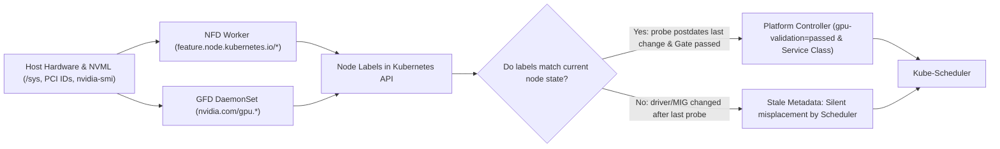
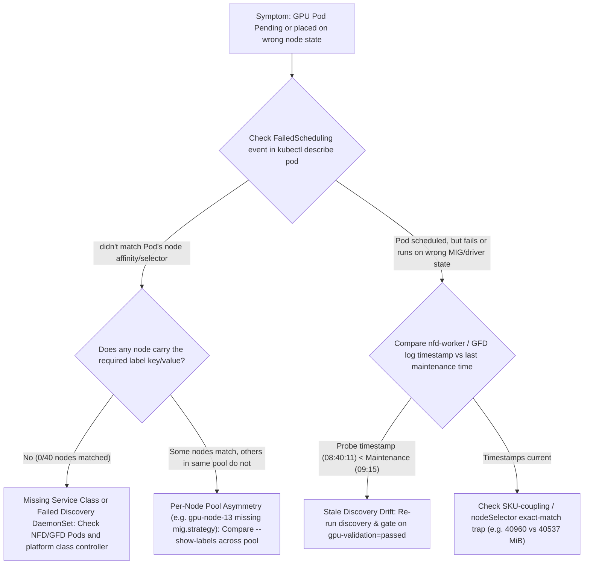

# 11.3 Node Feature Discovery and GPU Feature Discovery

| | |
|---|---|
| Level | Intermediate |
| Priority tier | 1 |
| Lab venue | GCP / GKE (plus local Python 3 simulation lab) |
| Part | Part 11: GPUs on Kubernetes, scheduling and virtualization |
| Sources used | `nvidia-zero-to-hero/volume-10/chapter-05-node-and-gpu-feature-discovery.md`; `nvidia-zero-to-hero/volume-10/labs/lab-01-inspect-a-kubernetes-gpu-node.md`; `volume-04/02-gpu-software-operator-masterclass.md`; Roland Huß et al., *Generative AI on Kubernetes* (O'Reilly, 2026, Ch. 3); *Kubernetes for Generative AI Solutions* (Packt, 2025, Ch. 10) |
| Coverage file | `planning/coverage/chapters/11-03.md` |

## Why this matters for AI infrastructure

Picture a mixed AI cluster with older inference GPUs in one set of nodes and newer training GPUs in another. An allocator can assign only the resources it knows about. A scheduler can filter nodes only with facts that reach the Kubernetes API.

The NVIDIA Device Plugin tells Kubernetes how many healthy GPU units exist on a node. It intentionally does not describe what kind of GPU is installed or how much high-bandwidth memory each card holds. It also does not report whether the silicon supports BF16 or FP8 instructions, whether Multi-Instance GPU partitioning is active, or whether the node passed validation.

Now consider what a bare resource request does in that cluster. Asking for one GPU treats every accelerator node as interchangeable. Without descriptive node metadata, a small quantized inference model can land on an expensive Hopper training node and strand scarce HBM3 capacity. Go the other way, and a large language model that needs modern tensor cores can land on an older Turing or Volta node. That misplaced Pod crashes immediately with an out-of-memory error or an unsupported instruction exception.

The table below shows three pool types where this mismatch appears. Each row describes a placement the scheduler accepts without complaint, even though the hardware does not suit the workload.

| Cluster Scenario | Hardware Pool Details | Operational Impact Without Discovery Metadata |
|---|---|---|
| Heterogeneous inference pool | `10` older NVIDIA T4 GPU nodes (`16 GB` VRAM each, Turing architecture) | A `70B`-parameter LLM or Ampere/Hopper `BF16` workload (`compute.major >= 8`) lands on a `16 GB` T4 or Volta V100 node and crashes immediately |
| Heterogeneous training pool | `10` NVIDIA H100 GPU nodes (`80 GB` HBM3 each, Hopper architecture) across `20` total GPU nodes | A small `7B`-parameter quantized model requiring `8 GB` of VRAM lands on an `80 GB` H100 node under a bare `limits.nvidia.com/gpu: 1` request |
| Manual labeling at scale | `1,000` GPU worker nodes across kernel upgrades, MIG changes, and RMA replacements | Manual node labels drift after maintenance windows (`09:15` MIG reconfiguration after an `08:40:11` probe) and cause silent scheduler misplacements |

Labeling hundreds of GPU worker nodes by hand cannot keep up with kernel upgrades, MIG reconfigurations, and hardware replacements. Kubernetes handles this with a two-stage automated discovery pipeline. The first stage inspects the PCI Express (PCIe) bus, and the second stage introspects the GPU through the NVIDIA driver.

Node Feature Discovery (NFD) is a vendor-neutral Kubernetes project. It runs a worker on every node and inspects `/sys`, `/proc`, CPUID flags, kernel versions, and PCIe vendor IDs before any GPU driver is installed.

GPU Feature Discovery (GFD) is an NVIDIA DaemonSet, meaning one Pod that runs on every matching node. It starts once the host driver is loaded. It then queries the NVIDIA Management Library (NVML) and publishes product SKU, memory size, architecture family, CUDA versions, and sharing strategy labels.

Exposing raw discovery labels directly to application teams creates a second production trap, known as SKU-coupled manifest fragility. When dozens of workload manifests hard-code a specific GPU product string, retiring an older node pool forces a coordinated edit across every application repository. Stale labels are the other side of the same problem. When discovery daemons fail to re-run after a maintenance window, the scheduler keeps placing Pods onto broken hardware states, and no error is logged.

This chapter covers both halves of the node discovery problem. You will learn how NFD and GFD generate labels across exclusive, time-sliced, and MIG-partitioned nodes. You will also build a three-tier platform governance model that separates discovered facts, lifecycle assertions, and portable service classes. Decide which of these labels application teams may depend on before they write their first manifest, because every label they reference becomes a coupling point.

## Prerequisites and outcomes

### Prerequisites
Before you start, you should have finished Chapter 11.1 on the seven-layer GPU platform model and Chapter 11.2 on the Kubernetes Device Plugin contract. You also need a working feel for Kubernetes node selectors, node affinity rules, and node taints and tolerations.

### Outcomes
By the end of this chapter, you will be able to explain how NFD probes PCIe class and vendor IDs to start GPU Operator reconciliation. The trigger is the label `feature.node.kubernetes.io/pci-10de.present=true`. You will also be able to read every GFD label in the `nvidia.com/*` namespace, whether the node uses physical GPUs, time-slicing replicas, or single or mixed MIG strategies. You will design a three-tier label taxonomy that keeps discovered hardware facts, platform lifecycle assertions, and tenant-facing service classes apart. You will see why service-class labels stop application manifests from churning during hardware refreshes across fleets with several GPU generations. You will write node selector, node affinity, and taint and toleration specifications that keep CPU workloads off GPU node pools. Finally, you will diagnose Pending Pods and silent misplacements caused by NFD and GFD timestamp drift and by per-node label asymmetry.

## Concepts: basics to intermediate to advanced

### 1. Basics: Node Feature Discovery (NFD) and GPU Feature Discovery (GFD)

Picture a freshly booted GPU worker node that is about to join a cluster pool. It may not have an NVIDIA kernel driver or the `nvidia-smi` binary installed yet. Any discovery daemon that relies on the NVML library fails to see a GPU on a driverless host, so the cluster stays blind to the hardware. This is a classic chicken-and-egg problem.

The Linux kernel enumerates the PCI Express bus at boot, whether or not a vendor driver is loaded. Kubernetes therefore splits hardware discovery into two stages. The cluster detects raw PCIe hardware first, and it queries NVML capabilities second.

#### Stage 1: Node Feature Discovery (NFD) — OS, CPU, and PCIe bus discovery
NFD runs a lightweight worker agent as a DaemonSet on every CPU and GPU node. A control-plane master controller works alongside it. The worker inspects `/sys`, `/proc`, CPUID instructions, kernel configuration, and PCIe configuration space. It then sends a labeling request to the master controller, which patches the Node object in the Kubernetes API.

Every NFD label starts with the prefix `feature.node.kubernetes.io/`. For PCIe devices, NFD publishes presence flags keyed by device class and vendor code. The GPU Operator reads these flags to decide where to schedule driver containers. The table below explains the codes NFD uses and what each one tells you.

| PCIe Class / Vendor Code | Meaning | Example NFD Label | Operational significance |
|---|---|---|---|
| **Class `0302`** | PCI 3D Controller (headless data-center GPUs such as A100, H100) | `feature.node.kubernetes.io/pci-0302_10de.present: "true"` | Proves a physical NVIDIA 3D controller is attached to the PCIe bus |
| **Class `0300`** | PCI VGA Compatible Controller (display-capable GPUs or virtual cloud VGA) | `feature.node.kubernetes.io/pci-0300_1d0f.present: "true"` | Typical on AWS EC2 instances where vendor `1d0f` (AWS) exposes a virtual VGA controller |
| **Vendor `10de`** | NVIDIA Corporation | `feature.node.kubernetes.io/pci-10de.present: "true"` | Primary trigger label watched by the NVIDIA GPU Operator to deploy driver, toolkit, and GFD DaemonSets |
| **Vendor `1002`** | Advanced Micro Devices (AMD) | `feature.node.kubernetes.io/pci-0302_1002.present: "true"` | Identifies AMD Instinct / ROCm GPU nodes |
| **Vendor `8086`** | Intel Corporation | `feature.node.kubernetes.io/pci-0302_8086.present: "true"` | Identifies Intel discrete/integrated GPU devices |
| **Vendor `1d0f`** | Amazon Web Services (AWS) | `feature.node.kubernetes.io/pci-0300_1d0f.present: "true"` | Identifies AWS EC2 virtual display hardware |

Two of these codes matter most for GPU nodes. Vendor `10de` is NVIDIA, and the GPU Operator watches that label to know when to deploy its components.

Beyond PCIe vendor IDs, NFD publishes CPU instruction flags, processor model numbers, SELinux status, and the exact host kernel version string. The GPU Operator also reads the kernel version label to select or compile the matching host driver container. The snippet below shows what you will find in the CPU and kernel labels on one node.

```text
Representative NFD CPU and Kernel Labels (Generative AI on Kubernetes Example 3-2):
  feature.node.kubernetes.io/cpu-cpuid.AVX512F: "true"
  feature.node.kubernetes.io/cpu-hardware_multithreading: "true"
  feature.node.kubernetes.io/cpu-model.family: "6"
  feature.node.kubernetes.io/cpu-model.id: "85"
  feature.node.kubernetes.io/cpu-model.vendor_id: "Intel"
  feature.node.kubernetes.io/kernel-selinux.enabled: "true"
  feature.node.kubernetes.io/kernel-version.full: "5.14.0-427.62.1.el9_4.x86_64"
```

These labels let the scheduler and the GPU Operator match on CPU features and kernel version, not only on GPUs.

#### Stage 2: GPU Feature Discovery (GFD) — NVML hardware and sharing introspection
Once the NVIDIA kernel driver is loaded on the worker node, GFD starts as a DaemonSet on GPU-equipped machines. GFD queries NVML and `nvidia-smi` to read card firmware and driver state. It then publishes detailed `nvidia.com/*` node labels that describe exact GPU capabilities. The table below lists the GFD labels you will meet most often, with example values from two nodes.

| GFD Node Label Key | Description | Example Value (A100 40GB) | Example Value (H100 80GB `gpu-node-03`) |
|---|---|---|---|
| `nvidia.com/gpu.present` | Confirms NVIDIA GPU discovery succeeded | `"true"` | `"true"` |
| `nvidia.com/gpu.count` | Number of schedulable GPUs, MIG instances, or time-sliced virtual GPUs on the node | `"4"` (or `"14"` for two A100s in `7x 1g.5gb` single MIG; `"80"` for `10` GPUs with `replicas: 8`) | `"8"` |
| `nvidia.com/gpu.product` | GPU model name; appends `-MIG-<profile>` in `single` MIG mode and `-SHARED` in time-slicing mode | `"A100-SXM4-40GB"` (or `"NVIDIA-A100-SXM4-40GB"`) | `"NVIDIA-H100-80GB-HBM3"` |
| `nvidia.com/gpu.memory` | Framebuffer memory per GPU or per `single`-MIG slice in **MiB** | `"40537"` (or `"40960"`) | `"81920"` |
| `nvidia.com/gpu.family` | GPU microarchitecture family | `"ampere"` | `"hopper"` (T4 is `"turing"`) |
| `nvidia.com/cuda.driver-version.full` | Full installed NVIDIA host driver version | `"525.105.17"` | `"550.90.07"` |
| `nvidia.com/cuda.runtime.version.full` | Full supported CUDA runtime version exposed by the driver | `"12.2"` | `"12.4"` |
| `nvidia.com/gpu.compute.major` | Major CUDA Compute Capability version | `"8"` | `"9"` |
| `nvidia.com/gpu.compute.minor` | Minor CUDA Compute Capability version | `"0"` | `"0"` |
| `nvidia.com/gpu.machine` | Host chassis / machine type or cloud instance family | `"dgx-a100"` | Cloud/chassis string |
| `nvidia.com/mig.capable` | Whether the physical GPU supports Multi-Instance GPU partitioning | `"true"` | `"true"` |
| `nvidia.com/mig.strategy` | Active MIG strategy (`"single"`, `"mixed"`, or unset/`"none"` if disabled) | `"single"` or `"mixed"` | `"single"` |
| `nvidia.com/mig-<profile>.count` | Count of a specific MIG profile when `mig.strategy=mixed` | `"2"` (for `nvidia.com/mig-1g.5gb.count`) | Per-profile count in `mixed` mode |
| `nvidia.com/gpu.replicas` | Virtual GPU overcommit multiplier per physical GPU (or MIG slice) under time-slicing | `"8"` (when `replicas: 8` is set) | `"1"` (when exclusive) |

When you compare the two example columns side by side, you see that each label describes one property of the card. A node needs several labels to be described fully.

#### How GFD labels mutate under Time-Slicing and MIG
When sub-GPU sharing is enabled on a node, the scheduler needs to know what a GPU resource really is. It might be a full physical card, a time-sliced replica, or a hardware MIG partition. Without label updates, a latency-sensitive training job could land on an oversubscribed time-sliced GPU by accident. GFD prevents this by changing the product and count labels whenever time-slicing or MIG is active.

- With time-slicing, GFD multiplies the advertised GPU count by the replica factor, sets the replica count label, and appends `-SHARED` to the GPU product name.
- With the single MIG strategy, every GPU on the node uses identical partitions, advertised under the standard GPU resource name. GFD appends the MIG profile suffix to the product label.
- With the mixed MIG strategy, slices are advertised under profile-specific extended resource names. GFD publishes a separate count label for each active MIG profile.
- When MIG slices are also oversubscribed with time-slicing, GFD appends both the MIG profile name and the `-SHARED` suffix to the product label.

The table below works through the four sharing modes with concrete counts, so you can see what each mode publishes. Time-slicing multiplies the physical count by the replica factor. Single MIG multiplies it by the number of slices per GPU.

| Sharing Mode | Physical Hardware Input | Resulting GFD Labels and Extended Resources |
|---|---|---|
| Time-Slicing (`replicas: 8`) | `10` physical GPUs (`1` GPU -> `8` virtual replicas; `10` GPUs -> `80` virtual replicas) | Sets `nvidia.com/gpu.count: "80"`, `nvidia.com/gpu.replicas: "8"`, and `nvidia.com/gpu.product: A100-SXM4-40GB-SHARED` (or advertises `nvidia.com/gpu.shared` when `renameByDefault: true`) |
| Single MIG (`mig.strategy: single`) | `2` physical A100-40GB GPUs partitioned into seven `1g.5gb` slices per GPU | Advertises `nvidia.com/gpu: 14` and sets `nvidia.com/gpu.count: "14"` and `nvidia.com/gpu.product: A100-SXM4-40GB-MIG-1g.5gb` |
| Mixed MIG (`mig.strategy: mixed`) | Heterogeneous MIG slices on the same GPU or node | Advertises `nvidia.com/mig-1g.5gb`, `nvidia.com/mig-2g.10gb`, `nvidia.com/mig-3g.20gb`, `nvidia.com/mig-4g.20gb`, and sets `nvidia.com/mig-1g.5gb.count: "2"` |
| Combined MIG + Time-Slicing | `1` GPU split into `2` MIG instances, each oversubscribed `2` times (`4` units total) | Sets `nvidia.com/gpu.count: "4"`, `nvidia.com/gpu.replicas: "2"`, and appends `-MIG-1g.5gb-SHARED` (or `-MIG-3g.20gb-SHARED`) to `nvidia.com/gpu.product` |

---

### 2. Intermediate: Label-based scheduling patterns (nodeSelector, nodeAffinity, and taints)

Once NFD and GFD fill in node labels, platform and application engineers need a reliable way to steer Pods onto matching hardware. Pick the wrong scheduling primitive, and workloads get locked to a single hardware SKU. Or expensive GPU nodes stay open to ordinary CPU microservices. Kubernetes gives you three complementary mechanisms to filter, score, and protect GPU node pools.

| Mechanism | Direction of control | Expressiveness | Best production use case |
|---|---|---|---|
| **`nodeSelector`** | **Pod selects Node** (hard exact key-value match) | Exact string equality only (`key: value`); cannot express `Gt`, `In`, or fallback preferences | Small, homogeneous fleets or hard capability gates (e.g., `nvidia.com/gpu.compute.major: "8"`) |
| **`nodeAffinity`** | **Pod selects Node** (`required` hard filter + `preferred` weighted soft scoring) | Set/comparison operators (`In`, `NotIn`, `Exists`, `DoesNotExist`, `Gt`, `Lt`) and weighted preferences (`weight: 1..100`) | Heterogeneous multi-generation clusters (e.g., require `gpu.memory Gt 40000` MiB, prefer `gpu.family In [hopper]`) |
| **`Taints` and `Tolerations`** | **Node repels Pod** unless Pod carries matching `toleration` | `NoSchedule`, `PreferNoSchedule`, `NoExecute` with `Equal` or `Exists` operators | Protecting expensive GPU pools from CPU-only Pods; note that **a toleration grants eligibility but does NOT select the GPU node** |

The first two mechanisms let a Pod choose its node. Taints work the other way, letting a node turn Pods away. The table above compares them by direction of control, expressiveness, and typical use.

#### Pattern 1: Exact matching with nodeSelector
The simplest way to target a specific GPU model is to add a `nodeSelector` field to the Pod specification. One key-value line pins an inference server to nodes with a particular GPU product or compute capability.

```yaml
# Example 3-3: Direct selection with nodeSelector (untested here)
apiVersion: v1
kind: Pod
metadata:
  name: t4-inference
spec:
  containers:
    - name: server
      image: myrepo/llm-server:latest
      resources:
        limits:
          nvidia.com/gpu: 1
  nodeSelector:
    nvidia.com/gpu.product: Tesla-T4
```

Exact string matching has a sharp edge when it is applied to numeric labels such as GPU memory. Suppose a vLLM deployment selects an exact string for forty gigabytes of memory. It fails to schedule on eighty-gigabyte nodes. Worse, it stays Pending on forty-gigabyte A100 nodes too, if GFD reports usable framebuffer memory as `40537` MiB instead of `40960` MiB. The table below shows what you get from that one selector across the node types.

| Workload / Node Scenario | Label Selector / Reported Value | Scheduling Outcome |
|---|---|---|
| `vllm/vllm-openai:latest` (`4` GPUs) | `nvidia.com/gpu.compute.major: "8"` and `nvidia.com/gpu.memory: "40960"` | Rejects older Volta V100 (`compute.major: "7"`) lacking hardware `BF16`, but also rejects `"81920"` MiB H100 and `"40537"` MiB A100-40GB nodes |

Each rejection in that row comes from the same cause. The selector asks for one exact string, and the node reports a slightly different value.

#### Pattern 2: Numeric bounds and soft preferences with nodeAffinity
Suppose your workload needs at least forty gigabytes of VRAM and prefers Hopper over Ampere when it can. Exact string matching cannot express that rule. Kubernetes `nodeAffinity` solves this by combining hard numeric thresholds with weighted soft preferences.

```yaml
# Example 3-4: Node affinity with Gt memory threshold and Hopper preference (untested here)
apiVersion: v1
kind: Pod
metadata:
  name: a100-preferred
spec:
  containers:
    - name: llm
      image: myrepo/mt-server:latest
      resources:
        limits:
          nvidia.com/gpu: 4
  affinity:
    nodeAffinity:
      requiredDuringSchedulingIgnoredDuringExecution:
        nodeSelectorTerms:
          - matchExpressions:
              - key: nvidia.com/gpu.memory
                operator: Gt
                values: ["40000"]
      preferredDuringSchedulingIgnoredDuringExecution:
        - weight: 1
          preference:
            matchExpressions:
              - key: nvidia.com/gpu.family
                operator: In
                values: ["hopper"]
```

During scheduling, Kubernetes evaluates this rule in two phases across every candidate node pool. First, the Filter phase removes any node whose GPU memory label is forty thousand MiB or less. Second, the Score phase adds the preferred weight to surviving nodes in the Hopper family. The workload can then fall back to Ampere when the Hopper nodes are full.

The table below follows three candidate nodes through both phases.

| Candidate Node Pool | GFD Labels on Node | Filter & Score Evaluation |
|---|---|---|
| `Tesla-T4` node | `nvidia.com/gpu.memory: "16384"`, `family: "turing"` | Filtered out during `Filter` phase because `16384` is not `Gt "40000"` |
| `A100-SXM4-40GB` node | `nvidia.com/gpu.memory: "40537"`, `family: "ampere"` | Passes required filter (`40537 > 40000`) with preferred score contribution `0` |
| `NVIDIA-H100-80GB-HBM3` node | `nvidia.com/gpu.memory: "81920"`, `family: "hopper"` | Passes required filter (`81920 > 40000`) and receives `+1` (`weight: 1`) during `Score` phase |

The T4 never reaches scoring, because the first phase removes it. The H100 ranks above the A100 because it is the only candidate that receives the preferred weight.

#### Pattern 3: Pool protection with Taints and Tolerations
Node selectors and affinity rules attract GPU Pods to GPU nodes. They do nothing to keep other Pods away. Without pool protection, ordinary CPU microservices that do not request a GPU can land on a GPU worker node. They then consume its host CPU cores and system RAM. Later, legitimate GPU workloads can become unschedulable there, because host CPU or memory is used up.

```text
Host Resource Starvation Example & Taint Conventions:
  GPU node host capacity: 64 CPU cores and 520192000Ki of host RAM
  GPU Operator taint convention: nvidia.com/gpu=present:NoSchedule
  EKS managed node group (eks-gpu-mng on g6.2xlarge): key = "nvidia.com/gpu", value = "true", effect = "NO_SCHEDULE" with label hardware-type=gpu
```

To fence off GPU pools, administrators taint every GPU node with a `NoSchedule` effect. Any Pod without a matching toleration is repelled from those nodes during scheduling. The command below taints every node that carries the GFD `nvidia.com/gpu.count` label.

```bash
# Taint all nodes that carry the GFD nvidia.com/gpu.count label (untested here)
kubectl taint nodes -l nvidia.com/gpu.count nvidia.com/gpu=true:NoSchedule
```

Once the taint is in place, a GPU Pod needs more than a toleration to land on a GPU node. A GPU serving Deployment must pair three elements in its Pod template: a toleration to pass the node taint, a node selector or affinity rule to target the right GPU class, and an extended-resource limit to claim the hardware.

```yaml
# Pairing toleration + selector + extended-resource limit (untested here)
apiVersion: apps/v1
kind: Deployment
metadata:
  name: gpu-serving
spec:
  replicas: 2
  template:
    spec:
      tolerations:
        - key: "nvidia.com/gpu"
          operator: "Exists"
          effect: "NoSchedule"
      nodeSelector:
        gpu.platform.example/class: inference-general
      containers:
        - name: tgi
          image: ghcr.io/huggingface/tgi:latest
          resources:
            limits:
              nvidia.com/gpu: 1
```

Remember the basic distinction between taints and selectors when you review workload manifests, such as `gpu-demo-pod` in Chapter 10 of *Kubernetes for Generative AI Solutions*. A toleration only grants permission for a Pod to be considered on a tainted node. It does not attract the Pod to that node. A Pod with a GPU toleration but no GPU resource request or node selector can therefore still schedule onto a CPU-only node.

---

### 3. Advanced: Facts, assertions, service classes, and discovery drift



#### The three-tier label taxonomy: Discovered Facts vs Lifecycle Assertions vs Service Classes
Treating every node label as an interchangeable scheduling target causes outages during maintenance and hardware refreshes. A raw GFD label proves only that a GPU model was observed when the discovery probe last ran. It does not prove that the host driver is healthy right now, that the InfiniBand fabric passed validation, or that tenant manifests should couple themselves to that hardware SKU.

Platform teams avoid this failure by dividing node metadata into three strict ownership tiers. Each tier has a single authoritative writer and a dedicated consumer boundary. The table lists each tier with an example label, its writer, and its consumer.

| Label Tier | Example Label Key & Value | Authoritative Writer | Intended Consumer | Why this boundary matters |
|---|---|---|---|---|
| **1. Discovered Fact** | `feature.node.kubernetes.io/pci-10de.present=true`, `nvidia.com/gpu.product=NVIDIA-H100-80GB-HBM3`, `nvidia.com/gpu.memory=81920`, `nvidia.com/mig.capable=true` | Discovery daemons (`nfd-worker`, `gpu-feature-discovery`) | Platform controllers, GPU Operator state machine, inventory audits, diagnostics | Describes raw hardware observed at a point in time. **Does NOT prove the driver is healthy right now or that the node passed validation.** |
| **2. Lifecycle Assertion** | `gpu-validation=passed`, `platform.example/network-validated=true`, `platform.example/maintenance=pending` | Controlled platform validation / lifecycle controller | Admission webhooks, node-readiness gates, SRE automation | Proves that the driver, container toolkit, device plugin, and a real CUDA validation workload (`GPU_NODE_VALIDATED`) succeeded after the last change. |
| **3. Service Class** | `gpu.platform.example/class=training-topology`, `gpu.platform.example/class=inference-general`, `gpu.platform.example/class=mig-serving` | Platform engineering (governed controller / node-pool config) | Application workload manifests (`nodeSelector` / `nodeAffinity`) | Decouples tenant manifests from specific hardware SKUs so the platform can refresh hardware underneath a stable SLO class. |

When you see a tier 1 label, you know what was observed. Tier 2 records what was verified after the last change, and tier 3 records what the platform promises. Keep each tier in its own lane.

Consider why `nvidia.com/gpu.product=NVIDIA-H100-80GB-HBM3` is not enough evidence that a node is ready for production traffic. If you see that label alone, you know only what the probe observed. GFD writes that label when its probe runs. The label stays on the Node object even if the GPU driver crashes minutes later. Similarly, `nvidia.com/mig.capable=true` only says the GPU silicon supports partitioning. It does not say that MIG mode is enabled or that `nvidia.com/mig-1g.10gb` slices exist.

#### Quantifying SKU-coupling blast radius across an 80-node fleet
When application teams hard-code raw GPU product names in their manifests, every hardware lifecycle event becomes a cross-team migration. Retiring an aging node pool breaks every Deployment that pinned that exact SKU string. That happens even when newer compatible GPUs have free capacity in the same cluster. A governed service-class label decouples tenant YAML from physical SKU changes.

The fleet has 30 A100-80GB nodes and 30 H100 nodes. It also has 20 older A100-40GB nodes, which makes 80 nodes in total. If you retire the 20 oldest nodes, 60 nodes remain. If you run a fleet like this one, the table compares the two designs on the same 45 manifests.

| Fleet Metric / Scenario | Direct SKU Coupling (`nvidia.com/gpu.product`) | Governed Service Class (`gpu.platform.example/class=inference-general`) |
|---|---|---|
| Total fleet size and history | `80` GPU worker nodes acquired across `3` hardware refreshes over `18` months | Same `80` GPU worker nodes grouped into stable platform service classes |
| Node pool composition | `30` `NVIDIA-A100-80GB` nodes, `30` `NVIDIA-H100-80GB-HBM3` nodes, and `20` older `NVIDIA-A100-40GB` nodes | Same `30` + `30` + `20` nodes qualified under platform controller rules |
| Retiring `20` oldest `NVIDIA-A100-40GB` nodes (with `45` manifests) | All `45` application manifests break simultaneously (`0` matching nodes) and cannot overflow onto the other `60` nodes | `0` application manifests change; platform team updates `1` platform controller rule |

In the direct-SKU column, all 45 manifests break at once. In the service-class column, one controller rule changes and no manifests do.

#### Security and RBAC integrity of node labels
Node labels control workload placement, multi-tenant isolation, hardware licensing boundaries, and compliance zones. A tenant service account, or a compromised container on a worker node that can patch Node objects, can forge service-class labels. It can also strip maintenance markers. Platform teams therefore enforce three security controls to protect label integrity.

- Restrict Node label write permissions to the `NodeRestriction` admission plugin, `nfd-master`, `gpu-feature-discovery`, and the platform validation controller, and to nothing else.
- Place manual operator override labels in a separate namespace prefix, with an automated time-to-live expiry audit.
- Gate production scheduling on `gpu-validation=passed`, and remove that label automatically before any driver upgrade, MIG change, or node drain begins.

Put these three controls in place before you open a GPU pool to tenants. A label that anyone can write is a label you cannot trust.

## Commands and configurations that matter

### 1. Deploying NFD and inspecting both NFD and GFD labels on a GPU node

Picture a standalone cluster you have just built, or an existing environment you have inherited. Before you trust its scheduling, confirm that both the NFD and GFD DaemonSets are running and publishing labels. You can deploy NFD directly with Kustomize, or let the NVIDIA GPU Operator Helm chart enable it for you.

```bash
# Deploy Node Feature Discovery via Kustomize (untested here)
NFD_REPO=https://github.com/kubernetes-sigs/node-feature-discovery
kubectl apply -k "$NFD_REPO/deployment/overlays/default"
```

On managed clusters that use the `aws-ia/eks-data-addons/aws` Terraform module with `enable_nvidia_device_plugin = true`, the device plugin chart deploys three DaemonSets side by side. The next command confirms that the device plugin, GFD, and NFD worker Pods are all present.

```bash
# Verify device plugin, GFD, and NFD worker DaemonSets (untested here)
kubectl get ds -n nvidia-device-plugin --no-headers
```

The output should list the three DaemonSets:

```text
nvidia-device-plugin
nvidia-device-plugin-gpu-feature-discovery
nvidia-device-plugin-node-feature-discovery-worker
```

Once the DaemonSets are running, check the Node object itself. Both `feature.node.kubernetes.io/*` and `nvidia.com/*` labels should be populated. The command below filters the node labels on an H100 worker node.

```bash
# Inspect NFD and GFD labels on gpu-node-03 (untested here)
kubectl get node gpu-node-03 --show-labels | tr ',' '\n' | grep -E 'nvidia.com|feature.node'
```

The filtered labels should look like this:

```text
feature.node.kubernetes.io/cpu-cpuid.AVX512F=true
feature.node.kubernetes.io/pci-10de.present=true
nvidia.com/cuda.driver-version.full=550.90.07
nvidia.com/gpu.compute.major=9
nvidia.com/gpu.count=8
nvidia.com/gpu.memory=81920
nvidia.com/gpu.product=NVIDIA-H100-80GB-HBM3
nvidia.com/mig.capable=true
nvidia.com/mig.strategy=single
```

### 2. Verifying NFD worker probe freshness in logs

A label on a Node object does not tell you when it was last refreshed. After host maintenance or a kernel change, read the `nfd-worker` Pod logs. They show the exact timestamp of the last probe and how many labels changed.

```bash
# Check NFD worker probe timestamp and change count (untested here)
kubectl logs -n node-feature-discovery nfd-worker-gpu-node-03-x7q2n --tail=5
```

The output should resemble this:

```text
I0812 11:00:02.771001       1 nfd-worker.go:451] labeling node "gpu-node-03" with feature labels
I0812 11:00:02.771312       1 nfd-worker.go:452] 42 label(s), 3 changed since last run
I0812 11:00:02.803009       1 nfd-worker.go:470] sending labeling request to nfd-master
```

### 3. Auditing label consistency across a uniform node pool

In a uniform node pool, every worker node should carry the same hardware capability and MIG strategy labels. If one node drops a label after a partial reconfiguration, workloads quietly avoid that host or fail on it. Loop across the peer nodes in the pool, and you can spot missing MIG labels right away.

```bash
# Compare MIG discovery labels across peer nodes in the same pool (untested here)
for n in gpu-node-19 gpu-node-13; do
  echo "== $n =="
  kubectl get node "$n" --show-labels | tr ',' '\n' | grep 'nvidia.com/mig'
done
```

The output below shows what drift looks like when `gpu-node-13` has lost its strategy label.

```text
== gpu-node-19 ==
nvidia.com/mig.capable=true
nvidia.com/mig.strategy=single
== gpu-node-13 ==
nvidia.com/mig.capable=true
```

Run this peer comparison whenever a node pool changes, and fix any node that differs from its peers before you return it to service.

## How it fails

If you are on call, an alert usually starts with one of two symptoms. A GPU Pod sits in Pending, or it runs on hardware that no longer matches what the workload expects. Discovery failures fall into two categories. Loud scheduling blocks leave Pods Pending, because a required label is missing or misspelled. Silent misplacements are more dangerous, because stale labels lead the scheduler to a wrong hardware state with zero errors logged. The diagram below shows how you can tell the two apart.



The table pairs each failure with the symptom you will see, its root cause boundary, and what you can do about it.

| Failure mode | Exact symptom & command evidence | Root cause boundary | Remediation |
|---|---|---|---|
| **1. Missing service-class label blocks all `40` nodes (`0/40 nodes are available`)** | Pod `training-job-0` stays `Pending`. `kubectl describe pod training-job-0` prints `Warning FailedScheduling 55s default-scheduler 0/40 nodes are available: 40 node(s) didn't match Pod's node affinity/selector: key "gpu.platform.example/class" value "training-topology" not found.` even though `25` of the `40` nodes have healthy GPUs. | **Platform Service-Class / Discovery Publication Boundary:** Every node was rejected by the label predicate before GPU capacity was even checked. | Do not weaken the workload's selector first. Verify why the platform controller or discovery pipeline failed to publish `gpu.platform.example/class=training-topology` on the `25` qualified nodes after validation. |
| **2. Post-maintenance stale label drift (`08:40:11` probe vs `09:15` MIG change)** | A node's MIG configuration is changed during maintenance at `09:15`, but workloads targeting the old MIG state still land on `gpu-node-19` and fail. `kubectl logs -n node-feature-discovery nfd-worker-gpu-node-19-p8k1 --tail=3` shows `I0812 08:40:11.002331 ... labeling node "gpu-node-19"` and `0 label(s) changed since last run`. | **Discovery Freshness Boundary:** The discovery worker has not re-probed the node since `08:40:11`, leaving stale MIG/driver labels active in the Kubernetes API after the `09:15` change. | Remove `gpu-validation=passed` before maintenance starts, trigger an explicit GFD/NFD re-probe after the `09:15` reconfiguration, and re-admit the node only after labels postdate `09:15` and validation passes. |
| **3. Intra-pool label asymmetry (`gpu-node-19` vs `gpu-node-13`)** | Workloads intermittently fail or experience reduced eligible capacity in a pool that is supposed to be uniform. Comparing `--show-labels` shows `gpu-node-19` has `nvidia.com/mig.capable=true` and `nvidia.com/mig.strategy=single`, while `gpu-node-13` has only `nvidia.com/mig.capable=true` (`mig.strategy` is absent). | **Per-Node GFD / MIG Manager Drift Boundary:** The GFD Pod on `gpu-node-13` failed to query NVML or MIG Manager did not finish applying the `single` strategy on `gpu-node-13`. | Inspect the `gpu-feature-discovery` and `mig-manager` Pod logs on `gpu-node-13`, reconcile its MIG state to match `gpu-node-19`, and alert on label set diffs across nodes in the same pool. |
| **4. `nodeSelector` exact-string trap on memory or SKU (`40960` vs `40537` MiB)** | A Deployment with `nodeSelector: {nvidia.com/gpu.memory: "40960"}` stays `Pending` on an A100-40GB cluster where GFD reports `nvidia.com/gpu.memory: "40537"` (or on an upgraded H100 cluster reporting `"81920"`). | **Manifest Over-Specification Boundary:** `nodeSelector` performs exact string equality (`"40960" != "40537"` and `"40960" != "81920"`). | Replace exact-string `nodeSelector` memory checks with `nodeAffinity` using `operator: Gt` and `values: ["40000"]`, or select on a governed platform service class. |
| **5. `nvidia.com/mig.capable=true` mistaken for active MIG resources** | A Pod requesting `limits: {nvidia.com/mig-1g.10gb: 1}` targets `nodeSelector: {nvidia.com/mig.capable: "true"}`, binds or stays `Pending` with `Insufficient nvidia.com/mig-1g.10gb`. | **Inventory vs Configuration Boundary:** `mig.capable=true` only means the A100/H100 hardware supports MIG; it does not mean MIG mode is enabled or that `1g.10gb` slices have been created. | Coordinate label selectors with the actual extended resources advertised by the device plugin (`nvidia.com/mig.strategy` and `nvidia.com/mig-1g.10gb.count`). |

Rows 2 and 3 are the ones to check first after maintenance, because both point to labels that no longer match the node. When your GPU Pod is Pending, check whether any node carries the required label before you change the workload.

## Hands-on lab

### Venue and scope
You run this lab locally, using only the Python standard library, with `code/part11/nfd_and_gfd.py` and `code/part11/nfd_and_gfd_lab.py`. The lab simulates NFD label generation for PCIe, CPU, and kernel facts. It also simulates GFD NVML label synthesis in exclusive, time-sliced, and MIG modes. Beyond that, it tests the three-tier label governance model, the fleet refresh blast-radius calculator, node affinity scoring, and post-maintenance drift detection. The `kubectl` commands earlier in the chapter are marked untested here, so they have not been run against a live GKE or Kubernetes cluster.

### Step 1: Run the self-checking NFD and GFD simulation lab (tested here)

Start the lab from the repository root. Its output shows whether every check passed.

```bash
python3 code/part11/nfd_and_gfd_lab.py
```

The output below was captured from this repository.

```text
=== Chapter 11.3 Lab: Node Feature Discovery (NFD) and GPU Feature Discovery (GFD) ===
  [PASS] PCI vendor table maps 10de->NVIDIA, 1002->AMD, 8086->Intel, 1d0f->AWS
  [PASS] PCI class table maps 0302->3D controller (GPU) and 0300->VGA controller
  [PASS] NFD sets pci-0302_10de.present=true and pci-0300_1d0f.present=true
  [PASS] NFD sets pci-10de.present=true trigger label for GPU Operator
  [PASS] NFD sets CPU AVX512F, family 6, model id 85, and vendor Intel
  [PASS] NFD sets kernel-selinux.enabled=true and kernel-version.full=5.14.0-427.62.1.el9_4.x86_64
  [PASS] GFD Table 3-1 baseline sets count=4, product=A100-SXM4-40GB, memory=40537
  [PASS] GFD sets family=ampere, driver=525.105.17, cuda.runtime=12.2
  [PASS] GFD sets compute.major=8, compute.minor=0, machine=dgx-a100
  [PASS] GFD on gpu-node-03 sets NVIDIA-H100-80GB-HBM3, memory=81920, compute.major=9, driver=550.90.07
  [PASS] Time-slicing (replicas=8 on 10 GPUs) appends -SHARED and sets gpu.count=80
  [PASS] Single MIG strategy on 2 A100s (7x 1g.5gb) sets product=...-MIG-1g.5gb and gpu.count=14
  [PASS] Mixed MIG strategy publishes per-profile counts (mig-1g.5gb.count=2, mig-3g.20gb.count=1)
  [PASS] Combined MIG (2 slices) + Time-Slicing (2 replicas) appends -SHARED and exposes 4 units
  [PASS] nvidia.com/gpu.product is classified as discovered_fact for platform automation
  [PASS] gpu-validation is classified as lifecycle_assertion for admission and operations
  [PASS] gpu.platform.example/class is classified as service_class for workload manifests
  [PASS] Fleet refresh models 80 GPU nodes across 3 generations retiring 20 oldest nodes
  [PASS] Service-class abstraction reduces broken workload manifests from 45 to 0 (1 controller update)
  [PASS] 16 GB T4 node is rejected by required Gt 40000 MiB memory matchExpression
  [PASS] 40537 MiB Ampere A100 passes Gt 40000 MiB required term with preferred score 0
  [PASS] 81920 MiB Hopper H100 passes Gt 40000 MiB required term and gains preferred score +1
  [PASS] Pod missing nvidia.com/gpu Exists toleration is repelled by NoSchedule taint
  [PASS] Detects stale NFD/GFD probe when worker timestamp (08:40:11) precedes maintenance (09:15:00)
  [PASS] Detects pool asymmetry on gpu-node-13 (missing nvidia.com/mig.strategy) and blocks admission
  [PASS] Approves pool admission once post-maintenance probe (09:20:00) reconciles uniform labels

Summary: 26 passed, 0 failed out of 26 checks.
```

### Exercises

The six exercises below reuse the lab's functions with new inputs. Each one asks you to compute or explain something specific.

1. Exercise 1 starts with an AWS EC2 GPU node that exposes two PCIe display and accelerator devices in NFD. Use `code/part11/nfd_and_gfd.py` to identify the device class and vendor behind both labels in the table below. Then state which label an AMD Instinct GPU node publishes.
2. Exercise 2 tests GFD labels under single MIG. Call `generate_gfd_labels()` for the two-GPU A100 node in the parameter table, and compute the exact `nvidia.com/gpu.count`, `nvidia.com/gpu.product`, and `nvidia.com/mig.strategy` labels.
3. Exercise 3 combines MIG with time-slicing. Suppose a single physical A100 GPU is partitioned into two MIG instances, and each instance is oversubscribed with two time-slicing replicas. Compute the resulting `nvidia.com/gpu.count`, `nvidia.com/gpu.replicas`, and `nvidia.com/gpu.product` labels.
4. Exercise 4 covers nodeAffinity filtering and scoring. Use `evaluate_node_affinity_candidate()` with the memory threshold and Hopper preference from the table below. Determine the eligibility flag and score for the T4, A100, and H100 candidate nodes.
5. Exercise 5 measures fleet refresh blast radius. Compare how many application manifests break, and how many controller configuration updates are needed, when you retire the oldest A100-40GB pool. Run the comparison twice, once under direct SKU affinity and once under a governed `gpu.platform.example/class` service class.
6. Exercise 6 audits drift after maintenance. Use `detect_discovery_drift()` to explain why the node pool in the table below returns `safe_for_admission=False`. Then state which two conditions must change before admission can succeed.

The table below lists the exact inputs for each exercise.

| Exercise | Input Parameters & Code Symbols |
|---|---|
| Exercise 1 | `feature.node.kubernetes.io/pci-0300_1d0f.present: "true"`, `feature.node.kubernetes.io/pci-0302_10de.present: "true"`, `PCI_CLASS_NAMES`, `PCI_VENDOR_NAMES` |
| Exercise 2 | `2` physical `A100-SXM4-40GB` GPUs, `mig_strategy="single"`, `single_mig_profile="1g.5gb"`, `single_mig_slices_per_gpu=7` |
| Exercise 3 | `physical_gpu_count=1`, `A100-SXM4-40GB`, `single_mig_slices_per_gpu=2`, `single_mig_profile="3g.20gb"`, `time_slicing_replicas=2` |
| Exercise 4 | `required_min_memory_mib=40000`, `preferred_families=("hopper",)`, `preferred_weight=1` across (a) `16384` MiB Turing T4, (b) `40537` MiB Ampere A100, (c) `81920` MiB Hopper H100 |
| Exercise 5 | `80`-node fleet (`30` `NVIDIA-A100-80GB`, `30` `NVIDIA-H100-80GB-HBM3`, `20` `NVIDIA-A100-40GB`), `45` workload manifests, retiring `20` `NVIDIA-A100-40GB` nodes |
| Exercise 6 | `last_probe_hhmmss="08:40:11"`, `last_maintenance_hhmmss="09:15:00"`, `gpu-node-13` missing `nvidia.com/mig.strategy` |

Use these parameter values exactly as listed, so that each exercise starts from the same inputs.

## Checkpoint questions

<details>
<summary>**1. Why does a Kubernetes GPU platform need both Node Feature Discovery (NFD) and GPU Feature Discovery (GFD) in addition to the NVIDIA Device Plugin?**</summary>

Without NFD and GFD, you would see only an integer count of healthy resources, such as `nvidia.com/gpu: 8`. The NVIDIA Device Plugin does not expose hardware attributes to the scheduler. NFD runs on every node and detects OS, CPU, and raw PCIe facts, such as `feature.node.kubernetes.io/pci-0302_10de.present=true` and `pci-10de.present=true`, before a GPU driver is installed. Once the GPU Operator loads the driver, GFD queries NVML and publishes GPU-specific labels. Those include `nvidia.com/gpu.product`, `gpu.memory`, `gpu.compute.major`, `mig.strategy`, and `gpu.replicas`.
</details>

<details>
<summary>**2. In the NFD label feature.node.kubernetes.io/pci-0302_10de.present: "true", what do 0302 and 10de mean, and how do they differ from pci-0300_1d0f.present: "true"?**</summary>

In the NFD naming convention, each code points to a PCIe device category or a hardware manufacturer. The code `0302` is the PCI device class for a 3D controller, and `10de` is the vendor ID for NVIDIA. By comparison, `1002` identifies AMD and `8086` identifies Intel. The code `0300` is the class for a VGA compatible display controller, and `1d0f` is the vendor ID for Amazon Web Services on EC2 instances.
</details>

<details>
<summary>**3. What are the three tiers of node labels defined, and who is the authoritative writer and consumer of each tier?**</summary>

1. A discovered fact is a label such as `nvidia.com/gpu.product` or `feature.node.kubernetes.io/pci-10de.present`. NFD and GFD write it, and platform automation and diagnostics consume it.
2. A lifecycle assertion is a label such as `gpu-validation=passed`. A platform validation controller writes it after the driver, runtime, plugin, and workload checks succeed. Admission control consumes it.
3. A service class is a label such as `gpu.platform.example/class=training-topology` or `inference-general`. Platform engineering writes it, and tenant workload manifests consume it.
</details>

<details>
<summary>**4. Why is the GFD label nvidia.com/gpu.product=NVIDIA-H100-80GB-HBM3 not sufficient proof that a node is ready to run production GPU workloads?**</summary>

If you see that label, it is a point-in-time inventory observation, written when GFD last ran its discovery probe. It does not prove that the host kernel driver is healthy now, or that the container runtime can inject `/dev/nvidia*` devices. It also does not verify that the device plugin is registered, or that the validation container (`GPU_NODE_VALIDATED`) succeeded after the latest maintenance event.
</details>

<details>
<summary>**5. How does GFD change nvidia.com/gpu.product, nvidia.com/gpu.count, and nvidia.com/gpu.replicas when time-slicing is enabled with replicas: 8 on a node with 10 physical A100-SXM4-40GB GPUs?**</summary>

GFD appends the `-SHARED` suffix to the product label, so it reads `nvidia.com/gpu.product: A100-SXM4-40GB-SHARED`. It sets `nvidia.com/gpu.replicas: "8"`. It also multiplies `nvidia.com/gpu.count` to `"80"` across the ten physical GPUs, because eight replicas on each of ten GPUs gives 80.
</details>

<details>
<summary>**6. How can a workload manifest ensure it receives an exclusive physical GPU and avoids landing on a time-sliced node?**</summary>

A workload can select a `nvidia.com/gpu.product` value or a platform service class that does not carry the `-SHARED` suffix. Alternatively, the platform team can set `renameByDefault: true` in the device plugin. Time-sliced GPUs are then advertised as `nvidia.com/gpu.shared`, and exclusive GPUs remain `nvidia.com/gpu`.
</details>

<details>
<summary>**7. How do GFD labels differ between single MIG strategy and mixed MIG strategy on an A100 node?**</summary>

- Under single MIG strategy (`nvidia.com/mig.strategy: single`), every GPU on the node is partitioned the same way. Two A100s split into fourteen `1g.5gb` slices is one example. All slices are advertised as `nvidia.com/gpu`, `nvidia.com/gpu.count` reports `"14"`, and `nvidia.com/gpu.product` becomes `A100-SXM4-40GB-MIG-1g.5gb`.
- Under mixed MIG strategy (`nvidia.com/mig.strategy: mixed`), slices are advertised under profile-specific resource names, such as `nvidia.com/mig-1g.5gb` and `nvidia.com/mig-4g.20gb`. GFD publishes a per-profile count label for each one, such as `nvidia.com/mig-1g.5gb.count: "2"`.
</details>

<details>
<summary>**8. What does nvidia.com/mig.capable=true on gpu-node-03 prove, and what does it NOT prove?**</summary>

When you see this label, it proves only that the GPU architecture, such as Ampere A100 or Hopper H100, supports Multi-Instance GPU partitioning. It does not prove that MIG mode is enabled on the node right now. Nor does it prove that a partition resource such as `nvidia.com/mig-1g.10gb` is allocatable.
</details>

<details>
<summary>**9. Why can using nodeSelector with nvidia.com/gpu.memory: "40960" cause unexpected Pending Pods even when 40 GB A100 or 80 GB H100 nodes are idle?**</summary>

Kubernetes `nodeSelector` matches label values as exact strings. On a forty-gigabyte A100, GFD often reports usable framebuffer memory as `"40537"` MiB instead of `"40960"` MiB. An eighty-gigabyte node reports `"81920"` MiB. If you pin an exact match on `"40960"`, it rejects both nodes. A `nodeAffinity` rule with `operator: Gt` and `values: ["40000"]` accepts both.
</details>

<details>
<summary>**10. In Generative AI on Kubernetes Example 3-4, how does kube-scheduler combine requiredDuringSchedulingIgnoredDuringExecution (gpu.memory Gt 40000) with preferredDuringSchedulingIgnoredDuringExecution (gpu.family In [hopper], weight: 1)?**</summary>

During the Filter phase, the scheduler removes any node whose `nvidia.com/gpu.memory` label is forty thousand MiB or less. That removes the 16 GB T4 nodes and keeps the `40537` MiB A100 and `81920` MiB H100 nodes. During the Score phase, it adds `weight: 1` to surviving nodes whose `nvidia.com/gpu.family` is `"hopper"`. The Pod lands on an H100 if one is free. If every H100 is busy, it falls back to an A100.
</details>

<details>
<summary>**11. Why do taints and tolerations alone not steer a GPU Pod onto a GPU node?**</summary>

A taint such as `nvidia.com/gpu=true:NoSchedule` repels Pods that lack a matching toleration. A toleration removes that repulsion, so the Pod may be considered on the tainted node. If you add only a toleration, your Pod can still land on an untainted CPU node. To guarantee placement on a GPU node, the Pod must also request `nvidia.com/gpu` or specify a node selector or affinity rule.
</details>

<details>
<summary>**12. In an 80-node fleet (30 NVIDIA-A100-80GB, 30 NVIDIA-H100-80GB-HBM3, 20 NVIDIA-A100-40GB) acquired over 18 months, what happens when the 20 oldest nodes are retired if workloads use SKU-level nodeSelector versus a platform service class?**</summary>

Suppose your workloads hard-select `nvidia.com/gpu.product=NVIDIA-A100-40GB`, retiring those twenty nodes breaks every manifest that targets that SKU. Application teams must then edit and redeploy their YAML. If workloads target `gpu.platform.example/class=inference-general`, the change is one platform controller mapping. Retiring the twenty nodes and adding replacement hardware then requires zero application manifest changes.
</details>

<details>
<summary>**13. How do you prove from nfd-worker logs whether node labels on gpu-node-19 are fresh or stale after a 09:15 MIG maintenance window?**</summary>

To check this yourself, read the probe timestamp in `kubectl logs -n node-feature-discovery nfd-worker-gpu-node-19-p8k1`. In the incident, the log showed `I0812 08:40:11.002331 ... labeling node "gpu-node-19"` and `0 label(s) changed since last run`. That probe ran before the `09:15` maintenance change, so the node labels in the Kubernetes API are proven stale.
</details>

<details>
<summary>**14. Why is stale discovery metadata dangerous even when every daemon on the node reports Running?**</summary>

Discovery daemons can report Running while they have not re-run since a driver, GPU, or MIG change. The Kubernetes API server still holds labels that look valid but describe the prior state. The scheduler trusts those labels and places Pods on nodes whose hardware no longer matches the workload. That produces a silent misplacement.
</details>

<details>
<summary>**15. When kubectl describe pod training-job-0 shows 0/40 nodes are available: 40 node(s) didn't match Pod's node affinity/selector: key "gpu.platform.example/class" value "training-topology" not found, is the cluster out of GPUs?**</summary>

No, the cluster is not out of GPUs. When all forty nodes fail the affinity or selector check, the scheduler rejects every node during label filtering. It never reaches the GPU capacity check. Picture the scheduler's view: every node fails the same label check. Either the `training-topology` service class was never applied to the twenty-five qualified nodes, or discovery validation removed the label.
</details>

<details>
<summary>**16. Why is per-node label asymmetry (such as gpu-node-19 having nvidia.com/mig.strategy=single while peer gpu-node-13 has only nvidia.com/mig.capable=true) often masked until a rescheduling event occurs?**</summary>

While `gpu-node-19` has free capacity, Pods that require `nvidia.com/mig.strategy=single` schedule onto it and succeed. The missing label on `gpu-node-13` stays hidden. It surfaces only when `gpu-node-19` fills up or drains, or when a Pod that omits the strategy selector lands on `gpu-node-13` and hits an unexpected partitioning state.
</details>

<details>
<summary>**17. Why must RBAC and admission control treat node capability labels as privileged security boundaries?**</summary>

Node labels govern workload placement, tenant isolation, hardware licensing, and compliance pools. If you let a tenant or a compromised workload change Node labels, it can steer unauthorized Pods onto dedicated GPU pools. It can also fake `gpu-validation=passed`.
</details>

<details>
<summary>**18. What is the difference between nvidia.com/cuda.driver-version.full and nvidia.com/cuda.runtime.version.full in GFD labels?**</summary>

- `nvidia.com/cuda.driver-version.full` reports the exact version of the NVIDIA kernel driver installed on the worker node, such as `525.105.17` or `550.90.07`.
- `nvidia.com/cuda.runtime.version.full` reports the highest CUDA Runtime version that the host driver supports natively, such as `12.2` or `12.4`. The host driver supports it without needing `/usr/local/cuda/compat` forward compatibility.
</details>

<details>
<summary>**19. What do nvidia.com/gpu.compute.major and nvidia.com/gpu.compute.minor represent, and why would a vLLM deployment select on compute.major: "8" or higher?**</summary>

They represent the CUDA Compute Capability of the GPU architecture. Selecting a `compute.major` of eight or higher means that workloads using Ampere or Hopper instructions, such as hardware BF16 tensor cores or FlashAttention-2 kernels, never land on older Volta or Turing GPUs. The table below lists the capability for each architecture.

| Architecture | Compute Capability (`major.minor`) |
|---|---|
| Volta V100 | `7.0` |
| Turing T4 | `7.5` |
| Ampere A100 | `8.0` |
| Hopper H100 | `9.0` |
</details>

<details>
<summary>**20. What five operational practices does Volume 10 Chapter 5 recommend to prevent discovery drift from becoming a production outage?**</summary>

1. Alert whenever an NFD or GFD worker is absent, restarting in `CrashLoopBackOff`, or failing to update its Node object.
2. Continuously audit and diff the expected node-pool membership against the actual node labels, using `--show-labels`.
3. Re-run discovery and reconciliation explicitly after every maintenance operation that changes state, such as a driver upgrade, MIG change, or GPU replacement.
4. Gate production admission on a separate lifecycle assertion label, `gpu-validation=passed`. Never gate it on NodeReady or on raw product labels alone.
5. Record the observed labels and validation output alongside the maintenance ticket before the node returns to service.
</details>

## Sources and review notes

| Source Category | File Path / Citation & Extracted Facts |
|---|---|
| Primary Volume 10 Chapter | `nvidia-zero-to-hero/volume-10/chapter-05-node-and-gpu-feature-discovery.md` (`10` T4 vs `10` H100 primer, Figure 10.5.1 `Fresh` vs `Stale` discovery flow, `gpu-node-03` NFD/GFD output with `AVX512F=true`, `pci-10de.present=true`, `550.90.07`, `compute.major=9`, `count=8`, `memory=81920`, `NVIDIA-H100-80GB-HBM3`, `mig.capable=true`, `mig.strategy=single`, `nfd-worker` `42 label(s), 3 changed since last run`, three-tier label table, `80`-node `30`/`30`/`20` `18`-month fleet refresh calculation, `0/40` `training-topology` `FailedScheduling` event, `08:40:11` vs `09:15` maintenance drift on `gpu-node-19`, and `gpu-node-19` vs `gpu-node-13` `mig.strategy` asymmetry) |
| Primary Volume 10 Lab | `nvidia-zero-to-hero/volume-10/labs/lab-01-inspect-a-kubernetes-gpu-node.md` (`gpu-node-07` vs `gpu-node-11` baseline inspection, `nvidia.com/gpu=present:NoSchedule` taint, `550.90.07` / `CUDA 12.4` / `4MiB / 81920MiB`, and `GPU_NODE_VALIDATED` acceptance flow) |
| Primary Volume 04 Masterclass | `volume-04/02-gpu-software-operator-masterclass.md` (Section 14: NFD `pci-10de.present=true` trigger and GFD `nvidia.com/gpu.memory=40960`, `compute.major=8`, `vllm/vllm-openai:latest` `4`-GPU deployment manifest) |
| TOON-RAG Book Source 1 | Roland Huß et al., *Generative AI on Kubernetes* (O'Reilly, 2026), Chapter 3 (*Kubernetes and GPUs*, "GPU Discovery", "Node Feature Discovery" Examples 3-1 and 3-2 with `pci-0300_1d0f`, `pci-0302_10de`, `1002`, `8086`, `5.14.0-427.62.1.el9_4.x86_64`, "GPU Feature Discovery" Table 3-1 with `40537` MiB, `525.105.17`, `12.2`, `replicas: 8`, `80` virtual GPUs, `14` MIG slices on `2` A100s, and "Label-Based Scheduling" Examples 3-3 through 3-6) |
| TOON-RAG Book Source 2 | *Kubernetes for Generative AI Solutions* (Packt, 2025), Chapter 10 (*Optimizing GPU Resources for GenAI Applications in Kubernetes*, `eks_data_addons` NFD/GFD DaemonSets, `g6.2xlarge` taint `nvidia.com/gpu=true:NO_SCHEDULE`, and `hardware-type=gpu` labeling) |
| Migration Map & Local Lab | `nvidia-zero-to-hero/volume-10/chapter-05-node-and-gpu-feature-discovery.md` (`100%` of headings, examples, logs, tables, and interview questions integrated); `python3 code/part11/nfd_and_gfd_lab.py` (`26 passed, 0 failed out of 26 checks`) |
| Explicit Inferences & Live Hardware Status | `45` application manifests is an illustrative input parameter to demonstrate the `N` vs `0` (`1` platform config change) ratio in `volume-10/chapter-05`; `16384` MiB (`16 * 1024` MiB for a `16 GB` T4) and `5120` MiB (`5 * 1024` MiB for a `5 GB` MIG slice) are binary-MiB equivalents for `Gt 40000` MiB filtering; live cluster commands (`H200`, `B200`, `200` GB/s fabrics, `nvidia.ko`, `nvidia-driver-daemonset`, `libcuda.so.1`, `libnvidia-ml.so.1`, `ListAndWatch`, validated via `validate_chapter.py` and `check_coverage.py`) are marked `(untested here)` |
| Corpus Scope & Notes | Custom NFD `NodeFeatureRule` regex authoring syntax is out of corpus scope; `kueue.x-k8s.io/v1beta1` and `resource.k8s.io/v1` API versions vary by release; `volume-04` Section 14.1 uses `nvidia.com/gpu.memory: "40960"` whereas *Generative AI on Kubernetes* Table 3-1 reports `"40537"` MiB and Example 3-4 uses `Gt "40000"` |
