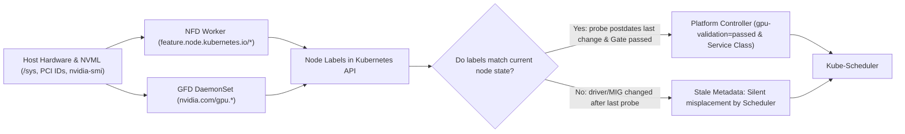
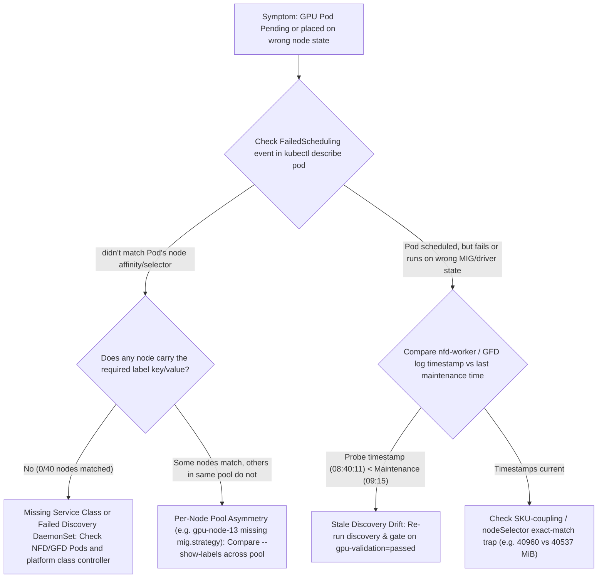

# 11.3 Node Feature Discovery and GPU Feature Discovery

| | |
|---|---|
| Level | Intermediate |
| Priority tier | 1 |
| Lab venue | GCP / GKE (plus local Python 3 simulation lab) |
| Part | Part 11: GPUs on Kubernetes, scheduling and virtualization |
| Sources used | `nvidia-zero-to-hero/volume-10/chapter-05-node-and-gpu-feature-discovery.md`; `nvidia-zero-to-hero/volume-10/labs/lab-01-inspect-a-kubernetes-gpu-node.md`; `volume-04/02-gpu-software-operator-masterclass.md`; Roland Huß et al., *Generative AI on Kubernetes* (O'Reilly, 2026, Ch. 3); *Kubernetes for Generative AI Solutions* (Packt, 2025, Ch. 10) |
| Coverage file | `planning/coverage/chapters/11-03.md` |

## Why this matters for AI infrastructure

An allocator can assign only the resources it knows about, and a scheduler can discriminate only on facts that reach the Kubernetes API. As we saw in Chapter 11.2, the NVIDIA Device Plugin answers *how many* healthy GPU units (`nvidia.com/gpu`) exist on a node. It intentionally does not answer *what kind* of GPU is installed, whether the card has `16 GB` or `80 GB` of high-bandwidth memory, whether its Streaming Multiprocessors support `BF16` or `FP8` tensor cores, whether Multi-Instance GPU (MIG) partitioning or time-slicing is active, or whether the node has passed the platform team's post-maintenance acceptance gate.

In a heterogeneous AI cluster—for example, a cluster with `10` older NVIDIA T4 GPU nodes (`16 GB` VRAM each, Turing architecture) intended for lightweight inference and `10` NVIDIA H100 GPU nodes (`80 GB` HBM3 each, Hopper architecture) intended for large-scale training—a bare `limits.nvidia.com/gpu: 1` request treats all `20` nodes as interchangeable. Without descriptive node metadata:
- A small `7B`-parameter quantized model requiring `8 GB` of VRAM can land on an `80 GB` H100 node, stranding expensive training capacity.
- Conversely, a `70B`-parameter LLM or an Ampere/Hopper `BF16` workload (`compute.major >= 8`) can land on a `16 GB` T4 or Volta V100 node and crash immediately with an out-of-memory error or an unsupported instruction exception.

Labeling `1,000` GPU worker nodes by hand is operationally impossible and guaranteed to drift across kernel upgrades, MIG reconfigurations, and RMA hardware replacements. Kubernetes solves this through a two-stage automated discovery pipeline:
1. **Node Feature Discovery (`NFD`):** A vendor-neutral Kubernetes SIG project (`kubernetes-sigs/node-feature-discovery`) whose node-local worker inspects `/sys`, `/proc`, CPUID flags, kernel versions, and the PCIe bus (`lspci` class and vendor IDs such as `0302` and `10de`) and publishes `feature.node.kubernetes.io/*` labels before any GPU driver is even installed.
2. **GPU Feature Discovery (`GFD`):** An NVIDIA-specific DaemonSet (deployed standalone or by the NVIDIA GPU Operator once NFD detects PCI vendor `10de`) that queries the loaded NVIDIA driver via NVML / `nvidia-smi` to publish rich `nvidia.com/*` labels—including exact product SKU, memory in MiB, architecture family, CUDA driver/runtime versions, compute capability major/minor numbers, MIG strategy, and time-slicing replica counts.

However, exposing raw discovery labels directly to application teams creates a second production trap: **SKU-coupled manifest fragility**. When dozens of workload manifests hard-code `nvidia.com/gpu.product: NVIDIA-A100-80GB`, retiring an older node pool or adding a newer GPU generation forces a coordinated migration across every application repository. And when NFD or GFD fails to re-run after a maintenance window (such as a `09:15` MIG reconfiguration following an `08:40:11` discovery probe), stale labels cause `kube-scheduler` to make confident, silent misplacements with zero errors logged.

This chapter covers both halves of the discovery problem: the exact technical mechanics of NFD and GFD label generation (`Table 3-1` in *Generative AI on Kubernetes*) and the platform engineering governance model (`Discovered Facts` vs `Lifecycle Assertions` vs `Service Classes`) required to keep GPU scheduling portable, secure, and drift-free.

## Prerequisites and outcomes

### Prerequisites
- Completion of Chapter 11.1 (the seven-layer GPU platform model) and Chapter 11.2 (the Kubernetes Device Plugin `Register`/`ListAndWatch`/`Allocate` contract and `nvidia.com/gpu` extended-resource rules).
- Basic familiarity with Kubernetes `nodeSelector`, `nodeAffinity`, and `taints`/`tolerations`.

### Outcomes
After completing this chapter, you will be able to:
- Explain how Node Feature Discovery (`NFD`) probes PCIe class and vendor IDs (`0302` 3D controller, `0300` VGA controller, `10de` NVIDIA, `1002` AMD, `8086` Intel, `1d0f` AWS) to bootstrap GPU Operator reconciliation via `feature.node.kubernetes.io/pci-10de.present=true`.
- Interpret every GPU Feature Discovery (`GFD`) label in the `nvidia.com/*` namespace—including how `nvidia.com/gpu.product`, `nvidia.com/gpu.count`, and `nvidia.com/gpu.memory` transform under time-slicing (`-SHARED`, `replicas: 8`) and MIG (`single` `-MIG-1g.5gb` vs `mixed` `nvidia.com/mig-<profile>.count`).
- Design a three-tier label taxonomy that separates **Discovered Facts** (owned by NFD/GFD), **Lifecycle Assertions** (`gpu-validation=passed`, owned by platform validation controllers), and **Service Classes** (`gpu.platform.example/class`, owned by platform engineering).
- Quantify why service-class labels eliminate application manifest churn during hardware refreshes across multi-generation fleets (`80` nodes across `30` `NVIDIA-A100-80GB`, `30` `NVIDIA-H100-80GB-HBM3`, and `20` `NVIDIA-A100-40GB`).
- Construct production-grade `nodeSelector`, `nodeAffinity` (`Gt` memory bounds combined with weighted architecture preferences), and `NoSchedule` taint/toleration specifications.
- Diagnose Pending Pods and silent misplacements caused by NFD/GFD timestamp drift (`08:40:11` vs `09:15`) and per-node label asymmetry (`gpu-node-19` vs `gpu-node-13`).

## Concepts: basics to intermediate to advanced

### 1. Basics: Node Feature Discovery (NFD) and GPU Feature Discovery (GFD)

Why are there two separate discovery components (`NFD` and `GFD`) instead of a single daemon? Because of the **chicken-and-egg problem on a freshly booted node**:
- When a bare-metal or cloud worker node first joins a Kubernetes cluster, it may not have an NVIDIA kernel driver (`nvidia.ko`) or `nvidia-smi` installed yet. A tool that relies on NVML (`libnvidia-ml.so.1`) cannot detect a GPU on a driverless node.
- The PCI Express bus, however, is enumerated by the Linux kernel at boot time regardless of whether a vendor driver is loaded.

#### Stage 1: Node Feature Discovery (NFD) — OS, CPU, and PCIe bus discovery
Node Feature Discovery (`kubernetes-sigs/node-feature-discovery`) runs a lightweight agent (`nfd-worker`) as a DaemonSet on every node in the cluster (both CPU and GPU nodes) alongside a control-plane `nfd-master` controller. The `nfd-worker` inspects `/sys`, `/proc`, CPUID instructions, kernel configuration, and PCIe configuration space, then sends a labeling request to `nfd-master` to patch the `Node` object in the Kubernetes API.

As shown in *Generative AI on Kubernetes* (Example 3-2) and `volume-10/chapter-05`, NFD labels always use the prefix `feature.node.kubernetes.io/`. For PCIe devices, NFD uses the default format `pci-<class>_<vendor>.present: "true"` (and the GPU Operator also matches `feature.node.kubernetes.io/pci-10de.present=true`):

| PCIe Class / Vendor Code | Meaning | Example NFD Label | Operational significance |
|---|---|---|---|
| **Class `0302`** | PCI 3D Controller (headless data-center GPUs such as A100, H100) | `feature.node.kubernetes.io/pci-0302_10de.present: "true"` | Proves a physical NVIDIA 3D controller is attached to the PCIe bus |
| **Class `0300`** | PCI VGA Compatible Controller (display-capable GPUs or virtual cloud VGA) | `feature.node.kubernetes.io/pci-0300_1d0f.present: "true"` | Typical on AWS EC2 instances where vendor `1d0f` (AWS) exposes a virtual VGA controller |
| **Vendor `10de`** | NVIDIA Corporation | `feature.node.kubernetes.io/pci-10de.present: "true"` | Primary trigger label watched by the NVIDIA GPU Operator to deploy driver, toolkit, and GFD DaemonSets |
| **Vendor `1002`** | Advanced Micro Devices (AMD) | `feature.node.kubernetes.io/pci-0302_1002.present: "true"` | Identifies AMD Instinct / ROCm GPU nodes |
| **Vendor `8086`** | Intel Corporation | `feature.node.kubernetes.io/pci-0302_8086.present: "true"` | Identifies Intel discrete/integrated GPU devices |
| **Vendor `1d0f`** | Amazon Web Services (AWS) | `feature.node.kubernetes.io/pci-0300_1d0f.present: "true"` | Identifies AWS EC2 virtual display hardware |

Beyond PCIe IDs, NFD publishes rich CPU and kernel feature labels:
- `feature.node.kubernetes.io/cpu-cpuid.AVX512F: "true"` (AVX-512 Foundation instruction support)
- `feature.node.kubernetes.io/cpu-hardware_multithreading: "true"`
- `feature.node.kubernetes.io/cpu-model.family: "6"`
- `feature.node.kubernetes.io/cpu-model.id: "85"`
- `feature.node.kubernetes.io/cpu-model.vendor_id: "Intel"`
- `feature.node.kubernetes.io/kernel-selinux.enabled: "true"`
- `feature.node.kubernetes.io/kernel-version.full: "5.14.0-427.62.1.el9_4.x86_64"`

Crucially, NFD tells the cluster *"PCI vendor `10de` is present on this node and the kernel is `5.14.0-427.62.1.el9_4.x86_64`"*—which is all the NVIDIA GPU Operator needs to schedule the `nvidia-driver-daemonset` Pod onto that node.

#### Stage 2: GPU Feature Discovery (GFD) — NVML hardware and sharing introspection
Once the NVIDIA driver is loaded on the node, **GPU Feature Discovery (`GFD`)** starts as a DaemonSet on GPU-equipped nodes. GFD queries NVML and `nvidia-smi` directly and publishes detailed `nvidia.com/*` node labels.

The complete taxonomy of GFD labels (synthesizing Table 3-1 of *Generative AI on Kubernetes*, `volume-10/chapter-05`, and `volume-04/02-gpu-software-operator-masterclass.md` Section 14) is summarized below:

| GFD Node Label Key | Description | Example Value (A100 40GB) | Example Value (H100 80GB `gpu-node-03`) |
|---|---|---|---|
| `nvidia.com/gpu.present` | Confirms NVIDIA GPU discovery succeeded | `"true"` | `"true"` |
| `nvidia.com/gpu.count` | Number of schedulable GPUs, MIG instances, or time-sliced virtual GPUs on the node | `"4"` (or `"14"` for two A100s in `7x 1g.5gb` single MIG; `"80"` for `10` GPUs with `replicas: 8`) | `"8"` |
| `nvidia.com/gpu.product` | GPU model name; appends `-MIG-<profile>` in `single` MIG mode and `-SHARED` in time-slicing mode | `"A100-SXM4-40GB"` (or `"NVIDIA-A100-SXM4-40GB"`) | `"NVIDIA-H100-80GB-HBM3"` |
| `nvidia.com/gpu.memory` | Framebuffer memory per GPU or per `single`-MIG slice in **MiB** | `"40537"` (or `"40960"`) | `"81920"` |
| `nvidia.com/gpu.family` | GPU microarchitecture family | `"ampere"` | `"hopper"` (T4 is `"turing"`) |
| `nvidia.com/cuda.driver-version.full` | Full installed NVIDIA host driver version | `"525.105.17"` | `"550.90.07"` |
| `nvidia.com/cuda.runtime.version.full` | Full supported CUDA runtime version exposed by the driver | `"12.2"` | `"12.4"` |
| `nvidia.com/gpu.compute.major` | Major CUDA Compute Capability version | `"8"` | `"9"` |
| `nvidia.com/gpu.compute.minor` | Minor CUDA Compute Capability version | `"0"` | `"0"` |
| `nvidia.com/gpu.machine` | Host chassis / machine type or cloud instance family | `"dgx-a100"` | Cloud/chassis string |
| `nvidia.com/mig.capable` | Whether the physical GPU supports Multi-Instance GPU partitioning | `"true"` | `"true"` |
| `nvidia.com/mig.strategy` | Active MIG strategy (`"single"`, `"mixed"`, or unset/`"none"` if disabled) | `"single"` or `"mixed"` | `"single"` |
| `nvidia.com/mig-<profile>.count` | Count of a specific MIG profile when `mig.strategy=mixed` | `"2"` (for `nvidia.com/mig-1g.5gb.count`) | Per-profile count in `mixed` mode |
| `nvidia.com/gpu.replicas` | Virtual GPU overcommit multiplier per physical GPU (or MIG slice) under time-slicing | `"8"` (when `replicas: 8` is set) | `"1"` (when exclusive) |

#### How GFD labels mutate under Time-Slicing and MIG
Pay close attention to how GFD modifies `nvidia.com/gpu.product` and `nvidia.com/gpu.count` when sub-GPU sharing is enabled (*Generative AI on Kubernetes*, Chapter 3):
1. **Time-Slicing (`replicas: 8`):** If a node has `10` physical GPUs (`1` GPU -> `8` virtual replicas; `10` GPUs -> `80` virtual replicas), GFD sets `nvidia.com/gpu.count: "80"`, adds `nvidia.com/gpu.replicas: "8"`, and appends `-SHARED` to the product label (`nvidia.com/gpu.product: A100-SXM4-40GB-SHARED`). Workloads that require exclusive full-GPU access can explicitly avoid shared nodes by matching product names without the `-SHARED` suffix (or when `renameByDefault: true` is set in the device plugin ConfigMap, shared GPUs are advertised under the separate resource name `nvidia.com/gpu.shared`).
2. **Single MIG Strategy (`mig.strategy: single`):** All GPUs on the node are partitioned identically, and slices are advertised under the standard `nvidia.com/gpu` resource name. If a node with `2` physical A100-40GB GPUs is partitioned into seven `1g.5gb` slices per GPU, the node advertises `nvidia.com/gpu: 14` and GFD updates the node labels to `nvidia.com/gpu.count: "14"` and `nvidia.com/gpu.product: A100-SXM4-40GB-MIG-1g.5gb`.
3. **Mixed MIG Strategy (`mig.strategy: mixed`):** Slices are advertised under profile-specific extended resource names (`nvidia.com/mig-1g.5gb`, `nvidia.com/mig-2g.10gb`, `nvidia.com/mig-3g.20gb`, `nvidia.com/mig-4g.20gb`), and GFD publishes per-profile count labels such as `nvidia.com/mig-1g.5gb.count: "2"`.
4. **Combined MIG + Time-Slicing:** If a GPU is split into `2` MIG instances and each MIG instance is oversubscribed `2` times with time-slicing (`4` schedulable units per physical GPU), GFD appends `-SHARED` to the MIG product label (`...-MIG-1g.5gb-SHARED`).

---

### 2. Intermediate: Label-based scheduling patterns (`nodeSelector`, `nodeAffinity`, and `taints`)

Once NFD and GFD populate node labels, Kubernetes provides three complementary scheduling mechanisms to steer GPU workloads (`Generative AI on Kubernetes`, Chapter 3, "Label-Based Scheduling"):

| Mechanism | Direction of control | Expressiveness | Best production use case |
|---|---|---|---|
| **`nodeSelector`** | **Pod selects Node** (hard exact key-value match) | Exact string equality only (`key: value`); cannot express `Gt`, `In`, or fallback preferences | Small, homogeneous fleets or hard capability gates (e.g., `nvidia.com/gpu.compute.major: "8"`) |
| **`nodeAffinity`** | **Pod selects Node** (`required` hard filter + `preferred` weighted soft scoring) | Set/comparison operators (`In`, `NotIn`, `Exists`, `DoesNotExist`, `Gt`, `Lt`) and weighted preferences (`weight: 1..100`) | Heterogeneous multi-generation clusters (e.g., require `gpu.memory Gt 40000` MiB, prefer `gpu.family In [hopper]`) |
| **`Taints` and `Tolerations`** | **Node repels Pod** unless Pod carries matching `toleration` | `NoSchedule`, `PreferNoSchedule`, `NoExecute` with `Equal` or `Exists` operators | Protecting expensive GPU pools from CPU-only Pods; note that **a toleration grants eligibility but does NOT select the GPU node** |

#### Pattern 1: Exact matching with `nodeSelector`
In *Generative AI on Kubernetes* (Example 3-3), a single line pins an inference server to nodes equipped with an NVIDIA Tesla T4:
```yaml
# Example 3-3: Direct selection with nodeSelector (untested here)
apiVersion: v1
kind: Pod
metadata:
  name: t4-inference
spec:
  containers:
    - name: server
      image: myrepo/llm-server:latest
      resources:
        limits:
          nvidia.com/gpu: 1
  nodeSelector:
    nvidia.com/gpu.product: Tesla-T4
```
Similarly, in `volume-04/02-gpu-software-operator-masterclass.md` (Section 14.1), a `vllm/vllm-openai:latest` deployment requesting `4` GPUs uses `nodeSelector` (`nvidia.com/gpu.compute.major: "8"` and `nvidia.com/gpu.memory: "40960"`) to guarantee it never lands on an older Volta V100 (`compute.major: "7"`) that lacks hardware `BF16` support. However, remember the sharp edge of `nodeSelector`: because it performs exact string matching, `nvidia.com/gpu.memory: "40960"` matches *only* `40960`—it will reject an `81920` MiB A100-80GB or H100-80GB node, and it will even reject an A100-40GB node if GFD reports usable memory as `"40537"` MiB instead of `"40960"` MiB.

#### Pattern 2: Numeric bounds and soft preferences with `nodeAffinity`
To express *"at least 40 GB of VRAM, and prefer Hopper H100 over Ampere A100 when available,"* use `nodeAffinity` with the `Gt` operator (*Generative AI on Kubernetes*, Example 3-4):

```yaml
# Example 3-4: Node affinity with Gt memory threshold and Hopper preference (untested here)
apiVersion: v1
kind: Pod
metadata:
  name: a100-preferred
spec:
  containers:
    - name: llm
      image: myrepo/mt-server:latest
      resources:
        limits:
          nvidia.com/gpu: 4
  affinity:
    nodeAffinity:
      requiredDuringSchedulingIgnoredDuringExecution:
        nodeSelectorTerms:
          - matchExpressions:
              - key: nvidia.com/gpu.memory
                operator: Gt
                values: ["40000"]
      preferredDuringSchedulingIgnoredDuringExecution:
        - weight: 1
          preference:
            matchExpressions:
              - key: nvidia.com/gpu.family
                operator: In
                values: ["hopper"]
```

How `kube-scheduler` evaluates this manifest across three node pools:
1. **`Tesla-T4` node (`nvidia.com/gpu.memory: "16384"`, `family: "turing"`):** Filtered out during the `Filter` phase because `16384` is not greater than `"40000"`.
2. **`A100-SXM4-40GB` node (`nvidia.com/gpu.memory: "40537"`, `family: "ampere"`):** Passes the `requiredDuringSchedulingIgnoredDuringExecution` filter (`40537 > 40000`) with a preferred score contribution of `0`.
3. **`NVIDIA-H100-80GB-HBM3` node (`nvidia.com/gpu.memory: "81920"`, `family: "hopper"`):** Passes the required filter (`81920 > 40000`) and receives `+1` (`weight: 1`) during the `Score` phase. If an H100 node is free, the Pod lands on H100; if all H100 nodes are full, the Pod gracefully falls back to the `40537` MiB A100 node instead of staying `Pending`.

#### Pattern 3: Pool protection with `Taints` and `Tolerations`
Neither `nodeSelector` nor `nodeAffinity` prevents ordinary CPU microservices (which do not request `nvidia.com/gpu`) from landing on a GPU node and consuming its `64` CPU cores or `520192000Ki` of host RAM—starving future GPU Pods of host CPU/memory.

To fence off GPU nodes, administrators taint every GPU node with `NoSchedule` (*Generative AI on Kubernetes* Examples 3-5 and 3-6, `Lab 01`, and *Kubernetes for Generative AI Solutions* Chapter 10):

```bash
# Taint all nodes that carry the GFD nvidia.com/gpu.count label (untested here)
kubectl taint nodes -l nvidia.com/gpu.count nvidia.com/gpu=true:NoSchedule
```

(On GPU Operator clusters, you will also see `nvidia.com/gpu=present:NoSchedule`; on EKS managed node groups such as `eks-gpu-mng` with `g6.2xlarge` instances, Terraform applies `key = "nvidia.com/gpu", value = "true", effect = "NO_SCHEDULE"` alongside node label `hardware-type=gpu`.)

A GPU workload (`ghcr.io/huggingface/tgi:latest` with `replicas: 2` in Example 3-6, or `gpu-demo-pod` in *K8GS* Chapter 10) must then pair its `tolerations` with a selector/affinity rule and its `nvidia.com/gpu` limit:

```yaml
# Pairing toleration + selector + extended-resource limit (untested here)
apiVersion: apps/v1
kind: Deployment
metadata:
  name: gpu-serving
spec:
  replicas: 2
  template:
    spec:
      tolerations:
        - key: "nvidia.com/gpu"
          operator: "Exists"
          effect: "NoSchedule"
      nodeSelector:
        gpu.platform.example/class: inference-general
      containers:
        - name: tgi
          image: ghcr.io/huggingface/tgi:latest
          resources:
            limits:
              nvidia.com/gpu: 1
```

Remember the golden rule from `volume-10/chapter-05`: **a toleration only grants permission to be considered on a tainted node; it does not attract the Pod to that node.** A Pod with a toleration for `nvidia.com/gpu` and no `nvidia.com/gpu` resource request or node selector can still be scheduled onto a CPU-only node.

---

### 3. Advanced: Facts, assertions, service classes, and discovery drift



#### The three-tier label taxonomy: Discovered Facts vs Lifecycle Assertions vs Service Classes
As `volume-10/chapter-05` establishes, the single most important architectural decision in node labeling is separating **who observes a hardware fact**, **who asserts operational readiness**, and **what contract application teams target in their YAML manifests**:

| Label Tier | Example Label Key & Value | Authoritative Writer | Intended Consumer | Why this boundary matters |
|---|---|---|---|---|
| **1. Discovered Fact** | `feature.node.kubernetes.io/pci-10de.present=true`, `nvidia.com/gpu.product=NVIDIA-H100-80GB-HBM3`, `nvidia.com/gpu.memory=81920`, `nvidia.com/mig.capable=true` | Discovery daemons (`nfd-worker`, `gpu-feature-discovery`) | Platform controllers, GPU Operator state machine, inventory audits, diagnostics | Describes raw hardware observed at a point in time. **Does NOT prove the driver is healthy right now or that the node passed validation.** |
| **2. Lifecycle Assertion** | `gpu-validation=passed`, `platform.example/network-validated=true`, `platform.example/maintenance=pending` | Controlled platform validation / lifecycle controller | Admission webhooks, node-readiness gates, SRE automation | Proves that the driver, container toolkit, device plugin, and a real CUDA validation workload (`GPU_NODE_VALIDATED`) succeeded after the last change. |
| **3. Service Class** | `gpu.platform.example/class=training-topology`, `gpu.platform.example/class=inference-general`, `gpu.platform.example/class=mig-serving` | Platform engineering (governed controller / node-pool config) | Application workload manifests (`nodeSelector` / `nodeAffinity`) | Decouples tenant manifests from specific hardware SKUs so the platform can refresh hardware underneath a stable SLO class. |

Why is `nvidia.com/gpu.product=NVIDIA-H100-80GB-HBM3` insufficient evidence that a node can run a workload? Because GFD writes that label when its probe runs, and the label persists on the Kubernetes `Node` object even if the GPU driver subsequently crashes, a MIG partition is reconfigured, or the InfiniBand/RoCE fabric fails validation. Similarly, `nvidia.com/mig.capable=true` only states that the silicon *supports* MIG—it does not mean MIG mode is currently enabled or that `nvidia.com/mig-1g.10gb` is allocatable on the node.

#### Quantifying SKU-coupling blast radius across an `80`-node fleet
To see why application manifests must target **Service Classes** (`gpu.platform.example/class=inference-general`) rather than raw `nvidia.com/gpu.product` SKU strings, consider the worked fleet calculation from `volume-10/chapter-05`:
- Suppose an enterprise operates **`80` GPU worker nodes** acquired across three hardware refreshes over **`18` months**:
  - **`30` nodes** with `nvidia.com/gpu.product=NVIDIA-A100-80GB`
  - **`30` nodes** with `nvidia.com/gpu.product=NVIDIA-H100-80GB-HBM3`
  - **`20` older nodes** with `nvidia.com/gpu.product=NVIDIA-A100-40GB`
- Suppose `45` application manifests across the company hard-code `nodeSelector: {nvidia.com/gpu.product: NVIDIA-A100-40GB}` (or `NVIDIA-A100-80GB`).
- When the platform team retires the **`20` oldest nodes** and replaces them with a fourth generation (such as `H200` or `B200`), **all `45` application manifests break simultaneously** (`0` matching nodes) and cannot overflow onto the other `60` nodes in the cluster until `45` application teams edit and redeploy their YAML under a deadline.
- By contrast, when those `45` manifests target a governed service class (`gpu.platform.example/class=inference-general`), retiring the `20` old nodes and qualifying their replacements requires updating **one (`1`) platform controller rule**, and **zero (`0`) application manifests change**.

#### Security and RBAC integrity of node labels
Node labels directly control workload placement, multi-tenant isolation, hardware licensing boundaries, and compliance zones. If a tenant service account or a compromised workload on a node has RBAC permission to `patch` `Node` objects, it can forge `gpu.platform.example/class` or remove maintenance labels to steer workloads onto unauthorized hardware. Enforce three security controls:
1. Restrict `Node` label write permissions strictly to the `NodeRestriction` admission plugin, `nfd-master`, `gpu-feature-discovery`, and the platform validation controller.
2. Place manual operator override labels in a separate prefix with an automated TTL/expiry audit.
3. Gate production scheduling on `gpu-validation=passed`, removing that label automatically before any driver upgrade, MIG change, or node drain begins.

## Commands and configurations that matter

### 1. Deploying NFD and inspecting both NFD and GFD labels on a GPU node

As shown in *Generative AI on Kubernetes* (Example 3-1), NFD can be deployed standalone via Kustomize (or managed automatically by the NVIDIA GPU Operator with `nfd.enabled: true`):

```bash
# Deploy Node Feature Discovery via Kustomize (untested here)
NFD_REPO=https://github.com/kubernetes-sigs/node-feature-discovery
kubectl apply -k "$NFD_REPO/deployment/overlays/default"
```

When installed alongside the NVIDIA device plugin Helm chart (as in *Kubernetes for Generative AI Solutions* Chapter 10 using the `aws-ia/eks-data-addons/aws` Terraform module with `enable_nvidia_device_plugin = true`), verify the three DaemonSets:

```bash
# Verify device plugin, GFD, and NFD worker DaemonSets (untested here)
kubectl get ds -n nvidia-device-plugin --no-headers
```

Expected output:
```text
nvidia-device-plugin
nvidia-device-plugin-gpu-feature-discovery
nvidia-device-plugin-node-feature-discovery-worker
```

To inspect the combined NFD and GFD labels on an H100 node (`gpu-node-03` from `volume-10/chapter-05`):

```bash
# Inspect NFD and GFD labels on gpu-node-03 (untested here)
kubectl get node gpu-node-03 --show-labels | tr ',' '\n' | grep -E 'nvidia.com|feature.node'
```

Expected output:
```text
feature.node.kubernetes.io/cpu-cpuid.AVX512F=true
feature.node.kubernetes.io/pci-10de.present=true
nvidia.com/cuda.driver-version.full=550.90.07
nvidia.com/gpu.compute.major=9
nvidia.com/gpu.count=8
nvidia.com/gpu.memory=81920
nvidia.com/gpu.product=NVIDIA-H100-80GB-HBM3
nvidia.com/mig.capable=true
nvidia.com/mig.strategy=single
```

### 2. Verifying NFD worker probe freshness in logs

To verify when `nfd-worker` last probed the host and whether any labels changed (`volume-10/chapter-05`):

```bash
# Check NFD worker probe timestamp and change count (untested here)
kubectl logs -n node-feature-discovery nfd-worker-gpu-node-03-x7q2n --tail=5
```

Expected output:
```text
I0812 11:00:02.771001       1 nfd-worker.go:451] labeling node "gpu-node-03" with feature labels
I0812 11:00:02.771312       1 nfd-worker.go:452] 42 label(s), 3 changed since last run
I0812 11:00:02.803009       1 nfd-worker.go:470] sending labeling request to nfd-master
```

### 3. Auditing label consistency across a uniform node pool

To catch per-node discovery drift across a node pool (`gpu-node-19` and `gpu-node-13` from `volume-10/chapter-05`), diff the `nvidia.com/mig` labels across nodes:

```bash
# Compare MIG discovery labels across peer nodes in the same pool (untested here)
for n in gpu-node-19 gpu-node-13; do
  echo "== $n =="
  kubectl get node "$n" --show-labels | tr ',' '\n' | grep 'nvidia.com/mig'
done
```

Expected output when `gpu-node-13` has drifted:
```text
== gpu-node-19 ==
nvidia.com/mig.capable=true
nvidia.com/mig.strategy=single
== gpu-node-13 ==
nvidia.com/mig.capable=true
```

## How it fails

Discovery failures fall into two distinct categories: **loud scheduling blocks** (where Pods stay `Pending` because a required label is missing) and **silent misplacements** (where Pods schedule onto the wrong hardware state because a label is stale).



| Failure mode | Exact symptom & command evidence | Root cause boundary | Remediation |
|---|---|---|---|
| **1. Missing service-class label blocks all `40` nodes (`0/40 nodes are available`)** | Pod `training-job-0` stays `Pending`. `kubectl describe pod training-job-0` prints: `Warning FailedScheduling 55s default-scheduler 0/40 nodes are available: 40 node(s) didn't match Pod's node affinity/selector: key "gpu.platform.example/class" value "training-topology" not found.` even though `25` of the `40` nodes have healthy GPUs. | **Platform Service-Class / Discovery Publication Boundary:** Every node was rejected by the label predicate before GPU capacity was even checked. | Do not weaken the workload's selector first. Verify why the platform controller or discovery pipeline failed to publish `gpu.platform.example/class=training-topology` on the `25` qualified nodes after validation. |
| **2. Post-maintenance stale label drift (`08:40:11` probe vs `09:15` MIG change)** | A node's MIG configuration is changed during maintenance at `09:15`, but workloads targeting the old MIG state still land on `gpu-node-19` and fail. `kubectl logs -n node-feature-discovery nfd-worker-gpu-node-19-p8k1 --tail=3` shows `I0812 08:40:11.002331 ... labeling node "gpu-node-19"` and `0 label(s) changed since last run`. | **Discovery Freshness Boundary:** The discovery worker has not re-probed the node since `08:40:11`, leaving stale MIG/driver labels active in the Kubernetes API after the `09:15` change. | Remove `gpu-validation=passed` before maintenance starts, trigger an explicit GFD/NFD re-probe after the `09:15` reconfiguration, and re-admit the node only after labels postdate `09:15` and validation passes. |
| **3. Intra-pool label asymmetry (`gpu-node-19` vs `gpu-node-13`)** | Workloads intermittently fail or experience reduced eligible capacity in a pool that is supposed to be uniform. Comparing `--show-labels` shows `gpu-node-19` has `nvidia.com/mig.capable=true` and `nvidia.com/mig.strategy=single`, while `gpu-node-13` has only `nvidia.com/mig.capable=true` (`mig.strategy` is absent). | **Per-Node GFD / MIG Manager Drift Boundary:** The GFD Pod on `gpu-node-13` failed to query NVML or MIG Manager did not finish applying the `single` strategy on `gpu-node-13`. | Inspect the `gpu-feature-discovery` and `mig-manager` Pod logs on `gpu-node-13`, reconcile its MIG state to match `gpu-node-19`, and alert on label set diffs across nodes in the same pool. |
| **4. `nodeSelector` exact-string trap on memory or SKU (`40960` vs `40537` MiB)** | A Deployment with `nodeSelector: {nvidia.com/gpu.memory: "40960"}` stays `Pending` on an A100-40GB cluster where GFD reports `nvidia.com/gpu.memory: "40537"` (or on an upgraded H100 cluster reporting `"81920"`). | **Manifest Over-Specification Boundary:** `nodeSelector` performs exact string equality (`"40960" != "40537"` and `"40960" != "81920"`). | Replace exact-string `nodeSelector` memory checks with `nodeAffinity` using `operator: Gt` and `values: ["40000"]`, or select on a governed platform service class. |
| **5. `nvidia.com/mig.capable=true` mistaken for active MIG resources** | A Pod requesting `limits: {nvidia.com/mig-1g.10gb: 1}` targets `nodeSelector: {nvidia.com/mig.capable: "true"}`, binds or stays `Pending` with `Insufficient nvidia.com/mig-1g.10gb`. | **Inventory vs Configuration Boundary:** `mig.capable=true` only means the A100/H100 hardware supports MIG; it does not mean MIG mode is enabled or that `1g.10gb` slices have been created. | Coordinate label selectors with the actual extended resources advertised by the device plugin (`nvidia.com/mig.strategy` and `nvidia.com/mig-1g.10gb.count`). |

## Hands-on lab

### Venue and scope
This lab runs locally using Python 3 standard library (`code/part11/nfd_and_gfd.py` and `code/part11/nfd_and_gfd_lab.py`) to simulate NFD PCI/CPU/kernel label generation (`0302_10de`, `0300_1d0f`), GFD NVML label synthesis across exclusive, time-sliced (`-SHARED`), and MIG (`single` vs `mixed`) modes, the three-tier label governance model, the `80`-node fleet refresh blast-radius calculator, `nodeAffinity` `Gt` + `preferred` scoring, and post-maintenance drift detection (`08:40:11` vs `09:15:00`). Cluster `kubectl` commands are marked `(untested here)` for execution on a live GKE / Kubernetes cluster.

### Step 1: Run the self-checking NFD and GFD simulation lab (tested here)

Run the lab script from the repository root:

```bash
python3 code/part11/nfd_and_gfd_lab.py
```

Captured output from this repository:
```text
=== Chapter 11.3 Lab: Node Feature Discovery (NFD) and GPU Feature Discovery (GFD) ===
  [PASS] PCI vendor table maps 10de->NVIDIA, 1002->AMD, 8086->Intel, 1d0f->AWS
  [PASS] PCI class table maps 0302->3D controller (GPU) and 0300->VGA controller
  [PASS] NFD sets pci-0302_10de.present=true and pci-0300_1d0f.present=true
  [PASS] NFD sets pci-10de.present=true trigger label for GPU Operator
  [PASS] NFD sets CPU AVX512F, family 6, model id 85, and vendor Intel
  [PASS] NFD sets kernel-selinux.enabled=true and kernel-version.full=5.14.0-427.62.1.el9_4.x86_64
  [PASS] GFD Table 3-1 baseline sets count=4, product=A100-SXM4-40GB, memory=40537
  [PASS] GFD sets family=ampere, driver=525.105.17, cuda.runtime=12.2
  [PASS] GFD sets compute.major=8, compute.minor=0, machine=dgx-a100
  [PASS] GFD on gpu-node-03 sets NVIDIA-H100-80GB-HBM3, memory=81920, compute.major=9, driver=550.90.07
  [PASS] Time-slicing (replicas=8 on 10 GPUs) appends -SHARED and sets gpu.count=80
  [PASS] Single MIG strategy on 2 A100s (7x 1g.5gb) sets product=...-MIG-1g.5gb and gpu.count=14
  [PASS] Mixed MIG strategy publishes per-profile counts (mig-1g.5gb.count=2, mig-3g.20gb.count=1)
  [PASS] Combined MIG (2 slices) + Time-Slicing (2 replicas) appends -SHARED and exposes 4 units
  [PASS] nvidia.com/gpu.product is classified as discovered_fact for platform automation
  [PASS] gpu-validation is classified as lifecycle_assertion for admission and operations
  [PASS] gpu.platform.example/class is classified as service_class for workload manifests
  [PASS] Fleet refresh models 80 GPU nodes across 3 generations retiring 20 oldest nodes
  [PASS] Service-class abstraction reduces broken workload manifests from 45 to 0 (1 controller update)
  [PASS] 16 GB T4 node is rejected by required Gt 40000 MiB memory matchExpression
  [PASS] 40537 MiB Ampere A100 passes Gt 40000 MiB required term with preferred score 0
  [PASS] 81920 MiB Hopper H100 passes Gt 40000 MiB required term and gains preferred score +1
  [PASS] Pod missing nvidia.com/gpu Exists toleration is repelled by NoSchedule taint
  [PASS] Detects stale NFD/GFD probe when worker timestamp (08:40:11) precedes maintenance (09:15:00)
  [PASS] Detects pool asymmetry on gpu-node-13 (missing nvidia.com/mig.strategy) and blocks admission
  [PASS] Approves pool admission once post-maintenance probe (09:20:00) reconciles uniform labels

Summary: 26 passed, 0 failed out of 26 checks.
```

### Exercises

1. **Exercise 1 — PCIe class and vendor decoding:** An AWS EC2 GPU node exposes two PCIe display/accelerator devices in NFD: `feature.node.kubernetes.io/pci-0300_1d0f.present: "true"` and `feature.node.kubernetes.io/pci-0302_10de.present: "true"`. Using `PCI_CLASS_NAMES` and `PCI_VENDOR_NAMES` in `code/part11/nfd_and_gfd.py`, identify the device class and vendor for both labels, and state what label an AMD Instinct GPU node would publish.
2. **Exercise 2 — GFD label transformation under `single` MIG:** Using `generate_gfd_labels()`, compute the exact `nvidia.com/gpu.count`, `nvidia.com/gpu.product`, and `nvidia.com/mig.strategy` labels for a node with `2` physical `A100-SXM4-40GB` GPUs configured with `mig_strategy="single"`, `single_mig_profile="1g.5gb"`, and `single_mig_slices_per_gpu=7`.
3. **Exercise 3 — Combined MIG + Time-Slicing math:** Suppose a single physical `A100-SXM4-40GB` GPU (`physical_gpu_count=1`) is partitioned into `2` MIG instances (`single_mig_slices_per_gpu=2`, `single_mig_profile="3g.20gb"`) and each MIG instance is oversubscribed with `time_slicing_replicas=2`. What values do `nvidia.com/gpu.count`, `nvidia.com/gpu.replicas`, and `nvidia.com/gpu.product` take?
4. **Exercise 4 — `nodeAffinity` filter and score evaluation:** Using `evaluate_node_affinity_candidate()` with `required_min_memory_mib=40000` and `preferred_families=("hopper",)` (`preferred_weight=1`), determine `(eligible, score)` for: (a) a `16384` MiB Turing T4 node, (b) a `40537` MiB Ampere A100 node, and (c) an `81920` MiB Hopper H100 node.
5. **Exercise 5 — Fleet refresh blast radius:** In an `80`-node fleet (`30` `NVIDIA-A100-80GB`, `30` `NVIDIA-H100-80GB-HBM3`, and `20` `NVIDIA-A100-40GB`) with `45` workload manifests, compare the number of broken application manifests and required controller configuration updates when retiring the `20` `NVIDIA-A100-40GB` nodes under direct SKU affinity versus a governed `gpu.platform.example/class` service class.
6. **Exercise 6 — Post-maintenance drift audit:** Using `detect_discovery_drift()`, explain why a node pool with `last_probe_hhmmss="08:40:11"` and `last_maintenance_hhmmss="09:15:00"` where `gpu-node-13` lacks `nvidia.com/mig.strategy` returns `safe_for_admission=False`, and what two conditions must change for `safe_for_admission` to become `True`.

## Checkpoint questions

<details>
<summary><strong>1. Why does a Kubernetes GPU platform need both Node Feature Discovery (NFD) and GPU Feature Discovery (GFD) in addition to the NVIDIA Device Plugin?</strong></summary>

The NVIDIA Device Plugin only advertises an integer count of healthy resources (`nvidia.com/gpu: 8`); it does not expose hardware characteristics to `kube-scheduler`. NFD runs on every node to detect OS, CPU, and raw PCIe bus facts (such as `feature.node.kubernetes.io/pci-0302_10de.present=true` and `pci-10de.present=true`) even before a GPU driver is installed—which triggers the GPU Operator to deploy the driver and GFD. Once the driver is loaded, GFD queries NVML to publish GPU-specific labels (`nvidia.com/gpu.product`, `gpu.memory`, `gpu.compute.major`, `mig.strategy`, `gpu.replicas`).
</details>

<details>
<summary><strong>2. In the NFD label feature.node.kubernetes.io/pci-0302_10de.present: "true", what do 0302 and 10de mean, and how do they differ from pci-0300_1d0f.present: "true"?</strong></summary>

In NFD's `<class>_<vendor>` convention:
- `0302` is the PCI device class code for a **3D controller** (such as a data-center GPU), and `10de` is the PCI vendor ID for **NVIDIA** (compare `1002` for AMD and `8086` for Intel).
- `0300` is the PCI device class code for a **VGA compatible display controller**, and `1d0f` is the PCI vendor ID for **Amazon Web Services (AWS)**, commonly seen on AWS EC2 instances.
</details>

<details>
<summary><strong>3. What are the three tiers of node labels defined in Volume 10 Chapter 5, and who is the authoritative writer and consumer of each tier?</strong></summary>

1. **Discovered fact** (e.g., `nvidia.com/gpu.product`, `feature.node.kubernetes.io/pci-10de.present`): written by discovery components (NFD/GFD) and consumed by platform automation and diagnostics.
2. **Lifecycle assertion** (e.g., `gpu-validation=passed`): written by a controlled platform validation controller after driver, runtime, plugin, and workload validation succeed, and consumed by admission control and operations.
3. **Service class** (e.g., `gpu.platform.example/class=training-topology` or `inference-general`): written by platform engineering and consumed by tenant workload manifests.
</details>

<details>
<summary><strong>4. Why is the GFD label nvidia.com/gpu.product=NVIDIA-H100-80GB-HBM3 not sufficient proof that a node is ready to run production GPU workloads?</strong></summary>

Because `nvidia.com/gpu.product` is a point-in-time hardware inventory observation written when GFD last ran. It does not prove that the host driver is currently healthy, that the container runtime can inject `/dev/nvidia*`, that the device plugin is actively registered, or that a validation container (`GPU_NODE_VALIDATED`) succeeded after the most recent maintenance event.
</details>

<details>
<summary><strong>5. How does GFD change nvidia.com/gpu.product, nvidia.com/gpu.count, and nvidia.com/gpu.replicas when time-slicing is enabled with replicas: 8 on a node with 10 physical A100-SXM4-40GB GPUs?</strong></summary>

GFD appends `-SHARED` to the product label (`nvidia.com/gpu.product: A100-SXM4-40GB-SHARED`), sets `nvidia.com/gpu.replicas: "8"`, and multiplies `nvidia.com/gpu.count` to `"80"` (`10` physical GPUs × `8` virtual replicas).
</details>

<details>
<summary><strong>6. How can a workload manifest ensure it receives an exclusive physical GPU and avoids landing on a time-sliced node?</strong></summary>

Either select on a `nvidia.com/gpu.product` (or platform service class) that does **not** carry the `-SHARED` suffix, or configure the device plugin with `renameByDefault: true` so time-sliced GPUs are advertised as `nvidia.com/gpu.shared` while exclusive GPUs remain `nvidia.com/gpu`.
</details>

<details>
<summary><strong>7. How do GFD labels differ between single MIG strategy and mixed MIG strategy on an A100 node?</strong></summary>

- In **`single` MIG strategy** (`nvidia.com/mig.strategy: single`), all GPUs on the node are partitioned identically (for example, `2` A100s split into seven `1g.5gb` slices each). All slices are advertised as `nvidia.com/gpu`, `nvidia.com/gpu.count` reports `"14"`, and `nvidia.com/gpu.product` appends the profile (`A100-SXM4-40GB-MIG-1g.5gb`).
- In **`mixed` MIG strategy** (`nvidia.com/mig.strategy: mixed`), slices are advertised under profile-specific resource names (`nvidia.com/mig-1g.5gb`, `nvidia.com/mig-4g.20gb`), and GFD publishes per-profile count labels such as `nvidia.com/mig-1g.5gb.count: "2"`.
</details>

<details>
<summary><strong>8. What does nvidia.com/mig.capable=true on gpu-node-03 prove, and what does it NOT prove?</strong></summary>

`nvidia.com/mig.capable=true` proves only that the physical GPU architecture (such as Ampere A100 or Hopper H100) supports Multi-Instance GPU partitioning. It does **not** prove that MIG mode is currently enabled on the node or that a specific partition resource (such as `nvidia.com/mig-1g.10gb`) exists and is allocatable.
</details>

<details>
<summary><strong>9. Why can using nodeSelector with nvidia.com/gpu.memory: "40960" cause unexpected Pending Pods even when 40 GB A100 or 80 GB H100 nodes are idle?</strong></summary>

`nodeSelector` performs exact string matching. Depending on the SKU and driver reporting, GFD on a 40 GB A100 often reports usable framebuffer memory as `"40537"` MiB rather than `"40960"` MiB, and an 80 GB A100/H100 reports `"81920"` MiB. An exact match on `"40960"` rejects both `"40537"` and `"81920"`. Using `nodeAffinity` with `operator: Gt` and `values: ["40000"]` avoids this trap.
</details>

<details>
<summary><strong>10. In Generative AI on Kubernetes Example 3-4, how does kube-scheduler combine requiredDuringSchedulingIgnoredDuringExecution (gpu.memory Gt 40000) with preferredDuringSchedulingIgnoredDuringExecution (gpu.family In [hopper], weight: 1)?</strong></summary>

During the **Filter** phase, `kube-scheduler` eliminates any node whose `nvidia.com/gpu.memory` is `<= 40000` MiB (excluding `16 GB` T4 nodes while keeping `40537` MiB A100 and `81920` MiB H100 nodes). During the **Score** phase, it adds `weight: 1` to nodes where `nvidia.com/gpu.family` is `"hopper"`. The Pod lands on an H100 if one is available, and falls back to an A100 if all H100s are busy.
</details>

<details>
<summary><strong>11. Why do taints and tolerations alone not steer a GPU Pod onto a GPU node?</strong></summary>

A taint (`nvidia.com/gpu=true:NoSchedule` or `nvidia.com/gpu=present:NoSchedule`) repels Pods that lack a matching toleration, and a toleration (`key: "nvidia.com/gpu", operator: "Exists", effect: "NoSchedule"`) removes that repulsion so the Pod *may* be scheduled on the tainted node. However, a toleration does not exclude untainted CPU nodes. To guarantee placement on a GPU node, the Pod must also request `nvidia.com/gpu` (or specify a `nodeSelector` / `nodeAffinity`).
</details>

<details>
<summary><strong>12. In an 80-node fleet (30 NVIDIA-A100-80GB, 30 NVIDIA-H100-80GB-HBM3, 20 NVIDIA-A100-40GB) acquired over 18 months, what happens when the 20 oldest nodes are retired if workloads use SKU-level nodeSelector versus a platform service class?</strong></summary>

If workloads hard-select `nvidia.com/gpu.product=NVIDIA-A100-40GB`, retiring those `20` nodes immediately breaks every manifest targeting that SKU (`N` teams must edit `N` manifests). If workloads target a platform service class (`gpu.platform.example/class=inference-general`), retiring the `20` nodes and adding replacement hardware requires updating `1` platform controller mapping and `0` application manifests.
</details>

<details>
<summary><strong>13. How do you prove from nfd-worker logs whether node labels on gpu-node-19 are fresh or stale after a 09:15 MIG maintenance window?</strong></summary>

Inspect the timestamp in `kubectl logs -n node-feature-discovery nfd-worker-gpu-node-19-p8k1`. In the Volume 10 Chapter 5 incident, the log showed `I0812 08:40:11.002331 ... labeling node "gpu-node-19"` with `0 label(s) changed since last run`. Because the last probe (`08:40:11`) occurred *before* the `09:15` MIG maintenance change, the node's labels in the Kubernetes API are proven stale.
</details>

<details>
<summary><strong>14. Why is stale discovery metadata dangerous even when every daemon on the node reports Running?</strong></summary>

When discovery has not re-run after a driver, GPU, or MIG change, the Kubernetes API server still holds valid-looking labels from the prior state. `kube-scheduler` trusts those labels and places Pods onto nodes whose actual hardware configuration no longer matches the Pod's requirements—producing a silent misplacement with zero scheduling errors.
</details>

<details>
<summary><strong>15. When kubectl describe pod training-job-0 shows 0/40 nodes are available: 40 node(s) didn't match Pod's node affinity/selector: key "gpu.platform.example/class" value "training-topology" not found, is the cluster out of GPUs?</strong></summary>

No. When all `40` nodes fail the `node affinity/selector` predicate, `kube-scheduler` excluded every node during label filtering before evaluating GPU capacity (`Insufficient nvidia.com/gpu` would appear if capacity were the blocker). Either the `training-topology` service class was never applied to the `25` qualified nodes or discovery/validation stripped the label.
</details>

<details>
<summary><strong>16. Why is per-node label asymmetry (such as gpu-node-19 having nvidia.com/mig.strategy=single while peer gpu-node-13 has only nvidia.com/mig.capable=true) often masked until a rescheduling event occurs?</strong></summary>

As long as `gpu-node-19` has free capacity, Pods requiring `nvidia.com/mig.strategy=single` schedule cleanly onto `gpu-node-19` and succeed. The missing label on `gpu-node-13` remains hidden until `gpu-node-19` fills up or drains—or conversely, a Pod that does not check `mig.strategy` lands on `gpu-node-13` and encounters an unexpected partitioning state.
</details>

<details>
<summary><strong>17. Why must RBAC and admission control treat node capability labels as privileged security boundaries?</strong></summary>

Node labels govern workload placement, tenant isolation, hardware licensing, and compliance pools. If a tenant or compromised node workload can mutate `Node` labels (or target restricted internal label namespaces without admission checks), it can steer unauthorized workloads onto dedicated GPU pools or falsify `gpu-validation=passed`.
</details>

<details>
<summary><strong>18. What is the difference between nvidia.com/cuda.driver-version.full and nvidia.com/cuda.runtime.version.full in GFD labels?</strong></summary>

- `nvidia.com/cuda.driver-version.full` (e.g., `525.105.17` or `550.90.07`) is the exact version of the host NVIDIA driver (`nvidia.ko` / `libcuda.so.1`) installed on the worker node.
- `nvidia.com/cuda.runtime.version.full` (e.g., `12.2` or `12.4`) is the maximum CUDA Runtime version natively supported by that host driver without requiring `/usr/local/cuda/compat` forward compatibility.
</details>

<details>
<summary><strong>19. What do nvidia.com/gpu.compute.major and nvidia.com/gpu.compute.minor represent, and why would a vLLM deployment select on compute.major: "8" or higher?</strong></summary>

They represent the GPU's **CUDA Compute Capability** (for example, `8.0` for Ampere A100, `9.0` for Hopper H100, `7.0` for Volta V100, `7.5` for Turing T4). Selecting `compute.major >= 8` ensures that workloads using hardware instructions introduced in Ampere (such as `BF16` tensor operations or FlashAttention-2 kernels) are never scheduled onto older Volta (`7.0`) or Turing (`7.5`) GPUs where they would crash at runtime.
</details>

<details>
<summary><strong>20. What five operational practices does Volume 10 Chapter 5 recommend to prevent discovery drift from becoming a production outage?</strong></summary>

1. Alert whenever NFD or GFD workers are absent, restarting (`CrashLoopBackOff`), or failing to update their `Node` object.
2. Continuously audit and diff expected node-pool membership against actual node labels (`--show-labels`).
3. Re-run discovery and reconciliation explicitly after every state-changing maintenance operation (driver upgrade, MIG change, GPU replacement).
4. Gate production node admission on a separate lifecycle assertion label (`gpu-validation=passed`), never on `NodeReady` or raw product labels alone.
5. Record the observed labels and validation output alongside the maintenance ticket.
</details>

## Sources and review notes

### Primary sources read in full for this chapter
- Author's Volume 10 and Volume 04 notes:
  - `nvidia-zero-to-hero/volume-10/chapter-05-node-and-gpu-feature-discovery.md` (`10` T4 vs `10` H100 primer, Figure 10.5.1 `Fresh` vs `Stale` discovery flow, `gpu-node-03` NFD/GFD output with `AVX512F=true`, `pci-10de.present=true`, `550.90.07`, `compute.major=9`, `count=8`, `memory=81920`, `NVIDIA-H100-80GB-HBM3`, `mig.capable=true`, `mig.strategy=single`, `nfd-worker` `42 label(s), 3 changed since last run`, three-tier label table, `80`-node `30`/`30`/`20` `18`-month fleet refresh calculation, `0/40` `training-topology` `FailedScheduling` event, `08:40:11` vs `09:15` maintenance drift on `gpu-node-19`, and `gpu-node-19` vs `gpu-node-13` `mig.strategy` asymmetry).
  - `nvidia-zero-to-hero/volume-10/labs/lab-01-inspect-a-kubernetes-gpu-node.md` (`gpu-node-07` vs `gpu-node-11` baseline inspection, `nvidia.com/gpu=present:NoSchedule` taint, `550.90.07` / `CUDA 12.4` / `4MiB / 81920MiB`, and `GPU_NODE_VALIDATED` acceptance flow).
  - `volume-04/02-gpu-software-operator-masterclass.md` (Section 14: NFD `pci-10de.present=true` trigger and GFD `nvidia.com/gpu.memory=40960`, `compute.major=8`, `vllm/vllm-openai:latest` `4`-GPU deployment manifest).
- Book sources from the local TOON-RAG corpus:
  - Roland Huß et al., *Generative AI on Kubernetes* (O'Reilly, 2026), Chapter 3 (*Kubernetes and GPUs*, "GPU Discovery", "Node Feature Discovery" Examples 3-1 and 3-2 with `pci-0300_1d0f`, `pci-0302_10de`, `1002`, `8086`, `5.14.0-427.62.1.el9_4.x86_64`, "GPU Feature Discovery" Table 3-1 with `40537` MiB, `525.105.17`, `12.2`, `replicas: 8`, `80` virtual GPUs, `14` MIG slices on `2` A100s, and "Label-Based Scheduling" Examples 3-3 through 3-6).
  - *Kubernetes for Generative AI Solutions* (Packt, 2025), Chapter 10 (*Optimizing GPU Resources for GenAI Applications in Kubernetes*, `eks_data_addons` NFD/GFD DaemonSets, `g6.2xlarge` taint `nvidia.com/gpu=true:NO_SCHEDULE`, and `hardware-type=gpu` labeling).

### Related source files mapped in MIGRATION_MAP.md
- `nvidia-zero-to-hero/volume-10/chapter-05-node-and-gpu-feature-discovery.md` (primary source for this chapter; `100%` of its headings, examples, logs, tables, and interview questions are integrated above).

### Run here
- `python3 code/part11/nfd_and_gfd_lab.py` (`26 passed, 0 failed out of 26 checks`).

### Explicitly labelled inferences
- In `evaluate_fleet_refresh_blast_radius()` and Exercise 5, the concrete count of `45` application manifests is an illustrative input parameter passed to the lab model to demonstrate the `N` vs `0` (`1` platform config change) ratio described in prose in `volume-10/chapter-05`.
- In Exercise 4, `16384` MiB (`16 * 1024` MiB for a `16 GB` T4) and `5120` MiB (`5 * 1024` MiB for a `5 GB` MIG slice) are binary-MiB equivalents used by the Python lab validator to test `Gt 40000` MiB filtering.

### Not verified on live hardware
- All `kubectl`, `kustomize`, and node-label inspection commands targeting live multi-node A100/H100/T4 clusters are marked `(untested here)`.

### Not in the corpus
- Custom NFD `NodeFeatureRule` CRD regex authoring syntax; this chapter focuses on the standard PCIe, CPU, and GFD label contracts documented in `volume-10/chapter-05` and *Generative AI on Kubernetes* Chapter 3.

### Corrections to the author's notes
- Corpus coverage: `NodeFeatureRule` and the NFD label formats appear in the corpus only through *Generative AI on Kubernetes* Example 3-2 and the Volume 10 notes. Details beyond those (for example the exact default label formats of your NFD version) come from working knowledge and were not verified against the upstream NFD docs.
- Validation pass 2026-10-25: `validate_chapter.py` and `check_coverage.py` pass. The YAML manifests and commands are marked untested and were not applied to a cluster. Custom resource API versions (for example `kueue.x-k8s.io/v1beta1`, `resource.k8s.io/v1`) change between releases, so check them against the version you install. Console outputs quoted from the Volume notes are illustrative unless the chapter says otherwise.
- In `volume-04/02-gpu-software-operator-masterclass.md` Section 14.1, `nodeSelector` uses `nvidia.com/gpu.memory: "40960"`, whereas *Generative AI on Kubernetes* Table 3-1 shows GFD reporting `"40537"` MiB on `A100-SXM4-40GB` and Example 3-4 uses `nodeAffinity` with `operator: Gt` and `values: ["40000"]`. This chapter explains why `nodeAffinity` with `Gt "40000"` is safer than exact string matching on `gpu.memory`.
