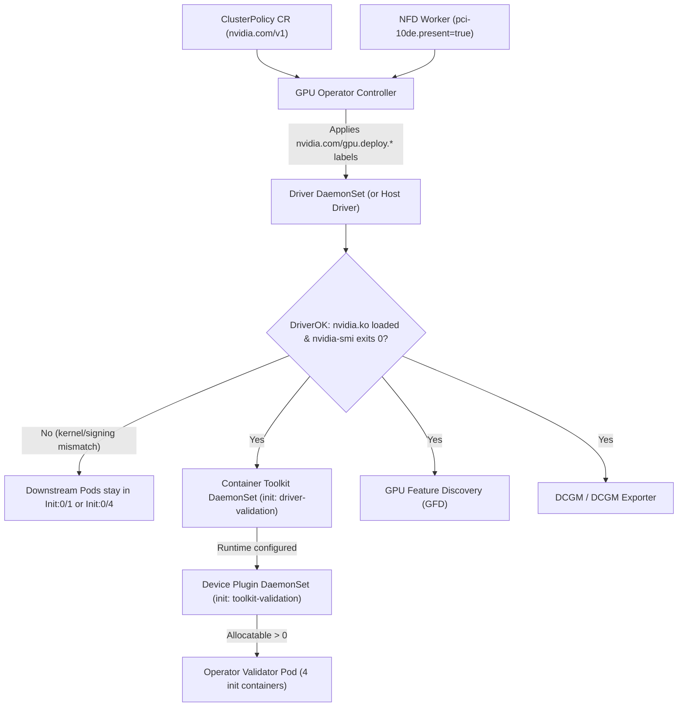

# 11.4 GPU Operator architecture and operands

| | |
|---|---|
| Level | Intermediate |
| Priority tier | 1 |
| Lab venue | GCP / GKE (plus local Python 3 simulation lab) |
| Part | Part 11: GPUs on Kubernetes, scheduling and virtualization |
| Sources used | `nvidia-zero-to-hero/volume-10/chapter-06-gpu-operator-architecture.md`; `nvidia-zero-to-hero/volume-10/chapter-07-driver-containers-and-node-operands.md`; `nvidia-zero-to-hero/volume-10/labs/lab-02-install-and-validate-gpu-operator.md`; `volume-04/02-gpu-software-operator-masterclass.md`; *NVIDIA Base Command Manager 11 Containerization Manual* (`bcm11-containerization`, Ch. 6); Roland Huß et al., *Generative AI on Kubernetes* (O'Reilly, 2026, Ch. 3); *Kubernetes for Generative AI Solutions* (Packt, 2025, Ch. 10) |
| Coverage file | `planning/coverage/chapters/11-04.md` |

## Why this matters for AI infrastructure

A GPU worker node is not permanently configured when a one-time installation script exits with status zero. Across the lifetime of a five-hundred-node AI cluster, autoscalers add new machines, administrators drain hosts for kernel security patches, and technicians replace failed GPUs. Every time a node boots or changes state, its kernel driver, container runtime, device plugin, feature discovery daemons, telemetry exporter, and validation pods must converge back to a single compatible contract.

Managing those seven moving parts with manual SSH scripts or ten independent Helm charts fails at cluster scale. The NVIDIA GPU Operator solves this by applying the Kubernetes Operator pattern through a single ClusterPolicy custom resource. It expresses the entire node-level GPU software stack as Kubernetes-managed desired state.

Yet cluster-wide automation is a double-edged sword when an operator change goes wrong. Because the controller reconciles every matching node automatically, a bad driver image or an aggressive rolling upgrade policy can take down production GPU capacity in minutes.

- **Reconciliation amplifies mistakes as fast as fixes:** Updating a single unpooled ClusterPolicy to a driver image that rejects a newer host kernel can break more than half of the cluster at once.
- **Control-plane ready status is not node-level readiness:** The ClusterPolicy object can report ready even while a single node's device plugin Pod is stuck in a crash loop.
- **Node operands are privileged host components packaged as Pods:** Driver containers load and unload host kernel modules, so an aggressive DaemonSet rollout can take dozens of GPUs offline simultaneously and breach inference SLO headroom.

| Production Trap | Cluster Scenario & Numbers | Operational Consequence |
|---|---|---|
| Unpooled `ClusterPolicy` driver update | `60` GPU nodes where `35` nodes run kernel `6.5.0-1015-aws` and receive `nvcr.io/nvidia/driver:550.90.07-ubuntu22.04` | Degrades `35 / 60 = 58.33%` (`~58%`) of cluster GPU capacity, whereas a `3`-node canary pool caps blast radius at `3 / 60 = 5.0%` (`57` nodes untouched) |
| Trusting `ClusterPolicy.status.state: ready` (`reason: OperandsReady`) | `25`-node pool where `nvidia-driver-daemonset` and `nvidia-container-toolkit-daemonset` are `25/25 READY` | `nvidia-device-plugin-daemonset` is `24/25 READY` because `pod/nvidia-device-plugin-daemonset-h9x2q` is in `CrashLoopBackOff` (`6` restarts over `14m`) |
| Oversized driver DaemonSet `maxUnavailable` | `40`-node (`8` GPUs/node = `320` GPUs) cluster with `6` minutes/batch and `28`-GPU inference headroom budget | `maxUnavailable: 4` takes `4 * 8 = 32` GPUs offline across `10` batches (`60` minutes), breaching the `28`-GPU budget unless reduced to `maxUnavailable: 2` (`16` GPUs offline) |

This chapter examines the internal architecture of the NVIDIA GPU Operator and its ClusterPolicy state machine. You will trace how per-node init containers enforce strict startup ordering, how privileged driver containers interact with the host kernel, and where the GPU Operator hands off to the NVIDIA Network Operator for RDMA networking.

## Prerequisites and outcomes

### Prerequisites
- Completion of Chapters 11.1 through 11.3 covering GPU readiness gates, the Device Plugin contract, the NVIDIA Container Toolkit, and NFD and GFD node labeling.
- Working knowledge of Kubernetes DaemonSets, Custom Resource Definitions, init containers, and Helm release management.

### Outcomes
- Explain how the GPU Operator controller reconciles a ClusterPolicy resource into node-local DaemonSets gated by NFD and node deployment labels.
- Trace the exact init-container validation chain inside the container toolkit, device plugin, and operator validator DaemonSets.
- Explain how a privileged Driver Container compiles or loads precompiled kernel modules, why module unloading fails when device files are held open, and how to choose an ownership model.
- Distinguish ClusterPolicy ready status and Pod Running state from the five sequential node acceptance gates.
- Quantify fleet blast radius between unpooled and canary rollouts and size the maximum unavailable node budget for rolling driver upgrades against an inference headroom target.
- Separate GPU Operator failure domains from NVIDIA Network Operator responsibilities across MOFED, SR-IOV, Multus CNI, and RDMA device plugins.

## Concepts: basics to intermediate to advanced

### 1. Basics: The Kubernetes Operator pattern, ClusterPolicy, and node operand targeting

In Kubernetes, a stateless web service is easily managed by a standard Deployment because any replica can start in any order. Managing the host-level GPU software stack on worker nodes is fundamentally different. Node components must start in a strict hardware-to-userspace sequence and inspect the host kernel. They also patch container runtime configurations on the host filesystem and verify that CUDA contexts initialize before admitting tenant Pods.

The NVIDIA GPU Operator coordinates this lifecycle using two core Kubernetes control-plane primitives.

- **Single Desired-State API:** Instead of maintaining separate Helm charts or Ansible playbooks for every daemon, the platform team defines a single cluster-scoped ClusterPolicy custom resource in API group `nvidia.com/v1`.
- **Continuous Reconciliation Loop:** The `gpu-operator` controller Deployment watches the ClusterPolicy resource and the cluster's Node objects. It reconciles child DaemonSets whenever NFD labels a node with `feature.node.kubernetes.io/pci-10de.present=true`.

#### How the Operator targets GPU nodes (nvidia.com/gpu.deploy.* labels)
How does the GPU Operator ensure that GPU DaemonSets run on GPU worker nodes while staying off CPU-only control-plane and management hosts? When the operator controller sees the NFD NVIDIA PCIe label on a node, it combines that discovery fact with the ClusterPolicy specification. It then writes eight explicit operand deployment labels onto the Node object.

```text
GPU Operator Operand Targeting Labels (bcm11-containerization Section 6.7.5, kubectl describe node node001 | grep nvidia):
  nvidia.com/gpu.deploy.driver=true             (or false when driver.enabled: false)
  nvidia.com/gpu.deploy.container-toolkit=true
  nvidia.com/gpu.deploy.device-plugin=true
  nvidia.com/gpu.deploy.gpu-feature-discovery=true
  nvidia.com/gpu.deploy.dcgm=true
  nvidia.com/gpu.deploy.dcgm-exporter=true
  nvidia.com/gpu.deploy.node-status-exporter=true
  nvidia.com/gpu.deploy.operator-validator=true
```

Each managed DaemonSet uses its corresponding deployment label as its node selector. As a result, CPU-only management nodes never receive driver, toolkit, device-plugin, or validator Pods. GPU worker nodes schedule the full operand stack automatically.

| Node Role in BCM 11 Cluster | Example Hostname & K8s Version | Scheduled GPU Operator Components |
|---|---|---|
| CPU control-plane / management node | `basecm11` (`v1.34.7`) | Runs `gpu-operator` controller Deployment, `gpu-operator-node-feature-discovery-master`, and `nfd-worker` |
| GPU worker nodes | `node001`, `node002` (`v1.34.7`) | Receive `nvidia.com/gpu.deploy.*=true` labels and run the full node operand DaemonSet stack |



#### Why ClusterPolicy.status.state: ready does not prove every node is healthy
Platform engineers often check the ClusterPolicy resource status after a rollout and assume the entire fleet is healthy when they see `state: ready`. That top-level status only indicates that the operator controller created its child DaemonSets and observed reconciliation convergence. It does not guarantee that every individual GPU worker node in a twenty-five-node pool has a working device plugin right now.

```yaml
$ kubectl get clusterpolicy cluster-policy -o yaml
apiVersion: nvidia.com/v1
kind: ClusterPolicy
metadata:
  name: cluster-policy
spec:
  driver: {enabled: true, version: "550.90.07"}
  toolkit: {enabled: true}
status:
  namespace: gpu-operator
  state: ready
  conditions:
  - type: Ready
    status: "True"
    reason: OperandsReady
```

Compare that top-level ready status against the live DaemonSet and Pod output on a twenty-five-node GPU fleet. While the driver and container toolkit DaemonSets show all twenty-five nodes ready, the device plugin DaemonSet is missing one node because a single Pod is stuck in a crash loop. Always verify that desired, ready, and available counts match across every DaemonSet alongside per-node allocatable GPU counts.

```text
$ kubectl get pods,daemonsets -n gpu-operator -o wide | grep -E 'driver|toolkit|device-plugin'
daemonset.apps/nvidia-driver-daemonset            25   25   25   25   25
daemonset.apps/nvidia-container-toolkit-daemonset 25   25   25   25   25
daemonset.apps/nvidia-device-plugin-daemonset      25   24   24   25   24
pod/nvidia-device-plugin-daemonset-h9x2q            0/1  CrashLoopBackOff  6   14m
```

---

### 2. Intermediate: Operand dependency ordering, initContainers, and nvidia-operator-validator

GPU Operator reconciliation is not a serial shell script. When a new GPU node joins the cluster and receives its deployment labels, Kubernetes schedules all matching DaemonSet Pods onto that node at the same time. Without local synchronization, the container toolkit Pod would patch containerd before the kernel driver finished compiling. The device plugin would also advertise GPUs before the runtime could inject them.

The GPU Operator enforces per-node dependency ordering by embedding gating init containers inside each downstream DaemonSet Pod and running a dedicated four-stage validator Pod.

#### 1. Container Toolkit Pod (driver-validation init container)
When the container toolkit DaemonSet lands on a GPU node, Kubernetes executes its `driver-validation` init container first. Until the NVIDIA kernel driver is loaded and responding on that host, the init container remains in `Init:0/1` and blocks the main toolkit container from starting. Once the driver check passes, the main container installs the toolkit binaries to `/usr/local/nvidia/toolkit`, writes the runtime drop-in configuration, and signals containerd to reload.

```text
$ kubectl logs -f -n gpu-operator nvidia-container-toolkit-daemonset-ffbk7
Defaulted container "nvidia-container-toolkit-ctr" out of: nvidia-container-toolkit-ctr, driver-validation (init)
...
time="2022-12-06T14:31:36Z" level=info msg="Installing NVIDIA container toolkit to '/usr/local/nvidia/toolkit'"
time="2022-12-06T14:31:36Z" level=info msg="Installing NVIDIA container toolkit config '/usr/local/nvidia/toolkit/.config/nvidia-container-runtime/config.toml'"
time="2022-12-06T14:31:36Z" level=info msg="Starting 'setup' for containerd"
time="2022-12-06T14:31:36Z" level=info msg="Loading config: /runtime/config-dir/nvidia-cri.toml"
```

#### 2. Device Plugin Pod (toolkit-validation init container)
The device plugin DaemonSet Pod uses the same pattern one layer higher in the stack. It runs an init container named `toolkit-validation` before starting `nvidia-device-plugin-ctr`. If the container toolkit has not finished configuring `/etc/containerd/config.toml` or `/cm/local/apps/containerd/var/etc/conf.d/nvidia-cri.toml`, the device plugin stays in `Init:0/1` so it cannot register GPUs on a half-configured runtime. Once `toolkit-validation` exits zero, the plugin opens NVML and binds `/var/lib/kubelet/device-plugins/nvidia-gpu.sock`. It then logs `Registered device plugin for 'nvidia.com/gpu' with Kubelet`.

#### 3. Operator Validator Pod (nvidia-operator-validator and its 4 init containers)
Even after the driver, toolkit, and device plugin Daemons report Running, the platform still needs end-to-end proof that a real container can allocate a GPU and execute a CUDA kernel. The `nvidia-operator-validator` DaemonSet provides this self-verification loop. It runs four sequential init containers on every GPU node before its main container logs `all validations are successful`.

```text
$ kubectl logs -f -n gpu-operator nvidia-operator-validator-2qvz6
Defaulted container "nvidia-operator-validator" out of: nvidia-operator-validator, driver-validation (init), toolkit-validation (init), cuda-validation (init), plugin-validation (init)
all validations are successful
```

| Validator Container (in execution order) | What it executes under the hood | Healthy log evidence | Companion Pod spawned |
|---|---|---|---|
| **1. `driver-validation (init)`** | Runs `chroot /run/nvidia/driver nvidia-smi` (or queries the host driver mount) to verify the kernel module and NVML respond | Prints full `NVIDIA-SMI` table (e.g., `520.61.05` / `CUDA 11.8` on `Tesla V100-SXM3-32GB` `2MiB / 32768MiB`, `32C`, `46W / 350W` on `node001`, or `550.90.07` / `CUDA 12.4`) | None (executes directly inside init container) |
| **2. `toolkit-validation (init)`** | Invokes `nvidia-smi` through the configured container runtime path to prove runtime library/device injection works | Prints `NVIDIA-SMI` banner from inside the toolkit-configured container context | None |
| **3. `cuda-validation (init)`** | Spawns a short-lived workload Pod (`nvidia-cuda-validator-<hash>`) that compiles/runs a real CUDA vector/matrix sample kernel | Logs `pod nvidia-cuda-validator-pxs9b have run successfully` (`5`-second polling from `Pending` to `Succeeded`) | `pod/nvidia-cuda-validator-pxs9b` (remains visible in `0/1 Completed` state) |
| **4. `plugin-validation (init)`** | Spawns a short-lived workload Pod (`nvidia-device-plugin-validator-<hash>`) requesting `nvidia.com/gpu: 1` to verify `kubelet` `Allocate()` end-to-end | Logs `pod nvidia-device-plugin-validator-5crlc have run successfully` | `pod/nvidia-device-plugin-validator-5crlc` (remains visible in `0/1 Completed` state) |
| **5. `nvidia-operator-validator` (main)** | Starts only after all 4 init containers exit `0` | `all validations are successful` | Keeps the validator DaemonSet Pod `1/1 Running` |

This architecture explains a common question when operators inspect Pod status in the GPU Operator namespace. Companion Pods such as `pod/nvidia-cuda-validator-9x2kq`, `pod/nvidia-cuda-validator-pxs9b`, and `pod/nvidia-device-plugin-validator-5crlc` show zero of one ready with status Completed. Because those Pods are one-shot validation jobs spawned by the third and fourth init containers, `0/1 Completed` is their expected healthy terminal state. Meanwhile, `nvidia-operator-validator-2qvz6` remains running.

---

### 3. Advanced: Driver containers, ownership models, rollout blast radius, and Network Operator handoff

#### How a Driver Container works on the Host OS
How can a Kubernetes container install a Linux kernel module when all containers on a node share the host kernel? The `nvidia-driver-daemonset` Pod is not an isolated application container. It is a privileged host-operating container that mounts host kernel directories and loads kernel modules directly into the host OS.

- **Privileged host mounts:** The Pod runs with `privileged: true` and bind-mounts `/usr/src`, `/lib/modules`, `/run/nvidia`, and `/dev` from the worker node filesystem.
- **Source compilation versus precompiled modules:** In source-build mode, the container inspects `uname -r` and locates `linux-headers-$(uname -r)`. It then compiles `nvidia.ko`, `nvidia-uvm.ko`, `nvidia-modeset.ko`, and `nvidia-peermem.ko` with `gcc` and `make`, and loads them via `insmod` or `modprobe`. On a five-hundred-node cluster, compiling from source on every boot causes all five hundred nodes to download headers and run `gcc` at once. Production clusters set `driver.usePrecompiled: true` to pull pre-built signed modules instead.
- **Sleep loop and shutdown trap:** After loading the kernel module and populating `/run/nvidia/driver`, the container sleeps so Kubernetes keeps the Pod running. When the Pod terminates during an upgrade, its shutdown trap runs `rmmod` to unload the kernel modules from the host.

```bash
# Executed inside the driver container during termination (untested here)
rmmod nvidia_uvm
rmmod nvidia
```

If any un-evicted container or host monitoring daemon still holds an open file descriptor to `/dev/nvidia*`, the Linux kernel rejects `rmmod` with `Error: Module nvidia is in use`. The node remains cordoned and stuck in its upgrade lifecycle until an operator identifies the offending process with `lsof /dev/nvidia*` and terminates it.

#### Choosing one ownership model per layer
When both the base OS image pipeline and the GPU Operator try to install or patch the NVIDIA driver on the same host, package upgrades and container restarts overwrite each other. That conflict triggers `Driver/library version mismatch` outages across nodes. Platform engineering must pick a single authoritative owner for the driver layer and a single owner for the runtime layer.

| Ownership Model | Configuration (`ClusterPolicy` / Helm) | Best production fit | Principal operational obligation |
|---|---|---|---|
| **1. Operator-Managed Driver & Runtime** | `driver.enabled: true`, `toolkit.enabled: true`, `nfd.enabled: true` | Cloud or bare-metal Kubernetes fleets where OS images do not pre-bake NVIDIA drivers | Coordinate operator `driver.version` upgrades with OS kernel upgrades (`uname -r`) and Secure Boot MOK signing keys |
| **2. Host-Managed Driver, Operator-Managed Runtime (BCM 11 / DGX Default)** | `driver.enabled: false`, `toolkit.enabled: true`, `nfd.enabled: true` (default in BCM 11 `cm-kubernetes-setup` and mandatory on DGX OS images) | NVIDIA Base Command Manager (BCM 11), DGX OS, or AWS EKS / GKE accelerated AMIs where the golden OS image owns the driver | OS image pipeline owns driver patching and reboots; GPU Operator reconciles Toolkit (via CDI or `/cm/local/apps/containerd/var/etc/conf.d/nvidia-cri.toml`), Device Plugin, GFD, and DCGM |
| **3. Host-Managed Driver & Runtime** | `driver.enabled: false`, `toolkit.enabled: false` | Strictly immutable OS appliances where both driver packages and `containerd` drop-ins are baked into the host image | Surface host driver and runtime configuration versions into Kubernetes node labels for drift auditing |

#### Five readiness gates and the DriverOK fork
Never treat NodeReady or a running status on the driver DaemonSet as proof that a node can run GPU workloads. A driver container can sit running while retrying a failed `modprobe` in the background. Production platforms enforce five sequential readiness gates before applying `gpu-validation=passed` to admit tenant workloads.

| Readiness Gate | Verification Target | Concrete Command & Healthy Evidence |
|---|---|---|
| **1. Infrastructure gate** | OS image, kernel (`uname -r`), Secure Boot MOK keys, registry mirror, and node-pool taints | Node boots into expected kernel and carries pool taint before workloads arrive |
| **2. Driver gate (`DriverOK`)** | Kernel module `nvidia.ko` loaded and NVML responds inside the driver container or host | `kubectl exec -n gpu-operator nvidia-driver-daemonset-4k7pl -- nvidia-smi` exits `0` and shows `Driver Version: 550.90.07`, `CUDA Version: 12.4`, `NVIDIA H100 80GB HBM3` on `00000000:65:00.0`, `34C`, `P0`, `118W / 700W`, `0MiB / 81559MiB` |
| **3. Runtime gate** | Container Toolkit / CDI injects `/dev/nvidia0` and `libcuda.so.1` into containers | Test container initializes NVML without `Unknown Error` |
| **4. Kubernetes gate** | NFD/GFD labels (`nvidia.com/gpu.product`, `gpu.memory`) and `Allocatable: nvidia.com/gpu` | Node advertises expected GPU count and capability labels in the Kubernetes API |
| **5. Acceptance gate** | End-to-end CUDA execution and telemetry check | `nvidia-operator-validator` logs `all validations are successful` (`GPU_OPERATOR_VALIDATED`) and DCGM passes, authorizing `gpu-validation=passed` |

#### Quantifying blast radius (58% vs 5%) and rolling maintenance concurrency (32 vs 16 GPUs)
Two capacity planning models govern how you structure GPU node pools and tune DaemonSet rolling upgrades. First, testing driver updates in a dedicated canary node pool bounds the blast radius of an incompatible kernel upgrade. Second, sizing `maxUnavailable` on the driver DaemonSet ensures that concurrent node drains never exceed your cluster's spare inference headroom.

| Rollout & Capacity Model | Input Fleet Parameters | Unsafe Rollout Outcome | Bounded Safe Rollout Outcome |
|---|---|---|---|
| **1. Canary Pool vs Unpooled `ClusterPolicy`** | `60` GPU nodes total; `35` nodes run newer kernel `6.5.0-1015-aws` incompatible with `nvcr.io/nvidia/driver:550.90.07-ubuntu22.04` | Updating one global `ClusterPolicy` degrades `35 / 60 = 58.33%` (`~58%`) of cluster GPU capacity within minutes | Isolating a `3`-node canary pool caps worst-case loss at `3 / 60 = 5.0%` (`5%`) and leaves `57` production nodes untouched |
| **2. Driver DaemonSet `maxUnavailable` Sizing** | `40` nodes (`8` GPUs/node = `320` total GPUs); `6` minutes/node drain+reload+validate; `292` GPUs required online (`28` GPUs spare headroom) | `maxUnavailable: 4` runs `40 / 4 = 10` batches × `6` min = `60` minutes, taking `4 * 8 = 32` GPUs offline concurrently and breaching the `28`-GPU budget by `4` GPUs | `maxUnavailable: 2` runs `40 / 2 = 20` batches × `6` min = `120` minutes, taking `2 * 8 = 16` GPUs offline concurrently and leaving `12` GPUs of spare margin |

#### Handoff boundary: GPU Operator vs NVIDIA Network Operator (NicClusterPolicy)
The NVIDIA GPU Operator owns only the GPU compute stack on the worker node. When multi-node training or disaggregated inference requires InfiniBand, RoCE, or GPUDirect RDMA over ConnectX adapters, a separate operator takes over the network fabric. As documented in the BCM 11 manual (`NVIDIA GPU Operator v26.3.3` alongside `Network Operator 26.1.1`), the NVIDIA Network Operator reconciles a `NicClusterPolicy` custom resource. It manages MOFED drivers, SR-IOV virtual functions, Multus secondary CNI attachments, and RDMA device plugins.

| Architectural Concern | NVIDIA GPU Operator (`ClusterPolicy`) | NVIDIA Network Operator (`NicClusterPolicy`) |
|---|---|---|
| **Host kernel driver managed** | NVIDIA GPU driver (`nvidia.ko`, `nvidia-uvm.ko`) | Mellanox OFED (`MOFED`) RDMA NIC driver (`mlx5_core`, `ib_uverbs`) and peer-memory modules |
| **Kubernetes extended resource** | `nvidia.com/gpu` (or `nvidia.com/mig-*`) via NVIDIA device plugin | RDMA device resources (e.g., `rdma/rdma_shared_device_a: 8` or SR-IOV VF resources) via RDMA/SR-IOV device plugin |
| **Container network / device wiring** | NVIDIA Container Toolkit / CDI (`/dev/nvidia*`, `libcuda.so.1`) | SR-IOV Virtual Function (VF) provisioning + **Multus CNI** secondary network interface (attaching an RDMA VF alongside standard `eth0`) |
| **Primary failure symptom** | `Allocatable: nvidia.com/gpu` is `0`/absent, or `nvidia-smi` / `cuInit` fails | Pod receives its GPU (`nvidia-smi` passes), but `ibv_devinfo` shows no HCA or `PORT_DOWN`, causing NCCL to hang or fall back to slow TCP sockets |

## Commands and configurations that matter

### 1. Installing a pinned GPU Operator release with Helm (Lab 02 and bcm11-containerization)

Before installing or upgrading the GPU Operator in production, always capture preflight cluster state so you can diff node labels, Helm releases, and Pod health after reconciliation. Next, add the NVIDIA NGC Helm repository and install an explicit pinned chart version using a version-controlled values file.

```bash
# 1. Capture pre-change cluster baseline (untested here)
mkdir -p gpu-operator-evidence
kubectl get nodes -o wide > gpu-operator-evidence/nodes-before.txt
helm list -A > gpu-operator-evidence/helm-before.txt
kubectl get pods -A -o wide > gpu-operator-evidence/pods-before.txt

# 2. Add NVIDIA Helm repo and list versions (untested here)
helm repo add nvidia https://helm.ngc.nvidia.com/nvidia
helm repo update
helm search repo nvidia/gpu-operator --versions | head -n 20

# 3. Install pinned GPU Operator release (untested here)
export GPU_OPERATOR_VERSION='v26.3.0'
helm upgrade --install gpu-operator nvidia/gpu-operator \
  --namespace gpu-operator --create-namespace \
  --version "$GPU_OPERATOR_VERSION" -f target-values.yaml \
  --wait --timeout 15m
```

On an NVIDIA Base Command Manager cluster, the golden host OS image already provides the NVIDIA driver and places containerd under `/cm/local/apps/containerd/`. Disable the operator driver container and pass the custom runtime paths via Helm flags.

```bash
# BCM 11 host-driver Helm installation with custom containerd paths (untested here)
helm install --wait -n gpu-operator --create-namespace \
  --version v26.3.0 \
  --set driver.enabled=false \
  --set toolkit.enabled=true \
  --set toolkit.env[0].name=CONTAINERD_CONFIG \
  --set toolkit.env[0].value=/cm/local/apps/containerd/var/etc/conf.d/nvidia-cri.toml \
  --set toolkit.env[1].name=RUNTIME_EXECUTABLE_PATH \
  --set toolkit.env[1].value=/cm/local/apps/containerd/current/bin/containerd \
  gpu-operator nvidia/gpu-operator
```

### 2. Configuring ClusterPolicy for sharing, MIG, and driver upgrade policy

Rather than scattering settings across node scripts, ClusterPolicy lets you declare precompiled drivers, GPUDirect RDMA peer memory, and automated rolling driver drains in one manifest. It also governs device-plugin sharing ConfigMaps (`gpu-sharing-config` with default profile `sharing` or node-specific override label `nvidia.com/device-plugin.config=<key>`) and the cluster MIG strategy.

```yaml
# clusterpolicy-production-example.yaml (untested here)
apiVersion: nvidia.com/v1
kind: ClusterPolicy
metadata:
  name: gpu-cluster-policy
spec:
  driver:
    enabled: true
    version: "535.154.05"
    usePrecompiled: true
    rdma:
      enabled: true
      useHostMofed: false
    upgradePolicy:
      autoUpgrade: true
      maxParallelUpgrades: 5
      drain:
        enable: true
        force: true
        timeoutSeconds: 300
        deleteEmptyDir: true
  toolkit:
    enabled: true
  gfd:
    enabled: true
  devicePlugin:
    config:
      name: gpu-sharing-config
      default: sharing
  mig:
    strategy: mixed
```

### 3. Validating GPU Operator operands, nvidia-operator-validator init containers, and Network Operator RDMA

After Helm reports that the release is deployed, walk the dependency chain from bottom to top. Check DaemonSet replica convergence, test `nvidia-smi` inside the driver container, inspect all four init containers of the operator validator Pod, and verify RDMA HCA port state if Network Operator is active.

```bash
# 1. Check Helm status, ClusterPolicy, and DaemonSet READY == DESIRED (untested here)
helm status gpu-operator -n gpu-operator
kubectl get clusterpolicy
kubectl get pods,daemonsets -n gpu-operator -o wide

# 2. Verify the Driver Gate directly inside the driver container (untested here)
kubectl exec -n gpu-operator nvidia-driver-daemonset-4k7pl -- nvidia-smi

# 3. Inspect all 4 init containers and main container of nvidia-operator-validator (untested here)
kubectl logs -n gpu-operator -l app=nvidia-operator-validator -c driver-validation
kubectl logs -n gpu-operator -l app=nvidia-operator-validator -c toolkit-validation
kubectl logs -n gpu-operator -l app=nvidia-operator-validator -c cuda-validation
kubectl logs -n gpu-operator -l app=nvidia-operator-validator -c plugin-validation
kubectl logs -n gpu-operator -l app=nvidia-operator-validator -c nvidia-operator-validator

# 4. If using NVIDIA Network Operator for RDMA, verify allocatable RDMA and IB port state (untested here)
kubectl describe node gpu-node-04 | grep -A2 Allocatable | grep -i rdma
kubectl describe pod nccl-worker-2 | grep -i rdma
kubectl exec -it nccl-worker-2 -- ibv_devinfo
```

Expected healthy output for Step 4 when NVIDIA Network Operator has provisioned shared RDMA devices and active InfiniBand links.
```text
  rdma/rdma_shared_device_a:  8
  rdma/rdma_shared_device_a:  1
hca_id: mlx5_0
    transport:          InfiniBand (0)
    fw_ver:              20.36.1010
    state:               PORT_ACTIVE (4)
```

## How it fails

When a GPU node fails to schedule or run workloads, never delete all Pods in the GPU Operator namespace as a first troubleshooting reflex. Deleting operands wipes out init-container ordering evidence and can trigger disruptive module unloads on healthy nodes. Instead, inspect the Pod status and logs to pinpoint the earliest broken gate in the dependency chain.

| Failure mode | Exact symptom & command evidence | Root cause boundary | Remediation |
|---|---|---|---|
| **1. Unsupported host kernel version in Driver Container (`6.5.0-1015-aws`)** | `kubectl logs -n gpu-operator nvidia-driver-daemonset-7z4kd` prints `Detected Kernel version 6.5.0-1015-aws is not supported. Only kernel versions supported by the driver branch listed in container image nvcr.io/nvidia/driver:550.90.07-ubuntu22.04 are compatible.` Downstream toolkit and plugin Pods stay in `Init:0/1`. | **Kernel-to-Driver Compatibility Boundary:** The node OS kernel upgraded ahead of the precompiled driver image matrix. | Pin the node pool's kernel version or update `driver.version` in a `3`-node canary pool to a driver branch qualified for kernel `6.5.0-1015-aws` before promoting cluster-wide. |
| **2. Secure Boot module signing rejection (`Key was rejected by service`)** | Driver Pod restarts repeatedly. `kubectl logs -n gpu-operator nvidia-driver-daemonset-4k7pl --previous` prints `Sending 'nvidia' module removal request... done. Installing NVIDIA driver kernel module... modprobe: ERROR: could not insert 'nvidia': Key was rejected by service`. Host `journalctl -k` logs `module verification failed`. | **Secure Boot / MOK Signing Boundary:** Host UEFI Secure Boot is enabled, and the compiled or precompiled `nvidia.ko` is not signed by a key enrolled in the host's Machine Owner Key (MOK) database. | Enroll the driver signing public key into the host MOK database (or use the distribution's signed precompiled driver stream) before restarting the driver operand. |
| **3. Driver Pod `1/1 Running` with kernel/library mismatch (`Driver/library version mismatch`)** | `nvidia-driver-daemonset-9mvxq` shows `1/1 Running` on `gpu-node-22`, yet `Allocatable` has no `nvidia.com/gpu` and device plugin logs `Unable to load NVML: could not communicate with driver`. Running `kubectl exec -n gpu-operator nvidia-driver-daemonset-9xq2z -- nvidia-smi` prints `Failed to initialize NVML: Driver/library version mismatch`. | **Driver Gate (`DriverOK`) Boundary:** A stale `nvidia.ko` from a prior driver version remained loaded in kernel memory when the new driver container started (`rmmod` was blocked by an open `/dev/nvidia*` handle). | Drain the node, check `lsof /dev/nvidia*` on the host, unload the stale kernel modules (or reboot the node), and verify `kubectl exec ... -- nvidia-smi` exits `0`. |
| **4. Driver gate passes, but container `nvidia-smi` fails with `Unknown Error`** | `nvidia-smi` succeeds on the host and inside `nvidia-driver-daemonset`, and the Pod receives an allocated GPU, but `kubectl exec -it cuda-validation-pod -- nvidia-smi` prints `Failed to initialize NVML: Unknown Error`. | **Runtime / Toolkit / CDI Boundary:** `containerd` did not properly bind-mount `/dev/nvidiactl` or host driver libraries into the container's mount namespace. | Inspect `nvidia-container-toolkit-daemonset` logs, `/etc/containerd/config.toml` (or `/cm/local/apps/containerd/var/etc/conf.d/nvidia-cri.toml`), and `/var/run/cdi/nvidia.yaml`. |
| **5. Validator `cuda-validation` fails with `no kernel image is available for execution on the device`** | `kubectl logs -n gpu-operator nvidia-cuda-validator-9x2kq` prints `running CUDA sample application... CUDA error: no kernel image is available for execution on the device`. | **Compute Capability / Image Architecture Boundary:** The validator or workload CUDA binary was compiled without SASS/PTX support for the GPU architecture installed on the node. | Align the validator/workload container image tag with the GPU's compute capability (`compute.major` / `driver.version`) in the release compatibility matrix. |
| **6. Helm install timeout because Driver DaemonSet lacks GPU node taint toleration** | `helm upgrade --install ... --wait --timeout 15m` times out. `kubectl get events -n gpu-operator` shows `Warning FailedScheduling pod/nvidia-driver-daemonset-7z4kd 0/3 nodes are available: 3 node(s) had taint {nvidia.com/gpu: NoSchedule}, that the pod didn't tolerate.` | **Values / Taint Alignment Boundary:** Custom node taints were applied to the GPU node pool without adding matching tolerations to the GPU Operator Helm values. | Add the matching `tolerations` stanza to `target-values.yaml` and re-run `helm upgrade --install` (never re-run blindly without fixing the values file). |

## Hands-on lab

### Venue and scope
This lab runs locally using the Python standard library in `code/part11/gpu_operator_and_operands.py` and `code/part11/gpu_operator_and_operands_lab.py`. It simulates node deployment label reconciliation, the four-stage validator init-container state machine, and ClusterPolicy versus DaemonSet readiness checks. It also evaluates unpooled versus canary blast radius, rolling driver upgrade concurrency against a spare headroom budget, and GPU Operator versus Network Operator fault routing. Cluster Helm and `kubectl` commands are marked untested here.

### Step 1: Run the self-checking GPU Operator architecture lab (tested here)

Run the lab script from the repository root.

```bash
python3 code/part11/gpu_operator_and_operands_lab.py
```

Captured output from this repository.
```text
=== Chapter 11.4 Lab: GPU Operator Architecture and Node Operands ===
  [PASS] GPU Operator tracks 8 nvidia.com/gpu.deploy.* operand targeting labels
  [PASS] Nodes without pci-10de.present receive no nvidia.com/gpu.deploy.* labels
  [PASS] Operator-managed policy sets deploy.driver=true, deploy.container-toolkit=true, deploy.operator-validator=true
  [PASS] Host-managed driver policy (BCM/DGX default) sets deploy.driver=false and deploy.container-toolkit=true
  [PASS] All 4 validator init containers pass on node001 and log 'all validations are successful'
  [PASS] When driver gate fails, toolkit and device-plugin stay in Init:0/1 and validator stays in Init:0/4
  [PASS] When toolkit gate fails after driver succeeds, validator halts at Init:1/4 (toolkit-validation)
  [PASS] When CUDA sample fails (compute capability mismatch), validator halts at Init:2/4 (cuda-validation)
  [PASS] When device plugin fails registration, validator halts at Init:3/4 (plugin-validation)
  [PASS] ClusterPolicy.status.state can report 'ready' while 1 of 25 device-plugin pods is in CrashLoopBackOff (24/25)
  [PASS] 3-node canary pool with 3/3 driver, toolkit, and plugin DaemonSets is fully healthy
  [PASS] Unpooled ClusterPolicy update across 60 nodes with 35 on kernel 6.5.0-1015-aws degrades 58.33% (~58%) of fleet
  [PASS] 3-node canary pool caps blast radius at 5.0% (3/60) and leaves 57 production nodes untouched
  [PASS] maxUnavailable: 4 across 40 nodes runs 10 batches x 6 min = 60 minutes total
  [PASS] maxUnavailable: 4 takes 32 GPUs offline concurrently, exceeding the 28-GPU headroom budget by 4 GPUs
  [PASS] maxUnavailable: 2 across 40 nodes runs 20 batches x 6 min = 120 minutes total
  [PASS] maxUnavailable: 2 takes 16 GPUs offline concurrently, staying within the 28-GPU headroom budget (+12 margin)
  [PASS] Missing allocatable GPU or failed CUDA init routes to GPU Operator domain
  [PASS] Healthy GPU + missing rdma/rdma_shared_device_a routes to NVIDIA Network Operator (MOFED/RDMA plugin)
  [PASS] Allocated RDMA resource + ibv_devinfo PORT_DOWN routes to Network Operator SR-IOV/Multus/fabric layer
  [PASS] Allocatable GPU=8, CUDA init OK, rdma_shared_device_a=8, and PORT_ACTIVE (4) verifies both operators
  [PASS] Default ClusterPolicyConfig pins reviewed driver version 550.90.07
  [PASS] Default ClusterPolicyConfig enables usePrecompiled=True to avoid 500-node GCC compilation storms
  [PASS] All 8 operand deployment labels evaluate to 'true' when all operands are enabled
  [PASS] Exactly 7 operand deployment labels evaluate to 'true' when driver.enabled=false

Summary: 25 passed, 0 failed out of 25 checks.
```

### Exercises

1. **Exercise 1 — Operand deployment label reconciliation:** Using the deployment label helper in the lab module, compare the dictionary of deployment labels generated when the operator manages the driver versus on an NVIDIA DGX or BCM 11 node where the host manages the driver. State which single label value changes.
2. **Exercise 2 — Diagnosing nvidia-operator-validator init containers:** Using the validator helper with the inputs in the table below, determine the exact validator Pod state and failing init container name when the CUDA sample fails.
3. **Exercise 3 — Canary vs unpooled blast radius:** Using the blast radius calculator on the sixty-node fleet in the table below, compute the percentage of degraded fleet capacity for an unpooled rollout versus a three-node canary pool rollout. State how many production nodes remain untouched.
4. **Exercise 4 — Sizing maxUnavailable against an inference headroom budget:** Using the upgrade window planner for the forty-node cluster in the table below, compare batches, wall-clock minutes, concurrent GPUs offline, SLO safety, and headroom margin across the three settings. Identify the largest integer that keeps the rollout SLO-safe.
5. **Exercise 5 — ClusterPolicy status vs DaemonSet reality:** Using the policy comparison helper in the table below, explain why an alert checking only ClusterPolicy ready status misses the crash-looping device plugin Pod. Write the DaemonSet metric condition that catches it.
6. **Exercise 6 — GPU Operator vs Network Operator incident triage:** Using the fault classifier for the multi-node PyTorch training Pod in the table below, identify the owner operator and failing layer when `ibv_devinfo` reports port down.

| Exercise | Input Parameters & Code Symbols |
|---|---|
| Exercise 1 | `compute_node_deploy_labels()`, `pci_10de_present=True`, `driver_enabled=True` vs `driver_enabled=False` |
| Exercise 2 | `evaluate_operator_validator_pod()`, `driver_module_loaded=True`, `nvml_healthy=True`, `toolkit_configured=True`, `cuda_sample_passed=False`, `plugin_registered_and_allocatable=True`, `Init:X/4` |
| Exercise 3 | `calculate_canary_vs_unpooled_blast_radius()`, `60`-node fleet, `35` nodes on kernel `6.5.0-1015-aws`, `3`-node canary pool |
| Exercise 4 | `plan_driver_upgrade_window()`, `40`-node (`8` GPUs/node) cluster, `28` GPUs spare headroom, `6` minutes/batch, `maxUnavailable=4`, `maxUnavailable=3`, `maxUnavailable=2` |
| Exercise 5 | `compare_policy_vs_daemonset_health(25, 25, 25, 24)`, `pod/nvidia-device-plugin-daemonset-h9x2q` (`6` restarts over `14m`) |
| Exercise 6 | `classify_gpu_vs_network_operator_fault()`, `nccl-worker-2` on `gpu-node-04`, `Allocatable: nvidia.com/gpu: 8`, `rdma/rdma_shared_device_a: 8`, `ibv_devinfo` `PORT_DOWN` (`ibv_devinfo_port_active=False`) |

## Checkpoint questions

<details>
<summary>**1. Why is a Kubernetes Operator controller better than a one-time host configuration script for managing GPU worker nodes?**</summary>

A one-time script performs a point-in-time mutation and has no ongoing relationship with the node. If a GPU is replaced, the kernel is patched, or a node is recreated by an autoscaler, the script's state silently drifts. The GPU Operator continuously watches the ClusterPolicy desired state and Node objects. It reconciles driver, toolkit, device-plugin, GFD, DCGM, and validator operands whenever nodes join, reboot, or recover.
</details>

<details>
<summary>**2. Why can ClusterPolicy.status.state report ready while a GPU node in the cluster is unable to schedule GPU Pods?**</summary>

The field `ClusterPolicy.status.state: ready` reflects the controller's reconciliation of desired Kubernetes objects, not live per-node operand health across every worker host. In the twenty-five-node example where the device plugin DaemonSet shows twenty-five desired and twenty-four ready, the ClusterPolicy remains ready while `nvidia-device-plugin-daemonset-h9x2q` is stuck in a crash loop with six restarts over fourteen minutes.
</details>

<details>
<summary>**3. Which eight nvidia.com/gpu.deploy.* labels does the GPU Operator apply to nodes where NFD detects PCI vendor 10de?**</summary>

The controller writes eight node selector labels in the `nvidia.com/gpu.deploy.*` namespace.
- `nvidia.com/gpu.deploy.driver` and `nvidia.com/gpu.deploy.container-toolkit`.
- `nvidia.com/gpu.deploy.device-plugin` and `nvidia.com/gpu.deploy.gpu-feature-discovery`.
- `nvidia.com/gpu.deploy.dcgm` and `nvidia.com/gpu.deploy.dcgm-exporter`.
- `nvidia.com/gpu.deploy.node-status-exporter` and `nvidia.com/gpu.deploy.operator-validator`.
</details>

<details>
<summary>**4. How do nvidia-container-toolkit-daemonset and nvidia-device-plugin-daemonset enforce startup ordering on a node if Kubernetes schedules all DaemonSet Pods concurrently?**</summary>

Each DaemonSet gates its main container behind a per-Pod init container.
- The container toolkit DaemonSet Pod runs `driver-validation` as an init container before starting `nvidia-container-toolkit-ctr`, blocking until the host driver is loaded and healthy.
- The device plugin DaemonSet Pod runs `toolkit-validation` as an init container before starting `nvidia-device-plugin-ctr`, blocking until the container toolkit has configured the CRI runtime.
</details>

<details>
<summary>**5. What are the four init containers inside an nvidia-operator-validator Pod, and what does each verify?**</summary>

1. **Driver validation:** `driver-validation` runs `chroot /run/nvidia/driver nvidia-smi` to verify that the host kernel driver and NVML respond.
2. **Toolkit validation:** `toolkit-validation` runs `nvidia-smi` through the container toolkit integration to verify runtime device and library injection.
3. **CUDA validation:** `cuda-validation` spawns the one-shot CUDA validator Pod to execute a real CUDA sample kernel.
4. **Plugin validation:** `plugin-validation` spawns the one-shot device-plugin validator Pod requesting one GPU to verify kubelet device allocation before the main container logs `all validations are successful`.
</details>

<details>
<summary>**6. Why do pod/nvidia-cuda-validator-9x2kq and pod/nvidia-device-plugin-validator-5crlc show READY 0/1 and STATUS Completed in a healthy gpu-operator namespace?**</summary>

They are one-shot validation Pods spawned by the third and fourth init containers of `nvidia-operator-validator`. They run their check and exit with status zero, whereas a validator Pod stuck at `0/1 Running` or `Pending` for several minutes indicates a hung or blocked validation step.
</details>

<details>
<summary>**7. How does a privileged Driver Container load an NVIDIA kernel module into the host OS without SSH access?**</summary>

The driver DaemonSet Pod runs with privileged permissions and mounts the host's `/usr/src`, `/lib/modules`, `/run/nvidia`, and `/dev` directories. It detects the host kernel version via `uname -r` and either compiles `nvidia.ko` with `gcc` or downloads a precompiled module. It then inserts the module directly into the host kernel via `insmod` or `modprobe` before entering a sleep loop.
</details>

<details>
<summary>**8. Why should driver.usePrecompiled: true be enabled for large (for example, 500-node) GPU clusters?**</summary>

Without `usePrecompiled: true`, every node booting or upgrading its driver container simultaneously downloads kernel headers over the network and compiles the kernel module from source with `gcc`. That creates massive network and CPU storms and slow node boot times. Precompiled driver containers ship pre-built kernel modules matched to the OS and kernel release.
</details>

<details>
<summary>**9. What happens when a Driver Container terminates during an upgrade, and why does rmmod nvidia sometimes fail?**</summary>

During termination, the driver container runs `rmmod nvidia_uvm` and `rmmod nvidia` to unload the old kernel module from the host kernel. If any un-evicted container or host monitoring daemon still holds an open file descriptor to `/dev/nvidia*`, the kernel refuses to unload the module with `Error: Module nvidia is in use`. The upgrade stalls on that node until the offending PID is found with `lsof /dev/nvidia*` and terminated.
</details>

<details>
<summary>**10. What are the three deployment ownership models for the GPU driver and container runtime, and why must you never allow dual ownership of a layer?**</summary>

1. **Operator-managed driver and runtime:** Both `driver.enabled: true` and `toolkit.enabled: true` are managed by the GPU Operator.
2. **Host-managed driver, operator-managed runtime:** Setting `driver.enabled: false` and `toolkit.enabled: true` is the default in NVIDIA BCM 11 and on DGX OS images.
3. **Host-managed driver and runtime:** Both settings are disabled in the operator because they are baked into an immutable OS appliance, avoiding dual ownership where OS packages and Operator containers overwrite each other.
</details>

<details>
<summary>**11. What are the five sequential GPU node readiness gates defined in Volume 10 Chapter 7?**</summary>

1. **Infrastructure gate:** Correct OS image, kernel policy, network, registry access, and node-pool controls are in place.
2. **Driver gate:** The GPU is visible on PCIe and `nvidia-smi` exits zero against the driver interface.
3. **Runtime gate:** A test container receives `/dev/nvidia*` and driver libraries via the toolkit or CDI path.
4. **Kubernetes gate:** Discovery labels from NFD and GFD and device-plugin allocatable resources match the intended service class.
5. **Acceptance gate:** Scoped CUDA validation workloads and DCGM telemetry checks pass.
</details>

<details>
<summary>**12. How do you distinguish a Driver Gate failure from a Runtime Gate failure using nvidia-smi error messages?**</summary>

- Running `kubectl exec -n gpu-operator nvidia-driver-daemonset-9xq2z -- nvidia-smi` and receiving a driver/library version mismatch or module insertion error proves a Driver Gate failure on the host.
- When `nvidia-smi` succeeds inside the driver container on an H100 node, but `kubectl exec -it cuda-validation-pod -- nvidia-smi` inside a workload Pod returns `Failed to initialize NVML: Unknown Error`, that proves a Runtime Gate injection failure.
</details>

<details>
<summary>**13. In a 60-node GPU cluster where 35 nodes run a newer kernel (6.5.0-1015-aws), what is the blast radius of an incompatible driver update with one global ClusterPolicy versus a 3-node canary pool?**</summary>

With a single unpooled ClusterPolicy, the DaemonSet controller updates all matching nodes and degrades `35 / 60 = 58.33%` of the cluster's GPU capacity. With a three-node canary pool, the failure is contained to `3 / 60 = 5.0%` of capacity while fifty-seven production nodes remain untouched.
</details>

<details>
<summary>**14. A 40-node (8 GPUs/node) cluster needs a driver DaemonSet upgrade (6 minutes per node batch) while preserving 28 GPUs of inference headroom. Why is maxUnavailable: 4 unsafe, and what happens with maxUnavailable: 2?**</summary>

- With `maxUnavailable: 4`, taking four nodes offline removes thirty-two GPUs concurrently across ten batches in sixty minutes, exceeding the twenty-eight-GPU headroom budget by four GPUs.
- With `maxUnavailable: 2`, taking two nodes offline removes sixteen GPUs concurrently across twenty batches in one hundred twenty minutes, staying twelve GPUs inside the twenty-eight-GPU headroom budget.
</details>

<details>
<summary>**15. Why can every GPU Operator Pod on gpu-node-22 show 1/1 Running while the node still advertises zero allocatable GPUs?**</summary>

A running Pod status only indicates that the container process is alive. In the `gpu-node-22` incident and on `gpu-node-014` where capacity of eight dropped to zero allocatable GPUs, the driver Pod stayed running after a failed kernel module load. Meanwhile, the device plugin Pod logged `Unable to load NVML: could not communicate with driver` and never registered GPUs with the kubelet.
</details>

<details>
<summary>**16. What does the validator error CUDA error: no kernel image is available for execution on the device in nvidia-cuda-validator-9x2kq indicate?**</summary>

It indicates a compute-capability or binary compatibility mismatch. The CUDA sample or workload binary was compiled for a GPU architecture that does not match the GPU hardware or driver present on the node.
</details>

<details>
<summary>**17. Why is NVIDIA Network Operator a separate operator (NicClusterPolicy) rather than part of the NVIDIA GPU Operator?**</summary>

RDMA-capable NICs such as ConnectX InfiniBand and RoCE adapters require their own host driver stack, their own Kubernetes device plugins, and secondary CNI network attachments via Multus CNI. The GPU Operator manages GPU drivers and GPU extended resources, whereas the Network Operator manages MOFED, SR-IOV VFs, secondary networks, and RDMA resource advertisement.
</details>

<details>
<summary>**18. What is the three-step command sequence to verify that NVIDIA Network Operator has exposed a working RDMA device to a Pod (nccl-worker-2 on gpu-node-04)?**</summary>

1. Run `kubectl describe node gpu-node-04 | grep -A2 Allocatable | grep -i rdma` to verify that eight shared RDMA devices are allocatable on the node.
2. Run `kubectl describe pod nccl-worker-2 | grep -i rdma` to verify that one shared RDMA device was allocated to the Pod.
3. Run `kubectl exec -it nccl-worker-2 -- ibv_devinfo` to verify `hca_id: mlx5_0`, InfiniBand transport, firmware version, and `PORT_ACTIVE` state inside the container.
</details>

<details>
<summary>**19. On an NVIDIA Base Command Manager 11 (BCM 11) cluster, where does containerd store its NVIDIA CRI drop-in config and binary, and how is it passed to the GPU Operator Helm chart?**</summary>

In BCM 11, containerd stores its drop-in config at `/cm/local/apps/containerd/var/etc/conf.d/nvidia-cri.toml` and its binary at `/cm/local/apps/containerd/current/bin/containerd`. Administrators pass these paths to Helm using `toolkit.env` overrides for `CONTAINERD_CONFIG` and `RUNTIME_EXECUTABLE_PATH`.
</details>

<details>
<summary>**20. Why should you never delete all GPU Operator operand Pods at once when troubleshooting a node failure?**</summary>

Deleting all operands simultaneously wipes out the log and init-container ordering evidence showing which boundary failed first across driver, toolkit, and plugin validation. Deleting driver DaemonSet Pods across healthy nodes also triggers disruptive kernel module unloads on active workloads.
</details>

## Sources and review notes

| Source Category | File Path / Citation & Extracted Facts |
|---|---|
| Primary Volume 10 Chapter 6 | `nvidia-zero-to-hero/volume-10/chapter-06-gpu-operator-architecture.md` (Figure 10.6.1 `DriverOK` dependency graph, `ClusterPolicy` `550.90.07` `ready` vs `25 24 24 25 24` `CrashLoopBackOff` `6` restarts over `14m`, 6-step evidence chain, 3 ownership models, `60`-node `35/60 = 58%` vs `3/60 = 5%` canary blast radius, `6.5.0-1015-aws` kernel error, `gpu-node-22` `1/1 Running` driver with `Unable to load NVML`, `nvidia-cuda-validator-9x2kq` `no kernel image is available`, and NVIDIA Network Operator `rdma/rdma_shared_device_a: 8`, `mlx5_0`, `20.36.1010`, `PORT_ACTIVE (4)`) |
| Primary Volume 10 Chapter 7 | `nvidia-zero-to-hero/volume-10/chapter-07-driver-containers-and-node-operands.md` (Figure 10.7.1 host-facing contracts, 5 readiness gates, `H100 80GB HBM3` `00000000:65:00.0` `118W / 700W` `0MiB / 81559MiB` driver gate vs `Driver/library version mismatch` vs `Unknown Error`, `40`-node `8`-GPU `6`-minute `maxUnavailable: 4` `32`-GPU vs `maxUnavailable: 2` `16`-GPU `28`-GPU headroom math, `Key was rejected by service` Secure Boot failure, and `gpu-node-014` `Capacity: 8` / `Allocatable: 0`) |
| Primary Volume 10 Lab 02 | `nvidia-zero-to-hero/volume-10/labs/lab-02-install-and-validate-gpu-operator.md` (Helm preflight, `3`-node `DESIRED 3 / READY 3` verification, `ALLOCATABLE: 4` on `gpu-node-01..03`, `GPU_OPERATOR_VALIDATED` workload check, `FailedScheduling` taint timeout event, and `3 Insufficient nvidia.com/gpu` overrequest test) |
| Primary Volume 04 Masterclass | `volume-04/02-gpu-software-operator-masterclass.md` (Sections 5, 6, 9, 15: `usePrecompiled: true`, `500`-node GCC compilation avoidance, `upgradePolicy` `maxParallelUpgrades: 5` `timeoutSeconds: 300`, `rmmod nvidia` failure and `lsof /dev/nvidia*`) |
| TOON-RAG Book Source 1 | *NVIDIA Base Command Manager 11 Containerization Manual* (`bcm11-containerization`), Chapter 6 ("6.7 The NVIDIA GPU Operator", pp. 107–108, 128–136: `v26.3.3`, `v26.3.0`, `v25.10.1`, Network Operator `26.1.1`, Kubernetes `v1.34.7`, 3-item wizard checklist defaults, `/cm/local/apps/containerd/var/etc/conf.d/nvidia-cri.toml`, `nvidia.com/gpu.deploy.*` labels on `node001` with `520.61.05` / `CUDA 11.8` / `Tesla-V100-SXM3-32GB` `32768` MiB `46W / 350W` `32C`, and the 4 init containers of `nvidia-operator-validator-2qvz6`) |
| TOON-RAG Book Sources 2 & 3 | Roland Huß et al., *Generative AI on Kubernetes* (O'Reilly, 2026), Chapter 3 ("NVIDIA GPU Operator" and "Operator Configuration with ClusterPolicy" Examples 3-10 and 3-11); *Kubernetes for Generative AI Solutions* (Packt, 2025), Chapter 10 ("NVIDIA Data Center GPU Manager (DCGM)", GPU Operator vs standalone DCGM-Exporter) |
| Migration Map & Local Lab | `nvidia-zero-to-hero/volume-10/chapter-06-gpu-operator-architecture.md`, `chapter-07-driver-containers-and-node-operands.md`, `volume-04/02-gpu-software-operator-masterclass.md`; `python3 code/part11/gpu_operator_and_operands_lab.py` (`25 passed, 0 failed out of 25 checks`) |
| Explicit Inferences & Scope Notes | In Exercise 4, `maxUnavailable=3` (`3 * 8 = 24` GPUs offline across `ceil(40 / 3) = 14` batches × `6` min = `84` minutes, leaving `28 - 24 = 4` GPUs margin) is a direct evaluation of the `40`-node formula from `volume-10/chapter-07`; live cluster commands (`ClusterPolicy.spec`, `RuntimeClass`, `nodeSelector`, `kube-controller-manager`, `nvidia-device-plugin-daemonset-k2vqp`, `ListAndWatch`, `owner_operator`, `failing_layer`, `validator_pod_state`, `slo_safe=True`, `GAK` p. `134`, cross-referenced with Chapters `5.3`, `6.1`, `15.1`, and `15.2` and validated via `validate_chapter.py` and `check_coverage.py`) are marked `(untested here)`; OpenShift `DriverToolkit` RhCoreOS digest internals are out of corpus scope; API versions (`kueue.x-k8s.io/v1beta1`, `resource.k8s.io/v1`) vary by release |
