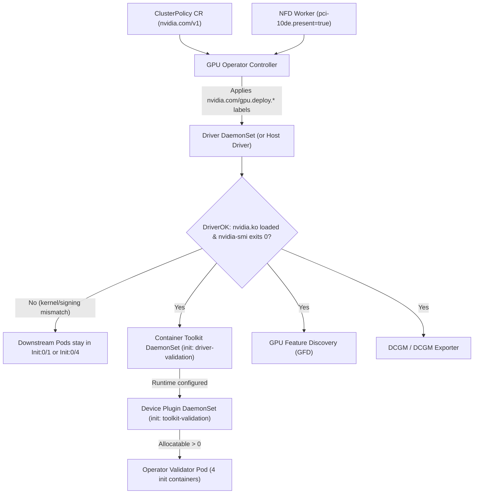

# 11.4 GPU Operator architecture and operands

| | |
|---|---|
| Level | Intermediate |
| Priority tier | 1 |
| Lab venue | GCP / GKE (plus local Python 3 simulation lab) |
| Part | Part 11: GPUs on Kubernetes, scheduling and virtualization |
| Sources used | `nvidia-zero-to-hero/volume-10/chapter-06-gpu-operator-architecture.md`; `nvidia-zero-to-hero/volume-10/chapter-07-driver-containers-and-node-operands.md`; `nvidia-zero-to-hero/volume-10/labs/lab-02-install-and-validate-gpu-operator.md`; `volume-04/02-gpu-software-operator-masterclass.md`; *NVIDIA Base Command Manager 11 Containerization Manual* (`bcm11-containerization`, Ch. 6); Roland Huß et al., *Generative AI on Kubernetes* (O'Reilly, 2026, Ch. 3); *Kubernetes for Generative AI Solutions* (Packt, 2025, Ch. 10) |
| Coverage file | `planning/coverage/chapters/11-04.md` |

## Why this matters for AI infrastructure

Picture a GPU node that passed its installation script last week and misbehaves today. That script ran once and exited with status zero, but the node has kept changing since. Across the life of a five-hundred-node AI cluster, autoscalers add new machines, administrators drain hosts for kernel security patches, and technicians replace failed GPUs.

Every time a node boots or changes state, several parts must line up again. Its kernel driver, container runtime, device plugin, feature discovery daemons, telemetry exporter and validation pods all need to converge back to one compatible contract.

Managing those seven moving parts by hand, with SSH scripts or ten independent Helm charts, breaks down at cluster scale. The NVIDIA GPU Operator solves this with the Kubernetes Operator pattern. You describe the whole node-level GPU software stack in one ClusterPolicy custom resource, and the operator keeps the cluster matching that description.

Automation that good has a downside. Because the controller reconciles every matching node automatically, a bad change reaches all of them just as fast. A bad driver image or an aggressive rolling upgrade policy can take down production GPU capacity in minutes.

Three failure patterns make this concrete. Reconciliation spreads mistakes as quickly as it spreads fixes. Updating a single unpooled ClusterPolicy to a driver image that rejects a newer host kernel can break more than half of the cluster at once. A ready status on the control plane is also not the same as readiness on each node. The ClusterPolicy object can report ready even while one node's device plugin Pod is stuck in a crash loop. Finally, node operands are privileged host components packaged as Pods. Driver containers load and unload host kernel modules, so an aggressive DaemonSet rollout can take dozens of GPUs offline at once and breach inference SLO headroom.

The table below puts numbers on these traps, so you can see how far a bad change reaches with and without a canary pool.

| Production Trap | Cluster Scenario & Numbers | Operational Consequence |
|---|---|---|
| Unpooled `ClusterPolicy` driver update | `60` GPU nodes where `35` nodes run kernel `6.5.0-1015-aws` and receive `nvcr.io/nvidia/driver:550.90.07-ubuntu22.04` | Degrades `35 / 60 = 58.33%` (`~58%`) of cluster GPU capacity, whereas a `3`-node canary pool caps blast radius at `3 / 60 = 5.0%` (`57` nodes untouched) |
| Trusting `ClusterPolicy.status.state: ready` (`reason: OperandsReady`) | `25`-node pool where `nvidia-driver-daemonset` and `nvidia-container-toolkit-daemonset` are `25/25 READY` | `nvidia-device-plugin-daemonset` is `24/25 READY` because `pod/nvidia-device-plugin-daemonset-h9x2q` is in `CrashLoopBackOff` (`6` restarts over `14m`) |
| Oversized driver DaemonSet `maxUnavailable` | `40`-node (`8` GPUs/node = `320` GPUs) cluster with `6` minutes/batch and `28`-GPU inference headroom budget | `maxUnavailable: 4` takes `4 * 8 = 32` GPUs offline across `10` batches (`60` minutes), breaching the `28`-GPU budget unless reduced to `maxUnavailable: 2` (`16` GPUs offline) |

The canary pool keeps 57 of the 60 nodes untouched when the update goes wrong.

This chapter examines the internal architecture of the NVIDIA GPU Operator and its ClusterPolicy state machine. Along the way you will trace how per-node init containers enforce strict startup ordering. You will also see how privileged driver containers interact with the host kernel, and where the GPU Operator hands off to the NVIDIA Network Operator for RDMA networking.

Roll a driver update through a small canary pool first, so one incompatible kernel cannot take most of the fleet with it.

## Prerequisites and outcomes

### Prerequisites
Before you start, you should have finished Chapters 11.1 through 11.3. Those cover GPU readiness gates, the Device Plugin contract, the NVIDIA Container Toolkit, and NFD and GFD node labeling. You should also be comfortable with Kubernetes DaemonSets, Custom Resource Definitions, init containers and Helm release management.

### Outcomes
By the end of this chapter, you should be able to explain how the GPU Operator controller reconciles a ClusterPolicy resource into node-local DaemonSets. Those DaemonSets are gated by NFD and node deployment labels. You should also be able to trace the exact init-container validation chain inside the container toolkit, device plugin and operator validator DaemonSets.

Next, you should be able to explain how a privileged Driver Container compiles or loads precompiled kernel modules. You will see why module unloading fails when device files are held open, and how to choose an ownership model. You should also be able to distinguish ClusterPolicy ready status and Pod Running state from the five sequential node acceptance gates.

Finally, you should be able to quantify fleet blast radius between unpooled and canary rollouts. You will size the maximum unavailable node budget for rolling driver upgrades against an inference headroom target. You will also separate GPU Operator failure domains from NVIDIA Network Operator responsibilities across MOFED, SR-IOV, Multus CNI, and RDMA device plugins.

Check that you can read a DaemonSet and an init container before you go further, because the rest of the chapter depends on both.

## Concepts: basics to intermediate to advanced

### 1. Basics: The Kubernetes Operator pattern, ClusterPolicy, and node operand targeting

A stateless web service is easy to manage in Kubernetes. A standard Deployment works because any replica can start in any order. The GPU software stack on a worker node is different. Its components must start in a strict sequence, from hardware up to user space. They inspect the host kernel, patch container runtime configuration on the host filesystem, and check that CUDA contexts initialize before they admit tenant Pods.

The NVIDIA GPU Operator manages this lifecycle with two core Kubernetes control-plane primitives. The first is a single desired-state API. Instead of maintaining separate Helm charts or Ansible playbooks for every daemon, the platform team defines one cluster-scoped ClusterPolicy custom resource in the API group `nvidia.com/v1`. The second is a continuous reconciliation loop. The `gpu-operator` controller Deployment watches the ClusterPolicy resource and the cluster's Node objects. It reconciles child DaemonSets whenever NFD labels a node with `feature.node.kubernetes.io/pci-10de.present=true`.

#### How the Operator targets GPU nodes (nvidia.com/gpu.deploy.* labels)
How does the GPU Operator make sure GPU DaemonSets land on GPU worker nodes and stay off CPU-only control-plane and management hosts? When the operator controller sees the NFD NVIDIA PCIe label on a node, it combines that discovery fact with the ClusterPolicy specification. It then writes eight explicit operand deployment labels onto the Node object.

```text
GPU Operator Operand Targeting Labels (bcm11-containerization Section 6.7.5, kubectl describe node node001 | grep nvidia):
  nvidia.com/gpu.deploy.driver=true             (or false when driver.enabled: false)
  nvidia.com/gpu.deploy.container-toolkit=true
  nvidia.com/gpu.deploy.device-plugin=true
  nvidia.com/gpu.deploy.gpu-feature-discovery=true
  nvidia.com/gpu.deploy.dcgm=true
  nvidia.com/gpu.deploy.dcgm-exporter=true
  nvidia.com/gpu.deploy.node-status-exporter=true
  nvidia.com/gpu.deploy.operator-validator=true
```

Each managed DaemonSet uses its matching deployment label as a node selector. That is why CPU-only management nodes never receive driver, toolkit, device-plugin or validator Pods. If you list the labels on a GPU worker node, you can predict which operands will land there. Those nodes pick up the full operand stack automatically.

The table shows which components land on which kind of host in a BCM 11 cluster.

| Node Role in BCM 11 Cluster | Example Hostname & K8s Version | Scheduled GPU Operator Components |
|---|---|---|
| CPU control-plane / management node | `basecm11` (`v1.34.7`) | Runs `gpu-operator` controller Deployment, `gpu-operator-node-feature-discovery-master`, and `nfd-worker` |
| GPU worker nodes | `node001`, `node002` (`v1.34.7`) | Receive `nvidia.com/gpu.deploy.*=true` labels and run the full node operand DaemonSet stack |

The control-plane node runs only the controller and feature discovery components, while the GPU worker nodes run the full stack. The diagram below shows how the pieces depend on each other.



Read the diagram from the top. Nothing downstream of the driver check starts until that check passes.

#### Why ClusterPolicy.status.state: ready does not prove every node is healthy
Platform engineers often check the ClusterPolicy resource status after a rollout. When you see `state: ready` there, it is tempting to assume the entire fleet is healthy. That top-level status only shows that the operator controller created its child DaemonSets and saw reconciliation converge. It does not guarantee that every individual GPU worker node in a twenty-five-node pool has a working device plugin right now.

```yaml
$ kubectl get clusterpolicy cluster-policy -o yaml
apiVersion: nvidia.com/v1
kind: ClusterPolicy
metadata:
  name: cluster-policy
spec:
  driver: {enabled: true, version: "550.90.07"}
  toolkit: {enabled: true}
status:
  namespace: gpu-operator
  state: ready
  conditions:
  - type: Ready
    status: "True"
    reason: OperandsReady
```

Compare that top-level status with the live DaemonSet and Pod output below. The driver and container toolkit DaemonSets show all twenty-five nodes ready. The device plugin DaemonSet is one node short, because a single Pod is stuck in a crash loop.

```text
$ kubectl get pods,daemonsets -n gpu-operator -o wide | grep -E 'driver|toolkit|device-plugin'
daemonset.apps/nvidia-driver-daemonset            25   25   25   25   25
daemonset.apps/nvidia-container-toolkit-daemonset 25   25   25   25   25
daemonset.apps/nvidia-device-plugin-daemonset      25   24   24   25   24
pod/nvidia-device-plugin-daemonset-h9x2q            0/1  CrashLoopBackOff  6   14m
```

Check that desired, ready and available counts match for every DaemonSet. Compare them with the per-node allocatable GPU counts as well.

---

### 2. Intermediate: Operand dependency ordering, initContainers, and nvidia-operator-validator

The GPU Operator does not run its steps one after another like a shell script. When a new GPU node joins and receives its deployment labels, Kubernetes schedules every matching DaemonSet Pod onto it at the same time. If you watch that node come up, you will see the Pods start together, not in a queue. Without local synchronization, the container toolkit Pod would patch containerd before the kernel driver finished compiling. The device plugin would then advertise GPUs before the runtime could inject them.

The operator enforces the order on each node in two ways. It places gating init containers inside each downstream DaemonSet Pod. It also runs a dedicated four-stage validator Pod.

#### 1. Container Toolkit Pod (driver-validation init container)
Consider what happens when the container toolkit DaemonSet lands on a GPU node. Kubernetes runs its `driver-validation` init container first. Until the NVIDIA kernel driver loads and responds on that host, the init container stays in `Init:0/1`, and it blocks the main toolkit container from starting. After the driver check passes, the main container installs the toolkit binaries into `/usr/local/nvidia/toolkit`, writes the runtime drop-in configuration and signals containerd to reload.

```text
$ kubectl logs -f -n gpu-operator nvidia-container-toolkit-daemonset-ffbk7
Defaulted container "nvidia-container-toolkit-ctr" out of: nvidia-container-toolkit-ctr, driver-validation (init)
...
time="2022-12-06T14:31:36Z" level=info msg="Installing NVIDIA container toolkit to '/usr/local/nvidia/toolkit'"
time="2022-12-06T14:31:36Z" level=info msg="Installing NVIDIA container toolkit config '/usr/local/nvidia/toolkit/.config/nvidia-container-runtime/config.toml'"
time="2022-12-06T14:31:36Z" level=info msg="Starting 'setup' for containerd"
time="2022-12-06T14:31:36Z" level=info msg="Loading config: /runtime/config-dir/nvidia-cri.toml"
```

#### 2. Device Plugin Pod (toolkit-validation init container)
The device plugin Pod follows the same pattern one layer higher. Its init container, `toolkit-validation`, runs before `nvidia-device-plugin-ctr` starts. If the container toolkit has not finished configuring `/etc/containerd/config.toml` or `/cm/local/apps/containerd/var/etc/conf.d/nvidia-cri.toml`, the plugin stays in `Init:0/1`. That keeps it from registering GPUs on a half-configured runtime.

Once `toolkit-validation` exits zero, the plugin opens NVML and binds `/var/lib/kubelet/device-plugins/nvidia-gpu.sock`. It then logs `Registered device plugin for 'nvidia.com/gpu' with Kubelet`.

#### 3. Operator Validator Pod (nvidia-operator-validator and its 4 init containers)
Even when the driver, toolkit and device plugin daemons report Running, you still need proof that a real container can allocate a GPU and run a CUDA kernel. The `nvidia-operator-validator` DaemonSet supplies that proof. On every GPU node it runs four sequential init containers. Only after all four exit zero does its main container log `all validations are successful`.

```text
$ kubectl logs -f -n gpu-operator nvidia-operator-validator-2qvz6
Defaulted container "nvidia-operator-validator" out of: nvidia-operator-validator, driver-validation (init), toolkit-validation (init), cuda-validation (init), plugin-validation (init)
all validations are successful
```

Each row below is one step of the validator, listed in the order the steps run.

| Validator Container (in execution order) | What it executes under the hood | Healthy log evidence | Companion Pod spawned |
|---|---|---|---|
| **1. `driver-validation (init)`** | Runs `chroot /run/nvidia/driver nvidia-smi` (or queries the host driver mount) to verify the kernel module and NVML respond | Prints full `NVIDIA-SMI` table (e.g., `520.61.05` / `CUDA 11.8` on `Tesla V100-SXM3-32GB` `2MiB / 32768MiB`, `32C`, `46W / 350W` on `node001`, or `550.90.07` / `CUDA 12.4`) | None (executes directly inside init container) |
| **2. `toolkit-validation (init)`** | Invokes `nvidia-smi` through the configured container runtime path to prove runtime library/device injection works | Prints `NVIDIA-SMI` banner from inside the toolkit-configured container context | None |
| **3. `cuda-validation (init)`** | Spawns a short-lived workload Pod (`nvidia-cuda-validator-<hash>`) that compiles/runs a real CUDA vector/matrix sample kernel | Logs `pod nvidia-cuda-validator-pxs9b have run successfully` (`5`-second polling from `Pending` to `Succeeded`) | `pod/nvidia-cuda-validator-pxs9b` (remains visible in `0/1 Completed` state) |
| **4. `plugin-validation (init)`** | Spawns a short-lived workload Pod (`nvidia-device-plugin-validator-<hash>`) requesting `nvidia.com/gpu: 1` to verify `kubelet` `Allocate()` end-to-end | Logs `pod nvidia-device-plugin-validator-5crlc have run successfully` | `pod/nvidia-device-plugin-validator-5crlc` (remains visible in `0/1 Completed` state) |
| **5. `nvidia-operator-validator` (main)** | Starts only after all 4 init containers exit `0` | `all validations are successful` | Keeps the validator DaemonSet Pod `1/1 Running` |

When you see companion Pods in this namespace, you may wonder whether they are broken. Pods such as `pod/nvidia-cuda-validator-9x2kq`, `pod/nvidia-cuda-validator-pxs9b` and `pod/nvidia-device-plugin-validator-5crlc` show zero of one ready, with status Completed. They are one-shot validation jobs spawned by the third and fourth init containers, so `0/1 Completed` is their expected healthy end state. Meanwhile, `nvidia-operator-validator-2qvz6` remains running.

---

### 3. Advanced: Driver containers, ownership models, rollout blast radius, and Network Operator handoff

#### How a Driver Container works on the Host OS
How can a Kubernetes container install a Linux kernel module when all containers on a node share the host kernel? The answer is that the `nvidia-driver-daemonset` Pod is not an isolated application container. It is a privileged host-operating container. It mounts host kernel directories and loads kernel modules straight into the host OS.

The Pod runs with `privileged: true`. It bind-mounts `/usr/src`, `/lib/modules`, `/run/nvidia` and `/dev` from the worker node filesystem.

Source compilation and precompiled modules are the two ways to get the driver in. In source-build mode, the container inspects `uname -r` and finds `linux-headers-$(uname -r)`. It then compiles `nvidia.ko`, `nvidia-uvm.ko`, `nvidia-modeset.ko` and `nvidia-peermem.ko` with `gcc` and `make`, and loads them with `insmod` or `modprobe`. Now picture that work on a five-hundred-node cluster. If every node compiles from source on every boot, all five hundred nodes download headers and run `gcc` at once. That is why production clusters set `driver.usePrecompiled: true` to pull pre-built signed modules instead.

Once the module is loaded and `/run/nvidia/driver` is populated, the container sleeps so that Kubernetes keeps your Pod running. During an upgrade the Pod terminates, and its shutdown trap runs `rmmod` to unload the kernel modules from the host. The trap runs these two commands, in this order.

```bash
# Executed inside the driver container during termination (untested here)
rmmod nvidia_uvm
rmmod nvidia
```

An open handle blocks that unload. If a container that was not evicted, or a host monitoring daemon, still holds an open file descriptor to `/dev/nvidia*`, the Linux kernel rejects `rmmod` with `Error: Module nvidia is in use`. A file descriptor is the open handle a process keeps on a file. The node then stays cordoned and stuck in its upgrade. An operator has to find the offending process with `lsof /dev/nvidia*` and stop it.

#### Choosing one ownership model per layer
Trouble starts when two owners touch the same driver. Suppose you let the base OS image pipeline and the GPU Operator both try to install or patch the NVIDIA driver on one host. Package upgrades and container restarts then overwrite each other. That conflict can cause `Driver/library version mismatch` outages across nodes. Platform engineering therefore has to name one owner for the driver layer and one owner for the runtime layer.

The table compares the three ownership models. Each one answers the question of who owns the driver and the runtime.

| Ownership Model | Configuration (`ClusterPolicy` / Helm) | Best production fit | Principal operational obligation |
|---|---|---|---|
| **1. Operator-Managed Driver & Runtime** | `driver.enabled: true`, `toolkit.enabled: true`, `nfd.enabled: true` | Cloud or bare-metal Kubernetes fleets where OS images do not pre-bake NVIDIA drivers | Coordinate operator `driver.version` upgrades with OS kernel upgrades (`uname -r`) and Secure Boot MOK signing keys |
| **2. Host-Managed Driver, Operator-Managed Runtime (BCM 11 / DGX Default)** | `driver.enabled: false`, `toolkit.enabled: true`, `nfd.enabled: true` (default in BCM 11 `cm-kubernetes-setup` and mandatory on DGX OS images) | NVIDIA Base Command Manager (BCM 11), DGX OS, or AWS EKS / GKE accelerated AMIs where the golden OS image owns the driver | OS image pipeline owns driver patching and reboots; GPU Operator reconciles Toolkit (via CDI or `/cm/local/apps/containerd/var/etc/conf.d/nvidia-cri.toml`), Device Plugin, GFD, and DCGM |
| **3. Host-Managed Driver & Runtime** | `driver.enabled: false`, `toolkit.enabled: false` | Strictly immutable OS appliances where both driver packages and `containerd` drop-ins are baked into the host image | Surface host driver and runtime configuration versions into Kubernetes node labels for drift auditing |

Only the first model puts the driver under the operator. The second model is the default on BCM 11 and DGX OS images, so there the OS image pipeline owns driver patching.

#### Five readiness gates and the DriverOK fork
A node that reports NodeReady is not automatically ready for GPU work. Neither is a driver DaemonSet that shows a running status. A driver container can sit in the Running state while it keeps retrying a failed `modprobe` in the background. Production platforms therefore enforce five sequential readiness gates. Only after the gates pass do they apply `gpu-validation=passed` to admit tenant workloads.

The table lists the gates in order. The second gate is the DriverOK check from the diagram above.

| Readiness Gate | Verification Target | Concrete Command & Healthy Evidence |
|---|---|---|
| **1. Infrastructure gate** | OS image, kernel (`uname -r`), Secure Boot MOK keys, registry mirror, and node-pool taints | Node boots into expected kernel and carries pool taint before workloads arrive |
| **2. Driver gate (`DriverOK`)** | Kernel module `nvidia.ko` loaded and NVML responds inside the driver container or host | `kubectl exec -n gpu-operator nvidia-driver-daemonset-4k7pl -- nvidia-smi` exits `0` and shows `Driver Version: 550.90.07`, `CUDA Version: 12.4`, `NVIDIA H100 80GB HBM3` on `00000000:65:00.0`, `34C`, `P0`, `118W / 700W`, `0MiB / 81559MiB` |
| **3. Runtime gate** | Container Toolkit / CDI injects `/dev/nvidia0` and `libcuda.so.1` into containers | Test container initializes NVML without `Unknown Error` |
| **4. Kubernetes gate** | NFD/GFD labels (`nvidia.com/gpu.product`, `gpu.memory`) and `Allocatable: nvidia.com/gpu` | Node advertises expected GPU count and capability labels in the Kubernetes API |
| **5. Acceptance gate** | End-to-end CUDA execution and telemetry check | `nvidia-operator-validator` logs `all validations are successful` (`GPU_OPERATOR_VALIDATED`) and DCGM passes, authorizing `gpu-validation=passed` |

A failure at gate 2 blocks every gate after it, so start the investigation with the driver.

#### Quantifying blast radius (58% vs 5%) and rolling maintenance concurrency (32 vs 16 GPUs)
Two capacity planning models shape how you structure GPU node pools and tune DaemonSet rolling upgrades. First, testing driver updates in a dedicated canary node pool bounds the blast radius of an incompatible kernel upgrade. Second, sizing `maxUnavailable` on the driver DaemonSet ensures that concurrent node drains never exceed your cluster's spare inference headroom.

The table puts real fleet numbers on both models.

| Rollout & Capacity Model | Input Fleet Parameters | Unsafe Rollout Outcome | Bounded Safe Rollout Outcome |
|---|---|---|---|
| **1. Canary Pool vs Unpooled `ClusterPolicy`** | `60` GPU nodes total; `35` nodes run newer kernel `6.5.0-1015-aws` incompatible with `nvcr.io/nvidia/driver:550.90.07-ubuntu22.04` | Updating one global `ClusterPolicy` degrades `35 / 60 = 58.33%` (`~58%`) of cluster GPU capacity within minutes | Isolating a `3`-node canary pool caps worst-case loss at `3 / 60 = 5.0%` (`5%`) and leaves `57` production nodes untouched |
| **2. Driver DaemonSet `maxUnavailable` Sizing** | `40` nodes (`8` GPUs/node = `320` total GPUs); `6` minutes/node drain+reload+validate; `292` GPUs required online (`28` GPUs spare headroom) | `maxUnavailable: 4` runs `40 / 4 = 10` batches × `6` min = `60` minutes, taking `4 * 8 = 32` GPUs offline concurrently and breaching the `28`-GPU budget by `4` GPUs | `maxUnavailable: 2` runs `40 / 2 = 20` batches × `6` min = `120` minutes, taking `2 * 8 = 16` GPUs offline concurrently and leaving `12` GPUs of spare margin |

Work through the second model step by step, and you can check each figure yourself. The fleet has 40 nodes with 8 GPUs each. That makes 320 GPUs in total, and 292 of them must stay online. The spare headroom is therefore 28 GPUs.

With `maxUnavailable: 4`, 4 × 8 = 32 GPUs go offline at once. That breaches the budget by 4 GPUs. With `maxUnavailable: 2`, 2 × 8 = 16 GPUs go offline at once, which leaves 12 GPUs of margin.

#### Handoff boundary: GPU Operator vs NVIDIA Network Operator (NicClusterPolicy)
The NVIDIA GPU Operator owns only the GPU compute stack on the worker node. When multi-node training or disaggregated inference needs InfiniBand, RoCE, or GPUDirect RDMA over ConnectX adapters, a separate operator takes over the network fabric. The BCM 11 manual pairs `NVIDIA GPU Operator v26.3.3` with `Network Operator 26.1.1`. In that setup, the NVIDIA Network Operator reconciles a `NicClusterPolicy` custom resource. It manages MOFED drivers, SR-IOV virtual functions, Multus secondary CNI attachments, and RDMA device plugins.

The table sets the two operators side by side, so you can see which one owns each concern.

| Architectural Concern | NVIDIA GPU Operator (`ClusterPolicy`) | NVIDIA Network Operator (`NicClusterPolicy`) |
|---|---|---|
| **Host kernel driver managed** | NVIDIA GPU driver (`nvidia.ko`, `nvidia-uvm.ko`) | Mellanox OFED (`MOFED`) RDMA NIC driver (`mlx5_core`, `ib_uverbs`) and peer-memory modules |
| **Kubernetes extended resource** | `nvidia.com/gpu` (or `nvidia.com/mig-*`) via NVIDIA device plugin | RDMA device resources (e.g., `rdma/rdma_shared_device_a: 8` or SR-IOV VF resources) via RDMA/SR-IOV device plugin |
| **Container network / device wiring** | NVIDIA Container Toolkit / CDI (`/dev/nvidia*`, `libcuda.so.1`) | SR-IOV Virtual Function (VF) provisioning + **Multus CNI** secondary network interface (attaching an RDMA VF alongside standard `eth0`) |
| **Primary failure symptom** | `Allocatable: nvidia.com/gpu` is `0`/absent, or `nvidia-smi` / `cuInit` fails | Pod receives its GPU (`nvidia-smi` passes), but `ibv_devinfo` shows no HCA or `PORT_DOWN`, causing NCCL to hang or fall back to slow TCP sockets |

Decide early which operator owns a failure, because you will fix it in a different custom resource depending on the answer.

## Commands and configurations that matter

### 1. Installing a pinned GPU Operator release with Helm (Lab 02 and bcm11-containerization)

Before you install or upgrade the GPU Operator in production, record the cluster's current state. That baseline lets you diff node labels, Helm releases and Pod health after reconciliation. Then add the NVIDIA NGC Helm repository and install one explicit, pinned chart version, using a values file kept under version control.

```bash
# 1. Capture pre-change cluster baseline (untested here)
mkdir -p gpu-operator-evidence
kubectl get nodes -o wide > gpu-operator-evidence/nodes-before.txt
helm list -A > gpu-operator-evidence/helm-before.txt
kubectl get pods -A -o wide > gpu-operator-evidence/pods-before.txt

# 2. Add NVIDIA Helm repo and list versions (untested here)
helm repo add nvidia https://helm.ngc.nvidia.com/nvidia
helm repo update
helm search repo nvidia/gpu-operator --versions | head -n 20

# 3. Install pinned GPU Operator release (untested here)
export GPU_OPERATOR_VERSION='v26.3.0'
helm upgrade --install gpu-operator nvidia/gpu-operator \
  --namespace gpu-operator --create-namespace \
  --version "$GPU_OPERATOR_VERSION" -f target-values.yaml \
  --wait --timeout 15m
```

On an NVIDIA Base Command Manager cluster, the golden host OS image already provides the NVIDIA driver, and containerd lives under `/cm/local/apps/containerd/`. So you disable the operator's driver container and pass the custom runtime paths through Helm flags.

```bash
# BCM 11 host-driver Helm installation with custom containerd paths (untested here)
helm install --wait -n gpu-operator --create-namespace \
  --version v26.3.0 \
  --set driver.enabled=false \
  --set toolkit.enabled=true \
  --set toolkit.env[0].name=CONTAINERD_CONFIG \
  --set toolkit.env[0].value=/cm/local/apps/containerd/var/etc/conf.d/nvidia-cri.toml \
  --set toolkit.env[1].name=RUNTIME_EXECUTABLE_PATH \
  --set toolkit.env[1].value=/cm/local/apps/containerd/current/bin/containerd \
  gpu-operator nvidia/gpu-operator
```

### 2. Configuring ClusterPolicy for sharing, MIG, and driver upgrade policy

Rather than scatter settings across node scripts, you can declare precompiled drivers, GPUDirect RDMA peer memory and automated rolling driver drains in one manifest. ClusterPolicy also governs the device-plugin sharing ConfigMaps. The default profile is `sharing` in `gpu-sharing-config`, and a single node can override it with the label `nvidia.com/device-plugin.config=<key>`. The same manifest sets the cluster MIG strategy.

```yaml
# clusterpolicy-production-example.yaml (untested here)
apiVersion: nvidia.com/v1
kind: ClusterPolicy
metadata:
  name: gpu-cluster-policy
spec:
  driver:
    enabled: true
    version: "535.154.05"
    usePrecompiled: true
    rdma:
      enabled: true
      useHostMofed: false
    upgradePolicy:
      autoUpgrade: true
      maxParallelUpgrades: 5
      drain:
        enable: true
        force: true
        timeoutSeconds: 300
        deleteEmptyDir: true
  toolkit:
    enabled: true
  gfd:
    enabled: true
  devicePlugin:
    config:
      name: gpu-sharing-config
      default: sharing
  mig:
    strategy: mixed
```

Notice the `upgradePolicy` block, which controls how driver upgrades roll out across the nodes.

### 3. Validating GPU Operator operands, nvidia-operator-validator init containers, and Network Operator RDMA

Once Helm reports the release as deployed, walk the dependency chain from the bottom up. Check that DaemonSet replicas converge, test `nvidia-smi` inside the driver container, inspect all four init containers of the operator validator Pod, and verify the RDMA HCA port state if the Network Operator is active.

```bash
# 1. Check Helm status, ClusterPolicy, and DaemonSet READY == DESIRED (untested here)
helm status gpu-operator -n gpu-operator
kubectl get clusterpolicy
kubectl get pods,daemonsets -n gpu-operator -o wide

# 2. Verify the Driver Gate directly inside the driver container (untested here)
kubectl exec -n gpu-operator nvidia-driver-daemonset-4k7pl -- nvidia-smi

# 3. Inspect all 4 init containers and main container of nvidia-operator-validator (untested here)
kubectl logs -n gpu-operator -l app=nvidia-operator-validator -c driver-validation
kubectl logs -n gpu-operator -l app=nvidia-operator-validator -c toolkit-validation
kubectl logs -n gpu-operator -l app=nvidia-operator-validator -c cuda-validation
kubectl logs -n gpu-operator -l app=nvidia-operator-validator -c plugin-validation
kubectl logs -n gpu-operator -l app=nvidia-operator-validator -c nvidia-operator-validator

# 4. If using NVIDIA Network Operator for RDMA, verify allocatable RDMA and IB port state (untested here)
kubectl describe node gpu-node-04 | grep -A2 Allocatable | grep -i rdma
kubectl describe pod nccl-worker-2 | grep -i rdma
kubectl exec -it nccl-worker-2 -- ibv_devinfo
```

When the Network Operator has provisioned shared RDMA devices and the InfiniBand links are active, Step 4 should look like this.

```text
  rdma/rdma_shared_device_a:  8
  rdma/rdma_shared_device_a:  1
hca_id: mlx5_0
    transport:          InfiniBand (0)
    fw_ver:              20.36.1010
    state:               PORT_ACTIVE (4)
```

Work through the four steps in order, so that the first failing layer is the first one you fix.

## How it fails

When a GPU node fails to schedule or run workloads, your first reflex might be to delete every Pod in the GPU Operator namespace. Do not do that. Deleting operands wipes out the init-container ordering evidence you need, and it can trigger disruptive module unloads on healthy nodes. Inspect the Pod status and logs instead, so you can pinpoint the earliest broken gate in the dependency chain.

| Failure mode | Exact symptom & command evidence | Root cause boundary | Remediation |
|---|---|---|---|
| **1. Unsupported host kernel version in Driver Container (`6.5.0-1015-aws`)** | `kubectl logs -n gpu-operator nvidia-driver-daemonset-7z4kd` prints `Detected Kernel version 6.5.0-1015-aws is not supported. Only kernel versions supported by the driver branch listed in container image nvcr.io/nvidia/driver:550.90.07-ubuntu22.04 are compatible.` Downstream toolkit and plugin Pods stay in `Init:0/1`. | **Kernel-to-Driver Compatibility Boundary:** The node OS kernel upgraded ahead of the precompiled driver image matrix. | Pin the node pool's kernel version or update `driver.version` in a `3`-node canary pool to a driver branch qualified for kernel `6.5.0-1015-aws` before promoting cluster-wide. |
| **2. Secure Boot module signing rejection (`Key was rejected by service`)** | Driver Pod restarts repeatedly. `kubectl logs -n gpu-operator nvidia-driver-daemonset-4k7pl --previous` prints `Sending 'nvidia' module removal request... done. Installing NVIDIA driver kernel module... modprobe: ERROR: could not insert 'nvidia': Key was rejected by service`. Host `journalctl -k` logs `module verification failed`. | **Secure Boot / MOK Signing Boundary:** Host UEFI Secure Boot is enabled, and the compiled or precompiled `nvidia.ko` is not signed by a key enrolled in the host's Machine Owner Key (MOK) database. | Enroll the driver signing public key into the host MOK database (or use the distribution's signed precompiled driver stream) before restarting the driver operand. |
| **3. Driver Pod `1/1 Running` with kernel/library mismatch (`Driver/library version mismatch`)** | `nvidia-driver-daemonset-9mvxq` shows `1/1 Running` on `gpu-node-22`, yet `Allocatable` has no `nvidia.com/gpu` and device plugin logs `Unable to load NVML: could not communicate with driver`. Running `kubectl exec -n gpu-operator nvidia-driver-daemonset-9xq2z -- nvidia-smi` prints `Failed to initialize NVML: Driver/library version mismatch`. | **Driver Gate (`DriverOK`) Boundary:** A stale `nvidia.ko` from a prior driver version remained loaded in kernel memory when the new driver container started (`rmmod` was blocked by an open `/dev/nvidia*` handle). | Drain the node, check `lsof /dev/nvidia*` on the host, unload the stale kernel modules (or reboot the node), and verify `kubectl exec ... -- nvidia-smi` exits `0`. |
| **4. Driver gate passes, but container `nvidia-smi` fails with `Unknown Error`** | `nvidia-smi` succeeds on the host and inside `nvidia-driver-daemonset`, and the Pod receives an allocated GPU, but `kubectl exec -it cuda-validation-pod -- nvidia-smi` prints `Failed to initialize NVML: Unknown Error`. | **Runtime / Toolkit / CDI Boundary:** `containerd` did not properly bind-mount `/dev/nvidiactl` or host driver libraries into the container's mount namespace. | Inspect `nvidia-container-toolkit-daemonset` logs, `/etc/containerd/config.toml` (or `/cm/local/apps/containerd/var/etc/conf.d/nvidia-cri.toml`), and `/var/run/cdi/nvidia.yaml`. |
| **5. Validator `cuda-validation` fails with `no kernel image is available for execution on the device`** | `kubectl logs -n gpu-operator nvidia-cuda-validator-9x2kq` prints `running CUDA sample application... CUDA error: no kernel image is available for execution on the device`. | **Compute Capability / Image Architecture Boundary:** The validator or workload CUDA binary was compiled without SASS/PTX support for the GPU architecture installed on the node. | Align the validator/workload container image tag with the GPU's compute capability (`compute.major` / `driver.version`) in the release compatibility matrix. |
| **6. Helm install timeout because Driver DaemonSet lacks GPU node taint toleration** | `helm upgrade --install ... --wait --timeout 15m` times out. `kubectl get events -n gpu-operator` shows `Warning FailedScheduling pod/nvidia-driver-daemonset-7z4kd 0/3 nodes are available: 3 node(s) had taint {nvidia.com/gpu: NoSchedule}, that the pod didn't tolerate.` | **Values / Taint Alignment Boundary:** Custom node taints were applied to the GPU node pool without adding matching tolerations to the GPU Operator Helm values. | Add the matching `tolerations` stanza to `target-values.yaml` and re-run `helm upgrade --install` (never re-run blindly without fixing the values file). |

Each row names one boundary, so when you see a symptom, match it to its layer before you change anything. You will find that each remedy fits only its own layer, so a fix that works in one row can fail in another.

## Hands-on lab

### Venue and scope
This lab runs locally with the Python standard library. The two scripts are `code/part11/gpu_operator_and_operands.py` and `code/part11/gpu_operator_and_operands_lab.py`. They simulate node deployment label reconciliation and the four-stage validator init-container state machine. They also compare ClusterPolicy readiness with DaemonSet readiness checks.

The lab further evaluates unpooled versus canary blast radius, rolling driver upgrade concurrency against a spare headroom budget, and GPU Operator versus Network Operator fault routing. Cluster Helm and `kubectl` commands are marked untested here.

### Step 1: Run the self-checking GPU Operator architecture lab (tested here)

Run the lab script from the repository root. It checks its own results, so the summary at the end tells you whether everything passed.

```bash
python3 code/part11/gpu_operator_and_operands_lab.py
```

The block below was captured from this repository.

```text
=== Chapter 11.4 Lab: GPU Operator Architecture and Node Operands ===
  [PASS] GPU Operator tracks 8 nvidia.com/gpu.deploy.* operand targeting labels
  [PASS] Nodes without pci-10de.present receive no nvidia.com/gpu.deploy.* labels
  [PASS] Operator-managed policy sets deploy.driver=true, deploy.container-toolkit=true, deploy.operator-validator=true
  [PASS] Host-managed driver policy (BCM/DGX default) sets deploy.driver=false and deploy.container-toolkit=true
  [PASS] All 4 validator init containers pass on node001 and log 'all validations are successful'
  [PASS] When driver gate fails, toolkit and device-plugin stay in Init:0/1 and validator stays in Init:0/4
  [PASS] When toolkit gate fails after driver succeeds, validator halts at Init:1/4 (toolkit-validation)
  [PASS] When CUDA sample fails (compute capability mismatch), validator halts at Init:2/4 (cuda-validation)
  [PASS] When device plugin fails registration, validator halts at Init:3/4 (plugin-validation)
  [PASS] ClusterPolicy.status.state can report 'ready' while 1 of 25 device-plugin pods is in CrashLoopBackOff (24/25)
  [PASS] 3-node canary pool with 3/3 driver, toolkit, and plugin DaemonSets is fully healthy
  [PASS] Unpooled ClusterPolicy update across 60 nodes with 35 on kernel 6.5.0-1015-aws degrades 58.33% (~58%) of fleet
  [PASS] 3-node canary pool caps blast radius at 5.0% (3/60) and leaves 57 production nodes untouched
  [PASS] maxUnavailable: 4 across 40 nodes runs 10 batches x 6 min = 60 minutes total
  [PASS] maxUnavailable: 4 takes 32 GPUs offline concurrently, exceeding the 28-GPU headroom budget by 4 GPUs
  [PASS] maxUnavailable: 2 across 40 nodes runs 20 batches x 6 min = 120 minutes total
  [PASS] maxUnavailable: 2 takes 16 GPUs offline concurrently, staying within the 28-GPU headroom budget (+12 margin)
  [PASS] Missing allocatable GPU or failed CUDA init routes to GPU Operator domain
  [PASS] Healthy GPU + missing rdma/rdma_shared_device_a routes to NVIDIA Network Operator (MOFED/RDMA plugin)
  [PASS] Allocated RDMA resource + ibv_devinfo PORT_DOWN routes to Network Operator SR-IOV/Multus/fabric layer
  [PASS] Allocatable GPU=8, CUDA init OK, rdma_shared_device_a=8, and PORT_ACTIVE (4) verifies both operators
  [PASS] Default ClusterPolicyConfig pins reviewed driver version 550.90.07
  [PASS] Default ClusterPolicyConfig enables usePrecompiled=True to avoid 500-node GCC compilation storms
  [PASS] All 8 operand deployment labels evaluate to 'true' when all operands are enabled
  [PASS] Exactly 7 operand deployment labels evaluate to 'true' when driver.enabled=false

Summary: 25 passed, 0 failed out of 25 checks.
```

### Exercises

Exercise 1 asks you to compare the deployment labels generated in two cases. In the first, the operator manages the driver. In the second, the host manages it, as on an NVIDIA DGX or BCM 11 node. Use the deployment label helper in the lab module, and state which single label value changes.

Exercise 2 asks you to find the exact validator Pod state, and the failing init container, when the CUDA sample fails. Use the validator helper with the inputs in the table below.

Exercise 3 uses the blast radius calculator on the sixty-node fleet in the table below. Compute the percentage of degraded fleet capacity for an unpooled rollout, then for a three-node canary pool rollout. State how many production nodes remain untouched.

Exercise 4 uses the upgrade window planner for the forty-node cluster in the table below. Compare batches, wall-clock minutes, concurrent GPUs offline, SLO safety and headroom margin across the three settings. Then identify the largest integer that keeps the rollout SLO-safe.

Exercise 5 asks you to explain why an alert that checks only ClusterPolicy ready status misses the crash-looping device plugin Pod. Use the policy comparison helper in the table below. Then write the DaemonSet metric condition that catches it.

Exercise 6 is a triage exercise for the multi-node PyTorch training Pod in the table below. Use the fault classifier to identify the owner operator and the failing layer when `ibv_devinfo` reports port down.

| Exercise | Input Parameters & Code Symbols |
|---|---|
| Exercise 1 | `compute_node_deploy_labels()`, `pci_10de_present=True`, `driver_enabled=True` vs `driver_enabled=False` |
| Exercise 2 | `evaluate_operator_validator_pod()`, `driver_module_loaded=True`, `nvml_healthy=True`, `toolkit_configured=True`, `cuda_sample_passed=False`, `plugin_registered_and_allocatable=True`, `Init:X/4` |
| Exercise 3 | `calculate_canary_vs_unpooled_blast_radius()`, `60`-node fleet, `35` nodes on kernel `6.5.0-1015-aws`, `3`-node canary pool |
| Exercise 4 | `plan_driver_upgrade_window()`, `40`-node (`8` GPUs/node) cluster, `28` GPUs spare headroom, `6` minutes/batch, `maxUnavailable=4`, `maxUnavailable=3`, `maxUnavailable=2` |
| Exercise 5 | `compare_policy_vs_daemonset_health(25, 25, 25, 24)`, `pod/nvidia-device-plugin-daemonset-h9x2q` (`6` restarts over `14m`) |
| Exercise 6 | `classify_gpu_vs_network_operator_fault()`, `nccl-worker-2` on `gpu-node-04`, `Allocatable: nvidia.com/gpu: 8`, `rdma/rdma_shared_device_a: 8`, `ibv_devinfo` `PORT_DOWN` (`ibv_devinfo_port_active=False`) |

Run Step 1 before you start the exercises, so you know the simulator passes before you rely on its answers.

## Checkpoint questions

<details>
<summary>**1. Why is a Kubernetes Operator controller better than a one-time host configuration script for managing GPU worker nodes?**</summary>

A one-time script makes a single change at one point in time, and then it has no ongoing relationship with the node. If a GPU is replaced, the kernel is patched, or an autoscaler recreates the node, the script's state drifts without anyone noticing. The GPU Operator keeps watching the ClusterPolicy desired state and the Node objects. It reconciles the driver, toolkit, device-plugin, GFD, DCGM and validator operands whenever nodes join, reboot or recover.
</details>

<details>
<summary>**2. Why can ClusterPolicy.status.state report ready while a GPU node in the cluster is unable to schedule GPU Pods?**</summary>

The field `ClusterPolicy.status.state: ready` reflects the controller's reconciliation of desired Kubernetes objects. If you read only that field, you will not see live health on each node. It does not show live operand health on every worker host. In the twenty-five-node example, the device plugin DaemonSet shows twenty-five desired and twenty-four ready. The ClusterPolicy still reads ready while `nvidia-device-plugin-daemonset-h9x2q` is stuck in a crash loop with six restarts over fourteen minutes.
</details>

<details>
<summary>**3. Which eight nvidia.com/gpu.deploy.* labels does the GPU Operator apply to nodes where NFD detects PCI vendor 10de?**</summary>

The controller writes eight node selector labels in the `nvidia.com/gpu.deploy.*` namespace.
- `nvidia.com/gpu.deploy.driver` and `nvidia.com/gpu.deploy.container-toolkit`.
- `nvidia.com/gpu.deploy.device-plugin` and `nvidia.com/gpu.deploy.gpu-feature-discovery`.
- `nvidia.com/gpu.deploy.dcgm` and `nvidia.com/gpu.deploy.dcgm-exporter`.
- `nvidia.com/gpu.deploy.node-status-exporter` and `nvidia.com/gpu.deploy.operator-validator`.
</details>

<details>
<summary>**4. How do nvidia-container-toolkit-daemonset and nvidia-device-plugin-daemonset enforce startup ordering on a node if Kubernetes schedules all DaemonSet Pods concurrently?**</summary>

Each DaemonSet puts its main container behind a per-Pod init container.
- The container toolkit DaemonSet Pod runs `driver-validation` as an init container before it starts `nvidia-container-toolkit-ctr`. That init container blocks until the host driver is loaded and healthy.
- The device plugin DaemonSet Pod runs `toolkit-validation` as an init container before it starts `nvidia-device-plugin-ctr`. That init container blocks until the container toolkit has configured the CRI runtime.
</details>

<details>
<summary>**5. What are the four init containers inside an nvidia-operator-validator Pod, and what does each verify?**</summary>

1. **Driver validation:** `driver-validation` runs `chroot /run/nvidia/driver nvidia-smi` to check that the host kernel driver and NVML respond.
2. **Toolkit validation:** `toolkit-validation` runs `nvidia-smi` through the container toolkit integration to check that runtime device and library injection works.
3. **CUDA validation:** `cuda-validation` starts the one-shot CUDA validator Pod, which runs a real CUDA sample kernel.
4. **Plugin validation:** `plugin-validation` starts the one-shot device-plugin validator Pod, which requests one GPU to check kubelet device allocation. Only then does the main container log `all validations are successful`.
</details>

<details>
<summary>**6. Why do pod/nvidia-cuda-validator-9x2kq and pod/nvidia-device-plugin-validator-5crlc show READY 0/1 and STATUS Completed in a healthy gpu-operator namespace?**</summary>

They are one-shot validation Pods. The third and fourth init containers of `nvidia-operator-validator` spawn them, and each one exits after its check. Each one runs its check and exits with status zero. A validator Pod that stays at `0/1 Running` or `Pending` for several minutes points to a hung or blocked validation step.
</details>

<details>
<summary>**7. How does a privileged Driver Container load an NVIDIA kernel module into the host OS without SSH access?**</summary>

The driver DaemonSet Pod runs with privileged permissions. It mounts the host's `/usr/src`, `/lib/modules`, `/run/nvidia` and `/dev` directories. It detects the host kernel version with `uname -r`, and then either compiles `nvidia.ko` with `gcc` or downloads a precompiled module. Finally, it inserts the module into the host kernel with `insmod` or `modprobe` and enters a sleep loop.
</details>

<details>
<summary>**8. Why should driver.usePrecompiled: true be enabled for large (for example, 500-node) GPU clusters?**</summary>

Without `usePrecompiled: true`, every node that boots or upgrades its driver container downloads kernel headers and compiles the module from source with `gcc`. If all the nodes do this at the same time, the network and CPU load becomes a storm, and node boot times grow. Precompiled driver containers ship pre-built kernel modules that match the OS and kernel release.
</details>

<details>
<summary>**9. What happens when a Driver Container terminates during an upgrade, and why does rmmod nvidia sometimes fail?**</summary>

During termination, the driver container runs `rmmod nvidia_uvm` and `rmmod nvidia` to unload the old kernel module from the host kernel. If any un-evicted container or host monitoring daemon still holds an open file descriptor to `/dev/nvidia*`, the kernel refuses to unload the module with `Error: Module nvidia is in use`. The upgrade stalls on that node until you find the offending PID with `lsof /dev/nvidia*` and terminate it.
</details>

<details>
<summary>**10. What are the three deployment ownership models for the GPU driver and container runtime, and why must you never allow dual ownership of a layer?**</summary>

1. **Operator-managed driver and runtime:** Both `driver.enabled: true` and `toolkit.enabled: true` are managed by the GPU Operator.
2. **Host-managed driver, operator-managed runtime:** Setting `driver.enabled: false` and `toolkit.enabled: true` is the default in NVIDIA BCM 11 and on DGX OS images.
3. **Host-managed driver and runtime:** Both settings are disabled in the operator, because the driver and runtime are baked into an immutable OS appliance.

Dual ownership is what you avoid. When OS packages and Operator containers both own a layer, they overwrite each other, and you cannot tell which one is in charge.
</details>

<details>
<summary>**11. What are the five sequential GPU node readiness gates defined in Volume 10 Chapter 7?**</summary>

1. **Infrastructure gate:** Correct OS image, kernel policy, network, registry access, and node-pool controls are in place.
2. **Driver gate:** The GPU is visible on PCIe, and `nvidia-smi` exits zero against the driver interface.
3. **Runtime gate:** A test container receives `/dev/nvidia*` and driver libraries through the toolkit or CDI path.
4. **Kubernetes gate:** Discovery labels from NFD and GFD, and device-plugin allocatable resources, match the intended service class.
5. **Acceptance gate:** Scoped CUDA validation workloads and DCGM telemetry checks pass.
</details>

<details>
<summary>**12. How do you distinguish a Driver Gate failure from a Runtime Gate failure using nvidia-smi error messages?**</summary>

- A driver/library version mismatch or a module insertion error, returned by `kubectl exec -n gpu-operator nvidia-driver-daemonset-9xq2z -- nvidia-smi`, proves a Driver Gate failure on the host.
- If `nvidia-smi` succeeds inside the driver container on an H100 node, but `kubectl exec -it cuda-validation-pod -- nvidia-smi` returns `Failed to initialize NVML: Unknown Error` from a workload Pod, that proves a Runtime Gate injection failure.
</details>

<details>
<summary>**13. In a 60-node GPU cluster where 35 nodes run a newer kernel (6.5.0-1015-aws), what is the blast radius of an incompatible driver update with one global ClusterPolicy versus a 3-node canary pool?**</summary>

For example, with a single unpooled ClusterPolicy, the DaemonSet controller updates all matching nodes, and that degrades 35 / 60 = 58.33% of the cluster's GPU capacity. With a three-node canary pool, the failure stays within 3 / 60 = 5.0% of capacity, and fifty-seven production nodes remain untouched. You can see that the canary keeps almost the whole fleet safe.
</details>

<details>
<summary>**14. A 40-node (8 GPUs/node) cluster needs a driver DaemonSet upgrade (6 minutes per node batch) while preserving 28 GPUs of inference headroom. Why is maxUnavailable: 4 unsafe, and what happens with maxUnavailable: 2?**</summary>

- For example, with `maxUnavailable: 4`, four nodes go offline at once. That removes thirty-two GPUs across ten batches in sixty minutes, which is four GPUs over the twenty-eight-GPU headroom budget.
- With `maxUnavailable: 2`, two nodes go offline at once. That removes sixteen GPUs across twenty batches in one hundred twenty minutes, and it leaves twelve GPUs inside the twenty-eight-GPU headroom budget.
</details>

<details>
<summary>**15. Why can every GPU Operator Pod on gpu-node-22 show 1/1 Running while the node still advertises zero allocatable GPUs?**</summary>

A running Pod status only shows that the container process is alive, so if you rely on it alone, you will miss the failure. On `gpu-node-22`, the driver Pod stayed running after a failed kernel module load. The device plugin Pod then logged `Unable to load NVML: could not communicate with driver` and never registered GPUs with the kubelet. The `gpu-node-014` case had the same effect, where capacity of eight dropped to zero allocatable GPUs.
</details>

<details>
<summary>**16. What does the validator error CUDA error: no kernel image is available for execution on the device in nvidia-cuda-validator-9x2kq indicate?**</summary>

It indicates a compute-capability or binary compatibility mismatch. The CUDA sample or workload binary was compiled for a GPU architecture that does not match the GPU hardware or driver on the node.
</details>

<details>
<summary>**17. Why is NVIDIA Network Operator a separate operator (NicClusterPolicy) rather than part of the NVIDIA GPU Operator?**</summary>

RDMA-capable NICs such as ConnectX InfiniBand and RoCE adapters need their own host driver stack, their own Kubernetes device plugins, and secondary CNI network attachments through Multus CNI. The GPU Operator manages GPU drivers and GPU extended resources. The Network Operator manages MOFED, SR-IOV VFs, secondary networks and RDMA resource advertisement.
</details>

<details>
<summary>**18. What is the three-step command sequence to verify that NVIDIA Network Operator has exposed a working RDMA device to a Pod (nccl-worker-2 on gpu-node-04)?**</summary>

1. Run `kubectl describe node gpu-node-04 | grep -A2 Allocatable | grep -i rdma` to verify that eight shared RDMA devices are allocatable on the node.
2. Run `kubectl describe pod nccl-worker-2 | grep -i rdma` to verify that one shared RDMA device was allocated to the Pod.
3. Run `kubectl exec -it nccl-worker-2 -- ibv_devinfo` to verify `hca_id: mlx5_0`, InfiniBand transport, firmware version, and `PORT_ACTIVE` state inside the container.
</details>

<details>
<summary>**19. On an NVIDIA Base Command Manager 11 (BCM 11) cluster, where does containerd store its NVIDIA CRI drop-in config and binary, and how is it passed to the GPU Operator Helm chart?**</summary>

On BCM 11, containerd keeps its drop-in config at `/cm/local/apps/containerd/var/etc/conf.d/nvidia-cri.toml` and its binary at `/cm/local/apps/containerd/current/bin/containerd`. You pass these paths to Helm with `toolkit.env` overrides for `CONTAINERD_CONFIG` and `RUNTIME_EXECUTABLE_PATH`.
</details>

<details>
<summary>**20. Why should you never delete all GPU Operator operand Pods at once when troubleshooting a node failure?**</summary>

Deleting all operands at once wipes out the logs and init-container ordering evidence. You need that evidence to see which boundary failed first across driver, toolkit and plugin validation. Deleting driver DaemonSet Pods on healthy nodes also triggers disruptive kernel module unloads on active workloads.
</details>

## Sources and review notes

| Source Category | File Path / Citation & Extracted Facts |
|---|---|
| Primary Volume 10 Chapter 6 | `nvidia-zero-to-hero/volume-10/chapter-06-gpu-operator-architecture.md` (Figure 10.6.1 `DriverOK` dependency graph, `ClusterPolicy` `550.90.07` `ready` vs `25 24 24 25 24` `CrashLoopBackOff` `6` restarts over `14m`, 6-step evidence chain, 3 ownership models, `60`-node `35/60 = 58%` vs `3/60 = 5%` canary blast radius, `6.5.0-1015-aws` kernel error, `gpu-node-22` `1/1 Running` driver with `Unable to load NVML`, `nvidia-cuda-validator-9x2kq` `no kernel image is available`, and NVIDIA Network Operator `rdma/rdma_shared_device_a: 8`, `mlx5_0`, `20.36.1010`, `PORT_ACTIVE (4)`) |
| Primary Volume 10 Chapter 7 | `nvidia-zero-to-hero/volume-10/chapter-07-driver-containers-and-node-operands.md` (Figure 10.7.1 host-facing contracts, 5 readiness gates, `H100 80GB HBM3` `00000000:65:00.0` `118W / 700W` `0MiB / 81559MiB` driver gate vs `Driver/library version mismatch` vs `Unknown Error`, `40`-node `8`-GPU `6`-minute `maxUnavailable: 4` `32`-GPU vs `maxUnavailable: 2` `16`-GPU `28`-GPU headroom math, `Key was rejected by service` Secure Boot failure, and `gpu-node-014` `Capacity: 8` / `Allocatable: 0`) |
| Primary Volume 10 Lab 02 | `nvidia-zero-to-hero/volume-10/labs/lab-02-install-and-validate-gpu-operator.md` (Helm preflight, `3`-node `DESIRED 3 / READY 3` verification, `ALLOCATABLE: 4` on `gpu-node-01..03`, `GPU_OPERATOR_VALIDATED` workload check, `FailedScheduling` taint timeout event, and `3 Insufficient nvidia.com/gpu` overrequest test) |
| Primary Volume 04 Masterclass | `volume-04/02-gpu-software-operator-masterclass.md` (Sections 5, 6, 9, 15: `usePrecompiled: true`, `500`-node GCC compilation avoidance, `upgradePolicy` `maxParallelUpgrades: 5` `timeoutSeconds: 300`, `rmmod nvidia` failure and `lsof /dev/nvidia*`) |
| TOON-RAG Book Source 1 | *NVIDIA Base Command Manager 11 Containerization Manual* (`bcm11-containerization`), Chapter 6 ("6.7 The NVIDIA GPU Operator", pp. 107–108, 128–136: `v26.3.3`, `v26.3.0`, `v25.10.1`, Network Operator `26.1.1`, Kubernetes `v1.34.7`, 3-item wizard checklist defaults, `/cm/local/apps/containerd/var/etc/conf.d/nvidia-cri.toml`, `nvidia.com/gpu.deploy.*` labels on `node001` with `520.61.05` / `CUDA 11.8` / `Tesla-V100-SXM3-32GB` `32768` MiB `46W / 350W` `32C`, and the 4 init containers of `nvidia-operator-validator-2qvz6`) |
| TOON-RAG Book Sources 2 & 3 | Roland Huß et al., *Generative AI on Kubernetes* (O'Reilly, 2026), Chapter 3 ("NVIDIA GPU Operator" and "Operator Configuration with ClusterPolicy" Examples 3-10 and 3-11); *Kubernetes for Generative AI Solutions* (Packt, 2025), Chapter 10 ("NVIDIA Data Center GPU Manager (DCGM)", GPU Operator vs standalone DCGM-Exporter) |
| Migration Map & Local Lab | `nvidia-zero-to-hero/volume-10/chapter-06-gpu-operator-architecture.md`, `chapter-07-driver-containers-and-node-operands.md`, `volume-04/02-gpu-software-operator-masterclass.md`; `python3 code/part11/gpu_operator_and_operands_lab.py` (`25 passed, 0 failed out of 25 checks`) |
| Explicit Inferences & Scope Notes | In Exercise 4, `maxUnavailable=3` (`3 * 8 = 24` GPUs offline across `ceil(40 / 3) = 14` batches × `6` min = `84` minutes, leaving `28 - 24 = 4` GPUs margin) is a direct evaluation of the `40`-node formula from `volume-10/chapter-07`; live cluster commands (`ClusterPolicy.spec`, `RuntimeClass`, `nodeSelector`, `kube-controller-manager`, `nvidia-device-plugin-daemonset-k2vqp`, `ListAndWatch`, `owner_operator`, `failing_layer`, `validator_pod_state`, `slo_safe=True`, `GAK` p. `134`, cross-referenced with Chapters `5.3`, `6.1`, `15.1`, and `15.2` and validated via `validate_chapter.py` and `check_coverage.py`) are marked `(untested here)`; OpenShift `DriverToolkit` RhCoreOS digest internals are out of corpus scope; API versions (`kueue.x-k8s.io/v1beta1`, `resource.k8s.io/v1`) vary by release |
