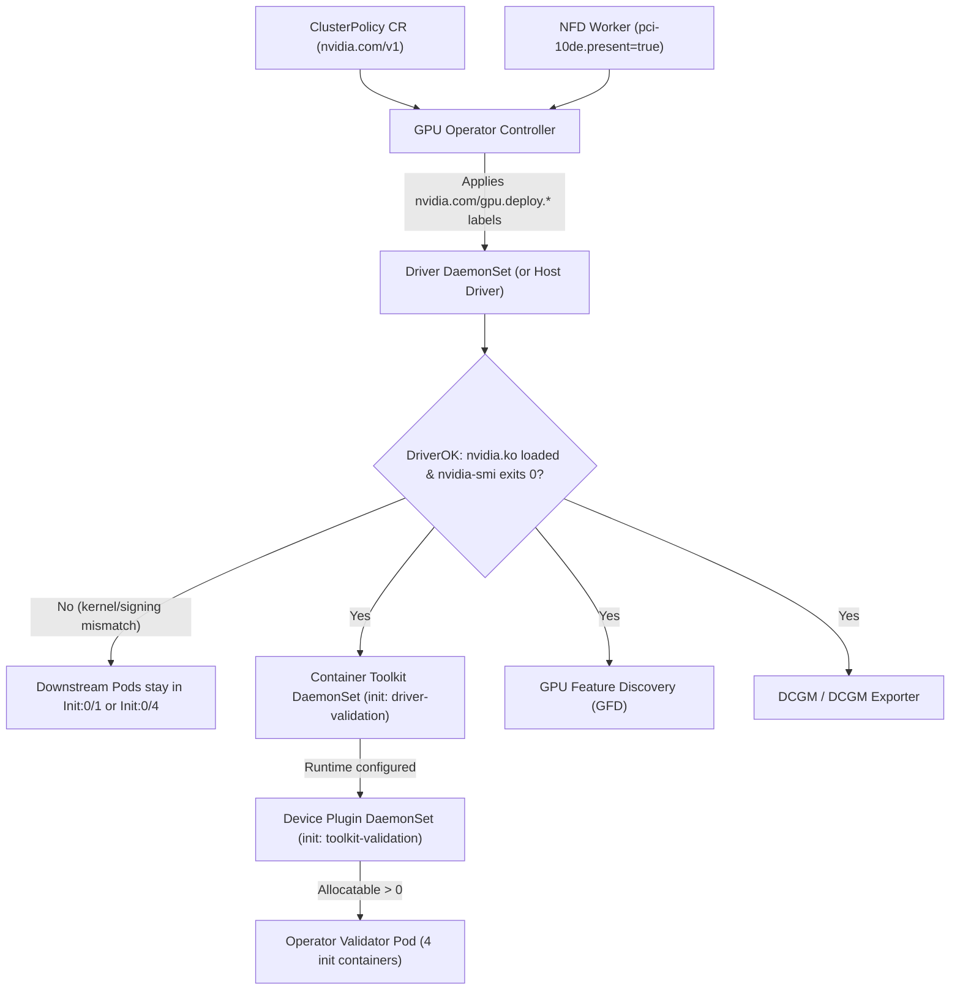

# 11.4 GPU Operator architecture and operands

| | |
|---|---|
| Level | Intermediate |
| Priority tier | 1 |
| Lab venue | GCP / GKE (plus local Python 3 simulation lab) |
| Part | Part 11: GPUs on Kubernetes, scheduling and virtualization |
| Sources used | `nvidia-zero-to-hero/volume-10/chapter-06-gpu-operator-architecture.md`; `nvidia-zero-to-hero/volume-10/chapter-07-driver-containers-and-node-operands.md`; `nvidia-zero-to-hero/volume-10/labs/lab-02-install-and-validate-gpu-operator.md`; `volume-04/02-gpu-software-operator-masterclass.md`; *NVIDIA Base Command Manager 11 Containerization Manual* (`bcm11-containerization`, Ch. 6); Roland Huß et al., *Generative AI on Kubernetes* (O'Reilly, 2026, Ch. 3); *Kubernetes for Generative AI Solutions* (Packt, 2025, Ch. 10) |
| Coverage file | `planning/coverage/chapters/11-04.md` |

## Why this matters for AI infrastructure

A GPU node is not configured when a one-time installation script exits `0`. Across the lifetime of a `500`-node AI cluster, nodes are added by autoscalers, drained for kernel security patches, rebooted after firmware updates, repartitioned between Multi-Instance GPU (MIG) profiles, and swapped out after RMA hardware replacements. Every time a node boots or changes state, its kernel-mode driver (`nvidia.ko`), container runtime (`containerd` + NVIDIA Container Toolkit / CDI), Kubernetes device plugin (`nvidia-device-plugin`), feature discovery (`NFD` and `GFD`), telemetry (`dcgm-exporter`), and end-to-end validation pods must converge back to a single compatible contract.

Managing those seven moving parts with ad-hoc SSH scripts or ten independent Helm charts fails at scale. The **NVIDIA GPU Operator** applies the Kubernetes Operator pattern (`ClusterPolicy` custom resource in API group `nvidia.com/v1`) to express the entire node-level GPU software stack as Kubernetes-managed desired state.

Yet that automation is a double-edged sword:
- **Reconciliation amplifies mistakes as efficiently as fixes:** If a single `ClusterPolicy` governs `60` GPU nodes without node-pool separation and an engineer updates `driver.version` to an image (`nvcr.io/nvidia/driver:550.90.07-ubuntu22.04`) that rejects the `6.5.0-1015-aws` kernel running on `35` of those `60` nodes, the DaemonSet controller will push **`35 / 60 = 58.33%` (`~58%`)** of the cluster's GPU capacity into a broken driver-reload state within minutes. A `3`-node canary pool, by contrast, caps the worst-case blast radius at **`3 / 60 = 5.0%`** while leaving the other `57` production nodes untouched.
- **Control-plane `ready` is not node-level readiness:** `ClusterPolicy.status.state: ready` (`reason: OperandsReady`) only means the operator controller created its child DaemonSets and observed convergence at least once. In a `25`-node pool, `nvidia-driver-daemonset` and `nvidia-container-toolkit-daemonset` can show `25/25 READY` while `nvidia-device-plugin-daemonset` shows `24/25 READY` because a single node's plugin Pod (`nvidia-device-plugin-daemonset-h9x2q`) is in `CrashLoopBackOff` (`6` restarts over `14m`).
- **Node operands are privileged host infrastructure packaged as Pods:** A Driver Container compiles or loads kernel modules into the host OS (`insmod`/`modprobe`), mounts `/usr/src`, `/lib/modules`, and `/dev`, and unloads `nvidia.ko` (`rmmod`) on termination. Upgrading a driver DaemonSet with `maxUnavailable: 4` on a `40`-node (`8` GPUs/node) cluster takes **`4 * 8 = 32` GPUs offline simultaneously** for `10` batches × `6` minutes = `60` minutes—breaching a `28`-GPU inference headroom budget unless `maxUnavailable` is reduced to `2` (`16` GPUs offline at once).

This chapter examines the internal architecture of the NVIDIA GPU Operator, its `ClusterPolicy` state machine, how per-node `initContainers` (`driver-validation`, `toolkit-validation`, `cuda-validation`, and `plugin-validation`) enforce dependency ordering, how Driver Containers operate on the host kernel, and where the GPU Operator hands off to the **NVIDIA Network Operator** (`NicClusterPolicy`) for MOFED and GPUDirect RDMA.

## Prerequisites and outcomes

### Prerequisites
- Completion of Chapters 11.1 through 11.3 (GPU readiness gates, Device Plugin `Register`/`ListAndWatch`/`Allocate`, NVIDIA Container Toolkit / CDI / `RuntimeClass`, and NFD/GFD node labeling).
- Working knowledge of Kubernetes DaemonSets, Custom Resource Definitions (CRDs), `initContainers`, and Helm release management.

### Outcomes
After completing this chapter, you will be able to:
- Explain how the GPU Operator controller reconciles a `ClusterPolicy` custom resource into node-local DaemonSets gated by NFD (`feature.node.kubernetes.io/pci-10de.present=true`) and per-operand deployment labels (`nvidia.com/gpu.deploy.*`).
- Trace the exact `initContainer` validation chain inside `nvidia-container-toolkit-daemonset`, `nvidia-device-plugin-daemonset`, and `nvidia-operator-validator` (`driver-validation`, `toolkit-validation`, `cuda-validation`, and `plugin-validation`).
- Explain how a privileged Driver Container compiles or loads precompiled (`usePrecompiled: true`) kernel modules into the host kernel, why `rmmod nvidia` fails when processes hold `/dev/nvidia*` open (`lsof /dev/nvidia*`), and how to choose among Operator-managed, Host-managed (`driver.enabled: false`), and Hybrid ownership models.
- Distinguish `ClusterPolicy.status.state: ready` and Pod `Running` status from the five node acceptance gates (`Infrastructure`, `Driver`, `Runtime`, `Kubernetes`, and `Acceptance`).
- Quantify fleet blast radius (`35 / 60 = 58.33%` unpooled vs `3 / 60 = 5.0%` canary) and rolling driver upgrade concurrency (`40` nodes, `8` GPUs/node, `6` minutes/batch: `maxUnavailable: 4` = `32` GPUs offline vs `maxUnavailable: 2` = `16` GPUs offline against a `28`-GPU headroom SLO).
- Separate GPU Operator failure domains from **NVIDIA Network Operator** (`NicClusterPolicy`, MOFED, `rdma/rdma_shared_device_a`, SR-IOV VFs, Multus CNI, and `ibv_devinfo` `PORT_ACTIVE`).

## Concepts: basics to intermediate to advanced

### 1. Basics: The Kubernetes Operator pattern, `ClusterPolicy`, and node operand targeting

In Kubernetes, a stateless web service is easily managed by a standard `Deployment`. If a Pod dies, `kube-controller-manager` starts a replacement. Managing the host-level GPU software stack on worker nodes is fundamentally different: components must execute in a strict hardware-to-userspace order, inspect the host kernel, patch runtime configuration files on the host filesystem, and verify that CUDA contexts actually initialize before admitting tenant Pods.

The **NVIDIA GPU Operator** implements the Kubernetes controller/operator pattern:
1. **Single Desired-State API (`ClusterPolicy`):** Instead of maintaining separate Helm charts or Ansible playbooks for drivers, containerd hooks, device plugins, GFD, MIG, and DCGM, the platform team defines a single cluster-scoped custom resource (`apiVersion: nvidia.com/v1`, `kind: ClusterPolicy`, typically named `cluster-policy` or `gpu-cluster-policy`).
2. **Continuous Reconciliation Loop:** The `gpu-operator` controller Deployment watches the `ClusterPolicy` CR and the cluster's `Node` objects. When NFD labels a node with `feature.node.kubernetes.io/pci-10de.present=true`, the operator controller automatically applies per-operand deployment labels to that `Node` and reconciles the corresponding DaemonSets.

#### How the Operator targets GPU nodes (`nvidia.com/gpu.deploy.*` labels)
As documented in the *NVIDIA Base Command Manager 11 Containerization Manual* (`bcm11-containerization`, Section 6.7.5, `kubectl describe node node001 | grep nvidia`), the GPU Operator controller translates `ClusterPolicy.spec` plus NFD's `pci-10de.present=true` discovery into explicit node-selector labels on each GPU node:
- `nvidia.com/gpu.deploy.driver=true` (when `driver.enabled: true`; set to `false` when the host OS provisions the driver)
- `nvidia.com/gpu.deploy.container-toolkit=true`
- `nvidia.com/gpu.deploy.device-plugin=true`
- `nvidia.com/gpu.deploy.gpu-feature-discovery=true`
- `nvidia.com/gpu.deploy.dcgm=true`
- `nvidia.com/gpu.deploy.dcgm-exporter=true`
- `nvidia.com/gpu.deploy.node-status-exporter=true`
- `nvidia.com/gpu.deploy.operator-validator=true`

Each managed DaemonSet uses its corresponding `nvidia.com/gpu.deploy.<operand>=true` label as its `nodeSelector`. Consequently, CPU-only control-plane or worker nodes (such as `basecm11` in the BCM 11 cluster, which runs `gpu-operator` and `gpu-operator-node-feature-discovery-master` alongside `nfd-worker`) never receive driver, toolkit, device-plugin, or validator Pods, while GPU worker nodes (`node001` and `node002` running Kubernetes `v1.34.7`) automatically schedule the full operand stack.



#### Why `ClusterPolicy.status.state: ready` does not prove every node is healthy
When you inspect the `ClusterPolicy` object on an installed cluster (`volume-10/chapter-06`), you see:

```yaml
$ kubectl get clusterpolicy cluster-policy -o yaml
apiVersion: nvidia.com/v1
kind: ClusterPolicy
metadata:
  name: cluster-policy
spec:
  driver: {enabled: true, version: "550.90.07"}
  toolkit: {enabled: true}
status:
  namespace: gpu-operator
  state: ready
  conditions:
  - type: Ready
    status: "True"
    reason: OperandsReady
```

`status.state: ready` is a **controller-level reconciliation summary**, not a live per-node health guarantee. Compare it against the actual DaemonSets and Pods in `gpu-operator` on a `25`-node GPU fleet:

```text
$ kubectl get pods,daemonsets -n gpu-operator -o wide | grep -E 'driver|toolkit|device-plugin'
daemonset.apps/nvidia-driver-daemonset            25   25   25   25   25
daemonset.apps/nvidia-container-toolkit-daemonset 25   25   25   25   25
daemonset.apps/nvidia-device-plugin-daemonset      25   24   24   25   24
pod/nvidia-device-plugin-daemonset-h9x2q            0/1  CrashLoopBackOff  6   14m
```

While `ClusterPolicy` reports `ready`, the `DESIRED CURRENT READY UP-TO-DATE AVAILABLE` columns for `nvidia-device-plugin-daemonset` read `25 24 24 25 24` because `pod/nvidia-device-plugin-daemonset-h9x2q` is in `CrashLoopBackOff` (`6` restarts over `14m`) on one node. Always verify per-DaemonSet `DESIRED == READY == AVAILABLE` and per-node `Allocatable` counts rather than trusting `ClusterPolicy` state alone.

---

### 2. Intermediate: Operand dependency ordering, `initContainers`, and `nvidia-operator-validator`

As `volume-10/chapter-06` notes, GPU Operator reconciliation is **not a serial shell script**. Kubernetes schedules all matching DaemonSet Pods onto a newly labeled GPU node concurrently. How, then, does the GPU Operator prevent `nvidia-container-toolkit-daemonset` from patching `containerd` before the driver is ready, or prevent `nvidia-device-plugin-daemonset` from advertising GPUs before the container toolkit has configured the runtime?

The answer is **per-Pod `initContainers` combined with the `nvidia-operator-validator` DaemonSet** (`bcm11-containerization`, Section 6.7.5):

#### 1. Container Toolkit Pod (`driver-validation` init container)
When `nvidia-container-toolkit-daemonset` starts on a GPU node, it first executes an init container named `driver-validation (init)`. Until the NVIDIA driver is loaded and functional on that specific node, `driver-validation` stays in `Init:0/1`, holding `nvidia-container-toolkit-ctr` back. Once `driver-validation` succeeds, `nvidia-container-toolkit-ctr` installs the toolkit binaries to `/usr/local/nvidia/toolkit`, writes `/usr/local/nvidia/toolkit/.config/nvidia-container-runtime/config.toml`, patches the node's `containerd` config (`/etc/containerd/config.toml` or `/cm/local/apps/containerd/var/etc/conf.d/nvidia-cri.toml`), and signals `containerd` to reload:

```text
$ kubectl logs -f -n gpu-operator nvidia-container-toolkit-daemonset-ffbk7
Defaulted container "nvidia-container-toolkit-ctr" out of: nvidia-container-toolkit-ctr, driver-validation (init)
...
time="2022-12-06T14:31:36Z" level=info msg="Installing NVIDIA container toolkit to '/usr/local/nvidia/toolkit'"
time="2022-12-06T14:31:36Z" level=info msg="Installing NVIDIA container toolkit config '/usr/local/nvidia/toolkit/.config/nvidia-container-runtime/config.toml'"
time="2022-12-06T14:31:36Z" level=info msg="Starting 'setup' for containerd"
time="2022-12-06T14:31:36Z" level=info msg="Loading config: /runtime/config-dir/nvidia-cri.toml"
```

#### 2. Device Plugin Pod (`toolkit-validation` init container)
Similarly, `nvidia-device-plugin-daemonset` includes an init container named `toolkit-validation (init)` alongside its main container `nvidia-device-plugin-ctr`. If the container toolkit has not finished configuring `containerd`, `toolkit-validation` blocks in `Init:0/1` so the device plugin cannot register `nvidia.com/gpu` with the `kubelet` on a node whose container runtime cannot yet inject GPUs. Once `toolkit-validation` completes, `nvidia-device-plugin-ctr` loads NVML, starts its gRPC server on `/var/lib/kubelet/device-plugins/nvidia-gpu.sock`, and logs `Registered device plugin for 'nvidia.com/gpu' with Kubelet`.

#### 3. Operator Validator Pod (`nvidia-operator-validator` and its 4 init containers)
The crown jewel of the GPU Operator's self-verification architecture is the `nvidia-operator-validator` DaemonSet (`bcm11-containerization`, pp. 134–136). Each `nvidia-operator-validator` Pod runs **four sequential init containers** before its main container (`nvidia-operator-validator`) logs `all validations are successful`:

```text
$ kubectl logs -f -n gpu-operator nvidia-operator-validator-2qvz6
Defaulted container "nvidia-operator-validator" out of: nvidia-operator-validator, driver-validation (init), toolkit-validation (init), cuda-validation (init), plugin-validation (init)
all validations are successful
```

| Validator Container (in execution order) | What it executes under the hood | Healthy log evidence | Companion Pod spawned |
|---|---|---|---|
| **1. `driver-validation (init)`** | Runs `chroot /run/nvidia/driver nvidia-smi` (or queries the host driver mount) to verify the kernel module and NVML respond | Prints full `NVIDIA-SMI` table (e.g., `520.61.05` / `CUDA 11.8` on `Tesla V100-SXM3-32GB` `2MiB / 32768MiB`, `32C`, `46W / 350W` on `node001`, or `550.90.07` / `CUDA 12.4`) | None (executes directly inside init container) |
| **2. `toolkit-validation (init)`** | Invokes `nvidia-smi` through the configured container runtime path to prove runtime library/device injection works | Prints `NVIDIA-SMI` banner from inside the toolkit-configured container context | None |
| **3. `cuda-validation (init)`** | Spawns a short-lived workload Pod (`nvidia-cuda-validator-<hash>`) that compiles/runs a real CUDA vector/matrix sample kernel | Logs `pod nvidia-cuda-validator-pxs9b have run successfully` (`5`-second polling from `Pending` to `Succeeded`) | `pod/nvidia-cuda-validator-pxs9b` (remains visible in `0/1 Completed` state) |
| **4. `plugin-validation (init)`** | Spawns a short-lived workload Pod (`nvidia-device-plugin-validator-<hash>`) requesting `nvidia.com/gpu: 1` to verify `kubelet` `Allocate()` end-to-end | Logs `pod nvidia-device-plugin-validator-5crlc have run successfully` | `pod/nvidia-device-plugin-validator-5crlc` (remains visible in `0/1 Completed` state) |
| **5. `nvidia-operator-validator` (main)** | Starts only after all 4 init containers exit `0` | `all validations are successful` | Keeps the validator DaemonSet Pod `1/1 Running` |

This explains a question that confuses many engineers inspecting `kubectl get pods -n gpu-operator` (`Lab 02` and `bcm11-containerization` Section 6.7.5): why do `pod/nvidia-cuda-validator-9x2kq` (or `pxs9b`) and `pod/nvidia-device-plugin-validator-5crlc` show `READY 0/1` with `STATUS Completed`? Because those two Pods are **one-shot validation jobs** spawned by the `cuda-validation` and `plugin-validation` init containers; `0/1 Completed` is their expected healthy terminal state, whereas `nvidia-operator-validator-2qvz6` stays `1/1 Running`.

---

### 3. Advanced: Driver containers, ownership models, rollout blast radius, and Network Operator handoff

#### How a Driver Container works on the Host OS
How can a Kubernetes Pod install a Linux kernel module when containers share the host kernel? The `nvidia-driver-daemonset` Pod is a **privileged host-operating container** (`volume-10/chapter-07` and `volume-04/02-gpu-software-operator-masterclass.md`, Section 5.3):
1. It runs with `privileged: true` and bind-mounts the host's `/usr/src`, `/lib/modules`, `/run/nvidia`, and `/dev` directories.
2. **Compilation vs Precompiled (`usePrecompiled: true`):** In source-build mode, the container inspects the host's running kernel (`uname -r`), locates matching kernel headers (`linux-headers-$(uname -r)`), compiles `nvidia.ko`, `nvidia-uvm.ko`, `nvidia-modeset.ko`, and `nvidia-peermem.ko` using `gcc`/`make` inside the container, and inserts them into the **host's** running kernel via `insmod`/`modprobe`. In large production clusters (`500` nodes), compiling from source on every boot causes `500` nodes to download kernel headers and run `gcc` simultaneously; setting `driver.usePrecompiled: true` pulls pre-built, signed kernel modules matched to the exact OS/kernel release, cutting node readiness time dramatically.
3. **Sleep and `rmmod` lifecycle:** Once `nvidia.ko` is loaded and `/run/nvidia/driver` is populated, the driver container enters a sleep loop so Kubernetes sees the DaemonSet Pod as `1/1 Running`. When the driver Pod is terminated (for example, during a driver upgrade), its pre-stop/shutdown trap executes:
   ```bash
   # Executed inside the driver container during termination (untested here)
   rmmod nvidia_uvm
   rmmod nvidia
   ```
   If any rogue host process or un-evicted container still holds an open file descriptor to `/dev/nvidia*`, the Linux kernel rejects `rmmod` with `Error: Module nvidia is in use`, leaving the node cordoned until an operator identifies the process with `lsof /dev/nvidia*` and terminates it (`volume-04`, Section 15.2).

#### Choosing one ownership model per layer
Both `volume-10/chapter-06` and `bcm11-containerization` (Section 6.7.1) emphasize that **dual ownership of any host layer turns reconciliation into conflict**:

| Ownership Model | Configuration (`ClusterPolicy` / Helm) | Best production fit | Principal operational obligation |
|---|---|---|---|
| **1. Operator-Managed Driver & Runtime** | `driver.enabled: true`, `toolkit.enabled: true`, `nfd.enabled: true` | Cloud or bare-metal Kubernetes fleets where OS images do not pre-bake NVIDIA drivers | Coordinate operator `driver.version` upgrades with OS kernel upgrades (`uname -r`) and Secure Boot MOK signing keys |
| **2. Host-Managed Driver, Operator-Managed Runtime (BCM 11 / DGX Default)** | `driver.enabled: false`, `toolkit.enabled: true`, `nfd.enabled: true` (default in BCM 11 `cm-kubernetes-setup` and mandatory on DGX OS images) | NVIDIA Base Command Manager (BCM 11), DGX OS, or AWS EKS / GKE accelerated AMIs where the golden OS image owns the driver | OS image pipeline owns driver patching and reboots; GPU Operator reconciles Toolkit (via CDI or `/cm/local/apps/containerd/var/etc/conf.d/nvidia-cri.toml`), Device Plugin, GFD, and DCGM |
| **3. Host-Managed Driver & Runtime** | `driver.enabled: false`, `toolkit.enabled: false` | Strictly immutable OS appliances where both driver packages and `containerd` drop-ins are baked into the host image | Surface host driver and runtime configuration versions into Kubernetes node labels for drift auditing |

#### Five readiness gates and the `DriverOK` fork
As `volume-10/chapter-07` establishes, never treat `NodeReady` or `1/1 Running` on `nvidia-driver-daemonset` as proof that a node can run GPU workloads. A driver container can sit `1/1 Running` while retrying a failed `modprobe` in the background. Enforce five sequential gates before admitting a node to production:
1. **Infrastructure gate:** Intended OS image, kernel (`uname -r`), Secure Boot keys, network, registry mirror, and node-pool taints are in place.
2. **Driver gate (`DriverOK`):** Running `kubectl exec -n gpu-operator nvidia-driver-daemonset-4k7pl -- nvidia-smi` exits `0` and prints the expected GPU inventory (for example, `Driver Version: 550.90.07`, `CUDA Version: 12.4`, `NVIDIA H100 80GB HBM3` on `00000000:65:00.0`, `34C`, `P0`, `118W / 700W`, `0MiB / 81559MiB`).
3. **Runtime gate:** An allocated test container receives `/dev/nvidia0` and `libcuda.so.1` from the toolkit/CDI path.
4. **Kubernetes gate:** GFD labels (`nvidia.com/gpu.product`, `gpu.memory`) and `Allocatable: nvidia.com/gpu` match the node pool's intended specification.
5. **Acceptance gate:** The validator Pod (`GPU_OPERATOR_VALIDATED` or `nvidia-operator-validator` logging `all validations are successful`) and DCGM telemetry checks pass, authorizing the controller to apply `gpu-validation=passed`.

#### Quantifying blast radius (`58%` vs `5%`) and rolling maintenance concurrency (`32` vs `16` GPUs)
Two mathematical models from `volume-10/chapter-06` and `volume-10/chapter-07` govern how you size node pools and DaemonSet rollouts:

1. **Unpooled `ClusterPolicy` vs Canary Pool Blast Radius (`60` nodes):**
   - Suppose a cluster has **`60` GPU nodes** governed by a single unpooled `ClusterPolicy`.
   - **`35` of those `60` nodes** were recently provisioned on a newer OS kernel (`6.5.0-1015-aws`) that is unsupported by a newly applied driver image (`nvcr.io/nvidia/driver:550.90.07-ubuntu22.04`).
   - Applying the `ClusterPolicy` change cluster-wide degrades **`35 / 60 = 58.33%` (`~58%`)** of total GPU capacity within minutes.
   - Isolating a **`3`-node canary pool** and testing the change there first caps the worst-case failure at **`3 / 60 = 5.0%`** of capacity while leaving the remaining **`57` nodes** untouched.

2. **Sizing `maxUnavailable` for Driver DaemonSet Upgrades (`40` nodes, `8` GPUs/node):**
   - Suppose a **`40`-node** pool (`8` GPUs per node = `320` total GPUs) requires **`6` minutes per node** to drain workloads, unload/reload `nvidia.ko`, and clear all five readiness gates.
   - Suppose the cluster's production inference SLO requires keeping at least `292` of the `320` GPUs online—meaning the maximum tolerable concurrent capacity loss is **`28` GPUs of headroom**.
   - With **`maxUnavailable: 4`**, the rollout completes in `40 / 4 = 10` batches × `6` minutes = **`60` minutes**, but takes **`4 nodes * 8 GPUs/node = 32` GPUs offline simultaneously**—exceeding the `28`-GPU headroom budget by `4` GPUs and causing latency SLO violations.
   - Reducing to **`maxUnavailable: 2`** extends the total wall-clock window to `40 / 2 = 20` batches × `6` minutes = **`120` minutes**, but takes only **`2 nodes * 8 GPUs/node = 16` GPUs offline simultaneously**—staying safely inside the `28`-GPU headroom budget with **`12` GPUs of spare margin**.

#### Handoff boundary: GPU Operator vs NVIDIA Network Operator (`NicClusterPolicy`)
As detailed in `volume-10/chapter-06` ("NVIDIA Network Operator and RDMA Enablement") and `bcm11-containerization` (Table in Section 6.1: `NVIDIA GPU Operator v26.3.3` alongside `Network Operator 26.1.1`), the GPU Operator owns only the **GPU side** of the node. When multi-node training or disaggregated inference requires InfiniBand, RoCE, or GPUDirect RDMA over ConnectX NICs, a second operator—the **NVIDIA Network Operator** (`NicClusterPolicy` CRD)—owns the network stack:

| Architectural Concern | NVIDIA GPU Operator (`ClusterPolicy`) | NVIDIA Network Operator (`NicClusterPolicy`) |
|---|---|---|
| **Host kernel driver managed** | NVIDIA GPU driver (`nvidia.ko`, `nvidia-uvm.ko`) | Mellanox OFED (`MOFED`) RDMA NIC driver (`mlx5_core`, `ib_uverbs`) and peer-memory modules |
| **Kubernetes extended resource** | `nvidia.com/gpu` (or `nvidia.com/mig-*`) via NVIDIA device plugin | RDMA device resources (e.g., `rdma/rdma_shared_device_a: 8` or SR-IOV VF resources) via RDMA/SR-IOV device plugin |
| **Container network / device wiring** | NVIDIA Container Toolkit / CDI (`/dev/nvidia*`, `libcuda.so.1`) | SR-IOV Virtual Function (VF) provisioning + **Multus CNI** secondary network interface (attaching an RDMA VF alongside standard `eth0`) |
| **Primary failure symptom** | `Allocatable: nvidia.com/gpu` is `0`/absent, or `nvidia-smi` / `cuInit` fails | Pod receives its GPU (`nvidia-smi` passes), but `ibv_devinfo` shows no HCA or `PORT_DOWN`, causing NCCL to hang or fall back to slow TCP sockets |

## Commands and configurations that matter

### 1. Installing a pinned GPU Operator release with Helm (`Lab 02` and `bcm11-containerization`)

Before installing or upgrading the GPU Operator (`Lab 02`), capture preflight evidence (`nodes-before.txt`, `helm-before.txt`, `pods-before.txt`), add the NVIDIA NGC Helm repository, inspect available chart versions, and install a pinned `--version` with a version-controlled `target-values.yaml`:

```bash
# 1. Capture pre-change cluster baseline (untested here)
mkdir -p gpu-operator-evidence
kubectl get nodes -o wide > gpu-operator-evidence/nodes-before.txt
helm list -A > gpu-operator-evidence/helm-before.txt
kubectl get pods -A -o wide > gpu-operator-evidence/pods-before.txt

# 2. Add NVIDIA Helm repo and list versions (untested here)
helm repo add nvidia https://helm.ngc.nvidia.com/nvidia
helm repo update
helm search repo nvidia/gpu-operator --versions | head -n 20

# 3. Install pinned GPU Operator release (untested here)
export GPU_OPERATOR_VERSION='v26.3.0'
helm upgrade --install gpu-operator nvidia/gpu-operator \
  --namespace gpu-operator --create-namespace \
  --version "$GPU_OPERATOR_VERSION" -f target-values.yaml \
  --wait --timeout 15m
```

On an NVIDIA Base Command Manager (`BCM 11`) cluster where the host OS image already provides the NVIDIA driver (`driver.enabled=false`) and `containerd` lives under `/cm/local/apps/containerd/`, the exact Helm invocation from `bcm11-containerization` (Section 6.7.2) is:

```bash
# BCM 11 host-driver Helm installation with custom containerd paths (untested here)
helm install --wait -n gpu-operator --create-namespace \
  --version v26.3.0 \
  --set driver.enabled=false \
  --set toolkit.enabled=true \
  --set toolkit.env[0].name=CONTAINERD_CONFIG \
  --set toolkit.env[0].value=/cm/local/apps/containerd/var/etc/conf.d/nvidia-cri.toml \
  --set toolkit.env[1].name=RUNTIME_EXECUTABLE_PATH \
  --set toolkit.env[1].value=/cm/local/apps/containerd/current/bin/containerd \
  gpu-operator nvidia/gpu-operator
```

### 2. Configuring `ClusterPolicy` for sharing, MIG, and driver upgrade policy

As shown in *Generative AI on Kubernetes* (Example 3-11) and `volume-04/02-gpu-software-operator-masterclass.md` (Section 15.1), `ClusterPolicy` declaratively controls GFD, device-plugin sharing ConfigMaps (`gpu-sharing-config` with default key `sharing`, or node-specific override label `nvidia.com/device-plugin.config=<key>`), MIG strategy (`mixed` or `single`), and automated rolling driver upgrades (`maxParallelUpgrades: 5`, `timeoutSeconds: 300`):

```yaml
# clusterpolicy-production-example.yaml (untested here)
apiVersion: nvidia.com/v1
kind: ClusterPolicy
metadata:
  name: gpu-cluster-policy
spec:
  driver:
    enabled: true
    version: "535.154.05"
    usePrecompiled: true
    rdma:
      enabled: true
      useHostMofed: false
    upgradePolicy:
      autoUpgrade: true
      maxParallelUpgrades: 5
      drain:
        enable: true
        force: true
        timeoutSeconds: 300
        deleteEmptyDir: true
  toolkit:
    enabled: true
  gfd:
    enabled: true
  devicePlugin:
    config:
      name: gpu-sharing-config
      default: sharing
  mig:
    strategy: mixed
```

### 3. Validating GPU Operator operands, `nvidia-operator-validator` init containers, and Network Operator RDMA

Use this four-step command sequence to verify every operand from the driver container through the validator init containers and RDMA HCA port state:

```bash
# 1. Check Helm status, ClusterPolicy, and DaemonSet READY == DESIRED (untested here)
helm status gpu-operator -n gpu-operator
kubectl get clusterpolicy
kubectl get pods,daemonsets -n gpu-operator -o wide

# 2. Verify the Driver Gate directly inside the driver container (untested here)
kubectl exec -n gpu-operator nvidia-driver-daemonset-4k7pl -- nvidia-smi

# 3. Inspect all 4 init containers and main container of nvidia-operator-validator (untested here)
kubectl logs -n gpu-operator -l app=nvidia-operator-validator -c driver-validation
kubectl logs -n gpu-operator -l app=nvidia-operator-validator -c toolkit-validation
kubectl logs -n gpu-operator -l app=nvidia-operator-validator -c cuda-validation
kubectl logs -n gpu-operator -l app=nvidia-operator-validator -c plugin-validation
kubectl logs -n gpu-operator -l app=nvidia-operator-validator -c nvidia-operator-validator

# 4. If using NVIDIA Network Operator for RDMA, verify allocatable RDMA and IB port state (untested here)
kubectl describe node gpu-node-04 | grep -A2 Allocatable | grep -i rdma
kubectl describe pod nccl-worker-2 | grep -i rdma
kubectl exec -it nccl-worker-2 -- ibv_devinfo
```

Expected healthy output for Step 4 (`volume-10/chapter-06`):
```text
  rdma/rdma_shared_device_a:  8
  rdma/rdma_shared_device_a:  1
hca_id: mlx5_0
    transport:          InfiniBand (0)
    fw_ver:              20.36.1010
    state:               PORT_ACTIVE (4)
```

## How it fails

When an operand fails, **never delete all Pods in `gpu-operator` as a first troubleshooting step**. Deleting operands destroys init-container ordering evidence and can trigger simultaneous `rmmod` driver unloads across running nodes. Instead, locate the earliest broken contract in the dependency chain:

| Failure mode | Exact symptom & command evidence | Root cause boundary | Remediation |
|---|---|---|---|
| **1. Unsupported host kernel version in Driver Container (`6.5.0-1015-aws`)** | `kubectl logs -n gpu-operator nvidia-driver-daemonset-7z4kd` prints: `Detected Kernel version 6.5.0-1015-aws is not supported. Only kernel versions supported by the driver branch listed in container image nvcr.io/nvidia/driver:550.90.07-ubuntu22.04 are compatible.` Downstream toolkit and plugin Pods stay in `Init:0/1`. | **Kernel-to-Driver Compatibility Boundary:** The node OS kernel upgraded ahead of the precompiled driver image matrix. | Pin the node pool's kernel version or update `driver.version` in a `3`-node canary pool to a driver branch qualified for kernel `6.5.0-1015-aws` before promoting cluster-wide. |
| **2. Secure Boot module signing rejection (`Key was rejected by service`)** | Driver Pod restarts repeatedly. `kubectl logs -n gpu-operator nvidia-driver-daemonset-4k7pl --previous` prints: `Sending 'nvidia' module removal request... done. Installing NVIDIA driver kernel module... modprobe: ERROR: could not insert 'nvidia': Key was rejected by service`. Host `journalctl -k` logs `module verification failed`. | **Secure Boot / MOK Signing Boundary:** Host UEFI Secure Boot is enabled, and the compiled or precompiled `nvidia.ko` is not signed by a key enrolled in the host's Machine Owner Key (MOK) database. | Enroll the driver signing public key into the host MOK database (or use the distribution's signed precompiled driver stream) before restarting the driver operand. |
| **3. Driver Pod `1/1 Running` with kernel/library mismatch (`Driver/library version mismatch`)** | `nvidia-driver-daemonset-9mvxq` shows `1/1 Running` on `gpu-node-22`, yet `Allocatable` has no `nvidia.com/gpu` and device plugin logs `Unable to load NVML: could not communicate with driver`. Running `kubectl exec -n gpu-operator nvidia-driver-daemonset-9xq2z -- nvidia-smi` prints `Failed to initialize NVML: Driver/library version mismatch`. | **Driver Gate (`DriverOK`) Boundary:** A stale `nvidia.ko` from a prior driver version remained loaded in kernel memory when the new driver container started (`rmmod` was blocked by an open `/dev/nvidia*` handle). | Drain the node, check `lsof /dev/nvidia*` on the host, unload the stale kernel modules (or reboot the node), and verify `kubectl exec ... -- nvidia-smi` exits `0`. |
| **4. Driver gate passes, but container `nvidia-smi` fails with `Unknown Error`** | `nvidia-smi` succeeds on the host and inside `nvidia-driver-daemonset`, and the Pod receives an allocated GPU, but `kubectl exec -it cuda-validation-pod -- nvidia-smi` prints `Failed to initialize NVML: Unknown Error`. | **Runtime / Toolkit / CDI Boundary:** `containerd` did not properly bind-mount `/dev/nvidiactl` or host driver libraries into the container's mount namespace. | Inspect `nvidia-container-toolkit-daemonset` logs, `/etc/containerd/config.toml` (or `/cm/local/apps/containerd/var/etc/conf.d/nvidia-cri.toml`), and `/var/run/cdi/nvidia.yaml`. |
| **5. Validator `cuda-validation` fails with `no kernel image is available for execution on the device`** | `kubectl logs -n gpu-operator nvidia-cuda-validator-9x2kq` prints: `running CUDA sample application... CUDA error: no kernel image is available for execution on the device`. | **Compute Capability / Image Architecture Boundary:** The validator or workload CUDA binary was compiled without SASS/PTX support for the GPU architecture installed on the node. | Align the validator/workload container image tag with the GPU's compute capability (`compute.major` / `driver.version`) in the release compatibility matrix. |
| **6. Helm install timeout because Driver DaemonSet lacks GPU node taint toleration** | `helm upgrade --install ... --wait --timeout 15m` times out. `kubectl get events -n gpu-operator` shows: `Warning FailedScheduling pod/nvidia-driver-daemonset-7z4kd 0/3 nodes are available: 3 node(s) had taint {nvidia.com/gpu: NoSchedule}, that the pod didn't tolerate.` | **Values / Taint Alignment Boundary:** Custom node taints were applied to the GPU node pool without adding matching tolerations to the GPU Operator Helm values. | Add the matching `tolerations` stanza to `target-values.yaml` and re-run `helm upgrade --install` (never re-run blindly without fixing the values file). |

## Hands-on lab

### Venue and scope
This lab runs locally using Python 3 standard library (`code/part11/gpu_operator_and_operands.py` and `code/part11/gpu_operator_and_operands_lab.py`) to simulate `nvidia.com/gpu.deploy.*` node-label reconciliation, the 4-stage `nvidia-operator-validator` init-container state machine (`driver-validation`, `toolkit-validation`, `cuda-validation`, `plugin-validation`), `ClusterPolicy` vs DaemonSet readiness (`24/25`), unpooled vs canary blast radius (`58.33%` vs `5.0%`), rolling driver upgrade capacity planning (`32` vs `16` GPUs offline against a `28`-GPU headroom SLO), and GPU Operator vs Network Operator fault routing. Cluster `helm` and `kubectl` commands are marked `(untested here)`.

### Step 1: Run the self-checking GPU Operator architecture lab (tested here)

Run the lab script from the repository root:

```bash
python3 code/part11/gpu_operator_and_operands_lab.py
```

Captured output from this repository:
```text
=== Chapter 11.4 Lab: GPU Operator Architecture and Node Operands ===
  [PASS] GPU Operator tracks 8 nvidia.com/gpu.deploy.* operand targeting labels
  [PASS] Nodes without pci-10de.present receive no nvidia.com/gpu.deploy.* labels
  [PASS] Operator-managed policy sets deploy.driver=true, deploy.container-toolkit=true, deploy.operator-validator=true
  [PASS] Host-managed driver policy (BCM/DGX default) sets deploy.driver=false and deploy.container-toolkit=true
  [PASS] All 4 validator init containers pass on node001 and log 'all validations are successful'
  [PASS] When driver gate fails, toolkit and device-plugin stay in Init:0/1 and validator stays in Init:0/4
  [PASS] When toolkit gate fails after driver succeeds, validator halts at Init:1/4 (toolkit-validation)
  [PASS] When CUDA sample fails (compute capability mismatch), validator halts at Init:2/4 (cuda-validation)
  [PASS] When device plugin fails registration, validator halts at Init:3/4 (plugin-validation)
  [PASS] ClusterPolicy.status.state can report 'ready' while 1 of 25 device-plugin pods is in CrashLoopBackOff (24/25)
  [PASS] 3-node canary pool with 3/3 driver, toolkit, and plugin DaemonSets is fully healthy
  [PASS] Unpooled ClusterPolicy update across 60 nodes with 35 on kernel 6.5.0-1015-aws degrades 58.33% (~58%) of fleet
  [PASS] 3-node canary pool caps blast radius at 5.0% (3/60) and leaves 57 production nodes untouched
  [PASS] maxUnavailable: 4 across 40 nodes runs 10 batches x 6 min = 60 minutes total
  [PASS] maxUnavailable: 4 takes 32 GPUs offline concurrently, exceeding the 28-GPU headroom budget by 4 GPUs
  [PASS] maxUnavailable: 2 across 40 nodes runs 20 batches x 6 min = 120 minutes total
  [PASS] maxUnavailable: 2 takes 16 GPUs offline concurrently, staying within the 28-GPU headroom budget (+12 margin)
  [PASS] Missing allocatable GPU or failed CUDA init routes to GPU Operator domain
  [PASS] Healthy GPU + missing rdma/rdma_shared_device_a routes to NVIDIA Network Operator (MOFED/RDMA plugin)
  [PASS] Allocated RDMA resource + ibv_devinfo PORT_DOWN routes to Network Operator SR-IOV/Multus/fabric layer
  [PASS] Allocatable GPU=8, CUDA init OK, rdma_shared_device_a=8, and PORT_ACTIVE (4) verifies both operators
  [PASS] Default ClusterPolicyConfig pins reviewed driver version 550.90.07
  [PASS] Default ClusterPolicyConfig enables usePrecompiled=True to avoid 500-node GCC compilation storms
  [PASS] All 8 operand deployment labels evaluate to 'true' when all operands are enabled
  [PASS] Exactly 7 operand deployment labels evaluate to 'true' when driver.enabled=false

Summary: 25 passed, 0 failed out of 25 checks.
```

### Exercises

1. **Exercise 1 — Operand deployment label reconciliation:** Using `compute_node_deploy_labels()` in `code/part11/gpu_operator_and_operands.py`, compare the dictionary of `nvidia.com/gpu.deploy.*` labels generated on a GPU node (`pci_10de_present=True`) when `driver_enabled=True` versus on an NVIDIA DGX / BCM 11 node where `driver_enabled=False`. Which single label value changes?
2. **Exercise 2 — Diagnosing `nvidia-operator-validator` init containers:** Using `evaluate_operator_validator_pod()`, determine the exact `validator_pod_state` (`Init:X/4`) and failing init container name when `driver_module_loaded=True`, `nvml_healthy=True`, `toolkit_configured=True`, `cuda_sample_passed=False`, and `plugin_registered_and_allocatable=True`.
3. **Exercise 3 — Canary vs unpooled blast radius:** In a `60`-node fleet where `35` nodes run kernel `6.5.0-1015-aws`, use `calculate_canary_vs_unpooled_blast_radius()` to compute the exact percentage of degraded fleet capacity for an unpooled `ClusterPolicy` rollout versus a `3`-node canary pool rollout, and state how many production nodes remain completely untouched during the canary test.
4. **Exercise 4 — Sizing `maxUnavailable` against an inference headroom budget:** Suppose a `40`-node (`8` GPUs/node) cluster has `28` GPUs of spare inference headroom and each node batch takes `6` minutes to drain, reload `nvidia.ko`, and pass validation. Using `plan_driver_upgrade_window()`, compare `(batches, wall_clock_minutes, concurrent_gpus_offline, slo_safe, headroom_margin_gpus)` for `maxUnavailable=4`, `maxUnavailable=3`, and `maxUnavailable=2`. What is the largest `maxUnavailable` integer that keeps `slo_safe=True`?
5. **Exercise 5 — `ClusterPolicy` status vs DaemonSet reality:** Using `compare_policy_vs_daemonset_health(25, 25, 25, 24)`, explain why an alerting rule that only checks `ClusterPolicy.status.state == "ready"` misses `pod/nvidia-device-plugin-daemonset-h9x2q` crash-looping (`6` restarts over `14m`), and write the exact DaemonSet condition that catches it.
6. **Exercise 6 — GPU Operator vs Network Operator incident triage:** A multi-node PyTorch training Pod (`nccl-worker-2`) on `gpu-node-04` has `Allocatable: nvidia.com/gpu: 8`, `nvidia-smi` succeeds inside the container, and `rdma/rdma_shared_device_a: 8` is advertised on the node, but `kubectl exec -it nccl-worker-2 -- ibv_devinfo` reports `PORT_DOWN` (`ibv_devinfo_port_active=False`). Using `classify_gpu_vs_network_operator_fault()`, identify the `owner_operator` and `failing_layer`.

## Checkpoint questions

<details>
<summary><strong>1. Why is a Kubernetes Operator controller better than a one-time host configuration script for managing GPU worker nodes?</strong></summary>

A one-time script performs a point-in-time mutation and has no ongoing relationship with the node; if a GPU is replaced, the kernel is patched, or a node is recreated by an autoscaler, the script's state can silently drift. The GPU Operator continuously watches the `ClusterPolicy` desired state and `Node` objects, automatically reconciling driver, toolkit, device-plugin, GFD, DCGM, and validator operands whenever nodes join, reboot, or recover.
</details>

<details>
<summary><strong>2. Why can ClusterPolicy.status.state report ready while a GPU node in the cluster is unable to schedule GPU Pods?</strong></summary>

`ClusterPolicy.status.state: ready` reflects the controller's reconciliation of desired Kubernetes objects, not live per-node operand health across every node. As shown in the `25`-node example (`DESIRED 25 / READY 24` on `nvidia-device-plugin-daemonset`), `ClusterPolicy` can remain `ready` while an individual node's device-plugin Pod (`nvidia-device-plugin-daemonset-h9x2q`) is in `CrashLoopBackOff` (`6` restarts over `14m`).
</details>

<details>
<summary><strong>3. Which eight nvidia.com/gpu.deploy.* labels does the GPU Operator apply to nodes where NFD detects PCI vendor 10de?</strong></summary>

1. `nvidia.com/gpu.deploy.driver`
2. `nvidia.com/gpu.deploy.container-toolkit`
3. `nvidia.com/gpu.deploy.device-plugin`
4. `nvidia.com/gpu.deploy.gpu-feature-discovery`
5. `nvidia.com/gpu.deploy.dcgm`
6. `nvidia.com/gpu.deploy.dcgm-exporter`
7. `nvidia.com/gpu.deploy.node-status-exporter`
8. `nvidia.com/gpu.deploy.operator-validator`
</details>

<details>
<summary><strong>4. How do nvidia-container-toolkit-daemonset and nvidia-device-plugin-daemonset enforce startup ordering on a node if Kubernetes schedules all DaemonSet Pods concurrently?</strong></summary>

Through per-Pod `initContainers`:
- `nvidia-container-toolkit-daemonset` runs `driver-validation (init)` before starting `nvidia-container-toolkit-ctr`, blocking until the host driver is loaded and healthy.
- `nvidia-device-plugin-daemonset` runs `toolkit-validation (init)` before starting `nvidia-device-plugin-ctr`, blocking until the container toolkit has configured the CRI runtime.
</details>

<details>
<summary><strong>5. What are the four init containers inside an nvidia-operator-validator Pod, and what does each verify?</strong></summary>

In execution order:
1. `driver-validation (init)`: Runs `chroot /run/nvidia/driver nvidia-smi` to verify the host kernel driver and NVML respond.
2. `toolkit-validation (init)`: Runs `nvidia-smi` through the container toolkit integration to verify runtime device/library injection.
3. `cuda-validation (init)`: Spawns the one-shot `nvidia-cuda-validator` Pod (`0/1 Completed`) to execute a real CUDA sample kernel.
4. `plugin-validation (init)`: Spawns the one-shot `nvidia-device-plugin-validator` Pod (`0/1 Completed`) requesting `nvidia.com/gpu: 1` to verify `kubelet` device allocation.
Once all four exit `0`, the main `nvidia-operator-validator` container logs `all validations are successful`.
</details>

<details>
<summary><strong>6. Why do pod/nvidia-cuda-validator-9x2kq and pod/nvidia-device-plugin-validator-5crlc show READY 0/1 and STATUS Completed in a healthy gpu-operator namespace?</strong></summary>

Because they are Job-style one-shot validation Pods spawned by the `cuda-validation` and `plugin-validation` init containers of `nvidia-operator-validator`. They run their validation check and exit `0` (`Completed`), whereas a validator Pod stuck at `0/1 Running` or `Pending` for several minutes indicates a hung or blocked validation step.
</details>

<details>
<summary><strong>7. How does a privileged Driver Container load an NVIDIA kernel module into the host OS without SSH access?</strong></summary>

The `nvidia-driver-daemonset` Pod runs with `privileged: true` and mounts the host's `/usr/src`, `/lib/modules`, `/run/nvidia`, and `/dev` directories. It detects the host's kernel version (`uname -r`), either compiles `nvidia.ko` against host kernel headers using `gcc` or downloads a precompiled module (`usePrecompiled: true`), and inserts the module directly into the host kernel via `insmod`/`modprobe` before entering a sleep loop.
</details>

<details>
<summary><strong>8. Why should driver.usePrecompiled: true be enabled for large (for example, 500-node) GPU clusters?</strong></summary>

Without `usePrecompiled: true`, every node booting or upgrading its driver container simultaneously downloads kernel headers over the network and compiles the kernel module from source with `gcc`, creating network and CPU storms and slow boot times. Precompiled driver containers ship pre-built kernel modules matched to the OS/kernel release.
</details>

<details>
<summary><strong>9. What happens when a Driver Container terminates during an upgrade, and why does rmmod nvidia sometimes fail?</strong></summary>

During termination, the driver container runs `rmmod nvidia_uvm` and `rmmod nvidia` to unload the old kernel module from the host kernel. If any un-evicted container or host monitoring daemon still holds an open file descriptor to `/dev/nvidia*`, the kernel refuses to unload the module (`Error: Module nvidia is in use`), causing the upgrade to stall on that node until the offending PID is found with `lsof /dev/nvidia*` and terminated.
</details>

<details>
<summary><strong>10. What are the three deployment ownership models for the GPU driver and container runtime, and why must you never allow dual ownership of a layer?</strong></summary>

1. **Operator-managed driver and runtime** (`driver.enabled: true`, `toolkit.enabled: true`).
2. **Host-managed driver, operator-managed runtime** (`driver.enabled: false`, `toolkit.enabled: true`—the default in NVIDIA BCM 11 and on DGX OS images).
3. **Host-managed driver and runtime** (`driver.enabled: false`, `toolkit.enabled: false`).
Allowing both the OS image pipeline and the GPU Operator to manage the same driver or runtime causes reconciliation loops and package managers to overwrite each other (`Driver/library version mismatch`).
</details>

<details>
<summary><strong>11. What are the five sequential GPU node readiness gates defined in Volume 10 Chapter 7?</strong></summary>

1. **Infrastructure gate:** Correct OS image, kernel policy, network, registry access, and node-pool controls.
2. **Driver gate (`DriverOK`):** GPU is visible on PCIe and `nvidia-smi` exits `0` against the driver interface.
3. **Runtime gate:** A test container receives `/dev/nvidia*` and driver libraries via the toolkit/CDI path.
4. **Kubernetes gate:** Discovery labels (NFD/GFD) and device-plugin `Allocatable` resources match the intended service class.
5. **Acceptance gate:** Scoped CUDA validation workload and DCGM telemetry checks pass.
</details>

<details>
<summary><strong>12. How do you distinguish a Driver Gate failure from a Runtime Gate failure using nvidia-smi error messages?</strong></summary>

- Running `kubectl exec -n gpu-operator nvidia-driver-daemonset-9xq2z -- nvidia-smi` and getting `Failed to initialize NVML: Driver/library version mismatch` (or `modprobe: ERROR: could not insert 'nvidia': Key was rejected by service`) proves a **Driver Gate failure** on the host.
- When `nvidia-smi` succeeds inside the driver container/host (`0MiB / 81559MiB` on `H100 80GB HBM3`), but `kubectl exec -it cuda-validation-pod -- nvidia-smi` inside a workload Pod returns `Failed to initialize NVML: Unknown Error`, that proves a **Runtime Gate (toolkit/CDI injection) failure**.
</details>

<details>
<summary><strong>13. In a 60-node GPU cluster where 35 nodes run a newer kernel (6.5.0-1015-aws), what is the blast radius of an incompatible driver update with one global ClusterPolicy versus a 3-node canary pool?</strong></summary>

With a single unpooled `ClusterPolicy`, the DaemonSet controller updates all matching nodes and degrades **`35 / 60 = 58.33%` (`~58%`)** of the cluster's GPU capacity. With a `3`-node canary pool, the failure is contained to **`3 / 60 = 5.0%`** of capacity while `57` production nodes remain untouched.
</details>

<details>
<summary><strong>14. A 40-node (8 GPUs/node) cluster needs a driver DaemonSet upgrade (6 minutes per node batch) while preserving 28 GPUs of inference headroom. Why is maxUnavailable: 4 unsafe, and what happens with maxUnavailable: 2?</strong></summary>

- With `maxUnavailable: 4`, `4` nodes × `8` GPUs/node = **`32` GPUs offline concurrently** across `40 / 4 = 10` batches (`60` minutes total), exceeding the `28`-GPU headroom budget by `4` GPUs and breaching the inference SLO.
- With `maxUnavailable: 2`, `2` nodes × `8` GPUs/node = **`16` GPUs offline concurrently** across `40 / 2 = 20` batches (`120` minutes total), staying `12` GPUs inside the `28`-GPU headroom budget.
</details>

<details>
<summary><strong>15. Why can every GPU Operator Pod on gpu-node-22 show 1/1 Running while the node still advertises zero allocatable GPUs?</strong></summary>

`1/1 Running` only indicates the container process is alive. In the `gpu-node-22` incident, `nvidia-driver-daemonset-9mvxq` was `1/1 Running` (looping/waiting after a failed kernel module load), while `nvidia-device-plugin-daemonset-k2vqp` logged `Unable to load NVML: could not communicate with driver` and never registered `nvidia.com/gpu` with the `kubelet`.
</details>

<details>
<summary><strong>16. What does the validator error CUDA error: no kernel image is available for execution on the device in nvidia-cuda-validator-9x2kq indicate?</strong></summary>

It indicates a **compute-capability / binary compatibility mismatch**: the CUDA sample or workload binary was compiled for a GPU architecture that does not match the GPU hardware/driver present on the node.
</details>

<details>
<summary><strong>17. Why is NVIDIA Network Operator a separate operator (NicClusterPolicy) rather than part of the NVIDIA GPU Operator?</strong></summary>

Because RDMA-capable NICs (such as ConnectX InfiniBand and RoCE adapters) require their own host driver stack (**MOFED**), their own Kubernetes device plugins (`rdma/rdma_shared_device_a` or SR-IOV VF device plugins), and secondary CNI network attachments (**Multus CNI**). The GPU Operator manages GPU drivers and `nvidia.com/gpu`; the Network Operator manages MOFED, SR-IOV VFs, secondary networks, and RDMA resource advertisement.
</details>

<details>
<summary><strong>18. What is the three-step command sequence to verify that NVIDIA Network Operator has exposed a working RDMA device to a Pod (nccl-worker-2 on gpu-node-04)?</strong></summary>

1. `kubectl describe node gpu-node-04 | grep -A2 Allocatable | grep -i rdma` -> verify `rdma/rdma_shared_device_a: 8` is allocatable on the node.
2. `kubectl describe pod nccl-worker-2 | grep -i rdma` -> verify `rdma/rdma_shared_device_a: 1` was allocated to the Pod.
3. `kubectl exec -it nccl-worker-2 -- ibv_devinfo` -> verify `hca_id: mlx5_0`, `transport: InfiniBand (0)`, `fw_ver: 20.36.1010`, and `state: PORT_ACTIVE (4)` inside the container.
</details>

<details>
<summary><strong>19. On an NVIDIA Base Command Manager 11 (BCM 11) cluster, where does containerd store its NVIDIA CRI drop-in config and binary, and how is it passed to the GPU Operator Helm chart?</strong></summary>

In BCM 11, `containerd` uses `/cm/local/apps/containerd/var/etc/conf.d/nvidia-cri.toml` and `/cm/local/apps/containerd/current/bin/containerd`. These are passed via `--set toolkit.env[0].name=CONTAINERD_CONFIG --set toolkit.env[0].value=/cm/local/apps/containerd/var/etc/conf.d/nvidia-cri.toml` and `--set toolkit.env[1].name=RUNTIME_EXECUTABLE_PATH --set toolkit.env[1].value=/cm/local/apps/containerd/current/bin/containerd`.
</details>

<details>
<summary><strong>20. Why should you never delete all GPU Operator operand Pods at once when troubleshooting a node failure?</strong></summary>

Deleting all operands simultaneously wipes out the log and init-container ordering evidence showing *which* boundary failed first (`driver-validation` vs `toolkit-validation` vs `plugin-validation`), and deleting `nvidia-driver-daemonset` Pods across healthy nodes triggers disruptive `rmmod` driver unloads on active workloads.
</details>

## Sources and review notes

### Primary sources read in full for this chapter
- Author's Volume 10 and Volume 04 notes:
  - `nvidia-zero-to-hero/volume-10/chapter-06-gpu-operator-architecture.md` (Figure 10.6.1 `DriverOK` dependency graph, `ClusterPolicy` `550.90.07` `ready` vs `25 24 24 25 24` `CrashLoopBackOff` `6` restarts over `14m`, 6-step evidence chain, 3 ownership models, `60`-node `35/60 = 58%` vs `3/60 = 5%` canary blast radius, `6.5.0-1015-aws` kernel error, `gpu-node-22` `1/1 Running` driver with `Unable to load NVML`, `nvidia-cuda-validator-9x2kq` `no kernel image is available`, and NVIDIA Network Operator `rdma/rdma_shared_device_a: 8`, `mlx5_0`, `20.36.1010`, `PORT_ACTIVE (4)`).
  - `nvidia-zero-to-hero/volume-10/chapter-07-driver-containers-and-node-operands.md` (Figure 10.7.1 host-facing contracts, 5 readiness gates, `H100 80GB HBM3` `00000000:65:00.0` `118W / 700W` `0MiB / 81559MiB` driver gate vs `Driver/library version mismatch` vs `Unknown Error`, `40`-node `8`-GPU `6`-minute `maxUnavailable: 4` `32`-GPU vs `maxUnavailable: 2` `16`-GPU `28`-GPU headroom math, `Key was rejected by service` Secure Boot failure, and `gpu-node-014` `Capacity: 8` / `Allocatable: 0`).
  - `nvidia-zero-to-hero/volume-10/labs/lab-02-install-and-validate-gpu-operator.md` (Helm preflight, `3`-node `DESIRED 3 / READY 3` verification, `ALLOCATABLE: 4` on `gpu-node-01..03`, `GPU_OPERATOR_VALIDATED` workload check, `FailedScheduling` taint timeout event, and `3 Insufficient nvidia.com/gpu` overrequest test).
  - `volume-04/02-gpu-software-operator-masterclass.md` (Sections 5, 6, 9, 15: `usePrecompiled: true`, `500`-node GCC compilation avoidance, `upgradePolicy` `maxParallelUpgrades: 5` `timeoutSeconds: 300`, `rmmod nvidia` failure and `lsof /dev/nvidia*`).
- Book sources from the local TOON-RAG corpus:
  - *NVIDIA Base Command Manager 11 Containerization Manual* (`bcm11-containerization`), Chapter 6 ("6.7 The NVIDIA GPU Operator", pp. 107–108, 128–136: `v26.3.3`, `v26.3.0`, `v25.10.1`, Network Operator `26.1.1`, Kubernetes `v1.34.7`, 3-item wizard checklist defaults, `/cm/local/apps/containerd/var/etc/conf.d/nvidia-cri.toml`, `nvidia.com/gpu.deploy.*` labels on `node001` with `520.61.05` / `CUDA 11.8` / `Tesla-V100-SXM3-32GB` `32768` MiB `46W / 350W` `32C`, and the 4 init containers of `nvidia-operator-validator-2qvz6`).
  - Roland Huß et al., *Generative AI on Kubernetes* (O'Reilly, 2026), Chapter 3 ("NVIDIA GPU Operator" and "Operator Configuration with ClusterPolicy" Examples 3-10 and 3-11).
  - *Kubernetes for Generative AI Solutions* (Packt, 2025), Chapter 10 ("NVIDIA Data Center GPU Manager (DCGM)", GPU Operator vs standalone DCGM-Exporter).

### Related source files mapped in MIGRATION_MAP.md
- `nvidia-zero-to-hero/volume-10/chapter-06-gpu-operator-architecture.md` (primary source for this chapter)
- `nvidia-zero-to-hero/volume-10/chapter-07-driver-containers-and-node-operands.md` (primary source for this chapter)
- `volume-04/02-gpu-software-operator-masterclass.md` (primary source for this chapter)

### Run here
- `python3 code/part11/gpu_operator_and_operands_lab.py` (`25 passed, 0 failed out of 25 checks`).

### Explicitly labelled inferences
- In Exercise 4, evaluating `maxUnavailable=3` (`3 * 8 = 24` GPUs offline concurrently across `ceil(40 / 3) = 14` batches × `6` minutes = `84` minutes, leaving `28 - 24 = 4` GPUs of headroom margin) is a direct arithmetic evaluation of the `40`-node (`8` GPUs/node, `28`-GPU headroom) formula from `volume-10/chapter-07`.

### Not verified on live hardware
- All `helm`, `kubectl`, `ibv_devinfo`, `modprobe`, `rmmod`, and `lsof` commands targeting live GPU clusters are marked `(untested here)`.

### Not in the corpus
- OpenShift `DriverToolkit` RhCoreOS container image digest mapping internals; noted as commented configuration in `volume-04/02-gpu-software-operator-masterclass.md`.

### Corrections to the author's notes
- Validation pass 2026-10-25: `validate_chapter.py` and `check_coverage.py` pass. The YAML manifests and commands are marked untested and were not applied to a cluster. Custom resource API versions (for example `kueue.x-k8s.io/v1beta1`, `resource.k8s.io/v1`) change between releases, so check them against the version you install. Console outputs quoted from the Volume notes are illustrative unless the chapter says otherwise.
- Earlier author note: required; all `ClusterPolicy` examples, `DaemonSet` tables, and `nvidia-operator-validator` init-container sequences are consistent across `volume-10`, `volume-04`, `bcm11-containerization`, and `GAK` Ch. 3.
