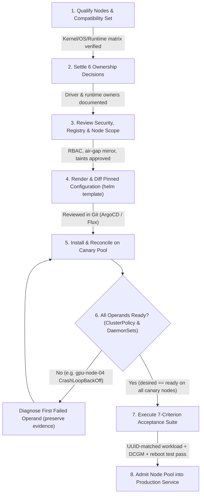
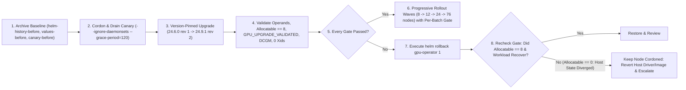

# 11.5 GPU Operator installation, configuration and upgrades

| | |
|---|---|
| Level | Advanced |
| Priority tier | 1 |
| Lab venue | GCP / GKE (plus local Python 3 simulation lab) |
| Part | Part 11: GPUs on Kubernetes, scheduling and virtualization |
| Sources used | `nvidia-zero-to-hero/volume-10/chapter-10-production-installation-and-configuration.md`; `nvidia-zero-to-hero/volume-10/chapter-11-upgrades-and-production-troubleshooting.md`; `nvidia-zero-to-hero/volume-10/chapter-12-volume-10-summary.md`; `nvidia-zero-to-hero/volume-10/labs/lab-04-perform-a-controlled-gpu-platform-upgrade.md`; `volume-04/02-gpu-software-operator-masterclass.md`; *NVIDIA Base Command Manager 11 Containerization Manual* (`bcm11-containerization`, Ch. 6); Roland Huß et al., *Generative AI on Kubernetes* (O'Reilly, 2026, Ch. 3) |
| Coverage file | `planning/coverage/chapters/11-05.md` |

## Why this matters for AI infrastructure

Picture a team that has just installed a GPU pool. Helm reports the release as deployed, so the team opens the pool to users. That status means less than it sounds. It means only that the Kubernetes API server accepted the rendered manifests and that the top-level Deployment objects reported ready within the configured timeout. It does not prove that the kernel module loaded on every worker node. It does not show that the container runtime can inject device files into a fresh container sandbox. It also does not show that the kubelet registered GPU capacity or that telemetry exporters scrape matching device identities.

Upgrades deserve the same suspicion. Treating a GPU platform upgrade as a routine chart version bump is even more dangerous. Every upgrade changes a tightly coupled compatibility set across the host kernel, driver, container runtime, and firmware. When an unreviewed upgrade sweeps across an entire cluster, one firmware quirk can take down every node at once. Platform teams can then discover that a chart rollback does not unload a wedged kernel module on the host. Machine learning engineers are left facing scheduling failures and broken nodes during critical training windows.

```text
Production Upgrade & Acceptance Risk Summary:
- Helm install wait scope: --timeout 15m (checks controller Deployment, not child DaemonSets)
- Coupled driver versions across upgrades: 535.129.03, 535.154.05, 550.90.07
- Coupled operator chart transitions: 24.6.0 -> 24.9.1 and v25.10.1 -> v26.3.0
- Fleet sizing model: 120 nodes * 8 GPUs/node = 960 GPUs across 4 hardware batches (30 nodes/batch)
- Canary and progressive wave schedule: 8 canary nodes (2/batch, ~7%) -> 12 nodes (10%) -> 24 nodes -> 76 nodes
- Maximum blast radius at Wave 2: 24 nodes * 8 GPUs = 192 GPUs out of 960 (20% of fleet capacity)
- Untouched serving capacity during Wave 1 and Wave 2: 90% to 80% of fleet
- Rollback trap: helm rollback gpu-operator 1 --namespace gpu-operator --wait --timeout 20m prints success while Allocatable stays 0
```

The summary above previews the numbers and commands that the rest of this chapter checks. This chapter is the production playbook for qualifying, installing, accepting, upgrading, and rolling back the NVIDIA GPU Operator across multi-pool Kubernetes clusters. Decide before you install which team owns each part of the stack, because the rest of the chapter depends on that answer.

## Prerequisites and outcomes

### Prerequisites
- Finish Chapters 11.1 through 11.4, which cover the seven-layer GPU lifecycle, Device Plugin registration, container runtime injection, and ClusterPolicy architecture.
- Be comfortable with Helm chart rendering, release history, and Kubernetes node maintenance commands, including drain and PodDisruptionBudget enforcement.

### Outcomes
By the end of this chapter, you should be able to do the following.
- Settle the six foundational platform ownership decisions before you write a single line of Helm values.
- Run the eight-stage installation evidence pipeline, and explain why a deployed Helm release can coexist with a failed ClusterPolicy.
- Check a GPU node pool against the seven-criterion production acceptance contract by matching workload logs with Prometheus telemetry.
- Size a multi-batch canary and progressive rollout schedule that limits the blast radius of hardware-specific bugs across a large fleet.
- Run a controlled upgrade and rollback state machine that catches host-level divergence when a Helm rollback leaves zero allocatable GPUs.

## Concepts: basics to intermediate to advanced

### 1. Basics: Defining the platform boundary and treating Helm values as a governed interface

Picture an engineer testing the GPU Operator in a lab. They run a one-line install with the default settings, and on a single disposable node everything seems to work. Move that same command to a production fleet, and the defaults can cause serious outages. They may overwrite host runtime configuration, or try to compile kernel drivers on hardened OS images that have no compiler. They can also pull container images from public registries through throttled NAT gateways during a cluster recovery.

Platform teams prevent these failures by treating the Helm values file as a strictly governed contract. Before anyone writes configuration files, infrastructure, security, and operations teams must settle six ownership boundaries. Once those boundaries are recorded, every change flows through an eight-stage installation and verification pipeline. The flowchart below shows that pipeline from qualification to admission into production.



Notice that a failed readiness check sends you back to diagnose the first failed operand, with the evidence preserved, before the install is reconciled again.

#### Six ownership decisions that determine the architecture
Before you create a values file, platform engineering, OS engineering, and security teams need to write down an answer to each of six boundary questions. If any domain stays ambiguous, an ownership clash is guaranteed during node boot or chart upgrades. The table lists the questions and the failure each unanswered question causes.

| Ownership Domain | Production Questions to Settle Before Deployment | Failure Mode if Left Ambiguous |
|---|---|---|
| **1. Driver ownership** | Is `nvidia.ko` pre-baked into a golden OS image (`driver.enabled: false`), installed by host automation, or managed by the GPU Operator (`driver.enabled: true`, `usePrecompiled: true`)? Who signs modules for UEFI Secure Boot? | Dual ownership where the operator driver container overwrites or clashes with host-installed kernel modules (`Driver/library version mismatch`). |
| **2. Runtime ownership** | Does the base OS image pre-configure containerd or CRI-O, or does the operator toolkit DaemonSet (`toolkit.enabled: true`) patch `CONTAINERD_CONFIG` and enable CDI? Which RuntimeClass handler names are published? | Toolkit operand patches `/etc/containerd/config.toml` while the distribution containerd reads `/cm/local/apps/containerd/var/etc/conf.d/nvidia-cri.toml` or cloud-specific paths. |
| **3. Node scope** | Which dedicated GPU node pools are eligible? How do NFD and GFD labels, node selectors, taints (`nvidia.com/gpu=present:NoSchedule`), and admission webhooks keep operands off CPU-only pools? | A global ClusterPolicy change pushes an incompatible driver across all pools simultaneously. |
| **4. Image supply chain** | Which internal container registry mirror is authoritative? Are all operator and operand images (`driver`, `container-toolkit`, `k8s-device-plugin`, `dcgm-exporter`, `k8s-mig-manager`) mirrored, scanned, and signed? | Node recovery stalls in ImagePullBackOff during an external registry outage or air-gapped firewall change. |
| **5. Sharing policy** | Which pools run exclusive full GPUs, which run MIG (`single` vs `mixed`), and which allow time-slicing (`replicas: 8` or `10`)? | Latency-sensitive inference lands on a time-sliced pool without memory isolation and suffers OOM or jitter. |
| **6. Operations & escalation** | Which team owns the Git-controlled `values.yaml`, compatibility matrix updates, alert triage, maintenance drain windows, and NVIDIA AI Enterprise (`NVAIE`) support escalation? | Incident responders blindly delete DaemonSets or run `helm rollback` without checking host kernel state. |

Read the table as a list of questions you must answer in writing before the first install. Each row also names what goes wrong when the answer is missing, such as a driver container that clashes with a host-installed module.

#### Why Helm reporting deployed is not the acceptance gate
A common mistake is opening a node pool to user traffic as soon as the Helm CLI exits with zero. Suppose you run a version-pinned Helm install against a 6-node canary pool. Helm waits only on the top-level objects. It checks the operator controller Deployment, not the child DaemonSets that get created across the worker nodes.

```text
$ helm install gpu-operator nvidia/gpu-operator \
    --namespace gpu-operator --create-namespace \
    --version 24.9.1 -f canary-values.yaml --wait --timeout 15m
NAME: gpu-operator
LAST DEPLOYED: Tue Aug  4 09:12:03 2026
NAMESPACE: gpu-operator
STATUS: deployed
REVISION: 1
```

Helm reports deployed for revision 1. A team that stops here and opens the pool to user traffic walks straight into an outage. The ClusterPolicy and the operand Pods show the real state of the installation.

```text
$ kubectl get clusterpolicy cluster-policy -o jsonpath='{.status.state}{"\n"}'
notReady

$ kubectl get pods -n gpu-operator -o wide | grep -v Running
NAME                                          READY   STATUS             RESTARTS   NODE
nvidia-driver-daemonset-7q2kd                 0/1     CrashLoopBackOff   5          gpu-node-04
```

Five of the 6 canary nodes succeeded, while `gpu-node-04` is stuck in CrashLoopBackOff with 5 restarts. The previous container logs on that specific node show the exact host difference.

```text
$ kubectl logs -n gpu-operator nvidia-driver-daemonset-7q2kd --previous | tail -5
Stopping NVIDIA persistence daemon...
Unloading NVIDIA driver kernel modules...
modprobe: ERROR: could not insert 'nvidia': Key was rejected by service
mount: /run/nvidia/driver/usr/src/nvidia-535.129.03: No such file or directory
Failed to install the kernel module through DKMS
```

The logs point at Secure Boot. Node `gpu-node-04` had UEFI Secure Boot enabled, and the Machine Owner Key was not enrolled for the driver module. The other 5 canary nodes had matching keys in their firmware databases. Because the team inspected the first failing operand instead of deleting the Helm release, they found the per-node Secure Boot drift at once.

---

### 2. Intermediate: The seven-criterion production acceptance contract

If you trust pod readiness probes alone, you will miss real failures in the GPU software stack. A device plugin container can report running while the kubelet shows zero allocatable GPUs. A telemetry exporter can stay running after a driver restart and still return zero metric series to Prometheus. Admit a node pool without end-to-end checks, and workloads either fail at runtime or run completely blind.

Before a new or upgraded GPU node pool is marked eligible for production workloads, it must pass all seven acceptance criteria. Automation should apply the validation label and uncordon the nodes only after every check passes.

| Acceptance Criterion | Concrete Verification Command | Required Passing Evidence | What Failure Here Isolates |
|---|---|---|---|
| **1. Host GPU detection & driver health** | `kubectl get clusterpolicy` and `nvidia-smi` inside driver container or host | `status.state: ready` and `nvidia-smi` exits `0` on all nodes in the pool | PCIe hardware, kernel ABI, or Secure Boot signing (`Key was rejected by service`) |
| **2. Runtime sandbox creation & CUDA init** | `kubectl apply -f gpu-validate.yaml` | Container transitions `Pending -> ContainerCreating -> Running -> Succeeded` without OCI hook errors | containerd `config.toml`, RuntimeClass, or CDI `/var/run/cdi/nvidia.yaml` (`/run/nvidia/driver/dev/nvidia0: no such file`) |
| **3. Device plugin & kubelet allocatable count** | `kubectl get node gpu-node-04 -o jsonpath='{.status.capacity.nvidia\.com/gpu}{" capacity / "}{.status.allocatable.nvidia\.com/gpu}{" allocatable\n"}'` | `8 capacity / 8 allocatable` matching physical or MIG specification on every node | Device plugin NVML initialization or kubelet gRPC socket registration |
| **4. Capability labels & taint enforcement** | `kubectl get node gpu-node-04 --show-labels` and `kubectl describe node` | Expected NFD and GFD labels, service class, and `nvidia.com/gpu=present:NoSchedule` taint present | NFD or GFD worker failure or missing node-pool taint |
| **5. Scheduled workload functional test** | `kubectl logs gpu-validate-node04` | Prints `GPU 0: NVIDIA H100 80GB HBM3 (UUID: GPU-3a91...)` and `CUDA_VALIDATED` | Driver-to-container library compatibility or compute capability mismatch |
| **6. DCGM telemetry & UUID identity match** | `curl -s http://dcgm-exporter.gpu-operator:9400/metrics \| grep 'DCGM_FI_DEV_GPU_UTIL{.*gpu_node04'` | `DCGM_FI_DEV_GPU_UTIL{gpu="0",UUID="GPU-3a91...",node="gpu-node-04"} 97` with matching UUID `GPU-3a91...` | `dcgm-exporter` lost access to host NVML socket (`0` series returned despite `1/1 Running` Pod) or MIG UUID misattribution |
| **7. Drain, reboot, and return-to-service resilience** | `kubectl drain`, host reboot, wait for reconciliation | Node reboots, reloads driver, toolkit, and plugin automatically, and re-passes Criteria 1–6 without SSH repair | Non-persistent kernel module, missing precompiled image in mirror, or boot race condition |

> **dcgm-exporter 4.9.0 version note.** dcgm-exporter 4.9.0 (2026-11-06) renamed many default metrics and changed some units. For example `DCGM_FI_DEV_GPU_UTIL` (percent) became `DCGM_FI_DEV_GPU_UTIL_RATIO` (0 to 1), and `DCGM_FI_DEV_FB_USED` (MiB) became `DCGM_FI_DEV_FB_USED_BYTES`. The metric names in this chapter are the 4.8.x names. On a 4.9.0 exporter use the [full mapping in 17.4](../part-17-operations/04-dcgm-exporter-and-interpreting-gpu-metrics.md#14-what-dcgm-exporter-490-renamed), and change thresholds together with the unit.

Criteria 5 and 6 work as a pair. The workload log names the GPU and its UUID, and the metric on port 9400 must carry the same UUID. That match catches silent telemetry failures before production jobs arrive.

```text
$ kubectl logs gpu-validate-node04
GPU 0: NVIDIA H100 80GB HBM3 (UUID: GPU-3a91...)
CUDA_VALIDATED

$ curl -s http://dcgm-exporter.gpu-operator:9400/metrics | grep 'DCGM_FI_DEV_GPU_UTIL{.*gpu_node04'
DCGM_FI_DEV_GPU_UTIL{gpu="0",UUID="GPU-3a91...",node="gpu-node-04"} 97
```

A running exporter Pod proves very little, so you should not rely on it. When the driver container restarts on a node, the exporter Pod can keep running while it returns zero utilization series, because its NVML socket disconnected. On multi-GPU or MIG-partitioned hosts, matching the exact UUID proves that the monitoring pipeline attributes utilization to the right physical device. Treat the UUID match as the proof, not the Pod status.

---

### 3. Advanced: Staged canary upgrades, progressive batch sizing, and why Helm rollback is not enough

Upgrading a live GPU fleet is one of the highest-risk operations in AI infrastructure. A single version bump touches kernel modules, runtime hooks, device plugins, and firmware interfaces at the same time. If an operator pushes the upgrade to all nodes together, a hardware batch quirk can disable the entire cluster. Worse, when an upgrade fails, a Helm rollback often leaves the worker nodes broken with zero allocatable GPUs.

To survive production upgrades, treat every upgrade as a change to a six-surface compatibility set. Each surface has its own failure mode and needs a specific recovery mechanism when something goes wrong.

| Change Surface | Primary Failure Boundary to Validate | Required Recovery Mechanism |
|---|---|---|
| **1. Kernel or OS node image** | Driver module compilation or loading (`uname -r` ABI) and Secure Boot | Boot back into the archived known-good node image |
| **2. NVIDIA Driver** | Device initialization (`RmInitAdapter`), CUDA compatibility, GPU reset | Restore matching kernel and driver image because `helm rollback` does not unload a kernel module |
| **3. Container Runtime / Toolkit** | CDI `/var/run/cdi/nvidia.yaml` or containerd runtime handler sandbox creation | Test with a freshly created GPU Pod because running Pods bypass sandbox creation |
| **4. GPU Operator Chart / ClusterPolicy** | CRD schema, operand DaemonSet selectors, and init-container sequencing | `helm rollback` to pinned revision only when host driver and kernel state remain compatible |
| **5. Kubernetes / kubelet** | Device-plugin socket registration (`/var/lib/kubelet/device-plugins/`) and Allocatable patching | Compare kubelet logs and Node status against an untouched peer pool |
| **6. GPU / Switch Firmware & BIOS** | PCIe enumeration, NVLink and NVSwitch training, thermal and power caps | Hardware maintenance runbook, which often requires a cold AC power cycle |

The recovery column differs from row to row. For the NVIDIA driver, a Helm rollback is not enough, because it does not unload a kernel module. The flowchart shows the canary sequence, from archiving the baseline through to the rollback path.



As you read the flowchart, pay closest attention to the Recheck branch. You should know that a rollback is not finished until the node passes it.

#### Sizing the canary and progressive rollout batches
Picking one arbitrary canary node misses hardware differences across a large fleet. Clusters are rarely built from a single manufacturing lot. Different procurement batches often carry slightly different motherboard BIOS settings or GPU VBIOS firmware revisions. Suppose your canary covers only one batch. A firmware incompatibility in another batch then escapes into the main rollout.

To bound the blast radius while testing every hardware generation, select at least two canary nodes from every procurement batch. Two nodes per batch let operators tell an isolated hardware fault on one server from a systematic driver regression. Once the canary passes its observation window, expand the rollout in progressive waves, with an independent gate after every wave.

Work the numbers for the 120-node fleet yourself, because you need to know the blast radius before you start. At 8 GPUs per node, the fleet holds 960 GPUs. Wave 2 covers 24 nodes and 192 GPUs. If a batch-specific BIOS bug halts the rollout there, the blast radius is 192 of 960 GPUs, or 20%.

| Rollout Stage | Node Count | GPU Count (`8` GPUs/node) | Share of `120`-Node (`960`-GPU) Fleet | Engineering Purpose & Blast Radius Bound |
|---|---|---|---|---|
| **Fleet Baseline** | `120` nodes (`4` batches of `30` nodes) | `960` GPUs | `120` of `120` nodes | Full cluster across `4` hardware procurement batches. |
| **Step 1: Representative Canary** | `8` nodes (`2` per batch across `4` batches) | `64` GPUs (`4 * 2 = 8` nodes) | `~7%` | Tests every BIOS/VBIOS batch with `2` nodes per batch so a single server defect is not confused with a software bug. |
| **Step 2: Wave 1 (Post-Canary)** | `12` nodes | `96` GPUs | `10%` | Exposes scheduler or registry contention while keeping `90%` of fleet capacity untouched. |
| **Step 3: Wave 2 (Doubled)** | `24` nodes | `192` GPUs (`24 * 8 = 192`) | `20%` | If a batch-specific BIOS bug halts rollout here, maximum blast radius is bounded to `192` of `960` GPUs (`20%`). |
| **Step 4: Wave 3 (Remaining)** | `76` nodes (`8 + 12 + 24 + 76 = 120`) | `608` GPUs (`64 + 96 + 192 + 608 = 960`) | Remaining `76` nodes | Completes the fleet upgrade after three clean observation windows. |

When you plan the rollout, use this table as the plan. Each wave must clear its own gate before the next one starts.

#### Why Helm rollback can succeed while the node stays broken
A dangerous failure happens when a canary upgrade fails its acceptance gate and the operator runs a Helm rollback. Helm prints a success message, so the operator or the automated pipeline may believe the cluster is healthy again. If the pipeline then uncordons the canary node, every newly scheduled Pod on that node will fail.

```text
$ helm history gpu-operator -n gpu-operator
REVISION  UPDATED                   STATUS      CHART               DESCRIPTION
1         Mon Jul 21 10:02:11 2026  superseded  gpu-operator-24.6.0 Install complete
2         Tue Aug 12 09:14:44 2026  deployed    gpu-operator-24.9.1 Upgrade complete

$ helm rollback gpu-operator 1 --namespace gpu-operator --wait --timeout 20m
Rollback was a success! Happy Helming!

$ kubectl get node "$CANARY_NODE" -o jsonpath='{.status.allocatable.nvidia\.com/gpu}{"\n"}'
0
```

The allocatable GPU count still reads zero, even though Helm said the rollback succeeded. A Helm rollback reverts only Kubernetes API objects, such as the ClusterPolicy, DaemonSet templates, and ConfigMaps. When the newer operator chart ran on the canary node, it loaded a newer kernel module or changed host runtime state. The older user-space device plugin cannot communicate with that newer kernel module, or a wedged module stayed in memory.

So you need a Recheck gate for every rollback before the node returns to service. First, check that the allocatable GPU count is back at the archived baseline of 8. Then re-run the validation Pod and confirm it prints the validation marker. If allocatable GPUs still read zero, keep the canary node cordoned and restore the host state with a reboot or an image rollback.

## Commands and configurations that matter

### 1. Archiving pre-upgrade baseline and rollback artifacts

Consider an upgrade that corrupts a node label halfway through a rollout. Without a saved copy of the old state, you have nothing to restore from during the incident. If a new chart version changes values or corrupts a node label, you need the exact pre-upgrade manifests to restore service. Archive the Helm revision history, effective values, rendered manifest, and canary node specification before you touch the cluster.

```bash
# Archive recoverable baseline state before touching the cluster (untested here)
export TARGET_VERSION='24.9.1'
export CANARY_NODE='gpu-node-07'
export CUDA_VALIDATION_IMAGE='nvcr.io/nvidia/cuda:12.4.1-base-ubuntu22.04'

mkdir -p gpu-upgrade-evidence
helm history gpu-operator -n gpu-operator > gpu-upgrade-evidence/helm-history-before.txt
helm get values gpu-operator -n gpu-operator -a > gpu-upgrade-evidence/values-before.yaml
helm get manifest gpu-operator -n gpu-operator > gpu-upgrade-evidence/manifest-before.yaml
kubectl get node "$CANARY_NODE" -o yaml > gpu-upgrade-evidence/canary-before.yaml
```

These four files form the baseline that every rollback decision in this chapter compares against.

### 2. Quarantining and draining the canary node safely

Suppose tenant workloads are still running on the canary node when the upgrade starts. Upgrading GPU drivers or runtime hooks at that moment will crash those active jobs. Kernel modules cannot unload cleanly while user containers hold open file descriptors to device nodes. So you cordon the canary node, confirm that training owners have checkpointed their jobs, and drain the tenant Pods while leaving DaemonSets intact.

```bash
# Cordon, list workloads, and drain the canary node (untested here)
kubectl cordon "$CANARY_NODE"
kubectl get pods -A -o wide --field-selector spec.nodeName="$CANARY_NODE"
kubectl drain "$CANARY_NODE" --ignore-daemonsets --delete-emptydir-data --grace-period=120 --timeout=20m
```

Expected output:

```text
node/gpu-node-07 already cordoned
evicting pod ml-training/resnet-worker-3
pod/resnet-worker-3 evicted
node/gpu-node-07 drained
```

Notice that the driver DaemonSet Pod stays on the node. The `--ignore-daemonsets` flag keeps node-level agents running while it evicts tenant workloads.

### 3. Executing the version-pinned canary upgrade and post-upgrade validation

Once the canary node is drained, apply the version-pinned upgrade. Then verify both control-plane readiness and host-level health. Checking only that Pods restarted is not enough. You must verify the allocatable GPU count, run a fresh validation workload, and inspect kubelet and kernel logs for Xid errors.

```bash
# 1. Upgrade to the pinned target version scoped to the canary values (untested here)
helm upgrade gpu-operator nvidia/gpu-operator \
  --namespace gpu-operator --version "$TARGET_VERSION" \
  -f target-values.yaml --wait --timeout 20m

# 2. Verify operand restarts and Allocatable == 8 on the canary node (untested here)
kubectl get pods -n gpu-operator -o wide | grep "$CANARY_NODE"
kubectl get node "$CANARY_NODE" -o jsonpath='{.status.capacity.nvidia\.com/gpu}{" capacity\n"}{.status.allocatable.nvidia\.com/gpu}{" allocatable\n"}'

# 3. Run the pinned canary validation Pod and check host kubelet/Xid logs (untested here)
kubectl apply -f gpu-upgrade-validation.yaml
kubectl wait --for=jsonpath='{.status.phase}'=Succeeded pod/gpu-upgrade-validation --timeout=5m
kubectl logs gpu-upgrade-validation
journalctl -u kubelet --since '30 minutes ago'
nvidia-smi -q
```

Each command checks a different layer. The first confirms that the operand Pods restarted, the second checks the allocatable count, and the third runs a fresh workload and reads the host logs.

### 4. GitOps rendering and pre-apply manifest diffing

Applying unreviewed Helm values directly to a cluster risks breaking node selectors, image mirrors, or security contexts across all pools. Treat the Helm values file as a version-controlled platform interface, synced through GitOps tools such as ArgoCD or Flux. Always render the full chart locally and diff it against the archived manifest before you drain a single node.

```bash
# Render and diff the candidate GPU Operator manifests before applying (untested here)
helm template gpu-operator nvidia/gpu-operator \
  --namespace gpu-operator \
  --version "$TARGET_VERSION" \
  -f target-values.yaml > gpu-upgrade-evidence/manifest-target.yaml

diff -u gpu-upgrade-evidence/manifest-before.yaml gpu-upgrade-evidence/manifest-target.yaml || true
```

Reviewing the rendered diff catches three frequent mistakes before any node is touched:
- A typo in a node selector key or toleration stops the driver or device plugin DaemonSet from scheduling onto the canary pool.
- An unmirrored upstream image repository fails with ImagePullBackOff inside an air-gapped or firewall-restricted production cluster.
- Accidentally enabling an operand such as `driver.enabled: true` on a pool whose OS image already manages the kernel driver.

Only after every gate passes should you clean up the validation Pod and uncordon the canary node:

```bash
# Clean up validation Pod and uncordon only after decision record approval (untested here)
kubectl delete pod gpu-upgrade-validation --ignore-not-found
kubectl uncordon "$CANARY_NODE"
```

## How it fails

A failed install or upgrade often shows its symptom far from the real cause. You may see a Helm status, a Pod error, or a missing allocatable count, and none of them names the broken layer. The table maps each piece of command evidence to the failure boundary behind it and to the fix. Use it as a lookup when a symptom matches, and check the evidence before you act. You can start from the evidence you already have, because each row begins with the exact output you should see.

| Failure mode | Exact symptom & command evidence | Root cause boundary | Remediation |
|---|---|---|---|
| **1. `helm install` reports `STATUS: deployed`, but ClusterPolicy is `notReady` (`gpu-node-04` Secure Boot)** | `helm install ... --version 24.9.1` succeeds (`REVISION: 1`), but `kubectl get clusterpolicy` prints `notReady`. On `gpu-node-04`, `nvidia-driver-daemonset-7q2kd` is in `CrashLoopBackOff` (`5` restarts) logging `modprobe: ERROR: could not insert 'nvidia': Key was rejected by service` and `mount: /run/nvidia/driver/usr/src/nvidia-535.129.03: No such file or directory`. | **Per-Node Secure Boot / MOK Enrollment Drift:** `gpu-node-04` lacks the MOK public key required to load `nvidia-535.129.03` under UEFI Secure Boot, while the other `5` canary nodes have it. | Do not delete the Helm release. Cordon `gpu-node-04`, enroll the signing key into MOK, and let the driver DaemonSet reconcile. |
| **2. Node has `nvidia.com/gpu.count=8` and `deploy.device-plugin=true`, but `allocatable` is `<no value>`** | On `gpu-node-07`, `kubectl get node gpu-node-07 --show-labels` shows `nvidia.com/gpu.present=true`, `nvidia.com/gpu.count=8`, and `nvidia.com/gpu.deploy.device-plugin=true`, yet `kubectl get node gpu-node-07 -o jsonpath='{.status.allocatable.nvidia\.com/gpu}'` returns nothing. | **Downstream Device Plugin / Kubelet Registration Boundary:** Node selection and hardware discovery succeeded, so the failure is inside `nvidia-device-plugin` or its kubelet gRPC registration. | Inspect `nvidia-device-plugin` logs and `journalctl -u kubelet` on `gpu-node-07` rather than editing node selectors. |
| **3. Pod fails at container creation (`open /run/nvidia/driver/dev/nvidia0: no such file or directory`)** | `kubectl describe pod gpu-validate-node07` prints `Warning Failed 8s kubelet Error: failed to create containerd task: failed to create shim: OCI runtime create failed: unable to retrieve OCI runtime error (open /run/nvidia/driver/dev/nvidia0: no such file or directory): unknown`. | **Pod Start / Toolkit Injection Boundary:** The container never reached its entrypoint because the toolkit or CDI mount path expected `/run/nvidia/driver/dev/nvidia0` when the driver root was elsewhere. | Align `driver.enabled` and toolkit driver-root settings with how the driver is actually provisioned on `gpu-node-07`. |
| **4. `nvidia-dcgm-exporter` is `1/1 Running`, but returns `0` GPU utilization series** | Validation workload passes (`CUDA_VALIDATED`), and `nvidia-dcgm-exporter-9fvqk` is `1/1 Running` on `gpu-node-07`, but `curl -s gpu-node-07:9400/metrics \| grep -c DCGM_FI_DEV_GPU_UTIL` outputs `0`. | **Observability / DCGM Socket Boundary:** The exporter container lost access to the underlying driver or NVML socket after a driver container restart. | Restart the `nvidia-dcgm-exporter` Pod on `gpu-node-07` and verify non-zero `DCGM_FI_DEV_GPU_UTIL` series with matching UUID before accepting the pool. |
| **5. Post-upgrade DaemonSet shows `8/8 Ready`, but one node (`gpu-node-11`) has `allocatable: 0`** | After a driver bump on an `8`-node batch, `kubectl get ds -n gpu-operator nvidia-device-plugin-daemonset` shows `8/8 READY`, and `gpu-node-12` reports `allocatable: 8`, but `gpu-node-11` reports `allocatable: 0`. | **Per-Node Post-Upgrade Registration Asymmetry:** Aggregate DaemonSet readiness (`8/8`) masked a stale socket or driver reload failure on `gpu-node-11`. | Check per-node `status.allocatable["nvidia.com/gpu"]` across every node in the batch, cordon `gpu-node-11`, and inspect its driver and kubelet registration logs. |
| **6. `helm rollback` succeeds (`REVISION 1`), but `$CANARY_NODE` still shows `allocatable: 0`** | After a failed upgrade from `24.6.0` to `24.9.1`, `helm rollback gpu-operator 1` prints `Rollback was a success`, yet `kubectl get node "$CANARY_NODE" -o jsonpath='{.status.allocatable.nvidia\.com/gpu}'` still prints `0`. | **Chart-vs-Host Rollback Divergence (`Recheck` Gate Failure):** `helm rollback` reverted control-plane YAML to `24.6.0`, but the `24.9.1` kernel module or host runtime change remained active on `$CANARY_NODE`. | Keep `$CANARY_NODE` cordoned, reboot the node or restore the archived host OS image, and uncordon only after `Allocatable: 8` and `GPU_UPGRADE_VALIDATED` pass. |

If you see one of these symptoms, find the matching row and read its boundary column before you change anything. Notice that the same kind of symptom can come from different boundaries. Rows 2, 5 and 6 all involve the allocatable GPU count, yet each points to a different boundary and a different fix. Match the boundary first, and only then choose the remediation.

## Hands-on lab

### Venue and scope
You can run this lab on your own machine with Python 3 and its standard library. Two scripts do the work: `code/part11/gpu_operator_upgrades.py` and `code/part11/gpu_operator_upgrades_lab.py`. The simulation covers four things: the seven-criterion production installation acceptance gate, the progressive canary wave planner, the upgrade and Recheck rollback state machine, and the failure classifier. Cluster commands are marked untested here.

### Step 1: Run the self-checking installation and upgrade lab

From the repository root, run the lab script. It checks all 25 acceptance, wave-sizing, rollback, and diagnostic rules, so you do not have to verify each one by hand.

```bash
python3 code/part11/gpu_operator_upgrades_lab.py
```

Captured output from this repository:

```text
=== Chapter 11.5 Lab: GPU Operator Installation, Configuration & Upgrades ===
  [PASS] Helm status='deployed' with clusterpolicy='notReady' (5/6 nodes ready) is rejected by acceptance gate
  [PASS] Acceptance gate flags 1_driver_and_operands_ready and 3_allocatable_matches_capacity on gpu-node-04
  [PASS] All 7 acceptance criteria pass when 6/6 nodes, 8/8 allocatable, CUDA_VALIDATED, and UUID GPU-3a91 match
  [PASS] Acceptance gate rejects pool when DCGM metric UUID does not match validation Pod UUID
  [PASS] Acceptance gate rejects pool when dcgm-exporter returns 0 DCGM_FI_DEV_GPU_UTIL series
  [PASS] 120-node fleet across 4 hardware procurement batches has 30 nodes per batch
  [PASS] 2 canary nodes per hardware batch = 8 canary nodes (~7% of 120-node fleet)
  [PASS] Progressive rollout waves are 8 (canary) -> 12 (10%) -> 24 (doubled) -> 76 (remaining) = 120 nodes
  [PASS] First post-canary batch of 12 nodes leaves 90.0% of fleet capacity serving traffic
  [PASS] Fault caught at the 24-node batch affects 24 x 8 = 192 GPUs out of 960 total GPUs (20.0% blast radius)
  [PASS] Upgrade from 24.6.0 (rev 1) to 24.9.1 (rev 2) passes gate when allocatable=8, workload OK, DCGM OK, 0 Xids
  [PASS] New Xid or kernel errors trigger upgrade_gate='fail' even when validation Pod succeeded
  [PASS] When helm rollback 1 succeeds but allocatable stays 0, Recheck catches host-state divergence and keeps node cordoned
  [PASS] When rollback restores allocatable=8 and validation workload passes, Recheck gate passes
  [PASS] Classifier routes 'Key was rejected by service' on gpu-node-04 to secure_boot_mok_signing
  [PASS] Classifier routes missing /run/nvidia/driver/dev/nvidia0 OCI error on gpu-node-07 to pod_start_runtime_injection
  [PASS] Classifier routes allocatable=0 (gpu-node-11 vs gpu-node-12=8) to device_plugin_or_kubelet_registration
  [PASS] Classifier routes 0 DCGM_FI_DEV_GPU_UTIL series on port 9400 to observability_dcgm_scrape_path
  [PASS] Classifier reports healthy when driver, runtime, allocatable=8, and DCGM series>0 all pass
  [PASS] Lab 04 revision history tracks gpu-operator-24.6.0 (rev 1) -> gpu-operator-24.9.1 (rev 2)
  [PASS] Pool acceptance contract evaluates all 7 criteria independently
  [PASS] 8-node canary pool across 4 hardware batches tests 64 GPUs before Batch 1
  [PASS] 12-node Batch 1 (10% of 120-node fleet) tests 96 GPUs
  [PASS] Final 76-node wave covers the remaining 608 GPUs after 3 clean observation windows
  [PASS] Sum of GPUs across waves (64 + 96 + 192 + 608) equals total fleet capacity of 960 GPUs

Summary: 25 passed, 0 failed out of 25 checks.
```

Read the summary line first. It shows that all 25 checks passed with 0 failures, and each PASS line names the rule it confirms.

### Exercises

1. Evaluate a pool's seven-criterion acceptance. Call `evaluate_pool_acceptance()` in `code/part11/gpu_operator_upgrades.py` with all first six checks passing and `drain_reboot_return_passed=False`. Identify which specific acceptance criterion fails and whether the pool is accepted.
2. Size the canary and progressive waves for a 120-node fleet. Run `plan_canary_and_progressive_batches(120, 4, 2, 10.0, 8)` to compute the node counts and GPU counts across all four waves. State the exact percentage of total fleet GPUs affected if a hardware bug halts the rollout at Wave 2.
3. Compare two rollback outcomes. Call `evaluate_upgrade_or_rollback_gate()` when `helm_rollback_succeeded=True` with zero allocatable GPUs versus 8 allocatable GPUs. Compare the returned Recheck gate status and required operator action.
4. Contrast two Pod failures. Use `diagnose_installation_or_upgrade_symptom()` to contrast a container creation failure caused by a missing `/run/nvidia/driver/dev/nvidia0` path against a running Pod that logs a CUDA initialization error.
5. Explain silent telemetry loss on `gpu-node-07`. Explain why a running exporter Pod does not satisfy Criterion 6 of the acceptance contract, and state the two checks required on port 9400.
6. Practise a safe canary drain. Explain why `--ignore-daemonsets` is mandatory when draining the canary node, and why you must never add `--force` casually if a training worker Pod blocks eviction.

## Checkpoint questions

Picture an engineer on call with a GPU node that will not join the pool. Try to answer each question yourself before you open it, and check your reasoning against the short answer.

<details>
<summary>**1. Why is helm install reporting STATUS: deployed not proof that the GPU Operator installation succeeded?**</summary>

A deployed status only tells you that the API server accepted the Helm release manifests and that the top-level Deployment objects became ready. It says nothing about whether the child DaemonSets reconciled across all worker nodes. In the 6-node canary install, Helm reported deployed while the ClusterPolicy was notReady, because the driver DaemonSet was in CrashLoopBackOff on `gpu-node-04`.
</details>

<details>
<summary>**2. What are the six ownership decisions that must be settled before deploying the GPU Operator in production?**</summary>

- **Driver ownership:** Choose between a curated OS image, host automation, or the operator-managed driver container.
- **Runtime ownership:** Choose between base image configuration and the operator toolkit DaemonSet patching containerd, CRI-O, and CDI.
- **Node scope:** Define the eligible node pools, labels, taints, and admission policies.
- **Image supply chain:** Establish an authoritative internal registry mirror, vulnerability scanning, image signing, and air-gapped reachability.
- **Sharing policy:** Select full-GPU, MIG, or time-slicing modes for each node pool.
- **Operations:** Assign team ownership for Git values, compatibility review, maintenance windows, and vendor escalation.
</details>

<details>
<summary>**3. On gpu-node-04, nvidia-driver-daemonset-7q2kd logs modprobe: ERROR: could not insert 'nvidia': Key was rejected by service and mount: /run/nvidia/driver/usr/src/nvidia-535.129.03: No such file or directory. What is the root cause?**</summary>

Node `gpu-node-04` has UEFI Secure Boot enabled. The public key used to sign the `nvidia-535.129.03` kernel module is not enrolled in its Machine Owner Key database. The other 5 canary nodes succeeded because their Secure Boot and MOK databases matched the driver image.
</details>

<details>
<summary>**4. What are the seven criteria in the Volume 10 Chapter 10 production acceptance contract for a GPU node pool?**</summary>

- Expected GPUs are detected on the host, and the driver is healthy.
- The configured container runtime path creates a GPU container and initializes CUDA.
- The device plugin advertises 8 capacity and 8 allocatable GPUs after kubelet registration.
- Hardware and policy labels and taints match the intended pool design.
- A scheduled validation workload receives the expected GPU and passes a functional test that prints `CUDA_VALIDATED`.
- DCGM telemetry is scraped with a matching device UUID and reaches dashboards.
- A controlled drain, reboot, and return-to-service cycle restores the node automatically, without manual repair.
</details>

<details>
<summary>**5. Why does Criterion 6 require matching the GPU UUID (GPU-3a91...) between the validation Pod log and the DCGM_FI_DEV_GPU_UTIL metric series on port 9400?**</summary>

If you check only that the exporter Pod is running, you can miss two severe failures. First, the exporter can return zero metric series after it loses its driver socket connection. Second, on multi-GPU or MIG-partitioned nodes, the UUID match proves that the scraped metric belongs to the exact physical device the validation Pod used.
</details>

<details>
<summary>**6. On gpu-node-07, labels show nvidia.com/gpu.present=true, nvidia.com/gpu.count=8, and nvidia.com/gpu.deploy.device-plugin=true, yet status.allocatable["nvidia.com/gpu"] is empty. What have you ruled out, and where is the fault?**</summary>

You have ruled out NFD and GFD hardware detection, as well as GPU Operator node-selector targeting. Both agree that `gpu-node-07` has 8 GPUs and should run the device plugin. The fault is downstream, inside the device plugin's NVML initialization or its gRPC registration with the kubelet.
</details>

<details>
<summary>**7. How do you distinguish a Pod start failure from a CUDA initialization failure when a validation Pod fails on gpu-node-07?**</summary>

- **Pod start failure:** Describing the Pod shows an OCI runtime create failure where `/run/nvidia/driver/dev/nvidia0` is missing. The container never reached its entrypoint, which points to a runtime or toolkit mount mismatch.
- **CUDA initialization failure:** The container starts and reaches the Running state, or it exits with application logs that print a CUDA error from inside user space.
</details>

<details>
<summary>**8. Why can curl -s gpu-node-07:9400/metrics | grep -c DCGM_FI_DEV_GPU_UTIL return 0 even when nvidia-dcgm-exporter-9fvqk is 1/1 Running and CUDA workloads succeed?**</summary>

The telemetry exporter runs as an independent daemon path. If the driver container restarted or recreated its host socket, the exporter container can lose its connection to NVML and DCGM while its container process keeps running.
</details>

<details>
<summary>**9. What six surfaces make up the compatibility set during a GPU platform upgrade?**</summary>

- The kernel or node OS image.
- The NVIDIA driver, including `nvidia.ko` and `libcuda.so.1`.
- The container runtime and the NVIDIA Container Toolkit or CDI.
- The GPU Operator chart and operand images.
- The Kubernetes control plane and kubelet.
- The hardware firmware and motherboard BIOS.
</details>

<details>
<summary>**10. For a 120-node fleet (8 GPUs/node = 960 GPUs) acquired across 4 hardware batches of 30 nodes each, how does Volume 10 Chapter 11 size the canary and subsequent rollout waves?**</summary>

- **Canary:** Select 2 nodes per hardware batch, for 8 nodes and 64 GPUs in total. That is roughly 7% of the fleet, and every hardware batch has at least 2 nodes.
- **Wave 1:** Roll out to 10% of the fleet, which is 12 nodes and 96 GPUs. That leaves 90% of capacity untouched.
- **Subsequent waves:** Double to 24 nodes and 192 GPUs in Wave 2, followed by the remaining 76 nodes and 608 GPUs in Wave 3.
</details>

<details>
<summary>**11. In that 120-node (960-GPU) fleet, why would a driver upgrade pass the 8-node canary and 12-node Wave 1, then fail on the 24-node Wave 2, and what is the blast radius in GPUs?**</summary>

Passing the canary and Wave 1 shows the driver is not universally broken. Failing on Wave 2 points to a node-population difference, such as a specific BIOS setting or hardware revision concentrated in those nodes. Halting at Wave 2 bounds the blast radius to 192 GPUs out of 960 total GPUs, which is 20.0% of fleet capacity.
</details>

<details>
<summary>**12. After upgrading an 8-node batch, nvidia-device-plugin-daemonset reports 8/8 READY, and gpu-node-12 shows allocatable: 8, but gpu-node-11 shows allocatable: 0. Why did the DaemonSet status not catch this?**</summary>

When you look only at DaemonSet readiness, you learn that the device plugin container is running and passing its basic probe. That check does not confirm that the kubelet accepted the gRPC registration, or that each host reports non-zero allocatable GPUs.
</details>

<details>
<summary>**13. What four baseline files must be captured into gpu-upgrade-evidence/ before running helm upgrade in Lab 04 Step 10?**</summary>

- `helm-history-before.txt`, captured from `helm history gpu-operator -n gpu-operator`.
- `values-before.yaml`, captured from `helm get values gpu-operator -n gpu-operator -a`.
- `manifest-before.yaml`, captured from `helm get manifest gpu-operator -n gpu-operator`.
- `canary-before.yaml`, captured from `kubectl get node "$CANARY_NODE" -o yaml`.
</details>

<details>
<summary>**14. Why does Lab 04 Step 11 drain the canary node with --ignore-daemonsets --delete-emptydir-data --grace-period=120 --timeout=20m, and what happens if a PodDisruptionBudget blocks the drain?**</summary>

The `--ignore-daemonsets` flag lets Kubernetes evict tenant workloads such as `ml-training/resnet-worker-3` while node-critical DaemonSets stay in place, so the upgrade can proceed. If a PodDisruptionBudget or an un-checkpointed training job blocks the drain, stop and coordinate with the workload owner. Do not pass `--force` casually.
</details>

<details>
<summary>**15. Why can helm rollback gpu-operator 1 print Rollback was a success while kubectl get node "$CANARY_NODE" still reports allocatable: 0?**</summary>

`helm rollback` reverts only the Kubernetes control-plane resources back to revision 1. It does not unload a kernel module that revision 2 loaded, and it does not revert a host OS image change. Host state and control-plane state can therefore stay out of sync.
</details>

<details>
<summary>**16. What is the Recheck gate in Lab 04 Figure 4, and what must you do if Recheck fails after helm rollback?**</summary>

The Recheck gate requires you to verify that allocatable GPUs returned to the baseline of 8 and that the validation Pod passes after `helm rollback` completes. If Recheck fails with zero allocatable GPUs, keep the canary node cordoned, run the host-level driver or node-image recovery runbook, and escalate as an incident.
</details>

<details>
<summary>**17. Why are new Xid errors in journalctl / dmesg during a canary test a mandatory rollback gate even if the validation Pod exits Succeeded?**</summary>

A short smoke test can exit zero before an intermittent driver or firmware fault shows up under sustained load. Any new Xid or kernel NVRM error during the canary window shows that the new compatibility set introduced hardware or driver instability.
</details>

<details>
<summary>**18. What is the correct six-step dependency order for troubleshooting any post-upgrade GPU failure (Volume 10 Chapters 11 and 12)?**</summary>

- Hardware inventory, node boot state, kernel version, and host driver health, checked with `nvidia-smi` and `dmesg`.
- The container runtime device-injection path, checked with `crictl inspect`, CDI `/var/run/cdi`, and fresh Pod sandbox creation.
- Device-plugin registration, kubelet state, capacity, and allocatable GPU counts.
- Node labels, taints, quotas, affinity, priority, and scheduler events.
- The allocated Pod security context, mounted `/dev/nvidia*` devices, CUDA initialization, and application image libraries.
- Time-correlated DCGM metrics, driver logs, and Kubernetes events.
</details>

<details>
<summary>**19. On an NVIDIA Base Command Manager 11 (BCM 11) cluster, how must the GPU Operator be uninstalled regardless of whether it was installed via cm-kubernetes-setup or Helm?**</summary>

Whether you installed the GPU Operator with the `cm-kubernetes-setup` wizard or directly with Helm, always remove it with `helm uninstall -n gpu-operator gpu-operator`. Removal is complete only when `kubectl get pods -n gpu-operator` returns `No resources found in gpu-operator namespace`.
</details>

<details>
<summary>**20. What twelve items belong in an actionable escalation evidence package for NVIDIA or platform support (Volume 10 Chapter 11)?**</summary>

- The scope, business impact, and a timestamped change timeline.
- The Kubernetes and GPU Operator versions from `helm history`, plus the pinned release values (`values-before.yaml` and `target-values.yaml`).
- The node OS image, the kernel version from `uname -r`, the CRI runtime details, and the physical GPU firmware inventory from `nvidia-smi -q`.
- The operand Pod statuses, DaemonSet statuses, `journalctl -u kubelet` logs, and node capacity and allocatable counts.
- The output from an approved minimal reproducer Pod, time-correlated DCGM metrics, kernel `dmesg` and Xid logs, and secret redaction that preserves timestamps.
</details>

## Sources and review notes

### Primary sources read in full for this chapter
The following primary sources and corpus texts were read in full and integrated into this chapter.

```text
Author Volume 10 and Volume 04 notes:
- nvidia-zero-to-hero/volume-10/chapter-10-production-installation-and-configuration.md (Figure 10.10.1 installation gates, 6 ownership decisions table, helm install --version 24.9.1 on 6-node canary with STATUS: deployed vs clusterpolicy notReady and nvidia-driver-daemonset-7q2kd CrashLoopBackOff 5 restarts on gpu-node-04 with nvidia-535.129.03 Key was rejected by service, 7-item acceptance contract, 8 capacity / 8 allocatable on gpu-node-04, GPU-3a91... CUDA_VALIDATED + DCGM_FI_DEV_GPU_UTIL 97 UUID match, gpu-node-07 <no value> allocatable, /run/nvidia/driver/dev/nvidia0: no such file, and 0 DCGM series on port 9400)
- nvidia-zero-to-hero/volume-10/chapter-11-upgrades-and-production-troubleshooting.md (Figure 10.11.1 two-gate canary and batch rollout diagram, 6 change surfaces table, 120-node / 4-batch 30-node / 8-node canary ~7% -> 12 10% -> 24 -> 76 progressive wave math with 24 * 8 = 192 / 960 = 20% blast radius, 8/8 Ready DaemonSet with gpu-node-11 0 vs gpu-node-12 8, 6-step layered incident method, and 12-item escalation package contents)
- nvidia-zero-to-hero/volume-10/chapter-12-volume-10-summary.md (Figure 10.12.1 end-to-end contract chain and component responsibility summary table)
- nvidia-zero-to-hero/volume-10/labs/lab-04-perform-a-controlled-gpu-platform-upgrade.md (Figure 4 Recheck rollback gate, Step 10 baseline archive commands, Step 11 kubectl drain --ignore-daemonsets --delete-emptydir-data --grace-period=120 --timeout=20m evicting ml-training/resnet-worker-3 on gpu-node-07, gpu-operator-24.6.0 rev 1 -> 24.9.1 rev 2, GPU_UPGRADE_VALIDATED, journalctl --since '30 minutes ago', and Step 16 helm rollback gpu-operator 1 succeeding while ALLOCATABLE remains 0)
- volume-04/02-gpu-software-operator-masterclass.md (Sections 5.2, 6, 9, 15, 16: upgradePolicy maxParallelUpgrades: 5, timeoutSeconds: 300, rmmod / lsof /dev/nvidia*)

Book sources from the local TOON-RAG corpus:
- NVIDIA Base Command Manager 11 Containerization Manual (bcm11-containerization), Chapter 6 (6.7.3 Removing The NVIDIA GPU Operator, helm uninstall -n gpu-operator gpu-operator)
- Roland Huß et al., Generative AI on Kubernetes (O'Reilly, 2026), Chapter 3 (NVIDIA GPU Operator)
```

### Related source files mapped in MIGRATION_MAP.md
- `nvidia-zero-to-hero/volume-10/chapter-10-production-installation-and-configuration.md` serves as the primary installation source for this chapter.
- `nvidia-zero-to-hero/volume-10/chapter-11-upgrades-and-production-troubleshooting.md` serves as the primary upgrade source for this chapter.
- `nvidia-zero-to-hero/volume-10/chapter-12-volume-10-summary.md` is consolidated in this chapter.
- `nvidia-zero-to-hero/volume-10/labs/lab-04-perform-a-controlled-gpu-platform-upgrade.md` serves as the primary lab source for this chapter.

### Run here
- Running `python3 code/part11/gpu_operator_upgrades_lab.py` passes all 25 checks with 0 failures.

### Explicitly labelled inferences
- The per-wave GPU counts in `plan_canary_and_progressive_batches()` and Exercise 2 are exact products of the wave node counts and 8 GPUs per node from the Volume 10 upgrade chapter.

```text
Wave GPU Math Verification:
- Canary: 8 nodes * 8 GPUs = 64 GPUs
- Wave 1: 12 nodes * 8 GPUs = 96 GPUs
- Wave 2: 24 nodes * 8 GPUs = 192 GPUs
- Wave 3: 76 nodes * 8 GPUs = 608 GPUs
- Total: 64 + 96 + 192 + 608 = 960 GPUs across 120 nodes
```

### Not verified on live hardware
- All `helm`, `kubectl`, `curl`, `journalctl`, and `nvidia-smi` commands targeting live clusters (`kube-apiserver`, `ServiceAccount`, `nodeSelector`, `nvidia-driver-ds-7z4kd`, `nvidia-operator-validator`, `gpu-validation=passed`, `total_canary_nodes=6`, `driver_ready_nodes=6`, `capacity_gpus=8`, `allocatable_gpus=8`, `dcgm_metric_series_count=8`, `rollback_recheck_gate` with `post_rollback_allocatable=0` vs `post_rollback_allocatable=8` and `post_rollback_workload_ok=True`, plus `kueue.x-k8s.io/v1beta1` and `resource.k8s.io/v1` CRDs) are marked untested here.

### Not in the corpus
- Automated ArgoCD PreSync and PostSync hook YAML manifests for the upgrade lab are not in the corpus, so this chapter presents the exact CLI commands documented in the source notes.

### Corrections to the author's notes
- Validation pass 2026-10-25 confirms that `validate_chapter.py` and `check_coverage.py` pass. The YAML manifests and commands are marked untested and were not applied to a cluster. Custom resource API versions change between releases, so check them against the version you install. Console outputs quoted from the Volume notes are illustrative unless the chapter says otherwise. The GPU Operator version numbers and driver versions are example values from the Volume 10 notes, not recommendations. The example Helm history dates in the notes do not match their weekdays, which does not affect the technical lesson.
- All version numbers, node names, and batch calculations match the Volume 10 installation, upgrade, and lab notes verbatim.
