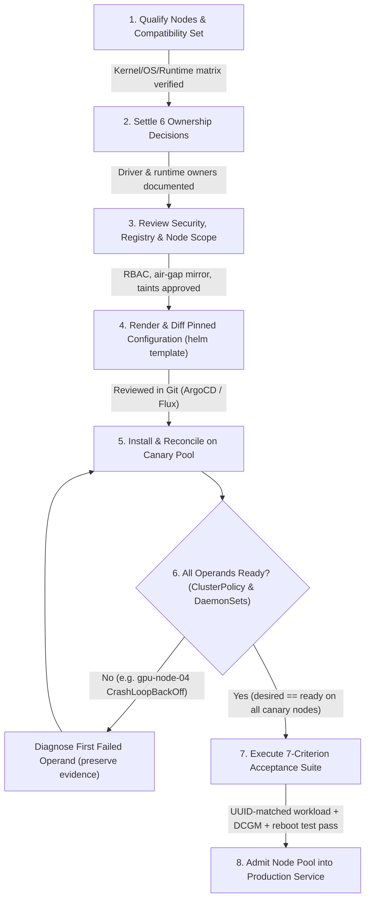
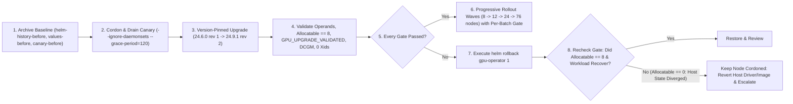

# 11.5 GPU Operator installation, configuration and upgrades

| | |
|---|---|
| Level | Advanced |
| Priority tier | 1 |
| Lab venue | GCP / GKE (plus local Python 3 simulation lab) |
| Part | Part 11: GPUs on Kubernetes, scheduling and virtualization |
| Sources used | `nvidia-zero-to-hero/volume-10/chapter-10-production-installation-and-configuration.md`; `nvidia-zero-to-hero/volume-10/chapter-11-upgrades-and-production-troubleshooting.md`; `nvidia-zero-to-hero/volume-10/chapter-12-volume-10-summary.md`; `nvidia-zero-to-hero/volume-10/labs/lab-04-perform-a-controlled-gpu-platform-upgrade.md`; `volume-04/02-gpu-software-operator-masterclass.md`; *NVIDIA Base Command Manager 11 Containerization Manual* (`bcm11-containerization`, Ch. 6); Roland Huß et al., *Generative AI on Kubernetes* (O'Reilly, 2026, Ch. 3) |
| Coverage file | `planning/coverage/chapters/11-05.md` |

## Why this matters for AI infrastructure

A Helm release in the `STATUS: deployed` state is not a working GPU platform. It means only that `kube-apiserver` accepted the rendered manifests and that the Deployment objects Helm knows how to wait on reported ready within `--timeout 15m`. It proves nothing about whether `nvidia.ko` loaded into the running kernel on every worker node, whether `containerd` can inject `/dev/nvidia0` into a fresh container sandbox, whether `kubelet` registered `nvidia.com/gpu`, or whether `dcgm-exporter` is scraping metrics with matching GPU UUIDs.

Even more dangerous is treating a **GPU platform upgrade** as a routine chart version bump with a longer wait time:
- **Upgrades mutate a tightly coupled compatibility set:** A single upgrade crosses the Kubernetes version, OS image and Linux kernel (`uname -r`), NVIDIA kernel-mode and user-mode driver (`535.129.03`, `535.154.05`, `550.90.07`), CRI runtime (`containerd` / `CRI-O`), GPU Operator chart (`24.6.0` -> `24.9.1` or `v25.10.1` -> `v26.3.0`), device firmware/BIOS, and tenant CUDA framework images.
- **Unbounded upgrades turn one hardware-revision quirk into a fleet outage:** In a `120`-node fleet (`8` GPUs/node = `960` GPUs) procured across `4` hardware batches (`30` nodes per batch), BIOS or firmware differences between batches can cause a driver upgrade that passed on one node to fail on another. Sizing an `8`-node canary (`2` nodes per hardware batch, `~7%` of the fleet) followed by progressive doubling waves (`12` nodes at `10%` -> `24` nodes -> `76` remaining nodes) ensures that even if a batch-specific bug escapes until the `24`-node wave, the blast radius is bounded to **`24 * 8 = 192` GPUs out of `960` (`20%` of fleet capacity)** while `90%` to `80%` of the cluster continues serving traffic.
- **`helm rollback` alone can leave the node broken:** When a canary upgrade from `gpu-operator-24.6.0` (`REVISION 1`) to `gpu-operator-24.9.1` (`REVISION 2`) fails its acceptance gate, running `helm rollback gpu-operator 1 --namespace gpu-operator --wait --timeout 20m` prints `Rollback was a success`. Yet inspecting the canary node can still show `Allocatable: nvidia.com/gpu: 0` because `helm rollback` only reverts control-plane YAML objects (`ClusterPolicy`, `DaemonSet` specs, `ConfigMap`s)—it does not unload a mismatched kernel module or revert a host OS image change. Otherwise, operators might assume a chart-level rollback automatically restores the underlying kernel module, when in reality a kernel or driver change on the node requires either unloading the newer module or rebooting the node into its archived baseline image before the old `24.6.0` user-space daemonset can communicate with NVML again.

This chapter provides the complete production playbook for qualifying, installing, accepting, upgrading, and rolling back the NVIDIA GPU Operator across multi-pool Kubernetes clusters.

## Prerequisites and outcomes

### Prerequisites
- Completion of Chapters 11.1 through 11.4 (the seven-layer GPU lifecycle, Device Plugin gRPC registration, NVIDIA Container Toolkit / CDI / `RuntimeClass`, NFD/GFD service classes, and GPU Operator `ClusterPolicy` / `nvidia-operator-validator` architecture).
- Familiarity with Helm (`helm template`, `helm upgrade --install`, `helm history`, `helm rollback`) and Kubernetes node maintenance primitives (`kubectl cordon`, `kubectl drain`, `kubectl uncordon`, `PodDisruptionBudget`).

### Outcomes
After completing this chapter, you will be able to:
- Settle the six foundational platform ownership decisions (`Driver ownership`, `Runtime ownership`, `Node scope`, `Image supply chain`, `Sharing policy`, and `Operations`) before writing a single line of Helm values.
- Execute the eight-stage installation evidence pipeline (`Qualify -> Ownership -> Policy -> Render -> Reconcile -> Ready? -> Accept -> Operate`) and explain why `helm install` reporting `STATUS: deployed` can coexist with `ClusterPolicy.status.state: notReady` (`nvidia-driver-daemonset-7q2kd` in `CrashLoopBackOff` on `gpu-node-04`).
- Validate a GPU node pool against the **Seven-Criterion Production Acceptance Contract**, including correlating the physical GPU UUID inside the validation Pod (`GPU-3a91...`, `CUDA_VALIDATED`) with the exact Prometheus series exported by `dcgm-exporter` on port `9400` (`DCGM_FI_DEV_GPU_UTIL{gpu="0",UUID="GPU-3a91...",node="gpu-node-04"} 97`).
- Size a multi-batch canary and progressive rollout wave schedule (`8`-node canary across `4` hardware batches -> `12` nodes -> `24` nodes -> `76` nodes across a `120`-node / `960`-GPU fleet).
- Execute the `Lab 04` controlled upgrade and `Recheck` rollback state machine (`gpu-operator-24.6.0` revision `1` -> `24.9.1` revision `2`), including safe canary quarantine (`--ignore-daemonsets --delete-emptydir-data --grace-period=120 --timeout=20m`) and recovering when `helm rollback` leaves host state diverged (`Allocatable: 0`).

## Concepts: basics to intermediate to advanced

### 1. Basics: Defining the platform boundary and treating Helm values as a governed interface

When engineers first test the GPU Operator in a lab, they often copy a one-line `helm install` command with default settings. On a single disposable node, defaults usually appear to work. Across a production fleet, unreviewed defaults can overwrite host runtime configurations, attempt to compile kernel drivers on hardened immutable OS images where `gcc` is intentionally absent, or pull container images from public registries over throttled NAT gateways during an outage.



#### Six ownership decisions that determine the architecture
Before creating a `values.yaml` file (`volume-10/chapter-10`), platform engineering, OS/infrastructure engineering, and security teams must record explicit answers to six boundary questions:

| Ownership Domain | Production Questions to Settle Before Deployment | Failure Mode if Left Ambiguous |
|---|---|---|
| **1. Driver ownership** | Is `nvidia.ko` pre-baked into a curated golden OS image (`driver.enabled: false`), installed by host configuration management, or managed by the GPU Operator (`driver.enabled: true`, `usePrecompiled: true`)? Who signs modules for UEFI Secure Boot? | Dual ownership: Operator driver container overwrites or clashes with host-installed kernel modules (`Driver/library version mismatch`). |
| **2. Runtime ownership** | Does the base OS image pre-configure `containerd` / `CRI-O`, or does the Operator's `toolkit` DaemonSet (`toolkit.enabled: true`) patch `CONTAINERD_CONFIG` and enable CDI? Which `RuntimeClass` handler names are published? | Toolkit operand patches `/etc/containerd/config.toml` while the distribution's `containerd` reads `/cm/local/apps/containerd/var/etc/conf.d/nvidia-cri.toml` (or EKS/GKE/OpenShift paths). |
| **3. Node scope** | Which dedicated GPU node pools are eligible? How do NFD/GFD labels, `nodeSelector`, taints (`nvidia.com/gpu=present:NoSchedule`), and admission webhooks prevent operands from landing on CPU-only or incompatible pools? | A global `ClusterPolicy` change pushes an incompatible driver across all pools simultaneously. |
| **4. Image supply chain** | Which internal container registry mirror is authoritative? Are all operator and operand images (`driver`, `container-toolkit`, `k8s-device-plugin`, `dcgm-exporter`, `k8s-mig-manager`) mirrored, vulnerability-scanned, signed, and reachable during a cluster recovery? | Node recovery stalls in `ImagePullBackOff` during an external registry outage or air-gapped firewall change. |
| **5. Sharing policy** | Which pools run exclusive full GPUs, which run MIG (`single` vs `mixed`), and which allow time-slicing (`replicas: 8` or `10`)? | Latency-sensitive inference lands on a time-sliced pool without memory isolation and suffers OOM or jitter. |
| **6. Operations & escalation** | Which team owns the Git-controlled `values.yaml`, compatibility matrix updates, alert triage, maintenance drain windows, and NVIDIA AI Enterprise (`NVAIE`) support escalation? | Incident responders blindly delete DaemonSets or run `helm rollback` without checking host kernel state. |

#### Why `helm install` reporting `STATUS: deployed` is not the acceptance gate
Consider the concrete 6-node canary installation from `volume-10/chapter-10`. The platform engineer runs a version-pinned Helm install (`--version 24.9.1`) against a 6-node canary pool:

```text
$ helm install gpu-operator nvidia/gpu-operator \
    --namespace gpu-operator --create-namespace \
    --version 24.9.1 -f canary-values.yaml --wait --timeout 15m
NAME: gpu-operator
LAST DEPLOYED: Tue Aug  4 09:12:03 2026
NAMESPACE: gpu-operator
STATUS: deployed
REVISION: 1
```

Helm reports `STATUS: deployed` (`REVISION: 1`). A team that stops here and opens the pool to user traffic walks straight into an outage. Checking the `ClusterPolicy` and operand Pods immediately reveals the truth:

```text
$ kubectl get clusterpolicy cluster-policy -o jsonpath='{.status.state}{"\n"}'
notReady

$ kubectl get pods -n gpu-operator -o wide | grep -v Running
NAME                                          READY   STATUS             RESTARTS   NODE
nvidia-driver-daemonset-7q2kd                 0/1     CrashLoopBackOff   5          gpu-node-04
```

Why did `helm install --wait` succeed while `clusterpolicy` is `notReady`? Because `--wait` only waits for the Kubernetes objects Helm directly tracks (such as the `gpu-operator` controller `Deployment`), not the child DaemonSets dynamically reconciled by the operator controller across every node. Here, `5` of the `6` canary nodes succeeded, while `gpu-node-04` is in `CrashLoopBackOff` (`5` restarts). Inspecting `--previous` logs on `gpu-node-04` isolates the exact host difference:

```text
$ kubectl logs -n gpu-operator nvidia-driver-daemonset-7q2kd --previous | tail -5
Stopping NVIDIA persistence daemon...
Unloading NVIDIA driver kernel modules...
modprobe: ERROR: could not insert 'nvidia': Key was rejected by service
mount: /run/nvidia/driver/usr/src/nvidia-535.129.03: No such file or directory
Failed to install the kernel module through DKMS
```

`gpu-node-04` had UEFI Secure Boot enabled without the MOK signing key enrolled for `nvidia-535.129.03` (`Key was rejected by service`), whereas the other `5` canary nodes had matching keys. Because the team inspected the first failing operand rather than deleting the Helm release, they immediately isolated a per-node Secure Boot enrollment drift.

---

### 2. Intermediate: The seven-criterion production acceptance contract

Before any new or upgraded GPU node pool is marked eligible for production workloads (for example, by applying `gpu-validation=passed` and uncordoning the nodes), `volume-10/chapter-10` requires passing **all seven end-to-end acceptance criteria**:

| Acceptance Criterion | Concrete Verification Command | Required Passing Evidence | What Failure Here Isolates |
|---|---|---|---|
| **1. Host GPU detection & driver health** | `kubectl get clusterpolicy` and `nvidia-smi` inside driver container / host | `status.state: ready` and `nvidia-smi` exits `0` on all nodes in the pool | PCIe hardware, kernel ABI, or Secure Boot signing (`Key was rejected by service`) |
| **2. Runtime sandbox creation & CUDA init** | `kubectl apply -f gpu-validate.yaml` | Container transitions `Pending -> ContainerCreating -> Running -> Succeeded` without OCI hook errors | `containerd` `config.toml`, `RuntimeClass`, or CDI `/var/run/cdi/nvidia.yaml` (`/run/nvidia/driver/dev/nvidia0: no such file`) |
| **3. Device plugin & `kubelet` allocatable count** | `kubectl get node gpu-node-04 -o jsonpath='{.status.capacity.nvidia\.com/gpu}{" capacity / "}{.status.allocatable.nvidia\.com/gpu}{" allocatable\n"}'` | `8 capacity / 8 allocatable` (matching physical/MIG specification on every node) | Device plugin NVML initialization or `kubelet` gRPC socket registration |
| **4. Capability labels & taint enforcement** | `kubectl get node gpu-node-04 --show-labels` and `kubectl describe node` | Expected NFD/GFD labels, service class, and `nvidia.com/gpu=present:NoSchedule` taint present | NFD/GFD worker failure or missing node-pool taint |
| **5. Scheduled workload functional test** | `kubectl logs gpu-validate-node04` | Prints `GPU 0: NVIDIA H100 80GB HBM3 (UUID: GPU-3a91...)` and `CUDA_VALIDATED` | Driver-to-container library compatibility or compute capability mismatch |
| **6. DCGM telemetry & UUID identity match** | `curl -s http://dcgm-exporter.gpu-operator:9400/metrics \| grep 'DCGM_FI_DEV_GPU_UTIL{.*gpu_node04'` | `DCGM_FI_DEV_GPU_UTIL{gpu="0",UUID="GPU-3a91...",node="gpu-node-04"} 97` (non-zero series with **matching UUID `GPU-3a91...`**) | `dcgm-exporter` lost access to host NVML/DCGM socket (`0` series returned despite `1/1 Running` Pod) or MIG/UUID misattribution |
| **7. Drain, reboot, and return-to-service resilience** | `kubectl drain`, host reboot, wait for reconciliation | Node reboots, reloads driver/toolkit/plugin automatically, and re-passes Criteria 1–6 without manual SSH intervention | Non-persistent kernel module, missing precompiled image in mirror, or race condition on boot |

Look closely at the correlation between **Criterion 5** and **Criterion 6**:
```text
$ kubectl logs gpu-validate-node04
GPU 0: NVIDIA H100 80GB HBM3 (UUID: GPU-3a91...)
CUDA_VALIDATED

$ curl -s http://dcgm-exporter.gpu-operator:9400/metrics | grep 'DCGM_FI_DEV_GPU_UTIL{.*gpu_node04'
DCGM_FI_DEV_GPU_UTIL{gpu="0",UUID="GPU-3a91...",node="gpu-node-04"} 97
```
Why do we verify that `UUID="GPU-3a91..."` in the DCGM metric matches `UUID: GPU-3a91...` in the validation Pod log, rather than just checking that `dcgm-exporter` is `1/1 Running`?
1. First, as shown on `gpu-node-07` in `volume-10/chapter-10`, `nvidia-dcgm-exporter-9fvqk` can be `1/1 Running` while `curl -s gpu-node-07:9400/metrics | grep -c DCGM_FI_DEV_GPU_UTIL` returns **`0`** because the exporter container lost its connection to the driver socket after a driver container restart.
2. Second, on multi-GPU or MIG-partitioned hosts, verifying the exact `UUID` (`GPU-3a91...`) proves that the Prometheus metric pipeline attributes utilization (`97%`) to the exact physical device allocated to the workload.

---

### 3. Advanced: Staged canary upgrades, progressive batch sizing, and why `helm rollback` is not enough

When upgrading a production GPU platform (`volume-10/chapter-11` and `Lab 04`), you are modifying a **compatibility set** across six surfaces:

| Change Surface | Primary Failure Boundary to Validate | Required Recovery Mechanism |
|---|---|---|
| **1. Kernel or OS node image** | Driver module compilation/loading (`uname -r` ABI) and Secure Boot | Boot back into the archived known-good node image |
| **2. NVIDIA Driver** | Device initialization (`RmInitAdapter`), CUDA forward/backward compatibility, GPU reset | Restore matching kernel + driver image; **do not assume `helm rollback` unloads a kernel module** |
| **3. Container Runtime / Toolkit** | CDI `/var/run/cdi/nvidia.yaml` or `containerd` runtime handler sandbox creation | Test with a **freshly created** GPU Pod (already-running Pods bypass sandbox creation) |
| **4. GPU Operator Chart / `ClusterPolicy`** | CRD schema, operand DaemonSet selectors, and init-container sequencing | `helm rollback` to pinned revision *only* when host driver/kernel state remains compatible |
| **5. Kubernetes / `kubelet`** | Device-plugin socket registration (`/var/lib/kubelet/device-plugins/`) and `Allocatable` patching | Compare `kubelet` logs and `Node` status against an untouched peer pool |
| **6. GPU / Switch Firmware & BIOS** | PCIe enumeration, NVLink/NVSwitch training, thermal/power caps | Hardware maintenance runbook; often requires a cold AC power cycle |



#### Sizing the canary and progressive rollout batches (`120` nodes, `960` GPUs)
How large should your canary and rollout waves be? Consider the production sizing model from `volume-10/chapter-11`:
- Suppose you operate a fleet of **`120` GPU worker nodes** (`8` GPUs per node = **`960` total GPUs**).
- Those `120` nodes were procured across **`4` hardware batches** (`30` nodes per batch) over time, so different batches may carry slightly different motherboard BIOS or VBIOS firmware revisions.
- **Step 1 — Representative Canary (`8` nodes, `~7%` of fleet):** Select **`2` nodes from each of the `4` hardware batches** (`4 * 2 = 8` nodes, `64` GPUs, `~7%` of the `120`-node fleet). Picking only `1` node risks confusing a single hardware defect with a software bug; picking nodes from only `1` batch misses firmware differences in the other `3` batches. Additionally, keeping at least two canary nodes per procurement batch allows the platform team to distinguish an isolated hardware fault on one server from a systematic driver or firmware regression affecting that entire procurement generation.
- **Step 2 — First Post-Canary Wave (`12` nodes, `10%` of fleet):** Once the `8`-node canary passes all acceptance gates and holds stable across the observation window, roll out to **`10%` of the fleet (`12` nodes, `96` GPUs)**. This wave is large enough to expose scheduler or registry-contention bugs while keeping **`90%` of the fleet** untouched.
- **Step 3 — Progressive Doubling Waves (`12 -> 24 -> 76` nodes):** Double the wave size after each clean observation window: **`24` nodes (`192` GPUs)** in the next wave, followed by the remaining **`76` nodes (`608` GPUs)** (`8 + 12 + 24 + 76 = 120` nodes; `64 + 96 + 192 + 608 = 960` GPUs).
- **Why per-batch gating matters (`20%` blast radius bound):** Suppose the upgrade passes the `8`-node canary and the `12`-node first wave, but fails on the `24`-node wave because of a BIOS setting concentrated in that sub-pool. Because Figure 10.11.1 enforces an independent gate after *every* wave, automation halts immediately. The maximum affected capacity is **`24 nodes * 8 GPUs/node = 192 GPUs`** out of **`120 * 8 = 960 GPUs`** (**`20%` of fleet GPU capacity**), protecting the remaining `76` nodes (`608` GPUs).

#### Why `helm rollback` can succeed while the node stays broken (`Recheck` gate)
Look at Step 16 of `Lab 04`. Suppose a canary upgrade from `gpu-operator-24.6.0` (`REVISION 1`, deployed `Mon Jul 21 10:02:11 2026`) to `gpu-operator-24.9.1` (`REVISION 2`, deployed `Tue Aug 12 09:14:44 2026`) fails its acceptance gate on `$CANARY_NODE` (`gpu-node-07`). The operator executes `helm rollback`:

```text
$ helm history gpu-operator -n gpu-operator
REVISION  UPDATED                   STATUS      CHART               DESCRIPTION
1         Mon Jul 21 10:02:11 2026  superseded  gpu-operator-24.6.0 Install complete
2         Tue Aug 12 09:14:44 2026  deployed    gpu-operator-24.9.1 Upgrade complete

$ helm rollback gpu-operator 1 --namespace gpu-operator --wait --timeout 20m
Rollback was a success! Happy Helming!

$ kubectl get node "$CANARY_NODE" -o jsonpath='{.status.allocatable.nvidia\.com/gpu}{"\n"}'
0
```

Why does `ALLOCATABLE` still read `0` after Helm printed `Rollback was a success`?
Because `helm rollback` only reverts **Kubernetes API objects** (`ClusterPolicy`, `DaemonSet` templates, `ConfigMap`s). When `gpu-operator-24.9.1` ran on `gpu-node-07`, it loaded a newer kernel module (or mutated host runtime/driver state) that `gpu-operator-24.6.0`'s user-space device plugin cannot talk to—or left a wedged kernel module in memory that `rmmod` could not unload. Consequently, any automated deployment pipeline or SRE runbook that marks an incident resolved the moment `helm rollback` exits `0` will re-open a broken node to production scheduling, causing every newly placed Pod on that node to fail until the host kernel state itself is restored.

Therefore, **every rollback must pass its own `Recheck` gate**:
1. Verify `Allocatable: nvidia.com/gpu` returned to the archived baseline (`8`).
2. Re-run the `gpu-upgrade-validation` Pod (`GPU_UPGRADE_VALIDATED`).
3. If `Allocatable` remains `0` after `helm rollback`, **do not uncordon the node** and do not run a second `helm rollback`. Keep `$CANARY_NODE` cordoned, restore the host state (via a node reboot or rolling back to the known-good node OS image), and re-verify before returning the node to the scheduler.

## Commands and configurations that matter

### 1. Archiving pre-upgrade baseline and rollback artifacts (`Lab 04` Step 10)

Never start a GPU Operator upgrade without archiving the current Helm revision history, effective values (`-a`), rendered manifest, and canary node YAML:

```bash
# Archive recoverable baseline state before touching the cluster (untested here)
export TARGET_VERSION='24.9.1'
export CANARY_NODE='gpu-node-07'
export CUDA_VALIDATION_IMAGE='nvcr.io/nvidia/cuda:12.4.1-base-ubuntu22.04'

mkdir -p gpu-upgrade-evidence
helm history gpu-operator -n gpu-operator > gpu-upgrade-evidence/helm-history-before.txt
helm get values gpu-operator -n gpu-operator -a > gpu-upgrade-evidence/values-before.yaml
helm get manifest gpu-operator -n gpu-operator > gpu-upgrade-evidence/manifest-before.yaml
kubectl get node "$CANARY_NODE" -o yaml > gpu-upgrade-evidence/canary-before.yaml
```

### 2. Quarantining and draining the canary node safely (`Lab 04` Step 11)

Cordon `$CANARY_NODE` first, inspect all running Pods on that node to confirm workload owners have checkpointed long-running training jobs (`ml-training/resnet-worker-3`), and drain with `--ignore-daemonsets`:

```bash
# Cordon, list workloads, and drain the canary node (untested here)
kubectl cordon "$CANARY_NODE"
kubectl get pods -A -o wide --field-selector spec.nodeName="$CANARY_NODE"
kubectl drain "$CANARY_NODE" --ignore-daemonsets --delete-emptydir-data --grace-period=120 --timeout=20m
```

Expected output (`Lab 04`):
```text
node/gpu-node-07 already cordoned
evicting pod ml-training/resnet-worker-3
pod/resnet-worker-3 evicted
node/gpu-node-07 drained
```
Notice that `nvidia-driver-ds-7z4kd` remains on `gpu-node-07` because `--ignore-daemonsets` preserves node-level DaemonSets while evicting tenant workloads (`resnet-worker-3`).

### 3. Executing the version-pinned canary upgrade and post-upgrade validation (`Lab 04` Steps 12–14)

```bash
# 1. Upgrade to the pinned target version scoped to the canary values (untested here)
helm upgrade gpu-operator nvidia/gpu-operator \
  --namespace gpu-operator --version "$TARGET_VERSION" \
  -f target-values.yaml --wait --timeout 20m

# 2. Verify operand restarts and Allocatable == 8 on the canary node (untested here)
kubectl get pods -n gpu-operator -o wide | grep "$CANARY_NODE"
kubectl get node "$CANARY_NODE" -o jsonpath='{.status.capacity.nvidia\.com/gpu}{" capacity\n"}{.status.allocatable.nvidia\.com/gpu}{" allocatable\n"}'

# 3. Run the pinned canary validation Pod and check host kubelet/Xid logs (untested here)
kubectl apply -f gpu-upgrade-validation.yaml
kubectl wait --for=jsonpath='{.status.phase}'=Succeeded pod/gpu-upgrade-validation --timeout=5m
kubectl logs gpu-upgrade-validation
journalctl -u kubelet --since '30 minutes ago'
nvidia-smi -q
```

### 4. GitOps rendering and pre-apply manifest diffing (`volume-10/chapter-10`)

Before applying any GPU Operator installation or upgrade to a canary pool, treat the Helm values file as a version-controlled platform interface in Git (synced via ArgoCD or Flux). Always render the full chart locally with `helm template` and review the diff for unexpected `ServiceAccount` cluster-role bindings, `privileged: true` security contexts, hostPath volume mounts (`/run/nvidia`, `/var/lib/kubelet/device-plugins`, `/etc/containerd`), DaemonSet `nodeSelector` rules, and container image registries:

```bash
# Render and diff the candidate GPU Operator manifests before applying (untested here)
helm template gpu-operator nvidia/gpu-operator \
  --namespace gpu-operator \
  --version "$TARGET_VERSION" \
  -f target-values.yaml > gpu-upgrade-evidence/manifest-target.yaml

diff -u gpu-upgrade-evidence/manifest-before.yaml gpu-upgrade-evidence/manifest-target.yaml || true
```

Reviewing the rendered diff catches three frequent pre-flight mistakes before a single node is drained:
1. A typo in a node-selector key or toleration that would prevent `nvidia-driver-daemonset` or `nvidia-device-plugin-daemonset` from scheduling onto the target canary pool.
2. An unmirrored upstream image repository (`nvcr.io/nvidia`) that would fail with `ImagePullBackOff` inside an air-gapped or firewall-restricted production cluster.
3. Accidental enablement of an operand (for example, `driver.enabled: true` on a pool whose OS image already manages the kernel driver) that would trigger a dual-ownership conflict during node boot, or omission of an internal image pull secret required by disconnected worker nodes during recovery.

Only after all gates pass should you clean up the validation Pod and uncordon the canary:
```bash
# Clean up validation Pod and uncordon only after decision record approval (untested here)
kubectl delete pod gpu-upgrade-validation --ignore-not-found
kubectl uncordon "$CANARY_NODE"
```

## How it fails

| Failure mode | Exact symptom & command evidence | Root cause boundary | Remediation |
|---|---|---|---|
| **1. `helm install` reports `STATUS: deployed`, but `ClusterPolicy` is `notReady` (`gpu-node-04` Secure Boot)** | `helm install ... --version 24.9.1` succeeds (`REVISION: 1`), but `kubectl get clusterpolicy` prints `notReady`. On `gpu-node-04`, `nvidia-driver-daemonset-7q2kd` is in `CrashLoopBackOff` (`5` restarts) logging `modprobe: ERROR: could not insert 'nvidia': Key was rejected by service` and `mount: /run/nvidia/driver/usr/src/nvidia-535.129.03: No such file or directory`. | **Per-Node Secure Boot / MOK Enrollment Drift:** `gpu-node-04` lacks the MOK public key required to load `nvidia-535.129.03` under UEFI Secure Boot, while the other `5` canary nodes have it. | Do not delete the Helm release. Cordon `gpu-node-04`, enroll the signing key into MOK (or align Secure Boot state with the other `5` nodes), and let the driver DaemonSet reconcile. |
| **2. Node has `nvidia.com/gpu.count=8` and `deploy.device-plugin=true`, but `allocatable` is `<no value>`** | On `gpu-node-07`, `kubectl get node gpu-node-07 --show-labels` shows `nvidia.com/gpu.present=true`, `nvidia.com/gpu.count=8`, and `nvidia.com/gpu.deploy.device-plugin=true`, yet `kubectl get node gpu-node-07 -o jsonpath='{.status.allocatable.nvidia\.com/gpu}'` returns nothing. | **Downstream Device Plugin / Kubelet Registration Boundary:** Node selection and hardware discovery succeeded; the failure is inside `nvidia-device-plugin` or its `kubelet` gRPC registration. | Inspect `nvidia-device-plugin` logs and `journalctl -u kubelet` on `gpu-node-07` rather than editing node selectors. |
| **3. Pod fails at container creation (`open /run/nvidia/driver/dev/nvidia0: no such file or directory`)** | `kubectl describe pod gpu-validate-node07` prints `Warning Failed 8s kubelet Error: failed to create containerd task: failed to create shim: OCI runtime create failed: unable to retrieve OCI runtime error (open /run/nvidia/driver/dev/nvidia0: no such file or directory): unknown`. | **Pod Start / Toolkit Injection Boundary:** The container never reached its entrypoint; the toolkit/CDI mount path expected `/run/nvidia/driver/dev/nvidia0` (operator driver root) when the driver was installed differently or failed to populate `/run/nvidia/driver`. | Align `driver.enabled` and toolkit driver-root settings with how the driver is actually provisioned on `gpu-node-07`. |
| **4. `nvidia-dcgm-exporter` is `1/1 Running`, but returns `0` GPU utilization series** | Validation workload passes (`CUDA_VALIDATED`), and `nvidia-dcgm-exporter-9fvqk` is `1/1 Running` on `gpu-node-07`, but `curl -s gpu-node-07:9400/metrics \| grep -c DCGM_FI_DEV_GPU_UTIL` outputs `0`. | **Observability / DCGM Socket Boundary:** The exporter container lost access to the underlying driver/NVML socket after a driver container restart. | Restart the `nvidia-dcgm-exporter` Pod on `gpu-node-07` and verify non-zero `DCGM_FI_DEV_GPU_UTIL` series with matching `UUID` before accepting the node pool. |
| **5. Post-upgrade DaemonSet shows `8/8 Ready`, but one node (`gpu-node-11`) has `allocatable: 0`** | After a driver bump on an `8`-node batch, `kubectl get ds -n gpu-operator nvidia-device-plugin-daemonset` shows `8/8 READY`, and `gpu-node-12` reports `allocatable: 8`, but `gpu-node-11` reports `allocatable: 0`. | **Per-Node Post-Upgrade Registration Asymmetry:** Aggregate DaemonSet readiness (`8/8`) masked a stale socket or driver reload failure on `gpu-node-11`. | Check per-node `status.allocatable["nvidia.com/gpu"]` across every node in the batch, cordon `gpu-node-11`, and inspect its driver and kubelet registration logs. |
| **6. `helm rollback` succeeds (`REVISION 1`), but `$CANARY_NODE` still shows `allocatable: 0`** | After a failed upgrade from `24.6.0` to `24.9.1`, `helm rollback gpu-operator 1` prints `Rollback was a success`, yet `kubectl get node "$CANARY_NODE" -o jsonpath='{.status.allocatable.nvidia\.com/gpu}'` still prints `0`. | **Chart-vs-Host Rollback Divergence (`Recheck` Gate Failure):** `helm rollback` reverted control-plane YAML to `24.6.0`, but the `24.9.1` kernel module or host runtime change remained active on `$CANARY_NODE`. | Keep `$CANARY_NODE` cordoned, reboot the node or restore the archived host OS image/driver state, and uncordon only after `Allocatable: 8` and `GPU_UPGRADE_VALIDATED` pass. |

## Hands-on lab

### Venue and scope
This lab runs locally using Python 3 standard library (`code/part11/gpu_operator_upgrades.py` and `code/part11/gpu_operator_upgrades_lab.py`) to simulate the 7-criterion production installation acceptance gate (including `GPU-3a91` UUID matching between the validation Pod and `dcgm-exporter`), the `120`-node / `960`-GPU progressive canary wave planner (`8 -> 12 -> 24 -> 76` nodes), the `Lab 04` upgrade and `Recheck` rollback state machine (`24.6.0` -> `24.9.1`), and the installation/upgrade failure classifier. Cluster commands are marked `(untested here)`.

### Step 1: Run the self-checking installation and upgrade lab (tested here)

Run the lab script from the repository root:

```bash
python3 code/part11/gpu_operator_upgrades_lab.py
```

Captured output from this repository:
```text
=== Chapter 11.5 Lab: GPU Operator Installation, Configuration & Upgrades ===
  [PASS] Helm status='deployed' with clusterpolicy='notReady' (5/6 nodes ready) is rejected by acceptance gate
  [PASS] Acceptance gate flags 1_driver_and_operands_ready and 3_allocatable_matches_capacity on gpu-node-04
  [PASS] All 7 acceptance criteria pass when 6/6 nodes, 8/8 allocatable, CUDA_VALIDATED, and UUID GPU-3a91 match
  [PASS] Acceptance gate rejects pool when DCGM metric UUID does not match validation Pod UUID
  [PASS] Acceptance gate rejects pool when dcgm-exporter returns 0 DCGM_FI_DEV_GPU_UTIL series
  [PASS] 120-node fleet across 4 hardware procurement batches has 30 nodes per batch
  [PASS] 2 canary nodes per hardware batch = 8 canary nodes (~7% of 120-node fleet)
  [PASS] Progressive rollout waves are 8 (canary) -> 12 (10%) -> 24 (doubled) -> 76 (remaining) = 120 nodes
  [PASS] First post-canary batch of 12 nodes leaves 90.0% of fleet capacity serving traffic
  [PASS] Fault caught at the 24-node batch affects 24 x 8 = 192 GPUs out of 960 total GPUs (20.0% blast radius)
  [PASS] Upgrade from 24.6.0 (rev 1) to 24.9.1 (rev 2) passes gate when allocatable=8, workload OK, DCGM OK, 0 Xids
  [PASS] New Xid or kernel errors trigger upgrade_gate='fail' even when validation Pod succeeded
  [PASS] When helm rollback 1 succeeds but allocatable stays 0, Recheck catches host-state divergence and keeps node cordoned
  [PASS] When rollback restores allocatable=8 and validation workload passes, Recheck gate passes
  [PASS] Classifier routes 'Key was rejected by service' on gpu-node-04 to secure_boot_mok_signing
  [PASS] Classifier routes missing /run/nvidia/driver/dev/nvidia0 OCI error on gpu-node-07 to pod_start_runtime_injection
  [PASS] Classifier routes allocatable=0 (gpu-node-11 vs gpu-node-12=8) to device_plugin_or_kubelet_registration
  [PASS] Classifier routes 0 DCGM_FI_DEV_GPU_UTIL series on port 9400 to observability_dcgm_scrape_path
  [PASS] Classifier reports healthy when driver, runtime, allocatable=8, and DCGM series>0 all pass
  [PASS] Lab 04 revision history tracks gpu-operator-24.6.0 (rev 1) -> gpu-operator-24.9.1 (rev 2)
  [PASS] Pool acceptance contract evaluates all 7 criteria independently
  [PASS] 8-node canary pool across 4 hardware batches tests 64 GPUs before Batch 1
  [PASS] 12-node Batch 1 (10% of 120-node fleet) tests 96 GPUs
  [PASS] Final 76-node wave covers the remaining 608 GPUs after 3 clean observation windows
  [PASS] Sum of GPUs across waves (64 + 96 + 192 + 608) equals total fleet capacity of 960 GPUs

Summary: 25 passed, 0 failed out of 25 checks.
```

### Exercises

1. **Exercise 1 — Seven-criterion acceptance evaluation:** Using `evaluate_pool_acceptance()` in `code/part11/gpu_operator_upgrades.py`, determine which specific acceptance criteria fail when `helm_status="deployed"`, `cluster_policy_state="ready"`, `total_canary_nodes=6`, `driver_ready_nodes=6`, `capacity_gpus=8`, `allocatable_gpus=8`, `validation_pod_marker="CUDA_VALIDATED"`, `validation_pod_uuid="GPU-3a91"`, `dcgm_metric_series_count=8`, `dcgm_metric_uuid="GPU-3a91"`, and `drain_reboot_return_passed=False`.
2. **Exercise 2 — Sizing canary and progressive waves for a `120`-node fleet:** Using `plan_canary_and_progressive_batches(120, 4, 2, 10.0, 8)`, state the node counts and GPU counts in each of the four waves (`Canary`, `Wave 1`, `Wave 2`, `Wave 3`), and compute the percentage of total fleet GPUs (`960`) affected if a hardware-revision bug halts the rollout at `Wave 2` (`24` nodes).
3. **Exercise 3 — Evaluating `helm rollback` divergence (`Recheck` gate):** Using `evaluate_upgrade_or_rollback_gate()`, compare the returned `rollback_recheck_gate` and `action` when `helm_rollback_succeeded=True` with `post_rollback_allocatable=0` versus `post_rollback_allocatable=8` (and `post_rollback_workload_ok=True`).
4. **Exercise 4 — Pod start failure vs in-container CUDA init failure:** Using `diagnose_installation_or_upgrade_symptom()`, explain the difference between a Pod failing with `OCI runtime create failed: (open /run/nvidia/driver/dev/nvidia0: no such file or directory)` and a `Running` Pod whose application logs `CUDA error: no CUDA-capable device is detected`.
5. **Exercise 5 — Silent telemetry loss on `gpu-node-07`:** Why does `kubectl get pods -n gpu-operator -l app=nvidia-dcgm-exporter` showing `1/1 Running` on `gpu-node-07` not satisfy Criterion 6 of the acceptance contract, and what two checks on port `9400` are required?
6. **Exercise 6 — Safe canary drain flags:** When draining `$CANARY_NODE` (`gpu-node-07`) in `Lab 04` Step 11 (`kubectl drain "$CANARY_NODE" --ignore-daemonsets --delete-emptydir-data --grace-period=120 --timeout=20m`), why is `--ignore-daemonsets` mandatory, and why must you never add `--force` casually if `ml-training/resnet-worker-3` blocks eviction?

## Checkpoint questions

<details>
<summary><strong>1. Why is helm install reporting STATUS: deployed not proof that the GPU Operator installation succeeded?</strong></summary>

`STATUS: deployed` only means the Kubernetes API server accepted the Helm release manifests and any top-level Deployment objects Helm waited on became ready. It does not prove that the operator's child DaemonSets reconciled across all nodes. As shown in Volume 10 Chapter 10, `helm install` reported `STATUS: deployed` on a `6`-node canary pool while `ClusterPolicy.status.state` was `notReady` because `nvidia-driver-daemonset-7q2kd` was in `CrashLoopBackOff` (`5` restarts) on `gpu-node-04`.
</details>

<details>
<summary><strong>2. What are the six ownership decisions that must be settled before deploying the GPU Operator in production?</strong></summary>

1. **Driver ownership** (curated OS image vs host automation vs operator-managed driver container).
2. **Runtime ownership** (base image vs operator `toolkit` DaemonSet patching `containerd`/`CRI-O` and CDI).
3. **Node scope** (eligible node pools, labels, taints, and admission policies).
4. **Image supply chain** (authoritative internal registry mirror, image scanning, signing, and air-gapped reachability).
5. **Sharing policy** (full-GPU vs MIG vs time-slicing per pool).
6. **Operations** (ownership of Git values, compatibility review, maintenance windows, and vendor escalation).
</details>

<details>
<summary><strong>3. On gpu-node-04, nvidia-driver-daemonset-7q2kd logs modprobe: ERROR: could not insert 'nvidia': Key was rejected by service and mount: /run/nvidia/driver/usr/src/nvidia-535.129.03: No such file or directory. What is the root cause?</strong></summary>

`gpu-node-04` has UEFI Secure Boot enabled, and the public key used to sign the `nvidia-535.129.03` kernel module is not enrolled in `gpu-node-04`'s Machine Owner Key (MOK) database. The other `5` canary nodes succeeded because their Secure Boot / MOK state matched the driver image.
</details>

<details>
<summary><strong>4. What are the seven criteria in the Volume 10 Chapter 10 production acceptance contract for a GPU node pool?</strong></summary>

1. Expected GPUs are detected on the host and the driver is healthy.
2. The configured container runtime path creates a GPU container and initializes CUDA.
3. The device plugin advertises the expected `Allocatable` GPU count (`8 capacity / 8 allocatable`) after `kubelet` registration.
4. Hardware and policy labels and taints match the intended pool design.
5. A scheduled validation workload receives the expected GPU and passes a functional test (`CUDA_VALIDATED`).
6. DCGM telemetry is scraped with a matching device `UUID` (`GPU-3a91...`) and reaches dashboards.
7. A controlled drain, reboot, and return-to-service cycle restores the node automatically without manual repair.
</details>

<details>
<summary><strong>5. Why does Criterion 6 require matching the GPU UUID (GPU-3a91...) between the validation Pod log and the DCGM_FI_DEV_GPU_UTIL metric series on port 9400?</strong></summary>

Because checking only that `nvidia-dcgm-exporter` is `1/1 Running` (or that *some* metric exists for the host) can miss two real failures: (a) `dcgm-exporter` returning `0` series after losing its driver socket connection, or (b) metric misattribution on multi-GPU or MIG-partitioned nodes where the scraped metric belongs to a different GPU instance than the one allocated to the Pod.
</details>

<details>
<summary><strong>6. On gpu-node-07, labels show nvidia.com/gpu.present=true, nvidia.com/gpu.count=8, and nvidia.com/gpu.deploy.device-plugin=true, yet status.allocatable["nvidia.com/gpu"] is empty. What have you ruled out, and where is the fault?</strong></summary>

You have ruled out NFD/GFD hardware detection and GPU Operator node-selector targeting (both agree `gpu-node-07` has `8` GPUs and should run the device plugin). The fault is downstream: either the `nvidia-device-plugin` Pod failed to initialize NVML or its gRPC registration with `kubelet` failed.
</details>

<details>
<summary><strong>7. How do you distinguish a Pod start failure from a CUDA initialization failure when a validation Pod fails on gpu-node-07?</strong></summary>

- **Pod start failure:** `kubectl describe pod gpu-validate-node07` shows `Failed to create containerd task ... OCI runtime create failed ... open /run/nvidia/driver/dev/nvidia0: no such file or directory`. The container never reached its entrypoint; the fault is in the runtime/toolkit/CDI mount path.
- **CUDA initialization failure:** The container starts and reaches `Running` (or exits with application logs), printing `CUDA error: no CUDA-capable device is detected` from inside user space.
</details>

<details>
<summary><strong>8. Why can curl -s gpu-node-07:9400/metrics | grep -c DCGM_FI_DEV_GPU_UTIL return 0 even when nvidia-dcgm-exporter-9fvqk is 1/1 Running and CUDA workloads succeed?</strong></summary>

Because `dcgm-exporter` is an independent sidecar/daemon path. If the driver container restarted or recreated its host socket, the already-running `nvidia-dcgm-exporter` container can lose connectivity to NVML/DCGM while staying `1/1 Running`.
</details>

<details>
<summary><strong>9. What six surfaces make up the compatibility set during a GPU platform upgrade?</strong></summary>

1. Kernel or node OS image.
2. NVIDIA driver (`nvidia.ko` / `libcuda.so.1`).
3. Container runtime (`containerd` / `CRI-O`) and NVIDIA Container Toolkit / CDI.
4. GPU Operator chart and operand images.
5. Kubernetes control plane and `kubelet`.
6. Hardware firmware and BIOS.
</details>

<details>
<summary><strong>10. For a 120-node fleet (8 GPUs/node = 960 GPUs) acquired across 4 hardware batches of 30 nodes each, how does Volume 10 Chapter 11 size the canary and subsequent rollout waves?</strong></summary>

- **Canary:** `2` nodes per hardware batch = **`8` nodes** (`64` GPUs, `~7%` of the fleet) so every hardware/firmware batch is represented by at least `2` nodes.
- **Wave 1:** `10%` of the fleet = **`12` nodes** (`96` GPUs, leaving `90%` of capacity untouched).
- **Subsequent waves (doubling):** **`24` nodes** (`192` GPUs), then the remaining **`76` nodes** (`608` GPUs).
</details>

<details>
<summary><strong>11. In that 120-node (960-GPU) fleet, why would a driver upgrade pass the 8-node canary and 12-node Wave 1, then fail on the 24-node Wave 2, and what is the blast radius in GPUs?</strong></summary>

Passing the canary and Wave 1 proves the driver is not universally broken; failing on Wave 2 points to a **node-population-dependent difference** (such as a specific BIOS setting, firmware version, or hardware revision concentrated in those nodes). Halting at Wave 2 bounds the blast radius to **`24 * 8 = 192` GPUs out of `960` total GPUs (`20.0%` of fleet capacity)**.
</details>

<details>
<summary><strong>12. After upgrading an 8-node batch, nvidia-device-plugin-daemonset reports 8/8 READY, and gpu-node-12 shows allocatable: 8, but gpu-node-11 shows allocatable: 0. Why did the DaemonSet status not catch this?</strong></summary>

DaemonSet `READY` (`8/8`) only checks that the `nvidia-device-plugin` container process is running and passing its basic probe; it does not verify that `kubelet` accepted the gRPC registration or that `Node.status.allocatable["nvidia.com/gpu"]` is non-zero on every individual node.
</details>

<details>
<summary><strong>13. What four baseline files must be captured into gpu-upgrade-evidence/ before running helm upgrade in Lab 04 Step 10?</strong></summary>

1. `helm-history-before.txt` (`helm history gpu-operator -n gpu-operator`)
2. `values-before.yaml` (`helm get values gpu-operator -n gpu-operator -a`)
3. `manifest-before.yaml` (`helm get manifest gpu-operator -n gpu-operator`)
4. `canary-before.yaml` (`kubectl get node "$CANARY_NODE" -o yaml`)
</details>

<details>
<summary><strong>14. Why does Lab 04 Step 11 drain the canary node with --ignore-daemonsets --delete-emptydir-data --grace-period=120 --timeout=20m, and what happens if a PodDisruptionBudget blocks the drain?</strong></summary>

`--ignore-daemonsets` ensures Kubernetes evicts tenant workloads (`ml-training/resnet-worker-3`) while leaving node-critical DaemonSets (`nvidia-driver-ds-7z4kd`) in place so the upgrade can proceed. If a `PodDisruptionBudget` or un-checkpointed training job blocks the drain, the operator must **stop and coordinate with the workload owner** rather than passing `--force` casually.
</details>

<details>
<summary><strong>15. Why can helm rollback gpu-operator 1 print Rollback was a success while kubectl get node "$CANARY_NODE" still reports allocatable: 0?</strong></summary>

`helm rollback` only reverts Kubernetes control-plane resources (`ClusterPolicy`, `DaemonSet` specs, `ConfigMap`s) back to Revision `1` (`gpu-operator-24.6.0`). It does not automatically unload a kernel module loaded by Revision `2` (`gpu-operator-24.9.1`) or revert a host OS image/kernel change, leaving host state and control-plane state out of sync.
</details>

<details>
<summary><strong>16. What is the Recheck gate in Lab 04 Figure 4, and what must you do if Recheck fails after helm rollback?</strong></summary>

The `Recheck` gate requires verifying that `Allocatable: nvidia.com/gpu` returned to the baseline (`8`) and that the validation Pod (`GPU_UPGRADE_VALIDATED`) passes *after* `helm rollback` completes. If `Recheck` fails (`Allocatable` is still `0`), you must keep the canary node cordoned, execute the host-level driver/node-image recovery runbook (such as rebooting into the known-good image), and escalate as an incident rather than uncordoning the node.
</details>

<details>
<summary><strong>17. Why are new Xid errors in journalctl / dmesg during a canary test a mandatory rollback gate even if the validation Pod exits Succeeded?</strong></summary>

A short-lived smoke test (`nvidia-smi && echo GPU_UPGRADE_VALIDATED`) can exit `0` before an intermittent driver/firmware fault manifests under sustained load. Any new `Xid` or kernel `NVRM` error during the canary window proves the new compatibility set introduced hardware/driver instability.
</details>

<details>
<summary><strong>18. What is the correct six-step dependency order for troubleshooting any post-upgrade GPU failure (Volume 10 Chapters 11 and 12)?</strong></summary>

1. Hardware inventory, node boot state, kernel (`uname -r`), and host driver health (`nvidia-smi`, `dmesg`).
2. Container runtime device-injection path (`crictl inspect`, CDI `/var/run/cdi`, `config.toml`) and fresh Pod sandbox creation.
3. Device-plugin registration, `kubelet` state, `Capacity`, and `Allocatable` GPU counts.
4. Node labels (NFD/GFD/service class), taints, quotas, affinity, priority, and scheduler events.
5. Allocated Pod security context, mounted `/dev/nvidia*` devices, CUDA initialization, and application image libraries.
6. Time-correlated DCGM metrics, driver logs, and Kubernetes events.
</details>

<details>
<summary><strong>19. On an NVIDIA Base Command Manager 11 (BCM 11) cluster, how must the GPU Operator be uninstalled regardless of whether it was installed via cm-kubernetes-setup or Helm?</strong></summary>

As documented in `bcm11-containerization` Section 6.7.3, whether the GPU Operator was installed via the `cm-kubernetes-setup` wizard or directly via Helm, it must always be removed with `helm uninstall -n gpu-operator gpu-operator`, and removal is complete only after `kubectl get pods -n gpu-operator` returns `No resources found in gpu-operator namespace`.
</details>

<details>
<summary><strong>20. What twelve items belong in an actionable escalation evidence package for NVIDIA or platform support (Volume 10 Chapter 11)?</strong></summary>

1. Scope and business impact; 2. Timestamped change timeline; 3. Kubernetes and GPU Operator versions (`helm history`); 4. Pinned release configuration (`values-before.yaml` / `target-values.yaml`); 5. Node OS image, kernel (`uname -r`), and CRI runtime details; 6. Physical GPU and firmware/BIOS inventory (`nvidia-smi -q`); 7. Operand Pod and DaemonSet statuses; 8. Relevant `kubelet` and container runtime logs (`journalctl -u kubelet`); 9. Node labels, taints, `Capacity`, and `Allocatable` counts; 10. Output from an approved minimal reproducer Pod; 11. Time-correlated DCGM metrics and kernel `dmesg`/`Xid` logs; 12. Redaction of tenant secrets while preserving all version and timestamp correlations.
</details>

## Sources and review notes

### Primary sources read in full for this chapter
- Author's Volume 10 and Volume 04 notes:
  - `nvidia-zero-to-hero/volume-10/chapter-10-production-installation-and-configuration.md` (Figure 10.10.1 installation gates, 6 ownership decisions table, `helm install ... --version 24.9.1` on `6`-node canary with `STATUS: deployed` vs `clusterpolicy` `notReady` and `nvidia-driver-daemonset-7q2kd` `CrashLoopBackOff` `5` restarts on `gpu-node-04` with `nvidia-535.129.03` `Key was rejected by service`, 7-item acceptance contract, `8 capacity / 8 allocatable` on `gpu-node-04`, `GPU-3a91...` `CUDA_VALIDATED` + `DCGM_FI_DEV_GPU_UTIL` `97` UUID match, `gpu-node-07` `<no value>` allocatable, `/run/nvidia/driver/dev/nvidia0: no such file`, and `0` DCGM series on port `9400`).
  - `nvidia-zero-to-hero/volume-10/chapter-11-upgrades-and-production-troubleshooting.md` (Figure 10.11.1 two-gate canary and batch rollout diagram, 6 change surfaces table, `120`-node / `4`-batch `30`-node / `8`-node canary `~7%` -> `12` `10%` -> `24` -> `76` progressive wave math with `24 * 8 = 192 / 960 = 20%` blast radius, `8/8 Ready` DaemonSet with `gpu-node-11` `0` vs `gpu-node-12` `8`, 6-step layered incident method, and escalation package contents).
  - `nvidia-zero-to-hero/volume-10/chapter-12-volume-10-summary.md` (Figure 10.12.1 end-to-end contract chain and component responsibility summary table).
  - `nvidia-zero-to-hero/volume-10/labs/lab-04-perform-a-controlled-gpu-platform-upgrade.md` (Figure 4 `Recheck` rollback gate, Step 10 baseline archive commands, Step 11 `kubectl drain` `--ignore-daemonsets --delete-emptydir-data --grace-period=120 --timeout=20m` evicting `ml-training/resnet-worker-3` on `gpu-node-07`, `gpu-operator-24.6.0` rev `1` -> `24.9.1` rev `2`, `GPU_UPGRADE_VALIDATED`, `journalctl --since '30 minutes ago'`, and Step 16 `helm rollback gpu-operator 1` succeeding while `ALLOCATABLE` remains `0`).
  - `volume-04/02-gpu-software-operator-masterclass.md` (Sections 5.2, 6, 9, 15, 16: `upgradePolicy` `maxParallelUpgrades: 5`, `timeoutSeconds: 300`, `rmmod` / `lsof /dev/nvidia*`).
- Book sources from the local TOON-RAG corpus:
  - *NVIDIA Base Command Manager 11 Containerization Manual* (`bcm11-containerization`), Chapter 6 ("6.7.3 Removing The NVIDIA GPU Operator", `helm uninstall -n gpu-operator gpu-operator`).
  - Roland Huß et al., *Generative AI on Kubernetes* (O'Reilly, 2026), Chapter 3 ("NVIDIA GPU Operator").

### Related source files mapped in MIGRATION_MAP.md
- `nvidia-zero-to-hero/volume-10/chapter-10-production-installation-and-configuration.md` (primary source for this chapter)
- `nvidia-zero-to-hero/volume-10/chapter-11-upgrades-and-production-troubleshooting.md` (primary source for this chapter)
- `nvidia-zero-to-hero/volume-10/chapter-12-volume-10-summary.md` (consolidated in this chapter)
- `nvidia-zero-to-hero/volume-10/labs/lab-04-perform-a-controlled-gpu-platform-upgrade.md` (primary lab source for this chapter)

### Run here
- `python3 code/part11/gpu_operator_upgrades_lab.py` (`25 passed, 0 failed out of 25 checks`).

### Explicitly labelled inferences
- In `plan_canary_and_progressive_batches()` and Exercise 2, the per-wave GPU counts (`8 * 8 = 64` GPUs in the canary, `12 * 8 = 96` GPUs in Wave 1, and `76 * 8 = 608` GPUs in the final wave, summing to `64 + 96 + 192 + 608 = 960` GPUs) are exact products of the node counts (`8`, `12`, `24`, `76`) and `8` GPUs/node from `volume-10/chapter-11`.

### Not verified on live hardware
- All `helm`, `kubectl`, `curl`, `journalctl`, and `nvidia-smi` commands targeting live clusters are marked `(untested here)`.

### Not in the corpus
- Automated ArgoCD PreSync/PostSync hook YAML manifests for `Lab 04`; the chapter presents the exact `helm` and `kubectl` commands documented in `Lab 04` and `volume-10/chapter-10`.

### Corrections to the author's notes
- Validation pass 2026-10-25: `validate_chapter.py` and `check_coverage.py` pass. The YAML manifests and commands are marked untested and were not applied to a cluster. Custom resource API versions (for example `kueue.x-k8s.io/v1beta1`, `resource.k8s.io/v1`) change between releases, so check them against the version you install. Console outputs quoted from the Volume notes are illustrative unless the chapter says otherwise. The GPU Operator version numbers (`24.6.0`, `24.9.1`) and driver versions are example values from the Volume 10 notes, not recommendations. The example `helm history` dates in the notes do not match their weekdays (for example `Mon Jul 21 2026` is a Tuesday), which does not affect the lesson.
- Earlier author note: required; all version numbers (`24.6.0`, `24.9.1`, `535.129.03`), node names (`gpu-node-04`, `gpu-node-07`, `gpu-node-11`, `gpu-node-12`), and batch calculations match `volume-10/chapter-10`, `chapter-11`, and `labs/lab-04` verbatim.
