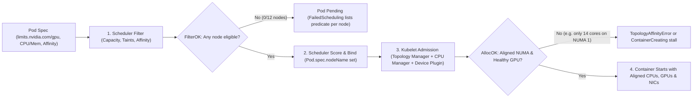
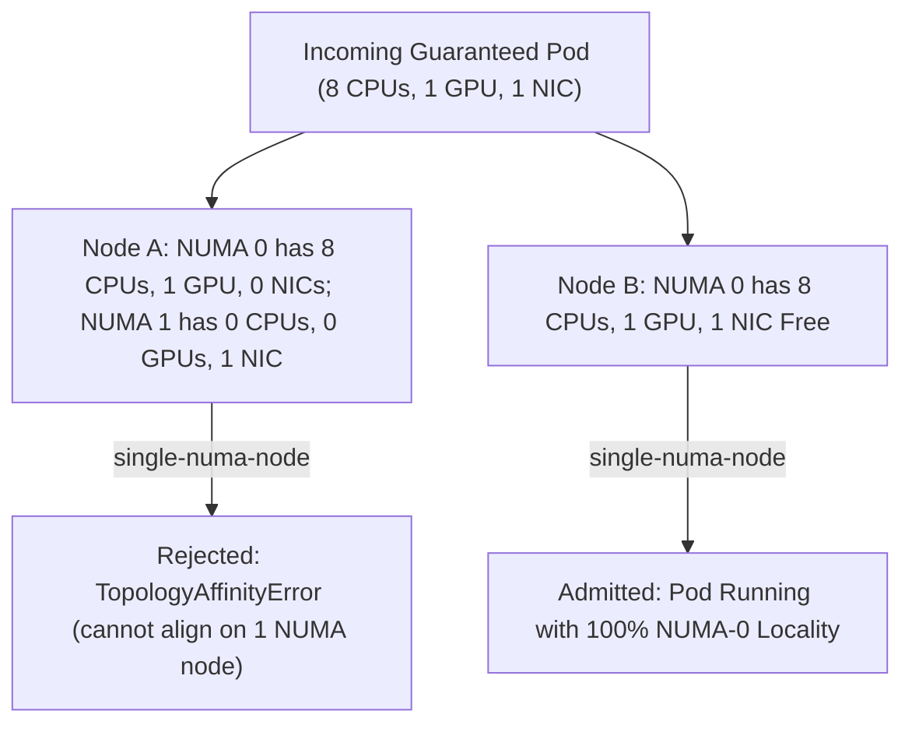

# 11.6 Scheduling GPUs: requests, Topology Manager, CPU and NUMA alignment

| | |
|---|---|
| Level | Advanced |
| Priority tier | 1 |
| Lab venue | GCP / GKE (plus local Python 3 simulation lab) |
| Part | Part 11: GPUs on Kubernetes, scheduling and virtualization |
| Coverage file | `planning/coverage/chapters/11-06.md` |

## Why this matters for AI infrastructure

Picture two training Pods on the same cluster that request the same number of GPUs. Both show `Running`, both report the same requests, and the dashboard looks identical for each of them. Then the training steps on one Pod take almost three times as long as the steps on the other. Nothing in the manifests explains the gap. The default scheduler treats each GPU request as a simple integer subtraction against a node allocatable counter. That count is necessary, but for high-performance AI workloads it is rarely sufficient. The counter knows how many GPUs are free, and it knows nothing about which CPU socket or which network card sits closest to them.

On a multi-socket GPU server, CPU cores, host memory, PCIe switches, network cards, and GPUs sit in separate hardware domains. A socket is one physical CPU package with its own cores and memory channels. A PCIe switch is a small chip that fans out lanes to several devices. When the scheduler or kubelet ignores that internal wiring, two Pods with identical requests can run at vastly different speeds.

Data-loading threads on one CPU socket can be forced to fetch training batches across an inter-socket link. They do this to feed a GPU on the opposite socket. The problem can be worse inside a single worker Pod. Two GPUs assigned to that Pod might communicate across a slow host PCIe bridge instead of a high-speed NVLink fabric. Each of these hops adds latency, and a training step waits for the slowest hop it has to make.

Strict single-socket enforcement brings a different risk. If you turn it on without adjusting Pod CPU requests, the kubelet can reject Pods while healthy GPUs sit idle. Platform engineers and machine learning teams feel these mismatches as unpredictable training step times, degraded network throughput, and mysterious admission failures. The admission failure is the hardest to explain, because the node looks free on the dashboard and still refuses the Pod.

The summary below collects the hardware numbers behind these symptoms.

```text
Hardware Locality & Scheduling Impact Summary:
- Dual-socket 8-GPU server split (128 CPU cores):
  - NUMA Node 0 (CPU 0, cores 0..63): GPUs 0..3 and NIC 0
  - NUMA Node 1 (CPU 1, cores 64..127): GPUs 4..7 and NIC 1
- Host NUMA DRAM access latency (AI Systems Performance Engineering Ch. 3 experiment):
  - Local NUMA access: ~80 ns
  - Remote cross-socket UPI/xGMI access: ~139 ns (+59 ns, ~75% / 73.75% latency penalty)
  - Training throughput gain from eliminating cross-NUMA traffic and core migrations: 5%-10%
- Memory & interconnect bandwidth cliff:
  - H100 HBM3 internal memory: 3,350 GB/s (>52x faster than PCIe Gen5 x16)
  - Blackwell NVLink 5.0 (B200 / GB200): 1.8 TB/s (1,800 GB/s) per GPU across 18 links at 100 GB/s; GB200 NVL72 connects 72 GPUs at 130 TB/s
  - Hopper NVLink 4.0 (H100 / H200): 900 GB/s per GPU (NV12 / NV18 via NVSwitch 3.0); A100 NVLink 3.0 is 600 GB/s
  - PCIe Gen5 x16: 64 GB/s per direction; PCIe Gen4 x16: 32 GB/s per direction
  - Unaligned PHB peer link (CPU Affinity 0-31 on NUMA 0 vs 32-63 on NUMA 1) vs NV4/NV12: 3-4x slower collective step time
- Strict single-numa-node admission math (128 cores, 8 GPUs):
  - 8 Triton Pods * 16 cores = 64 cores on NUMA 0 (Pods 1..4), leaving 14 free cores on NUMA 1 after 2 OS daemon cores -> TopologyAffinityError
  - Right-sized to 12 cores/Pod: 4 * 12 = 48 cores/socket (96 total), leaving 16 cores/socket (14 after OS daemons) so all 8 Pods schedule
```

Notice two figures that recur through the chapter. One is the latency gap between local and remote NUMA memory. The other is the 14 free cores that block the last Pod in the admission math. You will see both again when the chapter reaches the Triton example, and by then the arithmetic should feel familiar.

This chapter walks through the four-stage placement framework first. It then covers the internal motherboard data paths that topology tools reveal, along with the Kubernetes QoS and kubelet alignment policies. Last come host and PyTorch memory pinning, and the design of a service-class catalog. A service-class catalog is the short list of workload tiers that a platform team publishes, each with its own placement rules. Decide early whether you are looking at a scheduler problem or a node-local problem. The answer tells you which logs to read first.

## Prerequisites and outcomes

This chapter builds on earlier work. Check the prerequisites first, then use the outcomes as a checklist while you read.

### Prerequisites
Imagine a Pending training Pod that your team has to explain to a machine learning engineer by the end of the day. You will be more useful to that engineer if you already know the building blocks. Finish Chapters 11.1 through 11.5 first. Those cover Device Plugin resource advertisement, CDI runtime injection, node feature labels, and GPU Operator lifecycle management. CDI, the Container Device Interface, is the standard that describes how a device is handed to a container. You should also be comfortable with Linux processes and threads, virtual memory paging, and PCIe bus basics. Paging is how the kernel moves memory between RAM and disk, and PCIe is the bus that connects GPUs and network cards to the CPU.

### Outcomes
This chapter gives you four things. It starts with the ordered questions that separate a scheduler filter failure from a node-local allocation error. Then it shows how to read every cell of an `nvidia-smi topo -m` affinity matrix, and how to measure the gap between HBM3, NVLink and PCIe bridges. Next it covers the settings that resolve `TopologyAffinityError` rejections, namely Guaranteed QoS, integer CPUs, the static CPU Manager and the Topology Manager policies. After that it covers host and container tuning for PyTorch training and low-latency inference, and it ends with how to diagnose Pending GPU Pods and slow running Pods.

## Concepts: basics to intermediate to advanced

### 1. Basics: The four placement questions and the physical motherboard data path

Think about the moment a Pod is stuck in Pending on Monday morning. Someone asks whether the cluster is out of GPUs, and the honest answer is that it depends on which step failed. A GPU Pod can fail in two different places. It can stay Pending because no node qualifies. Or the scheduler can bind it to a node where the kubelet later refuses it. These are two separate failures with two separate fixes, and mixing them up is the most common way to waste a morning.

Kubernetes schedules and admits GPU Pods in two separate stages that run in different components. The central scheduler filters and scores candidate nodes using cluster-wide resource counters, labels, and taints. A taint is a mark on a node that repels Pods unless they tolerate it. Once the Pod is bound to a node, the local kubelet coordinates with the CPU Manager, Topology Manager, and Device Plugin. The scheduler works from a cluster-wide view, and the kubelet works from the view of one machine.

If the scheduler cannot find a matching node, the Pod stays Pending with a scheduling failure event. If the scheduler binds the Pod to a node where physical resources cannot align on the same socket, the kubelet rejects the Pod.



Read the diagram as a two-door check. The left door is the scheduler, and a Pod that fails there stays Pending. The right door is the kubelet on the chosen node, and a Pod that fails there gets a `TopologyAffinityError` or sits in ContainerCreating. The two doors need different evidence, so the first question to answer is which door the Pod stopped at.

To avoid over-constraining the cluster, or under-specifying a critical job, platform teams ask four placement questions in strict order. The order matters, because each answer narrows the set of nodes that the next question has to consider.
- Capacity asks how many GPU units each Pod requires, and under which extended resource name, such as `nvidia.com/gpu` or `nvidia.com/mig-2g.45gb`.
- Eligibility asks which validated node pool or service class label, such as `gpu.platform.example/class`, qualifies the workload to run.
- Locality asks whether the workload has a measured sensitivity to CPU-to-GPU NUMA affinity, GPU-to-NIC PCIe switch proximity, or GPU-to-GPU NVLink connectivity.
- Coordination asks whether the job consists of multiple coupled worker Pods that must start simultaneously, through gang scheduling or queue admission.

Answering the four questions in writing is a small habit with a large payoff. When a Pod is stuck, you can check each question in turn and see which one has no good answer yet. Most stuck Pods turn out to have an answer missing from the second or third question.

#### Physical motherboard hierarchy: PCIe, NVLink, NVSwitch, and NUMA
Why does hardware locality matter so much for distributed training and high-throughput inference? Before a tensor can reach an external 400G InfiniBand or RoCE network cable, it must cross the internal traces of the server motherboard. A tensor is the multi-dimensional array of numbers that a model works on. Moving data across an internal PCIe host bridge or an inter-socket CPU link is orders of magnitude slower than moving it across NVLink or local GPU memory. The reason is distance and sharing. Each extra hop passes through more chips, and those chips are shared with other traffic.

The table compares each layer by its bandwidth or latency, and by how it behaves as a bottleneck. Read the rows from the fastest path at the top to the slowest path at the bottom. The gap between the top row and the bottom row explains most of the performance you see on a real server.

| Interconnect / Memory Layer | Typical Bandwidth / Latency | Architectural Role & Bottleneck Behavior |
|---|---|---|
| **H100 HBM3 Internal Memory** | `3,350 GB/s` | On-package GPU framebuffer bandwidth. Feeding this across a `64 GB/s` PCIe Gen5 slot throttles data transfer by a `>52x` ratio. |
| **NVLink 5.0 (Blackwell B200 / GB200)** | `1.8 TB/s` (`1,800 GB/s`) bidirectional per GPU (`18` links × `100 GB/s`) | Doubles NVLink 4.0 and exceeds PCIe Gen5 by `>14x`. NVSwitch 4.0 provides `72` NVLink 5.0 ports per chip (`144` ports / `14.4 TB/s` per dual-chip switch tray), and GB200 NVL72 links `72` GPUs at `130 TB/s` aggregate bandwidth (`72 * 1.8 TB/s`). |
| **NVLink 4.0 (Hopper H100 / H200)** | `900 GB/s` bidirectional per GPU (`12`–`18` links) | HGX H100 and H200 use `4` NVSwitch 3.0 chips to form an all-to-all non-blocking mesh across `8` GPUs (`600 GB/s` on Ampere A100 NVLink 3.0 with `12` links `NV12`). |
| **NVLink-C2C (Grace Hopper GH200 / Grace Blackwell GB200)** | `~900 GB/s` coherent CPU-to-GPU link | Provides hardware-coherent shared virtual address space between the Grace ARM CPU and paired GPU, while Linux still models CPU DRAM and GPU HBM as separate NUMA pools. |
| **PCIe Gen5 x16 (Hopper / Blackwell host bus)** | `64 GB/s` per direction (`16` lanes) | Doubles PCIe Gen4 x16 (`32 GB/s` per direction) used on Ampere A100 servers. Connects GPUs, ConnectX NICs, and NVMe SSDs to PCIe switches or CPU root complexes. |
| **Local NUMA DRAM vs Cross-Socket UPI / xGMI** | `~80 ns` local vs `~139 ns` remote (`~75%` / `73.75%` latency penalty) | Dual-socket servers split CPUs, RAM, and PCIe lanes into NUMA Node `0` and NUMA Node `1`. Crossing the inter-socket Intel UPI or AMD xGMI link adds `59 ns` per memory access and saturates under DMA load. |

Notice the first row. If you feed H100 HBM3 memory across a PCIe Gen5 slot, data transfer is throttled by a >52x ratio. That is the reason the GPU wants its data already sitting in its own memory before a step starts, and why the loader threads matter so much. NVLink and NVSwitch are the fast lanes that let GPUs trade data with each other without going through the CPU at all. The NUMA row is the one to watch when you see slow CPU-side behavior, because it is where a thread on one socket reaches for memory on the other.

#### Reading `nvidia-smi topo -m` like a senior architect
Run `nvidia-smi topo -m` when you need to know how a server is wired. Picture a new server that arrives on a Tuesday, and you have one afternoon to check its layout before it joins the pool. It shows how GPUs, network cards, CPU cores, and NUMA nodes connect. The matrix gives the exact hardware path between every pair of devices on the motherboard. You read it once per server model, write down the result, and use it to set the placement rules for that model.

```text
# Illustrative output for an 8-GPU HGX system (untested here)
        GPU0    GPU1    GPU2    GPU3    GPU4    GPU5    GPU6    GPU7    NIC0    NIC1    CPU Affinity    NUMA Affinity
GPU0     X      NV12    NV12    NV12    NV12    NV12    NV12    NV12    PIX     SYS     0-15            0
GPU1    NV12     X      NV12    NV12    NV12    NV12    NV12    NV12    SYS     PIX     0-15            0
GPU2    NV12    NV12     X      NV12    NV12    NV12    NV12    NV12    SYS     SYS     16-31           1
GPU3    NV12    NV12    NV12     X      NV12    NV12    NV12    NV12    SYS     SYS     16-31           1
```

Read the matrix one cell at a time. Pick a row, such as GPU0, and walk across it. Each code in the matrix has a precise hardware meaning, and that meaning sets the speed of peer-to-peer DMA. Peer-to-peer DMA is a transfer that moves data directly between two devices without copying it through host memory. `X` marks the same physical device. `NV4`, `NV12`, and `NV18` connect directly over bonded NVLink lanes or an NVSwitch fabric, which bypasses the PCIe bus completely. `PIX` means the path crosses at most a single PCIe switch chip. That path enables direct Peer-to-Peer DMA and GPUDirect RDMA without touching the CPU.

`PXB` traverses multiple cascaded PCIe switches without crossing a CPU PCIe Host Bridge. `PHB` shares the same PCIe Host Bridge inside one CPU socket, so traffic climbs to the CPU root complex and back down. The root complex is the part of the CPU that owns the PCIe lanes. `NODE` traverses multiple PCIe Host Bridges within the same NUMA node. `SYS` is the slowest path on a host. It crosses the inter-socket link between different NUMA nodes, and it can cut throughput by 50%. When you see `SYS` between two GPUs that a job needs to talk to, that job should not be placed on those two GPUs.

The last two columns, CPU Affinity and NUMA Affinity, tell you which cores belong to each GPU. Those columns are the bridge between this matrix and the kubelet settings later in the chapter. A GPU whose affinity says NUMA 0 wants CPU cores from NUMA 0, and a Pod that mixes NUMA 0 GPUs with NUMA 1 cores pays the cross-socket price on every step.

#### Why the default scheduler is blind to GPU links

Take an 8-GPU server with two groups of four GPUs, linked by NVLink inside each group. Your job asks for four GPUs. The ideal is four GPUs on one NVLink fabric and one NUMA node. Picture the job as a set of four GPUs that must pass gradients to each other every step. Gradients are the numbers that describe how each model weight should change, and they are exchanged after every batch. Their path decides how long each step takes.

The default scheduler does not see that layout. By default, Kubernetes counts each GPU as an identical resource. It does not know whether GPU 0 and GPU 1 share a NUMA node or an NVLink connection. That gap matters. The scheduler is doing its job correctly from its own point of view, because a GPU is a GPU to the counter. The missing piece is the topology, and the topology lives on the node, not in the counter.

A blind scheduler can hand you two GPUs from one group and two from the other. The traffic between those GPUs then crosses the slower path, through InfiniBand or Ethernet. That can cut your inter-GPU bandwidth in half. The NVL72 rack shows what is at stake for you. It links 72 GPUs in one NVLink domain, with about 130 TB/s of combined throughput. A placement that ignores topology can throw that advantage away. It does not feel like an error, because the job runs and the logs are clean. It just runs slower than the hardware allows, and nobody sees the cause until someone reads the matrix.

Treat topology as a scheduling input, not an afterthought, when you request GPUs. That means writing the locality answer into the Pod spec, through a node label, a service class or a topology-aware admission policy, instead of hoping the default placement happens to be good.

---

### 2. Intermediate: Kubernetes QoS classes, static CPU Manager, and Topology Manager

Picture a Pod that asks for 16 CPU cores, 1 GPU, and 1 RDMA network card. By default, Kubernetes is unaware of NUMA boundaries on a worker node. The default kubelet policies allocate those three resources independently. The Pod can easily receive CPU cores on socket 0, a GPU on socket 1, and a network interface on socket 0. That unaligned placement forces every batch transfer and network packet across the inter-socket link. Each of the three allocations was correct on its own, and the combination is the problem.

To enforce hardware locality on a Kubernetes worker node, three kubelet mechanisms must work together. You must configure the Pod Quality of Service class, enable the static CPU Manager policy, and select an appropriate Topology Manager policy. Each of the three answers a different question. QoS decides whether the Pod is eligible for exclusive CPUs at all, the CPU Manager decides which cores it gets, and the Topology Manager decides whether the cores, the GPU and the NIC can sit on the same socket.

#### 1. Pod Quality of Service and integer CPU requests
Kubernetes places every Pod into one of three Quality of Service classes. The class depends on the Pod's CPU and memory requests and limits. A request is the amount the scheduler reserves for the Pod, and a limit is the most the Pod may use.
- A BestEffort Pod sets no CPU or memory requests or limits. That makes it the first candidate for eviction, and it rules the Pod out for pinned CPUs.
- A Burstable Pod has at least one container that sets a request or limit. Its requests do not equal its limits, so its threads float across shared CPU cores.
- A Guaranteed Pod gives every container explicit requests and limits for both CPU and memory. The requests equal the limits for both.

Exclusive CPU core pinning and Topology Manager alignment apply only to Guaranteed Pods whose CPU request and limit are whole positive integers. Requesting `cpu: "16"` qualifies for exclusive core pinning under `cpuManagerPolicy: static`. A fractional request like `cpu: "15.5"` goes into the shared CPU pool instead. The request format decides whether your Pod gets dedicated cores. It is easy to write `15.5` by accident when you are tuning a Pod down, and the Pod then quietly loses the pinning it needed.

#### 2. The four kubelet Topology Manager policies
Before it admits a Pod, the kubelet relies on the Topology Manager. The Topology Manager is a kubelet subsystem that queries Hint Providers. A hint provider is a kubelet component that reports where its resources sit on each NUMA node. It collects NUMA affinity hints from the CPU Manager, the Memory Manager, and the Device Manager, which covers both GPUs and SR-IOV network interfaces. It then applies one of four configured policies to decide whether to admit or reject the Pod.

| `topologyManagerPolicy` | Kubelet Admission Behavior | Operational Trade-Off for AI Infrastructure |
|---|---|---|
| **`none` (default)** | Allocates CPUs, memory, GPUs, and NICs independently with zero NUMA coordination. | Maximum bin-packing flexibility, but causes random cross-socket UPI and xGMI bottlenecks (`SYS` paths) on multi-socket servers. |
| **`best-effort`** | Calculates the preferred NUMA affinity across all Hint Providers and tries to align them, but admits the Pod anyway if alignment is impossible. | Dangerous for strict SLO production workloads because a Pod can run at full speed on Monday and 50% slower on Tuesday after rescheduling. |
| **`restricted`** | Calculates the minimal number of NUMA nodes required by the Hint Providers and rejects the Pod with `TopologyAffinityError` if available resources cannot match that minimal count. | Allows multi-NUMA allocations when a Pod legitimately requests more GPUs or CPUs than exist on one socket, while rejecting sub-optimal splits. |
| **`single-numa-node`** | Requires that all requested exclusive CPUs, memory, GPUs, and NICs reside on a single physical NUMA node, or rejects the Pod with `TopologyAffinityError`. | Guarantees zero cross-socket traffic for every admitted Pod, at the cost of strict per-socket capacity accounting. |

The four policies form a range. `none` packs resources most freely but ignores locality. `single-numa-node` gives the strictest locality and the strictest capacity accounting. The middle two policies sit between them. `best-effort` is the one that surprises teams, because it looks like an alignment policy and it still admits misaligned Pods. The diagram below shows the same Pod evaluated on two nodes under `single-numa-node`.



On Node A, the GPU and the NIC sit on different NUMA nodes, so the Pod is rejected. Node B has all three resources on NUMA 0, so the Pod is admitted. The two nodes have the same total resources, and the only difference is where those resources sit. That is the lesson of the whole section. Locality is a property of placement, and the same hardware can admit or reject the same Pod depending on how its pieces line up.

#### Deep dive: Solving the `TopologyAffinityError` 5th-Pod mystery on a 128-core, 8-GPU server
Turning on `single-numa-node` changes the capacity math on a node. Many platform teams find this out only when a Pod is rejected. Suppose an infrastructure team configures `--topology-manager-policy=single-numa-node` and `--cpu-manager-policy=static` on a fleet of dual-socket servers. Each server has 128 CPU cores and 8 GPUs, split evenly across two sockets. The team deploys 8 Triton Inference Server Pods, and each requests 1 GPU and 16 CPU cores. The first several Pods start cleanly. The remaining Pod fails at once with `TopologyAffinityError`, while GPUs sit completely idle.

Why did the kubelet reject a Pod when the server still had idle GPUs and free CPU cores? The first four Pods consumed all 64 CPU cores and all 4 GPUs on the first socket. On the second socket, all 4 GPUs were free, but Linux OS daemons, the kubelet, and monitoring agents consumed 2 CPU cores. That left only 14 free CPU cores when the last 16-core Pod arrived. Because the Topology Manager refuses to split a 16-core request across sockets or pair socket-0 CPUs with a socket-1 GPU, it rejected the Pod.

The arithmetic is the whole story. Sixteen cores per Pod times four Pods is sixty-four cores, which is exactly what socket 0 has. Socket 1 has the same sixty-four cores, but two of them belong to the operating system. So the fifth Pod sees fourteen usable cores, and fourteen is less than sixteen. The GPUs on socket 1 are not the bottleneck at all. The CPU count is.

The table compares two ways to pack the same 8 Pods. Read the last column to see which packing admits all of them.

| Packing Configuration (`128` cores, `8` GPUs across `2` NUMA nodes) | Per-Socket Capacity (`64` cores, `4` GPUs per NUMA node) | Pod CPU & GPU Request | Per-Socket Usage (`4` Pods) | Remaining Cores on Socket (`62` available after `2` OS cores) | Admission Outcome under `single-numa-node` |
|---|---|---|---|---|---|
| **Naive Full-Core Division** | `64` cores, `4` GPUs (`GPU 0..3` on NUMA `0`, `GPU 4..7` on NUMA `1`) | `1` GPU, `16` CPU cores (`8 * 16 = 128` cores) | `4 * 16 = 64` cores on NUMA `0` (`0` free) | Only `14` free cores left on NUMA `1` (`14 < 16`) | Rejects Pod with `TopologyAffinityError`, stranding idle GPUs |
| **Right-Sized with OS Headroom** | `64` cores, `4` GPUs (`2` cores reserved for OS/kubelet per socket) | `1` GPU, `12` CPU cores (`8 * 12 = 96` cores) | `4 * 12 = 48` cores per NUMA node | `64 - 48 = 16` cores (`14` free after `2` OS cores) | Admits all `8` Pods with `100%` `single-numa-node` locality |

The lesson is simple. Never divide total host CPU cores by total GPUs before you subtract the OS and DaemonSet reservations set in `systemReserved` and `kubeReserved`. Right-sizing each Triton Pod from 16 cores down to 12 cores consumes 48 CPU cores per socket. That leaves enough headroom for host daemons, so all 8 Pods schedule cleanly. Notice that the GPU count did not change. Only the CPU request changed, and that single change turned a rejected Pod into eight running ones.

---

### 3. Advanced: OS tuning, PyTorch DataLoader NUMA binding, MIG single-node constraints, and service classes

Say the scheduler gives your Pod aligned GPUs and CPU cores, yet the GPU still waits between batches. Picture the GPU utilization graph in a Grafana panel, with a sawtooth pattern that drops to near zero between steps. The placement looks right, so the next suspects are the operating system and the framework. OS-level and framework-level defaults can starve the GPU with data-loading stalls. Standard pageable host memory forces the CUDA driver to copy training batches through internal bounce buffers. Pageable memory is memory the kernel is allowed to move or swap, so the driver has to copy it into a safe staging area first. Default kernel page sizes can cause excessive Translation Lookaside Buffer (TLB) misses across large datasets. The TLB is a small cache that maps virtual addresses to physical memory, and a miss means a slow lookup. CPU power-saving states add microsecond wake-up delays between kernel launches.

To sustain maximum GPU utilization, platform engineers pair Kubernetes topology alignment with seven host and container tuning controls. Each row names one tuning domain, the setting to use, and the effect it has. Treat the table as a menu, not a checklist. Each setting helps a specific kind of workload, and a few of them help training and hurt inference, as you will see after the table.

| Tuning Domain | Production Setting / Command | Measured Impact & Architectural Mechanism |
|---|---|---|
| **1. Pinned (page-locked) host memory** | `pin_memory=True` with `non_blocking=True` on `.to("cuda")` and `ulimit -l unlimited` (`memlock`) | Enables direct GPU DMA without bounce buffers, making host-to-device (`H2D`) copies `2–3x` faster (`bandwidthTest --memory=pinned` vs `pageable`). |
| **2. Swap disablement** | `vm.swappiness=0` and `sudo swapoff -a` with cgroup v2 memory isolation | Prevents the Linux kernel from paging host data caches to disk, which otherwise stalls GPU batch fetching by orders of magnitude. |
| **3. Transparent Hugepages (THP)** | `2 MB` or `1 GB` pages vs `4 KB` pages for training; `transparent_hugepage=never` or `madvise` with explicit `hugetlbfs` (`vm.nr_hugepages`) for inference | Reduces TLB misses on large datasets for a `~3%–5%` training throughput gain, while disabling THP avoids background compaction latency spikes in online LLM inference. |
| **4. CPU frequency governor & C-states** | `cpupower frequency-set -g performance` and disable deep sleep states (`C6`) in BIOS to stay in `C0` | Prevents microsecond CPU wake-up delays between batches that accumulate into GPU execution bubbles. |
| **5. Multi-threaded memory allocators** | `jemalloc` (`export MALLOC_CONF="narenas:8,dirty_decay_ms:10000,muzzy_decay_ms:10000,background_thread:true"`) or `tcmalloc` (`export TCMALLOC_MAX_TOTAL_THREAD_CACHE_BYTES=$((512*1024*1024))` = `536,870,912` bytes / `512 MiB`, `export TCMALLOC_RELEASE_RATE=16`) | Eliminates `glibc` `malloc` lock contention across concurrent Python and C++ data-loading threads (`CUDA_MPS_ACTIVE_THREAD_PERCENTAGE=50` when sharing via MPS). |
| **6. OverlayFS bypass & direct I/O** | Bind-mount NVMe or parallel storage (`-v /data/dataset:/mnt/dataset:ro`), use `O_DIRECT` or `io_uring`, and call `posix_fadvise(fd, 0, 0, POSIX_FADV_DONTNEED)` | Bypasses container Copy-on-Write (`CoW`) metadata overhead and prevents checkpoint bursts from evicting active dataset pages from the OS page cache. |
| **7. GPU persistence daemon** | `systemctl enable nvidia-persistenced` | Keeps driver state initialized when `/dev/nvidia*` is closed, eliminating the `1–2` second cold-start delay and preserving dynamic MIG state. |

Some rows differ between training and inference, and the THP row shows the clearest case. Training benefits from large pages, while latency-sensitive inference is better served by disabling THP. The reason is that large pages cut the TLB misses that slow down big sequential scans, but the background work that builds large pages can pause a request for a few milliseconds at a bad moment. A training job absorbs that pause without noticing, and an inference request does not. Pick the setting per workload class, not per cluster.

The pinned-memory row is the one most teams should apply first. Pinned memory is locked in RAM, so the GPU can read it directly. When you set `pin_memory=True` in the PyTorch DataLoader and move tensors with `non_blocking=True`, the copy can overlap with compute. The `ulimit -l unlimited` setting is required because Linux limits how much memory a process may lock by default, and a container with the default limit will quietly fall back to pageable copies.

#### Explicit NUMA binding in Bash and PyTorch DataLoader workers
Picture a multi-GPU job on a node where the kubelet did not isolate a single NUMA node per process. Each worker then needs an explicit bind to its local NUMA node. A simple startup loop can do that. It queries `nvidia-smi topo -m` for each GPU index and launches the training script under `numactl`. The `numactl` tool sets which CPUs and which memory bank a process may use, so the process stays on its local socket.

```bash
# Dynamically query each GPU's NUMA node via nvidia-smi topo -m and bind with numactl (untested here)
#!/bin/bash
for GPU in 0 1 2 3; do
  NODE=$(nvidia-smi topo -m -i "$GPU" | awk '/NUMA Affinity/ {print $NF}')
  numactl --cpunodebind="$NODE" --membind="$NODE" \
    bash -c "CUDA_VISIBLE_DEVICES=$GPU python train.py --gpu $GPU" &
done
wait
```

Read the loop as a small recipe. It asks the hardware for each GPU's NUMA node, and it starts one training process per GPU, pinned to that node for both CPU and memory. The `&` at the end of each launch runs the process in the background, and `wait` keeps the script alive until all of them finish. The loop depends on the topology output being present on the node, so check that output first if the script behaves strangely.

DataLoader workers are a separate case. Spawned worker subprocesses do not reliably inherit `numactl` CPU and memory affinity across `exec` boundaries in PyTorch. You need to re-apply the binding inside each worker. To keep data-loading threads on the local socket, pass a closure-based `worker_init_fn` using `functools.partial`. A closure is a function that remembers the values it was built with, and `functools.partial` is the standard way to build one with fixed arguments. In the parent process, query NVML or sysfs for the NUMA node and CPU list. Each worker then re-applies CPU affinity via `psutil` and memory policy via `libnuma`. The sysfs path is the Linux virtual filesystem that exposes the topology, and `libnuma` is the C library that sets the memory policy.

Watch out for one trap. Never call `torch.cuda` functions inside `worker_init_fn`. Doing so initializes duplicate CUDA contexts inside CPU worker processes. A CUDA context is the per-process state that the driver builds before any GPU work can run, and each one costs GPU memory. The worker only needs the CPU binding, so keep the GPU calls in the parent process.

```text
PyTorch NUMA-Aware DataLoader Reference Parameters (AI Systems Performance Engineering Ch. 3):
- Topology discovery: NVML (nvmlDeviceGetNUMANodeId / nvmlDeviceGetCpuAffinity) or /sys/bus/pci/devices/<PCI_ID>/numa_node + /sys/devices/system/node/node<N>/cpulist
- Worker binding APIs: psutil.Process(os.getpid()).cpu_affinity(cpus) + libnuma (numa_run_on_node(node), numa_set_preferred(node))
- DataLoader settings: batch_size=32, num_workers=4, pin_memory=True, persistent_workers=True, prefetch_factor=2
```

The reference block lists the discovery paths and the settings together, so you can check a script against them. The `persistent_workers` setting keeps the worker processes alive between epochs, so the binding work is done once rather than on every pass.

#### The single-node MIG scheduling constraint
Multi-Instance GPU, or MIG, splits one large GPU into smaller slices. Each slice gets its own share of compute units, memory and copy engines, and each one is isolated from the others in hardware. When you partition GPUs this way, remember one limit. A Kubernetes Pod cannot span multiple nodes. If a Pod requests two MIG slices in a single container specification, the scheduler must find both slices free on the exact same physical machine. Free slices spread across different machines do not count, no matter how many there are in total.

```yaml
resources:
  limits:
    nvidia.com/mig-2g.45gb: "2"
```

```text
Blackwell B200 MIG Profile Reference (132 SMs total, 1/7 = ~19 SMs per slice, Table 3-1):
- Profiles available: 1g.23gb, 1g.45gb, 2g.45gb (~38 SMs, 45 GB HBM, 3 copy engines, max 3/GPU), 3g.90gb (~57 SMs, 90 GB HBM, 6 copy engines, max 2/GPU), 4g.90gb, 7g.180gb
- Requesting nvidia.com/mig-2g.45gb: "2" allocates 2 * ~38 = ~76 SMs and 2 * 45 GB = 90 GB total HBM
- Single-node Pod rule: If Node 1 has 1 free 2g.45gb slice and Node 2 has 1 free 2g.45gb slice, a Pod requesting "2" stays permanently Pending
- Driver R570 MIG constraint: Cross-GPU MIG peer-to-peer (P2P), cross-instance CUDA IPC, and NCCL collectives across MIG instances are unsupported
```

The limits block asks for two slices in one container. Read the profile reference below it to see what those two slices mean in SMs and memory. An SM (streaming multiprocessor) is the GPU's basic compute unit, and the count tells you how much of the chip a slice gets. The reference also shows why two slices on different machines are no help. The scheduler needs both on one node, and the NCCL line says that the two slices cannot talk to each other across instances anyway.

NCCL, the library that runs collective operations across GPUs, cannot use MIG slices across instances. Peer-to-peer DMA is also unsupported across MIG slices. For that reason, distributed multi-GPU training and expert-parallel inference should always request full GPUs. Expert-parallel inference splits a mixture-of-experts model across GPUs, so tokens must travel between them at every layer. MIG is a good fit for many small, independent jobs, and a poor fit for a job whose GPUs must exchange data continuously.

#### Designing the service-class catalog to control fragmentation
Every hard locality rule you add shrinks the set of nodes and sockets a Pod can use. The smaller that set gets, the more likely GPUs are stranded and sit unused. Fragmentation is the name for this effect, where free capacity exists but is split into pieces too small for the next Pod. Platform teams balance performance determinism against cluster utilization by publishing a four-tier service-class catalog. The catalog works as a menu that each team picks from, so that the strictest rules are only applied where they pay for themselves.

| Service Class | Primary Objective | Kubernetes Scheduling & Locality Posture |
|---|---|---|
| **1. Interactive development** | Rapid admission, low cost | Flexible shared pool, time-slicing or small MIG slices (`1g.5gb` / `1g.23gb`), strict namespace quotas |
| **2. Online inference** | Low tail latency, high availability | Protected pool (`taint` + `nodeAffinity`), pod anti-affinity across nodes and zones for replica spread, `single-numa-node` where PCIe or CPU bound, `transparent_hugepage=never` |
| **3. Batch inference** | High throughput per dollar | Flexible placement across hardware generations (`preferredDuringScheduling`), queue-aware admission |
| **4. Distributed training** | Predictable collective step time (`AllReduce`) | Topology-validated pool (`NV12`/`NV18` + `PIX` RDMA NICs), `single-numa-node` or `restricted`, gang-scheduled admission, checkpoint-aware preemption |

Strict topology rules appear in the online inference and distributed training rows. The other two rows keep placement flexible. The split is deliberate. Interactive users and batch jobs can tolerate a wait, so they should not pay the fragmentation cost of strict locality. Online inference and distributed training cannot tolerate either a slow path or a long wait, so they get the strict rules and the protected capacity that comes with them.

#### Reducing orchestration jitter and requesting the whole node

Kubernetes keeps background work running on every node. The kubelet, the container runtime, and monitoring agents all use some CPU and memory. Usually that is only a few percent of one core, so a training job barely notices. Consider what happens when a busy inference workload shares the same machine. If another container suddenly uses heavy CPU or I/O, your job feels it. Jitter is the name for that small, unpredictable variation in step time, and it hurts most in jobs that wait on every step.

Clusters that run only training, or only inference, are easier to debug and tune than a mix. Pods on the same node can still interrupt your job, though, when they share the network or the disks. Requests and limits help here, and so does cgroup control of CPU and I/O. Kubernetes supports CPU isolation, which gives a pod the dedicated cores and memory it requests. I/O is different. Kubernetes does not enforce I/O limits the same way, so I/O isolation may need manual node-level tuning.

For performance-sensitive jobs, the cleanest setup is to request all of the CPUs and GPUs on the node. Then nothing else contends for those resources. That is hard to arrange in a shared cluster, but it remains the ideal setup for consistent performance. Decide early whether your job can have a node to itself, because that choice shapes the rest of the design. If the answer is yes, the placement problem gets much simpler, and most of the rules in this chapter stop mattering for that node.

## Commands and configurations that matter

### 1. Configuring kubelet for static CPU Manager and single-numa-node Topology Manager

Start with the kubelet, because you configure it first. Without explicit kubelet configuration, every Pod gets shared CPU cores and unaligned devices, whatever its manifest says. Picture a platform engineer who writes perfect Pod manifests and still sees misaligned placement, because the node was never configured to honor them. To enable strict NUMA alignment on a GPU worker node, configure `/var/lib/kubelet/config.yaml`. Also make sure `--pass-device-specs=true` is enabled on the NVIDIA device plugin. Finally, make sure you reserve CPU and memory for host daemons. Otherwise user Pods can starve the kubelet or exhaust the cores of a socket.

```yaml
# /var/lib/kubelet/config.yaml (untested here)
apiVersion: kubelet.config.k8s.io/v1beta1
kind: KubeletConfiguration
cpuManagerPolicy: static
cpuManagerReconcilePeriod: 5s
topologyManagerPolicy: single-numa-node
topologyManagerScope: pod
systemReserved:
  cpu: "2"
  memory: "4Gi"
kubeReserved:
  cpu: "2"
  memory: "4Gi"
```

The pair to notice is `cpuManagerPolicy: static` with `topologyManagerPolicy: single-numa-node`. The first decides how cores are handed out, and the second decides whether the cores, GPU and NIC must share a socket. The `systemReserved` and `kubeReserved` blocks hold back the host's own share. `systemReserved` covers the operating system daemons, and `kubeReserved` covers the kubelet and the container runtime. Those reservations are the cores that the Triton example above was missing.

Apply the change on one node first, restart the kubelet there, and read the node's allocatable CPU before you touch the rest of the pool. If the allocatable number is lower than the physical core count by the amount you reserved, the change took effect. If the number has not moved, the kubelet did not pick up the file.

### 2. Deploying a Guaranteed QoS Pod that triggers static CPU pinning and single-numa-node

A kubelet set to static CPU management is not enough by itself. The Pod must also meet the Guaranteed QoS contract, or it gets no exclusive cores. Every container needs identical requests and limits for CPU and memory, with whole integer CPU counts. This example requests 12 CPU cores rather than 16. Four Pods at 12 cores use 48 of the 64 cores on a socket, which leaves room for the OS reservations. The number is the reason the manifest looks slightly unusual. It is sized to the socket, not to the tenant's wish list.

```yaml
# triton-numa-aligned-pod.yaml (untested here)
apiVersion: v1
kind: Pod
metadata:
  name: triton-inference-0
spec:
  tolerations:
    - key: "nvidia.com/gpu"
      operator: "Exists"
      effect: "NoSchedule"
  nodeSelector:
    gpu.platform.example/class: online-inference
  containers:
    - name: triton
      image: nvcr.io/nvidia/tritonserver:24.08-py3
      resources:
        requests:
          cpu: "12"
          memory: "64Gi"
          nvidia.com/gpu: "1"
        limits:
          cpu: "12"
          memory: "64Gi"
          nvidia.com/gpu: "1"
```

Check the `requests` and `limits` blocks first, since you control both. A mismatch between them keeps the Pod out of Guaranteed QoS. The toleration lets the Pod land on the GPU taint, and the node selector keeps it in the online inference pool. Those two lines are the eligibility question from the four placement questions, and the resource block answers the capacity question. Read the manifest against those questions, and it will make sense even if the numbers look arbitrary.

### 3. Diagnosing Pending Pods and slow running Pods

A Pending GPU Pod tempts engineers to assume the cluster is out of GPUs, and to scale up the node pool unnecessarily. Often the cluster has GPUs to spare. The scheduler can reject nodes for several independent reasons, including capacity, taints, and label selectors. Read the full `FailedScheduling` event message first, because it gives you the exact per-node breakdown. The breakdown tells you how many nodes failed for each reason, and those numbers add up to the total node count.

```bash
# 1. Inspect predicate breakdown for a Pending GPU Pod (untested here)
kubectl describe pod train-worker-2 | tail -8
```

Expected output:

```text
Events:
  Type     Reason            Age   From               Message
  ----     ------            ----  ----               -------
  Warning  FailedScheduling  40s   default-scheduler  0/12 nodes are available:
    4 Insufficient nvidia.com/gpu, 6 node(s) had untolerated taint
    {pool: inference-only}, 2 node(s) didn't match Pod's node affinity/selector.
```

Read the message as a small table. Each clause names one reason and the number of nodes that failed for it. A clause about GPUs means the pool is full. A clause about a taint means the nodes are protected for another workload. A clause about affinity or a selector means the Pod asked for labels that some nodes do not carry. The fix is different for each, so the message tells you which team to talk to.

A different symptom shows up in running workers. If a training worker's step times are three to four times slower than identical Pods on other nodes, check the GPU peer topology inside the container. The Pod is running, so the scheduler is not the problem. The problem is what the two GPUs can reach each other through.

```bash
# 2. Compare peer GPU interconnect inside the slow worker container (untested here)
kubectl exec train-worker-2 -- nvidia-smi topo -m | head -4
```

Expected output on a degraded placement:

```text
        GPU0  GPU1  CPU Affinity  NUMA Affinity
GPU0     X    PHB   0-31          0
GPU1    PHB    X    32-63         1
```

In this output, GPU0 and GPU1 talk across a PCIe Host Bridge, and they sit on different NUMA nodes. That explains the severe collective slowdown next to an NVLink peer pair. A healthy placement for the same two GPUs would show NV12 or NV18 in the cell between them. If the cell shows PHB, the fix is in the placement, not in the code, so the training script is not the place to look first.

## How it fails

Scheduling blocks, admission rejections, and silent locality regressions look different on the surface. Match the symptom to its cause before you change anything. The table below does that for the failures you can meet on multi-socket GPU servers. Each row keeps the evidence and the boundary together, so you can see why the remedy belongs to that boundary and not to another.

| Failure mode | Exact symptom & command evidence | Root cause boundary | Remediation |
|---|---|---|---|
| **1. `TopologyAffinityError` on 5th or 8th Pod despite idle GPUs on the node** | On a `128`-core, `8`-GPU dual-socket server (`64` cores and `4` GPUs per NUMA node) with `topologyManagerPolicy: single-numa-node`, Pods requesting `1` GPU and `16` CPUs start `4` or `7` replicas, and the remaining Pod fails with `Status: TopologyAffinityError` while GPUs sit idle. | **Per-Socket CPU Exhaustion under `single-numa-node`:** `Pods 1..4` consumed all `64` cores on NUMA `0`, and OS daemons consumed `2` cores on NUMA `1`, leaving only `14` free cores (`< 16`) on NUMA `1`. | Configure `systemReserved` and `kubeReserved` explicitly and right-size the Pod CPU request and limit from `16` cores to `12` cores (`4 * 12 = 48` cores per socket), leaving `16` cores (`14` after OS daemons) free per NUMA node so all `8` Pods admit cleanly. |
| **2. Pod runs `3–4x` slower on Node B than Node A with identical GPU count (`PHB` / `SYS` vs `NV4` / `PIX`)** | All Pods are Running, but step time or NCCL bandwidth regresses by `50%`–`75%`. `kubectl exec train-worker-2 -- nvidia-smi topo -m` shows `PHB` or `SYS` across NUMA `0` cores `0-31` and NUMA `1` cores `32-63` between `GPU0` and `GPU1` instead of `NV4` or `NV12`. | **Unaligned Intra-Node Data Path (`SYS` / `PHB`):** Default `topologyManagerPolicy: none` assigned GPUs across different NUMA sockets or across a CPU root complex from the active `400G` NIC. | Enable `topologyManagerPolicy: single-numa-node` or `restricted`, enable the SR-IOV RDMA device plugin so NIC NUMA hints participate in admission, and place distributed training in a topology-validated service class. |
| **3. Exclusive CPU pinning silently ignored despite `cpuManagerPolicy: static`** | Pod specifies `resources.limits.cpu: "16"`, but `cat /sys/fs/cgroup/cpuset.cpus` inside the container still lists all `0-127` host cores, and data-loader threads migrate across NUMA nodes. | **QoS / Integer CPU Rule Violation:** Either `resources.requests.cpu` did not equal `limits.cpu`, memory requests and limits were unequal, or a fractional CPU value (`15.5`) was used. | Set `requests == limits` for both `cpu` and `memory` on every container in the Pod using whole integer CPU values (`cpu: "16"`) so the Pod enters Guaranteed QoS. |
| **4. Multi-slice MIG Pod (`nvidia.com/mig-2g.45gb: "2"`) stuck in `Pending` while cluster has `>= 2` free slices** | Cluster has `4` free `nvidia.com/mig-2g.45gb` slices spread `1` per node across `4` nodes, yet a Pod requesting `nvidia.com/mig-2g.45gb: "2"` (`~76` SMs) stays Pending (`Insufficient nvidia.com/mig-2g.45gb`). | **Single-Node Pod Boundary:** A Kubernetes Pod cannot span multiple nodes, so all `2` requested `2g.45gb` slices must be free on the same node. | Partition MIG nodes so multiple `2g.45gb` instances (`3` per B200 GPU) co-reside on the same node, or request `1` larger slice (`4g.90gb`). |
| **5. Partial-start deadlock in multi-Pod distributed training** | A 4-worker PyTorch training job schedules `3` Pods holding `24` GPUs, while the 4th Pod stays Pending (`0/12 nodes are available: 4 Insufficient nvidia.com/gpu, 6 untolerated taint, 2 affinity mismatch`). The `24` allocated GPUs sit at `0%` compute waiting for rank 3 to join `dist.init_process_group`. | **Missing Coordinated / Gang Admission Boundary:** The default scheduler binds Pods one by one without checking whether the entire worker group can fit simultaneously. | Admit multi-Pod training jobs through a gang-aware queue or scheduler such as KAI Scheduler, Kueue, or Volcano covered in Chapters 11.7–11.20 so `0` GPUs are reserved until all `4` workers can start together. |

Each row starts from a symptom you can see, then names the root cause and the fix. If you see `TopologyAffinityError` while GPUs on the node sit idle, start with row 1. If you see a slow training job with healthy Pods, start with row 2. Rows 3 and 4 are about the exact form of a request, so they are easy to miss in a manifest review. Row 5 is the one that wastes the most GPU time, because the allocated GPUs are paid for and doing nothing.

Notice a pattern across the rows. Each failure looks like a scheduling problem in the first minute, and most of them turn out to be node-local problems or request-format problems. That is why the first question in the chapter, which door the Pod stopped at, is the question to ask again here.

## Hands-on lab

### Venue and scope
This lab runs locally, so you do not need a cluster to follow it. Two Python 3 standard library scripts do the work: `code/part11/gpu_scheduling_and_topology.py` and `code/part11/gpu_scheduling_and_topology_lab.py`. Together they simulate six things: cross-NUMA memory latency, topology matrix link ranking, Guaranteed QoS and static CPU Manager eligibility, Topology Manager admission policies, dual-socket Triton Pod packing, and scheduler predicate decomposition. Each simulation is a small model of one rule from this chapter, so you can change an input and see the rule respond.

The commands that target a real cluster in this chapter were not run on one. They are marked as such in their code blocks, and they should be checked on your own hardware before you rely on them.

### Step 1: Run the self-checking GPU scheduling and topology lab (tested here)

Run the lab script from the repository root. It executes all 25 verification checks, and it prints a pass or fail line for each one. The checks cover the arithmetic in this chapter, so a passing run means the simulator agrees with the numbers you have been reading.

```bash
python3 code/part11/gpu_scheduling_and_topology_lab.py
```

The block below shows what a passing run prints.

```text
=== Chapter 11.6 Lab: GPU Scheduling, Topology Manager, CPU & NUMA Alignment ===
  [PASS] Cross-NUMA memory latency rises from ~80 ns to ~139 ns (~75% increase, 73.75% exact)
  [PASS] nvidia-smi topo -m ranks X (self) faster than NV12 (NVLink), which is faster than PIX (same PCIe switch)
  [PASS] PCIe topology hierarchy orders PIX < PXB < PHB < NODE < SYS (cross-socket UPI/xGMI slowest)
  [PASS] Pod with integer CPU (16==16) and matching memory (65536==65536 MiB) gets Guaranteed QoS and static CPU pinning
  [PASS] Guaranteed Pod with fractional CPU (15.5) does NOT receive exclusive static CPU pinning
  [PASS] Pod with CPU request (8) != limit (16) is Burstable and excluded from static CPU pinning
  [PASS] Pod with no CPU/memory requests or limits is BestEffort (highest eviction risk)
  [PASS] single-numa-node rejects Pod on Node A (GPU on NUMA 0, NIC on NUMA 1) with TopologyAffinityError
  [PASS] restricted policy also rejects unaligned Pod on Node A with TopologyAffinityError
  [PASS] best-effort admits Pod on Node A despite cross-NUMA split between GPU 0 and NIC 1
  [PASS] none policy admits Pod on Node A without NUMA alignment
  [PASS] single-numa-node admits Pod on Node B where NUMA 0 has 8 CPUs, 1 GPU, and 1 NIC aligned
  [PASS] When NUMA 0 uses 4x16=64 cores and NUMA 1 has only 14 free cores, Pod 5 fails with TopologyAffinityError leaving 4 GPUs idle
  [PASS] When 2 cores on NUMA 1 are used by OS daemons (62 free), 3 Pods take 48 cores leaving 14 cores (< 16) and blocking the last Pod
  [PASS] Right-sizing Triton Pods from 16 cores to 12 cores (4x12=48 cores/socket) admits all 8 Pods under single-numa-node
  [PASS] FailedScheduling event on train-worker-2 decomposes 12 nodes into 4 insufficient GPU, 6 untolerated taint, and 2 affinity mismatch
  [PASS] PCIe Gen5 x16 (64 GB/s per direction) doubles PCIe Gen4 x16 (32 GB/s per direction)
  [PASS] H100 HBM3 bandwidth (3350 GB/s) is >52x higher than a single PCIe Gen5 x16 link (64 GB/s)
  [PASS] NVLink 5.0 delivers 18 x 100 GB/s = 1.8 TB/s per GPU (~130 TB/s across 72 GPUs in GB200 NVL72)
  [PASS] Dual-chip NVSwitch 4.0 tray provides 144 NVLink 5.0 ports and 14.4 TB/s switching capacity
  [PASS] Two nvidia.com/mig-2g.45gb slices on a 132-SM GPU allocate 2 x ~38 SMs = ~76 SMs and must co-reside on 1 node
  [PASS] tcmalloc TCMALLOC_MAX_TOTAL_THREAD_CACHE_BYTES=((512*1024*1024)) equals 536,870,912 bytes (512 MiB)
  [PASS] Topology link classifier covers all 9 nvidia-smi topo -m states (X, NV18, NV12, NV4, PIX, PXB, PHB, NODE, SYS)
  [PASS] With 12 cores/Pod (48 cores used per 62-core available socket), 14 cores remain free per NUMA node for OS/system daemons
  [PASS] Cross-NUMA memory access adds 59.0 ns per access (139 ns - 80 ns)

Summary: 25 passed, 0 failed out of 25 checks.
```

You should see every line read PASS. The summary at the end confirms that all 25 checks passed. If one line reads FAIL, the matching check names the rule, and that is the first place to look before you trust any of the simulator's other answers.

### Exercises

Start with the cross-NUMA latency calculation, which you can check by hand. Call `compute_numa_latency_penalty(80.0, 139.0)` in `code/part11/gpu_scheduling_and_topology.py`. Compute the exact nanosecond penalty first. Then compute the exact percentage increase. Last, compare that with the rounded benchmark figure.

Next, check QoS and CPU pinning eligibility. Use `classify_pod_qos_and_cpu_pinning()` on three Pods. Test integer CPU 16/16 with matching memory 65536/65536. Test fractional CPU 15.5/15.5. Test unequal CPU 8/16. Which of the three Pods receives exclusive static CPU pinning?

Then compare two admission policies on Node A. Socket 0 has 8 free CPUs and 1 free GPU, while socket 1 has 1 free NIC. Use `evaluate_topology_manager_admission()` to compare the outcome under `single-numa-node`. Run it again under `best-effort`. Which policy rejects the Pod?

Next, test the Triton packing problem. Call `simulate_dual_socket_hgx_pod_packing()` for 8 Pods on a dual-socket server with 62 available cores and 4 GPUs per socket. Start with 16 cores per Pod. How many Pods are admitted, and how many GPUs stay idle? Then run it again with 12 cores per Pod. What changes?

Then you can read a `FailedScheduling` event. Run `parse_failed_scheduling_event()` on the 12-node failure message for `train-worker-2`. Which node count shows a capacity shortage? Which node count shows pool isolation? Which node count shows a selector mismatch?

Finish with the MIG slice math. Use the 132-SM Blackwell B200 profile table. Calculate the SM count for `MIG 2g.45gb`. Calculate the HBM memory for the same profile. Then calculate the copy engines and the maximum instances per GPU. Repeat the same steps for `MIG 3g.90gb`.

## Checkpoint questions

<details>
<summary>**1. What are the four ordered placement questions that Volume 10 Chapter 8 defines for every GPU workload class?**</summary>

- Capacity asks how many GPU units each Pod needs, and which extended resource name it uses.
- Eligibility asks which validated node pool or service class may run the workload.
- Locality asks whether the workload has measured sensitivity to CPU, NUMA, NIC, storage, or GPU-peer topology.
- Coordination asks whether multiple Pods must start simultaneously, through gang admission or a queue.
</details>

<details>
<summary>**2. In Figure 10.8.1, what is the operational difference between a failure at FilterOK=No and a failure at AllocOK=No?**</summary>

A FilterOK=No failure happens inside the central scheduler, before the Pod is bound to any node. The Pod stays Pending, and a `FailedScheduling` event lists the predicate that rejected each node. An AllocOK=No failure happens later, on the worker node, inside the kubelet. The scheduler has already bound the Pod by then. It shows up as `TopologyAffinityError` or a container creation error, when Topology Manager admission or Device Plugin allocation fails.
</details>

<details>
<summary>**3. How much latency does crossing a NUMA boundary add to host memory access in AI Systems Performance Engineering Chapter 3, and how much training throughput can CPU/NUMA pinning recover?**</summary>

In the benchmark cited in Chapter 3, local NUMA memory access takes roughly 80 ns. Remote cross-socket access takes roughly 139 ns. That is an increase of 59 ns, or roughly 75%. The exact figure is 73.75%. Eliminating cross-NUMA traffic and OS core migrations through CPU and NUMA pinning yields 5% to 10% training throughput improvements.
</details>

<details>
<summary>**4. Compare the per-GPU or per-slot bandwidth of H100 HBM3, Blackwell NVLink 5.0 (and GB200 NVL72), Hopper NVLink 4.0, PCIe Gen5 x16, and PCIe Gen4 x16.**</summary>

- H100 HBM3 delivers 3,350 GB/s of internal memory bandwidth.
- NVLink 5.0 on Blackwell delivers 1.8 TB/s, or 1,800 GB/s, bidirectional per GPU across 18 links at 100 GB/s each. A dual-chip NVSwitch 4.0 tray provides 144 ports and 14.4 TB/s. GB200 NVL72 connects 72 GPUs at 130 TB/s total GPU bandwidth.
- NVLink 4.0 on Hopper H100 delivers 900 GB/s bidirectional per GPU, compared with 600 GB/s on A100 NVLink 3.0.
- PCIe Gen5 x16 provides 64 GB/s per direction, double the 32 GB/s per direction of PCIe Gen4 x16.
</details>

<details>
<summary>**5. What do the codes X, NV12, PIX, PXB, PHB, NODE, and SYS mean in nvidia-smi topo -m output?**</summary>

- `X` means the same physical GPU.
- `NV12`, `NV4`, and `NV18` mean the devices are connected via 12, 4, or 18 bonded NVLink links.
- `PIX` means the devices are connected across at most a single PCIe switch. That enables direct Peer-to-Peer DMA, bypassing the CPU root complex.
- `PXB` means the devices are connected across multiple cascaded PCIe switches without crossing a PCIe Host Bridge.
- `PHB` means the devices are connected across the same PCIe Host Bridge inside one CPU root complex.
- `NODE` means the devices are connected across PCIe Host Bridges within a single NUMA node.
- `SYS` means the devices are connected across the inter-socket UPI, QPI, or xGMI link between different NUMA nodes. It is the slowest host path.
</details>

<details>
<summary>**6. Why is a PIX path between GPU 0 and NIC 0 vastly superior to a NODE or SYS path for multi-node training?**</summary>

A PIX path puts GPU 0 and NIC 0 behind one shared PCIe switch chip. GPUDirect RDMA Peer-to-Peer DMA packets can then flow directly between GPU HBM and the network card, without touching the CPU root complex. On a NODE or SYS path, every byte traverses the CPU root complex, and it may cross the inter-socket link. That can cut network throughput by up to 50%.
</details>

<details>
<summary>**7. What three conditions must be true for a Kubernetes Pod to receive exclusive pinned CPU cores from the kubelet CPU Manager?**</summary>

The kubelet must use `cpuManagerPolicy: static`. The Pod must be Guaranteed QoS, which means every container sets `resources.requests` equal to `resources.limits` for both CPU and memory. The requested CPU must be a whole positive integer, such as 12 or 16. For example, `cpu: "16"` qualifies, while 15.5 does not.
</details>

<details>
<summary>**8. What is the difference between the four kubelet Topology Manager policies: none, best-effort, restricted, and single-numa-node?**</summary>

- `none` does no NUMA alignment across resources.
- `best-effort` attempts NUMA alignment using the hints from Hint Providers, but still admits the Pod if alignment fails. That leads to non-deterministic cross-NUMA slowdowns.
- `restricted` rejects the Pod with `TopologyAffinityError` when available resources cannot match the minimal number of NUMA nodes the request needs.
- `single-numa-node` requires all requested CPUs, memory, GPUs, and NICs to come from a single NUMA node. Otherwise it rejects the Pod with `TopologyAffinityError`.
</details>

<details>
<summary>**9. On a 128-core, 8-GPU dual-socket server (64 cores and 4 GPUs per NUMA node) running single-numa-node, why do 16-core, 1-GPU Triton Pods fail with TopologyAffinityError before all 8 GPUs are used, and how do you fix it?**</summary>

The first four Pods consume all 64 cores and 4 GPUs on socket 0, leaving zero cores there. On socket 1, OS and system daemons take a couple of CPU cores. That leaves only 14 free cores when the last 16-core Pod is evaluated. Because 14 is less than 16, `single-numa-node` will not pull cores across sockets, so it rejects the Pod with `TopologyAffinityError`. If you right-size each Pod to 12 CPU cores, it uses 48 cores per socket. That leaves 16 cores per socket for the OS, and all 8 Pods can run.
</details>

<details>
<summary>**10. Why does PyTorch's DataLoader pin_memory=True speed up host-to-device (H2D) tensor transfers by 2–3x, and what Linux limit must be raised in containers to support it?**</summary>

Setting `pin_memory=True` allocates page-locked host RAM. The GPU DMA engine can then copy batches directly over PCIe with `non_blocking=True`. That avoids staging data through pageable OS bounce buffers, and it reaches 2 to 3x higher H2D transfer bandwidth. Linux restricts how much memory a process can lock with `ulimit -l`, so you must set memlock to `unlimited` in containers.
</details>

<details>
<summary>**11. Why does AI Systems Performance Engineering Chapter 3 recommend enabling Transparent Hugepages (THP, 2 MB pages) for GPU training, but disabling THP (transparent_hugepage=never or madvise) for latency-sensitive LLM inference?**</summary>

For training, backing large memory allocations with 2 MB or 1 GB hugepages, instead of 4 KB pages, reduces TLB misses and page-fault overhead. That improves training throughput by roughly 3% to 5%. For latency-sensitive inference, though, the kernel's background THP compaction and defragmentation thread can add unpredictable pauses. Those pauses can hurt tail latency in online LLM inference.
</details>

<details>
<summary>**12. Why must PyTorch DataLoader workers re-apply CPU and NUMA memory affinity inside worker_init_fn rather than relying on parent inheritance, and what API must never be called inside worker_init_fn?**</summary>

Across Python spawn and exec boundaries, parent `numactl` CPU and memory policies are not reliably inherited by child DataLoader processes. So `worker_init_fn` must re-apply the binding itself, using `psutil.Process(os.getpid()).cpu_affinity(cpus)` and `libnuma`. Doing so guarantees locality. Never call `torch.cuda` functions inside `worker_init_fn`, because that initializes duplicate CUDA contexts inside CPU data-loader workers.
</details>

<details>
<summary>**13. How do CPU C-states (such as C6) and the Linux CPU frequency governor cause GPU execution bubbles, and how do you prevent them?**</summary>

When a CPU core idles while the GPU computes a batch, power-saving governors can downclock it or place it into deep ACPI sleep states such as C6. Waking the core back to active state C0 to dispatch the next CUDA kernel adds microsecond delays. Those delays become idle gaps between GPU kernels. Setting `cpupower frequency-set -g performance` and disabling deep C-states in BIOS keeps cores awake at maximum frequency.
</details>

<details>
<summary>**14. How do jemalloc and tcmalloc environment variables reduce CPU data-preparation jitter on GPU servers?**</summary>

- jemalloc: Setting `MALLOC_CONF="narenas:8,dirty_decay_ms:10000,muzzy_decay_ms:10000,background_thread:true"` shards allocations across per-CPU arenas and delays returning freed pages to the OS.
- tcmalloc: Setting `TCMALLOC_MAX_TOTAL_THREAD_CACHE_BYTES` to 512 MiB and `TCMALLOC_RELEASE_RATE=16` enlarges per-thread caches, so data-loader threads avoid global locks and kernel syscalls.
</details>

<details>
<summary>**15. Why should training datasets and checkpoint directories always be bind-mounted into GPU containers rather than read/written inside the container's root filesystem?**</summary>

Container root filesystems use union overlay filesystems with Copy-on-Write semantics. Those add metadata lookup and file-copy overhead on reads and writes. Bind-mounting host NVMe or network storage bypasses OverlayFS completely. Using `O_DIRECT` or `io_uring` for checkpoints, and calling `posix_fadvise` with `POSIX_FADV_DONTNEED`, also prevents page-cache stalls.
</details>

<details>
<summary>**16. What does nvidia-persistenced do, and how much cold-start latency does it eliminate when a GPU job starts?**</summary>

The `nvidia-persistenced` daemon keeps the NVIDIA driver state and hardware context loaded, even when no process has `/dev/nvidia*` open. That eliminates the 1 to 2 second driver re-initialization delay on job start. It also preserves active MIG slice configurations between jobs.
</details>

<details>
<summary>**17. On a Blackwell B200 GPU (132 SMs), why does a Pod requesting nvidia.com/mig-2g.45gb: "2" (~76 SMs) stay Pending when two different nodes each have one free 2g.45gb slice?**</summary>

As you can see, a Kubernetes Pod cannot span multiple worker nodes. The cluster has 2 free `2g.45gb` slices in total, but the scheduler can only place the Pod on a single node that has at least 2 free `nvidia.com/mig-2g.45gb` slices locally.
</details>

<details>
<summary>**18. Why does AI Systems Performance Engineering Chapter 3 warn against using MIG for multi-GPU distributed training or MoE expert-parallel inference?**</summary>

Consider a MIG setup. Under current MIG driver architecture, including R570-era guidance, cross-GPU MIG peer-to-peer transfers, cross-instance CUDA IPC, and NCCL collective communications across MIG instances are unsupported. That limitation forces inter-instance traffic through slower host and network paths.
</details>

<details>
<summary>**19. In Volume 10 Chapter 8, kubectl describe pod train-worker-2 shows 0/12 nodes are available: 4 Insufficient nvidia.com/gpu, 6 node(s) had untolerated taint pool=inference-only, 2 node(s) didn't match Pod's node affinity/selector. How do you interpret all three numbers?**</summary>

- `4 Insufficient nvidia.com/gpu` means four nodes in the training pool are full because of a capacity shortage.
- `6 untolerated taint` means six nodes belong to the protected online-inference pool. They correctly repelled this training Pod, as designed.
- `2 node affinity mismatch` means two nodes failed the Pod's label selector. The cause is either a missing label on those nodes, or a selector on the Pod that is too narrow.
</details>

<details>
<summary>**20. Why can adding strict topology-aware scheduling constraints lower total cluster GPU utilization, and how does a service-class catalog manage that trade-off?**</summary>

Every hard placement constraint, such as taints, required node affinity, `single-numa-node`, or gang admission, shrinks the set of eligible sockets and nodes. That can leave healthy GPUs stranded when workloads do not divide evenly into socket boundaries. A service-class catalog restricts strict topology rules to distributed training and online inference. It routes interactive development and batch inference to flexible pools.
</details>

## Sources and review notes

### Primary sources read in full for this chapter
The sources below were read in full for this chapter, and their material is built into the text.

```text
Author Volume 10, Volume 07, and Volume 04 notes:
- nvidia-zero-to-hero/volume-10/chapter-08-gpu-scheduling-and-topology.md (Figure 10.8.1 FilterOK vs AllocOK decision pipeline, 4 placement questions, core controls table, 4-class service catalog table, train-worker-2 0/12 4/6/2 FailedScheduling event, and PHB 0-31/32-63 vs NV4 3-4x slow training diagnosis)
- nvidia-zero-to-hero/volume-07/chapter-08-topology-aware-placement.md (Topology Manager none, best-effort, restricted, single-numa-node policies, Node A vs Node B diagram, and the 128-core / 8-GPU dual-socket Triton 16-core TopologyAffinityError at 14 remaining cores vs 12-core fix)
- nvidia-zero-to-hero/volume-07/chapter-02-pcie-numa-and-host-data-paths.md (PCIe Gen4 x16 32 GB/s vs Gen5 x16 64 GB/s vs H100 HBM3 3,350 GB/s, PLX/Broadcom PCIe switches PIX vs CPU root complex PHB/NODE vs cross-socket UPI/xGMI SYS 50% drop)
- volume-04/02-gpu-software-operator-masterclass.md (Section 13: nvidia-smi topo -m HGX A100 NV12 600 GB/s / H100 900 GB/s matrix and /var/lib/kubelet/config.yaml topologyManagerPolicy)

Book sources from the local TOON-RAG corpus:
- Chris Fregly, AI Systems Performance Engineering (O'Reilly, 2025), Chapter 3 (OS, Docker, and Kubernetes Tuning for GPU-Based Environments: ~80 ns local vs ~139 ns remote NUMA = ~75% latency increase, 5%-10% CPU pinning throughput gain, Grace-Blackwell NVLink-C2C ~900 GB/s, numactl --cpunodebind --membind, PyTorch DataLoader worker_init_fn with batch_size=32, num_workers=4, pin_memory=True 2-3x DMA speedup, ulimit -l unlimited, 2 MB / 1 GB vs 4 KB THP ~3%-5% gain vs transparent_hugepage=never for inference, vm.swappiness=0, O_DIRECT / io_uring / POSIX_FADV_DONTNEED, C0/C6 C-states, jemalloc MALLOC_CONF / tcmalloc 512*1024*1024, nvidia-persistenced 1-2 s startup, CUDA_MPS_ACTIVE_THREAD_PERCENTAGE=50, Table 3-1 Blackwell B200 MIG profiles 132 SMs 2 x 2g.45gb = ~76 SMs single-node Pod limit, R570 MIG P2P/NCCL limits, Guaranteed vs Burstable vs BestEffort QoS with static CPU Manager)
- Roland Huß et al., Generative AI on Kubernetes (O'Reilly, 2026), Chapter 3 (NVLink and NVSwitch: NVIDIA GPU Interconnects: NVLink 5.0 1.8 TB/s across 18 links at 100 GB/s, NVSwitch 4.0 72 ports / 144-port tray 14.4 TB/s, GB200 NVL72 72 GPUs 130 TB/s)
- Kubernetes for Generative AI Solutions (Packt, 2025), Chapter 10 (GPU resource scheduling and utilization)
- Scalable Kubernetes Infrastructure for AI Platforms (scalable-kubernetes-infrastructure-for-ai-platforms), Chapters 1-2 (Kubernetes AI workload scheduling)
```

### Related source files mapped in MIGRATION_MAP.md
`nvidia-zero-to-hero/volume-10/chapter-08-gpu-scheduling-and-topology.md` is the primary source for this chapter. All of its headings, diagrams, tables, events, and interview questions are integrated above.

### Run here
Running `python3 code/part11/gpu_scheduling_and_topology_lab.py` passes all 25 checks with 0 failures.

### Explicitly labelled inferences
The chapter lab script checks the exact arithmetic in this section: the percentage increase, the bandwidth ratio, and the per-socket CPU core totals.

```text
Arithmetic Derivations Verified by Lab Script:
- Cross-NUMA latency increase: (139 - 80) / 80 = 73.75% (+59.0 ns, reported as ~75% in AI Systems Performance Engineering Chapter 3)
- H100 HBM3 vs PCIe Gen5 x16 ratio: 3,350 GB/s / 64 GB/s = 52.34x (>52x)
- Right-sized 12-core Triton Pods: 4 * 12 = 48 cores per socket (96 cores total across 8 Pods), leaving 16 cores per 64-core socket or 14 cores per 62-core socket after 2 OS daemon cores
```

### Not verified on live hardware
All `kubectl`, `nvidia-smi`, `numactl`, and `cpupower` commands that target multi-socket GPU servers are marked untested here. The same applies to the objects listed next: `kube-scheduler`, `ClusterPolicy`, `nvidia-device-plugin`, `sriov-network-device-plugin`, `mlx5_0`, `hostPath`, `2/7` MIG slices, `delta_ns` and `increase_pct_exact`, `kueue.x-k8s.io/v1beta1`, and `resource.k8s.io/v1`. They are cross-referenced with Chapters `11.8`, `11.13`, `13.1`, and `13.2`.

### Not in the corpus
The corpus does not include custom Kubernetes Scheduler Framework Go plugin code for the Filter and Score extension points. Queue and gang-scheduling controllers, such as Kueue, Volcano, and KAI Scheduler, are covered in detail in Chapters 11.7 through 11.20.

### Corrections to the author's notes
- The YAML manifests and commands are marked untested and were not applied to a cluster. Custom resource API versions change between releases, so check them against the version you install. Console outputs quoted from the Volume notes are illustrative unless the chapter says otherwise.
- The NUMA latency figures of roughly 80 ns local and 139 ns remote were checked against AI Systems Performance Engineering Chapter 3, which describes them as one experiment. The 5% to 10% throughput gain is what the book says is possible, not a guaranteed result.
- In AI Systems Performance Engineering Chapter 3, two `nvidia.com/mig-2g.45gb` slices allocate roughly 76 SMs and 90 GB of total HBM across the two instances. This chapter states both the 45 GB per-slice and 90 GB two-slice figures clearly.
