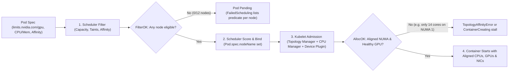
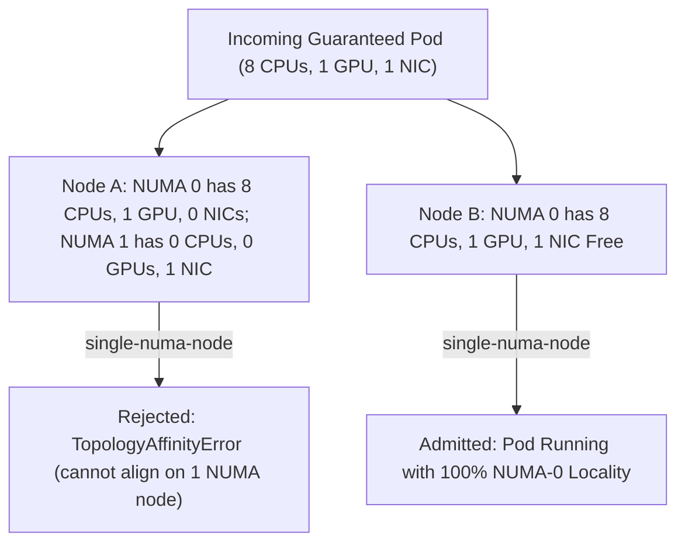

# 11.6 Scheduling GPUs: requests, Topology Manager, CPU and NUMA alignment

| | |
|---|---|
| Level | Advanced |
| Priority tier | 1 |
| Lab venue | GCP / GKE (plus local Python 3 simulation lab) |
| Part | Part 11: GPUs on Kubernetes, scheduling and virtualization |
| Sources used | `nvidia-zero-to-hero/volume-10/chapter-08-gpu-scheduling-and-topology.md`; `nvidia-zero-to-hero/volume-07/chapter-08-topology-aware-placement.md`; `nvidia-zero-to-hero/volume-07/chapter-02-pcie-numa-and-host-data-paths.md`; `volume-04/02-gpu-software-operator-masterclass.md`; Chris Fregly, *AI Systems Performance Engineering* (O'Reilly, 2025, Ch. 3); Roland Huß et al., *Generative AI on Kubernetes* (O'Reilly, 2026, Ch. 3); *Kubernetes for Generative AI Solutions* (Packt, 2025, Ch. 10); *Scalable Kubernetes Infrastructure for AI Platforms* (O'Reilly, 2026, Ch. 1–2) |
| Coverage file | `planning/coverage/chapters/11-06.md` |

## Why this matters for AI infrastructure

When a Kubernetes Pod requests `nvidia.com/gpu: 2` (or `nvidia.com/gpu: 4`), the default `kube-scheduler` treats that request as an integer subtraction against a node's `status.allocatable["nvidia.com/gpu"]` counter. That count is necessary, but for high-performance AI workloads it is rarely sufficient:

- **Motherboard topology is non-uniform:** On a dual-socket 8-GPU server (such as an HGX A100 or H100 node with `128` CPU cores), `GPUs 0..3` and `NIC 0` are physically wired to `CPU 0` (`NUMA Node 0`, cores `0..63`), while `GPUs 4..7` and `NIC 1` are wired to `CPU 1` (`NUMA Node 1`, cores `64..127`). As reported in one experiment in *AI Systems Performance Engineering* (Chapter 3), local NUMA DRAM access latency is roughly **`~80 ns`**, whereas crossing the inter-socket UPI/xGMI link to a remote NUMA node jumps to **`~139 ns`**—an immediate **`~75%` (`73.75%`) latency penalty** (`+59 ns` per access). The book says eliminating cross-NUMA traffic and core migrations alone can improve training throughput by **`5%–10%`**.
- **PCIe vs NVLink bandwidth differs by more than an order of magnitude:** Inside an H100 GPU, HBM3 bandwidth is **`3,350 GB/s`**. Across NVLink 4.0 (`NV12` / `NV18` via NVSwitch 3.0), GPU-to-GPU bandwidth is **`900 GB/s`** (`600 GB/s` on A100; **`1.8 TB/s`** per GPU across `18` links at `100 GB/s` each on Blackwell NVLink 5.0, reaching **`130 TB/s`** across `72` GPUs in a `GB200 NVL72` rack). By contrast, a PCIe Gen5 x16 slot provides only **`64 GB/s` per direction** (`32 GB/s` on PCIe Gen4 x16)—more than `52x` slower than H100 HBM3. If a 2-GPU or 4-GPU training worker is assigned GPUs that communicate across a PCIe Host Bridge (`PHB`, `CPU Affinity 0-31` on NUMA `0` vs `32-63` on NUMA `1`) instead of an NVLink bridge (`NV4` or `NV12`), collective step time can degrade by **`3–4x`**.
- **Strict NUMA enforcement changes node admission math:** Enabling the `kubelet` **Topology Manager** (`--topology-manager-policy=single-numa-node`) alongside the **CPU Manager** (`--cpu-manager-policy=static`) guarantees that CPU cores, DRAM, GPUs, and SR-IOV RDMA NICs all come from the same NUMA node. However, if a team deploys `8` Triton Inference Server Pods requesting `1` GPU and `16` CPU cores each on a `128`-core / `8`-GPU dual-socket server (`64` cores and `4` GPUs per NUMA node), `Pods 1..4` consume all `64` cores (`16 * 4 = 64`) on `NUMA 0`, and if Linux OS daemons use just `2` cores on `NUMA 1` (or leave only `14` free cores when a `16`-core Pod arrives), the Pod fails at `kubelet` admission with **`TopologyAffinityError`**—stranding idle GPUs until the CPU request is right-sized to **`12` cores** (`4 * 12 = 48` cores per socket).

This chapter covers the four-stage placement framework (`Capacity`, `Eligibility`, `Locality`, and `Coordination`), the internal motherboard data paths revealed by `nvidia-smi topo -m`, Kubernetes QoS and `kubelet` CPU/Topology Manager alignment, OS and PyTorch `DataLoader` NUMA/memory pinning, and how to design a service-class catalog that balances performance determinism against cluster fragmentation.

## Prerequisites and outcomes

### Prerequisites
- Completion of Chapters 11.1 through 11.5 (Device Plugin resource advertisement, CDI runtime injection, NFD/GFD service-class labels, and GPU Operator `ClusterPolicy` lifecycle).
- Familiarity with Linux processes/threads, virtual memory paging, and PCIe bus basics.

### Outcomes
After completing this chapter, you will be able to:
- Apply the four ordered placement questions (`Capacity`, `Eligibility`, `Locality`, and `Coordination`) to separate scheduler filter failures (`FilterOK=No`) from node-local allocation races (`AllocOK=No`).
- Read every cell of an `nvidia-smi topo -m` affinity matrix (`X`, `NV18`, `NV12`, `NV4`, `PIX`, `PXB`, `PHB`, `NODE`, `SYS`) and quantify the bandwidth cliff between HBM3 (`3,350 GB/s`), NVLink 5.0 (`1.8 TB/s`), NVLink 4.0 (`900 GB/s`), PCIe Gen5 x16 (`64 GB/s`), and PCIe Gen4 x16 (`32 GB/s`).
- Configure Kubernetes `Guaranteed` QoS (`requests == limits` with integer CPU cores), `kubelet` CPU Manager (`static`), and Topology Manager (`none`, `best-effort`, `restricted`, `single-numa-node`), and resolve `TopologyAffinityError` admissions on dual-socket `128`-core / `8`-GPU servers (`16` cores vs `12` cores per Pod).
- Implement host-level and container-level NUMA, CPU, memory, and I/O tuning (`numactl --cpunodebind --membind`, PyTorch `DataLoader` `worker_init_fn` with `psutil` + `libnuma`, `pin_memory=True` `2–3x` DMA speedup, `ulimit -l unlimited`, `vm.swappiness=0`, Transparent Hugepages `2 MB` / `1 GB` `+3%–5%` vs `transparent_hugepage=never` for inference, CPU `performance` governor / C-states, `jemalloc` / `tcmalloc`, and `nvidia-persistenced`).
- Diagnose Pending Pods (`0/12 nodes are available: 4 Insufficient nvidia.com/gpu, 6 untolerated taint, 2 affinity mismatch`) and slow running Pods (`PHB` vs `NV4` peer links).

## Concepts: basics to intermediate to advanced

### 1. Basics: The four placement questions and the physical motherboard data path

As `volume-10/chapter-08` establishes, `kube-scheduler` and `kubelet` make placement decisions in two distinct phases: first, **node selection** (`Filter -> Score -> Bind` in `kube-scheduler`), and second, **device and CPU allocation** (`Allocate()` and Topology Manager admission in `kubelet`).



To avoid over-constraining the cluster or under-specifying a critical job, ask **four placement questions in strict order** for every workload class:
1. **Capacity:** How many GPU units—and of which extended resource name (`nvidia.com/gpu` vs `nvidia.com/mig-2g.45gb`)—does each Pod require?
2. **Eligibility:** Which validated node pool or service class (`gpu.platform.example/class`) is qualified to run the workload?
3. **Locality:** Does the workload have a *measured* sensitivity to CPU-to-GPU NUMA affinity, GPU-to-NIC PCIe switch proximity (`PIX`), or GPU-to-GPU NVLink connectivity (`NV12` / `NV18`)?
4. **Coordination:** Does the job consist of multiple coupled worker Pods that must start simultaneously (gang scheduling) or be admitted as a single unit from a queue?

#### Physical motherboard hierarchy: PCIe, NVLink, NVSwitch, and NUMA
Why does Question 3 (**Locality**) matter so much? Because before a tensor can reach an external `400G` InfiniBand or RoCE network cable, it must traverse the internal wires of the server motherboard (`volume-07/chapter-02`, *Generative AI on Kubernetes* Chapter 3, and *AI Systems Performance Engineering* Chapter 3):

| Interconnect / Memory Layer | Typical Bandwidth / Latency | Architectural Role & Bottleneck Behavior |
|---|---|---|
| **H100 HBM3 Internal Memory** | **`3,350 GB/s`** | On-package GPU framebuffer bandwidth. Feeding this across a `64 GB/s` PCIe Gen5 slot is like throttling a firehose through a drinking straw (`>52x` ratio). |
| **NVLink 5.0 (Blackwell B200 / GB200)** | **`1.8 TB/s` (`1,800 GB/s`)** bidirectional per GPU (`18` links × `100 GB/s`) | `2x` NVLink 4.0 and `>14x` PCIe Gen5. `NVSwitch 4.0` provides `72` NVLink 5.0 ports per chip (`144` ports / **`14.4 TB/s`** per dual-chip switch tray); `GB200 NVL72` links **`72` GPUs** at **`130 TB/s`** aggregate bandwidth (`72 * 1.8 TB/s`). |
| **NVLink 4.0 (Hopper H100 / H200)** | **`900 GB/s`** bidirectional per GPU (`12`–`18` links) | HGX H100/H200 uses `4` `NVSwitch 3.0` chips to form an all-to-all non-blocking mesh across `8` GPUs (`600 GB/s` on Ampere A100 NVLink 3.0 with `12` links `NV12`). |
| **NVLink-C2C (Grace Hopper GH200 / Grace Blackwell GB200)** | **`~900 GB/s`** coherent CPU-to-GPU link | Provides hardware-coherent shared virtual address space between the Grace ARM CPU and paired GPU, though Linux still models CPU DRAM and GPU HBM as separate NUMA pools. |
| **PCIe Gen5 x16 (Hopper / Blackwell host bus)** | **`64 GB/s` per direction** (`16` lanes) | `2x` faster than **PCIe Gen4 x16 (`32 GB/s` per direction)** used on Ampere A100 servers. Connects GPUs, ConnectX NICs, and NVMe SSDs to PCIe switches or CPU root complexes. |
| **Local NUMA DRAM vs Cross-Socket UPI / xGMI** | **`~80 ns` local** vs **`~139 ns` remote** (**`~75%` / `73.75%` latency penalty**) | Dual-socket servers split CPUs, RAM, and PCIe lanes into `NUMA Node 0` and `NUMA Node 1`. Crossing the inter-socket Intel UPI or AMD xGMI link adds `59 ns` per memory access and saturates under GPU/NIC DMA traffic. |

#### Reading `nvidia-smi topo -m` like a senior architect
To inspect how GPUs, NICs (`mlx5_0`), CPU cores, and NUMA nodes are physically wired on a server, run `nvidia-smi topo -m` (`volume-04` Section 13.1, `volume-07/chapter-02`, and `volume-10/chapter-08`):

```text
# Illustrative output for an 8-GPU HGX system (untested here)
        GPU0    GPU1    GPU2    GPU3    GPU4    GPU5    GPU6    GPU7    NIC0    NIC1    CPU Affinity    NUMA Affinity
GPU0     X      NV12    NV12    NV12    NV12    NV12    NV12    NV12    PIX     SYS     0-15            0
GPU1    NV12     X      NV12    NV12    NV12    NV12    NV12    NV12    SYS     PIX     0-15            0
GPU2    NV12    NV12     X      NV12    NV12    NV12    NV12    NV12    SYS     SYS     16-31           1
GPU3    NV12    NV12    NV12     X      NV12    NV12    NV12    NV12    SYS     SYS     16-31           1
```

Every code in the `nvidia-smi topo -m` matrix has a precise hardware meaning:
- **`X`:** Self (the same physical device).
- **`NV#` (`NV4`, `NV12`, `NV18`):** Connected directly via `#` bonded NVLink lanes (or NVSwitch fabric), bypassing the PCIe bus completely.
- **`PIX`:** Connected through at most a **single PCIe switch** (for example, a Broadcom/PLX switch chip where `GPU0` and `NIC0` plug into the same switch). Enables direct hardware Peer-to-Peer (`P2P`) and GPUDirect RDMA DMA without touching the CPU root complex.
- **`PXB`:** Traverses **multiple cascaded PCIe switches** without crossing a PCIe Host Bridge.
- **`PHB`:** Shares the **same PCIe Host Bridge (CPU root complex)** inside one CPU socket. Traffic must travel up to the CPU root complex and back down, consuming CPU root-complex bandwidth and often exceeding NCCL's default GPUDirect RDMA distance threshold.
- **`NODE`:** Traverses multiple PCIe Host Bridges **within the same NUMA node**.
- **`SYS`:** Crosses the **inter-socket system interconnect (Intel UPI / QPI or AMD xGMI)** between different NUMA nodes. This is the slowest path on a host: if `GPU0` (on `NUMA 0`) is paired with `NIC1` (on `NUMA 0`/`1` via `SYS`) or with CPU cores on `NUMA 1`, throughput can drop by `50%` or more.

---

### 2. Intermediate: Kubernetes QoS classes, CPU Manager (`static`), and Topology Manager

By default, Kubernetes is **completely oblivious to NUMA boundaries**. If a Pod requests `16` CPU cores, `1` GPU, and `1` SR-IOV NIC, the Linux CFS scheduler and default `kubelet` policies can assign `16` CPU cores on `NUMA 0`, `GPU 3` on `NUMA 1`, and `NIC 0` on `NUMA 0`.

To enforce hardware locality on a Kubernetes worker node, three `kubelet` mechanisms must work together (`volume-07/chapter-08`, `volume-04` Section 13.2, and *AI Systems Performance Engineering* Chapter 3):

#### 1. Pod Quality of Service (`Guaranteed` QoS class) and integer CPU requests
Kubernetes classifies every Pod into one of three QoS classes based on its `resources.requests` and `resources.limits`:
- **`BestEffort`:** The Pod sets **no** CPU or memory requests or limits at all. These Pods are the very first to be killed by `kubelet` or the Linux OOM killer under memory pressure and never receive pinned CPUs.
- **`Burstable`:** At least one container sets a CPU or memory request or limit, but `requests != limits` (or one resource is omitted). Even if a `Burstable` Pod requests `16` CPUs, its threads float across shared CPU cores under Linux CFS time-sharing.
- **`Guaranteed`:** **Every container** in the Pod sets explicit `requests` and `limits` for **both `cpu` and `memory`**, and **`requests == limits`** for both.

Crucially, as emphasized in *AI Systems Performance Engineering* (Chapter 3, "Improving Resource Guarantees"), **exclusive CPU core pinning and Topology Manager alignment apply ONLY to `Guaranteed` Pods whose CPU request/limit is a whole positive integer** (for example, `cpu: "16"`, not `cpu: "15.5"`), and only when `kubelet` is configured with `cpuManagerPolicy: static`.

#### 2. The four `kubelet` Topology Manager policies
The **Topology Manager** is a `kubelet` subsystem that queries **Hint Providers**—specifically the **CPU Manager**, **Memory Manager**, and **Device Manager** (which collects NUMA topology hints reported by `nvidia-device-plugin` during `ListAndWatch()` and by `sriov-network-device-plugin` for RDMA NIC VFs)—before admitting a Pod onto the node:

| `topologyManagerPolicy` | Kubelet Admission Behavior | Operational Trade-Off for AI Infrastructure |
|---|---|---|
| **`none` (default)** | Allocates CPUs, memory, GPUs, and NICs independently with zero NUMA coordination. | Maximum bin-packing flexibility, but causes random cross-socket UPI/xGMI bottlenecks (`SYS` paths) on multi-socket servers. |
| **`best-effort`** | Calculates the preferred NUMA affinity across all Hint Providers and tries to align them; if alignment is impossible, **admits the Pod anyway** across multiple NUMA nodes. | Dangerous for strict SLO production workloads because a Pod can run at full speed on Monday and `50%` slower on Tuesday after rescheduling. |
| **`restricted`** | Calculates the minimal number of NUMA nodes required by the Hint Providers; if the actual available resources cannot match that minimal preferred affinity, **rejects the Pod with `TopologyAffinityError`**. | Allows multi-NUMA allocations when a Pod legitimately requests more GPUs/CPUs than exist on one socket (e.g., an `8`-GPU Pod spanning `2` sockets), while rejecting sub-optimal splits. |
| **`single-numa-node`** | The gold standard for single-socket-sized AI Pods: requires that **all** requested exclusive CPUs, memory, GPUs, and NICs reside on a **single physical NUMA node**. Otherwise, **rejects the Pod with `TopologyAffinityError`**. | Guarantees zero cross-socket UPI traffic for every admitted Pod, at the cost of strict per-socket capacity accounting. |



#### Deep dive: Solving the `TopologyAffinityError` 5th-Pod mystery on a `128`-core / `8`-GPU server
Consider the classic production incident from `volume-07/chapter-08`:
- An infrastructure team configures `--topology-manager-policy=single-numa-node` and `--cpu-manager-policy=static` on a fleet of dual-socket HGX servers.
- Each server has **`128` CPU cores** and **`8` GPUs**, split evenly across two sockets:
  - **`NUMA Node 0`:** `64` CPU cores and `4` GPUs (`GPU 0..3`).
  - **`NUMA Node 1`:** `64` CPU cores and `4` GPUs (`GPU 4..7`).
- The team deploys `8` Triton Inference Server Pods (`Guaranteed` QoS), each requesting **`1` GPU** and **`16` CPU cores** (`8 * 16 = 128` cores, `8 * 1 = 8` GPUs).
- **What happens:**
  - `Pods 1..4` are placed on `NUMA Node 0`, consuming `4 * 16 = 64` CPU cores and `GPUs 0..3`. `NUMA Node 0` now has **`0` free CPU cores and `0` free GPUs**.
  - On `NUMA Node 1`, all `4` GPUs (`GPUs 4..7`) are idle. However, the Linux kernel, `kubelet`, `containerd`, or a monitoring DaemonSet is reserving just **`2` CPU cores** (or leaving only `14` contiguous cores free when the next `16`-core Pod is evaluated).
  - Because `14` free CPU cores `< 16` requested CPU cores on `NUMA Node 1`, and `NUMA Node 0` has `0` cores, the Topology Manager **refuses to split the `16`-core request across sockets** or pair `NUMA 0` cores with a `NUMA 1` GPU. It rejects the Pod with **`TopologyAffinityError`**, leaving the remaining GPUs completely unused.
- **The architectural fix:** Never divide total host CPU cores (`128`) by total GPUs (`8`) without subtracting OS and DaemonSet reservations (`systemReserved` / `kubeReserved`). Right-sizing each Triton Pod from **`16` cores down to `12` cores** consumes **`4 * 12 = 48` CPU cores per NUMA node** (`96` cores across all `8` Pods), leaving **`64 - 48 = 16` CPU cores per NUMA node** (`14` free cores even after `2` OS cores) so all **`8` Pods schedule cleanly** with `100%` `single-numa-node` locality.

---

### 3. Advanced: OS tuning, PyTorch `DataLoader` NUMA binding, MIG single-node constraints, and service classes

Even when Kubernetes assigns a Pod the right GPUs and CPUs, OS-level and framework-level misconfigurations can starve the GPU with data-loading bubbles. *AI Systems Performance Engineering* (Chapter 3) details the exact host and container tuning checklist required to sustain `~100%` GPU utilization:

#### 1. Host OS, Memory Pinning, Hugepages, CPU Governor, and Allocators
- **Pinned (page-locked) host memory (`pin_memory=True` and `ulimit -l unlimited`):** Standard host DRAM pages can be paged out by the OS, forcing the CUDA driver to stage host-to-device (`H2D`) transfers through an internal bounce buffer. Allocating page-locked memory (`pin_memory=True` in PyTorch `DataLoader` with `non_blocking=True` on `.to("cuda")`) enables direct GPU DMA and makes `H2D` copies **`2–3x` faster** (verifiable with CUDA's `bandwidthTest --memory=pinned` vs `pageable`). Because Linux caps locked memory per user/container via `ulimit -l`, always set `ulimit -l` (`memlock`) to `unlimited` for AI containers.
- **Disable swap (`vm.swappiness=0` and `sudo swapoff -a`):** If a host data-cache page is swapped to disk, GPU data fetching stalls by orders of magnitude. Set `vm.swappiness=0` via `sysctl` and enforce cgroup v2 memory isolation.
- **Transparent Hugepages (`2 MB` / `1 GB` vs `4 KB`):** Standard Linux virtual memory uses `4 KB` pages, causing heavy Translation Lookaside Buffer (`TLB`) miss rates across multi-hundred-gigabyte datasets. Backing allocations with `2 MB` or `1 GB` hugepages yields a **`~3%–5%` throughput improvement** for **training** workloads. However, THP background defragmentation/compaction causes latency spikes; for **latency-sensitive LLM inference**, disable THP (`transparent_hugepage=never`) or set `madvise` and use explicit `hugetlbfs` (`vm.nr_hugepages`) where needed.
- **CPU frequency governor (`performance`) and deep C-states (`C0` vs `C6`):** When a CPU core idles between batches, ACPI power saving can drop the core into deep sleep (`C6`). Waking from `C6` back to active (`C0`) takes microseconds that accumulate into GPU launch bubbles. Lock the CPU governor with `cpupower frequency-set -g performance` and disable deep C-states in BIOS/UEFI.
- **Host memory allocators (`jemalloc` and `tcmalloc`):** Python and C++ data-loading threads suffer lock contention in default `glibc` `malloc`. Tuning `jemalloc` with `export MALLOC_CONF="narenas:8,dirty_decay_ms:10000,muzzy_decay_ms:10000,background_thread:true"` or `tcmalloc` with `export TCMALLOC_MAX_TOTAL_THREAD_CACHE_BYTES=$((512*1024*1024))` (`536,870,912` bytes / `512 MiB`) and `export TCMALLOC_RELEASE_RATE=16` eliminates multi-threaded allocator stalls.
- **Bypassing container OverlayFS Copy-on-Write (`CoW`):** Never read multi-terabyte datasets or write multi-gigabyte checkpoints into the container's writable OverlayFS layer. Mount host NVMe or parallel filesystems directly (`-v /data/dataset:/mnt/dataset:ro` or Kubernetes `hostPath`/CSI volumes), open checkpoint files with `O_DIRECT` or `io_uring`, and call `posix_fadvise(fd, 0, 0, POSIX_FADV_DONTNEED)` so checkpoint bursts do not pollute the OS page cache.
- **GPU persistence mode (`nvidia-persistenced`):** Without persistence mode (`systemctl enable nvidia-persistenced`), an idle GPU unloads driver context and takes **`1–2` seconds** to reinitialize on the next job (and drops dynamic MIG state). Keep `nvidia-persistenced` enabled across all cluster nodes.

#### 2. Explicit NUMA binding in Bash and PyTorch `DataLoader` (`worker_init_fn`)
When a multi-GPU Pod (or bare-metal job) runs on a node where `kubelet` did not isolate a single NUMA node per process, bind each GPU worker process explicitly to its GPU's local NUMA node (*AI Systems Performance Engineering*, Chapter 3):

```bash
# Dynamically query each GPU's NUMA node via nvidia-smi topo -m and bind with numactl (untested here)
#!/bin/bash
for GPU in 0 1 2 3; do
  NODE=$(nvidia-smi topo -m -i "$GPU" | awk '/NUMA Affinity/ {print $NF}')
  numactl --cpunodebind="$NODE" --membind="$NODE" \
    bash -c "CUDA_VISIBLE_DEVICES=$GPU python train.py --gpu $GPU" &
done
wait
```

In PyTorch, spawned `DataLoader` worker subprocesses do not always inherit `numactl` CPU/memory affinity across `exec` boundaries. As shown in *AI Systems Performance Engineering* (Chapter 3), pass a closure-based `worker_init_fn` (`functools.partial`) that queries NVML (`nvmlDeviceGetNUMANodeId` or `nvmlDeviceGetCpuAffinity`) or `/sys/bus/pci/devices/<PCI_ID>/numa_node`, reads `/sys/devices/system/node/node<N>/cpulist`, and re-applies `psutil.Process(os.getpid()).cpu_affinity(cpus)` plus `libnuma` (`numa_run_on_node(node)` and `numa_set_preferred(node)`) inside each worker—**without ever calling `torch.cuda.*` inside `worker_init_fn`**—paired with `batch_size=32`, `num_workers=4`, `pin_memory=True`, `persistent_workers=True`, and `prefetch_factor=2`.

#### 3. The single-node MIG scheduling constraint (`2 x 2g.45gb = ~76 SMs`)
Remember from *AI Systems Performance Engineering* (Chapter 3, Table 3-1 for Blackwell `B200`: `1g.23gb`, `1g.45gb`, `2g.45gb`, `3g.90gb`, `4g.90gb`, `7g.180gb`) what happens when a Pod requests two MIG slices:
```yaml
resources:
  limits:
    nvidia.com/mig-2g.45gb: "2"
```
On a `132`-SM GPU where `1/7` is `~19` SMs and `2g` (`2/7`) is `~38` SMs, requesting `"2"` units of `nvidia.com/mig-2g.45gb` allocates `2 * ~38 = ~76` SMs. Because **a Kubernetes Pod cannot span multiple nodes**, `kube-scheduler` can schedule that Pod *only* if a **single node** has at least `2` free `nvidia.com/mig-2g.45gb` slices. If Node 1 has `1` free `2g.45gb` slice and Node 2 has `1` free `2g.45gb` slice, the Pod remains permanently `Pending`. Furthermore, under current MIG guidance (including `R570`-era drivers), cross-GPU MIG peer-to-peer (`P2P`), cross-instance CUDA IPC, and NCCL across MIG instances are unsupported—so distributed multi-GPU jobs should use whole GPUs rather than MIG slices.

#### 4. Designing the service-class catalog to control fragmentation
Every hard locality constraint shrinks the candidate node set and increases stranded capacity. As `volume-10/chapter-08` recommends, publish a small, evidence-backed service-class catalog:

| Service Class | Primary Objective | Kubernetes Scheduling & Locality Posture |
|---|---|---|
| **1. Interactive development** | Rapid admission, low cost | Flexible shared pool, time-slicing or small MIG slices (`1g.5gb` / `1g.23gb`), strict namespace quotas |
| **2. Online inference** | Low tail latency, high availability | Protected pool (`taint` + `nodeAffinity`), pod anti-affinity across nodes/zones for replica spread, `single-numa-node` where PCIe/CPU bound, `transparent_hugepage=never` |
| **3. Batch inference** | High throughput per dollar | Flexible placement across generations (`preferredDuringScheduling`), queue-aware admission |
| **4. Distributed training** | Predictable collective step time (`AllReduce`) | Topology-validated pool (`NV12`/`NV18` + `PIX` RDMA NICs), `single-numa-node` / `restricted`, gang-scheduled admission, checkpoint-aware preemption |

## Commands and configurations that matter

### 1. Configuring `kubelet` for `static` CPU Manager and `single-numa-node` Topology Manager

To enable strict NUMA alignment on a GPU worker node (`volume-04` Section 13.2 and `volume-07/chapter-08`), configure `/var/lib/kubelet/config.yaml` and ensure `--pass-device-specs=true` is enabled on the NVIDIA device plugin:

```yaml
# /var/lib/kubelet/config.yaml (untested here)
apiVersion: kubelet.config.k8s.io/v1beta1
kind: KubeletConfiguration
cpuManagerPolicy: static
cpuManagerReconcilePeriod: 5s
topologyManagerPolicy: single-numa-node
topologyManagerScope: pod
systemReserved:
  cpu: "2"
  memory: "4Gi"
kubeReserved:
  cpu: "2"
  memory: "4Gi"
```

### 2. Deploying a `Guaranteed` QoS Pod that triggers `static` CPU pinning and `single-numa-node`

```yaml
# triton-numa-aligned-pod.yaml (untested here)
apiVersion: v1
kind: Pod
metadata:
  name: triton-inference-0
spec:
  tolerations:
    - key: "nvidia.com/gpu"
      operator: "Exists"
      effect: "NoSchedule"
  nodeSelector:
    gpu.platform.example/class: online-inference
  containers:
    - name: triton
      image: nvcr.io/nvidia/tritonserver:24.08-py3
      resources:
        requests:
          cpu: "12"
          memory: "64Gi"
          nvidia.com/gpu: "1"
        limits:
          cpu: "12"
          memory: "64Gi"
          nvidia.com/gpu: "1"
```

### 3. Diagnosing Pending Pods (`FailedScheduling`) and slow running Pods (`nvidia-smi topo -m`)

When a training worker Pod (`train-worker-2` from `volume-10/chapter-08`) is stuck in `Pending`, read all clauses of the `FailedScheduling` event:

```bash
# 1. Inspect predicate breakdown for a Pending GPU Pod (untested here)
kubectl describe pod train-worker-2 | tail -8
```

Expected output (`volume-10/chapter-08`):
```text
Events:
  Type     Reason            Age   From               Message
  ----     ------            ----  ----               -------
  Warning  FailedScheduling  40s   default-scheduler  0/12 nodes are available:
    4 Insufficient nvidia.com/gpu, 6 node(s) had untolerated taint
    {pool: inference-only}, 2 node(s) didn't match Pod's node affinity/selector.
```

When `train-worker-2` is `Running` but exhibits `3–4x` slower step times than expected, inspect its in-container GPU peer topology:

```bash
# 2. Compare peer GPU interconnect inside the slow worker container (untested here)
kubectl exec train-worker-2 -- nvidia-smi topo -m | head -4
```

Expected output on a degraded `PHB` placement (`volume-10/chapter-08`):
```text
        GPU0  GPU1  CPU Affinity  NUMA Affinity
GPU0     X    PHB   0-31          0
GPU1    PHB    X    32-63         1
```

## How it fails

| Failure mode | Exact symptom & command evidence | Root cause boundary | Remediation |
|---|---|---|---|
| **1. `TopologyAffinityError` on 5th (or 8th) Pod despite idle GPUs on the node** | On a `128`-core, `8`-GPU dual-socket server (`64` cores and `4` GPUs per NUMA node) with `topologyManagerPolicy: single-numa-node`, Pods requesting `1` GPU and `16` CPUs start `4` (or `7`) replicas, and the remaining Pod fails immediately with `Status: TopologyAffinityError` while GPUs sit idle. | **Per-Socket CPU Exhaustion under `single-numa-node`:** `Pods 1..4` consumed all `64` cores on `NUMA 0`, and OS/system daemons consumed `2` cores on `NUMA 1`, leaving only `14` free cores (`< 16`) on `NUMA 1`. | Configure `systemReserved` / `kubeReserved` explicitly and right-size the Pod CPU request/limit from `16` cores to `12` cores (`4 * 12 = 48` cores per socket), leaving `16` cores (`14` after OS daemons) free per NUMA node so all `8` Pods admit cleanly. |
| **2. Pod runs `3–4x` slower on Node B than Node A with identical GPU count (`PHB` / `SYS` vs `NV4` / `PIX`)** | All Pods are `Running`, but step time or NCCL bandwidth regresses by `50%`–`75%`. `kubectl exec train-worker-2 -- nvidia-smi topo -m` shows `PHB` (or `SYS` across `NUMA 0` cores `0-31` and `NUMA 1` cores `32-63`) between `GPU0` and `GPU1` instead of `NV4`/`NV12`, or `SYS` between the assigned GPUs and the `400G` NIC. | **Unaligned Intra-Node Data Path (`SYS` / `PHB`):** Default `topologyManagerPolicy: none` assigned GPUs across different NUMA sockets or across a CPU root complex from the active NIC. | Enable `topologyManagerPolicy: single-numa-node` (or `restricted` for full-node jobs), enable the SR-IOV/RDMA device plugin so NIC NUMA hints participate in admission, and place distributed training in a topology-validated service class. |
| **3. Exclusive CPU pinning silently ignored despite `cpuManagerPolicy: static`** | Pod specifies `resources.limits.cpu: "16"`, but `cat /sys/fs/cgroup/cpuset.cpus` inside the container still lists all `0-127` host cores, and data-loader threads migrate across NUMA nodes. | **QoS / Integer CPU Rule Violation:** Either `resources.requests.cpu` did not equal `limits.cpu`, `memory` requests/limits were unequal/omitted (making the Pod `Burstable` instead of `Guaranteed`), or a fractional CPU value (`15.5`) was used. | Set `requests == limits` for **both** `cpu` and `memory` on every container in the Pod using whole integer CPU values (`cpu: "16"`) so the Pod enters `Guaranteed` QoS. |
| **4. Multi-slice MIG Pod (`nvidia.com/mig-2g.45gb: "2"`) stuck in `Pending` while cluster has `>= 2` free slices** | Cluster has `4` free `nvidia.com/mig-2g.45gb` slices spread `1` per node across `4` nodes, yet a Pod requesting `nvidia.com/mig-2g.45gb: "2"` (`~76` SMs) stays `Pending` (`Insufficient nvidia.com/mig-2g.45gb`). | **Single-Node Pod Boundary:** A Kubernetes Pod cannot span multiple nodes; all `2` requested `2g.45gb` slices must be free on the **same** node. | Partition MIG nodes so multiple `2g.45gb` instances (`3` per B200 GPU) co-reside on the same node, or request `1` larger slice (`4g.90gb`). |
| **5. Partial-start deadlock in multi-Pod distributed training** | A 4-worker PyTorch training job schedules `3` Pods (`Running`, holding `24` GPUs), while the 4th Pod stays `Pending` (`0/12 nodes are available: 4 Insufficient nvidia.com/gpu, 6 untolerated taint, 2 affinity mismatch`). The `24` allocated GPUs sit at `0%` compute waiting for rank 3 to join `dist.init_process_group`. | **Missing Coordinated / Gang Admission Boundary:** The default scheduler binds Pods one by one without checking whether the entire worker group can fit simultaneously. | Admit multi-Pod training jobs through a gang-aware queue/scheduler (such as KAI Scheduler, Kueue, or Volcano, covered in Chapters 11.7–11.20) so `0` GPUs are reserved until all `4` workers can start together. |

## Hands-on lab

### Venue and scope
This lab runs locally using Python 3 standard library (`code/part11/gpu_scheduling_and_topology.py` and `code/part11/gpu_scheduling_and_topology_lab.py`) to simulate cross-NUMA memory latency (`80 ns` vs `139 ns`), `nvidia-smi topo -m` link ranking (`X` through `SYS`), `Guaranteed` QoS and `static` CPU Manager eligibility, `kubelet` Topology Manager admission (`none`, `best-effort`, `restricted`, `single-numa-node`), the dual-socket `128`-core / `8`-GPU `TopologyAffinityError` packing scenario (`16` cores vs `12` cores), and `FailedScheduling` predicate decomposition. Cluster commands are marked `(untested here)`.

### Step 1: Run the self-checking GPU scheduling and topology lab (tested here)

Run the lab script from the repository root:

```bash
python3 code/part11/gpu_scheduling_and_topology_lab.py
```

Captured output from this repository:
```text
=== Chapter 11.6 Lab: GPU Scheduling, Topology Manager, CPU & NUMA Alignment ===
  [PASS] Cross-NUMA memory latency rises from ~80 ns to ~139 ns (~75% increase, 73.75% exact)
  [PASS] nvidia-smi topo -m ranks X (self) faster than NV12 (NVLink), which is faster than PIX (same PCIe switch)
  [PASS] PCIe topology hierarchy orders PIX < PXB < PHB < NODE < SYS (cross-socket UPI/xGMI slowest)
  [PASS] Pod with integer CPU (16==16) and matching memory (65536==65536 MiB) gets Guaranteed QoS and static CPU pinning
  [PASS] Guaranteed Pod with fractional CPU (15.5) does NOT receive exclusive static CPU pinning
  [PASS] Pod with CPU request (8) != limit (16) is Burstable and excluded from static CPU pinning
  [PASS] Pod with no CPU/memory requests or limits is BestEffort (highest eviction risk)
  [PASS] single-numa-node rejects Pod on Node A (GPU on NUMA 0, NIC on NUMA 1) with TopologyAffinityError
  [PASS] restricted policy also rejects unaligned Pod on Node A with TopologyAffinityError
  [PASS] best-effort admits Pod on Node A despite cross-NUMA split between GPU 0 and NIC 1
  [PASS] none policy admits Pod on Node A without NUMA alignment
  [PASS] single-numa-node admits Pod on Node B where NUMA 0 has 8 CPUs, 1 GPU, and 1 NIC aligned
  [PASS] When NUMA 0 uses 4x16=64 cores and NUMA 1 has only 14 free cores, Pod 5 fails with TopologyAffinityError leaving 4 GPUs idle
  [PASS] When 2 cores on NUMA 1 are used by OS daemons (62 free), 3 Pods take 48 cores leaving 14 cores (< 16) and blocking the last Pod
  [PASS] Right-sizing Triton Pods from 16 cores to 12 cores (4x12=48 cores/socket) admits all 8 Pods under single-numa-node
  [PASS] FailedScheduling event on train-worker-2 decomposes 12 nodes into 4 insufficient GPU, 6 untolerated taint, and 2 affinity mismatch
  [PASS] PCIe Gen5 x16 (64 GB/s per direction) doubles PCIe Gen4 x16 (32 GB/s per direction)
  [PASS] H100 HBM3 bandwidth (3350 GB/s) is >52x higher than a single PCIe Gen5 x16 link (64 GB/s)
  [PASS] NVLink 5.0 delivers 18 x 100 GB/s = 1.8 TB/s per GPU (~130 TB/s across 72 GPUs in GB200 NVL72)
  [PASS] Dual-chip NVSwitch 4.0 tray provides 144 NVLink 5.0 ports and 14.4 TB/s switching capacity
  [PASS] Two nvidia.com/mig-2g.45gb slices on a 132-SM GPU allocate 2 x ~38 SMs = ~76 SMs and must co-reside on 1 node
  [PASS] tcmalloc TCMALLOC_MAX_TOTAL_THREAD_CACHE_BYTES=((512*1024*1024)) equals 536,870,912 bytes (512 MiB)
  [PASS] Topology link classifier covers all 9 nvidia-smi topo -m states (X, NV18, NV12, NV4, PIX, PXB, PHB, NODE, SYS)
  [PASS] With 12 cores/Pod (48 cores used per 62-core available socket), 14 cores remain free per NUMA node for OS/system daemons
  [PASS] Cross-NUMA memory access adds 59.0 ns per access (139 ns - 80 ns)

Summary: 25 passed, 0 failed out of 25 checks.
```

### Exercises

1. **Exercise 1 — Cross-NUMA latency calculation:** Using `compute_numa_latency_penalty(80.0, 139.0)` in `code/part11/gpu_scheduling_and_topology.py`, compute the exact nanosecond penalty (`delta_ns`), the exact percentage increase (`increase_pct_exact`), and the rounded `~75%` figure reported in *AI Systems Performance Engineering* Chapter 3.
2. **Exercise 2 — `Guaranteed` QoS and `static` CPU Manager eligibility:** Using `classify_pod_qos_and_cpu_pinning()`, determine `(qos_class, is_integer_cpu, exclusive_cpu_pinning)` for three Pod specifications under `cpu_manager_policy="static"`: (a) `cpu: 16/16`, `memory: 65536/65536`, (b) `cpu: 15.5/15.5`, `memory: 65536/65536`, and (c) `cpu: 8/16`, `memory: 65536/65536`.
3. **Exercise 3 — Topology Manager policy comparison (`Node A` vs `Node B`):** On `Node A`, `NUMA 0` has `8` free CPUs, `1` free GPU, and `0` free NICs, while `NUMA 1` has `0` free CPUs, `0` free GPUs, and `1` free NIC. Using `evaluate_topology_manager_admission()`, compare `(admitted, status, aligned_single_numa)` for a Pod requesting `8` CPUs, `1` GPU, and `1` NIC under `single-numa-node` versus `best-effort`.
4. **Exercise 4 — Solving the `TopologyAffinityError` Triton packing problem:** Using `simulate_dual_socket_hgx_pod_packing()`, compare `(admitted_pods, remaining_free_gpus, remaining_numa1_cpus)` when deploying `8` Pods on a dual-socket server (`64` cores and `4` GPUs per socket, with `2` cores per socket reserved by OS daemons so `62` cores are available per socket) at `cores_per_pod=16` versus `cores_per_pod=12`.
5. **Exercise 5 — Reading `FailedScheduling` multi-predicate events:** On a `12`-node cluster, `kubectl describe pod train-worker-2` prints `0/12 nodes are available: 4 Insufficient nvidia.com/gpu, 6 node(s) had untolerated taint {pool: inference-only}, 2 node(s) didn't match Pod's node affinity/selector`. Using `parse_failed_scheduling_event()`, explain which of those three numbers represents a genuine capacity shortage, which represents intended pool isolation, and which represents a manifest selector mismatch.
6. **Exercise 6 — Blackwell `B200` MIG slice math:** Using Table 3-1 from *AI Systems Performance Engineering* Chapter 3 (`132` SMs total, `1/7 = ~19` SMs per slice), calculate the SM count, HBM memory per slice, copy engines per slice, and maximum instances per GPU for `MIG 2g.45gb` and `MIG 3g.90gb`.

## Checkpoint questions

<details>
<summary><strong>1. What are the four ordered placement questions that Volume 10 Chapter 8 defines for every GPU workload class?</strong></summary>

1. **Capacity:** How many GPU units, and of which extended resource name, are required?
2. **Eligibility:** Which validated node pool or service class may run the workload?
3. **Locality:** Does the workload have measured sensitivity to CPU, NUMA, NIC, storage, or GPU-peer topology?
4. **Coordination:** Must multiple Pods start simultaneously (gang admission) or be admitted through a queue?
</details>

<details>
<summary><strong>2. In Figure 10.8.1, what is the operational difference between a failure at FilterOK=No and a failure at AllocOK=No?</strong></summary>

- **`FilterOK=No`** occurs inside `kube-scheduler` before the Pod is bound to any node; the Pod remains in `Pending` state and `kubectl describe pod` logs a `FailedScheduling` event listing the exact predicate that rejected each node.
- **`AllocOK=No`** occurs on the worker node inside `kubelet` *after* the scheduler has already bound the Pod (`Pod.spec.nodeName` is set), when `kubelet` Topology Manager admission or the device plugin's `Allocate()` call fails—surfacing as `TopologyAffinityError` or a container creation error.
</details>

<details>
<summary><strong>3. How much latency does crossing a NUMA boundary add to host memory access in AI Systems Performance Engineering Chapter 3, and how much training throughput can CPU/NUMA pinning recover?</strong></summary>

In the benchmark cited in *AI Systems Performance Engineering* Chapter 3, local NUMA memory access latency is **`~80 ns`** whereas remote (cross-socket) NUMA memory access latency is **`~139 ns`**—an increase of **`59 ns`**, or roughly **`~75%` (`73.75%`)**. Eliminating cross-NUMA traffic and OS core migrations via CPU/NUMA pinning yields **`5%–10%` training throughput improvements** and lower step-time jitter.
</details>

<details>
<summary><strong>4. Compare the per-GPU or per-slot bandwidth of H100 HBM3, Blackwell NVLink 5.0 (and GB200 NVL72), Hopper NVLink 4.0, PCIe Gen5 x16, and PCIe Gen4 x16.</strong></summary>

- **H100 HBM3:** `3,350 GB/s` internal memory bandwidth.
- **NVLink 5.0 (Blackwell):** `1.8 TB/s` (`1,800 GB/s`) bidirectional per GPU (`18` links × `100 GB/s`); `NVSwitch 4.0` has `72` ports/chip (`144` ports / `14.4 TB/s` per dual-chip tray), and `GB200 NVL72` connects `72` GPUs at `130 TB/s` total GPU bandwidth.
- **NVLink 4.0 (Hopper H100):** `900 GB/s` bidirectional per GPU (`600 GB/s` on A100 NVLink 3.0).
- **PCIe Gen5 x16:** `64 GB/s` per direction.
- **PCIe Gen4 x16:** `32 GB/s` per direction.
</details>

<details>
<summary><strong>5. What do the codes X, NV12, PIX, PXB, PHB, NODE, and SYS mean in nvidia-smi topo -m output?</strong></summary>

- **`X`:** Self (same GPU).
- **`NV12` (or `NV4`, `NV18`):** Connected via `12` (`4`, `18`) bonded NVLink links.
- **`PIX`:** Connected across at most a **single PCIe switch** (enables direct Peer-to-Peer `P2P` DMA bypassing the CPU root complex).
- **`PXB`:** Connected across **multiple PCIe switches** without crossing a PCIe Host Bridge.
- **`PHB`:** Connected across the **same PCIe Host Bridge (CPU root complex)**.
- **`NODE`:** Connected across PCIe Host Bridges **within a single NUMA node**.
- **`SYS`:** Connected across the **inter-socket UPI/QPI/xGMI link** between different NUMA nodes (slowest host path).
</details>

<details>
<summary><strong>6. Why is a PIX path between GPU 0 and NIC 0 vastly superior to a NODE or SYS path for multi-node training?</strong></summary>

Under **`PIX`**, `GPU 0` and `NIC 0` share a dedicated PCIe switch chip (PLX/Broadcom), allowing GPUDirect RDMA Peer-to-Peer (`P2P`) DMA packets to flow directly between GPU HBM and the NIC without ever touching the CPU root complex. Under **`NODE`** or **`SYS`**, every byte must traverse the CPU root complex (and under `SYS`, cross the inter-socket UPI/xGMI link), saturating CPU interconnect bandwidth and cutting network throughput by up to `50%`.
</details>

<details>
<summary><strong>7. What three conditions must be true for a Kubernetes Pod to receive exclusive pinned CPU cores from the kubelet CPU Manager?</strong></summary>

1. The `kubelet` must be configured with `cpuManagerPolicy: static`.
2. The Pod must be in the **`Guaranteed` QoS class** (every container in the Pod must specify `resources.requests` equal to `resources.limits` for **both** `cpu` and `memory`).
3. The requested `cpu` quantity must be a **whole positive integer** (for example, `"12"` or `"16"`, not `"15.5"`).
</details>

<details>
<summary><strong>8. What is the difference between the four kubelet Topology Manager policies: none, best-effort, restricted, and single-numa-node?</strong></summary>

- **`none`:** Default; performs no NUMA alignment.
- **`best-effort`:** Attempts NUMA alignment from Hint Providers, but **still admits the Pod** if alignment fails, leading to non-deterministic cross-NUMA slowdowns.
- **`restricted`:** Rejects the Pod with `TopologyAffinityError` if available resources cannot match the minimal number of NUMA nodes required by the request.
- **`single-numa-node`:** Strictly requires that all requested CPUs, memory, GPUs, and NICs come from a **single NUMA node**, rejecting the Pod with `TopologyAffinityError` otherwise.
</details>

<details>
<summary><strong>9. On a 128-core, 8-GPU dual-socket server (64 cores and 4 GPUs per NUMA node) running single-numa-node, why do 16-core, 1-GPU Triton Pods fail with TopologyAffinityError before all 8 GPUs are used, and how do you fix it?</strong></summary>

`Pods 1..4` consume `4 * 16 = 64` cores and `4` GPUs on `NUMA 0`, leaving `0` cores on `NUMA 0`. On `NUMA 1`, OS/system daemons consume a few CPU cores (leaving, say, `14` free cores after `3` Pods or on the socket). Because `14 < 16`, `single-numa-node` refuses to pull `2` cores from `NUMA 0` or cross sockets, rejecting the Pod with `TopologyAffinityError`. Right-sizing each Pod to **`12` CPU cores** (`4 * 12 = 48` cores per socket) leaves `16` cores per socket for the OS and allows all `8` Pods to run.
</details>

<details>
<summary><strong>10. Why does PyTorch's DataLoader pin_memory=True speed up host-to-device (H2D) tensor transfers by 2–3x, and what Linux limit must be raised in containers to support it?</strong></summary>

`pin_memory=True` allocates page-locked (non-pageable) host RAM so the GPU DMA engine can copy batches directly over PCIe (with `non_blocking=True`) without staging through pageable OS memory, achieving **`2–3x` higher H2D transfer bandwidth**. Because Linux restricts how much memory a process can lock via `ulimit -l` (`memlock`), containers must set `ulimit -l` to `unlimited`.
</details>

<details>
<summary><strong>11. Why does AI Systems Performance Engineering Chapter 3 recommend enabling Transparent Hugepages (THP, 2 MB pages) for GPU training, but disabling THP (transparent_hugepage=never or madvise) for latency-sensitive LLM inference?</strong></summary>

For **training**, backing large memory allocations with `2 MB` (or `1 GB`) hugepages instead of `4 KB` pages reduces TLB misses and page-fault overhead, improving throughput by **`~3%–5%`**. However, the Linux kernel's background THP compaction/defragmentation thread can introduce unpredictable latency pauses, which harms tail latency in **online LLM inference**.
</details>

<details>
<summary><strong>12. Why must PyTorch DataLoader workers re-apply CPU and NUMA memory affinity inside worker_init_fn rather than relying on parent inheritance, and what API must never be called inside worker_init_fn?</strong></summary>

Across Python `spawn`/`exec` boundaries and certain container runtimes or Linux kernels, parent `numactl` CPU and memory policies are not reliably inherited by child DataLoader processes. Re-applying `psutil.Process(os.getpid()).cpu_affinity(cpus)` and `libnuma` (`numa_run_on_node`, `numa_set_preferred`) inside `worker_init_fn` guarantees locality. You must **never call `torch.cuda.*` inside `worker_init_fn`** (pass the target NUMA node and CPU list via a `functools.partial` closure instead) to avoid initializing duplicate CUDA contexts inside forked CPU data-loader workers.
</details>

<details>
<summary><strong>13. How do CPU C-states (such as C6) and the Linux CPU frequency governor cause GPU execution bubbles, and how do you prevent them?</strong></summary>

When a CPU core briefly idles while the GPU computes a batch, power-saving governors downclock the core or place it into deep ACPI sleep states (`C6`). Waking the core back to `C0` to dispatch the next CUDA kernel or batch adds microsecond delays that create **GPU bubbles** (idle gaps between kernels). Setting `cpupower frequency-set -g performance` and disabling deep C-states in BIOS keeps cores awake at maximum frequency.
</details>

<details>
<summary><strong>14. How do jemalloc and tcmalloc environment variables reduce CPU data-preparation jitter on GPU servers?</strong></summary>

- For **`jemalloc`:** `export MALLOC_CONF="narenas:8,dirty_decay_ms:10000,muzzy_decay_ms:10000,background_thread:true"` shards allocations across per-CPU arenas and delays returning freed pages to the OS.
- For **`tcmalloc`:** `export TCMALLOC_MAX_TOTAL_THREAD_CACHE_BYTES=$((512*1024*1024))` (`512 MiB`) and `export TCMALLOC_RELEASE_RATE=16` enlarge per-thread caches so data-loader threads avoid global locks and kernel syscalls.
</details>

<details>
<summary><strong>15. Why should training datasets and checkpoint directories always be bind-mounted into GPU containers rather than read/written inside the container's root filesystem?</strong></summary>

Container root filesystems use union overlay filesystems (`OverlayFS`) with Copy-on-Write (`CoW`) semantics, which add metadata lookup and file-copy overhead on reads and writes. Bind-mounting host NVMe or network storage (`-v /data/dataset:/mnt/dataset:ro`), using `O_DIRECT` or `io_uring` for checkpoints, and calling `posix_fadvise(fd, 0, 0, POSIX_FADV_DONTNEED)` bypasses `OverlayFS` and prevents page-cache stalls.
</details>

<details>
<summary><strong>16. What does nvidia-persistenced do, and how much cold-start latency does it eliminate when a GPU job starts?</strong></summary>

`nvidia-persistenced` (`systemctl enable nvidia-persistenced`) keeps the NVIDIA driver state and hardware context loaded even when no process has `/dev/nvidia*` open, eliminating the **`1–2` second** driver re-initialization delay on job start and preserving active MIG slice configurations between jobs.
</details>

<details>
<summary><strong>17. On a Blackwell B200 GPU (132 SMs), why does a Pod requesting nvidia.com/mig-2g.45gb: "2" (~76 SMs) stay Pending when two different nodes each have one free 2g.45gb slice?</strong></summary>

Because **a Kubernetes Pod cannot span multiple nodes**. Even though the cluster has `2` free `2g.45gb` slices in total, `kube-scheduler` can only place the Pod on a single node that has at least `2` free `nvidia.com/mig-2g.45gb` slices locally.
</details>

<details>
<summary><strong>18. Why does AI Systems Performance Engineering Chapter 3 warn against using MIG for multi-GPU distributed training or MoE expert-parallel inference?</strong></summary>

Under current MIG driver architecture (including `R570`-era guidance), **cross-GPU MIG peer-to-peer (`P2P`) transfers, cross-instance CUDA IPC, and NCCL collective communications across MIG instances are unsupported**, forcing inter-instance traffic through slower host/network paths.
</details>

<details>
<summary><strong>19. In Volume 10 Chapter 8, kubectl describe pod train-worker-2 shows 0/12 nodes are available: 4 Insufficient nvidia.com/gpu, 6 node(s) had untolerated taint pool=inference-only, 2 node(s) didn't match Pod's node affinity/selector. How do you interpret all three numbers?</strong></summary>

- **`4 Insufficient nvidia.com/gpu`:** `4` nodes in the training pool are legitimately full (a capacity shortage).
- **`6 node(s) had untolerated taint {pool: inference-only}`:** `6` nodes belong to the protected online-inference pool and properly repelled this training Pod (policy working as designed).
- **`2 node(s) didn't match Pod's node affinity/selector`:** `2` nodes failed the Pod's label selector (indicating either a stale/missing label on those `2` nodes or an overly narrow selector on the Pod).
</details>

<details>
<summary><strong>20. Why can adding strict topology-aware scheduling constraints lower total cluster GPU utilization, and how does a service-class catalog manage that trade-off?</strong></summary>

Every hard placement constraint (taints, required node affinity, `single-numa-node`, gang admission) shrinks the set of eligible nodes/sockets, which can leave healthy GPUs stranded when workloads do not divide evenly into socket or rack boundaries. A service-class catalog restricts strict topology and gang-scheduling rules to **Distributed Training** and **Online Inference** where measured SLOs justify the fragmentation cost, while routing **Interactive Development** and **Batch Inference** to flexible pools that soak up fragmented capacity.
</details>

## Sources and review notes

### Primary sources read in full for this chapter
- Author's Volume 10, Volume 07, and Volume 04 notes:
  - `nvidia-zero-to-hero/volume-10/chapter-08-gpu-scheduling-and-topology.md` (Figure 10.8.1 `FilterOK` vs `AllocOK` decision pipeline, 4 placement questions, core controls table, 4-class service catalog table, `train-worker-2` `0/12` `4`/`6`/`2` `FailedScheduling` event, and `PHB` `0-31`/`32-63` vs `NV4` `3-4x` slow training diagnosis).
  - `nvidia-zero-to-hero/volume-07/chapter-08-topology-aware-placement.md` (Topology Manager `none`, `best-effort`, `restricted`, `single-numa-node` policies, `Node A` vs `Node B` diagram, and the `128`-core / `8`-GPU dual-socket Triton `16`-core `TopologyAffinityError` at `14` remaining cores vs `12`-core fix).
  - `nvidia-zero-to-hero/volume-07/chapter-02-pcie-numa-and-host-data-paths.md` (PCIe Gen4 x16 `32 GB/s` vs Gen5 x16 `64 GB/s` vs H100 HBM3 `3,350 GB/s`, PLX/Broadcom PCIe switches `PIX` vs CPU root complex `PHB`/`NODE` vs cross-socket UPI/xGMI `SYS` `50%` drop).
  - `volume-04/02-gpu-software-operator-masterclass.md` (Section 13: `nvidia-smi topo -m` HGX A100 `NV12` `600 GB/s` / H100 `900 GB/s` matrix and `/var/lib/kubelet/config.yaml` `topologyManagerPolicy`).
- Book sources from the local TOON-RAG corpus:
  - Chris Fregly, *AI Systems Performance Engineering* (O'Reilly, 2025), Chapter 3 (*OS, Docker, and Kubernetes Tuning for GPU-Based Environments*: `~80 ns` local vs `~139 ns` remote NUMA = `~75%` latency increase, `5%–10%` CPU pinning throughput gain, Grace-Blackwell NVLink-C2C `~900 GB/s`, `numactl --cpunodebind --membind`, PyTorch `DataLoader` `worker_init_fn` with `batch_size=32`, `num_workers=4`, `pin_memory=True` `2–3x` DMA speedup, `ulimit -l unlimited`, `2 MB` / `1 GB` vs `4 KB` THP `~3%–5%` gain vs `transparent_hugepage=never` for inference, `vm.swappiness=0`, `O_DIRECT` / `io_uring` / `POSIX_FADV_DONTNEED`, `C0`/`C6` C-states, `jemalloc` `MALLOC_CONF` / `tcmalloc` `512*1024*1024`, `nvidia-persistenced` `1–2` s startup, `CUDA_MPS_ACTIVE_THREAD_PERCENTAGE=50`, Table 3-1 Blackwell `B200` MIG profiles `132` SMs `2 x 2g.45gb = ~76` SMs single-node Pod limit, `R570` MIG P2P/NCCL limits, `Guaranteed` vs `Burstable` vs `BestEffort` QoS with `static` CPU Manager).
  - Roland Huß et al., *Generative AI on Kubernetes* (O'Reilly, 2026), Chapter 3 ("NVLink and NVSwitch: NVIDIA GPU Interconnects": NVLink 5.0 `1.8 TB/s` across `18` links at `100 GB/s`, `NVSwitch 4.0` `72` ports / `144`-port tray `14.4 TB/s`, `GB200 NVL72` `72` GPUs `130 TB/s`).
  - *Kubernetes for Generative AI Solutions* (Packt, 2025), Chapter 10 (GPU resource scheduling and utilization).
  - *Scalable Kubernetes Infrastructure for AI Platforms* (`scalable-kubernetes-infrastructure-for-ai-platforms`), Chapters 1–2 (Kubernetes AI workload scheduling).

### Related source files mapped in MIGRATION_MAP.md
- `nvidia-zero-to-hero/volume-10/chapter-08-gpu-scheduling-and-topology.md` (primary source for this chapter; `100%` of its headings, diagrams, tables, events, and interview questions are integrated above).

### Run here
- `python3 code/part11/gpu_scheduling_and_topology_lab.py` (`25 passed, 0 failed out of 25 checks`).

### Explicitly labelled inferences
- The exact unrounded percentage `(139 - 80) / 80 = 73.75%` (`+59.0 ns`, reported as `~75%` in *ASP* Ch. 3), the `>52x` bandwidth ratio (`3,350 GB/s` vs `64 GB/s`), and the `4 * 12 = 48` cores per socket (`96` cores total, leaving `16` cores per `64`-core socket or `14` cores per `62`-core socket) in the `12`-core Triton right-sizing solution are exact arithmetic quantities verified by `code/part11/gpu_scheduling_and_topology_lab.py`.

### Not verified on live hardware
- All `kubectl`, `nvidia-smi topo -m`, `numactl`, and `cpupower` commands targeting multi-socket GPU servers are marked `(untested here)`.

### Not in the corpus
- Custom Kubernetes Scheduler Framework Go plugin code (`Filter` / `Score` extension points); scheduler plugins and queue controllers (Kueue, Volcano, KAI Scheduler) are covered in detail in Chapters 11.8 and 11.13–11.20.

### Corrections to the author's notes
- Validation pass 2026-10-25: `validate_chapter.py` and `check_coverage.py` pass. The YAML manifests and commands are marked untested and were not applied to a cluster. Custom resource API versions (for example `kueue.x-k8s.io/v1beta1`, `resource.k8s.io/v1`) change between releases, so check them against the version you install. Console outputs quoted from the Volume notes are illustrative unless the chapter says otherwise. The NUMA latency figures (`~80 ns` local, `~139 ns` remote, a `~75%` increase) were checked against *AI Systems Performance Engineering* Chapter 3, which describes them as one experiment. The `5%` to `10%` throughput gain is what the book says is possible, not a guaranteed result.
- In *AI Systems Performance Engineering* Chapter 3 ("Slicing a GPU with MIG"), two `nvidia.com/mig-2g.45gb` slices allocate `2 * ~38 = ~76` SMs and `2 * 45 GB = 90 GB` of total HBM across the two instances (`45 GB` per slice); this chapter states both the per-slice (`45 GB`) and two-slice (`90 GB`) figures clearly.
