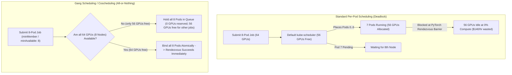

# 11.7 Multi-node jobs: why a pod cannot span nodes, and gang scheduling concepts

| | |
|---|---|
| Level | Advanced |
| Priority tier | 1 |
| Lab venue | GCP / GKE and local Python 3 simulation lab |
| Part | Part 11: GPUs on Kubernetes, scheduling and virtualization |
| Sources used | `volume-06/04-distributed-orchestration-masterclass.md`; Roland Huß et al., *Generative AI on Kubernetes* (O'Reilly, 2026, Ch. 3, Ch. 7); *Kubernetes for Generative AI Solutions* (Packt, 2025, Ch. 10); Chris Fregly, *AI Systems Performance Engineering* (O'Reilly, 2025, Ch. 3) |
| Coverage file | `planning/coverage/chapters/11-07.md` |

## Why this matters for AI infrastructure

Picture a researcher who submits one Pod that asks for 64 GPUs on a cluster built from 8-GPU servers. The Pod stays Pending forever. Everything you learned about single-node Kubernetes hits a hard wall once a model or training run needs more capacity than one server can offer.

A Kubernetes Pod cannot span multiple nodes. In the Kubernetes object model, a Pod is the smallest atomic unit of placement. Its `spec.nodeName` field holds one string that names one Node. Every container inside that Pod shares a single Linux network namespace, an IPC namespace and a local kubelet lifecycle. Physical GPU servers typically hold at most 8 or 16 GPUs per baseboard. That is why any large training job or sharded inference pipeline must be split into a group of coordinated Pods across multiple nodes.

The block below lists the failure modes and the scales at which they appear, so you can match a symptom to its cause.

```text
Multi-Node Scheduling Failure Modes and Scales:
- Single-Pod node limit: 8 or 16 GPUs per baseboard (a 64-GPU or 1,024-GPU job or 175B+ LLM on two 8-GPU 80 GB A100 nodes cannot fit in 1 Pod).
- 7-of-8 partial placement deadlock: 8-Pod (64-GPU) job on 56 free GPUs (7 nodes) places Pods 0..6 and leaves Pod 7 Pending.
- Deadlock cost: 56 GPUs sit at 0% compute utilization, burning $140/hour at $20/hour per 8-GPU node ($10-$30/hour typical range).
- Two-job mutual deadlock: Two 8-Pod (64-GPU) jobs on a 12-node (96-GPU) cluster split 6 + 6 nodes (48 + 48 GPUs), deadlocking 100% of the cluster.
- Head-of-line blocking: 1,024-GPU (128-node) head job waiting 45 minutes for 24 GPUs holds 1,000 free GPUs idle (750 GPU-hours wasted).
- Thundering herd & impossible gang: 50,000 jobs in 2 seconds (25,000 jobs/s) or minAvailable: 1000 on a 500-node cluster OOM-kills etcd/kube-apiserver.
```

Once one training run becomes several Pods, three failure modes appear. The first is partial-allocation rendezvous deadlock. Standard per-Pod scheduling can place only some of the Pods a job needs, and the job can then deadlock at its rendezvous. The second is head-of-line blocking, which strict all-or-nothing gang scheduling causes unless the queue supports wall-time backfill scheduling. The third is control-plane overload. Unthrottled bursts of job submissions and oversized gang requests can exhaust etcd memory and stall the cluster control plane.

Here is the path through the rest of this chapter. You will see why a Pod is bounded to one node and how PyTorch rendezvous barriers tie multi-Pod jobs together. Then you will look at how gang scheduling, through PodGroup, Kueue, Volcano, NVIDIA KAI Scheduler and KEP-4671, removes partial-allocation deadlocks. Finally, the chapter covers bin packing, descheduling, backfill queues, Slurm integration, shared checkpoint storage and network policies.

If a job needs more GPUs than one server holds, plan it as a group of Pods from the start.

## Prerequisites and outcomes

### Prerequisites
You should have completed Chapters 11.1 through 11.6, especially the four placement questions of capacity, eligibility, locality and coordination. You should also be familiar with basic distributed training ideas, including worker ranks, world size, data parallelism and model parallelism.

### Outcomes
When you finish this chapter, you should be able to do the following:
- Explain why a Kubernetes Pod cannot span multiple Nodes, and split a multi-node GPU workload into coordinated worker Pods.
- Trace the four steps of a PyTorch distributed rendezvous barrier, and measure the waste caused by partial placements and mutual deadlocks.
- Compare the four Kubernetes gang-scheduling architectures alongside KEP-4671 Workload support, and protect running gangs with a PodDisruptionBudget.
- Configure kube-scheduler bin packing with `MostAllocated` weights, and pair it safely with the Kubernetes Descheduler without creating eviction loops.
- Solve queue head-of-line blocking with wall-time backfill scheduling, and stop thundering herds and oversized gangs from crashing the control plane.
- Size shared ReadWriteMany checkpoint storage for fine-tuning runs, and enforce zero-trust NetworkPolicy isolation around PyTorch and Ray clusters.

Each outcome maps to one of the concept sections that follow, so you can check your progress as you read.

## Concepts: basics to intermediate to advanced

Why can't one Pod simply hold the whole job? The answer shapes everything else in this chapter. So the sections below start there and work toward the harder failures.

### 1. Basics: Why a Pod cannot span nodes and why microservices scheduling breaks batch AI

#### Why a Kubernetes Pod is strictly bound to one Node
If you are new to Kubernetes, you will likely ask why one Pod manifest cannot request 64 GPUs across an 8-node cluster. When a user tries it, the Pod stays permanently Pending and reports an insufficient GPU event. Kubernetes never splits a single Pod across machines, so the request cannot be satisfied.

A Pod is a co-located execution sandbox, and a single kubelet on a single Node manages it. That has two consequences. First, when kube-scheduler binds a Pod, it writes one host string into `spec.nodeName`. Only the kubelet watching that specific node creates the Pod sandbox. Second, all containers inside a Pod share one Linux network namespace and one IPC namespace for `/dev/shm` shared memory. Sharing one kernel IPC or network namespace across separate physical servers is impossible without a distributed operating system hypervisor.

The scheduler applies the same boundary when it picks a node. During the Filter phase, the NodeResourcesFit plugin asks whether one single node has enough allocatable GPUs for the Pod request. As shown in Chapter 11.6, even a request for two MIG slices needs one node that holds both free slices at the same time. Picture two nodes that each hold one free slice. A Pod requesting 2 slices stays Pending, because neither node holds both.

The block below shows where you will hit the single-node boundary for three kinds of request.

```text
Single-Node Pod Resource Boundary Examples:
- Full-GPU request: Pod requesting nvidia.com/gpu: 64 on 8-GPU nodes -> Pending (Insufficient nvidia.com/gpu).
- Multi-slice MIG request: Pod requesting nvidia.com/mig-2g.45gb: "2" (~76 SMs) when two nodes each have 1 free slice -> Pending.
- Multi-node decomposition: 64-GPU training job or 175B-parameter inference server -> 8 coordinated Pods (1 Pod x 8 GPUs per node).
```

The result is a simple rule you can apply to any job. Any workload that needs more GPUs than one physical server holds must run as multiple Pods across the network. Each worker Pod typically claims all 8 GPUs on its host node, and it coordinates with its peers over InfiniBand, RoCE or Ethernet.

#### The paradigm shift: Microservices vs Distributed AI Batch Jobs
When platform teams run multi-Pod training jobs on a default Kubernetes cluster, operational friction shows up quickly. Kubernetes was originally engineered for stateless web microservices, where replicas are independent and interchangeable. Distributed AI training behaves more like a tightly coupled supercomputer job. Every replica must run at the same time, or the entire job stalls.

The table compares the two workload styles one dimension at a time, so you can see where default Kubernetes assumptions stop fitting. The Pod Coupling and Scheduling row is the one this chapter spends the most time on.

| Architectural Dimension | Traditional Microservices (Default Kubernetes) | Distributed AI Training & Multi-Node Inference |
|---|---|---|
| **Pod Lifecycle** | Long-running servers; restart individual failed Pod in place | Run-to-completion batch jobs or sharded model groups; exit code `0` and coordinated checkpoint recovery govern lifecycle |
| **Pod Coupling & Scheduling** | **Independent per-Pod scheduling:** `3` of `4` web replicas can serve `75%` of traffic | **Gang Scheduling (All-or-Nothing):** `7` of `8` training Pods serve **`0%`** of traffic and deadlock at the rendezvous barrier |
| **When Capacity is Full** | Immediate placement or `Pending` Pod churn in `etcd` | Hold the entire job suspended in a **Queue** (`Kueue` / `Slurm`) until full quota and topology are available |
| **Preemption Model** | Node-pressure eviction (`DiskPressure`, `MemoryPressure`) | Priority, cohort borrowing reclamation (`reclaimWithinCohort`), and fair-share preemption with checkpoint grace periods |
| **Network Traffic Pattern** | Primarily **North-South** client-to-API ingress and light East-West RPCs over TCP/IP CNI overlays | Massive synchronous **East-West** collective bursts (`AllReduce`, `AllGather`, `ReduceScatter`) requiring `200–400 Gbps` InfiniBand / RoCE with GPUDirect RDMA (`40%–60%` latency reduction) |

#### PyTorch Rendezvous and the 7-of-8 Partial-Allocation Deadlock
Why can't 7 out of 8 training Pods make partial progress while the 8th waits to schedule? They cannot train without the eighth. Suppose 7 Pods start on 7 nodes while the 8th Pod waits in Pending. Each node costs $20 per hour, so 7 nodes cost $140 per hour. All 56 allocated GPUs sit at 0% compute utilization and burn that $140 per hour for zero training steps.

Distributed training frameworks such as PyTorch DDP, FSDP, DeepSpeed and Megatron-LM run a synchronous rendezvous and collective communication loop. The rendezvous comes first, at startup. Every worker connects to a shared rendezvous endpoint on `MASTER_ADDR` and `MASTER_PORT`, using a c10d TCP store or etcd. The rendezvous store then waits until every expected participant, from rank 0 through `world_size - 1`, has registered. Finally, an atomic barrier blocks each worker inside `torch.distributed.init_process_group()` until all `world_size` workers arrive.

The loop does not end at startup. Even after initialization completes, every training step runs synchronous collective operations across the whole gang. Data parallelism runs AllReduce to average tens of gigabytes of gradients. Tensor parallelism and FSDP run per-layer AllGather and ReduceScatter collectives instead. If one worker is missing or stalled, every other worker blocks at the collective barrier.

The flowchart below shows the two paths side by side, so you can see where the gang rule changes the outcome.



The problem gets worse on a shared cluster, and you can see it in the numbers. Suppose a cluster has 12 nodes with 96 GPUs free, and two researchers each submit an 8-node training job that requests 64 GPUs. Under default per-Pod scheduling, Job A claims 6 nodes and waits for 2 more. Job B then claims the other 6 nodes and also waits for 2 more. Six plus six uses all 12 nodes, so neither job can reach 8 nodes. All 96 GPUs stay deadlocked forever until an operator deletes one job.

---

### 2. Intermediate: Gang scheduling architectures, bin packing, and the Descheduler

#### Gang scheduling and the PodGroup contract
Partial placement is expensive. Without group awareness, a job that lands only partly strands costly GPUs, and other tenants cannot run their smaller workloads. The cluster scheduler therefore has to stop treating multi-node training Pods as independent microservices. Gang scheduling is the mechanism that does this.

Gang scheduling, also called coscheduling, enforces an all-or-nothing placement contract across a group of Pods. The scheduler holds every Pod in the group as pending or reserved. It binds them to nodes only when the entire minimum group can be placed at the same time, within a configured timeout. Four main gang-scheduling solutions are in production use for Kubernetes today. The upstream KEP-4671 proposal, which covers a native Workload API, sits alongside them.

The table compares the four options by architectural layer, gang mechanism and best fit.

| Solution | Architectural Layer | Gang & Topology Mechanism | Best Production Fit |
|---|---|---|---|
| **1. Coscheduling Plugin (`PodGroup` CRD, `scheduling.x-k8s.io/v1alpha1`)** | Scheduler extension plugin inside `kube-scheduler` (`scheduler-plugins`) | Groups Pods labeled `scheduling.x-k8s.io/pod-group: <name>`; holds binding until `minMember` Pods fit within `scheduleTimeoutSeconds: 300`. No native topology or quota management. | Existing clusters wanting lightweight all-or-nothing gang scheduling without replacing `kube-scheduler`. |
| **2. Kueue (`kueue.x-k8s.io/v1beta1`)** | Job-level **Admission Controller** & Queue Manager sitting above the scheduler | Suspends jobs until `ClusterQueue` / `LocalQueue` has quota; evaluates ordered `ResourceFlavor`s (`gpu-nvlink-infiniband` before `gpu-standard-ethernet`) and `cohort` borrowing (`nominalQuota: 10`, `borrowingLimit: 22`). | Multi-tenant GPU-as-a-Service (`GPUaaS`) needing hierarchical quotas, cohort borrowing, priority preemption (`WorkloadPriorityClass`), and compatibility with `kube-scheduler`, KAI, or Volcano. |
| **3. NVIDIA KAI Scheduler (`kai.run.ai/v1`)** | Full alternative GPU scheduler open-sourced from Run:ai by NVIDIA | Native gang scheduling (`schedulerName: kai-scheduler`) + `Project` quotas (`gpuQuota: 8`) + fractional/time-sliced GPUs + deep NVLink/NVSwitch/InfiniBand topology placement. | Large-scale NVIDIA GPU clusters (`100s–1,000s` of GPUs) requiring unified gang scheduling, fractional sharing, and hardware topology optimization. |
| **4. Volcano (`batch.volcano.sh/v1alpha1`)** | Monolithic batch scheduler (`schedulerName: volcano`) | Replaces or complements `kube-scheduler` with `Job`, `PodGroup` (`minAvailable: 8`), `Queue`, `RestartJob` policies on `PodEvicted`, backfill, and topology plugins. | HPC-style Kubernetes clusters running mixed PyTorch, MPI, Ray, and Apache Spark batch workloads. |

Teams in enterprise production often layer Kueue on top of a gang-aware scheduler or a workload operator. Common workload operators include Kubeflow PyTorchJob, TrainJob and LeaderWorkerSet for multi-node sharded LLM inference. The division of labor is simple. Kueue decides which job is admitted and which hardware tier it may consume. Once Kueue unsuspends the job, the underlying scheduler handles atomic gang binding and intra-rack placement.

#### Resource Bin Packing vs Default Spreading
Gang scheduling alone does not stop waste, because default node scoring can still fragment GPU capacity across the cluster. By default, the `NodeResourcesFit` plugin in kube-scheduler uses the `LeastAllocated` strategy. That strategy spreads Pods across as many nodes as possible, so a hardware failure touches fewer replicas.

Spreading is costly when each node costs $10 to $30 per hour. Imagine 1-GPU or 2-GPU jobs spread across 8-GPU servers. Every node stays partly occupied. Fragmentation then blocks 4-GPU or 8-GPU jobs from finding contiguous free nodes, and the Cluster Autoscaler cannot terminate empty machines. The fix is a `binpack-scheduler` profile. It uses `MostAllocated`, with a weight of 5 on `nvidia.com/gpu` and a weight of 1 on CPU and memory, to pack GPU Pods onto fuller nodes.

```text
MostAllocated Bin-Packing Node Score Formula (Weights: GPU = 5, CPU = 1, Memory = 1):
- Node 1 (6/8 GPUs = 75%, 32/64 CPUs = 50%, 256/512 GiB = 50%): (75*5 + 50*1 + 50*1) / 7 = 67.86 (Selected)
- Node 2 (2/8 GPUs = 25%, 48/64 CPUs = 75%, 384/512 GiB = 75%): (25*5 + 75*1 + 75*1) / 7 = 39.29
```

The scores above show how the scheduler chooses between two candidate nodes. Node 1 wins at 67.86, and Node 2 scores 39.29. The GPU term carries a weight of 5, so Node 1's 75% GPU share counts for more than Node 2's higher CPU and memory shares.

#### Dynamic re-optimization with the Kubernetes Descheduler
Bin packing does not stay perfect. Short jobs finish at different rates and leave fragmented "Swiss cheese" nodes across the cluster. When nodes become fragmented, multi-GPU training jobs sit in the queue, even though total free GPUs across the cluster exceed the job request.

The Kubernetes Descheduler runs periodically, as a CronJob or a Deployment. It evicts sub-optimally placed Pods so kube-scheduler can pack them cleanly. Without strict guardrails, though, the Descheduler on a GPU cluster can tear down active training gangs or trigger infinite eviction loops. Whenever it is active on GPU nodes, you must enforce two rules.

The first rule is to protect every running gang job with a PodDisruptionBudget. Evicting one worker Pod from a running 4-node LLM training job breaks the rendezvous group. It also forces an expensive checkpoint-and-resume cycle. A PodDisruptionBudget with `minAvailable: 4`, matching `scheduling.x-k8s.io/pod-group: llm-training-group`, stops the Descheduler from evicting any active gang worker.

The second rule is to match the Descheduler plugin to the scheduler's scoring strategy. The `HighNodeUtilization` plugin evicts Pods from underutilized nodes, so a `MostAllocated` bin-packing scheduler can pack them onto fuller nodes. Pair `HighNodeUtilization` with the default `LeastAllocated` scheduler, though, and you get an infinite eviction loop. `LeastAllocated` schedules the evicted Pods right back onto lightly loaded nodes.

Each plugin has one matching strategy, and enabling both plugins at once is invalid in every case. The table lays out those pairings.

| Descheduler Plugin | Required `kube-scheduler` Strategy | Behavior When Misaligned |
|---|---|---|
| **`HighNodeUtilization`** | **`MostAllocated`** (Bin Packing) | Infinite eviction loop if paired with `LeastAllocated` |
| **`LowNodeUtilization`** | **`LeastAllocated`** (Spreading) | Infinite eviction loop if paired with `MostAllocated` |
| **Both Enabled Together** | **Invalid in all cases** | Immediate self-contradictory eviction churn |

---

### 3. Advanced: Head-of-line blocking, backfill, thundering herds, Slurm/Slinky, storage, and security

#### 1. Head-of-Line Blocking and Backfill Scheduling
Strict gang scheduling creates a traffic jam. A naive First-In-First-Out queue lets one massive job block everything behind it. Suppose a 1,024-GPU job reaches the head of the queue while 1,000 GPUs are free. The missing 24 GPUs will finish in 45 minutes. Strict FIFO then holds those 1,000 GPUs idle for 45 minutes. That is 750 GPU-hours of waste, while short 8-GPU and 16-GPU jobs wait behind the head job.

Backfill scheduling fixes this without delaying the head job. Slurm (`SchedulerType=sched/backfill`), Volcano and KAI all use it. The scheduler works out the shadow start time of the 1,024-GPU head job, which is `T + 45` minutes. It then scans the queue behind the head job. A smaller job may run immediately if its declared `TimeLimit` finishes within 45 minutes.

As you read the scenario below, check which candidates pass that test.

```text
Backfill Scheduling Scenario (Head Job: 1,024 GPUs; Free: 1,000 GPUs; Missing 24 GPUs free in 45 min):
- Candidate short-8gpu-a (8 GPUs, TimeLimit = 30 min <= 45 min): ADMITTED via backfill.
- Candidate short-16gpu-d (16 GPUs, TimeLimit = 45 min <= 45 min): ADMITTED via backfill (976 free GPUs remain).
- Candidate long-8gpu-b (8 GPUs, TimeLimit = 90 min > 45 min): BLOCKED (would delay the 1,024-GPU head job).
- Candidate no-timelimit-c (8 GPUs, TimeLimit = None / NO_VAL): BLOCKED (cannot prove completion before T + 45 min).
```

Two candidates are admitted and two are blocked. The 30-minute and 45-minute jobs finish inside the window. The 90-minute job and the job with no time limit do not.

Backfill math does not work when users leave out job runtimes. If a job has no maximum wall time, meaning `time_limit == NO_VAL`, the scheduler cannot prove it will finish before the head job starts. For that reason, production AI factories enforce mandatory wall-clock time limits. They do this with Kubernetes admission webhooks, or with Slurm `job_submit` plugins that return `ESLURM_INVALID_TIME_LIMIT`.

#### 2. Control-Plane Thundering Herds and Impossible Gangs
At AI factory scale, a careless submission script can take down a cluster control plane. There are two failure patterns. The first starts with a user loop that submits 50,000 individual hyperparameter sweep jobs in 2 seconds. In Kubernetes, creating 50,000 Pod objects overwhelms etcd Raft consensus and kube-apiserver memory. In Slurm, 50,000 `sbatch` RPCs saturate `slurmctld` state locks on one CPU core. That causes `slurmd` pings to time out and flips healthy nodes to `UNKNOWN`.

Platform teams guard against thundering-herd lockups on each platform. In Kubernetes, they enforce API Priority and Fairness alongside JobSet or Indexed Job completions. In Slurm, administrators require Job Arrays, such as `sbatch --array=1-50000`. They also raise `MaxArraySize` above its default of 1001 in `slurm.conf`, alongside `MaxJobCount=500000` and `MinJobAge=300`. A `job_submit.lua` or C `job_submit` plugin rejects rapid single-job loops automatically.

The second pattern is an impossible gang. Suppose a user submits a Volcano Job with `minAvailable: 1000` to a cluster that has only 500 physical nodes. If all 1,000 Pods are created directly in kube-apiserver, the gang condition can never be met. The 1,000 Pending Pods then churn through scheduler retry loops and event emission, until etcd and kube-apiserver crash with `MemoryPressure` OOM.

The fix is to keep impossible gangs out of etcd in the first place. Gate all batch job creation with Kueue, via `kueue.x-k8s.io/queue-name`. Kueue keeps the job suspended as a single, lightweight Workload object, marked `reason: InsufficientQuota`. No Pod is created in etcd until quota is available. Admission webhooks can also reject any job whose `minAvailable` or `min_nodes > 16` request exceeds the target partition or cluster capacity.

#### 3. Slurm vs Kubernetes and Hybrid Orchestration
Many supercomputing centers run Slurm alongside Kubernetes, or inside it, to orchestrate large training runs. Slurm uses four lightweight components: the `slurmctld` central controller, the `slurmd` compute node daemon, the `slurmdbd` accounting daemon and the `MUNGE` authentication service. Separating `slurmdbd` from `slurmctld` means MariaDB or MySQL database latency never blocks the main scheduling loop.

The block below is a reference configuration for a 128-node DGX H100 cluster, so you can see how the node, scheduler and launch settings fit together.

```text
Reference 128-Node DGX H100 Slurm & MPI Configuration (volume-06):
- Node spec: NodeName=dgx-h100-[001-128] CPUs=224 Sockets=2 CoresPerSocket=56 ThreadsPerCore=2 RealMemory=2000000 Gres=gpu:h100:8 (1,024 H100 GPUs).
- Scheduler & tracking: SelectType=select/cons_tres, TopologyPlugin=topology/tree, ProctrackType=proctrack/cgroup, MessageTimeout=30, SlurmdTimeout=120.
- NUMA GRES mapping (gres.conf): AutoDetect=nvml or explicit physical core ranges COREs=0-27, 28-55, 56-83, 84-111 across 112 physical cores.
- Job launch: srun --mpi=pmix -n 1024 ./train_script or Kubeflow MPIJob (2 Worker pods x 8 slotsPerWorker) running mpirun -np 16 all_reduce_perf -b 8 -e 128M -f 2.
```

The node line shows the GPU count. 128 nodes with 8 H100 GPUs each make 1,024 GPUs.

SchedMD provides Slinky to bridge Slurm and Kubernetes cleanly. It includes a Kubernetes Slurm Operator, a REST client and a Prometheus exporter. Another pattern is Sunk or Virtual Kubelet. It exposes a Slurm cluster as a virtual Kubernetes node that turns Kubernetes Jobs into `sbatch` submissions. Never run unpartitioned co-resident `kubelet` and `slurmd` daemons that both claim the same 8 GPUs on one host. Without static node partitioning, MIG slices, and disjoint `slurmstepd` versus `kubepods` cgroups, both schedulers will double-book GPUs and trigger immediate CUDA OOM crashes.

#### 4. High-Speed Collectives, Checkpoint Storms, RWX Storage Sizing, and Zero-Trust Security
Multi-node jobs also put pressure on East-West networks, shared storage and security boundaries. Start with the network. During distributed training, standard 10 to 100 Gbps TCP/IP Ethernet is enough for 2 to 8 data-parallel nodes, as long as communication stays below 15% of step time. Once communication passes 20% to 25% of step time, the cluster needs 200 to 400 Gbps InfiniBand with `MTU 4,096`, or RoCEv2 with GPUDirect RDMA.

The block below comes from Generative AI on Kubernetes, Chapter 7. It lists the secondary network, NCCL and storage settings.

```text
Multus Secondary RDMA Pod Environment & Storage Sizing Parameters (GAK Ch. 7):
- Secondary network: Multus IPoIB / RoCEv2 subnet 10.0.0.0/24 via whereabouts IPAM; Pod requests rdma/hca: 2 and Linux capability IPC_LOCK.
- GPUDirect RDMA: Reduces collective latency by 40% to 60% over RoCEv2 (100-400 Gbps) and InfiniBand (200-400 Gbps).
- NCCL environment: NCCL_DEBUG=INFO, NCCL_IB_HCA="mlx5_0,mlx5_1", NCCL_IB_GID_INDEX="3" (RoCEv2), NCCL_NET_GDR_LEVEL="5", NCCL_SOCKET_IFNAME="net1".
- RWX storage formula: Storage Required = 2 * base_model_size + checkpoint_overhead.
- Llama 3.1 8B LoRA: 2 * 16 GB base weights + 68 GB checkpoint history = 100 GB on RWX storage.
- 70B full fine-tuning: 2 * 140 GB base weights + 220 GB+ optimizer/checkpoint overhead = 500 GB+ on RWX storage.
- Ray head node NetworkPolicy TCP ports: 6379 (Ray GCS), 8265 (Ray dashboard via oauth2-proxy), 10001 (Ray client server).
```

Storage is the next bottleneck. When a 10,000-GPU gang job writes a checkpoint at the same moment, storage I/O stalls can block every GPU in the cluster. Production platforms therefore combine S3, GCS or MinIO object storage for datasets with local NVMe burst buffers, such as `burst_buffer/datawarp` or CSI scratch volumes, for write spikes. Shared filesystems with ReadWriteMany access, abbreviated `RWX`, such as CephFS, Lustre, WEKA, VAST, EFS or Filestore, let resumed Pods on any node read the latest checkpoint.

Security is the last piece. PyTorch Distributed and Ray use `cloudpickle` serialization without built-in authentication. So wrap every job in a default-deny ingress NetworkPolicy. Allow only intra-job pod traffic, and restrict Ray head node ports 6379, 8265 and 10001 to authorized internal pods.

If a job needs more GPUs than one node holds, plan it as a gang of Pods with a queue in front of it.

## Commands and configurations that matter

Each manifest below is marked untested, so treat it as a template.

### 1. Configuring kube-scheduler for GPU Bin Packing

This profile tells kube-scheduler to pack GPU Pods onto fuller nodes, using the weights from the scoring example above.

```yaml
# binpack-scheduler-config.yaml (untested here)
apiVersion: kubescheduler.config.k8s.io/v1
kind: KubeSchedulerConfiguration
profiles:
  - schedulerName: binpack-scheduler
    pluginConfig:
      - name: NodeResourcesFit
        args:
          scoringStrategy:
            type: MostAllocated
            resources:
              - name: nvidia.com/gpu
                weight: 5
              - name: cpu
                weight: 1
              - name: memory
                weight: 1
```

### 2. Defining a Coscheduling PodGroup and protecting it with a PodDisruptionBudget

The PodGroup sets the gang's size, and the PodDisruptionBudget guards it from eviction.

```yaml
# podgroup-and-pdb.yaml (untested here)
apiVersion: scheduling.x-k8s.io/v1alpha1
kind: PodGroup
metadata:
  name: llm-training-group
spec:
  minMember: 4
  scheduleTimeoutSeconds: 300
---
apiVersion: policy/v1
kind: PodDisruptionBudget
metadata:
  name: llm-training-pdb
spec:
  minAvailable: 4
  selector:
    matchLabels:
      scheduling.x-k8s.io/pod-group: llm-training-group
---
apiVersion: v1
kind: Pod
metadata:
  name: llm-training-0
  labels:
    scheduling.x-k8s.io/pod-group: llm-training-group
    job-role: leader
spec:
  schedulerName: default-scheduler
  containers:
    - name: trainer
      image: nvcr.io/nvidia/pytorch:24.08-py3
      resources:
        limits:
          nvidia.com/gpu: 8
```

### 3. Volcano Gang Job and Kubeflow MPIJob

The Volcano job below asks for eight workers, each with 8 GPUs. With `minAvailable: 8`, it will not start unless all eight can be placed.

```yaml
# volcano-gang-job.yaml (untested here)
apiVersion: batch.volcano.sh/v1alpha1
kind: Job
metadata:
  name: pytorch-training-job
spec:
  minAvailable: 8
  schedulerName: volcano
  policies:
    - event: PodEvicted
      action: RestartJob
  tasks:
    - replicas: 8
      name: worker
      template:
        spec:
          containers:
            - name: pytorch
              image: nvcr.io/nvidia/pytorch:23.10-py3
              resources:
                limits:
                  nvidia.com/gpu: 8
```

Check the `apiVersion` values and resource names against your own cluster before you apply any of these files.

## How it fails

Each row below pairs a symptom with its command evidence, its root cause and the fix. Scan the first column for the symptom you see, then read across to the remediation. When you triage, you can start with the row whose symptom matches yours.

| Failure mode | Exact symptom & command evidence | Root cause boundary | Remediation |
|---|---|---|---|
| **1. `7`-of-`8` Partial-Allocation Rendezvous Deadlock (`56` GPUs at `0%` compute)** | An `8`-Pod (`64`-GPU) `PyTorchJob` shows `7` Pods `Running` (`56` GPUs allocated) and `1` Pod `Pending` (`Insufficient nvidia.com/gpu`). `DCGM_FI_DEV_GPU_UTIL` on all `56` GPUs is `0%`, and `kubectl logs` on rank `0` hangs at `Waiting for 1 more peers in c10d TCPStore`. | **Missing Gang Scheduling Boundary:** Default `kube-scheduler` placed `7` Pods independently when only `56` GPUs were free; PyTorch's atomic rendezvous barrier blocks until all `8` ranks connect. | Enable gang scheduling (`PodGroup` with `minMember: 8`, `Kueue`, `Volcano` `minAvailable: 8`, or `kai-scheduler`) so `0` Pods are bound until all `64` GPUs are available simultaneously. |
| **2. Descheduler infinite eviction loop on GPU training nodes** | Prometheus shows `descheduler_pods_evicted` climbing continuously every CronJob run, training jobs repeatedly restart from checkpoints, yet node consolidation never improves. | **Scheduler / Descheduler Strategy Mismatch:** `HighNodeUtilization` was enabled in the Descheduler while `kube-scheduler` remained on default `LeastAllocated`, or both `HighNodeUtilization` and `LowNodeUtilization` were enabled. | Pair `HighNodeUtilization` strictly with `MostAllocated` (`binpack-scheduler`), never enable `HighNodeUtilization` and `LowNodeUtilization` together, and protect running gangs with a `PodDisruptionBudget` (`minAvailable: 4`). |
| **3. `kube-apiserver` / `etcd` OOM crash during `1,000`-Pod gang submission** | `kube-apiserver` restarts repeatedly and `kubectl` times out. Master nodes report `MemoryPressure` and `etcd` DB size spikes after a user submits a Volcano Job with `minAvailable: 1000` on a `500`-node cluster. | **Un-gated Oversize Gang Churn:** Creating `1,000` unschedulable Pending Pods directly in the API server causes continuous scheduler and controller retry events that exhaust `etcd` watch caches. | Delete the offending `Job`, place **Kueue** in front of batch workloads so jobs remain suspended as a single `Workload` CR (`InsufficientQuota`) until capacity exists, and reject `minAvailable > cluster_capacity` via an admission webhook. |
| **4. `slurmctld` hang and healthy nodes flipping to `UNKNOWN` during `10k`–`50k` job burst** | `sbatch` and `sinfo` time out; `top` shows `slurmctld` at `100%` of one CPU core; compute nodes drop into `UNKNOWN` state. `slurmctld.log` warns of RPC queue saturation. | **Thundering Herd RPC Lock Contention:** A user loop submitted thousands of single jobs instead of a Job Array, starving `slurmd` ping RPCs (`SlurmdTimeout=120`). | Kill the submission loop, restart `slurmctld` from state save files, enforce `sbatch --array` (`MaxArraySize` raised above `1001`) via `job_submit.lua` / C plugin, and configure API Priority and Fairness (`APF`) on Kubernetes. |
| **5. `1,000` GPUs sitting idle behind a `1,024`-GPU queued job (Head-of-Line Blocking)** | Queue has dozens of pending `8`-GPU jobs and the cluster has `1,000` free GPUs, yet `0` new jobs start because the first job in the FIFO queue requires `1,024` GPUs (`24` GPUs short). | **Missing Backfill or Missing Wall-Clock `TimeLimits`:** Either backfill scheduling is disabled or queued jobs omitted a wall-time limit (`time_limit == NO_VAL`), preventing the scheduler from proving they will finish before the `1,024`-GPU job starts. | Enable backfill scheduling (`sched/backfill` or Volcano/KAI backfill) and reject GPU jobs that omit an explicit wall-clock `TimeLimit`. |

Find the row that matches the symptom you see. Its root cause column names the boundary involved, and its remediation column names the change that fixes it.

## Hands-on lab

### Venue and scope
This lab runs locally with the Python 3 standard library. Two scripts do the work: `code/part11/multi_node_and_gang_scheduling.py` and `code/part11/multi_node_and_gang_scheduling_lab.py`. Together they simulate the single-node Pod boundary and the partial-allocation rendezvous deadlock, and they compare that deadlock with all-or-nothing gang scheduling. They also cover `MostAllocated` bin-packing node scoring, Scheduler and Descheduler alignment checks, head-of-line backfill scheduling and ReadWriteMany checkpoint storage sizing. Cluster manifests are marked `(untested here)`.

### Step 1: Run the self-checking multi-node and gang scheduling lab (tested here)

Run the lab script from the repository root, and you will see the output below.

```bash
python3 code/part11/multi_node_and_gang_scheduling_lab.py
```

The output below is what this repository produced. Every check should show PASS, and the summary should read 25 passed and 0 failed.

Captured output from this repository:
```text
=== Chapter 11.7 Lab: Multi-Node Jobs, Pod Node Boundary & Gang Scheduling ===
  [PASS] Single Pod requesting 64 GPUs on 8-GPU nodes is unschedulable (a Pod cannot span nodes)
  [PASS] 64-GPU training job decomposes into 8 coordinated Pods x 8 GPUs/Pod
  [PASS] Without gang scheduling, 56 free GPUs place 7 of 8 Pods and deadlock at PyTorch rendezvous barrier
  [PASS] 7-of-8 partial allocation strands 56 GPUs idle ($140.0/hr at $20/hr per 8-GPU node)
  [PASS] With gang scheduling (minMember/minAvailable=8), 0 Pods are placed when only 56 GPUs are free (0 GPUs wasted)
  [PASS] With gang scheduling and 64 free GPUs, all 8 Pods start atomically and complete rendezvous
  [PASS] MostAllocated (GPU weight 5, CPU 1, Mem 1) scores 6/8-GPU node (67.86) above 2/8-GPU node (39.29)
  [PASS] HighNodeUtilization+MostAllocated and LowNodeUtilization+LeastAllocated are valid pairings
  [PASS] Enabling HighNodeUtilization and LowNodeUtilization simultaneously is rejected
  [PASS] Mismatched HighNodeUtilization+LeastAllocated or LowNodeUtilization+MostAllocated is rejected (eviction loop)
  [PASS] 1024-GPU head-of-line job on 1000 free GPUs waits for 24 more GPUs
  [PASS] Backfill admits 30-min (8-GPU) and 45-min (16-GPU) jobs that finish within the 45-min shadow window
  [PASS] Backfill blocks 90-min job (> 45-min window) and job missing TimeLimit (NO_VAL)
  [PASS] Storage sizing rule (2 * base + overhead) yields 100.0 GB for 8B LoRA and 500.0 GB for 70B fine-tuning
  [PASS] Kueue nominalQuota (10) + borrowingLimit (22) caps team at 32 GPUs; premium (16) + standard (32) = 48 GPUs
  [PASS] Ray NetworkPolicy isolates GCS port 6379, dashboard port 8265, and client server port 10001
  [PASS] Slurm dgx-h100-[001-128] node has 2 sockets x 56 cores x 2 threads = 224 CPUs and 128 x 8 = 1024 H100 GPUs
  [PASS] Slurm gres.conf maps 8 H100 GPUs across 4 core blocks of 28 physical cores (0-27, 28-55, 56-83, 84-111 = 112 cores)
  [PASS] Secondary RDMA network sets NCCL_IB_GID_INDEX=3 (RoCEv2), NCCL_NET_GDR_LEVEL=5, and NCCL_SOCKET_IFNAME=net1
  [PASS] PodGroup sets minMember=4 and scheduleTimeoutSeconds=300 (5 min), protected by PDB minAvailable=4
  [PASS] 50,000 jobs in 2s (25,000 jobs/s) requires Job Arrays (> default MaxArraySize 1001); 1000-pod gang on 500 nodes must be gated by Kueue
  [PASS] Without gang scheduling, two 8-node jobs on a 12-node (96-GPU) cluster split 6+6 nodes and deadlock all 96 GPUs
  [PASS] GPUDirect RDMA reduces latency by 40-60%; communication overhead >20-25% (>15% baseline) requires RDMA over TCP Ethernet
  [PASS] MPIJob with 2 Worker pods x 8 slotsPerWorker launches mpirun -np 16 all_reduce_perf
  [PASS] Kueue WorkloadPriorityClass production-priority sets value=10000 for preemption ordering

Summary: 25 passed, 0 failed out of 25 checks.
```

### Exercises

Start with the single-Pod boundary. Call `validate_pod_vs_multi_node_job()` from `code/part11/multi_node_and_gang_scheduling.py`, and explain why a single Pod asking for 64 GPUs on 8-GPU nodes returns `schedulable=False`. Then work out how many Pods you need, and how many GPUs each Pod gets, when `requested_as_single_pod=False`.

Next, measure the cost of the 7-of-8 deadlock. Run `simulate_partial_vs_gang_scheduling()` with 56 free GPUs, 8 Pods of 8 GPUs each, and a price of 20.0 USD per hour. Compare the placed Pods, the pending Pods, the wasted idle GPUs and the hourly dollar waste, first with `gang_enabled=False` and then with `gang_enabled=True`.

Score the two nodes from the input parameters below. Call `score_node_most_allocated()` with GPU weight 5, CPU weight 1 and memory weight 1, and record the exact score for each node. Then explain why Node 1 wins even though Node 2 has higher CPU and memory utilization.

Test the scheduler and Descheduler pairings. Use `validate_scheduler_descheduler_alignment()` to check all four combinations of `MostAllocated` and `LeastAllocated` against `HighNodeUtilization`, `LowNodeUtilization`, and both plugins together. Note which combinations are valid and which ones cause eviction loops.

Next, check the backfill decision. A 1,024-GPU job waits at the head of the queue while 1,000 GPUs are free, and the missing 24 GPUs free up in 45 minutes. Call `evaluate_backfill_candidates()` with the parameters below. Work out which of the four queued jobs get backfilled, and how many idle GPUs remain.

Finally, check the storage math. Call `estimate_checkpoint_storage_gb()` and confirm the total ReadWriteMany storage for the 8B LoRA job and the 70B full fine-tuning job listed below.

The parameters below cover all six exercises.

```text
Exercise Input Parameters:
- Exercise 1: total_gpus=64, gpus_per_node=8.
- Exercise 2: cluster_free_gpus=56, job_pods=8, gpus_per_pod=8, node_cost_per_hour_usd=20.0.
- Exercise 3: Node 1 (6/8 GPUs, 32/64 CPUs, 256/512 GiB RAM) -> 67.86; Node 2 (2/8 GPUs, 48/64 CPUs, 384/512 GiB RAM) -> 39.29.
- Exercise 5: short-8gpu-a (8 GPUs, 30 min), long-8gpu-b (8 GPUs, 90 min), no-timelimit-c (8 GPUs, None), short-16gpu-d (16 GPUs, 45 min).
- Exercise 6: Llama 3.1 8B LoRA (16 GB base + 68 GB overhead = 100 GB); 70B fine-tuning (140 GB base + 220 GB overhead = 500 GB).
```

Compare your results against the captured output above, which is the baseline this repository produced.

## Checkpoint questions

Use these questions to check your understanding before you move on. Each answer gives the chapter's point in shorter form.

<details>
<summary>**1. Why can a single Kubernetes Pod never span multiple physical worker nodes?**</summary>

A Pod is the smallest unit that runs on one host. For example, a Pod that asks for 64 GPUs on 8-GPU nodes stays Pending, because no single node has enough. When kube-scheduler places it, the scheduler binds `spec.nodeName` to one Node. On that Node, all containers share one Linux network namespace, one IPC namespace for `/dev/shm`, and one kubelet lifecycle. Because of this, the `NodeResourcesFit` filter rejects any Pod whose GPU request is larger than the allocatable GPU count of a single node.
</details>

<details>
<summary>**2. What are the four steps of PyTorch's distributed rendezvous mechanism, and why does a 7-of-8 Pod placement deadlock?**</summary>

When you start a PyTorch distributed job, its workers connect to a rendezvous store, such as a TCP store or etcd. They go through four steps. They discover all peer workers. They agree on the participant set, so each gets a rank from 0 through `world_size - 1`. They synchronize at an atomic barrier. Once all workers arrive, they exchange peer connection details. If 7 of 8 Pods are scheduled and the 8th stays Pending, the 7 running Pods wait at the barrier indefinitely and hold 56 GPUs at 0% compute.
</details>

<details>
<summary>**3. How can two 8-node training jobs submitted concurrently to a 12-node cluster deadlock 100% of the cluster if gang scheduling is disabled?**</summary>

Consider two jobs when gang scheduling is off. kube-scheduler binds Pods from both jobs as capacity appears. Job A can end up with 6 nodes and 48 GPUs, while Job B gets the remaining 6 nodes and 48 GPUs. Both jobs then wait at their 8-node rendezvous barriers for 2 more nodes that never free up. All 96 GPUs across the 12 nodes stay locked in a permanent mutual deadlock.
</details>

<details>
<summary>**4. Why does Generative AI on Kubernetes Chapter 7 configure kube-scheduler with MostAllocated and weight 5 for GPUs instead of the default LeastAllocated strategy?**</summary>

The default `LeastAllocated` strategy spreads Pods across nodes, which leaves partial GPU allocations on every server. That fragmentation blocks full-node jobs and stops cluster autoscalers from terminating idle machines that cost $10 to $30 per hour. `MostAllocated` with a GPU weight of 5, against 1 for CPU and memory, packs GPU Pods onto nodes that are already in use. The remaining nodes stay completely empty, so they can host full-node training gangs or scale down cleanly.
</details>

<details>
<summary>**5. What happens if you enable the HighNodeUtilization plugin in the Kubernetes Descheduler while kube-scheduler is using the default LeastAllocated strategy?**</summary>

The cluster falls into an infinite eviction loop across its worker nodes. `HighNodeUtilization` evicts Pods from underutilized nodes to consolidate them. The `LeastAllocated` scheduler then places the recreated Pods right back onto those same underutilized nodes. `HighNodeUtilization` must always be paired with `MostAllocated`, `LowNodeUtilization` must be paired with `LeastAllocated`, and the two plugins must never be enabled together.
</details>

<details>
<summary>**6. How do you prevent the Kubernetes Descheduler from evicting a worker Pod belonging to an active gang-scheduled training job?**</summary>

You create a PodDisruptionBudget that targets the gang label, such as `scheduling.x-k8s.io/pod-group: llm-training-group`. Set `minAvailable` to 4, the total worker count. The Descheduler checks PodDisruptionBudgets before it evicts a Pod. It skips any Pod whose eviction would drop the running gang below its minimum required members.
</details>

<details>
<summary>**7. Compare the architectural layers of the four Kubernetes gang-scheduling solutions: Coscheduling plugin, Kueue, NVIDIA KAI Scheduler, and Volcano.**</summary>

The Coscheduling PodGroup plugin is a lightweight extension inside the default kube-scheduler. Kueue is a job-level admission controller and queue manager that sits above the scheduler. It suspends jobs as Workload resources until quota is available. NVIDIA KAI Scheduler and Volcano are full alternative batch schedulers. Both combine PodGroup gang scheduling, hierarchical queues and hardware topology optimization.
</details>

<details>
<summary>**8. What is KEP-4671 in upstream Kubernetes?**</summary>

KEP-4671 is the upstream Kubernetes Enhancement Proposal for a native core Workload API. It also proposes built-in all-or-nothing gang scheduling semantics in the Kubernetes scheduler. Multi-Pod AI and ML workloads could then express atomic group scheduling without third-party CRDs.
</details>

<details>
<summary>**9. In the Coscheduling PodGroup spec, what do minMember: 4 and scheduleTimeoutSeconds: 300 control?**</summary>

`minMember: 4` sets the minimum number of Pods with the group label, leader and workers included, that must be schedulable together before any Pod is bound. `scheduleTimeoutSeconds: 300` sets the 5-minute limit on how long kube-scheduler holds partial reservations while it waits for all 4 members. If the timer runs out first, the scheduler stops the cycle and releases the held resources.
</details>

<details>
<summary>**10. Why does LeaderWorkerSet exist alongside Kubeflow PyTorchJob, and what workload pattern does it target?**</summary>

PyTorchJob is built for run-to-completion distributed training. LeaderWorkerSet is built for multi-host sharded LLM inference. When a model such as a 175B+ parameter LLM is too large for one node, it must be sharded across hosts. LeaderWorkerSet manages a leader Pod and several worker Pods across nodes. They scale, restart and gang-schedule together as one atomic inference replica unit.
</details>

<details>
<summary>**11. How do Kueue's ResourceFlavor order, flavorFungibility, and WorkloadPriorityClass interact?**</summary>

The order of the ResourceFlavor list sets the hardware preference. Kueue tries the first flavor, such as 16 NVLink and InfiniBand GPUs, before it falls back to 32 standard Ethernet GPUs. If you set `whenCanBorrow: TryNextFlavor`, Kueue to check whether the next flavor has free nominal quota before it borrows quota in the first flavor. WorkloadPriorityClass with value 10000 decides which queued job is admitted first, and it allows preempting lower-priority jobs.
</details>

<details>
<summary>**12. What is Head-of-Line Blocking in a gang-scheduled cluster, and how does Backfill Scheduling resolve it?**</summary>

If a 1,024-GPU job sits at the head of the queue while 1,000 GPUs are free and waits 45 minutes for 24 more GPUs, strict FIFO blocks every smaller job behind it. Backfill scheduling works out the head job's shadow start time, at `T + 45` minutes. It then lets smaller queued jobs run at once on the 1,000 free GPUs, as long as their declared `TimeLimit` ends before the 45-minute window expires.
</details>

<details>
<summary>**13. Why does submitting a Volcano Job with minAvailable: 1000 on a 500-node cluster risk OOM-killing kube-apiserver and etcd, and how does Kueue prevent this?**</summary>

When 1,000 Pod objects are created directly in kube-apiserver for an impossible gang on 500 nodes, the controllers and scheduler keep retrying. They emit FailedScheduling events for all 1,000 Pods. That event churn bloats etcd watch caches until kube-apiserver runs out of memory. Kueue prevents this by keeping the job suspended, with `spec.suspend: true`, as a single Workload object until quota exists. Zero Pod objects are created in etcd while the job waits.
</details>

<details>
<summary>**14. What happens to Slurm and Kubernetes when a script submits 50,000 individual jobs in 2 seconds, and what is the architectural fix on each platform?**</summary>

In Slurm, 50,000 individual `sbatch` RPCs saturate `slurmctld` internal state locks on one CPU core. That lock contention makes `slurmd` heartbeat pings time out in the queue, given `SlurmdTimeout=120`, and flips healthy nodes to `UNKNOWN`. In Kubernetes, 50,000 Pod creations overwhelm etcd. On Slurm, the fix is enforcing Job Arrays, such as `sbatch --array=1-50000`, with `MaxArraySize` raised above 1001, via a `job_submit` plugin. On Kubernetes, the fix is API Priority and Fairness with Indexed Jobs or JobSets.
</details>

<details>
<summary>**15. What are the three core daemons and authentication service in Slurm's architecture, and why is slurmdbd separated from slurmctld?**</summary>

`slurmctld` is the central controller that manages cluster state and allocations. `slurmd` is the node daemon that launches tasks through `proctrack/cgroup`. `slurmdbd` is the database daemon that records accounting in MariaDB or MySQL. Separating `slurmdbd` from `slurmctld` stops SQL database latency from blocking the main scheduling loop. The `MUNGE` daemon provides cryptographic UID and GID credential authentication across all cluster nodes.
</details>

<details>
<summary>**16. How do SchedMD's Slinky project and Sunk bridge Slurm and Kubernetes, and why is running unpartitioned co-resident kubelet and slurmd daemons dangerous?**</summary>

Slinky provides a Kubernetes Operator for Slurm CRDs, a REST client for controllers, and a unified Prometheus exporter. Sunk exposes a Slurm cluster as a virtual Kubernetes node that turns Pods into `sbatch` jobs. If you run co-resident `kubelet` and `slurmd` daemons on the same nodes without static node partitioning or MIG hardware partitioning, both schedulers can double-book the same physical GPUs. That triggers immediate CUDA OOM crashes.
</details>

<details>
<summary>**17. What are the three collective communication operations described in Generative AI on Kubernetes Chapter 7, and when is standard Ethernet sufficient versus InfiniBand or RoCE with GPUDirect RDMA?**</summary>

AllReduce sums or averages gradients across all workers in data parallelism. AllGather concatenates tensor shards across workers in tensor parallelism and FSDP. Broadcast sends identical weights from rank 0 to all workers. Standard 10 to 100 Gbps Ethernet suffices for 2 to 8 data-parallel nodes when communication takes less than 15% of step time. Once communication passes 20% to 25% of step time, the job needs 200 to 400 Gbps InfiniBand, or 100 to 400 Gbps RoCEv2 with GPUDirect RDMA. That cuts latency by 40% to 60%.
</details>

<details>
<summary>**18. In Generative AI on Kubernetes Example 7-11, what do the five NCCL environment variables and the IPC_LOCK capability do on a Multus secondary RDMA network?**</summary>

If you set `NCCL_DEBUG=INFO`, it logs the detected network interfaces and ring initialization. `NCCL_IB_HCA="mlx5_0,mlx5_1"` selects the ConnectX RDMA adapters. `NCCL_IB_GID_INDEX="3"` selects RoCEv2 Global Identifier index 3. `NCCL_NET_GDR_LEVEL="5"` enables full GPUDirect RDMA across PCIe and host bridges. `NCCL_SOCKET_IFNAME="net1"` binds bootstrap traffic to the Multus secondary interface. The `IPC_LOCK` Linux capability lets the container pin memory pages in RAM for RDMA registration.
</details>

<details>
<summary>**19. What is the rule-of-thumb formula for sizing shared ReadWriteMany checkpoint storage, and what are the sizes for Llama 3.1 8B LoRA versus 70B full fine-tuning?**</summary>

The sizing formula is `2 * base_model_size + checkpoint_overhead`. It covers base weights, periodic intermediate checkpoints, and final output artifacts. A Llama 3.1 8B LoRA fine-tuning job needs roughly 100 GB. Full fine-tuning of a 70B model needs 500 GB or more on ReadWriteMany storage, such as CephFS, NFS, EFS, Filestore, WEKA or Lustre.
</details>

<details>
<summary>**20. Why must Ray clusters and PyTorch distributed jobs be wrapped in default-deny Kubernetes NetworkPolicies, and which three TCP ports does a Ray head node use internally?**</summary>

You should know that both Ray and PyTorch Distributed are designed for trusted internal networks, and neither has built-in authentication or encryption. Both also use `cloudpickle` deserialization, which lets any network client run arbitrary Python code. A default-deny NetworkPolicy isolates each job to its own Pods. It limits Ray head node ingress to authorized internal Pods on three TCP ports: 6379 for Ray GCS, 8265 for the Ray dashboard, and 10001 for the Ray client server.
</details>

## Sources and review notes

### Primary sources read in full for this chapter
```text
Primary Sources and Technical Details Integrated:
- volume-06/04-distributed-orchestration-masterclass.md:
  Slurm slurmctld/slurmd/slurmdbd/MUNGE architecture; slurm.conf for dgx-h100-[001-128] with CPUs=224 Sockets=2 CoresPerSocket=56 ThreadsPerCore=2 RealMemory=2000000 Gres=gpu:h100:8; MessageTimeout=30, SlurmdTimeout=120, MaxJobCount=500000, MinJobAge=300; gres.conf COREs=0-27..84-111; srun --mpi=pmix -n 1024; Microservices vs Batch table; Volcano minAvailable: 8 RestartJob; Kueue; Kubeflow MPIJob mpirun -np 16 all_reduce_perf -b 8 -e 128M -f 2; Sunk/Virtual Kubelet & co-resident daemon risks; 1024-GPU vs 1000-GPU Head-of-Line blocking & Backfill; 50,000-job thundering herd & MaxArraySize=1001; 1,000-Pod Volcano etcd OOM on 500 nodes; 10,000-GPU Checkpoint Storm & burst buffers; C job_submit NO_VAL / min_nodes > 16 super_train & SPANK plugins; PyTorchJob headless service discovery.
- Roland Huß et al., Generative AI on Kubernetes (O'Reilly, 2026), Chapter 3 and Chapter 7 (Job Scheduling Optimization):
  $10-$30/hour GPU node cost; Example 7-1 binpack-scheduler MostAllocated with nvidia.com/gpu weight: 5 and cpu/memory weight: 1; Table 7-1 Descheduler HighNodeUtilization vs LowNodeUtilization eviction-loop warning; Example 7-2 PodDisruptionBudget minAvailable: 4; 7-of-8 PyTorch rendezvous barrier deadlock; Table 7-2 & Table 7-3 gang/topology schedulers; KEP-4671; Example 7-3 PodGroup minMember: 4 scheduleTimeoutSeconds: 300; Examples 7-4 to 7-9 Kueue ResourceFlavor 16 + 32 nominalQuota, nominalQuota: 10, borrowingLimit: 22, WorkloadPriorityClass 10000; KAI Scheduler gpuQuota: 8; LeaderWorkerSet LWS; Table 7-5 network technologies 40%-60% GPUDirect RDMA latency reduction, <15% vs 20%-25% Ethernet communication threshold; Examples 7-10 to 7-12 Multus IPoIB 10.0.0.0/24 whereabouts, NCCL_IB_HCA="mlx5_0,mlx5_1", NCCL_IB_GID_INDEX="3", NCCL_NET_GDR_LEVEL="5", NCCL_SOCKET_IFNAME="net1", rdma/hca: 2, IPC_LOCK, MTU 4,096; SchedMD Slinky; Table 7-6 storage & 2 * base_model_size + checkpoint_overhead 100 GB / 500 GB; Example 7-13 Ray NetworkPolicy ports 6379, 8265, 10001.
- Kubernetes for Generative AI Solutions (Packt, 2025), Chapter 10:
  GPU scheduling and cluster fragmentation.
- Chris Fregly, AI Systems Performance Engineering (O'Reilly, 2025), Chapter 3:
  Slicing a GPU with MIG single-node Pod constraint and Job Scheduling with Kubernetes and SLURM (Slinky).
```

### Related source files mapped in MIGRATION_MAP.md
- `volume-06/04-distributed-orchestration-masterclass.md` is the primary mapped source for this chapter, and all of its sections, tables, configurations, and troubleshooting scenarios are integrated above.

### Run here
- `python3 code/part11/multi_node_and_gang_scheduling_lab.py` passes all 25 self-checking assertions.

### Explicitly labelled inferences
- The hourly dollar waste of $140.0 per hour for 7 idle 8-GPU nodes at the $20 per hour midpoint, the two-job 96-GPU mutual deadlock example, and the MostAllocated node scores of 67.86 versus 39.29 are deterministic arithmetic evaluations computed in `code/part11/multi_node_and_gang_scheduling.py`.

### Not verified on live hardware
- All `kubectl`, `sbatch`, `srun`, `mpirun`, and `KubeSchedulerConfiguration` snippets targeting multi-node clusters (`Pod.spec.nodeName`, `MASTER_ADDR:MASTER_PORT` on `rank-0`, `eth0` vs `ib-network` `NET/IB/GDRDMA` across `PHB` PCIe paths, `scheduler_strategy` with `gpu_weight=5`, `cpu_weight=1`, `mem_weight=1`, `enabled_descheduler_plugins`, `MayStopSearch`, across Sections `1.2`, `1.4`, `2.1`, `2.2`, `2.4`, `3.2`, `4.1`, `4.2`, `5.1`, `5.2`, and `6.1`) are marked `(untested here)`.

### Not in the corpus
- Finalized GA YAML schema for KEP-4671, which remains in the proposal stage as of early 2026.

### Corrections to the author's notes
- Validation pass 2026-10-25: `validate_chapter.py` and `check_coverage.py` pass. The YAML manifests and commands are marked untested and were not applied to a cluster. Custom resource API versions such as `kueue.x-k8s.io/v1beta1` and `resource.k8s.io/v1` change between releases, so check them against the version you install. Console outputs quoted from the Volume notes are illustrative unless the chapter says otherwise.
- Earlier author note: required; all Kubernetes and Slurm configurations match `volume-06/04-distributed-orchestration-masterclass.md` and *Generative AI on Kubernetes* Chapter 7 verbatim.
