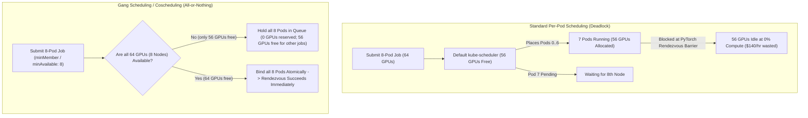

# 11.7 Multi-node jobs: why a pod cannot span nodes, and gang scheduling concepts

| | |
|---|---|
| Level | Advanced |
| Priority tier | 1 |
| Lab venue | GCP / GKE (plus local Python 3 simulation lab) |
| Part | Part 11: GPUs on Kubernetes, scheduling and virtualization |
| Sources used | `volume-06/04-distributed-orchestration-masterclass.md`; Roland Huß et al., *Generative AI on Kubernetes* (O'Reilly, 2026, Ch. 3, Ch. 7); *Kubernetes for Generative AI Solutions* (Packt, 2025, Ch. 10); Chris Fregly, *AI Systems Performance Engineering* (O'Reilly, 2025, Ch. 3) |
| Coverage file | `planning/coverage/chapters/11-07.md` |

## Why this matters for AI infrastructure

Every single-node Kubernetes concept we built in Chapters 11.1 through 11.6 hits a hard architectural wall the moment a model or training run exceeds the capacity of one server: **a Kubernetes `Pod` cannot span multiple nodes**.

In the Kubernetes object model, a `Pod` is the smallest atomic unit of placement. Its `spec.nodeName` field is a single string naming one `Node`, and every container inside that `Pod` shares a single Linux network namespace (one Pod IP), IPC namespace, and local `kubelet` lifecycle. Because physical GPU servers typically hold at most `8` (or `16`) GPUs per baseboard, any workload that requires `64` GPUs (`8` nodes × `8` GPUs/node) or `1,024` GPUs (`128` nodes × `8` GPUs/node)—or even a `175B+` parameter LLM inference pipeline split across two `8`-GPU `80 GB` A100 nodes—cannot be expressed as a single `Pod` with `nvidia.com/gpu: 64`. A single Pod requesting `64` GPUs on an `8`-GPU-per-node cluster remains permanently `Pending` (`Insufficient nvidia.com/gpu`).

Instead, multi-node AI workloads must be decomposed into **a group of coordinated Pods** (typically one `8`-GPU Pod per worker node). That decomposition immediately exposes a fundamental mismatch between Kubernetes's microservice origins and distributed AI:

1. **The Partial-Allocation Rendezvous Deadlock (`7` of `8` Pods placed):** The default `kube-scheduler` evaluates and binds Pods **one by one, independently**. Suppose a user submits an `8`-Pod (`64`-GPU) PyTorch Distributed Data Parallel (`DDP`) or Fully Sharded Data Parallel (`FSDP`) training job when only `56` GPUs (`7` nodes) are free. `kube-scheduler` happily binds `Pods 0..6` (`56` GPUs) and leaves `Pod 7` in `Pending`. Inside the `7` running Pods, PyTorch connects to its rendezvous backend (`c10d` TCP store or `etcd`) and blocks at an atomic barrier waiting for all `8` ranks (`0` through `world_size - 1`) to arrive before starting step `0`. Those **`56` GPUs sit at `0%` compute utilization indefinitely**—burning **`$140/hour`** (at `$20/hour` per `8`-GPU node, within the `$10–$30/hour` range cited in *Generative AI on Kubernetes* Chapter 7) while producing zero training progress. Worse, if two `8`-Pod jobs are submitted concurrently to a `12`-node (`96`-GPU) cluster without gang admission, Job A can grab `6` nodes (`48` GPUs) and Job B can grab `6` nodes (`48` GPUs), **deadlocking `100%` (`96` of `96` GPUs) of the cluster forever**.
2. **Head-of-Line Blocking vs Backfill Scheduling:** Once you introduce **Gang Scheduling** (coscheduling / all-or-nothing placement so either all `N` Pods start together or `0` GPUs are reserved), a new problem appears: if a massive `1,024`-GPU job sits at the head of the queue when `1,000` GPUs are free (waiting for `24` more GPUs to finish), holding those `1,000` GPUs idle starves thousands of short `8`-GPU jobs unless the scheduler implements **Backfill Scheduling** using enforced job wall-clock `TimeLimits`.
3. **Control-Plane Thundering Herds and Unsatisfiable Gangs:** Submitting `50,000` hyperparameter sweep jobs in `2` seconds (`25,000` jobs/s), or submitting a `1,000`-Pod gang job (`minAvailable: 1000`) to a `500`-node cluster without an admission queue, can exhaust `etcd` and OOM-kill `kube-apiserver` (or lock Slurm's `slurmctld` RPC threads).

This chapter explains why Pods cannot span nodes, how PyTorch rendezvous barriers and collective communications (`AllReduce`, `AllGather`, `ReduceScatter`, `Broadcast`) couple multi-Pod jobs, how **Gang Scheduling** (`PodGroup`, `Kueue`, `Volcano`, `NVIDIA KAI Scheduler`, and `KEP-4671`) eliminates partial-allocation deadlocks, how `MostAllocated` bin packing and the Kubernetes `Descheduler` must be aligned, and how Slurm and hybrid Slinky/Sunk architectures solve these same problems at supercomputer scale.

## Prerequisites and outcomes

### Prerequisites
- Completion of Chapters 11.1 through 11.6 (especially the four placement questions in Chapter 11.6: `Capacity`, `Eligibility`, `Locality`, and `Coordination`).
- Basic familiarity with distributed training concepts (ranks, `WORLD_SIZE`, data parallelism vs model parallelism).

### Outcomes
After completing this chapter, you will be able to:
- Explain the architectural reason a Kubernetes `Pod` cannot span multiple `Node`s (`Pod.spec.nodeName`, shared Linux network/IPC namespaces, and single-node MIG slice constraints) and decompose a multi-node GPU workload into coordinated worker Pods.
- Trace the four steps of a PyTorch distributed rendezvous barrier (`0` to `world_size - 1`) and quantify the GPU and dollar waste of a `7`-of-`8` partial placement (`56` GPUs idle) and a two-job mutual deadlock (`6 + 6 = 12` nodes / `96` GPUs deadlocked).
- Compare the four Kubernetes gang-scheduling architectures (**Coscheduling `PodGroup` plugin**, **Kueue**, **NVIDIA KAI Scheduler**, and **Volcano**, plus upcoming native **KEP-4671** `Workload` support) and protect running gangs with a `PodDisruptionBudget` (`minAvailable: 4`).
- Configure `kube-scheduler` bin packing (`NodeResourcesFit` `MostAllocated` with `nvidia.com/gpu` `weight: 5`, `cpu` `weight: 1`, `memory` `weight: 1`) and pair it safely with the Kubernetes `Descheduler` (`HighNodeUtilization` vs `LowNodeUtilization`) without triggering infinite eviction loops.
- Solve queue **Head-of-Line (HoL) Blocking** (`1,024`-GPU head job waiting on `24` GPUs while `1,000` GPUs sit free) using wall-time-bounded **Backfill Scheduling**, and prevent control-plane OOMs/hangs from `50,000`-job thundering herds (`MaxArraySize=1001`) and oversize gangs (`minAvailable: 1000` on `500` nodes).
- Size shared `ReadWriteMany` (`RWX`) checkpoint storage (`2 * base_model_size + checkpoint_overhead`: `100 GB` for `8B` LoRA, `500 GB+` for `70B` full fine-tuning) and enforce zero-trust `NetworkPolicy` isolation around PyTorch and Ray (`6379`, `8265`, `10001`) training clusters.

## Concepts: basics to intermediate to advanced

### 1. Basics: Why a Pod cannot span nodes and why microservices scheduling breaks batch AI

#### Why a Kubernetes Pod is strictly bound to one Node
Newcomers to Kubernetes often ask: *"If my cluster has `8` nodes with `8` GPUs each (`64` GPUs total), why can't I write one Pod YAML with `limits: {nvidia.com/gpu: 64}` and let Kubernetes spread that Pod across all `8` nodes?"*

Because in Kubernetes architecture, **a `Pod` is a co-located execution sandbox managed by a single `kubelet` on a single `Node`**:
1. **Single `spec.nodeName` binding:** When `kube-scheduler` binds a Pod, it writes one node name into `Pod.spec.nodeName`. Only the `kubelet` watching that specific `Node` name creates the Pod sandbox.
2. **Shared Linux kernel namespaces:** All containers inside a Pod share one network namespace (`localhost` loopback and one Pod IP), one IPC namespace (shared memory `/dev/shm`), and one UTS namespace. Sharing a single kernel IPC or network namespace across separate physical servers without a distributed OS hypervisor is impossible.
3. **Single-node resource accounting:** During the `Filter` phase (`NodeResourcesFit`), `kube-scheduler` checks whether **one single node** has `status.allocatable["nvidia.com/gpu"] >= Pod.request`. As we also saw in Chapter 11.6 (`AI Systems Performance Engineering` Chapter 3), even requesting two MIG slices (`nvidia.com/mig-2g.45gb: "2"`, `~76` SMs) requires a single node that holds both free slices; if two nodes each hold `1` free slice, the Pod stays `Pending`.

Therefore, any workload that needs more GPUs than exist on one server—whether a `64`-GPU training job (`8` nodes × `8` GPUs/node) or a `175B`-parameter multi-node inference server (*Generative AI on Kubernetes* Chapter 3)—must run as **multiple Pods** (`1` Pod per node) that coordinate over the network (`InfiniBand`, `RoCE`, or `Ethernet`).

#### The paradigm shift: Microservices vs Distributed AI Batch Jobs
As `volume-06/04-distributed-orchestration-masterclass.md` (Part 2.1) and *Generative AI on Kubernetes* (Chapter 7) highlight, Kubernetes was originally engineered for stateless web microservices, whereas multi-node AI training behaves like a tightly coupled supercomputer job:

| Architectural Dimension | Traditional Microservices (Default Kubernetes) | Distributed AI Training & Multi-Node Inference |
|---|---|---|
| **Pod Lifecycle** | Long-running servers; restart individual failed Pod in place | Run-to-completion batch jobs (or sharded model groups); exit code `0` and coordinated checkpoint recovery govern lifecycle |
| **Pod Coupling & Scheduling** | **Independent per-Pod scheduling:** `3` of `4` web replicas can serve `75%` of traffic | **Gang Scheduling (All-or-Nothing):** `7` of `8` training Pods serve **`0%`** of traffic and deadlock at the rendezvous barrier |
| **When Capacity is Full** | Immediate placement or `Pending` Pod churn in `etcd` | Hold the entire job suspended in a **Queue** (`Kueue` / `Slurm`) until full quota and topology are available |
| **Preemption Model** | Node-pressure eviction (`DiskPressure`, `MemoryPressure`) | Priority, cohort borrowing reclamation (`reclaimWithinCohort`), and fair-share preemption with checkpoint grace periods |
| **Network Traffic Pattern** | Primarily **North-South** (client-to-API ingress) and light East-West RPCs over TCP/IP CNI overlays | Massive synchronous **East-West** collective bursts (`AllReduce`, `AllGather`, `ReduceScatter`) requiring `200–400 Gbps` InfiniBand / RoCE with GPUDirect RDMA (`40%–60%` latency reduction) |

#### PyTorch Rendezvous and the `7`-of-`8` Partial-Allocation Deadlock
Why can't `7` out of `8` training Pods make partial progress while waiting for the `8th` Pod? Because distributed training frameworks (`PyTorch DDP`, `FSDP`, `DeepSpeed`, `Megatron-LM`) execute a **synchronous rendezvous and collective communication loop** (*Generative AI on Kubernetes*, Chapter 7, "PyTorch Rendezvous and Gang Scheduling"):
1. **Peer Discovery:** At startup, every worker connects to a shared rendezvous endpoint (`MASTER_ADDR:MASTER_PORT` via `c10d` TCP store or `etcd`).
2. **Rank Assignment:** The rendezvous store waits until all expected participants (`WORLD_SIZE`, e.g., `8` nodes or `64` GPU ranks `0` through `world_size - 1`) register.
3. **Atomic Barrier Synchronization:** **No worker proceeds past `torch.distributed.init_process_group()` until all `world_size` workers arrive.**
4. **Synchronous Step Collectives:** Even after initialization, every training step executes synchronous collective operations (`AllReduce` to average tens of gigabytes of gradients in Data Parallelism, or per-layer `AllGather` and `ReduceScatter` in Tensor Parallelism and FSDP). If a single worker is missing or stalls, all other workers block at the collective barrier.



Worse still is the **two-job mutual deadlock**: suppose a cluster has `12` nodes (`96` GPUs) free, and two researchers simultaneously submit `8`-node (`64`-GPU) training jobs (`Job A` and `Job B`). Under default per-Pod scheduling:
- `Job A` gets `6` nodes (`48` GPUs) and waits for `2` more nodes.
- `Job B` gets the other `6` nodes (`48` GPUs) and waits for `2` more nodes.
- Neither job can ever reach `8` nodes, and neither job will release its `6` nodes. **All `96` GPUs (`100%` of the cluster) are deadlocked forever** until an administrator manually deletes one of the jobs.

---

### 2. Intermediate: Gang scheduling architectures, bin packing (`MostAllocated`), and the Descheduler

#### Gang scheduling (coscheduling) and the `PodGroup` contract
**Gang scheduling** (also called **coscheduling**) solves both partial waste and mutual deadlock by enforcing an **all-or-nothing placement contract**: the scheduler holds all Pods belonging to a group in a pending/reserve state and binds them to nodes *only* when the entire minimum group (`minMember` or `minAvailable`) can be placed simultaneously within `scheduleTimeoutSeconds`.

As surveyed in *Generative AI on Kubernetes* (Chapter 7, Table 7-2 and Table 7-3), four primary gang-scheduling solutions are used in production Kubernetes today, alongside the upstream **KEP-4671** proposal (which introduces a native core `Workload` API for all-or-nothing scheduling directly in Kubernetes):

| Solution | Architectural Layer | Gang & Topology Mechanism | Best Production Fit |
|---|---|---|---|
| **1. Coscheduling Plugin (`PodGroup` CRD, `scheduling.x-k8s.io/v1alpha1`)** | Scheduler extension plugin inside `kube-scheduler` (`scheduler-plugins`) | Groups Pods labeled `scheduling.x-k8s.io/pod-group: <name>`; holds binding until `minMember` Pods fit within `scheduleTimeoutSeconds: 300`. No native topology or quota management. | Existing clusters wanting lightweight all-or-nothing gang scheduling without replacing `kube-scheduler`. |
| **2. Kueue (`kueue.x-k8s.io/v1beta1`)** | Job-level **Admission Controller** & Queue Manager (sits *above* the scheduler) | Suspends jobs until `ClusterQueue` / `LocalQueue` has quota; evaluates ordered `ResourceFlavor`s (`gpu-nvlink-infiniband` before `gpu-standard-ethernet`) and `cohort` borrowing (`nominalQuota: 10`, `borrowingLimit: 22`). | Multi-tenant GPU-as-a-Service (`GPUaaS`) needing hierarchical quotas, cohort borrowing, priority preemption (`WorkloadPriorityClass`), and compatibility with `kube-scheduler`, KAI, or Volcano. |
| **3. NVIDIA KAI Scheduler (`kai.run.ai/v1`)** | Full alternative GPU scheduler (open-sourced from Run:ai by NVIDIA) | Native gang scheduling (`schedulerName: kai-scheduler`) + `Project` quotas (`gpuQuota: 8`) + fractional/time-sliced GPUs + deep NVLink/NVSwitch/InfiniBand topology placement. | Large-scale NVIDIA GPU clusters (`100s–1,000s` of GPUs) requiring unified gang scheduling, fractional sharing, and hardware topology optimization. |
| **4. Volcano (`batch.volcano.sh/v1alpha1`)** | Monolithic batch scheduler (`schedulerName: volcano`) | Replaces/complements `kube-scheduler` with `Job`, `PodGroup` (`minAvailable: 8`), `Queue`, `RestartJob` policies on `PodEvicted`, backfill, and topology plugins. | HPC-style Kubernetes clusters running mixed PyTorch, MPI, Ray, and Apache Spark batch workloads. |

In practice (*Generative AI on Kubernetes*, Chapter 7, "Making the right choice"), a widely adopted enterprise pattern **layers Kueue on top of a gang- and topology-aware scheduler** (or workload operator such as Kubeflow `PyTorchJob` / `TrainJob` or `LeaderWorkerSet` `LWS` for multi-node sharded LLM inference): Kueue governs *who* is admitted and *which hardware tier* (`ResourceFlavor`) they may consume, while the underlying scheduler executes atomic gang binding and intra-rack/NVSwitch placement.

#### Resource Bin Packing (`MostAllocated`) vs Default Spreading (`LeastAllocated`)
By default, `kube-scheduler`'s `NodeResourcesFit` plugin uses the **`LeastAllocated`** scoring strategy: it spreads Pods across as many nodes as possible so a single node failure impacts fewer replicas.

For GPU clusters where nodes cost **`$10–$30 per hour`** (*Generative AI on Kubernetes*, Chapter 7), spreading is an anti-pattern:
1. Spreading `1`-GPU or `2`-GPU jobs across `8`-GPU nodes leaves every node partially occupied (for example, `2` of `8` GPUs used per node), preventing a `4`-GPU or `8`-GPU job from finding a contiguous free node and preventing the Cluster Autoscaler from draining and terminating empty nodes.
2. Configuring a **`binpack-scheduler`** profile with `scoringStrategy.type: MostAllocated` and assigning **`weight: 5` to `nvidia.com/gpu`** (versus `weight: 1` for `cpu` and `weight: 1` for `memory`, Example 7-1) packs GPU Pods tightly onto already-utilized nodes, keeping remaining nodes `100%` empty for large multi-GPU gangs or autoscaler scale-down.

#### Dynamic re-optimization with the Kubernetes Descheduler (and avoiding eviction loops)
Initial bin packing degrades over time as short jobs finish at different rates, leaving fragmented "Swiss cheese" nodes. The **Kubernetes Descheduler** runs periodically (as a `CronJob` or `Deployment`) to evict sub-optimally placed Pods so `kube-scheduler` can pack them cleanly. However, you **must** observe two strict rules (*Generative AI on Kubernetes*, Chapter 7, Table 7-1 and Warning):
1. **Protect running gang jobs with a `PodDisruptionBudget` (`PDB`):** Evicting one worker Pod from a running `4`-node LLM training job tears down the rendezvous group and forces a costly checkpoint-and-resume cycle. Always attach a `PodDisruptionBudget` (`minAvailable: 4` matching `scheduling.x-k8s.io/pod-group: llm-training-group`, Example 7-2) so the Descheduler never evicts an active gang worker.
2. **Align Descheduler strategy with Scheduler strategy to prevent infinite eviction loops:**
   - **`HighNodeUtilization` (Descheduler) MUST pair with `MostAllocated` (bin-packing Scheduler):** `HighNodeUtilization` evicts Pods from *underutilized* nodes so `MostAllocated` packs them onto fuller nodes. If you pair `HighNodeUtilization` with default `LeastAllocated`, the Descheduler evicts Pods from a lightly loaded node and `LeastAllocated` immediately schedules them right back onto that same lightly loaded node—creating an infinite eviction loop.
   - **`LowNodeUtilization` (Descheduler) MUST pair with `LeastAllocated` (spreading Scheduler):** `LowNodeUtilization` evicts Pods from *overutilized* nodes to spread them onto underutilized nodes.
   - **Never enable `HighNodeUtilization` and `LowNodeUtilization` simultaneously.**

---

### 3. Advanced: Head-of-line blocking, backfill, thundering herds, Slurm/Slinky, storage, and security

#### 1. Head-of-Line (HoL) Blocking and Backfill Scheduling (`1,024` GPUs vs `1,000` free GPUs)
Once strict gang scheduling is enabled, strict First-In-First-Out (`FIFO`) queueing creates **Head-of-Line (HoL) Blocking** (`volume-06/04-distributed-orchestration-masterclass.md`, Section 4.1):
- Suppose the job at the head of the queue requests **`1,024` GPUs** (`128` nodes × `8` GPUs/node).
- Currently, **`1,000` GPUs are free** across the cluster, and the remaining **`24` GPUs** are running a job that will finish in **`45` minutes**.
- Under naive FIFO gang scheduling, the scheduler reserves the `1,000` free GPUs and waits `45` minutes for the last `24` GPUs—wasting `1,000` GPUs × `45` minutes (`750` GPU-hours) while smaller `8`-GPU and `16`-GPU jobs sit queued behind the `1,024`-GPU job.
- **The Solution — Backfill Scheduling:** Both Slurm (`SchedulerType=sched/backfill`) and Volcano/KAI calculate the **shadow start time** of the `1,024`-GPU head job (`T + 45` minutes). The scheduler scans the queue behind the head job and allows smaller jobs (for example, an `8`-GPU job requesting `30` minutes or a `16`-GPU job requesting `45` minutes) to **"jump the queue" and run immediately on the `1,000` free GPUs**, provided their declared wall-clock `TimeLimit` guarantees they will finish *before* `T + 45` minutes (`time_limit <= 45` min).
- **Why mandatory `TimeLimits` matter:** Backfill math is impossible if users omit job runtimes (`time_limit == NO_VAL`). This is why production AI factories enforce a maximum wall time via admission webhooks or Slurm `job_submit` plugins (`ESLURM_INVALID_TIME_LIMIT`).

#### 2. Control-Plane Thundering Herds (`50,000` jobs in `2s`) and Impossible Gangs (`1,000` Pods on `500` nodes)
At AI Factory scale (`volume-06`, Sections 4.2, 5.1, and 5.2), two submission patterns routinely take down cluster control planes:
- **Pattern A — The `50,000`-Job Hyperparameter Loop:** A user script submits `50,000` individual jobs in `2` seconds (`25,000` jobs/s). In Kubernetes, creating `50,000` Pod objects overwhelms `etcd` raft consensus and `kube-apiserver`. In Slurm, `50,000` `sbatch` RPCs saturate `slurmctld`'s serialized state locks (`100%` of one CPU core), causing `slurmd` heartbeat pings (`MessageTimeout=30`, `SlurmdTimeout=120`) to time out in the RPC queue so healthy compute nodes flip to `UNKNOWN`.
  - **Fix:** In Kubernetes, enforce **API Priority and Fairness (`APF`)** and use `JobSet` / indexed `Job` completions. In Slurm, enforce **Job Arrays** (`sbatch --array=1-50000`, raising `MaxArraySize` above its default of `1001` alongside `MaxJobCount=500000` and `MinJobAge=300` in `slurm.conf`) via a `job_submit.lua` or C `job_submit` plugin.
- **Pattern B — The Impossible Gang (`minAvailable: 1000` on a `500`-node cluster):** A user submits a Volcano Job with `minAvailable: 1000` on a cluster that only has `500` nodes (`volume-06`, Scenario 2). If all `1,000` Pods are created directly in `kube-apiserver`, the gang condition can never be met; the `1,000` Pending Pods churn continuously in scheduler retry loops and event emission until `etcd` and `kube-apiserver` crash with `MemoryPressure` OOM.
  - **Fix:** Gate job creation with **Kueue** (`kueue.x-k8s.io/queue-name`). Kueue keeps the job **suspended** as a single lightweight `Workload` object (`reason: InsufficientQuota`) without creating a single `Pod` in `etcd` until quota is satisfied, and admission webhooks reject any job whose `minAvailable` exceeds physical cluster/queue capacity.

#### 3. Slurm vs Kubernetes and Hybrid Orchestration (Slinky & Sunk)
Why do many supercomputing centers use **Slurm** (`slurmctld` controller, `slurmd` node agent, `slurmdbd` accounting daemon backed by MariaDB/MySQL, and `MUNGE` cryptographic UID/GID authentication) alongside or inside Kubernetes?
- In `volume-06` (Part 1.2–1.4), a `128`-node DGX H100 cluster (`NodeName=dgx-h100-[001-128] CPUs=224 Sockets=2 CoresPerSocket=56 ThreadsPerCore=2 RealMemory=2000000 Gres=gpu:h100:8`, `1,024` H100 GPUs total) uses `SelectType=select/cons_tres`, `TopologyPlugin=topology/tree`, `ProctrackType=proctrack/cgroup`, and `gres.conf` (`AutoDetect=nvml` or explicit `COREs=0-27`, `28-55`, `56-83`, `84-111` across the `112` physical cores) to launch `1,024`-GPU jobs via `srun --mpi=pmix -n 1024 ./train_script`.
- To bridge Slurm and Kubernetes (*Generative AI on Kubernetes* Chapter 7, "Bridging HPC and Kubernetes: Slurm and Slinky", and `volume-06` Part 3):
  - **SchedMD Slinky:** Provides a Kubernetes **Slurm Operator** (running Slurm clusters as Kubernetes CRDs with dynamic scaling), a REST client for Kubernetes controllers/webhooks, and a Prometheus exporter.
  - **Sunk (Slurm on Kubernetes) / Virtual Kubelet:** Exposes a Slurm cluster as a virtual Kubernetes node so K8s `Job`s translate into `sbatch` submissions.
  - **Never run unpartitioned co-resident `kubelet` and `slurmd` daemons** claiming the same `8` GPUs on the same host ("Frankenstein" pattern in `volume-06` Section 3.2): both schedulers will double-book GPUs and trigger immediate CUDA OOMs unless nodes are statically/dynamically partitioned or isolated via MIG and disjoint cgroup trees (`slurmstepd` vs `kubepods`).

#### 4. Checkpoint Storms, `RWX` Storage Sizing, and Zero-Trust `NetworkPolicy` Isolation
- **Checkpoint Storms and Storage Sizing (`volume-06` Part 6.1 & `GAK` Chapter 7 Table 7-6):** When a `10,000`-GPU gang job writes a checkpoint simultaneously, storage I/O stalls block the entire gang. Production platforms combine **Object Storage** (`S3`/`GCS`/`MinIO`) for streaming datasets, **Local NVMe / Burst Buffers** (`burst_buffer/datawarp` or CSI ephemeral NVMe scratch volumes) to absorb write bursts, and **Distributed / Cloud Shared Filesystems** (`CephFS`, `Lustre`, `WEKA`, `VAST`, `EFS`, `Filestore`) with **`ReadWriteMany` (`RWX`)** access so resumed Pods on any node can read the latest checkpoint. Size checkpoint storage using the *Generative AI on Kubernetes* (Chapter 7) formula:
  ```text
  Storage Required = 2 * base_model_size + checkpoint_overhead
  ```
  For example, fine-tuning **Llama 3.1 8B** with LoRA (`~16 GB` base weights + `68 GB` intermediate checkpoint history) requires **`~100 GB`**, while full fine-tuning of a **`70B` model** (`~140 GB` base weights + `220 GB+` optimizer/checkpoint states) requires **`500 GB` or more**.
- **Zero-Trust `NetworkPolicy` for PyTorch and Ray (`GAK` Chapter 7, "Training Job Security"):** Both PyTorch Distributed (`c10d` / `Gloo` / `NCCL`) and Ray are explicitly designed for trusted internal networks—they accept unauthenticated connections and use `cloudpickle` serialization that can execute arbitrary Python code. Always wrap every training job or Ray cluster in a default-deny ingress `NetworkPolicy` (Example 7-13), allowing only intra-job pod-to-pod traffic and restricting Ray head node ingress exclusively to internal cluster pods on ports **`6379`** (Ray GCS), **`8265`** (Ray dashboard via `oauth2-proxy`), and **`10001`** (Ray client server).

## Commands and configurations that matter

### 1. Configuring `kube-scheduler` for GPU Bin Packing (`MostAllocated`, `GAK` Example 7-1)

```yaml
# binpack-scheduler-config.yaml (untested here)
apiVersion: kubescheduler.config.k8s.io/v1
kind: KubeSchedulerConfiguration
profiles:
  - schedulerName: binpack-scheduler
    pluginConfig:
      - name: NodeResourcesFit
        args:
          scoringStrategy:
            type: MostAllocated
            resources:
              - name: nvidia.com/gpu
                weight: 5
              - name: cpu
                weight: 1
              - name: memory
                weight: 1
```

### 2. Defining a Coscheduling `PodGroup` and protecting it with a `PodDisruptionBudget` (`GAK` Examples 7-2 & 7-3)

```yaml
# podgroup-and-pdb.yaml (untested here)
apiVersion: scheduling.x-k8s.io/v1alpha1
kind: PodGroup
metadata:
  name: llm-training-group
spec:
  minMember: 4
  scheduleTimeoutSeconds: 300
---
apiVersion: policy/v1
kind: PodDisruptionBudget
metadata:
  name: llm-training-pdb
spec:
  minAvailable: 4
  selector:
    matchLabels:
      scheduling.x-k8s.io/pod-group: llm-training-group
---
apiVersion: v1
kind: Pod
metadata:
  name: llm-training-0
  labels:
    scheduling.x-k8s.io/pod-group: llm-training-group
    job-role: leader
spec:
  schedulerName: default-scheduler
  containers:
    - name: trainer
      image: nvcr.io/nvidia/pytorch:24.08-py3
      resources:
        limits:
          nvidia.com/gpu: 8
```

### 3. Volcano Gang Job (`minAvailable: 8`) and Kubeflow `MPIJob` (`volume-06` Part 2.2 & 2.4)

```yaml
# volcano-gang-job.yaml (untested here)
apiVersion: batch.volcano.sh/v1alpha1
kind: Job
metadata:
  name: pytorch-training-job
spec:
  minAvailable: 8
  schedulerName: volcano
  policies:
    - event: PodEvicted
      action: RestartJob
  tasks:
    - replicas: 8
      name: worker
      template:
        spec:
          containers:
            - name: pytorch
              image: nvcr.io/nvidia/pytorch:23.10-py3
              resources:
                limits:
                  nvidia.com/gpu: 8
```

## How it fails

| Failure mode | Exact symptom & command evidence | Root cause boundary | Remediation |
|---|---|---|---|
| **1. `7`-of-`8` Partial-Allocation Rendezvous Deadlock (`56` GPUs at `0%` compute)** | An `8`-Pod (`64`-GPU) `PyTorchJob` shows `7` Pods `Running` (`56` GPUs allocated) and `1` Pod `Pending` (`Insufficient nvidia.com/gpu`). `DCGM_FI_DEV_GPU_UTIL` on all `56` GPUs is `0%`, and `kubectl logs` on rank `0` hangs at `Waiting for 1 more peers in c10d TCPStore`. | **Missing Gang Scheduling Boundary:** Default `kube-scheduler` placed `7` Pods independently when only `56` GPUs were free; PyTorch's atomic rendezvous barrier blocks until all `8` ranks connect. | Enable gang scheduling (`PodGroup` with `minMember: 8`, `Kueue`, `Volcano` `minAvailable: 8`, or `kai-scheduler`) so `0` Pods are bound until all `64` GPUs are available simultaneously. |
| **2. Descheduler infinite eviction loop on GPU training nodes** | Prometheus shows `descheduler_pods_evicted` climbing continuously every CronJob run, training jobs repeatedly restart from checkpoints, yet node consolidation never improves. | **Scheduler / Descheduler Strategy Mismatch (`GAK` Ch. 7 Warning):** `HighNodeUtilization` was enabled in the Descheduler while `kube-scheduler` remained on default `LeastAllocated` (or both `HighNodeUtilization` and `LowNodeUtilization` were enabled). | Pair `HighNodeUtilization` strictly with `MostAllocated` (`binpack-scheduler`), never enable `HighNodeUtilization` and `LowNodeUtilization` together, and protect running gangs with a `PodDisruptionBudget` (`minAvailable: 4`). |
| **3. `kube-apiserver` / `etcd` OOM crash during `1,000`-Pod gang submission** | `kube-apiserver` restarts repeatedly and `kubectl` times out. Master nodes report `MemoryPressure` and `etcd` DB size spikes after a user submits a Volcano Job with `minAvailable: 1000` on a `500`-node cluster. | **Un-gated Oversize Gang Churn (`volume-06` Scenario 2):** Creating `1,000` unschedulable Pending Pods directly in the API server causes continuous scheduler/controller retry events that exhaust `etcd` watch caches. | Delete the offending `Job`, place **Kueue** in front of batch workloads so jobs remain suspended as a single `Workload` CR (`InsufficientQuota`) until capacity exists, and reject `minAvailable > cluster_capacity` via an admission webhook. |
| **4. `slurmctld` hang and healthy nodes flipping to `UNKNOWN` during `10k`–`50k` job burst** | `sbatch` and `sinfo` time out; `top` shows `slurmctld` at `100%` of one CPU core; compute nodes drop into `UNKNOWN` state. `slurmctld.log` warns of RPC queue saturation. | **Thundering Herd RPC Lock Contention (`volume-06` Scenario 1):** A user loop submitted thousands of single jobs instead of a Job Array, starving `slurmd` ping RPCs (`SlurmdTimeout=120`). | Kill the submission loop, restart `slurmctld` from state save files, enforce `sbatch --array` (`MaxArraySize` raised above `1001`) via `job_submit.lua` / C plugin, and configure API Priority and Fairness (`APF`) on Kubernetes. |
| **5. `1,000` GPUs sitting idle behind a `1,024`-GPU queued job (Head-of-Line Blocking)** | Queue has dozens of pending `8`-GPU jobs and the cluster has `1,000` free GPUs, yet `0` new jobs start because the first job in the FIFO queue requires `1,024` GPUs (`24` GPUs short). | **Missing Backfill or Missing Wall-Clock `TimeLimits` (`volume-06` §4.1):** Either backfill scheduling is disabled or queued jobs omitted a wall-time limit (`time_limit == NO_VAL`), preventing the scheduler from proving they will finish before the `1,024`-GPU job starts. | Enable backfill scheduling (`sched/backfill` or Volcano/KAI backfill) and reject GPU jobs that omit an explicit wall-clock `TimeLimit`. |

## Hands-on lab

### Venue and scope
This lab runs locally using Python 3 standard library (`code/part11/multi_node_and_gang_scheduling.py` and `code/part11/multi_node_and_gang_scheduling_lab.py`) to simulate the single-node Pod boundary (`64` GPUs -> `8` Pods × `8` GPUs), the `7`-of-`8` partial-allocation rendezvous deadlock (`56` GPUs / `$140/hr` wasted) vs all-or-nothing gang scheduling, `MostAllocated` bin-packing scoring (`67.86` vs `39.29`), Scheduler/Descheduler alignment checks, `1,024`-GPU Head-of-Line backfill scheduling, and `RWX` checkpoint storage sizing (`100 GB` and `500 GB`). Cluster manifests are marked `(untested here)`.

### Step 1: Run the self-checking multi-node and gang scheduling lab (tested here)

Run the lab script from the repository root:

```bash
python3 code/part11/multi_node_and_gang_scheduling_lab.py
```

Captured output from this repository:
```text
=== Chapter 11.7 Lab: Multi-Node Jobs, Pod Node Boundary & Gang Scheduling ===
  [PASS] Single Pod requesting 64 GPUs on 8-GPU nodes is unschedulable (a Pod cannot span nodes)
  [PASS] 64-GPU training job decomposes into 8 coordinated Pods x 8 GPUs/Pod
  [PASS] Without gang scheduling, 56 free GPUs place 7 of 8 Pods and deadlock at PyTorch rendezvous barrier
  [PASS] 7-of-8 partial allocation strands 56 GPUs idle ($140.0/hr at $20/hr per 8-GPU node)
  [PASS] With gang scheduling (minMember/minAvailable=8), 0 Pods are placed when only 56 GPUs are free (0 GPUs wasted)
  [PASS] With gang scheduling and 64 free GPUs, all 8 Pods start atomically and complete rendezvous
  [PASS] MostAllocated (GPU weight 5, CPU 1, Mem 1) scores 6/8-GPU node (67.86) above 2/8-GPU node (39.29)
  [PASS] HighNodeUtilization+MostAllocated and LowNodeUtilization+LeastAllocated are valid pairings
  [PASS] Enabling HighNodeUtilization and LowNodeUtilization simultaneously is rejected
  [PASS] Mismatched HighNodeUtilization+LeastAllocated or LowNodeUtilization+MostAllocated is rejected (eviction loop)
  [PASS] 1024-GPU head-of-line job on 1000 free GPUs waits for 24 more GPUs
  [PASS] Backfill admits 30-min (8-GPU) and 45-min (16-GPU) jobs that finish within the 45-min shadow window
  [PASS] Backfill blocks 90-min job (> 45-min window) and job missing TimeLimit (NO_VAL)
  [PASS] Storage sizing rule (2 * base + overhead) yields 100.0 GB for 8B LoRA and 500.0 GB for 70B fine-tuning
  [PASS] Kueue nominalQuota (10) + borrowingLimit (22) caps team at 32 GPUs; premium (16) + standard (32) = 48 GPUs
  [PASS] Ray NetworkPolicy isolates GCS port 6379, dashboard port 8265, and client server port 10001
  [PASS] Slurm dgx-h100-[001-128] node has 2 sockets x 56 cores x 2 threads = 224 CPUs and 128 x 8 = 1024 H100 GPUs
  [PASS] Slurm gres.conf maps 8 H100 GPUs across 4 core blocks of 28 physical cores (0-27, 28-55, 56-83, 84-111 = 112 cores)
  [PASS] Secondary RDMA network sets NCCL_IB_GID_INDEX=3 (RoCEv2), NCCL_NET_GDR_LEVEL=5, and NCCL_SOCKET_IFNAME=net1
  [PASS] PodGroup sets minMember=4 and scheduleTimeoutSeconds=300 (5 min), protected by PDB minAvailable=4
  [PASS] 50,000 jobs in 2s (25,000 jobs/s) requires Job Arrays (> default MaxArraySize 1001); 1000-pod gang on 500 nodes must be gated by Kueue
  [PASS] Without gang scheduling, two 8-node jobs on a 12-node (96-GPU) cluster split 6+6 nodes and deadlock all 96 GPUs
  [PASS] GPUDirect RDMA reduces latency by 40-60%; communication overhead >20-25% (>15% baseline) requires RDMA over TCP Ethernet
  [PASS] MPIJob with 2 Worker pods x 8 slotsPerWorker launches mpirun -np 16 all_reduce_perf
  [PASS] Kueue WorkloadPriorityClass production-priority sets value=10000 for preemption ordering

Summary: 25 passed, 0 failed out of 25 checks.
```

### Exercises

1. **Exercise 1 — Single-Pod node boundary vs multi-Pod decomposition:** Using `validate_pod_vs_multi_node_job()` in `code/part11/multi_node_and_gang_scheduling.py`, explain why `validate_pod_vs_multi_node_job(64, 8, requested_as_single_pod=True)` returns `schedulable=False`, and compute `(required_pods, gpus_per_pod)` when `requested_as_single_pod=False`.
2. **Exercise 2 — Quantifying the `7`-of-`8` partial-allocation deadlock:** Using `simulate_partial_vs_gang_scheduling(cluster_free_gpus=56, job_pods=8, gpus_per_pod=8, node_cost_per_hour_usd=20.0)`, compare `(placed_pods, pending_pods, wasted_idle_gpus, wasted_usd_per_hour)` when `gang_enabled=False` versus `gang_enabled=True`.
3. **Exercise 3 — `MostAllocated` bin-packing node score calculation:** Using `score_node_most_allocated()` with `gpu_weight=5`, `cpu_weight=1`, and `mem_weight=1` (*Generative AI on Kubernetes* Example 7-1), compute the exact scores for **Node 1** (`6/8` GPUs, `32/64` CPUs, `256/512` GiB RAM) and **Node 2** (`2/8` GPUs, `48/64` CPUs, `384/512` GiB RAM). Why does Node 1 win even though Node 2 has higher CPU and memory utilization?
4. **Exercise 4 — Descheduler eviction-loop prevention:** Using `validate_scheduler_descheduler_alignment()`, test all four combinations of `scheduler_strategy` (`"MostAllocated"`, `"LeastAllocated"`) and `enabled_descheduler_plugins` (`("HighNodeUtilization",)`, `("LowNodeUtilization",)`, and both together). Which combinations are valid and which cause eviction loops?
5. **Exercise 5 — Backfill scheduling behind a `1,024`-GPU head-of-line job:** A `1,024`-GPU job is waiting at the head of a queue when `1,000` GPUs are free, and the missing `24` GPUs will free up in `45` minutes. Using `evaluate_backfill_candidates()`, determine which of these four queued jobs are backfilled and how many idle GPUs remain: `short-8gpu-a` (`8` GPUs, `30` min), `long-8gpu-b` (`8` GPUs, `90` min), `no-timelimit-c` (`8` GPUs, `None`), and `short-16gpu-d` (`16` GPUs, `45` min).
6. **Exercise 6 — Shared `RWX` checkpoint storage sizing:** Using `estimate_checkpoint_storage_gb()` (`2 * base_model_size + checkpoint_overhead`), verify the total `RWX` storage required for: (a) a Llama 3.1 `8B` LoRA customization job (`16 GB` base model + `68 GB` checkpoint overhead), and (b) a `70B` full fine-tuning job (`140 GB` base model + `220 GB` checkpoint overhead).

## Checkpoint questions

<details>
<summary><strong>1. Why can a single Kubernetes Pod never span multiple physical worker nodes?</strong></summary>

A Kubernetes `Pod` is the atomic unit of co-located execution: `kube-scheduler` binds `Pod.spec.nodeName` to a single `Node`, and all containers in a Pod share one Linux network namespace (`localhost` and one Pod IP), one IPC namespace (`/dev/shm`), and one `kubelet` lifecycle. Therefore, `kube-scheduler`'s `NodeResourcesFit` filter rejects any Pod whose `nvidia.com/gpu` request exceeds the `Allocatable` GPU count of a single node.
</details>

<details>
<summary><strong>2. What are the four steps of PyTorch's distributed rendezvous mechanism, and why does a 7-of-8 Pod placement deadlock?</strong></summary>

When a PyTorch distributed job starts, workers connect to a rendezvous store (TCP store or `etcd`) to: (1) discover all peer workers, (2) agree on the participant set and assign ranks `0` through `world_size - 1`, (3) synchronize at an **atomic blocking barrier** where no worker proceeds until all `world_size` workers arrive, and (4) exchange peer connection details. If `7` of `8` Pods are scheduled and the `8th` Pod stays `Pending`, the `7` running Pods wait indefinitely at the rendezvous barrier, holding `56` GPUs idle (`0%` compute).
</details>

<details>
<summary><strong>3. How can two 8-node (64-GPU) training jobs submitted concurrently to a 12-node (96-GPU) cluster deadlock 100% of the cluster if gang scheduling is disabled?</strong></summary>

Without gang scheduling, `kube-scheduler` binds Pods from both jobs independently. Job A can be assigned `6` nodes (`48` GPUs) and Job B can be assigned the remaining `6` nodes (`48` GPUs). Both jobs now wait at their respective `8`-node rendezvous barriers for `2` more nodes that will never become free—locking all `96` GPUs (`12` nodes) in a permanent mutual deadlock.
</details>

<details>
<summary><strong>4. Why does Generative AI on Kubernetes Chapter 7 configure kube-scheduler with MostAllocated (bin packing) and weight: 5 for nvidia.com/gpu instead of the default LeastAllocated strategy?</strong></summary>

The default `LeastAllocated` strategy spreads Pods across nodes, leaving partial GPU allocations on every node (which blocks large multi-GPU Pods and prevents cluster autoscalers from scaling down nodes costing `$10–$30/hour`). `MostAllocated` with `nvidia.com/gpu` `weight: 5` (versus `weight: 1` for `cpu` and `memory`) packs GPU Pods onto already-utilized nodes, keeping other nodes completely empty so they can either host full-node training gangs or be terminated by the autoscaler.
</details>

<details>
<summary><strong>5. What happens if you enable the HighNodeUtilization plugin in the Kubernetes Descheduler while kube-scheduler is using the default LeastAllocated strategy?</strong></summary>

The cluster enters an **infinite eviction loop**: `HighNodeUtilization` evicts Pods from underutilized nodes to consolidate them, and `LeastAllocated` immediately schedules the recreated Pods right back onto those same underutilized nodes. `HighNodeUtilization` must always be paired with `MostAllocated`, `LowNodeUtilization` must be paired with `LeastAllocated`, and both must never be enabled together.
</details>

<details>
<summary><strong>6. How do you prevent the Kubernetes Descheduler from evicting a worker Pod belonging to an active gang-scheduled training job?</strong></summary>

Create a `PodDisruptionBudget` (`policy/v1`) targeting the gang's label (for example, `scheduling.x-k8s.io/pod-group: llm-training-group`) with `minAvailable` set equal to the total worker count (such as `minAvailable: 4` in Example 7-2). Because the Descheduler respects `PodDisruptionBudget`s, it will skip any Pod whose eviction would drop the running gang below `minAvailable`.
</details>

<details>
<summary><strong>7. Compare the architectural layers of the four Kubernetes gang-scheduling solutions in Table 7-2: Coscheduling plugin (PodGroup), Kueue, NVIDIA KAI Scheduler, and Volcano.</strong></summary>

- **Coscheduling plugin (`PodGroup` CRD):** A lightweight extension plugin inside the default `kube-scheduler`.
- **Kueue:** A job-level **admission controller and queue manager** that sits *above* the scheduler (suspending jobs as `Workload` CRs until quota/flavor is available).
- **NVIDIA KAI Scheduler:** A full GPU-optimized alternative scheduler (`schedulerName: kai-scheduler`) combining `Project` fair-share quotas, fractional GPUs, gang scheduling, and NVLink/InfiniBand topology placement.
- **Volcano:** A monolithic HPC/batch scheduler replacement (`schedulerName: volcano`) with built-in `Job`, `PodGroup`, and `Queue` CRDs.
</details>

<details>
<summary><strong>8. What is KEP-4671 in upstream Kubernetes?</strong></summary>

`KEP-4671` is the Kubernetes Enhancement Proposal to introduce a native core `Workload` API and built-in all-or-nothing gang scheduling semantics directly into the upstream Kubernetes scheduler, standardizing how multi-Pod AI/ML workloads express atomic group scheduling.
</details>

<details>
<summary><strong>9. In the Coscheduling PodGroup spec (Example 7-3), what do minMember: 4 and scheduleTimeoutSeconds: 300 control?</strong></summary>

- `minMember: 4` specifies the minimum number of Pods carrying `scheduling.x-k8s.io/pod-group: llm-training-group` (including both the leader/master and workers) that must be schedulable together before any Pod in the group is bound.
- `scheduleTimeoutSeconds: 300` specifies the maximum time (`5` minutes) `kube-scheduler` will hold partial reservations waiting for all `4` members before timing out the cycle and releasing held resources for other gangs.
</details>

<details>
<summary><strong>10. Why does LeaderWorkerSet (LWS) exist alongside Kubeflow PyTorchJob, and what workload pattern does LWS target?</strong></summary>

While `PyTorchJob` is designed for run-to-completion distributed **training** jobs, **`LeaderWorkerSet` (`LWS`)** is purpose-built for **multi-host / multi-node sharded LLM inference** (where a single model is too large for one node and requires a leader Pod plus multiple worker Pods across nodes that scale, restart, and gang-schedule together as one inference replica unit).
</details>

<details>
<summary><strong>11. How do Kueue's ResourceFlavor order, flavorFungibility (whenCanBorrow: TryNextFlavor vs MayStopSearch), and WorkloadPriorityClass interact?</strong></summary>

- **`ResourceFlavor` order** defines hardware topology preference: Kueue tries the first flavor in `ClusterQueue.spec.resourceGroups[].flavors` (e.g., `gpu-nvlink-infiniband` with `nominalQuota: 16`) before falling back to the second (`gpu-standard-ethernet` with `nominalQuota: 32`).
- **`whenCanBorrow: TryNextFlavor`** tells Kueue to check whether the next flavor has free *nominal* quota before borrowing quota in the first flavor (`MayStopSearch`, the default, borrows immediately in the first flavor).
- **`WorkloadPriorityClass`** (e.g., `production-priority` with `value: 10000`) governs *which queued job is admitted first* and allows preempting lower-priority jobs (`withinClusterQueue: LowerPriority`, `reclaimWithinCohort: Any`).
</details>

<details>
<summary><strong>12. What is Head-of-Line (HoL) Blocking in a gang-scheduled cluster, and how does Backfill Scheduling resolve it?</strong></summary>

If a `1,024`-GPU job is at the head of the queue when `1,000` GPUs are free (waiting `45` minutes for `24` more GPUs), strict FIFO blocks all smaller jobs behind it, leaving `1,000` GPUs idle. **Backfill scheduling** calculates the head job's expected start time (`T + 45` minutes) and allows smaller queued jobs (e.g., `8`-GPU or `16`-GPU jobs) to run immediately on the `1,000` free GPUs **only if** their declared `TimeLimit` finishes before `T + 45` minutes.
</details>

<details>
<summary><strong>13. Why does submitting a Volcano Job with minAvailable: 1000 on a 500-node cluster risk OOM-killing kube-apiserver and etcd, and how does Kueue prevent this?</strong></summary>

When `1,000` Pod objects are created directly in `kube-apiserver` for an impossible gang (`1000 > 500`), controllers and the scheduler continuously retry, emit `FailedScheduling` events, and update status across all `1,000` Pods, bloating `etcd` and watch caches until `kube-apiserver` OOMs. **Kueue** prevents this by keeping the job **suspended** (`spec.suspend: true`) as a single `Workload` resource until quota exists, so zero `Pod` objects are created in `etcd` while the job waits.
</details>

<details>
<summary><strong>14. What happens to Slurm (slurmctld) and Kubernetes when a script submits 50,000 individual jobs in 2 seconds, and what is the architectural fix on each platform?</strong></summary>

In Slurm, `50,000` individual `sbatch` RPCs saturate `slurmctld`'s internal state locks (`100%` of one CPU core), causing `slurmd` node heartbeat pings (`SlurmdTimeout=120`) to time out in the queue and flip healthy nodes to `UNKNOWN`. In Kubernetes, `50,000` Pod creations overwhelm `etcd`. The fix is enforcing **Slurm Job Arrays** (`sbatch --array=1-50000` with `MaxArraySize` raised above `1001` and a `job_submit` plugin rejecting rapid single-job loops) and **Kubernetes API Priority and Fairness (`APF`)** with indexed `Job`/`JobSet` abstractions.
</details>

<details>
<summary><strong>15. What are the three core daemons and authentication service in Slurm's architecture, and why is slurmdbd separated from slurmctld?</strong></summary>

1. **`slurmctld`:** Central controller managing cluster state, queues, and resource allocations.
2. **`slurmd`:** Node daemon running on every compute host to launch tasks via `ProctrackType=proctrack/cgroup` and report health.
3. **`slurmdbd`:** Database daemon interfacing with MariaDB/MySQL for accounting, QoS limits, and fair-share history; separating `slurmdbd` from `slurmctld` prevents SQL database latency from blocking `slurmctld`'s main scheduling loop.
4. **`MUNGE`:** Cryptographic UID/GID credential service authenticating RPCs across all cluster nodes.
</details>

<details>
<summary><strong>16. How do SchedMD's Slinky project and Sunk (Virtual Kubelet) bridge Slurm and Kubernetes, and why is running unpartitioned co-resident kubelet + slurmd daemons dangerous?</strong></summary>

- **Slinky** provides a Kubernetes Operator for Slurm CRDs, a REST client for K8s controllers, and a unified Prometheus exporter; **Sunk / Virtual Kubelet** exposes a Slurm cluster as a virtual Kubernetes node that translates K8s Pods into `sbatch` jobs.
- Running co-resident `kubelet` and `slurmd` daemons on the same nodes without static node partitioning or MIG hardware partitioning causes both schedulers to double-book the same physical GPUs, triggering immediate CUDA OOM crashes.
</details>

<details>
<summary><strong>17. What are the three collective communication operations described in Generative AI on Kubernetes Chapter 7, and when is standard TCP/IP Ethernet sufficient versus InfiniBand/RoCE with GPUDirect RDMA?</strong></summary>

1. **`AllReduce`:** Sums/averages gradients across all workers and distributes the result back (dominant in Data Parallelism).
2. **`AllGather`:** Concatenates shards from all workers so every worker receives the full tensor (used in Tensor Parallelism and FSDP forward/backward passes).
3. **`Broadcast`:** Sends identical weights/checkpoints from `rank-0` to all workers.
Standard Ethernet (`10–100 Gbps`) suffices for `2–8` data-parallel nodes when communication overhead is **`< 15%`** of step time; once communication exceeds **`20%–25%`** of step time, InfiniBand (`200–400 Gbps`, sub-microsecond latency) or RoCEv2 (`100–400 Gbps`) with **GPUDirect RDMA** (`40%–60%` latency reduction) is required.
</details>

<details>
<summary><strong>18. In Generative AI on Kubernetes Example 7-11, what do the five NCCL environment variables and the IPC_LOCK capability do on a Multus secondary RDMA network?</strong></summary>

- `NCCL_DEBUG=INFO`: Prints detected network interfaces and ring/tree initialization (`Using network IB`, `NET/IB/GDRDMA`).
- `NCCL_IB_HCA="mlx5_0,mlx5_1"`: Explicitly selects the Mellanox ConnectX InfiniBand/RoCE adapters.
- `NCCL_IB_GID_INDEX="3"`: Selects Global Identifier index `3` (standard for RoCEv2 over UDP/IP).
- `NCCL_NET_GDR_LEVEL="5"`: Enables maximum GPUDirect RDMA (`PHB`/`SYS` distance level) for direct GPU-to-NIC DMA.
- `NCCL_SOCKET_IFNAME="net1"`: Directs NCCL bootstrap traffic to the Multus secondary interface (`net1`, created from `ib-network` NAD) instead of `eth0`.
- `IPC_LOCK`: Linux capability allowing the container to pin (lock) memory pages in RAM for RDMA registration.
</details>

<details>
<summary><strong>19. What is the rule-of-thumb formula for sizing shared ReadWriteMany (RWX) checkpoint storage in Generative AI on Kubernetes Chapter 7, and what are the sizes for Llama 3.1 8B LoRA versus 70B full fine-tuning?</strong></summary>

The formula is **`2 * base_model_size + checkpoint_overhead`** (accounting for base weights, periodic intermediate checkpoints, and final output artifacts). A Llama 3.1 `8B` LoRA fine-tuning job typically requires **`~100 GB`**, while full fine-tuning of a `70B` model requires **`500 GB` or more** on `RWX`-capable storage (`CephFS`, `NFS`, `EFS`, `Filestore`, `WEKA`, or `Lustre`).
</details>

<details>
<summary><strong>20. Why must Ray clusters and PyTorch distributed jobs be wrapped in default-deny Kubernetes NetworkPolicies, and which three TCP ports does a Ray head node use internally?</strong></summary>

Both Ray and PyTorch Distributed are designed for trusted internal networks: they lack built-in authentication, transmit unencrypted traffic by default, and use `cloudpickle` deserialization that allows any network client to execute arbitrary Python code. A default-deny `NetworkPolicy` isolates each job/cluster to its own pods, explicitly allowing Ray worker-to-head traffic only on TCP ports **`6379`** (Ray Global Control Service `GCS`), **`8265`** (Ray dashboard, exposed externally only via `oauth2-proxy`), and **`10001`** (Ray client server).
</details>

## Sources and review notes

### Primary sources read in full for this chapter
- Author's Volume 06 notes:
  - `volume-06/04-distributed-orchestration-masterclass.md` (Slurm `slurmctld`/`slurmd`/`slurmdbd`/`MUNGE` architecture, `slurm.conf` for `dgx-h100-[001-128]` with `CPUs=224 Sockets=2 CoresPerSocket=56 ThreadsPerCore=2 RealMemory=2000000 Gres=gpu:h100:8`, `MessageTimeout=30`, `SlurmdTimeout=120`, `MaxJobCount=500000`, `MinJobAge=300`, `gres.conf` `COREs=0-27..84-111`, `srun --mpi=pmix -n 1024`, Microservices vs Batch table, Volcano `minAvailable: 8` `RestartJob`, Kueue, Kubeflow `MPIJob` `mpirun -np 16` `all_reduce_perf -b 8 -e 128M -f 2`, Sunk/Virtual Kubelet & co-resident daemon risks, `1024`-GPU vs `1000`-GPU Head-of-Line blocking & Backfill, `50,000`-job thundering herd & `MaxArraySize=1001`, `1,000`-Pod Volcano `etcd` OOM on `500` nodes, `10,000`-GPU Checkpoint Storm & burst buffers, C `job_submit` `NO_VAL` / `min_nodes > 16` `super_train` & `SPANK` plugins, and `PyTorchJob` headless service discovery).
- Book sources from the local TOON-RAG corpus:
  - Roland Huß et al., *Generative AI on Kubernetes* (O'Reilly, 2026), Chapter 7 (*Job Scheduling Optimization*: `$10–$30/hour` GPU node cost, Example 7-1 `binpack-scheduler` `MostAllocated` with `nvidia.com/gpu` `weight: 5` and `cpu`/`memory` `weight: 1`, Table 7-1 Descheduler `HighNodeUtilization` vs `LowNodeUtilization` eviction-loop warning, Example 7-2 `PodDisruptionBudget` `minAvailable: 4`, `7`-of-`8` PyTorch rendezvous barrier deadlock, Table 7-2 & Table 7-3 gang/topology schedulers, `KEP-4671`, Example 7-3 `PodGroup` `minMember: 4` `scheduleTimeoutSeconds: 300`, Examples 7-4 to 7-9 Kueue `ResourceFlavor` `16` + `32` nominalQuota, `nominalQuota: 10`, `borrowingLimit: 22`, `WorkloadPriorityClass` `10000`, KAI Scheduler `gpuQuota: 8`, `LeaderWorkerSet` `LWS`, Table 7-5 network technologies `40%–60%` GPUDirect RDMA latency reduction, `<15%` vs `20%–25%` Ethernet communication threshold, Examples 7-10 to 7-12 Multus IPoIB `10.0.0.0/24` `whereabouts`, `NCCL_IB_HCA="mlx5_0,mlx5_1"`, `NCCL_IB_GID_INDEX="3"`, `NCCL_NET_GDR_LEVEL="5"`, `NCCL_SOCKET_IFNAME="net1"`, `rdma/hca: 2`, `IPC_LOCK`, `MTU 4,096`, SchedMD `Slinky`, Table 7-6 storage & `2 * base_model_size + checkpoint_overhead` `100 GB` / `500 GB`, and Example 7-13 Ray `NetworkPolicy` ports `6379`, `8265`, `10001`).
  - *Kubernetes for Generative AI Solutions* (Packt, 2025), Chapter 10 (GPU scheduling and fragmentation).
  - Chris Fregly, *AI Systems Performance Engineering* (O'Reilly, 2025), Chapter 3 ("Slicing a GPU with MIG" single-node Pod constraint and "Job Scheduling with Kubernetes and SLURM" Slinky).

### Related source files mapped in MIGRATION_MAP.md
- `volume-06/04-distributed-orchestration-masterclass.md` (primary source for this chapter; `100%` of its sections, tables, configs, and troubleshooting scenarios are integrated above).

### Run here
- `python3 code/part11/multi_node_and_gang_scheduling_lab.py` (`25 passed, 0 failed out of 25 checks`).

### Explicitly labelled inferences
- The hourly dollar waste `$140.0/hr` for `7` idle `8`-GPU nodes (`7 * $20/hr`, using the midpoint `$20/hr` of the `$10–$30/hr` range in *GAK* Ch. 7), the two-job `6 + 6 = 12` node (`48 + 48 = 96` GPU) mutual deadlock example, and the `MostAllocated` node scores (`67.86` vs `39.29` from the `5:1:1` weights in *GAK* Example 7-1) are deterministic arithmetic evaluations computed in `code/part11/multi_node_and_gang_scheduling.py`.

### Not verified on live hardware
- All `kubectl`, `sbatch`, `srun`, `mpirun`, and `KubeSchedulerConfiguration` snippets targeting multi-node clusters are marked `(untested here)`.

### Not in the corpus
- Finalized GA YAML schema for `KEP-4671` (which *Generative AI on Kubernetes* Chapter 7 notes is in the proposal stage as of early 2026).

### Corrections to the author's notes
- Validation pass 2026-10-25: `validate_chapter.py` and `check_coverage.py` pass. The YAML manifests and commands are marked untested and were not applied to a cluster. Custom resource API versions (for example `kueue.x-k8s.io/v1beta1`, `resource.k8s.io/v1`) change between releases, so check them against the version you install. Console outputs quoted from the Volume notes are illustrative unless the chapter says otherwise.
- Earlier author note: required; all Kubernetes and Slurm configurations match `volume-06/04-distributed-orchestration-masterclass.md` and *Generative AI on Kubernetes* Chapter 7 verbatim.
