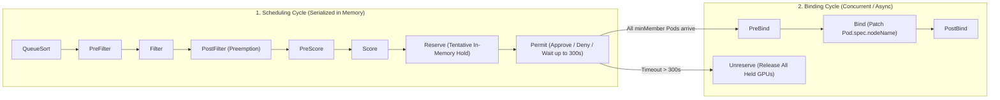
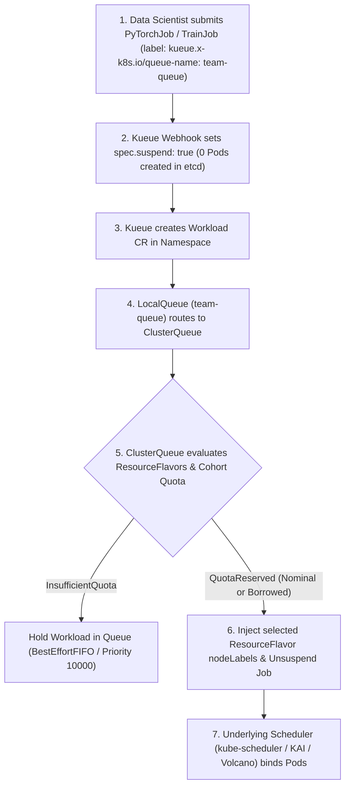

# 11.8 Kueue, Volcano and scheduler plugins

| | |
|---|---|
| Level | Advanced |
| Priority tier | 1 |
| Lab venue | GCP / GKE and local Python 3 simulation lab |
| Part | Part 11: GPUs on Kubernetes, scheduling and virtualization |
| Sources used | Roland Huß et al., *Generative AI on Kubernetes* (O'Reilly, 2026, Ch. 7); `volume-03/01-k8s-control-plane-scheduling-masterclass.md`; `volume-06/04-distributed-orchestration-masterclass.md`; *Scalable Kubernetes Infrastructure for AI Platforms* (O'Reilly, 2026, Ch. 2); *Kubernetes for Generative AI Solutions* (Packt, 2025, Ch. 10) |
| Coverage file | `planning/coverage/chapters/11-08.md` |

## Why this matters for AI infrastructure

Picture a four-Pod training job where 3 Pods fit on the cluster and the fourth cannot find a node. In Chapter 11.7, we saw why multi-node GPU jobs cannot run inside a single Pod. We also saw why standard per-Pod scheduling deadlocks distributed training runs when only a subset of Pods can fit on the cluster. Fixing that in a multi-tenant production AI cluster means answering three control-plane questions, one for each layer of Kubernetes involved.

The first question is about kube-scheduler itself. How does the scheduler hold 3 already-filtered Pods of a 4-Pod job in memory, without binding them to kubelet, until the fourth Pod also finds a valid node? If the fourth Pod fails before the timeout expires, how does the scheduler roll back those tentative reservations? The Kubernetes Scheduling Framework and the Coscheduling PodGroup plugin answer both parts. They use the Reserve, Permit, and Unreserve extension points, which are hooks where a plugin can step into the scheduling flow.

The second question sits above kube-scheduler. Standard Kubernetes ResourceQuota objects act as rigid namespace ceilings, and those ceilings leave expensive GPUs sitting idle. Say Team A has a guaranteed quota of 10 GPUs while Team B and Team C each have 16 GPUs. With hard ResourceQuotas, Team A cannot borrow the idle GPUs when Team B and Team C are inactive. A second cost follows. If unadmitted batch jobs immediately create thousands of Pending Pods in kube-apiserver, the etcd watch caches and Raft consensus can stall or crash. Kueue fixes both problems by sitting above the scheduler as a job-level admission controller. It keeps each job suspended, with zero Pods created, until nominal or borrowed cohort quota is reserved.

The third question comes from organizations that run heterogeneous high-performance computing (HPC), MPI, Ray, PyTorch, and Apache Spark workloads. They often need one engine that offers gang scheduling, task failure policies, Dominant Resource Fairness, and backfill together. Volcano is a full replacement batch scheduler built for that environment.

```text
Three Control-Plane Layers for Multi-Tenant GPU Batch Scheduling:
- Layer 1 (Inside kube-scheduler): 11 Scheduling Framework phases + Coscheduling PodGroup (minMember: 4, scheduleTimeoutSeconds: 300).
- Layer 2 (Above kube-scheduler - Kueue): Job-level admission (spec.suspend: true, 0 Pending Pods in etcd), ResourceFlavor tiers (16 NVLink+IB GPUs, 32 Ethernet GPUs), Cohort borrowing (nominalQuota: 10 + borrowingLimit: 22 = 32 max GPUs), and WorkloadPriorityClass (10000).
- Layer 3 (Batch Scheduler - Volcano): Monolithic batch scheduler (schedulerName: volcano) with PodGroup (minAvailable: 8, 64 GPUs) and event: PodEvicted -> action: RestartJob.
- Control-Plane Protection: etcd Raft quorum (3, 5, or 7 nodes on port 2379) and API Priority and Fairness (50 shares, 100 queues x 200 length = 20,000 buffered requests, handSize: 5).
```

Read the block from top to bottom. Each line names one layer and the job that layer does for the cluster.

This chapter walks through the internal mechanics of the scheduler plugins, the custom resource (CRD) schemas, the rules for flavor fungibility, the cohort borrowing and preemption rules, and the control-plane guards that keep the API server stable. It covers Scheduler Plugins, Kueue, and Volcano in that order. When a batch job stalls, start by asking which of these three layers is holding it back.

## Prerequisites and outcomes

### Prerequisites
This chapter builds on two earlier ones. You should have finished Chapter 11.6, which covers the kubelet Topology Manager and Guaranteed QoS. You should also have finished Chapter 11.7, which covers the single-node Pod boundary, PyTorch rendezvous barriers, and gang scheduling concepts. You will also need to be comfortable with Kubernetes Custom Resources, Admission Webhooks, and Namespaces, because the rest of the chapter depends on them.

### Outcomes
After completing this chapter, you will be able to:
- Trace a Pod through all 11 extension points of the Kubernetes Scheduling Framework, and explain how the Coscheduling PodGroup plugin uses Reserve, Permit, and Unreserve.
- Design a multi-tenant Kueue GPU-as-a-Service platform with ResourceFlavor, ClusterQueue, LocalQueue, Workload, and WorkloadPriorityClass.
- Predict the exact Kueue placement under `TryNextFlavor` and under `MayStopSearch`, and follow how `reclaimWithinCohort` and `withinClusterQueue` preempt GPU workloads.
- Configure Volcano Job, PodGroup, and RestartJob policies, and decide when to layer Kueue above Coscheduling, KAI Scheduler, or Volcano.
- Protect the kube-apiserver and the etcd Raft quorum during heavy batch job churn, using API Priority and Fairness shuffle sharding.

If the prerequisites feel unfamiliar, read those two chapters before you move on to the intermediate material.

## Concepts: basics to intermediate to advanced

### 1. Basics: The Kubernetes Scheduling Framework and the Coscheduling PodGroup plugin

#### The two-cycle kube-scheduler pipeline
Picture Pods from several training jobs reaching kube-scheduler at the same moment. A naive concurrent scheduler would race, and it could book the same physical GPU twice. The opposite design fails too. If the scheduler waited for every write to kube-apiserver to finish before it looked at the next Pod, scheduling throughput would collapse.

To prevent GPU double-booking while keeping throughput high, kube-scheduler splits every Pod placement into two sequential cycles. In the Scheduling Cycle, the scheduler works on one Pod at a time, in memory, to pick the best node and mark that node's resources as tentatively taken. In the Binding Cycle, the scheduler writes `spec.nodeName` to kube-apiserver asynchronously, with many goroutines running at once. The main scheduling loop never waits on the network.



Every Pod passes through 11 ordered extension points across these two cycles. The table lists them in order, and each row says what that gate does for a GPU Pod. Once you see what happens at each gate, it becomes clear how the Coscheduling PodGroup plugin implements gang scheduling without forking upstream Kubernetes.

| Phase # | Extension Point | Cycle | Role in GPU & Coscheduling Placement |
|---|---|---|---|
| 1 | **QueueSort** | Scheduling | Orders pending Pods in the active queue by PriorityClass (`critical-inference: 1000000`), creation timestamp, or PodGroup. |
| 2 | **PreFilter** | Scheduling | Checks group preconditions; rejects a PodGroup (`minMember: 4`) immediately if fewer than 4 Pods exist or an earlier member failed. |
| 3 | **Filter** | Scheduling | Eliminates nodes that lack allocatable `nvidia.com/gpu`, matching NodeAffinity, untainted access, or required NodePorts. |
| 4 | **PostFilter** | Scheduling | Runs only if Filter returns 0 feasible nodes; checks if preempting lower-priority Pods allows this Pod to fit. |
| 5–6 | **PreScore & Score** | Scheduling | Ranks feasible nodes using ImageLocality (cached 20 GB LLM image) and NodeResourcesFit (MostAllocated with GPU weight 5). |
| 7 | **Reserve** | Scheduling | Tentatively marks the chosen node's GPUs as assumed in scheduler memory before contacting kube-apiserver. |
| 8 | **Permit** | Scheduling | Gang-scheduling gate returning Approve (`Success`), Deny (`Reject`), or `Wait` in `WaitOnPermit` up to `scheduleTimeoutSeconds: 300`. |
| 9–11 | **PreBind, Bind, PostBind** | Binding | Once all 4 members reach Permit, all 4 goroutines wake up and patch `Pod.spec.nodeName` concurrently; if 300 seconds expire, `Unreserve` frees held GPUs. |

Take a four-Pod gang as an example. Pods 0, 1, and 2 pass Filter and Score. The Reserve step holds their GPUs in memory, and the Permit step parks them in the `WaitOnPermit` map. Once Pod 3 reaches Permit within 300 seconds, the Coscheduling plugin signals `Success` to all 4 waiting goroutines, so they bind together.

Now take the failure case. If 300 seconds pass while Pod 3 is still unschedulable, the timeout fires. Permit returns `Reject`, and `Unreserve` releases the held GPUs on all 3 nodes.

---

### 2. Intermediate: Kueue architecture in depth

#### Why PodGroup alone is not enough for multi-tenant GPUaaS
PodGroup gives you gang waiting inside kube-scheduler. On its own, though, it leaves three gaps in a multi-tenant cluster. First, every job still creates all of its Pending Pods right away in kube-apiserver and etcd, so a large batch submission can overwhelm the control plane. Second, PodGroup has no notion of multi-tenant quotas, cohort borrowing, or hardware-tier fallback. Third, it works on raw Pods rather than on higher-level batch objects such as PyTorchJob, TrainJob, RayJob, JobSet, or MPIJob.

Kueue (`kueue.x-k8s.io/v1beta2`), developed by Kubernetes SIG Scheduling, closes all three gaps. It acts as a job-level admission controller and queue manager above the scheduler. When a user submits a job, Kueue's mutating webhook sets `spec.suspend: true` right away. Because of that flag, zero Pods are created in etcd while the job waits in the queue.



Read the diagram as one path. The job is suspended first, then queued, and its Pods appear only after quota is reserved.

#### The four core Kueue resources and persona separation
Kueue separates two groups of people. Platform administrators work at the cluster level, and they define hardware tiers and cluster quotas once. Data scientists work in their own namespaces. They attach a single queue label (`kueue.x-k8s.io/queue-name`) to their training manifests and never hardcode node selectors.

| Kueue Resource | Scope & Owner | Operational Purpose | Concrete Example from Corpus |
|---|---|---|---|
| **1. ResourceFlavor** | Cluster-scoped (Platform Admin) | Defines a distinct hardware or topology tier via nodeLabels and tolerations | `gpu-nvlink-infiniband` (nvlink + infiniband + nvidia-h100) vs `gpu-standard-ethernet` (pcie + ethernet) |
| **2. ClusterQueue** | Cluster-scoped (Platform Admin) | Governs a pool of resources across ResourceFlavors, setting `nominalQuota`, `borrowingLimit`, cohort, `flavorFungibility`, and preemption | `topology-aware-cluster-queue` (16 NVLink+IB GPUs, 32 PCIe+Ethernet GPUs); `team-a-queue` in `shared-gpu-cohort` (10 nominal, 22 borrowing); `cluster-queue-h100` (1000 CPU, 4000Gi RAM, 128 H100 GPUs); `gpu-training` (32 H100s) and `gpu-development` (8 GPUs) |
| **3. LocalQueue** | Namespace-scoped (Admin creates; Data Scientist targets) | Namespace pointer mapping a team's namespace to a ClusterQueue; workloads bind via label `kueue.x-k8s.io/queue-name: team-queue` | `team-queue` -> `topology-aware-cluster-queue`; `team-a-training-queue` -> `team-a-queue` |
| **4. Workload & WorkloadPriorityClass** | Namespace-scoped (Workload) & Cluster-scoped (WorkloadPriorityClass) | Tracks job admission state (`QuotaReserved` vs `InsufficientQuota`), `podSetAssignments` (head: 1, worker: 1), and job priority | `production-priority` (value 10000) referenced by label `kueue.x-k8s.io/priority-class: production-priority` |

Look at the scope column first. The cluster-scoped rows are the platform team's job, and the namespace-scoped rows are what each team touches. That split is what lets one platform team serve many teams.

When you use Kubeflow Trainer's higher-level TrainJob API (`trainer.kubeflow.org/v1alpha1`) with Kueue or KAI Scheduler, the data scientist applies `kueue.x-k8s.io/queue-name` directly to the TrainJob metadata. The platform administrator sets the low-level Pod fields in the ClusterTrainingRuntime or TrainingRuntime template. Those template fields include `schedulerName`, Multus network annotations, and NCCL environment variables.

#### Ordered ResourceFlavor evaluation and flavorFungibility
A ClusterQueue can list several hardware tiers, and Kueue checks them in list order. Say the first flavor is `gpu-nvlink-infiniband` with 16 GPUs, and the second is `gpu-standard-ethernet` with 32 GPUs. Kueue first asks whether the job fits in the free nominal quota of the first flavor. If 8 free nominal GPUs exist in `gpu-nvlink-infiniband`, the job is admitted there right away, and its status reads `QuotaReserved`.

Now change the picture. All 16 nominal GPUs in the first flavor are busy, and 8 borrowable GPUs sit in the cohort for that flavor. The second flavor has 32 free nominal GPUs. Should the job borrow in the first flavor right away? If it does, the job runs on NVLink hardware, but it becomes exposed to preemption when the lending team reclaims its cohort quota. The `flavorFungibility.whenCanBorrow` setting controls that choice.

Work through the numbers for an 8-GPU job. The first flavor has no free nominal GPUs, so the job can only run there by borrowing 8 from the cohort. The second flavor has 32 free nominal GPUs, so the same job fits there without borrowing at all.

```text
Kueue Flavor Fungibility Behavior (Flavor 1: 16/16 used, 8 borrowable; Flavor 2: 0/32 used nominal):
- whenCanBorrow: MayStopSearch (Kueue default):
  Borrows 8 GPUs in Flavor 1 (gpu-nvlink-infiniband) immediately and stops searching Flavor 2.
- whenCanBorrow: TryNextFlavor (GAK Example 7-7):
  Skips borrowing in Flavor 1 and assigns 8 free NOMINAL GPUs in Flavor 2 (gpu-standard-ethernet) so the job cannot be cohort-preempted.
```

The first setting, `MayStopSearch`, is the default. It borrows in the first flavor and stops looking. The second setting, `TryNextFlavor`, spends the free nominal quota of the second flavor first, so the job cannot be preempted by cohort reclaim.

Once Kueue selects a flavor, it records the assignment in `status.admission.podSetAssignments` for each role. It then injects that flavor's `nodeLabels` into the Pod templates and sets `spec.suspend` to false.

#### Multi-tenant Cohort Borrowing and Preemption
Standard ResourceQuota objects create rigid silos between teams. Suppose Team A has a hard ceiling of 10 GPUs and needs 28 GPUs for a weekend training run. Team B and Team C sit idle with 16 GPUs each. Under standard ResourceQuotas, Team A is blocked, and 32 expensive GPUs stay dark.

Kueue lets you join several ClusterQueues into a shared cohort, such as `shared-gpu-cohort`. That makes opportunistic sharing low-risk. Team A gets a guaranteed baseline of `nominalQuota: 10` GPUs plus a `borrowingLimit: 22`, so it can grow to 32 effective GPUs when its cohort peers are idle. To make lending safe for Team B and Team C, Kueue enforces two distinct preemption mechanisms alongside `BestEffortFIFO` queueing.

Follow the example below as a story. Team A is already running 28 GPUs, which is 10 nominal plus 18 borrowed. When Team B submits an 8-GPU job to reclaim its own quota, the first rule applies. When Team A submits a 36-GPU total (28 + 8), that is more than its 32-GPU maximum, so the second rule applies.

```text
Kueue Cohort Borrowing & Preemption Mechanics (GAK Example 7-9):
- Team A quota config: cohort: shared-gpu-cohort, nominalQuota: 10, borrowingLimit: 22 -> max effective ceiling = 32 GPUs.
- Active state: Team A is running jobs using 28 GPUs (10 nominal + 18 borrowed from cohort; 4 borrowable GPUs remain under ceiling).
- Preemption Rule 1 (reclaimWithinCohort: Any):
  When Team B submits an 8-GPU job to reclaim its own nominal quota, Kueue preempts Team A's borrowed workload regardless of priority.
- Preemption Rule 2 (withinClusterQueue: LowerPriority):
  When Team A submits a job with WorkloadPriorityClass production-priority (value: 10000) and cannot fit (28 + 8 = 36 > 32 max), Kueue preempts Team A's lower-priority experimental job (value: 100).
```

Under the first rule, Team A's borrowed workload is preempted no matter what its priority is. Under the second, Team A's own lower-priority job is preempted to make room for the higher-priority one.

Notice the separation between three different settings. ResourceFlavor decides which hardware tier a job lands on. The WorkloadPriorityClass, with value 10000, decides which queued job is admitted first at the queue layer. A standard Kubernetes PriorityClass, such as `critical-inference` with value 1000000, works inside kube-scheduler and kubelet to control Pod-level node preemption and eviction order.

ClusterQueue quota accounting tracks admitted resource requests, not physical node health. Suppose `cluster-queue-h100` has `nominalQuota: 128` GPUs across 16 nodes. If 2 nodes are cordoned or NotReady, quota accounting may still admit two 64-GPU jobs. The second job then cannot find 8 healthy nodes.

Enabling `waitForPodsReady` in Kueue closes this gap. If an admitted job's Pods do not reach Ready within a timeout, Kueue suspends and requeues the workload, so it cannot block the queue forever. When you size a shared queue, count healthy nodes as well as quota.

---

### 3. Advanced: Volcano batch scheduling, layered architectures, and control-plane protection

#### Volcano architecture
Kueue is a job-level admission controller that hands Pod-to-node binding to an underlying scheduler. Volcano takes a different route. It is a monolithic batch scheduling system from the Cloud Native Computing Foundation (CNCF), and it replaces kube-scheduler when you set `schedulerName: volcano`. Teams that run a mix of PyTorch, MPI, Ray, and Apache Spark workloads often choose it. They want gang scheduling, task-level failure recovery, Dominant Resource Fairness, and backfill inside a single scheduler binary.

Volcano adds three tightly coupled custom resources: Job (`batch.volcano.sh/v1alpha1`), PodGroup (`scheduling.volcano.sh/v1beta1`), and Queue (`scheduling.volcano.sh/v1beta1`). A Volcano Job can combine several task templates. It sets `minAvailable: 8` at the job level and applies event-driven lifecycle policies to the whole gang.

Consider an 8-Pod distributed training job. Suppose one worker Pod is evicted or crashes. If the other 7 Pods keep running, they hang inside NCCL AllReduce until the collective timer expires. Configuring `event: PodEvicted` with `action: RestartJob` in the Volcano Job spec tells the controller to tear down all 7 surviving Pods at once. Volcano then requeues the entire 8-Pod gang cleanly from its last checkpoint.

#### Architectural trade-offs: Coscheduling vs Kueue vs Volcano vs KAI Scheduler
The table compares the four options on the questions that matter most. It covers whether each one replaces kube-scheduler, whether it creates Pending Pods while a job waits, and how it combines with the others.

| Criterion | Coscheduling (PodGroup) | Kueue | Volcano | NVIDIA KAI Scheduler |
|---|---|---|---|---|
| **Replaces kube-scheduler?** | **No** (plugin inside kube-scheduler) | **No** (admission controller above scheduler) | **Yes** (`schedulerName: volcano`) | **Yes** (`schedulerName: kai-scheduler`) |
| **Creates Pending Pods in etcd while queued?** | **Yes** (Pods wait in Permit / ActiveQ) | **No** (Job stays `spec.suspend: true` as a single Workload CR) | **Yes / Partial** (enqueue action gates PodGroup in scheduler cache) | **Yes / Managed** via PodGroup & queues |
| **Multi-tenant Quota & Cohort Borrowing?** | No | **Yes** (ClusterQueue, LocalQueue, cohort, `borrowingLimit`) | **Yes** (Queue weights & reclaim action) | **Yes** (Project CRD `gpuQuota` & hierarchical fair-share) |
| **Hardware Topology Awareness?** | Manual node labels / affinity only | Admission-level ResourceFlavor tiering + Topology TAS | Built-in topology scoring plugins | Native NVLink, NVSwitch, MIG & fractional GPU awareness |
| **Layered Combination?** | Can run under Kueue | Can sit above kube-scheduler, KAI, or Volcano | Usually standalone or under Kueue | Runs standalone or under Kueue |

Look at the Pending Pods row first. Kueue is the only option that creates no Pending Pods while a job waits, and the last row shows it can sit above the others.

#### Protecting etcd quorum and kube-apiserver with API Priority and Fairness
Large-scale batch scheduling sends intense bursts of Workload, PodGroup, Pod, and Event writes. An undersized control plane can become unstable under that load. If etcd loses Raft quorum or suffers high disk write latency, kube-apiserver rejects writes, and gang-scheduling timeouts misfire across the whole cluster.

Raft consensus needs a strict majority to commit any state change. That majority is `(N // 2) + 1` healthy nodes. You should always deploy an odd number of etcd nodes, typically 3 or 5, on dedicated low-latency NVMe storage. Never deploy an even number such as 4 or 6. Adding a 4th node raises the required quorum from 2 to 3, yet the cluster still tolerates only 1 node failure. That adds write replication latency for no extra fault tolerance.

The block below works through the quorum math. Each line gives the quorum for a node count and the number of failures the cluster survives.

```text
etcd Raft Quorum Math (Quorum = N // 2 + 1) and Operational Rules (volume-03):
- 3 nodes: Quorum = 2, tolerates 1 node failure (3 - 2 = 1).
- 4 nodes (ANTI-PATTERN): Quorum = 3, tolerates 1 node failure (4 - 3 = 1) with higher Raft write latency.
- 5 nodes (Production Recommended): Quorum = 3, tolerates 2 node failures (5 - 3 = 2).
- 6 nodes (ANTI-PATTERN): Quorum = 4, tolerates 2 node failures (6 - 4 = 2).
- 7 nodes: Quorum = 4, tolerates 3 node failures (7 - 4 = 3).
- Dead-node replacement rule (3-node cluster with 1 dead node, 2 live nodes):
  ALWAYS run `etcdctl member remove` BEFORE adding the replacement node. Adding a 4th member first raises quorum to 3 with only 3 live nodes; if 1 node blips during snapshot sync, live nodes drop to 2 < 3 and crash the control plane.
- Multi-AZ split-brain (etcd-0, etcd-1 in AZ-A; etcd-2 in AZ-B):
  If AZ-A and AZ-B partition, AZ-A (2 >= 2) keeps quorum and serves traffic; AZ-B (1 < 2) loses quorum and rejects writes.
```

The dead-node rule is the one to remember. Run `etcdctl member remove` before you add the replacement node, because adding it first pushes quorum up while only 3 nodes are alive.

In production, platform teams watch four golden control-plane metrics: `apiserver_request_total`, `apiserver_request_duration_seconds`, `etcd_disk_wal_fsync_duration_seconds`, and `scheduler_scheduling_algorithm_duration_seconds`. To stop runaway batch controllers or user scripts from starving kubelet heartbeats, configure an API Priority and Fairness (APF) PriorityLevelConfiguration named `ai-workload-level`. It sets 50 concurrency shares, 100 queues, a hand size of 5, and a queue length limit of 200. Together those settings buffer up to 20,000 in-flight batch requests.

Shuffle sharding with a hand size of 5 means a single noisy tenant can use at most 5 of the 100 queues. That is 5% of the pool. Size the APF queues before the first large batch submission, and treat the four metrics as your early warning.

## Commands and configurations that matter

### 1. Defining Kueue ResourceFlavors, ClusterQueue, and LocalQueue

Platform administrators write these objects once. Two ResourceFlavors describe the hardware tiers, a ClusterQueue draws quota from both, and a LocalQueue points a team's namespace at it.

```yaml
# kueue-topology-flavors-and-queues.yaml (Kueue v1beta2, checked against the v0.20.5 CRDs)
apiVersion: kueue.x-k8s.io/v1beta2
kind: ResourceFlavor
metadata:
  name: gpu-nvlink-infiniband
spec:
  nodeLabels:
    gpu-interconnect: nvlink
    network-fabric: infiniband
    gpu-type: nvidia-h100
---
apiVersion: kueue.x-k8s.io/v1beta2
kind: ResourceFlavor
metadata:
  name: gpu-standard-ethernet
spec:
  nodeLabels:
    gpu-interconnect: pcie
    network-fabric: ethernet
    gpu-type: nvidia-h100
---
apiVersion: kueue.x-k8s.io/v1beta2
kind: ClusterQueue
metadata:
  name: topology-aware-cluster-queue
spec:
  namespaceSelector: {}
  resourceGroups:
    - coveredResources: ["nvidia.com/gpu"]
      flavors:
        - name: gpu-nvlink-infiniband
          resources:
            - name: nvidia.com/gpu
              nominalQuota: 16
        - name: gpu-standard-ethernet
          resources:
            - name: nvidia.com/gpu
              nominalQuota: 32
  flavorFungibility:
    whenCanBorrow: TryNextFlavor
    whenCanPreempt: MayStopSearch
---
apiVersion: kueue.x-k8s.io/v1beta2
kind: LocalQueue
metadata:
  name: team-queue
  namespace: team-a
spec:
  clusterQueue: topology-aware-cluster-queue
```

Kueue evaluates flavors in list order, so the NVLink flavor comes first. The `flavorFungibility` block sets the borrowing behavior covered earlier.

### 2. Configuring Kueue Cohort Borrowing, Priority Preemption, and APF PriorityLevelConfiguration

This file adds the cohort, the preemption rules, a WorkloadPriorityClass, and an APF PriorityLevelConfiguration. The team's ClusterQueue can borrow up to 32 GPUs, which is its nominal 10 plus the 22 it may borrow.

```yaml
# kueue-cohort-priority-and-apf.yaml (Kueue v1beta2, checked against the v0.20.5 CRDs)
apiVersion: kueue.x-k8s.io/v1beta2
kind: ClusterQueue
metadata:
  name: team-a-queue
spec:
  cohortName: shared-gpu-cohort
  resourceGroups:
    - coveredResources: ["nvidia.com/gpu"]
      flavors:
        - name: default-flavor
          resources:
            - name: nvidia.com/gpu
              nominalQuota: 10
              borrowingLimit: 22
  queueingStrategy: BestEffortFIFO
  preemption:
    reclaimWithinCohort: Any
    withinClusterQueue: LowerPriority
---
apiVersion: kueue.x-k8s.io/v1beta2
kind: WorkloadPriorityClass
metadata:
  name: production-priority
value: 10000
description: "High priority for production training jobs"
---
apiVersion: flowcontrol.apiserver.k8s.io/v1
kind: PriorityLevelConfiguration
metadata:
  name: ai-workload-level
spec:
  type: Limited
  limited:
    nominalConcurrencyShares: 50
    limitResponse:
      type: Queue
      queuing:
        queues: 100
        handSize: 5
        queueLengthLimit: 200
```

The `preemption` block holds the two rules from earlier. `reclaimWithinCohort: Any` lets a lender take back borrowed GPUs, and `withinClusterQueue: LowerPriority` lets a higher-priority job preempt a lower one in the same queue.

### 3. Inspecting Kueue Workload admission status and taking an etcd snapshot

The first two commands show why a Workload is waiting or admitted. The last two check etcd health and save a snapshot before an upgrade.

```bash
# 1. Inspect Kueue Workload admission and podSetAssignments (untested here)
kubectl get workloads -n team-a
kubectl get workload -n team-a -o yaml

# 2. Verify etcd endpoint health and save a pre-upgrade snapshot on port 2379 (untested here)
ETCDCTL_API=3 etcdctl --endpoints=https://127.0.0.1:2379 \
  --cacert=/etc/kubernetes/pki/etcd/ca.crt \
  --cert=/etc/kubernetes/pki/etcd/server.crt \
  --key=/etc/kubernetes/pki/etcd/server.key \
  endpoint status --write-out=table

ETCDCTL_API=3 etcdctl --endpoints=https://127.0.0.1:2379 \
  --cacert=/etc/kubernetes/pki/etcd/ca.crt \
  --cert=/etc/kubernetes/pki/etcd/server.crt \
  --key=/etc/kubernetes/pki/etcd/server.key \
  snapshot save /var/lib/etcd-backup.db
```

Once the Workload is admitted, its status looks like the block below. When you read it, the admission section tells you the ClusterQueue and the flavor chosen for each role.

```yaml
status:
  conditions:
    - type: Admitted
      status: "True"
      reason: "QuotaReserved"
      message: "The workload is admitted and quota is reserved"
  admission:
    clusterQueue: "ai-training-cluster-queue"
    podSetAssignments:
      - count: 1
        flavors:
          nvidia.com/gpu: gpu-training-flavor
        name: head
      - count: 1
        flavors:
          nvidia.com/gpu: gpu-training-flavor
        name: worker
```

When a job looks stuck, start with `kubectl get workloads`, and take the etcd snapshot before you upgrade.

## How it fails

Each row below starts with a symptom you can see on screen and traces it to the layer where the cause lives. Read a row from left to right, and the remediation sits at the end. The first and second symptoms both look like a job that is not running, but the causes sit in different places.

| Failure mode | Exact symptom & command evidence | Root cause boundary | Remediation |
|---|---|---|---|
| **1. PyTorchJob or TrainJob creates 0 Pods and appears "frozen"** | User submits PyTorchJob, `kubectl get pods -n team-a` shows no Pods at all, and `kubectl get pytorchjob` shows Suspended. | **Kueue Queue Hold (`InsufficientQuota` or Missing LocalQueue):** Kueue mutated `spec.suspend: true` on submission. Inspecting `kubectl get workloads -n team-a -o yaml` reveals `reason: "InsufficientQuota"`, or LocalQueue `team-queue` is missing. | Always inspect `kubectl get workloads -n <ns>` first when using Kueue. Verify LocalQueue exists and check ClusterQueue used and borrowed GPU counts. |
| **2. Workload unexpectedly borrows preemptible quota in Flavor 1 instead of using free nominal quota in Flavor 2** | ClusterQueue has `gpu-nvlink-infiniband` (16/16 used, borrowable in cohort) and `gpu-standard-ethernet` (0/32 used). A batch job gets admitted into `gpu-nvlink-infiniband` via cohort borrowing and is preempted 10 minutes later when the lending team reclaims quota. | **Default `whenCanBorrow: MayStopSearch` Behavior:** Under Kueue's default `MayStopSearch`, if borrowing is possible in the first flavor, Kueue stops searching and borrows immediately rather than checking whether the next flavor has free nominal quota. | Set `flavorFungibility.whenCanBorrow: TryNextFlavor` on the ClusterQueue so Kueue exhausts free nominal quota across all acceptable flavors before borrowing from the cohort. |
| **3. Coscheduling PodGroup repeatedly cycles from Reserve to Rejected every 300 seconds** | 3 of 4 Pods in `llm-training-group` pass Filter and Score, wait 300 seconds in `WaitOnPermit`, and are rejected (`Unreserve`) because the 4th Pod fails node affinity or topology filters. | **Permit Gate Timeout (`scheduleTimeoutSeconds: 300`):** The cluster lacks a 4th node matching the Pod's selector, taint, or resource requirements, causing the PodGroup to hold 3 nodes for 5 minutes per retry cycle. | Inspect the FailedScheduling event on the 4th Pod (`llm-training-3`) or layer Kueue ResourceFlavor quota checks above PodGroup so the group is not unsuspended until 4 matching nodes are available. |
| **4. Evicted Volcano worker Pod leaves 7 sibling Pods hanging until NCCL timeout** | One node reboots under an 8-Pod Volcano training job; the evicted Pod is not recreated as a full gang reset, leaving the remaining 7 Pods hung in AllReduce. | **Missing `PodEvicted -> RestartJob` Task Policy:** The Volcano Job spec omitted `policies: [{event: PodEvicted, action: RestartJob}]` and `PodFailed`. | Add `event: PodEvicted` and `event: PodFailed` with `action: RestartJob` to `VolcanoJob.spec.policies` so any single-rank failure cleanly restarts the entire gang. |
| **5. Adding a 4th etcd node to replace a dead 3rd node crashes the control plane** | In a 3-node etcd cluster (`etcd-0`, `etcd-1`, `etcd-2`) where `etcd-2` died (2/3 healthy, quorum 2 intact), an operator adds `etcd-3` before removing dead `etcd-2`. During state sync, `etcd-1` restarts or blips, and the entire Kubernetes API server goes down (`raft: lost quorum`). | **etcd Even-Node Quorum Trap:** Adding `etcd-3` first raises cluster membership to 4 nodes, which increases required Raft quorum from 2 to 3 (`4 // 2 + 1 = 3`). With `etcd-2` already dead, any transient blip on 1 of the 3 remaining nodes drops live nodes to 2 < 3. | Always run `etcdctl member remove <dead-member-id>` to reduce the cluster from 3 to 2 before adding the replacement 3rd node. |


When a job misbehaves, match its symptom to one of these rows before you change any manifest, so you know which layer to check first. If you see the first symptom, start with the workloads, not the Pods.

## Hands-on lab

### Venue and scope
This lab runs on your own machine, using only the Python 3 standard library. The two scripts are `code/part11/kueue_volcano_and_plugins.py` and `code/part11/kueue_volcano_and_plugins_lab.py`. Together they simulate the 11-phase Kubernetes Scheduling Framework, the Coscheduling Permit and Unreserve gate, Kueue's ordered ResourceFlavor selection, cohort borrowing and preemption, Volcano RestartJob policies, APF shuffle-sharding queue capacity, and etcd Raft quorum math. Cluster commands are marked `(untested here)`, so treat them as the intended form rather than something this lab ran.

### Step 1: Run the self-checking Kueue, Volcano, and scheduler plugins lab (tested here)

Run the lab script from the repository root. It checks its own results, so you do not need to compare output by hand.

```bash
python3 code/part11/kueue_volcano_and_plugins_lab.py
```

The output below was captured from this repository. Each line is one check, and a line that starts with `[PASS]` means that check held.

```text
=== Chapter 11.8 Lab: Kueue, Volcano & Kubernetes Scheduler Plugins ===
  [PASS] Scheduling Framework executes Filter -> Score -> Reserve -> Permit -> Bind in order
  [PASS] Coscheduling Permit returns 'Wait' when 3 of 4 PodGroup members have reached Reserve (120s <= 300s)
  [PASS] Coscheduling Permit rejects and triggers Unreserve across peers when wait exceeds scheduleTimeoutSeconds (300s)
  [PASS] Coscheduling Permit returns 'Success' once all 4 PodGroup members arrive within 300s
  [PASS] Kueue admits 8-GPU job into first listed flavor (gpu-nvlink-infiniband) when nominal quota (16) has 8 free
  [PASS] With whenCanBorrow: TryNextFlavor, Kueue prefers nominal quota in gpu-standard-ethernet over borrowing in first flavor
  [PASS] With default whenCanBorrow: MayStopSearch, Kueue borrows in gpu-nvlink-infiniband and stops searching
  [PASS] When all flavors are exhausted (16/16 and 32/32), Kueue keeps Workload suspended with reason: InsufficientQuota
  [PASS] Team A (nominal=10, borrowingLimit=22 -> 32 max) using 28 GPUs (18 borrowed) is preempted when Team B reclaims cohort quota
  [PASS] High-priority Team A job (production-priority=10000) preempts lower-priority Team A job via withinClusterQueue: LowerPriority
  [PASS] Volcano holds Job in Pending state with 0 active pods when only 6 of 8 minAvailable pods can fit
  [PASS] Volcano transitions Job to Running once all 8 minAvailable pods can be placed
  [PASS] When 1 worker pod is evicted, Volcano policy (event: PodEvicted -> action: RestartJob) restarts the entire 8-pod gang
  [PASS] APF PriorityLevelConfiguration (100 queues x 200 queueLengthLimit, handSize=5) buffers up to 20,000 requests
  [PASS] Kubernetes PriorityClass critical-inference (value: 1000000) and Kueue WorkloadPriorityClass (value: 10000) are distinct
  [PASS] cluster-queue-h100 (1000 CPU, 4000Gi memory, 128 H100 GPUs) admits at most two 64-GPU PyTorchJobs simultaneously
  [PASS] GAK Ch 7 multi-tier ClusterQueues allocate 32 H100s to gpu-training and 8 GPUs to gpu-development
  [PASS] etcd quorum (N//2 + 1) is 2 for 3 nodes, 3 for 4 or 5 nodes, and 4 for 7 nodes
  [PASS] A 4-node etcd cluster requires quorum 3 and tolerates only 1 failure (same as 3 nodes, higher write latency)
  [PASS] Kueue Workload status.admission.podSetAssignments maps both head (1) and worker podSets to selected ResourceFlavors
  [PASS] Scheduler Framework model tracks all 11 standard extension points from QueueSort to PostBind
  [PASS] FlavorQuotaState tracks free_nominal (16-8=8 for premium, 32-0=32 for standard)
  [PASS] FlavorQuotaState caps max_borrowable_now at min(cohort_borrowable_free=8, borrowing_limit=8)
  [PASS] When Team A uses 28 of its 32 max effective GPUs (10 nominal + 18 borrowed), 4 borrowable GPUs remain unused
  [PASS] etcd client health and snapshot commands target standard port 2379

Summary: 25 passed, 0 failed out of 25 checks.
```

The summary line at the bottom confirms that every check passed.

### Exercises

The exercises reuse the same functions as the lab, so you can test your reasoning against the code. Work through the six items in order. Each one gives you the function to call and the inputs to use.

1. Use `evaluate_coscheduling_permit_gate()` in `code/part11/kueue_volcano_and_plugins.py` to compare the Permit status, and whether Unreserve is triggered, for `llm-training-group`. Check the three timing scenarios in the input block below.
2. Use `select_kueue_resource_flavor()` with the two flavor quota states from the input block. Work out the selected flavor and the borrowing status for an 8-GPU job under `TryNextFlavor`, and then under `MayStopSearch`.
3. Team A in `team-a-queue` has a nominal quota of 10 GPUs and a borrowing limit of 22 GPUs in `shared-gpu-cohort`. Assume Team A is actively using 28 GPUs. Calculate how many GPUs Team A is borrowing and how many more it can still borrow. Then trace what happens when Team B submits an 8-GPU job under `reclaimWithinCohort: Any`.
4. Use `evaluate_kueue_cohort_and_preemption()` to trace the case where Team A is already at 28 GPUs and submits another 8-GPU job with priority 10000. A lower-priority experimental job with priority 100 is running in the same queue. What happens to it?
5. Use `evaluate_volcano_job_event()` to explain why an 8-Pod Volcano distributed training job sets `event: PodEvicted` to `action: RestartJob`. Why does it not restart only the single evicted container?
6. Compute the required Raft quorum and the maximum tolerated node failures for 3, 4, 5, and 7 etcd nodes. Then call `compute_apf_queue_capacity()` with the parameters in the input block to get the total maximum buffered requests across all 100 queues.

The inputs for all six exercises are listed below. Use these values exactly as written.

```text
Exercise Input Parameters:
- Exercise 1: min_member=4, schedule_timeout_seconds=300; cases: (a) 3 Pods at 120s, (b) 3 Pods at 305s, (c) 4 Pods at 40s.
- Exercise 2: gpu-nvlink-infiniband (nominal_quota=16, used_nominal=16, cohort_borrowable_free=8, borrowing_limit=8); gpu-standard-ethernet (nominal_quota=32, used_nominal=0).
- Exercise 3 & 4: nominalQuota=10, borrowingLimit=22 (32 max effective GPUs), active=28 GPUs, new job=8 GPUs (28 + 8 = 36 > 32), priority 10000 vs 100.
- Exercise 5: minAvailable=8, replicas=8, 1 Pod evicted -> RestartJob tears down 7 survivors (active_pods=0, job_state="Restarting").
- Exercise 6: etcd nodes = 3, 4, 5, 7; APF compute_apf_queue_capacity(50, 100, 5, 200) -> 20,000 buffered requests.
```

Run the lab first, then work the exercises. The lab shows which checks pass, and the exercises ask you to reason through the same cases yourself.

## Checkpoint questions

<details>
<summary>**1. What are the two cycles of the Kubernetes Scheduling Framework, and why is the Scheduling Cycle serialized while the Binding Cycle is concurrent?**</summary>

The Scheduling Cycle runs QueueSort, PreFilter, Filter, PostFilter, PreScore, Score, Reserve, and Permit one Pod at a time. Running it serially means you never see two Pods claim the same GPU in the scheduler cache at once. After Reserve and Permit approve a Pod, the Binding Cycle runs PreBind, Bind, and PostBind in parallel goroutines. That keeps API server network latency from blocking the scheduling loop.
</details>

<details>
<summary>**2. How do the Reserve, Permit, and Unreserve extension points work together in the Coscheduling PodGroup plugin?**</summary>

Reserve holds a Pod's chosen GPUs in memory once the Pod passes Filter and Score. For a PodGroup with `minMember: 4`, Permit then returns Wait and parks each Pod in `WaitOnPermit` for up to 300 seconds. If the 4th Pod arrives in time, Permit approves all 4 Pods together so they bind. If 300 seconds pass with fewer than 4 Pods, Permit rejects the group, and Unreserve runs on every held Pod to free their GPUs at once.
</details>

<details>
<summary>**3. What is the difference between a Kubernetes PriorityClass and a Kueue WorkloadPriorityClass?**</summary>

A Kubernetes PriorityClass, such as `critical-inference` with value 1000000, works at the Pod scheduling and kubelet layer. It controls QueueSort, node-level Pod preemption in PostFilter, and the order of node-pressure eviction. A Kueue WorkloadPriorityClass, such as `production-priority` with value 10000, works at the job admission layer. It orders queued Workloads and triggers quota preemption, without changing Pod-level node eviction priority.
</details>

<details>
<summary>**4. Walk through the seven steps of the Kueue job admission lifecycle from job submission to Pod creation.**</summary>

First, a data scientist submits a job with the `kueue.x-k8s.io/queue-name: team-queue` label. Second, Kueue's mutating webhook sets `spec.suspend: true`, so zero Pods are created. Third, Kueue creates a shadow Workload object in the namespace. Fourth, the LocalQueue routes that Workload to the ClusterQueue. Fifth, the ClusterQueue checks quota and ResourceFlavor availability. Sixth, once quota is reserved, Kueue injects the selected flavor's `nodeLabels` into the Pod templates and sets `spec.suspend: false`. Seventh, the job controller creates the Pods, and the underlying scheduler binds them to nodes.
</details>

<details>
<summary>**5. Why does standard Kubernetes ResourceQuota lead to poor GPU utilization in multi-tenant clusters, and how do Kueue Cohorts solve it?**</summary>

Standard ResourceQuota enforces a hard, static ceiling for each namespace. Consider Team A, capped at 10 GPUs, which needs 28 GPUs. Team B and Team C sit idle with 16 GPUs each. ResourceQuota blocks Team A and leaves 32 GPUs unused. Kueue Cohorts fix this. If you set `nominalQuota: 10` and `borrowingLimit: 22`, Team A can borrow up to 22 idle GPUs. Under `reclaimWithinCohort: Any`, Team A gives back those borrowed GPUs automatically as soon as Team B or Team C submits work.
</details>

<details>
<summary>**6. In Generative AI on Kubernetes Example 7-7, what is the difference between MayStopSearch and TryNextFlavor?**</summary>

Suppose the first listed ResourceFlavor, `gpu-nvlink-infiniband` with nominal quota 16, is fully used (16/16) but can borrow from the cohort. The second flavor, `gpu-standard-ethernet` with nominal quota 32, has free nominal quota. Under the default `MayStopSearch`, Kueue borrows in the first flavor and stops searching. Under `TryNextFlavor`, Kueue checks the next flavor first, so the workload uses non-preemptible nominal quota in the fallback flavor before it borrows.
</details>

<details>
<summary>**7. How does Kueue steer a PyTorchJob onto H100 nodes with NVLink and InfiniBand without the data scientist writing nodeSelector rules in their PyTorchJob YAML?**</summary>

The platform administrator defines the labels `gpu-interconnect: nvlink`, `network-fabric: infiniband`, and `gpu-type: nvidia-h100` in the `gpu-nvlink-infiniband` ResourceFlavor. The data scientist only adds `kueue.x-k8s.io/queue-name: team-queue` to the PyTorchJob. When Kueue admits the Workload into that flavor, it injects those `nodeLabels` as `nodeSelector` terms into the job's PodSet templates. The data scientist never writes those rules.
</details>

<details>
<summary>**8. What is the difference between Kueue's reclaimWithinCohort: Any and withinClusterQueue: LowerPriority preemption settings?**</summary>

`reclaimWithinCohort: Any` lets a ClusterQueue such as Team B reclaim its guaranteed `nominalQuota` when that quota is lent out in the cohort. It can preempt the borrower's workloads regardless of priority, so Team B can always get back its baseline capacity. `withinClusterQueue: LowerPriority` works differently. A new high-priority workload with `value: 10000` can preempt a lower-priority workload inside the same ClusterQueue.
</details>

<details>
<summary>**9. What does Kueue's BestEffortFIFO queueingStrategy do when the head job in a ClusterQueue cannot fit in current free quota?**</summary>

Unlike `StrictFIFO`, which blocks every job behind the head job even when smaller jobs would fit in the remaining quota, `BestEffortFIFO` admits jobs in FIFO order without hard head-of-line blocking. If an older large job cannot fit right now, you will see Kueue keep it queued and admit the smaller jobs behind it that do fit in the free quota.
</details>

<details>
<summary>**10. In Kueue, what is the difference between checking kubectl get pytorchjob and kubectl get workloads?**</summary>

`kubectl get pytorchjob` shows only the framework job object, which stays Suspended until admission. `kubectl get workloads` inspects Kueue's own admission resource. It shows the Admitted condition, the `QuotaReserved` or `InsufficientQuota` reason, the selected ClusterQueue, and the ResourceFlavor assigned to each PodSet, for the head and worker roles.
</details>

<details>
<summary>**11. How does Volcano's architecture differ from Kueue's architecture?**</summary>

If you look at Kueue, it is a lightweight Kubernetes SIG Scheduling controller. It acts only as a job-level admission and queue manager, and it hands Pod-to-node scheduling to kube-scheduler or another scheduler. Volcano is a monolithic CNCF batch scheduler. It replaces kube-scheduler when you set `schedulerName: volcano`. It bundles its own Job, PodGroup, and Queue CRDs with gang scheduling, Dominant Resource Fairness (DRF) sharing, backfill, and topology scoring in one binary.
</details>

<details>
<summary>**12. In a Volcano Job, what do minAvailable: 8 and the PodEvicted -> RestartJob policy accomplish?**</summary>

`minAvailable: 8` tells `volcano-scheduler` not to bind any Pods of the job unless at least 8 Pods can be placed at the same time. The `event: PodEvicted` policy with `action: RestartJob` tells the Volcano controller to tear down all remaining Pods if any Pod in the running gang is evicted. Volcano then restarts the whole 8-Pod gang, rather than leaving 7 Pods stuck in a broken NCCL ring. Without it, you could end up with exactly that.
</details>

<details>
<summary>**13. Why do many production AI platforms layer Kueue on top of Volcano or NVIDIA KAI Scheduler instead of using only one tool?**</summary>

Layering splits the work between two tiers. Kueue supplies multi-tenant ClusterQueue and LocalQueue governance, cohort borrowing, and ResourceFlavor tier routing. It keeps unadmitted jobs suspended, so they create zero Pending Pods in etcd. Once Kueue unsuspends a job, Volcano or NVIDIA KAI Scheduler performs the low-level atomic gang binding and NVLink or InfiniBand topology placement.
</details>

<details>
<summary>**14. Why is ClusterQueue quota admission alone not always proof that 64 physical GPUs are ready on nodes, and what Kueue feature closes that gap?**</summary>

Quota accounting in `cluster-queue-h100` counts admitted requests against `nominalQuota: 128`. For example, if 2 nodes with 16 GPUs each are cordoned or NotReady, the quota can still show 64 GPUs free, yet the physical nodes cannot schedule all 8 Pods. Enabling `waitForPodsReady` closes that gap. If an admitted job's Pods do not become Ready within a timeout, Kueue suspends and requeues the workload, so it does not block the queue indefinitely.
</details>

<details>
<summary>**15. Why is a 4-node etcd cluster discouraged compared to a 3-node or 5-node etcd cluster?**</summary>

Raft consensus needs a strict majority of `(N // 2) + 1` nodes. If you run a 3-node cluster, quorum is 2 and it tolerates 1 failure. A 4-node cluster has quorum 3 and also tolerates only 1 failure. A 5-node cluster has quorum 3 and tolerates 2 failures. The 4-node layout therefore adds replication overhead and raises the quorum from 2 to 3, without adding any fault tolerance.
</details>

<details>
<summary>**16. In a 3-node etcd cluster where 1 node has permanently failed, why must you run etcdctl member remove before adding the replacement node?**</summary>

While 1 of 3 nodes is dead, the 2 remaining nodes still hold the quorum of 2. If you add a new fourth member before removing the dead one, the cluster has 4 members and needs quorum 3, but only 3 nodes are alive. If one existing node blips during snapshot transfer, only 2 nodes remain. That loses quorum and crashes the control plane. So remove the dead member with `etcdctl member remove` first.
</details>

<details>
<summary>**17. What happens if a multi-AZ 3-node etcd cluster with two nodes in AZ-A and one node in AZ-B suffers a network partition between the two availability zones?**</summary>

The AZ-A side holds 2 of the 3 nodes, so it keeps quorum, since 2 is at least 2. It keeps or elects a Raft leader and continues to serve all Kubernetes API reads and writes. The AZ-B side holds only 1 node, which is below quorum, since 1 is less than 2. It loses quorum at once and rejects all writes and linearizable reads until the partition heals.
</details>

<details>
<summary>**18. Which four Prometheus metrics does Volume 03 Section 10 highlight for monitoring kube-apiserver, etcd, and kube-scheduler health under AI batch load?**</summary>

Platform teams monitor `apiserver_request_total` for request volume, `apiserver_request_duration_seconds` for API latency, `etcd_disk_wal_fsync_duration_seconds` for Write-Ahead Log disk fsync latency, and `scheduler_scheduling_algorithm_duration_seconds` for scheduling cycle latency. Spikes in etcd WAL fsync latency above a few milliseconds cause Raft leader losses and scheduler binding timeouts.
</details>

<details>
<summary>**19. In the API Priority and Fairness PriorityLevelConfiguration, what do nominalConcurrencyShares: 50, queues: 100, handSize: 5, and queueLengthLimit: 200 configure?**</summary>

Setting 50 nominal concurrency shares defines the relative share of concurrent kube-apiserver execution seats for `ai-workload-level`. Setting 100 queues and a queue length limit of 200 creates 100 queues that each hold up to 200 waiting requests, for a total buffer of 20,000 requests. Setting `handSize: 5` uses shuffle sharding. It hashes each user stream into 5 of the 100 queues, so one runaway tenant can saturate at most 5% of the queues.
</details>

<details>
<summary>**20. When Kubeflow Trainer's TrainJob API is used with Kueue or KAI Scheduler, where are schedulerName, network annotations, and NCCL environment variables configured versus the queue-name label?**</summary>

The data scientist applies the `kueue.x-k8s.io/queue-name` label to the TrainJob metadata. The platform administrator sets the low-level Pod infrastructure in the ClusterTrainingRuntime or TrainingRuntime template, which generates the underlying JobSet Pods. That template holds `schedulerName`, the Multus network annotations, and the `NCCL_*` environment variables.
</details>

## Sources and review notes

### Primary sources read in full for this chapter
The block below lists what each primary source contributed. Every source was read in full before the chapter was written.

```text
Primary Sources and Technical Details Integrated:
- Roland Huß et al., Generative AI on Kubernetes (O'Reilly, 2026), Chapter 7 (Job Scheduling Optimization):
  Figure 7-2 Kueue personas; Table 7-2/7-3/7-4 scheduler & multitenancy comparisons; Example 7-3 Coscheduling PodGroup minMember: 4 scheduleTimeoutSeconds: 300; Example 7-4 Workload QuotaReserved podSetAssignments (head: 1, worker: 1); Examples 7-6/7-7/7-8 ResourceFlavor gpu-nvlink-infiniband 16 vs gpu-standard-ethernet 32 with whenCanBorrow: TryNextFlavor vs MayStopSearch, gpu-training 32 H100s / gpu-development 8 GPUs; Example 7-9 cohort: shared-gpu-cohort nominalQuota: 10 borrowingLimit: 22 BestEffortFIFO reclaimWithinCohort: Any withinClusterQueue: LowerPriority WorkloadPriorityClass 10000; TrainJob ClusterTrainingRuntime note; Volcano Queue/PodGroup/Job analysis.
- Scalable Kubernetes Infrastructure for AI Platforms (scalable-kubernetes-infrastructure-for-ai-platforms), Chapter 2:
  Managing Compute Resources for Training: 6 enterprise resource-management requirements and Kueue vs Volcano architectural comparison.
- Kubernetes for Generative AI Solutions (Packt, 2025), Chapter 10:
  GPU scheduling and cluster utilization.
- volume-03/01-k8s-control-plane-scheduling-masterclass.md:
  Section 4 etcd 3/5/7 vs 4/6 node quorum math, AZ-A/AZ-B split-brain, port 2379 etcdctl commands; Section 5 Queueing -> Filter -> Score -> Reserve -> Permit -> Bind (11 phases) & PriorityClass critical-inference 1000000 with 20GB image locality; Section 7.1 cluster-queue-h100 1000 CPU / 4000Gi RAM / 128 H100 GPUs and waitForPodsReady; Section 10 control-plane metrics & APF ai-workload-level nominalConcurrencyShares: 50, queues: 100, handSize: 5, queueLengthLimit: 200 (20,000 max buffered requests).
- volume-06/04-distributed-orchestration-masterclass.md:
  Section 2.2 Volcano Job minAvailable: 8 (64 GPUs) event: PodEvicted -> action: RestartJob and Section 2.3 Kueue admission flow.
```

### Related source files mapped in MIGRATION_MAP.md
No separate `nvidia-devops` file was mapped only to 11.8 in `brief.py`. The chapter combines the Kueue, Volcano, and Scheduler Framework sections from the Volume 03 and Volume 06 notes with *Generative AI on Kubernetes*, Chapter 7, and *Scalable Kubernetes Infrastructure for AI Platforms*, Chapter 2.

### Run here
Run the lab with `python3 code/part11/kueue_volcano_and_plugins_lab.py`. It passes all 25 self-checking assertions.

### Explicitly labelled inferences
Both totals below are labelled inferences, which means they are direct arithmetic rather than figures taken from a source. Team A's maximum of 32 GPUs (`10 + 22`) follows from its quota and borrowing limit. When 28 GPUs are active, that leaves 18 borrowed and 4 unused borrowable GPUs. The total APF queue buffer of 20,000 requests (`100 * 200`) is also computed directly in `code/part11/kueue_volcano_and_plugins.py`.

### Not verified on live hardware
The `kubectl`, `etcdctl`, Kueue, Volcano, and APF YAML manifests were not verified on live hardware, and each one is marked `(untested here)`. The list includes `batch/v1`, `scheduling.k8s.io/v1`, `scheduler-plugins` Coscheduling `minResources`, Volcano `minTaskMember`, `TaintToleration`, `node-high`, `leader-election`, `FlowSchema`, `RWX` storage, `24.08` container tags, `56`-GPU examples, and Section `4.2`.

### Not in the corpus
The corpus does not cover the Kueue MultiKueue multi-cluster federation CRDs, `MultiKueueConfig` and `MultiKueueCluster`. Multi-cluster scheduling is covered in later chapters where it applies.

### Corrections to the author's notes
The validation pass on 2026-10-25 found that `validate_chapter.py` and `check_coverage.py` both pass. The YAML manifests and commands are marked untested, and they were not applied to a cluster. Custom resource API versions such as `kueue.x-k8s.io/v1beta2` and `resource.k8s.io/v1` change between releases, so check them against the version you install. Console outputs quoted from the Volume notes are illustrative unless the chapter says otherwise. The Kueue, Volcano, and etcd quorum figures were checked against general Kubernetes knowledge and are consistent. Three nodes tolerate 1 failure, 5 tolerate 2, and 7 tolerate 3.

An earlier author note reads: required; all Kueue `v1beta2`, Volcano `v1alpha1`, and APF `v1` schemas match the cited sources verbatim. Check the API versions against your installed release before you copy any manifest.

- Manifest checked against upstream CRDs on 2026-11-11 (versions: Kueue v0.20.5, API kueue.x-k8s.io/v1beta2).
