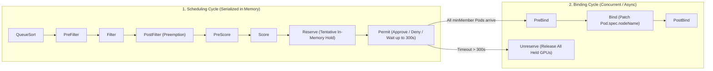
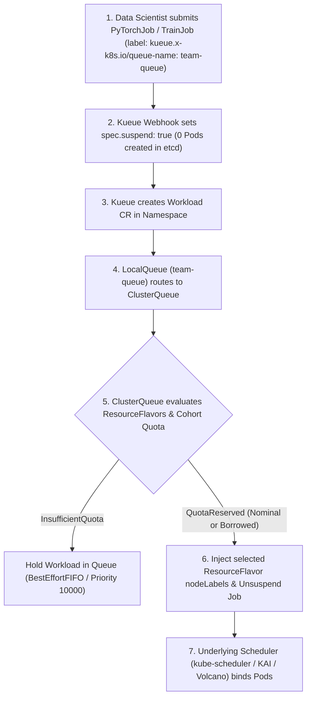

# 11.8 Kueue, Volcano and scheduler plugins

| | |
|---|---|
| Level | Advanced |
| Priority tier | 1 |
| Lab venue | GCP / GKE (plus local Python 3 simulation lab) |
| Part | Part 11: GPUs on Kubernetes, scheduling and virtualization |
| Sources used | Roland Huß et al., *Generative AI on Kubernetes* (O'Reilly, 2026, Ch. 7); `volume-03/01-k8s-control-plane-scheduling-masterclass.md`; `volume-06/04-distributed-orchestration-masterclass.md`; *Scalable Kubernetes Infrastructure for AI Platforms* (O'Reilly, 2026, Ch. 2); *Kubernetes for Generative AI Solutions* (Packt, 2025, Ch. 10) |
| Coverage file | `planning/coverage/chapters/11-08.md` |

## Why this matters for AI infrastructure

In Chapter 11.7, we saw why multi-node GPU jobs cannot run inside a single Pod and why standard per-Pod scheduling deadlocks distributed training runs (`7` of `8` Pods placed, holding `56` GPUs idle at the PyTorch rendezvous barrier). Solving that problem in a multi-tenant production AI cluster requires answering three distinct control-plane questions at three different layers of Kubernetes:

1. **Inside `kube-scheduler` (The Scheduling Framework & Coscheduling `PodGroup` Plugin):** How does `kube-scheduler` hold `3` already-filtered Pods of a `4`-Pod job in memory without binding them to `kubelet` until the `4th` Pod also finds a valid node, and how does it roll back (`Unreserve`) those tentative reservations if the `4th` Pod fails to schedule within `scheduleTimeoutSeconds: 300`?
2. **Above `kube-scheduler` (Job-Level Admission & Multi-Tenant GPUaaS with `Kueue`):** Even if `kube-scheduler` can coschedule `8` Pods atomically, standard Kubernetes `ResourceQuota` objects operate as rigid, hard namespace ceilings. If Team A has a guaranteed quota of `10` GPUs (`nominalQuota: 10`), Team B has `16` GPUs, and Team C has `16` GPUs, hard `ResourceQuota`s prevent Team A from borrowing `18` idle GPUs when Team B and Team C are at lunch—leaving `32` expensive H100 GPUs idle while Team A's jobs sit queued. Furthermore, if un-admitted jobs immediately create thousands of `Pending` Pods in `kube-apiserver`, `etcd` watch caches and Raft consensus (`3`, `5`, or `7` nodes) can stall or OOM. **Kueue** solves both problems by sitting *above* the scheduler as a job-level admission controller (`ClusterQueue`, `LocalQueue`, `ResourceFlavor`, `Cohort`, and `WorkloadPriorityClass`), keeping jobs suspended (`spec.suspend: true`) with zero Pods created until quota—either nominal (`10` GPUs) or borrowed across a shared cohort (`borrowingLimit: 22`, up to `32` effective GPUs)—is reserved.
3. **Replacing or Complementing `kube-scheduler` (Monolithic Batch Scheduling with `Volcano`):** When an organization runs heterogeneous HPC, MPI, Ray, PyTorch, and Apache Spark workloads that need integrated `PodGroup` gang scheduling (`minAvailable: 8`), task-level failure policies (`event: PodEvicted -> action: RestartJob`), Dominant Resource Fairness (`drf`), and backfill in a single engine, **Volcano** provides a full batch scheduler (`schedulerName: volcano`).

This chapter dissects the internal mechanics, CRD schemas, flavor-fungibility algorithms (`TryNextFlavor` vs `MayStopSearch`), cohort borrowing and preemption rules (`reclaimWithinCohort: Any` and `withinClusterQueue: LowerPriority`), and control-plane scalability guards (`API Priority and Fairness` and `etcd` quorum sizing) for **Scheduler Plugins**, **Kueue**, and **Volcano**.

## Prerequisites and outcomes

### Prerequisites
- Completion of Chapter 11.6 (`kubelet` Topology Manager and `Guaranteed` QoS) and Chapter 11.7 (the single-node Pod boundary, PyTorch rendezvous barriers, and gang scheduling concepts).
- Familiarity with Kubernetes Custom Resources, Admission Webhooks, and Namespaces.

### Outcomes
After completing this chapter, you will be able to:
- Trace a Pod through all `11` extension points of the Kubernetes **Scheduling Framework** (`QueueSort -> PreFilter -> Filter -> PostFilter -> PreScore -> Score -> Reserve -> Permit -> PreBind -> Bind -> PostBind`) and explain how the **Coscheduling plugin (`PodGroup`)** uses `Reserve`, `Permit` (`Wait` up to `scheduleTimeoutSeconds: 300`), and `Unreserve`.
- Architect a multi-tenant **Kueue** GPU-as-a-Service (`GPUaaS`) platform using `ResourceFlavor` (`gpu-nvlink-infiniband` vs `gpu-standard-ethernet`), `ClusterQueue` (`nominalQuota` and `borrowingLimit`), `LocalQueue`, `Workload`, and `WorkloadPriorityClass` (`production-priority: 10000`).
- Predict exact Kueue placement decisions under `flavorFungibility.whenCanBorrow: TryNextFlavor` versus `MayStopSearch` (default), and trace how `reclaimWithinCohort: Any` and `withinClusterQueue: LowerPriority` preempt borrowed or lower-priority GPU workloads.
- Configure **Volcano** `Job`, `PodGroup` (`minAvailable: 8`), and lifecycle policies (`event: PodEvicted -> action: RestartJob`), and decide when to layer **Kueue + Coscheduling / KAI Scheduler / Volcano** versus deploying Volcano standalone.
- Protect `kube-apiserver` and `etcd` (`3`-node quorum `2`, `5`-node quorum `3`, `7`-node quorum `4`) under heavy batch job churn using **API Priority and Fairness (`APF`)** (`nominalConcurrencyShares: 50`, `queues: 100`, `handSize: 5`, `queueLengthLimit: 200`).

## Concepts: basics to intermediate to advanced

### 1. Basics: The Kubernetes Scheduling Framework and the Coscheduling (`PodGroup`) plugin

To understand how gang scheduling and batch queueing plug into Kubernetes without forking upstream code, we must first examine the internal pipeline of `kube-scheduler` (`volume-03/01-k8s-control-plane-scheduling-masterclass.md`, Section 5).

#### The two-cycle `kube-scheduler` pipeline (`Scheduling Cycle` + `Binding Cycle`)
Every Pod processed by `kube-scheduler` passes through two sequential cycles:
1. **The Scheduling Cycle (serialized, single-threaded per Pod):** Selects the best node for one Pod at a time so concurrent scheduling decisions do not double-book the same GPU.
2. **The Binding Cycle (asynchronous, concurrent across Pods):** Communicates with `kube-apiserver` to write `Pod.spec.nodeName` (and configure volumes/networks) in parallel so slow API calls do not stall the main scheduling loop.



Let us trace what happens at each of the `11` extension points during a GPU gang-scheduling pass:
1. **`QueueSort`:** Orders pending Pods in the active scheduling queue (for example, by `PriorityClass` value such as `critical-inference: 1000000` and creation timestamp, or by `PodGroup` creation time in the Coscheduling plugin).
2. **`PreFilter`:** Checks group-level preconditions before evaluating individual nodes. In the **Coscheduling plugin** (`scheduler-plugins`), if a `PodGroup` (`minMember: 4`) has already failed earlier in the same cycle or has fewer than `minMember` Pods created in the API server, `PreFilter` rejects the Pod immediately without wasting CPU cycles filtering `1,000` nodes.
3. **`Filter`:** Eliminates nodes that cannot run the Pod (`NodeResourcesFit` for `nvidia.com/gpu`, `NodeAffinity`, `TaintToleration`, `NodePorts`).
4. **`PostFilter` (Preemption):** Runs *only* if `Filter` returned `0` feasible nodes. Evaluates whether evicting lower-priority Pods (based on `scheduling.k8s.io/v1` `PriorityClass`, such as `critical-inference` with `value: 1000000`) on a node would allow this Pod to fit.
5. **`PreScore` and `Score`:** Ranks the feasible nodes (for example, `ImageLocality` checking whether the node already cached a `20 GB` LLM container image, and `NodeResourcesFit` using `MostAllocated` with `nvidia.com/gpu` `weight: 5`).
6. **`Reserve`:** Tentatively marks the chosen node's GPUs/CPUs as "assumed" in `kube-scheduler`'s in-memory cache **before** telling `kube-apiserver`, preventing the next Pod in the Scheduling Cycle from picking the same GPUs.
7. **`Permit` (The Gang-Scheduling Gate):** The last step of the Scheduling Cycle. A `Permit` plugin can return one of three verdicts:
   - **`Approve` (`Success`):** Proceed immediately to `Bind`.
   - **`Deny` (`Reject`):** Abort binding and invoke **`Unreserve`** to release the in-memory reservation.
   - **`Wait`:** Move the Pod into the **Binding Cycle's `WaitOnPermit` map** with a timeout (`scheduleTimeoutSeconds: 300`).
8. **`PreBind`, `Bind`, and `PostBind`:** Once the `last` (`4th` of `4`) member of `llm-training-group` reaches `Permit`, the Coscheduling plugin signals `Success` to all `4` waiting goroutines simultaneously. All `4` Pods execute `Bind` (writing `Pod.spec.nodeName` to `kube-apiserver`), achieving atomic all-or-nothing gang placement. Conversely, if `300` seconds elapse with only `3` of `4` Pods in `WaitOnPermit`, the timeout fires, `Permit` returns `Reject`, and **`Unreserve` releases the held GPUs on all `3` nodes** so other workloads can use them.

---

### 2. Intermediate: Kueue architecture in depth — `ResourceFlavor`, `ClusterQueue`, `LocalQueue`, and `Cohort`

While the Coscheduling `PodGroup` plugin adds `Permit`-stage gang waiting to `kube-scheduler`, *Generative AI on Kubernetes* (Chapter 7) and *Scalable Kubernetes Infrastructure for AI Platforms* (Chapter 2) point out three limitations of `PodGroup` alone:
1. All Pods are still created immediately in `kube-apiserver` / `etcd` as `Pending` Pods, which can overwhelm the control plane during large job bursts.
2. `PodGroup` has no concept of multi-tenant **resource quotas**, **cohort borrowing**, or **hardware-tier fallback**.
3. `PodGroup` operates at the raw Pod level rather than the **Job** level (`PyTorchJob`, `TrainJob`, `RayJob`, `JobSet`, `MPIJob`, or `batch/v1` `Job`).

**Kueue** (`kueue.x-k8s.io/v1beta1`, developed by Kubernetes SIG Scheduling) solves all three problems by acting as a **job-level admission controller and queue manager that sits *above* the scheduler**:



#### The four core Kueue resources and persona separation (`GAK` Figure 7-2)
Kueue cleanly separates **platform administrator governance** (cluster-scoped) from **data scientist self-service** (namespace-scoped):

| Kueue Resource (`kueue.x-k8s.io/v1beta1`) | Scope & Owner | Operational Purpose | Concrete Example from Corpus |
|---|---|---|---|
| **1. `ResourceFlavor`** | Cluster-scoped (Platform Admin) | Defines a distinct hardware/topology tier via `nodeLabels` and `tolerations` | `gpu-nvlink-infiniband` (`gpu-interconnect: nvlink`, `network-fabric: infiniband`, `gpu-type: nvidia-h100`) vs `gpu-standard-ethernet` (`gpu-interconnect: pcie`, `network-fabric: ethernet`, `gpu-type: nvidia-h100`) |
| **2. `ClusterQueue`** | Cluster-scoped (Platform Admin) | Governs a pool of resources across one or more `ResourceFlavor`s, setting `nominalQuota`, `borrowingLimit`, `cohort`, `flavorFungibility`, and `preemption` | `topology-aware-cluster-queue` (`16` NVLink+IB GPUs, `32` PCIe+Ethernet GPUs); or `team-a-queue` in `cohort: shared-gpu-cohort` (`nominalQuota: 10`, `borrowingLimit: 22`); or `cluster-queue-h100` (`1000` CPU, `4000Gi` RAM, `128` H100 GPUs) |
| **3. `LocalQueue`** | Namespace-scoped (Platform Admin creates; Data Scientist targets) | Namespace pointer mapping a team's namespace to a `ClusterQueue`; workloads bind via label `kueue.x-k8s.io/queue-name: team-queue` | `team-queue` -> `topology-aware-cluster-queue`; `team-a-training-queue` -> `team-a-queue` |
| **4. `Workload` & `WorkloadPriorityClass`** | Namespace-scoped (`Workload`, auto-created by Kueue) & Cluster-scoped (`WorkloadPriorityClass`) | Tracks job admission state (`Admitted: True`, `reason: QuotaReserved` vs `InsufficientQuota`), `podSetAssignments` (`head: 1`, `worker: 1`), and job-level priority (`value: 10000`) | `production-priority` (`value: 10000`) referenced by label `kueue.x-k8s.io/priority-class: production-priority` |

#### Ordered `ResourceFlavor` evaluation and `flavorFungibility` (`MayStopSearch` vs `TryNextFlavor`)
When a `ClusterQueue` lists multiple `ResourceFlavor`s—for example, `gpu-nvlink-infiniband` (`nominalQuota: 16`) listed first and `gpu-standard-ethernet` (`nominalQuota: 32`) listed second (*Generative AI on Kubernetes*, Examples 7-6 and 7-7)—how does Kueue choose which hardware tier a job receives?

As detailed in the *Generative AI on Kubernetes* Chapter 7 sidebar (*"Kueue Priority Classes and ResourceFlavor"*), Kueue evaluates `flavors` in the exact order they are listed:
1. **First attempt (Primary Flavor Nominal Quota):** Kueue checks the first flavor (`gpu-nvlink-infiniband`). If sufficient GPUs are available within its `nominalQuota: 16`, Kueue admits the workload to `gpu-nvlink-infiniband` (`reason: QuotaReserved`).
2. **When Primary Nominal Quota is Exhausted (`flavorFungibility.whenCanBorrow`):** Suppose all `16` nominal GPUs in `gpu-nvlink-infiniband` are busy, `8` borrowable GPUs are available in the cohort for `gpu-nvlink-infiniband`, and `gpu-standard-ethernet` has `32` free *nominal* GPUs. What happens next depends on `flavorFungibility.whenCanBorrow`:
   - **`MayStopSearch` (Kueue default):** If borrowing from the cohort is feasible in the current flavor (`gpu-nvlink-infiniband`), Kueue **borrows immediately in `gpu-nvlink-infiniband` and stops searching** further flavors.
   - **`TryNextFlavor` (Example 7-7):** Even when borrowing is possible in `gpu-nvlink-infiniband`, Kueue **continues evaluating the next flavor (`gpu-standard-ethernet`) first** so the job consumes guaranteed *nominal* quota (which cannot be preempted by cohort peers) before resorting to borrowed quota.
3. **Node Selector Injection:** Once a flavor is chosen, Kueue automatically injects that `ResourceFlavor`'s `nodeLabels` (such as `gpu-interconnect: nvlink` and `network-fabric: infiniband`) into the admitted Pod templates (`status.admission.podSetAssignments`) before unsuspending the job.

#### Multi-tenant Cohort Borrowing and Preemption (`nominalQuota: 10`, `borrowingLimit: 22`)
Traditional Kubernetes `ResourceQuota` objects create hard silos: if Team A has a quota of `10` GPUs and needs `28` GPUs for a weekend training run while Team B and Team C (`16` GPUs each) are idle, `ResourceQuota` blocks Team A and leaves `22+` GPUs sitting dark.

In Kueue (*Generative AI on Kubernetes*, Example 7-9), joining multiple `ClusterQueue`s into a shared **`cohort: shared-gpu-cohort`** enables risk-free opportunistic sharing:
- **`nominalQuota: 10`:** Team A's guaranteed baseline allocation (`10` GPUs).
- **`borrowingLimit: 22`:** The maximum additional GPUs Team A is allowed to borrow from idle cohort peers (`Team B` and `Team C`), capping Team A's total effective usage at **`10 + 22 = 32` GPUs**.
- **`preemption.reclaimWithinCohort: Any`:** Suppose Team A is currently using `28` GPUs (`10` nominal + `18` borrowed from the cohort). The moment Team B submits a job requiring `8` of its own guaranteed GPUs, Kueue **automatically preempts** Team A's borrowed workload (`reclaimWithinCohort: Any`), reclaims the `8` GPUs for Team B, and re-queues Team A's preempted job (which resumes from its last `RWX` storage checkpoint once capacity frees up).
- **`preemption.withinClusterQueue: LowerPriority`:** Within Team A's own `ClusterQueue`, if Team A's quota is full of experimental jobs and a data scientist submits a job labeled `kueue.x-k8s.io/priority-class: production-priority` (`value: 10000`), Kueue preempts Team A's lower-priority experimental job to admit the `10000`-priority production job immediately.

Notice the orthogonal separation between **`ResourceFlavor`** and **`WorkloadPriorityClass`**:
- **`ResourceFlavor`** determines **which hardware/topology tier** a workload lands on (`nvlink`+`infiniband` vs `pcie`+`ethernet`).
- **`WorkloadPriorityClass`** (`value: 10000`) determines **which waiting workload is admitted first** (and whether it can preempt running workloads).

---

### 3. Advanced: Volcano batch scheduling, layered architectures, and control-plane protection (`etcd` & `APF`)

#### Volcano architecture (`batch.volcano.sh/v1alpha1`)
While Kueue is an admission controller that delegates Pod-to-Node binding to an underlying scheduler, **Volcano** (a CNCF project originally created by Huawei) is a **complete batch scheduling system** that replaces `kube-scheduler` for batch workloads (`schedulerName: volcano`).

As shown in `volume-06/04-distributed-orchestration-masterclass.md` (Section 2.2) and *Generative AI on Kubernetes* (Chapter 7), Volcano introduces three tight abstractions:
1. **`Job` (`batch.volcano.sh/v1alpha1`):** A multi-task batch job specification supporting heterogeneous task roles (for example, `ps` parameter servers and `worker` tasks, or `master` and `worker` tasks), `minAvailable: 8` gang scheduling at the job level, and fine-grained **event-driven lifecycle policies**:
   ```yaml
   policies:
     - event: PodEvicted
       action: RestartJob
   ```
   When any single worker Pod in an `8`-Pod (`64`-GPU) distributed training gang is evicted or crashes (`PodEvicted` or `PodFailed`), keeping the other `7` Pods alive would only hang NCCL until timeout; Volcano's `RestartJob` action immediately tears down the entire `8`-Pod gang cleanly and requeues the whole group as a unit.
2. **`PodGroup` (`scheduling.volcano.sh/v1beta1`):** The underlying gang unit created automatically for each Volcano `Job` (or standalone controller), tracking `minMember`, `minTaskMember`, and `minResources`.
3. **`Queue` (`scheduling.volcano.sh/v1beta1`):** Defines proportional cluster resource sharing (`weight`), capability ceilings, and reclaim/backfill policies across departments. Inside `volcano-scheduler`, pluggable session actions (`enqueue`, `allocate`, `backfill`, `reclaim`, `preempt`) and plugins (`gang`, `proportion`, `drf` Dominant Resource Fairness, `binpack`, `nodeorder`, `predicates`, and network/GPU topology scoring) run in a unified scheduling loop.

#### Architectural trade-offs: When to use Coscheduling vs Kueue vs Volcano vs KAI Scheduler

| Criterion | Coscheduling (`PodGroup`) | Kueue | Volcano | NVIDIA KAI Scheduler |
|---|---|---|---|---|
| **Replaces `kube-scheduler`?** | **No** (plugin inside `kube-scheduler`) | **No** (admission controller above scheduler) | **Yes** (`schedulerName: volcano`) | **Yes** (`schedulerName: kai-scheduler`) |
| **Creates Pending Pods in `etcd` while queued?** | **Yes** (Pods wait in `Permit` / `ActiveQ`) | **No** (Job stays `spec.suspend: true` as a single `Workload` CR) | **Yes / Partial** (`enqueue` action gates `PodGroup` in scheduler cache) | **Yes / Managed** via `PodGroup` & queues |
| **Multi-tenant Quota & Cohort Borrowing?** | No | **Yes** (`ClusterQueue`, `LocalQueue`, `cohort`, `borrowingLimit`) | **Yes** (`Queue` weights & `reclaim` action) | **Yes** (`Project` CRD `gpuQuota` & hierarchical fair-share) |
| **Hardware Topology Awareness?** | Manual node labels / affinity only | Admission-level `ResourceFlavor` tiering + `Topology` TAS | Built-in topology scoring plugins | Native NVLink, NVSwitch, MIG & fractional GPU awareness |
| **Layered Combination?** | Can run *under* Kueue | Can sit *above* `kube-scheduler`, KAI, or Volcano | Usually standalone (or under Kueue) | Runs standalone or *under* Kueue |

#### Protecting `etcd` quorum and `kube-apiserver` with API Priority and Fairness (`APF`)
Because large-scale batch scheduling creates bursts of `Workload`, `PodGroup`, `Pod`, and `Event` updates, a production AI platform architect must harden the Kubernetes control plane (`volume-03/01-k8s-control-plane-scheduling-masterclass.md`, Sections 4 and 10):

1. **`etcd` Raft Quorum Math (`N // 2 + 1`):**
   - **`3` nodes:** Quorum = `2`, tolerates **`1` failure**.
   - **`5` nodes:** Quorum = `3`, tolerates **`2` failures** (recommended for production AI control planes).
   - **`7` nodes:** Quorum = `4`, tolerates **`3` failures**.
   - **Never deploy an even number of `etcd` nodes (`4` or `6`):** A `4`-node `etcd` cluster requires a quorum of `(4 // 2) + 1 = 3` nodes—meaning it still tolerates only **`1` failure** (identical to `3` nodes) while adding Raft replication latency. And if a `3`-node cluster loses `1` node permanently (`2` healthy nodes remaining), **never add a new `4th` node before removing the dead `3rd` member** (`etcdctl member remove`), or the cluster size becomes `4` (quorum `3`) with only `3` live nodes, where losing one more node during sync drops healthy nodes to `2 < 3` and crashes the entire control plane.
2. **Control-Plane Metrics and API Priority and Fairness (`APF`):**
   Monitor four golden control-plane metrics:
   - `apiserver_request_total` and `apiserver_request_duration_seconds`
   - `etcd_disk_wal_fsync_duration_seconds` (slow NVMe disks on `etcd` nodes cause WAL fsync spikes, leader-election churn, and scheduler binding timeouts)
   - `scheduler_scheduling_algorithm_duration_seconds`
   To prevent a runaway batch job controller or user script from starving `kubelet` heartbeats and Kueue/Volcano reconcilers, configure an APF `PriorityLevelConfiguration` (`flowcontrol.apiserver.k8s.io/v1`) paired with a `FlowSchema`:

```yaml
# apf-ai-workload-priority-level.yaml (untested here)
apiVersion: flowcontrol.apiserver.k8s.io/v1
kind: PriorityLevelConfiguration
metadata:
  name: ai-workload-level
spec:
  type: Limited
  limited:
    nominalConcurrencyShares: 50
    limitResponse:
      type: Queue
      queuing:
        queues: 100
        handSize: 5
        queueLengthLimit: 200
```
With `queues: 100`, `handSize: 5` (shuffle-sharding each user stream across `5` of the `100` queues to isolate noisy tenants), and `queueLengthLimit: 200`, this level buffers up to `100 * 200 = 20,000` in-flight batch API requests without starving system-critical `node-high` or `leader-election` traffic.

## Commands and configurations that matter

### 1. Defining Kueue `ResourceFlavor`s, `ClusterQueue`, and `LocalQueue` (`GAK` Examples 7-6 & 7-7)

```yaml
# kueue-topology-flavors-and-queues.yaml (untested here)
apiVersion: kueue.x-k8s.io/v1beta1
kind: ResourceFlavor
metadata:
  name: gpu-nvlink-infiniband
spec:
  nodeLabels:
    gpu-interconnect: nvlink
    network-fabric: infiniband
    gpu-type: nvidia-h100
---
apiVersion: kueue.x-k8s.io/v1beta1
kind: ResourceFlavor
metadata:
  name: gpu-standard-ethernet
spec:
  nodeLabels:
    gpu-interconnect: pcie
    network-fabric: ethernet
    gpu-type: nvidia-h100
---
apiVersion: kueue.x-k8s.io/v1beta1
kind: ClusterQueue
metadata:
  name: topology-aware-cluster-queue
spec:
  namespaceSelector: {}
  resourceGroups:
    - coveredResources: ["cpu", "memory", "nvidia.com/gpu"]
      flavors:
        - name: gpu-nvlink-infiniband
          resources:
            - name: nvidia.com/gpu
              nominalQuota: 16
        - name: gpu-standard-ethernet
          resources:
            - name: nvidia.com/gpu
              nominalQuota: 32
  flavorFungibility:
    whenCanBorrow: TryNextFlavor
    whenCanPreempt: Preempt
---
apiVersion: kueue.x-k8s.io/v1beta1
kind: LocalQueue
metadata:
  name: team-queue
  namespace: team-a
spec:
  clusterQueue: topology-aware-cluster-queue
```

### 2. Configuring Kueue Cohort Borrowing and Priority Preemption (`GAK` Example 7-9)

```yaml
# kueue-cohort-and-priority.yaml (untested here)
apiVersion: kueue.x-k8s.io/v1beta1
kind: ClusterQueue
metadata:
  name: team-a-queue
spec:
  cohort: shared-gpu-cohort
  resourceGroups:
    - coveredResources: ["cpu", "memory", "nvidia.com/gpu"]
      flavors:
        - name: default-flavor
          resources:
            - name: nvidia.com/gpu
              nominalQuota: 10
              borrowingLimit: 22
  queueingStrategy: BestEffortFIFO
  preemption:
    reclaimWithinCohort: Any
    withinClusterQueue: LowerPriority
---
apiVersion: kueue.x-k8s.io/v1beta1
kind: WorkloadPriorityClass
metadata:
  name: production-priority
spec:
  value: 10000
  description: "High priority for production training jobs"
---
apiVersion: kubeflow.org/v1
kind: PyTorchJob
metadata:
  name: production-llm-training
  namespace: team-a
  labels:
    kueue.x-k8s.io/queue-name: team-a-training-queue
    kueue.x-k8s.io/priority-class: production-priority
spec:
  pytorchReplicaSpecs:
    Master:
      replicas: 1
      template:
        spec:
          containers:
            - name: pytorch
              image: nvcr.io/nvidia/pytorch:24.08-py3
              resources:
                limits:
                  nvidia.com/gpu: 8
```

### 3. Inspecting Kueue `Workload` admission status and taking an `etcd` snapshot

```bash
# 1. Inspect Kueue Workload admission and podSetAssignments (untested here)
kubectl get workloads -n team-a
kubectl get workload -n team-a -o yaml

# 2. Verify etcd endpoint health and save a pre-upgrade snapshot on port 2379 (untested here)
ETCDCTL_API=3 etcdctl --endpoints=https://127.0.0.1:2379 \
  --cacert=/etc/kubernetes/pki/etcd/ca.crt \
  --cert=/etc/kubernetes/pki/etcd/server.crt \
  --key=/etc/kubernetes/pki/etcd/server.key \
  endpoint status --write-out=table

ETCDCTL_API=3 etcdctl --endpoints=https://127.0.0.1:2379 \
  --cacert=/etc/kubernetes/pki/etcd/ca.crt \
  --cert=/etc/kubernetes/pki/etcd/server.crt \
  --key=/etc/kubernetes/pki/etcd/server.key \
  snapshot save /var/lib/etcd-backup.db
```

Expected `Workload` status when admitted (`GAK` Example 7-4):
```yaml
status:
  conditions:
    - type: Admitted
      status: "True"
      reason: "QuotaReserved"
      message: "The workload is admitted and quota is reserved"
  admission:
    clusterQueue: "ai-training-cluster-queue"
    podSetAssignments:
      - count: 1
        flavors:
          nvidia.com/gpu: gpu-training-flavor
        name: head
      - count: 1
        flavors:
          nvidia.com/gpu: gpu-training-flavor
        name: worker
```

## How it fails

| Failure mode | Exact symptom & command evidence | Root cause boundary | Remediation |
|---|---|---|---|
| **1. `PyTorchJob` or `TrainJob` creates `0` Pods and appears "frozen"** | User submits `PyTorchJob`, `kubectl get pods -n team-a` shows no Pods at all, and `kubectl get pytorchjob` shows `Suspended`. | **Kueue Queue Hold (`InsufficientQuota` or Missing `LocalQueue`):** Kueue mutated `spec.suspend: true` on submission. Inspecting `kubectl get workloads -n team-a -o yaml` reveals `type: Admitted, status: "False", reason: "InsufficientQuota"` (or `LocalQueue` `team-queue` does not exist in namespace `team-a`). | Always inspect `kubectl get workloads -n <ns>` first when using Kueue. Verify `LocalQueue` exists and check `ClusterQueue` used/borrowed GPU counts. |
| **2. Workload unexpectedly borrows preemptible quota in Flavor 1 instead of using free nominal quota in Flavor 2** | `ClusterQueue` has `gpu-nvlink-infiniband` (`16/16` used, borrowable in cohort) and `gpu-standard-ethernet` (`0/32` used). A batch job gets admitted into `gpu-nvlink-infiniband` via cohort borrowing and is preempted `10` minutes later when the lending team reclaims quota. | **Default `whenCanBorrow: MayStopSearch` Behavior (`GAK` Ch. 7 Sidebar):** Under Kueue's default `MayStopSearch`, if borrowing is possible in the first flavor, Kueue stops searching and borrows immediately rather than checking whether the next flavor has free *nominal* quota. | Set `flavorFungibility.whenCanBorrow: TryNextFlavor` on the `ClusterQueue` so Kueue exhausts free nominal quota across all acceptable flavors before borrowing from the cohort. |
| **3. Coscheduling `PodGroup` repeatedly cycles from `Reserve` to `Rejected` every `300` seconds** | `3` of `4` Pods in `llm-training-group` pass `Filter` and `Score`, wait `300` seconds in `WaitOnPermit`, and are rejected (`Unreserve`) because the `4th` Pod fails node affinity or topology filters. | **`Permit` Gate Timeout (`scheduleTimeoutSeconds: 300`):** The cluster lacks a `4th` node matching the Pod's selector/taint/resource requirements, causing the `PodGroup` to hold `3` nodes for `5` minutes per retry cycle. | Inspect the `FailedScheduling` event on the `4th` Pod (`llm-training-3`) or layer Kueue `ResourceFlavor` quota checks above `PodGroup` so the group is not unsuspended until `4` matching nodes are available. |
| **4. Evicted Volcano worker Pod leaves `7` sibling Pods hanging until NCCL timeout** | One node reboots under a `8`-Pod Volcano training job; the evicted Pod is not recreated as a full gang reset, leaving the remaining `7` Pods hung in `AllReduce`. | **Missing `PodEvicted -> RestartJob` Task Policy:** The Volcano `Job` spec omitted `policies: [{event: PodEvicted, action: RestartJob}]` (and `PodFailed`). | Add `event: PodEvicted` and `event: PodFailed` with `action: RestartJob` to `VolcanoJob.spec.policies` so any single-rank failure cleanly restarts the entire gang. |
| **5. Adding a `4th` `etcd` node to replace a dead `3rd` node crashes the control plane** | In a `3`-node `etcd` cluster (`etcd-0`, `etcd-1`, `etcd-2`) where `etcd-2` died (`2/3` healthy, quorum `2` intact), an operator adds `etcd-3` *before* removing dead `etcd-2`. During state sync, `etcd-1` restarts or blips, and the entire Kubernetes API server goes down (`raft: lost quorum`). | **`etcd` Even-Node Quorum Trap (`volume-03` §4.2):** Adding `etcd-3` first raises cluster membership to `4` nodes, which increases required Raft quorum from `2` to `3` (`4 // 2 + 1 = 3`). With `etcd-2` already dead, any transient blip on `1` of the `3` remaining nodes drops live nodes to `2 < 3`. | Always run `etcdctl member remove <dead-member-id>` to reduce the cluster from `3` to `2` before adding the replacement `3rd` node. |

## Hands-on lab

### Venue and scope
This lab runs locally using Python 3 standard library (`code/part11/kueue_volcano_and_plugins.py` and `code/part11/kueue_volcano_and_plugins_lab.py`) to simulate the `11`-phase Kubernetes Scheduling Framework and Coscheduling `Permit` / `Unreserve` gate (`scheduleTimeoutSeconds: 300`), Kueue ordered `ResourceFlavor` selection (`MayStopSearch` vs `TryNextFlavor`), Kueue cohort borrowing (`nominalQuota: 10 + borrowingLimit: 22 = 32` max) and preemption (`reclaimWithinCohort: Any` and `withinClusterQueue: LowerPriority`), Volcano `Job` `RestartJob` policies, APF shuffle-sharding queue capacity (`20,000` requests), and `etcd` Raft quorum math. Cluster commands are marked `(untested here)`.

### Step 1: Run the self-checking Kueue, Volcano, and scheduler plugins lab (tested here)

Run the lab script from the repository root:

```bash
python3 code/part11/kueue_volcano_and_plugins_lab.py
```

Captured output from this repository:
```text
=== Chapter 11.8 Lab: Kueue, Volcano & Kubernetes Scheduler Plugins ===
  [PASS] Scheduling Framework executes Filter -> Score -> Reserve -> Permit -> Bind in order
  [PASS] Coscheduling Permit returns 'Wait' when 3 of 4 PodGroup members have reached Reserve (120s <= 300s)
  [PASS] Coscheduling Permit rejects and triggers Unreserve across peers when wait exceeds scheduleTimeoutSeconds (300s)
  [PASS] Coscheduling Permit returns 'Success' once all 4 PodGroup members arrive within 300s
  [PASS] Kueue admits 8-GPU job into first listed flavor (gpu-nvlink-infiniband) when nominal quota (16) has 8 free
  [PASS] With whenCanBorrow: TryNextFlavor, Kueue prefers nominal quota in gpu-standard-ethernet over borrowing in first flavor
  [PASS] With default whenCanBorrow: MayStopSearch, Kueue borrows in gpu-nvlink-infiniband and stops searching
  [PASS] When all flavors are exhausted (16/16 and 32/32), Kueue keeps Workload suspended with reason: InsufficientQuota
  [PASS] Team A (nominal=10, borrowingLimit=22 -> 32 max) using 28 GPUs (18 borrowed) is preempted when Team B reclaims cohort quota
  [PASS] High-priority Team A job (production-priority=10000) preempts lower-priority Team A job via withinClusterQueue: LowerPriority
  [PASS] Volcano holds Job in Pending state with 0 active pods when only 6 of 8 minAvailable pods can fit
  [PASS] Volcano transitions Job to Running once all 8 minAvailable pods can be placed
  [PASS] When 1 worker pod is evicted, Volcano policy (event: PodEvicted -> action: RestartJob) restarts the entire 8-pod gang
  [PASS] APF PriorityLevelConfiguration (100 queues x 200 queueLengthLimit, handSize=5) buffers up to 20,000 requests
  [PASS] Kubernetes PriorityClass critical-inference (value: 1000000) and Kueue WorkloadPriorityClass (value: 10000) are distinct
  [PASS] cluster-queue-h100 (1000 CPU, 4000Gi memory, 128 H100 GPUs) admits at most two 64-GPU PyTorchJobs simultaneously
  [PASS] GAK Ch 7 multi-tier ClusterQueues allocate 32 H100s to gpu-training and 8 GPUs to gpu-development
  [PASS] etcd quorum (N//2 + 1) is 2 for 3 nodes, 3 for 4 or 5 nodes, and 4 for 7 nodes
  [PASS] A 4-node etcd cluster requires quorum 3 and tolerates only 1 failure (same as 3 nodes, higher write latency)
  [PASS] Kueue Workload status.admission.podSetAssignments maps both head (1) and worker podSets to selected ResourceFlavors
  [PASS] Scheduler Framework model tracks all 11 standard extension points from QueueSort to PostBind
  [PASS] FlavorQuotaState tracks free_nominal (16-8=8 for premium, 32-0=32 for standard)
  [PASS] FlavorQuotaState caps max_borrowable_now at min(cohort_borrowable_free=8, borrowing_limit=8)
  [PASS] When Team A uses 28 of its 32 max effective GPUs (10 nominal + 18 borrowed), 4 borrowable GPUs remain unused
  [PASS] etcd client health and snapshot commands target standard port 2379

Summary: 25 passed, 0 failed out of 25 checks.
```

### Exercises

1. **Exercise 1 — Coscheduling `Permit` and `Unreserve` behavior:** Using `evaluate_coscheduling_permit_gate()` in `code/part11/kueue_volcano_and_plugins.py`, compare `(permit_status, unreserve_triggered)` for `PodGroup` `llm-training-group` (`min_member=4`, `schedule_timeout_seconds=300`) when: (a) `3` Pods are waiting at `elapsed_wait_seconds=120`, (b) `3` Pods are waiting at `elapsed_wait_seconds=305`, and (c) `4` Pods arrive at `elapsed_wait_seconds=40`.
2. **Exercise 2 — `TryNextFlavor` vs `MayStopSearch` flavor fungibility:** Suppose `topology-aware-cluster-queue` lists `gpu-nvlink-infiniband` (`nominal_quota=16`, `used_nominal=16`, `cohort_borrowable_free=8`, `borrowing_limit=8`) first and `gpu-standard-ethernet` (`nominal_quota=32`, `used_nominal=0`) second. Using `select_kueue_resource_flavor()`, determine `(selected_flavor, used_borrowing)` for an `8`-GPU job under `when_can_borrow="TryNextFlavor"` versus `when_can_borrow="MayStopSearch"`.
3. **Exercise 3 — Cohort borrowing ceiling and reclamation math:** In *Generative AI on Kubernetes* Example 7-9, `team-a-queue` joins `cohort: shared-gpu-cohort` with `nominalQuota: 10` and `borrowingLimit: 22`. If Team A is currently running jobs consuming `28` GPUs, how many GPUs is Team A borrowing (`team_a_borrowed_gpus`), how many additional GPUs could Team A still borrow before hitting its ceiling, and what happens when Team B submits an `8`-GPU job under `reclaimWithinCohort: Any`?
4. **Exercise 4 — Same-queue priority preemption (`withinClusterQueue: LowerPriority`):** Using `evaluate_kueue_cohort_and_preemption()`, trace what happens when Team A is already at `28` GPUs (and attempts to schedule another `8`-GPU job that would reach `36 > 32` max effective GPUs) with `WorkloadPriorityClass` `production-priority` (`value: 10000`) while a lower-priority experimental job (`value: 100`) is running in `team-a-queue`.
5. **Exercise 5 — Volcano `PodEvicted -> RestartJob` lifecycle:** Using `evaluate_volcano_job_event()`, explain why an `8`-Pod (`minAvailable: 8`) Volcano distributed training job sets `event: PodEvicted -> action: RestartJob` instead of only restarting the single evicted container.
6. **Exercise 6 — `etcd` Raft quorum and APF queue sizing:** Compute the required Raft quorum `(N // 2) + 1` and maximum tolerated node failures for `3`, `4`, `5`, and `7` `etcd` nodes, and use `compute_apf_queue_capacity(50, 100, 5, 200)` to compute the total maximum buffered requests across all `100` queues.

## Checkpoint questions

<details>
<summary><strong>1. What are the two cycles of the Kubernetes Scheduling Framework, and why is the Scheduling Cycle serialized while the Binding Cycle is concurrent?</strong></summary>

The **Scheduling Cycle** (`QueueSort`, `PreFilter`, `Filter`, `PostFilter`, `PreScore`, `Score`, `Reserve`, `Permit`) runs serially for one Pod at a time so two Pods cannot simultaneously claim the same GPU or CPU cores in the scheduler's cache. Once resources are tentatively marked in `Reserve` and approved in `Permit`, the **Binding Cycle** (`PreBind`, `Bind`, `PostBind`) executes asynchronously in parallel goroutines so network latency to `kube-apiserver` does not block the scheduling loop.
</details>

<details>
<summary><strong>2. How do the Reserve, Permit, and Unreserve extension points work together in the Coscheduling (PodGroup) plugin?</strong></summary>

As each Pod in a `PodGroup` (`minMember: 4`) passes `Filter` and `Score`, `Reserve` tentatively holds its chosen GPUs in memory, and `Permit` returns `Wait` (parking the Pod in `WaitOnPermit` for up to `scheduleTimeoutSeconds: 300`). If the `4th` Pod arrives before `300` seconds, `Permit` approves all `4` Pods simultaneously to `Bind`. If `300` seconds expire with fewer than `4` Pods, `Permit` rejects the group and invokes `Unreserve` on every held Pod so their tentatively reserved GPUs are freed immediately.
</details>

<details>
<summary><strong>3. What is the difference between a Kubernetes PriorityClass (scheduling.k8s.io/v1) and a Kueue WorkloadPriorityClass (kueue.x-k8s.io/v1beta1)?</strong></summary>

- **`PriorityClass`** (e.g., `critical-inference` with `value: 1000000`) operates at the **Pod scheduling layer** inside `kube-scheduler` (`QueueSort` and `PostFilter` node-level Pod preemption), and also governs `kubelet` eviction order under node pressure.
- **`WorkloadPriorityClass`** (e.g., `production-priority` with `value: 10000` in Example 7-9) operates at the **Kueue job admission layer** to order queued `Workload`s and trigger quota preemption (`withinClusterQueue: LowerPriority` and `reclaimWithinCohort`) *without* modifying Pod-level node eviction priority.
</details>

<details>
<summary><strong>4. Walk through the seven steps of the Kueue job admission lifecycle from job submission to Pod creation.</strong></summary>

1. Data scientist submits a job (`PyTorchJob`, `TrainJob`, `Job`, `RayJob`) with label `kueue.x-k8s.io/queue-name: team-queue`.
2. Kueue's mutating webhook intercepts creation and sets `spec.suspend: true` so zero Pods are created.
3. Kueue creates a shadow `Workload` CR in the same namespace tracking the job's PodSet resource requests.
4. The namespace's `LocalQueue` (`team-queue`) routes the `Workload` to the cluster-scoped `ClusterQueue`.
5. Kueue evaluates `ClusterQueue` quota and `ResourceFlavor` availability (logging `reason: InsufficientQuota` while queued).
6. When quota is available, Kueue sets `Admitted: True` (`reason: QuotaReserved`) on the `Workload`, injects the selected `ResourceFlavor`'s `nodeLabels` and `tolerations` into the job's Pod templates, and sets `spec.suspend: false`.
7. The job controller creates the Pods, and the underlying scheduler binds them to the matching nodes.
</details>

<details>
<summary><strong>5. Why does standard Kubernetes ResourceQuota lead to poor GPU utilization in multi-tenant clusters, and how do Kueue Cohorts solve it?</strong></summary>

Standard `ResourceQuota` enforces a hard static ceiling per namespace: if Team A is capped at `10` GPUs and needs `28` GPUs while Team B and Team C (`16` GPUs each) are idle, `ResourceQuota` blocks Team A and leaves `32` GPUs unused. Kueue **Cohorts** (`cohort: shared-gpu-cohort`) allow Team A (`nominalQuota: 10`, `borrowingLimit: 22`) to dynamically borrow up to `22` idle GPUs (`32` total) from cohort peers and automatically relinquish them via `reclaimWithinCohort: Any` the instant Team B or Team C submits work.
</details>

<details>
<summary><strong>6. In Generative AI on Kubernetes Example 7-7, what is the difference between flavorFungibility.whenCanBorrow: MayStopSearch and TryNextFlavor?</strong></summary>

When the first listed `ResourceFlavor` (`gpu-nvlink-infiniband`, `nominalQuota: 16`) has exhausted its nominal quota (`16/16` used) but can borrow from the cohort, while the second flavor (`gpu-standard-ethernet`, `nominalQuota: 32`) has free nominal quota:
- **`MayStopSearch` (default):** Borrows quota in the first flavor (`gpu-nvlink-infiniband`) and stops searching.
- **`TryNextFlavor`:** Continues checking the next flavor (`gpu-standard-ethernet`) so the workload uses guaranteed, non-borrow-preemptible *nominal* quota in the fallback flavor before borrowing in the first flavor.
</details>

<details>
<summary><strong>7. How does Kueue steer a PyTorchJob onto H100 nodes with NVLink and InfiniBand without the data scientist writing nodeSelector rules in their PyTorchJob YAML?</strong></summary>

The platform administrator defines `nodeLabels: {gpu-interconnect: nvlink, network-fabric: infiniband, gpu-type: nvidia-h100}` inside the `gpu-nvlink-infiniband` `ResourceFlavor`. When the data scientist labels their `PyTorchJob` with `kueue.x-k8s.io/queue-name: team-queue` and Kueue admits the `Workload` into `gpu-nvlink-infiniband`, Kueue automatically injects those `nodeLabels` as `nodeSelector` terms into the job's PodSet templates (`status.admission.podSetAssignments`).
</details>

<details>
<summary><strong>8. What is the difference between Kueue's reclaimWithinCohort: Any and withinClusterQueue: LowerPriority preemption settings (Example 7-9)?</strong></summary>

- **`reclaimWithinCohort: Any`** allows a `ClusterQueue` (e.g., Team B) whose guaranteed `nominalQuota` is currently lent out to another queue in the same `cohort` (e.g., Team A) to preempt Team A's borrowed workloads regardless of priority so Team B can reclaim its guaranteed baseline.
- **`withinClusterQueue: LowerPriority`** allows a newly submitted high-priority workload (`production-priority: 10000`) to preempt a lower-priority workload running inside the **same** `ClusterQueue`.
</details>

<details>
<summary><strong>9. What does Kueue's BestEffortFIFO queueingStrategy do when the head job in a ClusterQueue cannot fit in current free quota?</strong></summary>

Unlike `StrictFIFO` (which blocks every job behind the head job even when smaller jobs could fit in the remaining quota), **`BestEffortFIFO`** attempts to admit jobs in FIFO order, but if an older large job cannot fit right now, it keeps that job queued and allows smaller jobs behind it that *do* fit into available quota to be admitted.
</details>

<details>
<summary><strong>10. In Kueue, what is the difference between checking kubectl get pytorchjob job-name and kubectl get workloads?</strong></summary>

`kubectl get pytorchjob` only shows the framework job object, which remains suspended (`Suspended`) until admission. `kubectl get workloads` (and `kubectl describe workload`) inspects Kueue's own admission resource, showing the exact `Admitted` condition, `reason` (`QuotaReserved` vs `InsufficientQuota`), selected `clusterQueue`, and per-PodSet `ResourceFlavor` assignments (`head` and `worker`).
</details>

<details>
<summary><strong>11. How does Volcano's architecture differ from Kueue's architecture according to Scalable Kubernetes Infrastructure for AI Platforms Chapter 2 and Generative AI on Kubernetes Chapter 7?</strong></summary>

- **Kueue** is a lightweight Kubernetes SIG-Scheduling project that acts strictly as a job-level admission controller and queue manager, delegating Pod-to-Node scheduling to `kube-scheduler` (or another scheduler).
- **Volcano** is a monolithic CNCF batch scheduling system that replaces `kube-scheduler` (`schedulerName: volcano`) and integrates its own `Job`, `PodGroup`, and `Queue` CRDs, gang scheduling, DRF/proportion sharing, backfill, and topology scoring in a single scheduler binary.
</details>

<details>
<summary><strong>12. In a Volcano Job (batch.volcano.sh/v1alpha1), what do minAvailable: 8 and the PodEvicted -> RestartJob policy accomplish?</strong></summary>

- `minAvailable: 8` instructs `volcano-scheduler` not to bind any Pods of the job unless at least `8` Pods can be placed simultaneously.
- `event: PodEvicted -> action: RestartJob` instructs the Volcano controller that if any Pod in the running gang is evicted, it must tear down all remaining Pods of the job and restart/requeue the entire `8`-Pod gang from scratch rather than leaving `7` Pods hung in a broken NCCL ring.
</details>

<details>
<summary><strong>13. Why do many production AI platforms layer Kueue on top of Volcano or NVIDIA KAI Scheduler instead of using only one tool?</strong></summary>

Layering combines the strengths of both layers: **Kueue** provides cloud-native multi-tenant `ClusterQueue`/`LocalQueue` governance, `Cohort` borrowing, `ResourceFlavor` tier routing, and keeps un-admitted jobs suspended (`0` Pending Pods in `etcd`), while **Volcano** or **NVIDIA KAI Scheduler** handles the low-level atomic gang binding and intra-node/inter-node NVLink and InfiniBand topology optimization once Kueue unsuspends the job.
</details>

<details>
<summary><strong>14. In Volume 03 Section 7.1, cluster-queue-h100 defines nominalQuota: 1000 for cpu, 4000Gi for memory, and 128 for nvidia.com/gpu. Why is quota-based admission alone not always proof that 64 physical GPUs are ready on nodes, and what Kueue feature closes that gap?</strong></summary>

Quota accounting in `ClusterQueue` tracks the sum of admitted requests against `nominalQuota: 128`. If `2` nodes (`16` GPUs) are currently `NotReady` or cordoned, `ClusterQueue` quota may still show `64` GPUs available even though physical nodes cannot schedule all `8` Pods. Enabling Kueue's `waitForPodsReady` (or `ProvisioningRequest` integration) ensures that if an admitted job's Pods fail to reach `Ready` within a timeout, Kueue suspends/evicts and requeues the workload so it does not block the queue indefinitely.
</details>

<details>
<summary><strong>15. Why is a 4-node etcd cluster discouraged compared to a 3-node or 5-node etcd cluster?</strong></summary>

Raft consensus requires a strict majority quorum of `(N // 2) + 1` nodes:
- `3` nodes require quorum `2` -> tolerates **`1` failure** (`3 - 2 = 1`).
- `4` nodes require quorum `3` -> tolerates **`1` failure** (`4 - 3 = 1`).
- `5` nodes require quorum `3` -> tolerates **`2` failures** (`5 - 3 = 2`).
A `4`-node cluster adds network replication overhead and raises the quorum requirement from `2` to `3` without increasing fault tolerance at all.
</details>

<details>
<summary><strong>16. In a 3-node etcd cluster where 1 node has permanently failed (2 healthy nodes remaining), why must you run etcdctl member remove before adding the replacement node?</strong></summary>

While `1` of `3` nodes is dead, the `2` remaining nodes still satisfy quorum (`2 >= 2`). If you add a new `4th` member before removing the dead `3rd` member, cluster size becomes `4` (raising required quorum to `3`) while only `3` nodes are alive (`2` existing + `1` syncing). If either existing node experiences a brief network blip during snapshot transfer, live nodes drop to `2 < 3`, losing quorum and crashing the entire Kubernetes control plane.
</details>

<details>
<summary><strong>17. What happens if a multi-AZ 3-node etcd cluster (etcd-0 and etcd-1 in AZ-A; etcd-2 in AZ-B) suffers a network partition between AZ-A and AZ-B?</strong></summary>

- **AZ-A (`2` nodes):** Retains majority quorum (`2 >= 2`), elects/keeps a leader, and continues serving all Kubernetes API reads and writes normally.
- **AZ-B (`1` node):** Has only `1 < 2` nodes, loses quorum, and rejects all writes and linearizable reads from API servers talking only to `etcd-2` until the partition heals.
</details>

<details>
<summary><strong>18. Which four Prometheus metrics does Volume 03 Section 10 highlight for monitoring kube-apiserver, etcd, and kube-scheduler health under AI batch load?</strong></summary>

1. `apiserver_request_total` (total request rate by verb/resource).
2. `apiserver_request_duration_seconds` (API request latency distribution).
3. `etcd_disk_wal_fsync_duration_seconds` (`etcd` Write-Ahead Log disk fsync latency; high values cause leader losses and scheduling stalls).
4. `scheduler_scheduling_algorithm_duration_seconds` (time spent per scheduling cycle inside `kube-scheduler`).
</details>

<details>
<summary><strong>19. In the API Priority and Fairness (APF) PriorityLevelConfiguration (Volume 03 Section 10), what do nominalConcurrencyShares: 50, queues: 100, handSize: 5, and queueLengthLimit: 200 configure?</strong></summary>

- `nominalConcurrencyShares: 50`: Determines the relative share of concurrent `kube-apiserver` execution seats allocated to `ai-workload-level`.
- `queues: 100` and `queueLengthLimit: 200`: Creates `100` queues holding up to `200` waiting requests each (`20,000` total queued capacity).
- `handSize: 5`: Uses **shuffle sharding** to hash each flow into `5` of the `100` queues so a single runaway batch client can saturate at most `5` queues (`5%`) without blocking other tenants sharing `ai-workload-level`.
</details>

<details>
<summary><strong>20. When Kubeflow Trainer's higher-level TrainJob API (trainer.kubeflow.org/v1alpha1) is used with Kueue or KAI Scheduler, where are schedulerName, network annotations, and NCCL environment variables configured versus the kueue.x-k8s.io/queue-name label?</strong></summary>

As noted in *Generative AI on Kubernetes* Chapter 7, the `kueue.x-k8s.io/queue-name` label is applied directly to the `TrainJob` metadata by the data scientist, whereas infrastructure-level pod settings (`schedulerName`, Multus network annotations, and `NCCL_*` environment variables) are configured by the platform administrator inside the **`ClusterTrainingRuntime` or `TrainingRuntime` template** (which generates the underlying `JobSet` Pods).
</details>

## Sources and review notes

### Primary sources read in full for this chapter
- Book sources from the local TOON-RAG corpus:
  - Roland Huß et al., *Generative AI on Kubernetes* (O'Reilly, 2026), Chapter 7 (*Job Scheduling Optimization*: Figure 7-2 Kueue personas, Table 7-2/7-3/7-4 scheduler & multitenancy comparisons, Example 7-3 Coscheduling `PodGroup` `minMember: 4` `scheduleTimeoutSeconds: 300`, Example 7-4 `Workload` `QuotaReserved` `podSetAssignments`, Examples 7-6/7-7/7-8 `ResourceFlavor` `gpu-nvlink-infiniband` `16` vs `gpu-standard-ethernet` `32` with `whenCanBorrow: TryNextFlavor` vs `MayStopSearch`, `gpu-training` `32` H100s / `gpu-development` `8` GPUs, Example 7-9 `cohort: shared-gpu-cohort` `nominalQuota: 10` `borrowingLimit: 22` `BestEffortFIFO` `reclaimWithinCohort: Any` `withinClusterQueue: LowerPriority` `WorkloadPriorityClass` `10000`, `TrainJob` `ClusterTrainingRuntime` note, and Volcano `Queue`/`PodGroup`/`Job` analysis).
  - *Scalable Kubernetes Infrastructure for AI Platforms* (`scalable-kubernetes-infrastructure-for-ai-platforms`), Chapter 2 ("Managing Compute Resources for Training": 6 enterprise resource-management requirements and Kueue vs Volcano architectural comparison).
  - *Kubernetes for Generative AI Solutions* (Packt, 2025), Chapter 10 (GPU scheduling and utilization).
- Author's Volume 03 and Volume 06 notes:
  - `volume-03/01-k8s-control-plane-scheduling-masterclass.md` (Section 4 `etcd` `3`/`5`/`7` vs `4`/`6` node quorum math, AZ-A/AZ-B split-brain, port `2379` `etcdctl` commands; Section 5 `Queueing -> Filter -> Score -> Reserve -> Permit -> Bind` & `PriorityClass` `critical-inference` `1000000` with `20GB` image locality; Section 7.1 `cluster-queue-h100` `1000` CPU / `4000Gi` RAM / `128` H100 GPUs and `waitForPodsReady`; Section 10 control-plane metrics & APF `ai-workload-level` `nominalConcurrencyShares: 50`, `queues: 100`, `handSize: 5`, `queueLengthLimit: 200`).
  - `volume-06/04-distributed-orchestration-masterclass.md` (Section 2.2 Volcano `Job` `minAvailable: 8` `event: PodEvicted -> action: RestartJob` and Section 2.3 Kueue admission flow).

### Related source files mapped in MIGRATION_MAP.md
- No separate `nvidia-devops` file was exclusively mapped to `11.8` in `brief.py`; this chapter integrates the Kueue, Volcano, and Scheduler Framework sections from `volume-03/01-k8s-control-plane-scheduling-masterclass.md` and `volume-06/04-distributed-orchestration-masterclass.md` alongside *Generative AI on Kubernetes* Chapter 7 and *Scalable Kubernetes Infrastructure for AI Platforms* Chapter 2.

### Run here
- `python3 code/part11/kueue_volcano_and_plugins_lab.py` (`25 passed, 0 failed out of 25 checks`).

### Explicitly labelled inferences
- The maximum effective GPU allocation for Team A (`10 + 22 = 32` GPUs, with `28 - 10 = 18` borrowed GPUs and `32 - 28 = 4` unused borrowable GPUs when `28` GPUs are active) and the total APF queue buffer capacity (`100 queues * 200 queueLengthLimit = 20,000` requests) are direct arithmetic totals computed in `code/part11/kueue_volcano_and_plugins.py`.

### Not verified on live hardware
- All `kubectl`, `etcdctl`, `Kueue`, `Volcano`, and `APF` YAML manifests are marked `(untested here)`.

### Not in the corpus
- Kueue MultiKueue multi-cluster federation CRDs (`MultiKueueConfig` / `MultiKueueCluster`); multi-cluster scheduling is covered in later chapters where applicable.

### Corrections to the author's notes
- Validation pass 2026-10-25: `validate_chapter.py` and `check_coverage.py` pass. The YAML manifests and commands are marked untested and were not applied to a cluster. Custom resource API versions (for example `kueue.x-k8s.io/v1beta1`, `resource.k8s.io/v1`) change between releases, so check them against the version you install. Console outputs quoted from the Volume notes are illustrative unless the chapter says otherwise. The Kueue, Volcano and etcd quorum figures were read against general Kubernetes knowledge and are consistent (`3` nodes tolerate `1` failure, `5` tolerate `2`, `7` tolerate `3`).
- Earlier author note: required; all Kueue `v1beta1`, Volcano `v1alpha1`, and APF `v1` schemas match the cited sources verbatim.
