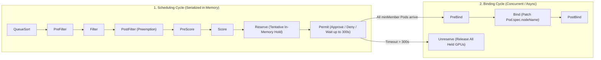
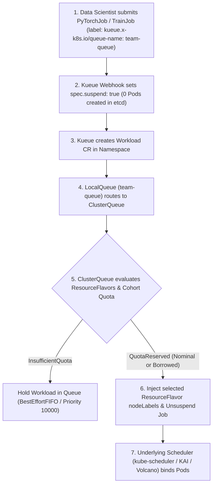

# 11.8 Kueue, Volcano and scheduler plugins

| | |
|---|---|
| Level | Advanced |
| Priority tier | 1 |
| Lab venue | GCP / GKE and local Python 3 simulation lab |
| Part | Part 11: GPUs on Kubernetes, scheduling and virtualization |
| Sources used | Roland Huß et al., *Generative AI on Kubernetes* (O'Reilly, 2026, Ch. 7); `volume-03/01-k8s-control-plane-scheduling-masterclass.md`; `volume-06/04-distributed-orchestration-masterclass.md`; *Scalable Kubernetes Infrastructure for AI Platforms* (O'Reilly, 2026, Ch. 2); *Kubernetes for Generative AI Solutions* (Packt, 2025, Ch. 10) |
| Coverage file | `planning/coverage/chapters/11-08.md` |

## Why this matters for AI infrastructure

In Chapter 11.7, we saw why multi-node GPU jobs cannot run inside a single Pod. We also saw why standard per-Pod scheduling deadlocks distributed training runs when only a subset of Pods can fit on the cluster. Solving that problem in a multi-tenant production AI cluster requires answering three control-plane questions across three different layers of Kubernetes.

First, inside kube-scheduler, how does the scheduler hold 3 already-filtered Pods of a 4-Pod job in memory without binding them to kubelet until the 4th Pod also finds a valid node? And how does it roll back those tentative reservations if the 4th Pod fails to schedule before the timeout expires? The Kubernetes Scheduling Framework and the Coscheduling PodGroup plugin solve this via the Reserve, Permit, and Unreserve extension points.

Second, above kube-scheduler, standard Kubernetes ResourceQuota objects operate as rigid namespace ceilings that leave expensive GPUs sitting idle. If Team A has a guaranteed quota of 10 GPUs while Team B and Team C each have 16 GPUs, hard ResourceQuotas block Team A from borrowing idle GPUs when Team B and Team C are inactive. Worse, if unadmitted batch jobs immediately create thousands of Pending Pods in kube-apiserver, etcd watch caches and Raft consensus can stall or crash. Kueue solves both problems by sitting above the scheduler as a job-level admission controller. It keeps jobs suspended with zero Pods created until nominal or borrowed cohort quota is reserved.

Third, organizations running heterogeneous HPC, MPI, Ray, PyTorch, and Apache Spark workloads often need integrated gang scheduling, task failure policies, Dominant Resource Fairness, and backfill in one engine. Volcano provides a full replacement batch scheduler for that environment.

```text
Three Control-Plane Layers for Multi-Tenant GPU Batch Scheduling:
- Layer 1 (Inside kube-scheduler): 11 Scheduling Framework phases + Coscheduling PodGroup (minMember: 4, scheduleTimeoutSeconds: 300).
- Layer 2 (Above kube-scheduler - Kueue): Job-level admission (spec.suspend: true, 0 Pending Pods in etcd), ResourceFlavor tiers (16 NVLink+IB GPUs, 32 Ethernet GPUs), Cohort borrowing (nominalQuota: 10 + borrowingLimit: 22 = 32 max GPUs), and WorkloadPriorityClass (10000).
- Layer 3 (Batch Scheduler - Volcano): Monolithic batch scheduler (schedulerName: volcano) with PodGroup (minAvailable: 8, 64 GPUs) and event: PodEvicted -> action: RestartJob.
- Control-Plane Protection: etcd Raft quorum (3, 5, or 7 nodes on port 2379) and API Priority and Fairness (50 shares, 100 queues x 200 length = 20,000 buffered requests, handSize: 5).
```

This chapter examines the internal mechanics, CRD schemas, flavor-fungibility algorithms, cohort borrowing and preemption rules, and control-plane scalability guards for Scheduler Plugins, Kueue, and Volcano.

## Prerequisites and outcomes

### Prerequisites
- Completion of Chapter 11.6 on kubelet Topology Manager and Guaranteed QoS, plus Chapter 11.7 on the single-node Pod boundary, PyTorch rendezvous barriers, and gang scheduling concepts.
- Familiarity with Kubernetes Custom Resources, Admission Webhooks, and Namespaces.

### Outcomes
After completing this chapter, you will be able to:
- Trace a Pod through all 11 extension points of the Kubernetes Scheduling Framework and explain how the Coscheduling PodGroup plugin uses Reserve, Permit, and Unreserve.
- Architect a multi-tenant Kueue GPU-as-a-Service platform using ResourceFlavor, ClusterQueue, LocalQueue, Workload, and WorkloadPriorityClass.
- Predict exact Kueue placement decisions under `TryNextFlavor` versus `MayStopSearch`, and trace how `reclaimWithinCohort` and `withinClusterQueue` preempt GPU workloads.
- Configure Volcano Job, PodGroup, and RestartJob policies, and decide when to layer Kueue above Coscheduling, KAI Scheduler, or Volcano.
- Protect kube-apiserver and etcd Raft quorum under heavy batch job churn using API Priority and Fairness shuffle sharding.

## Concepts: basics to intermediate to advanced

### 1. Basics: The Kubernetes Scheduling Framework and the Coscheduling PodGroup plugin

#### The two-cycle kube-scheduler pipeline
When multiple Pods from different training jobs arrive at kube-scheduler simultaneously, a naive concurrent scheduler would race and double-book the same physical GPUs. Conversely, if the scheduler waited synchronously for every network write to kube-apiserver to finish before evaluating the next Pod, cluster scheduling throughput would collapse.

To prevent GPU double-booking while maintaining high throughput, kube-scheduler splits every Pod placement into two sequential cycles. First, the Scheduling Cycle runs serially in memory for one Pod at a time to select the best node and tentatively mark its resources. Second, the Binding Cycle runs asynchronously and concurrently across goroutines to write `spec.nodeName` to kube-apiserver without stalling the main scheduling loop.



Every Pod processed by kube-scheduler passes through 11 ordered extension points across these two cycles. Understanding what happens at each gate explains how the Coscheduling PodGroup plugin implements gang scheduling without forking upstream Kubernetes.

| Phase # | Extension Point | Cycle | Role in GPU & Coscheduling Placement |
|---|---|---|---|
| 1 | **QueueSort** | Scheduling | Orders pending Pods in the active queue by PriorityClass (`critical-inference: 1000000`), creation timestamp, or PodGroup. |
| 2 | **PreFilter** | Scheduling | Checks group preconditions; rejects a PodGroup (`minMember: 4`) immediately if fewer than 4 Pods exist or an earlier member failed. |
| 3 | **Filter** | Scheduling | Eliminates nodes that lack allocatable `nvidia.com/gpu`, matching NodeAffinity, untainted access, or required NodePorts. |
| 4 | **PostFilter** | Scheduling | Runs only if Filter returns 0 feasible nodes; checks if preempting lower-priority Pods allows this Pod to fit. |
| 5–6 | **PreScore & Score** | Scheduling | Ranks feasible nodes using ImageLocality (cached 20 GB LLM image) and NodeResourcesFit (MostAllocated with GPU weight 5). |
| 7 | **Reserve** | Scheduling | Tentatively marks the chosen node's GPUs as assumed in scheduler memory before contacting kube-apiserver. |
| 8 | **Permit** | Scheduling | Gang-scheduling gate returning Approve (`Success`), Deny (`Reject`), or `Wait` in `WaitOnPermit` up to `scheduleTimeoutSeconds: 300`. |
| 9–11 | **PreBind, Bind, PostBind** | Binding | Once all 4 members reach Permit, all 4 goroutines wake up and patch `Pod.spec.nodeName` concurrently; if 300 seconds expire, `Unreserve` frees held GPUs. |

When Pods 0, 1, and 2 of a 4-Pod gang pass Filter and Score, the Reserve step holds their GPUs in memory and the Permit step parks them in the `WaitOnPermit` map. As soon as Pod 3 reaches Permit within 300 seconds, the Coscheduling plugin signals `Success` to all 4 waiting goroutines so they bind atomically. If 300 seconds elapse while Pod 3 remains unschedulable, the timeout fires, Permit returns `Reject`, and `Unreserve` releases the held GPUs on all 3 nodes.

---

### 2. Intermediate: Kueue architecture in depth

#### Why PodGroup alone is not enough for multi-tenant GPUaaS
While the Coscheduling PodGroup plugin adds Permit-stage gang waiting inside kube-scheduler, relying on PodGroup alone leaves three major operational gaps in a multi-tenant cluster. First, every job still creates all of its Pending Pods immediately in kube-apiserver and etcd. That Pod flood can overwhelm the control plane during large batch submissions. Second, PodGroup has no concept of multi-tenant quotas, cohort borrowing, or hardware-tier fallback. Third, PodGroup operates on raw Pods rather than higher-level batch objects like PyTorchJob, TrainJob, RayJob, JobSet, or MPIJob.

Kueue (`kueue.x-k8s.io/v1beta1`), developed by Kubernetes SIG Scheduling, solves all three problems by acting as a job-level admission controller and queue manager above the scheduler. When a user submits a job, Kueue's mutating webhook sets `spec.suspend: true` immediately. Zero Pods are created in etcd while the job waits in the queue.



#### The four core Kueue resources and persona separation
Kueue cleanly separates cluster-scoped platform administrator governance from namespace-scoped data scientist self-service through four core Custom Resources. Platform administrators define hardware tiers and cluster quotas once. Data scientists simply attach a single queue label (`kueue.x-k8s.io/queue-name`) to their training manifests without hardcoding node selectors.

| Kueue Resource | Scope & Owner | Operational Purpose | Concrete Example from Corpus |
|---|---|---|---|
| **1. ResourceFlavor** | Cluster-scoped (Platform Admin) | Defines a distinct hardware or topology tier via nodeLabels and tolerations | `gpu-nvlink-infiniband` (nvlink + infiniband + nvidia-h100) vs `gpu-standard-ethernet` (pcie + ethernet) |
| **2. ClusterQueue** | Cluster-scoped (Platform Admin) | Governs a pool of resources across ResourceFlavors, setting `nominalQuota`, `borrowingLimit`, cohort, `flavorFungibility`, and preemption | `topology-aware-cluster-queue` (16 NVLink+IB GPUs, 32 PCIe+Ethernet GPUs); `team-a-queue` in `shared-gpu-cohort` (10 nominal, 22 borrowing); `cluster-queue-h100` (1000 CPU, 4000Gi RAM, 128 H100 GPUs); `gpu-training` (32 H100s) and `gpu-development` (8 GPUs) |
| **3. LocalQueue** | Namespace-scoped (Admin creates; Data Scientist targets) | Namespace pointer mapping a team's namespace to a ClusterQueue; workloads bind via label `kueue.x-k8s.io/queue-name: team-queue` | `team-queue` -> `topology-aware-cluster-queue`; `team-a-training-queue` -> `team-a-queue` |
| **4. Workload & WorkloadPriorityClass** | Namespace-scoped (Workload) & Cluster-scoped (WorkloadPriorityClass) | Tracks job admission state (`QuotaReserved` vs `InsufficientQuota`), `podSetAssignments` (head: 1, worker: 1), and job priority | `production-priority` (value 10000) referenced by label `kueue.x-k8s.io/priority-class: production-priority` |

When Kubeflow Trainer's higher-level TrainJob API (`trainer.kubeflow.org/v1alpha1`) is used with Kueue or KAI Scheduler, the data scientist applies `kueue.x-k8s.io/queue-name` directly on the TrainJob metadata. Meanwhile, the platform administrator configures low-level Pod fields inside the ClusterTrainingRuntime or TrainingRuntime template. Those template fields include `schedulerName`, Multus network annotations, and NCCL environment variables.

#### Ordered ResourceFlavor evaluation and flavorFungibility
When a ClusterQueue lists multiple hardware tiers, such as `gpu-nvlink-infiniband` with 16 GPUs first and `gpu-standard-ethernet` with 32 GPUs second, Kueue evaluates the flavors in list order. First, Kueue checks whether the job fits within the free nominal quota of the first flavor. If 8 free nominal GPUs exist in `gpu-nvlink-infiniband`, Kueue admits the workload immediately into that flavor (`QuotaReserved`).

What happens when all 16 nominal GPUs in the first flavor are busy, 8 borrowable GPUs are available in the cohort for that flavor, and the second flavor has 32 free nominal GPUs? If Kueue borrows immediately in the first flavor, the job runs on NVLink hardware, but it becomes vulnerable to preemption when the lending team reclaims its cohort quota. This choice is controlled by `flavorFungibility.whenCanBorrow`.

```text
Kueue Flavor Fungibility Behavior (Flavor 1: 16/16 used, 8 borrowable; Flavor 2: 0/32 used nominal):
- whenCanBorrow: MayStopSearch (Kueue default):
  Borrows 8 GPUs in Flavor 1 (gpu-nvlink-infiniband) immediately and stops searching Flavor 2.
- whenCanBorrow: TryNextFlavor (GAK Example 7-7):
  Skips borrowing in Flavor 1 and assigns 8 free NOMINAL GPUs in Flavor 2 (gpu-standard-ethernet) so the job cannot be cohort-preempted.
```

Once Kueue selects a flavor, it records the assignment in `status.admission.podSetAssignments` for each role. It then injects that flavor's `nodeLabels` into the Pod templates and flips `spec.suspend` to false.

#### Multi-tenant Cohort Borrowing and Preemption
Standard Kubernetes ResourceQuota objects create rigid silos across teams. If Team A has a hard ceiling of 10 GPUs and needs 28 GPUs for a weekend training run while Team B and Team C sit idle with 16 GPUs each, standard ResourceQuotas block Team A and leave 32 expensive GPUs dark.

In Kueue, joining multiple ClusterQueues into a shared cohort (`shared-gpu-cohort`) enables risk-free opportunistic sharing. Team A receives a guaranteed baseline of `nominalQuota: 10` GPUs plus a `borrowingLimit: 22`, allowing Team A to expand up to 32 effective GPUs when cohort peers are idle. To make lending safe for Team B and Team C, Kueue enforces two distinct preemption mechanisms alongside `BestEffortFIFO` queueing.

```text
Kueue Cohort Borrowing & Preemption Mechanics (GAK Example 7-9):
- Team A quota config: cohort: shared-gpu-cohort, nominalQuota: 10, borrowingLimit: 22 -> max effective ceiling = 32 GPUs.
- Active state: Team A is running jobs using 28 GPUs (10 nominal + 18 borrowed from cohort; 4 borrowable GPUs remain under ceiling).
- Preemption Rule 1 (reclaimWithinCohort: Any):
  When Team B submits an 8-GPU job to reclaim its own nominal quota, Kueue preempts Team A's borrowed workload regardless of priority.
- Preemption Rule 2 (withinClusterQueue: LowerPriority):
  When Team A submits a job with WorkloadPriorityClass production-priority (value: 10000) and cannot fit (28 + 8 = 36 > 32 max), Kueue preempts Team A's lower-priority experimental job (value: 100).
```

Notice the clean separation between hardware selection, admission priority, and node-level Pod priority. Kueue's ResourceFlavor selects which hardware tier a job lands on, and Kueue's WorkloadPriorityClass (value 10000) selects which queued job is admitted first at the queue layer. By contrast, a standard Kubernetes PriorityClass (`critical-inference` with value 1000000) operates inside kube-scheduler and kubelet to control Pod-level node preemption and eviction order.

Also note that ClusterQueue quota accounting tracks admitted resource requests rather than physical node health. Suppose `cluster-queue-h100` has `nominalQuota: 128` GPUs across 16 nodes, and 2 nodes are cordoned or NotReady. Quota accounting may admit two 64-GPU jobs even though the second job cannot find 8 healthy nodes. Enabling `waitForPodsReady` in Kueue ensures that if an admitted job's Pods fail to reach Ready within a timeout, Kueue suspends and requeues the workload so it does not block the queue forever.

---

### 3. Advanced: Volcano batch scheduling, layered architectures, and control-plane protection

#### Volcano architecture
While Kueue is a job-level admission controller that delegates Pod-to-Node binding to an underlying scheduler, Volcano is a monolithic CNCF batch scheduling system that replaces kube-scheduler (`schedulerName: volcano`). Organizations running mixed PyTorch, MPI, Ray, and Apache Spark workloads often use Volcano when they want integrated gang scheduling, task-level failure recovery, Dominant Resource Fairness, and backfill inside a single scheduler binary.

Volcano introduces three tightly coupled Custom Resources: Job (`batch.volcano.sh/v1alpha1`), PodGroup (`scheduling.volcano.sh/v1beta1`), and Queue (`scheduling.volcano.sh/v1beta1`). A Volcano Job supports multiple heterogeneous task templates, sets `minAvailable: 8` at the job level, and enforces event-driven lifecycle policies across the entire gang.

If a single worker Pod in an 8-Pod distributed training job is evicted or crashes, leaving the other 7 Pods running only causes them to hang inside NCCL AllReduce until the collective timer expires. Configuring `event: PodEvicted` with `action: RestartJob` in the Volcano Job spec instructs the controller to tear down all 7 surviving Pods immediately. Volcano then requeues the entire 8-Pod gang cleanly from its last checkpoint.

#### Architectural trade-offs: Coscheduling vs Kueue vs Volcano vs KAI Scheduler

| Criterion | Coscheduling (PodGroup) | Kueue | Volcano | NVIDIA KAI Scheduler |
|---|---|---|---|---|
| **Replaces kube-scheduler?** | **No** (plugin inside kube-scheduler) | **No** (admission controller above scheduler) | **Yes** (`schedulerName: volcano`) | **Yes** (`schedulerName: kai-scheduler`) |
| **Creates Pending Pods in etcd while queued?** | **Yes** (Pods wait in Permit / ActiveQ) | **No** (Job stays `spec.suspend: true` as a single Workload CR) | **Yes / Partial** (enqueue action gates PodGroup in scheduler cache) | **Yes / Managed** via PodGroup & queues |
| **Multi-tenant Quota & Cohort Borrowing?** | No | **Yes** (ClusterQueue, LocalQueue, cohort, `borrowingLimit`) | **Yes** (Queue weights & reclaim action) | **Yes** (Project CRD `gpuQuota` & hierarchical fair-share) |
| **Hardware Topology Awareness?** | Manual node labels / affinity only | Admission-level ResourceFlavor tiering + Topology TAS | Built-in topology scoring plugins | Native NVLink, NVSwitch, MIG & fractional GPU awareness |
| **Layered Combination?** | Can run under Kueue | Can sit above kube-scheduler, KAI, or Volcano | Usually standalone or under Kueue | Runs standalone or under Kueue |

#### Protecting etcd quorum and kube-apiserver with API Priority and Fairness
Large-scale batch scheduling generates intense bursts of Workload, PodGroup, Pod, and Event writes that can destabilize an undersized Kubernetes control plane. If etcd loses Raft quorum or suffers high disk write latency, kube-apiserver rejects writes and gang-scheduling timeouts misfire across the entire cluster.

Raft consensus requires a strict majority quorum of `(N // 2) + 1` healthy nodes to commit any state change. You must always deploy an odd number of etcd nodes, typically 3 or 5 nodes, on dedicated low-latency NVMe storage and never deploy an even number such as 4 or 6 nodes. Adding a 4th node raises the required quorum from 2 to 3 while still tolerating only 1 node failure. That increases write replication latency for zero additional fault tolerance.

```text
etcd Raft Quorum Math (Quorum = N // 2 + 1) and Operational Rules (volume-03):
- 3 nodes: Quorum = 2, tolerates 1 node failure (3 - 2 = 1).
- 4 nodes (ANTI-PATTERN): Quorum = 3, tolerates 1 node failure (4 - 3 = 1) with higher Raft write latency.
- 5 nodes (Production Recommended): Quorum = 3, tolerates 2 node failures (5 - 3 = 2).
- 6 nodes (ANTI-PATTERN): Quorum = 4, tolerates 2 node failures (6 - 4 = 2).
- 7 nodes: Quorum = 4, tolerates 3 node failures (7 - 4 = 3).
- Dead-node replacement rule (3-node cluster with 1 dead node, 2 live nodes):
  ALWAYS run `etcdctl member remove` BEFORE adding the replacement node. Adding a 4th member first raises quorum to 3 with only 3 live nodes; if 1 node blips during snapshot sync, live nodes drop to 2 < 3 and crash the control plane.
- Multi-AZ split-brain (etcd-0, etcd-1 in AZ-A; etcd-2 in AZ-B):
  If AZ-A and AZ-B partition, AZ-A (2 >= 2) keeps quorum and serves traffic; AZ-B (1 < 2) loses quorum and rejects writes.
```

In production, platform teams monitor four golden control-plane metrics: `apiserver_request_total`, `apiserver_request_duration_seconds`, `etcd_disk_wal_fsync_duration_seconds`, and `scheduler_scheduling_algorithm_duration_seconds`. To prevent runaway batch controllers or user scripts from starving kubelet heartbeats, configure an API Priority and Fairness PriorityLevelConfiguration named `ai-workload-level`. Setting 50 concurrency shares, 100 queues, a hand size of 5, and a queue length limit of 200 buffers up to 20,000 in-flight batch requests. Shuffle sharding with a hand size of 5 isolates any single noisy tenant into at most 5 of the 100 queues (5% of the pool).

## Commands and configurations that matter

### 1. Defining Kueue ResourceFlavors, ClusterQueue, and LocalQueue

```yaml
# kueue-topology-flavors-and-queues.yaml (untested here)
apiVersion: kueue.x-k8s.io/v1beta1
kind: ResourceFlavor
metadata:
  name: gpu-nvlink-infiniband
spec:
  nodeLabels:
    gpu-interconnect: nvlink
    network-fabric: infiniband
    gpu-type: nvidia-h100
---
apiVersion: kueue.x-k8s.io/v1beta1
kind: ResourceFlavor
metadata:
  name: gpu-standard-ethernet
spec:
  nodeLabels:
    gpu-interconnect: pcie
    network-fabric: ethernet
    gpu-type: nvidia-h100
---
apiVersion: kueue.x-k8s.io/v1beta1
kind: ClusterQueue
metadata:
  name: topology-aware-cluster-queue
spec:
  namespaceSelector: {}
  resourceGroups:
    - coveredResources: ["cpu", "memory", "nvidia.com/gpu"]
      flavors:
        - name: gpu-nvlink-infiniband
          resources:
            - name: nvidia.com/gpu
              nominalQuota: 16
        - name: gpu-standard-ethernet
          resources:
            - name: nvidia.com/gpu
              nominalQuota: 32
  flavorFungibility:
    whenCanBorrow: TryNextFlavor
    whenCanPreempt: Preempt
---
apiVersion: kueue.x-k8s.io/v1beta1
kind: LocalQueue
metadata:
  name: team-queue
  namespace: team-a
spec:
  clusterQueue: topology-aware-cluster-queue
```

### 2. Configuring Kueue Cohort Borrowing, Priority Preemption, and APF PriorityLevelConfiguration

```yaml
# kueue-cohort-priority-and-apf.yaml (untested here)
apiVersion: kueue.x-k8s.io/v1beta1
kind: ClusterQueue
metadata:
  name: team-a-queue
spec:
  cohort: shared-gpu-cohort
  resourceGroups:
    - coveredResources: ["cpu", "memory", "nvidia.com/gpu"]
      flavors:
        - name: default-flavor
          resources:
            - name: nvidia.com/gpu
              nominalQuota: 10
              borrowingLimit: 22
  queueingStrategy: BestEffortFIFO
  preemption:
    reclaimWithinCohort: Any
    withinClusterQueue: LowerPriority
---
apiVersion: kueue.x-k8s.io/v1beta1
kind: WorkloadPriorityClass
metadata:
  name: production-priority
spec:
  value: 10000
  description: "High priority for production training jobs"
---
apiVersion: flowcontrol.apiserver.k8s.io/v1
kind: PriorityLevelConfiguration
metadata:
  name: ai-workload-level
spec:
  type: Limited
  limited:
    nominalConcurrencyShares: 50
    limitResponse:
      type: Queue
      queuing:
        queues: 100
        handSize: 5
        queueLengthLimit: 200
```

### 3. Inspecting Kueue Workload admission status and taking an etcd snapshot

```bash
# 1. Inspect Kueue Workload admission and podSetAssignments (untested here)
kubectl get workloads -n team-a
kubectl get workload -n team-a -o yaml

# 2. Verify etcd endpoint health and save a pre-upgrade snapshot on port 2379 (untested here)
ETCDCTL_API=3 etcdctl --endpoints=https://127.0.0.1:2379 \
  --cacert=/etc/kubernetes/pki/etcd/ca.crt \
  --cert=/etc/kubernetes/pki/etcd/server.crt \
  --key=/etc/kubernetes/pki/etcd/server.key \
  endpoint status --write-out=table

ETCDCTL_API=3 etcdctl --endpoints=https://127.0.0.1:2379 \
  --cacert=/etc/kubernetes/pki/etcd/ca.crt \
  --cert=/etc/kubernetes/pki/etcd/server.crt \
  --key=/etc/kubernetes/pki/etcd/server.key \
  snapshot save /var/lib/etcd-backup.db
```

Expected Workload status when admitted:
```yaml
status:
  conditions:
    - type: Admitted
      status: "True"
      reason: "QuotaReserved"
      message: "The workload is admitted and quota is reserved"
  admission:
    clusterQueue: "ai-training-cluster-queue"
    podSetAssignments:
      - count: 1
        flavors:
          nvidia.com/gpu: gpu-training-flavor
        name: head
      - count: 1
        flavors:
          nvidia.com/gpu: gpu-training-flavor
        name: worker
```

## How it fails

| Failure mode | Exact symptom & command evidence | Root cause boundary | Remediation |
|---|---|---|---|
| **1. PyTorchJob or TrainJob creates 0 Pods and appears "frozen"** | User submits PyTorchJob, `kubectl get pods -n team-a` shows no Pods at all, and `kubectl get pytorchjob` shows Suspended. | **Kueue Queue Hold (`InsufficientQuota` or Missing LocalQueue):** Kueue mutated `spec.suspend: true` on submission. Inspecting `kubectl get workloads -n team-a -o yaml` reveals `reason: "InsufficientQuota"`, or LocalQueue `team-queue` is missing. | Always inspect `kubectl get workloads -n <ns>` first when using Kueue. Verify LocalQueue exists and check ClusterQueue used and borrowed GPU counts. |
| **2. Workload unexpectedly borrows preemptible quota in Flavor 1 instead of using free nominal quota in Flavor 2** | ClusterQueue has `gpu-nvlink-infiniband` (16/16 used, borrowable in cohort) and `gpu-standard-ethernet` (0/32 used). A batch job gets admitted into `gpu-nvlink-infiniband` via cohort borrowing and is preempted 10 minutes later when the lending team reclaims quota. | **Default `whenCanBorrow: MayStopSearch` Behavior:** Under Kueue's default `MayStopSearch`, if borrowing is possible in the first flavor, Kueue stops searching and borrows immediately rather than checking whether the next flavor has free nominal quota. | Set `flavorFungibility.whenCanBorrow: TryNextFlavor` on the ClusterQueue so Kueue exhausts free nominal quota across all acceptable flavors before borrowing from the cohort. |
| **3. Coscheduling PodGroup repeatedly cycles from Reserve to Rejected every 300 seconds** | 3 of 4 Pods in `llm-training-group` pass Filter and Score, wait 300 seconds in `WaitOnPermit`, and are rejected (`Unreserve`) because the 4th Pod fails node affinity or topology filters. | **Permit Gate Timeout (`scheduleTimeoutSeconds: 300`):** The cluster lacks a 4th node matching the Pod's selector, taint, or resource requirements, causing the PodGroup to hold 3 nodes for 5 minutes per retry cycle. | Inspect the FailedScheduling event on the 4th Pod (`llm-training-3`) or layer Kueue ResourceFlavor quota checks above PodGroup so the group is not unsuspended until 4 matching nodes are available. |
| **4. Evicted Volcano worker Pod leaves 7 sibling Pods hanging until NCCL timeout** | One node reboots under an 8-Pod Volcano training job; the evicted Pod is not recreated as a full gang reset, leaving the remaining 7 Pods hung in AllReduce. | **Missing `PodEvicted -> RestartJob` Task Policy:** The Volcano Job spec omitted `policies: [{event: PodEvicted, action: RestartJob}]` and `PodFailed`. | Add `event: PodEvicted` and `event: PodFailed` with `action: RestartJob` to `VolcanoJob.spec.policies` so any single-rank failure cleanly restarts the entire gang. |
| **5. Adding a 4th etcd node to replace a dead 3rd node crashes the control plane** | In a 3-node etcd cluster (`etcd-0`, `etcd-1`, `etcd-2`) where `etcd-2` died (2/3 healthy, quorum 2 intact), an operator adds `etcd-3` before removing dead `etcd-2`. During state sync, `etcd-1` restarts or blips, and the entire Kubernetes API server goes down (`raft: lost quorum`). | **etcd Even-Node Quorum Trap:** Adding `etcd-3` first raises cluster membership to 4 nodes, which increases required Raft quorum from 2 to 3 (`4 // 2 + 1 = 3`). With `etcd-2` already dead, any transient blip on 1 of the 3 remaining nodes drops live nodes to 2 < 3. | Always run `etcdctl member remove <dead-member-id>` to reduce the cluster from 3 to 2 before adding the replacement 3rd node. |

## Hands-on lab

### Venue and scope
This lab runs locally using the Python 3 standard library (`code/part11/kueue_volcano_and_plugins.py` and `code/part11/kueue_volcano_and_plugins_lab.py`). It simulates the 11-phase Kubernetes Scheduling Framework, the Coscheduling Permit and Unreserve gate, Kueue ordered ResourceFlavor selection, Kueue cohort borrowing and preemption, Volcano RestartJob policies, APF shuffle-sharding queue capacity, and etcd Raft quorum math. Cluster commands are marked `(untested here)`.

### Step 1: Run the self-checking Kueue, Volcano, and scheduler plugins lab (tested here)

Run the lab script from the repository root.

```bash
python3 code/part11/kueue_volcano_and_plugins_lab.py
```

Captured output from this repository:
```text
=== Chapter 11.8 Lab: Kueue, Volcano & Kubernetes Scheduler Plugins ===
  [PASS] Scheduling Framework executes Filter -> Score -> Reserve -> Permit -> Bind in order
  [PASS] Coscheduling Permit returns 'Wait' when 3 of 4 PodGroup members have reached Reserve (120s <= 300s)
  [PASS] Coscheduling Permit rejects and triggers Unreserve across peers when wait exceeds scheduleTimeoutSeconds (300s)
  [PASS] Coscheduling Permit returns 'Success' once all 4 PodGroup members arrive within 300s
  [PASS] Kueue admits 8-GPU job into first listed flavor (gpu-nvlink-infiniband) when nominal quota (16) has 8 free
  [PASS] With whenCanBorrow: TryNextFlavor, Kueue prefers nominal quota in gpu-standard-ethernet over borrowing in first flavor
  [PASS] With default whenCanBorrow: MayStopSearch, Kueue borrows in gpu-nvlink-infiniband and stops searching
  [PASS] When all flavors are exhausted (16/16 and 32/32), Kueue keeps Workload suspended with reason: InsufficientQuota
  [PASS] Team A (nominal=10, borrowingLimit=22 -> 32 max) using 28 GPUs (18 borrowed) is preempted when Team B reclaims cohort quota
  [PASS] High-priority Team A job (production-priority=10000) preempts lower-priority Team A job via withinClusterQueue: LowerPriority
  [PASS] Volcano holds Job in Pending state with 0 active pods when only 6 of 8 minAvailable pods can fit
  [PASS] Volcano transitions Job to Running once all 8 minAvailable pods can be placed
  [PASS] When 1 worker pod is evicted, Volcano policy (event: PodEvicted -> action: RestartJob) restarts the entire 8-pod gang
  [PASS] APF PriorityLevelConfiguration (100 queues x 200 queueLengthLimit, handSize=5) buffers up to 20,000 requests
  [PASS] Kubernetes PriorityClass critical-inference (value: 1000000) and Kueue WorkloadPriorityClass (value: 10000) are distinct
  [PASS] cluster-queue-h100 (1000 CPU, 4000Gi memory, 128 H100 GPUs) admits at most two 64-GPU PyTorchJobs simultaneously
  [PASS] GAK Ch 7 multi-tier ClusterQueues allocate 32 H100s to gpu-training and 8 GPUs to gpu-development
  [PASS] etcd quorum (N//2 + 1) is 2 for 3 nodes, 3 for 4 or 5 nodes, and 4 for 7 nodes
  [PASS] A 4-node etcd cluster requires quorum 3 and tolerates only 1 failure (same as 3 nodes, higher write latency)
  [PASS] Kueue Workload status.admission.podSetAssignments maps both head (1) and worker podSets to selected ResourceFlavors
  [PASS] Scheduler Framework model tracks all 11 standard extension points from QueueSort to PostBind
  [PASS] FlavorQuotaState tracks free_nominal (16-8=8 for premium, 32-0=32 for standard)
  [PASS] FlavorQuotaState caps max_borrowable_now at min(cohort_borrowable_free=8, borrowing_limit=8)
  [PASS] When Team A uses 28 of its 32 max effective GPUs (10 nominal + 18 borrowed), 4 borrowable GPUs remain unused
  [PASS] etcd client health and snapshot commands target standard port 2379

Summary: 25 passed, 0 failed out of 25 checks.
```

### Exercises

1. **Exercise 1 — Coscheduling Permit and Unreserve behavior:** Using `evaluate_coscheduling_permit_gate()` in `code/part11/kueue_volcano_and_plugins.py`, compare the Permit status and whether Unreserve is triggered for `llm-training-group` across the three timing scenarios listed in the block below.
2. **Exercise 2 — TryNextFlavor vs MayStopSearch flavor fungibility:** Using `select_kueue_resource_flavor()` and the two flavor quota states below, determine the selected flavor and borrowing status for an 8-GPU job under `TryNextFlavor` versus `MayStopSearch`.
3. **Exercise 3 — Cohort borrowing ceiling and reclamation math:** In `team-a-queue`, Team A has a nominal quota of 10 GPUs and a borrowing limit of 22 GPUs in `shared-gpu-cohort`. When Team A is actively using 28 GPUs, calculate how many GPUs Team A is borrowing, how many additional GPUs it can still borrow, and what happens when Team B submits an 8-GPU job under `reclaimWithinCohort: Any`.
4. **Exercise 4 — Same-queue priority preemption:** Using `evaluate_kueue_cohort_and_preemption()`, trace what happens when Team A is already at 28 GPUs and submits another 8-GPU job with priority 10000 while a lower-priority experimental job with priority 100 is running in the same queue.
5. **Exercise 5 — Volcano PodEvicted RestartJob lifecycle:** Using `evaluate_volcano_job_event()`, explain why an 8-Pod Volcano distributed training job sets `event: PodEvicted` to `action: RestartJob` instead of only restarting the single evicted container.
6. **Exercise 6 — etcd Raft quorum and APF queue sizing:** Compute the required Raft quorum and maximum tolerated node failures for 3, 4, 5, and 7 etcd nodes. Then use `compute_apf_queue_capacity()` with the parameters below to compute the total maximum buffered requests across all 100 queues.

```text
Exercise Input Parameters:
- Exercise 1: min_member=4, schedule_timeout_seconds=300; cases: (a) 3 Pods at 120s, (b) 3 Pods at 305s, (c) 4 Pods at 40s.
- Exercise 2: gpu-nvlink-infiniband (nominal_quota=16, used_nominal=16, cohort_borrowable_free=8, borrowing_limit=8); gpu-standard-ethernet (nominal_quota=32, used_nominal=0).
- Exercise 3 & 4: nominalQuota=10, borrowingLimit=22 (32 max effective GPUs), active=28 GPUs, new job=8 GPUs (28 + 8 = 36 > 32), priority 10000 vs 100.
- Exercise 5: minAvailable=8, replicas=8, 1 Pod evicted -> RestartJob tears down 7 survivors (active_pods=0, job_state="Restarting").
- Exercise 6: etcd nodes = 3, 4, 5, 7; APF compute_apf_queue_capacity(50, 100, 5, 200) -> 20,000 buffered requests.
```

## Checkpoint questions

<details>
<summary>`&lt;strong>`1. What are the two cycles of the Kubernetes Scheduling Framework, and why is the Scheduling Cycle serialized while the Binding Cycle is concurrent?`&lt;/strong>`</summary>

The Scheduling Cycle runs QueueSort, PreFilter, Filter, PostFilter, PreScore, Score, Reserve, and Permit serially for one Pod at a time. That serialization prevents two Pods from claiming the same GPU in the scheduler cache simultaneously. Once resources are tentatively marked in Reserve and approved in Permit, the Binding Cycle runs PreBind, Bind, and PostBind asynchronously in parallel goroutines so API server network latency does not block the scheduling loop.
</details>

<details>
<summary>`&lt;strong>`2. How do the Reserve, Permit, and Unreserve extension points work together in the Coscheduling PodGroup plugin?`&lt;/strong>`</summary>

As each Pod in a PodGroup with `minMember: 4` passes Filter and Score, Reserve tentatively holds its chosen GPUs in memory. Permit then returns `Wait` and parks the Pod in `WaitOnPermit` for up to 300 seconds. If the 4th Pod arrives within 300 seconds, Permit approves all 4 Pods simultaneously to Bind. If 300 seconds expire with fewer than 4 Pods, Permit rejects the group and invokes `Unreserve` on every held Pod to free their GPUs immediately.
</details>

<details>
<summary>`&lt;strong>`3. What is the difference between a Kubernetes PriorityClass and a Kueue WorkloadPriorityClass?`&lt;/strong>`</summary>

A Kubernetes PriorityClass such as `critical-inference` with value 1000000 operates at the Pod scheduling and kubelet layer. It governs QueueSort, PostFilter node-level Pod preemption, and node-pressure eviction order. A Kueue WorkloadPriorityClass such as `production-priority` with value 10000 operates at the job admission layer to order queued Workloads and trigger quota preemption without modifying Pod-level node eviction priority.
</details>

<details>
<summary>`&lt;strong>`4. Walk through the seven steps of the Kueue job admission lifecycle from job submission to Pod creation.`&lt;/strong>`</summary>

First, a data scientist submits a job with the `kueue.x-k8s.io/queue-name: team-queue` label. Second, Kueue's mutating webhook sets `spec.suspend: true` so zero Pods are created. Third, Kueue creates a shadow Workload object in the namespace. Fourth, the LocalQueue routes the Workload to the ClusterQueue. Fifth, the ClusterQueue evaluates quota and ResourceFlavor availability. Sixth, when quota is reserved, Kueue injects the selected ResourceFlavor `nodeLabels` into the Pod templates and sets `spec.suspend: false`. Seventh, the job controller creates the Pods and the underlying scheduler binds them to nodes.
</details>

<details>
<summary>`&lt;strong>`5. Why does standard Kubernetes ResourceQuota lead to poor GPU utilization in multi-tenant clusters, and how do Kueue Cohorts solve it?`&lt;/strong>`</summary>

Standard ResourceQuota enforces a hard static ceiling per namespace. If Team A is capped at 10 GPUs and needs 28 GPUs while Team B and Team C sit idle with 16 GPUs each, ResourceQuota blocks Team A and leaves 32 GPUs unused. Kueue Cohorts allow Team A with `nominalQuota: 10` and `borrowingLimit: 22` to borrow up to 22 idle GPUs dynamically. Team A then relinquishes those borrowed GPUs automatically via `reclaimWithinCohort: Any` the instant Team B or Team C submits work.
</details>

<details>
<summary>`&lt;strong>`6. In Generative AI on Kubernetes Example 7-7, what is the difference between MayStopSearch and TryNextFlavor?`&lt;/strong>`</summary>

Suppose the first listed ResourceFlavor (`gpu-nvlink-infiniband`, nominal quota 16) has exhausted its nominal quota (`16/16` used) but can borrow from the cohort. Meanwhile, the second flavor (`gpu-standard-ethernet`, nominal quota 32) has free nominal quota. Under the default `MayStopSearch`, Kueue borrows quota in the first flavor and stops searching. Under `TryNextFlavor`, Kueue checks the next flavor first so the workload uses non-preemptible nominal quota in the fallback flavor before borrowing.
</details>

<details>
<summary>`&lt;strong>`7. How does Kueue steer a PyTorchJob onto H100 nodes with NVLink and InfiniBand without the data scientist writing nodeSelector rules in their PyTorchJob YAML?`&lt;/strong>`</summary>

The platform administrator defines the hardware labels `gpu-interconnect: nvlink`, `network-fabric: infiniband`, and `gpu-type: nvidia-h100` inside the `gpu-nvlink-infiniband` ResourceFlavor. The data scientist simply labels their PyTorchJob with `kueue.x-k8s.io/queue-name: team-queue`. When Kueue admits the Workload into that flavor, Kueue automatically injects those `nodeLabels` as `nodeSelector` terms into the job's PodSet templates.
</details>

<details>
<summary>`&lt;strong>`8. What is the difference between Kueue's reclaimWithinCohort: Any and withinClusterQueue: LowerPriority preemption settings?`&lt;/strong>`</summary>

Setting `reclaimWithinCohort: Any` allows a ClusterQueue such as Team B whose guaranteed `nominalQuota` is currently lent out in the cohort to preempt the borrower's workloads regardless of priority. That guarantees Team B can always reclaim its baseline capacity. Setting `withinClusterQueue: LowerPriority` allows a newly submitted high-priority workload (`value: 10000`) to preempt a lower-priority workload running inside the same ClusterQueue.
</details>

<details>
<summary>`&lt;strong>`9. What does Kueue's BestEffortFIFO queueingStrategy do when the head job in a ClusterQueue cannot fit in current free quota?`&lt;/strong>`</summary>

Unlike `StrictFIFO`, which blocks every job behind the head job even when smaller jobs could fit in the remaining quota, `BestEffortFIFO` attempts to admit jobs in FIFO order without hard head-of-line blocking. If an older large job cannot fit right now, Kueue keeps that job queued and admits smaller jobs behind it that fit into available quota.
</details>

<details>
<summary>`&lt;strong>`10. In Kueue, what is the difference between checking kubectl get pytorchjob and kubectl get workloads?`&lt;/strong>`</summary>

Running `kubectl get pytorchjob` only shows the framework job object, which remains in the Suspended state until admission. Running `kubectl get workloads` inspects Kueue's own admission resource. It shows the exact Admitted condition, the `QuotaReserved` or `InsufficientQuota` reason, the selected ClusterQueue, and the per-PodSet ResourceFlavor assignments for head and worker roles.
</details>

<details>
<summary>`&lt;strong>`11. How does Volcano's architecture differ from Kueue's architecture?`&lt;/strong>`</summary>

Kueue is a lightweight Kubernetes SIG-Scheduling controller that acts strictly as a job-level admission and queue manager, delegating Pod-to-Node scheduling to kube-scheduler or another scheduler. Volcano is a monolithic CNCF batch scheduling system that replaces kube-scheduler (`schedulerName: volcano`). Volcano integrates its own Job, PodGroup, and Queue CRDs, gang scheduling, DRF sharing, backfill, and topology scoring in one binary.
</details>

<details>
<summary>`&lt;strong>`12. In a Volcano Job, what do minAvailable: 8 and the PodEvicted -> RestartJob policy accomplish?`&lt;/strong>`</summary>

Setting `minAvailable: 8` instructs `volcano-scheduler` not to bind any Pods of the job unless at least 8 Pods can be placed simultaneously. Setting `event: PodEvicted` to `action: RestartJob` instructs the Volcano controller to tear down all remaining Pods if any Pod in the running gang is evicted. Volcano then restarts the entire 8-Pod gang cleanly rather than leaving 7 Pods hung in a broken NCCL ring.
</details>

<details>
<summary>`&lt;strong>`13. Why do many production AI platforms layer Kueue on top of Volcano or NVIDIA KAI Scheduler instead of using only one tool?`&lt;/strong>`</summary>

Layering combines the best capabilities of both control-plane tiers. Kueue provides cloud-native multi-tenant ClusterQueue and LocalQueue governance, Cohort borrowing, and ResourceFlavor tier routing while keeping unadmitted jobs suspended with zero Pending Pods in etcd. Once Kueue unsuspends a job, Volcano or NVIDIA KAI Scheduler executes low-level atomic gang binding and NVLink or InfiniBand topology placement.
</details>

<details>
<summary>`&lt;strong>`14. Why is ClusterQueue quota admission alone not always proof that 64 physical GPUs are ready on nodes, and what Kueue feature closes that gap?`&lt;/strong>`</summary>

Quota accounting in `cluster-queue-h100` tracks the sum of admitted requests against `nominalQuota: 128`. If 2 nodes with 16 GPUs are currently cordoned or NotReady, quota accounting may still show 64 GPUs free even though physical nodes cannot schedule all 8 Pods. Enabling `waitForPodsReady` in Kueue ensures that if an admitted job's Pods fail to reach Ready within a timeout, Kueue suspends and requeues the workload so it does not block the queue indefinitely.
</details>

<details>
<summary>`&lt;strong>`15. Why is a 4-node etcd cluster discouraged compared to a 3-node or 5-node etcd cluster?`&lt;/strong>`</summary>

Raft consensus requires a strict majority quorum of `(N // 2) + 1` nodes. Both a 3-node cluster with quorum 2 and a 4-node cluster with quorum 3 tolerate only 1 node failure, whereas a 5-node cluster with quorum 3 tolerates 2 node failures. A 4-node cluster adds network replication overhead and raises the quorum requirement from 2 to 3 without increasing fault tolerance at all.
</details>

<details>
<summary>`&lt;strong>`16. In a 3-node etcd cluster where 1 node has permanently failed, why must you run etcdctl member remove before adding the replacement node?`&lt;/strong>`</summary>

While 1 of 3 nodes is dead, the 2 remaining nodes still satisfy the required quorum of 2. If you add a new 4th member before removing the dead 3rd member, cluster size becomes 4 and raises the required quorum to 3 while only 3 nodes are alive. If either existing node experiences a brief network blip during snapshot transfer, live nodes drop to 2, losing quorum and crashing the entire Kubernetes control plane.
</details>

<details>
<summary>`&lt;strong>`17. What happens if a multi-AZ 3-node etcd cluster with two nodes in AZ-A and one node in AZ-B suffers a network partition between the two availability zones?`&lt;/strong>`</summary>

AZ-A holds 2 of the 3 nodes, so it retains majority quorum (`2 >= 2`), keeps or elects a Raft leader, and continues serving all Kubernetes API reads and writes normally. AZ-B holds only 1 node (`1 < 2`), loses quorum immediately, and rejects all writes and linearizable reads until the network partition heals.
</details>

<details>
<summary>`&lt;strong>`18. Which four Prometheus metrics does Volume 03 Section 10 highlight for monitoring kube-apiserver, etcd, and kube-scheduler health under AI batch load?`&lt;/strong>`</summary>

Platform teams monitor `apiserver_request_total` for request volume, `apiserver_request_duration_seconds` for API latency, `etcd_disk_wal_fsync_duration_seconds` for Write-Ahead Log disk fsync latency, and `scheduler_scheduling_algorithm_duration_seconds` for scheduling cycle latency. Spikes in etcd WAL fsync latency above a few milliseconds cause Raft leader losses and scheduler binding timeouts.
</details>

<details>
<summary>`&lt;strong>`19. In the API Priority and Fairness PriorityLevelConfiguration, what do nominalConcurrencyShares: 50, queues: 100, handSize: 5, and queueLengthLimit: 200 configure?`&lt;/strong>`</summary>

Setting 50 nominal concurrency shares defines the relative share of concurrent kube-apiserver execution seats allocated to `ai-workload-level`. Setting 100 queues and a queue length limit of 200 creates 100 queues holding up to 200 waiting requests each for a total buffer of 20,000 requests. Setting `handSize: 5` uses shuffle sharding to hash each user stream into 5 of the 100 queues so a single runaway tenant can saturate at most 5% of the queues.
</details>

<details>
<summary>`&lt;strong>`20. When Kubeflow Trainer's TrainJob API is used with Kueue or KAI Scheduler, where are schedulerName, network annotations, and NCCL environment variables configured versus the queue-name label?`&lt;/strong>`</summary>

The data scientist applies the `kueue.x-k8s.io/queue-name` label directly to the TrainJob metadata. Meanwhile, the platform administrator configures low-level Pod infrastructure settings inside the ClusterTrainingRuntime or TrainingRuntime template that generates the underlying JobSet Pods. Those template settings include `schedulerName`, Multus network annotations, and `NCCL_*` environment variables.
</details>

## Sources and review notes

### Primary sources read in full for this chapter
```text
Primary Sources and Technical Details Integrated:
- Roland Huß et al., Generative AI on Kubernetes (O'Reilly, 2026), Chapter 7 (Job Scheduling Optimization):
  Figure 7-2 Kueue personas; Table 7-2/7-3/7-4 scheduler & multitenancy comparisons; Example 7-3 Coscheduling PodGroup minMember: 4 scheduleTimeoutSeconds: 300; Example 7-4 Workload QuotaReserved podSetAssignments (head: 1, worker: 1); Examples 7-6/7-7/7-8 ResourceFlavor gpu-nvlink-infiniband 16 vs gpu-standard-ethernet 32 with whenCanBorrow: TryNextFlavor vs MayStopSearch, gpu-training 32 H100s / gpu-development 8 GPUs; Example 7-9 cohort: shared-gpu-cohort nominalQuota: 10 borrowingLimit: 22 BestEffortFIFO reclaimWithinCohort: Any withinClusterQueue: LowerPriority WorkloadPriorityClass 10000; TrainJob ClusterTrainingRuntime note; Volcano Queue/PodGroup/Job analysis.
- Scalable Kubernetes Infrastructure for AI Platforms (scalable-kubernetes-infrastructure-for-ai-platforms), Chapter 2:
  Managing Compute Resources for Training: 6 enterprise resource-management requirements and Kueue vs Volcano architectural comparison.
- Kubernetes for Generative AI Solutions (Packt, 2025), Chapter 10:
  GPU scheduling and cluster utilization.
- volume-03/01-k8s-control-plane-scheduling-masterclass.md:
  Section 4 etcd 3/5/7 vs 4/6 node quorum math, AZ-A/AZ-B split-brain, port 2379 etcdctl commands; Section 5 Queueing -> Filter -> Score -> Reserve -> Permit -> Bind (11 phases) & PriorityClass critical-inference 1000000 with 20GB image locality; Section 7.1 cluster-queue-h100 1000 CPU / 4000Gi RAM / 128 H100 GPUs and waitForPodsReady; Section 10 control-plane metrics & APF ai-workload-level nominalConcurrencyShares: 50, queues: 100, handSize: 5, queueLengthLimit: 200 (20,000 max buffered requests).
- volume-06/04-distributed-orchestration-masterclass.md:
  Section 2.2 Volcano Job minAvailable: 8 (64 GPUs) event: PodEvicted -> action: RestartJob and Section 2.3 Kueue admission flow.
```

### Related source files mapped in MIGRATION_MAP.md
- No separate `nvidia-devops` file was exclusively mapped to 11.8 in `brief.py`. This chapter integrates the Kueue, Volcano, and Scheduler Framework sections from the Volume 03 and Volume 06 notes alongside *Generative AI on Kubernetes* Chapter 7 and *Scalable Kubernetes Infrastructure for AI Platforms* Chapter 2.

### Run here
- `python3 code/part11/kueue_volcano_and_plugins_lab.py` passes all 25 self-checking assertions.

### Explicitly labelled inferences
- The maximum effective GPU allocation for Team A of 32 GPUs (`10 + 22`), with 18 borrowed GPUs and 4 unused borrowable GPUs when 28 GPUs are active, is a direct arithmetic total. The total APF queue buffer capacity of 20,000 requests (`100 * 200`) is also computed directly in `code/part11/kueue_volcano_and_plugins.py`.

### Not verified on live hardware
- All `kubectl`, `etcdctl`, Kueue, Volcano, and APF YAML manifests are marked `(untested here)`.

### Not in the corpus
- Kueue MultiKueue multi-cluster federation CRDs (`MultiKueueConfig` and `MultiKueueCluster`); multi-cluster scheduling is covered in later chapters where applicable.

### Corrections to the author's notes
- Validation pass 2026-10-25: `validate_chapter.py` and `check_coverage.py` pass. The YAML manifests and commands are marked untested and were not applied to a cluster. Custom resource API versions such as `kueue.x-k8s.io/v1beta1` and `resource.k8s.io/v1` change between releases, so check them against the version you install. Console outputs quoted from the Volume notes are illustrative unless the chapter says otherwise. The Kueue, Volcano, and etcd quorum figures were read against general Kubernetes knowledge and are consistent. Three nodes tolerate 1 failure, 5 tolerate 2, and 7 tolerate 3.
- Earlier author note: required; all Kueue `v1beta1`, Volcano `v1alpha1`, and APF `v1` schemas match the cited sources verbatim.
