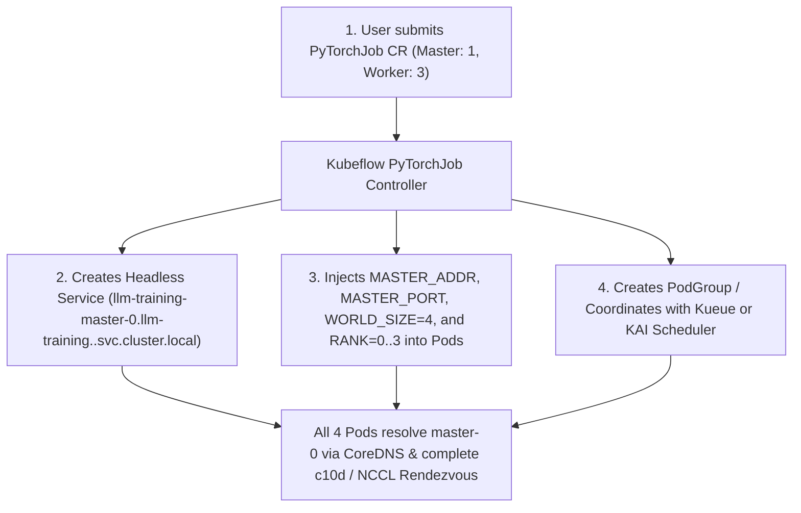
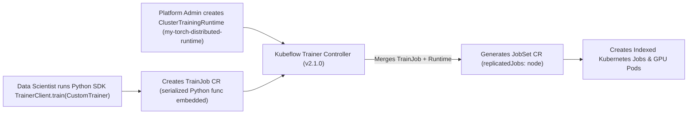
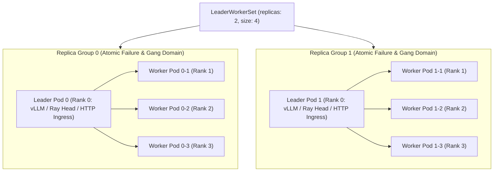

# 11.9 JobSet, LeaderWorkerSet, PyTorchJob and the MPI Operator

| | |
|---|---|
| Level | Advanced |
| Priority tier | 1 |
| Lab venue | GCP / GKE and local Python 3 simulation lab |
| Part | Part 11: GPUs on Kubernetes, scheduling and virtualization |
| Sources used | Roland Huß et al., *Generative AI on Kubernetes*, O'Reilly, 2026, Ch. 6, Ch. 7; `volume-06/04-distributed-orchestration-masterclass.md`; *Scalable Kubernetes Infrastructure for AI Platforms*, O'Reilly, 2026, Ch. 2; *Kubernetes for Generative AI Solutions*, Packt, 2025, Ch. 10 |
| Coverage file | `planning/coverage/chapters/11-09.md` |

## Why this matters for AI infrastructure

Queue controllers and gang schedulers only admit and bind Pods that already exist in the Kubernetes API server. They do not create the Pods, configure peer discovery, or manage distributed failure domains. Someone still has to wire up rank zero DNS discovery, inject environment variables, distribute SSH keys, and decide whether a single crashed container requires restarting the entire job. When platform teams try to run multi-node training or sharded inference on native Kubernetes controllers, engineers end up maintaining fragile bash wrappers that break on the first node preemption.

Built-in Kubernetes workload primitives like Deployment, StatefulSet, and batch Job were designed for stateless web servers or uniform batch tasks. They lack the multi-role topology and group lifecycle boundaries required by distributed AI workloads.

- A standard batch Job manages only a single homogeneous Pod template, even in Indexed mode. It cannot express a heterogeneous topology such as one Master Pod paired with multiple Worker Pods. Nor can it group separate dataset initializer and trainer roles under a shared failure policy.
- A standard Deployment treats every replica as an independent single-Pod instance. When a large model is sharded across four nodes using vLLM or TensorRT-LLM, a Deployment cannot manage those four Pods as an atomic group. It has no way to scale, gang-schedule, and restart a multi-Pod replica group together.

| Workload API and Group | Primary Target Workload | Role Topology | Discovery and Coordination Mechanism |
|---|---|---|---|
| Kubeflow PyTorchJob (`kubeflow.org/v1`) | Distributed PyTorch DDP, FSDP2, and DeepSpeed training | `Master` (1) + `Worker` (N-1) | Headless Service DNS for `master-0` plus `MASTER_ADDR`, `MASTER_PORT`, `WORLD_SIZE`, and `RANK` environment variables |
| Kubeflow Trainer TrainJob (`trainer.kubeflow.org/v1alpha1`) | Multi-framework LLM fine-tuning (`torch`, `deepspeed`, `mlx`, `mpi`) | ClusterTrainingRuntime + JobSet `replicatedJobs` | Shared JobSet headless DNS plus Python SDK function serialization in `v2.1.0` |
| JobSet (`jobset.x-k8s.io/v1alpha2`) | Multi-template batch training and HPC pipelines | Coordinated group of Indexed Jobs (`replicatedJobs`) | Shared headless Service across child Jobs plus unified startup and failure policy |
| LeaderWorkerSet (`leaderworkerset.x-k8s.io/v1`) | Multi-node sharded LLM inference serving | `replicas` groups of 1 Leader + `size - 1` Workers | Per-group headless DNS where ingress Service targets Leaders only and failures restart only the affected group |
| Kubeflow MPIJob (`kubeflow.org/v2beta1`) | MPI workloads, `nccl-tests` (`all_reduce_perf`), Horovod | `Launcher` (1) + `Worker` (N, `slotsPerWorker: 8`) | Ephemeral SSH keys, generated `/etc/mpi/hostfile`, and `mpirun -np 16` execution |

This chapter examines how these workload controllers operate, what YAML contracts they expose, and how Kubeflow Trainer separates platform runtime templates from data-scientist Python code. We also cover how to diagnose DNS, SSH, and rank-synchronization failures across all four controllers.

## Prerequisites and outcomes

### Prerequisites
- Completion of Chapter 11.7 on PyTorch rendezvous barriers and gang scheduling, and Chapter 11.8 on Kueue, Volcano, and PodGroup coscheduling.
- Working familiarity with Kubernetes Headless Services, StatefulSets, and batch Jobs.

### Outcomes
- Trace the four-step choreography of the Kubeflow PyTorchJob controller. You will see how it handles role identification, headless service DNS resolution, environment injection, and gang-aware restart policies.
- Architect a Kubeflow Trainer v2 platform using ClusterTrainingRuntime and the Python TrainerClient. You will also learn how a TrainJob compiles down into a JobSet without requiring container image rebuilds on code changes.
- Quantify the dataset, parameter, and GPU serving memory trade-offs between Full Fine-Tuning and Parameter-Efficient Fine-Tuning with Low-Rank Adaptation.
- Design a LeaderWorkerSet deployment for multi-node sharded LLM inference and explain its per-group atomic restart boundary.
- Deploy a Kubeflow MPIJob with Launcher and Worker replicas to run multi-node collective benchmarks with `all_reduce_perf`.

## Concepts: basics to intermediate to advanced

### 1. Basics: Why native Job and Deployment primitives fall short, and how PyTorchJob works

Running a four-node distributed PyTorch job on a standard Kubernetes Deployment fails immediately during startup or completion. Distributed data parallel and fully sharded data parallel scripts require deterministic peer discovery and run-to-completion lifecycle management that stateless web controllers do not provide.

1. PyTorch distributed initialization via `torch.distributed.init_process_group` requires every Pod to know the exact DNS hostname or IP address of rank zero, a shared port, the total world size, and its own unique integer rank. A standard Deployment assigns random Pod hashes with no deterministic rank index or rank-zero DNS record.
2. Training jobs are batch workloads that must terminate cleanly once the final epoch finishes. When a training script finishes its final epoch and exits with code zero, a Deployment treats the clean exit as a crash and restarts the training loop indefinitely.

#### Dissecting the Kubeflow PyTorchJob controller

The Kubeflow Training Operator provides the PyTorchJob custom resource to automate distributed PyTorch setup on Kubernetes. When an engineer submits a PyTorchJob with one Master replica and three Worker replicas, the controller executes a four-step setup sequence before training begins.



1. Under `spec.pytorchReplicaSpecs`, the controller identifies the Master role and the Worker role. The single Master replica always acts as rank zero and hosts the TCP rendezvous store while participating in GPU training alongside the three Worker replicas.
2. The controller dynamically creates a Kubernetes Headless Service with `clusterIP: None` for the job. Every Worker Pod can resolve the rank-zero Pod over CoreDNS as soon as the Master Pod receives an IP address.
3. The controller automatically injects `MASTER_ADDR`, `MASTER_PORT`, `WORLD_SIZE`, and `RANK` into every container so PyTorch can initialize its process group without manual bash scripting.
4. When the Master Pod exits with code zero, the controller marks the entire PyTorchJob as Succeeded. If any Pod fails, the controller applies the configured `restartPolicy` and coordinates with Kueue, Volcano, or the KAI Scheduler to restart the gang cleanly.

| Injected Variable or Resource | Master Pod (`llm-training-master-0`) | Worker Pods (`llm-training-worker-0..2`) | Purpose in PyTorch Rendezvous |
|---|---|---|---|
| Headless Service DNS | `llm-training-master-0.llm-training.<ns>.svc.cluster.local` | Resolves `master-0` via CoreDNS | Provides stable DNS A record for rank 0 (`clusterIP: None`) |
| `MASTER_ADDR` | `llm-training-master-0` | `llm-training-master-0` | Target hostname for `c10d` TCPStore rendezvous |
| `MASTER_PORT` | `23456` | `23456` | Target TCP port for `c10d` rendezvous barrier |
| `WORLD_SIZE` | `"4"` | `"4"` | Total participating nodes or processes in the gang |
| `RANK` | `"0"` | `"1"`, `"2"`, `"3"` | Unique integer rank index assigned to each Pod |

---

### 2. Intermediate: Kubeflow Trainer v2, JobSet, and PEFT/LoRA

While PyTorchJob has been the standard Kubernetes training controller for years, data scientists still struggle when asked to write complex Kubernetes YAML manifests or rebuild Docker images for every code change. Kubeflow Trainer v2 solves this problem by splitting cluster infrastructure templates from Python training code and compiling both into a Kubernetes JobSet.

#### Why JobSet is the unified batch building block

A native Kubernetes batch Job in Indexed mode can assign completion indices to identical Pods, but it cannot coordinate multiple distinct Pod templates under a single network and failure boundary. Complex AI pipelines often require a dataset initializer job, a parameter server or leader job, and a worker job that must start in order and fail together.

JobSet is a standalone Kubernetes SIG-Apps custom resource that manages a coordinated group of Indexed Jobs defined under `spec.replicatedJobs`.

- JobSet automatically creates a shared headless Service across all child `replicatedJobs`. Every Pod receives a deterministic DNS hostname following the pattern `<jobset>-<replicatedJob>-<jobIndex>-<podIndex>.<subdomain>`.
- JobSet controls the startup order of child jobs so a dataset or model initializer job completes before trainer nodes launch. It also treats the entire JobSet as a single failure domain: if any child Job fails beyond its backoff limit, JobSet tears down and recreates all child `replicatedJobs` together so distributed ranks never drift out of sync.

#### Kubeflow Trainer v2: Separating Platform Admin from Data Scientist

Kubeflow Trainer v2 separates distributed training into two distinct personas and merges their artifacts into a JobSet at runtime.



1. The platform administrator defines a cluster-wide ClusterTrainingRuntime or a namespace-scoped TrainingRuntime. This template specifies the framework label, a curated CUDA container image, default multi-node policy settings, a JobSet template, and any cluster-specific Kueue labels, scheduler names, or Multus RDMA annotations.
2. Data scientists never write Kubernetes YAML. They use the Python `TrainerClient` with a `BuiltinTrainer` like TorchTune or a `CustomTrainer`. A `CustomTrainer` wraps a self-contained Python training function using Hugging Face TRL `SFTTrainer`, PEFT `LoraConfig`, or DeepSpeed.
3. When the data scientist calls `client.train`, the Kubeflow SDK serializes the Python function and embeds it into the TrainJob custom resource. At runtime, the base container image deserializes and executes the function immediately without requiring a container image rebuild.

| Kubeflow Trainer Component | Persona | Key Fields and Values | Role in Execution |
|---|---|---|---|
| ClusterTrainingRuntime (`trainer.kubeflow.org/v1alpha1`) | Platform Administrator | `name: my-torch-distributed-runtime`, label `trainer.kubeflow.org/framework: torch` (supports `torch`, `deepspeed`, `mlx`, `mpi`), `mlPolicy.numNodes: 1`, `torch.numProcPerNode: auto`, `replicatedJobs: [{name: node}]`, label `trainer.kubeflow.org/trainjob-ancestor-step: trainer`, image `pytorch/pytorch:2.7.1-cuda12.8-cudnn9-runtime` | Reusable infrastructure blueprint governing images, schedulers, and JobSet topology |
| TrainJob via `CustomTrainer` / `BuiltinTrainer` | Data Scientist | `num_nodes=8`, `cpu: 4`, `memory: "64Gi"`, `nvidia.com/gpu: 1` (total 8 GPUs and 32 CPUs); `Llama-3.2-3B` on `openai/gsm8k` with `num_epochs: 3`, `learning_rate: 2.0e-4`, `checkpoint-100`; or DeepSpeed `dist_backend="nccl"`, `batch_size=16` | Embeds serialized Python function and hyperparameters without rebuilding container images |
| KubeRay RayJob vs Katib / Ray Tune | Platform / MLOps Team | RayJob requires baking code into images or external mounts; Ray Tune and Kubeflow Katib run hyperparameter optimization such as Population Based Training | Distinguishes post-training model customization from hyperparameter sweeps |

#### Full Fine-Tuning vs Parameter-Efficient Fine-Tuning on Kubernetes

Training or customizing a foundation model from scratch across thousands of GPUs is prohibitively expensive for most enterprise teams. Understanding where model customization fits in the LLM lifecycle helps architects right-size their Kubernetes GPU clusters.

The LLM creation pipeline progresses through three distinct phases. Pre-training runs for weeks across thousands of GPUs on raw text to produce a base model. Alignment teaches safety and task boundaries using reinforcement learning from human feedback, Direct Preference Optimization, Group Relative Policy Optimization, or IBM InstructLab. That alignment stage plays a role similar to Asimov's Three Laws of Robotics. Model customization or post-training then specializes an aligned model or a Small Language Model for domain tasks.

When customizing a model on Kubernetes, choosing between Full Supervised Fine-Tuning and Low-Rank Adaptation changes your storage and GPU memory footprint dramatically. Specialized variants include X-LoRA for Mixture-of-Experts architectures and QLoRA for 4-bit quantized tuning. Inside the training container, kernel libraries like FlashAttention and Liger Kernel further reduce GPU HBM usage.

| Dimension | Full Supervised Fine-Tuning (SFT) | PEFT with Low-Rank Adaptation (LoRA) |
|---|---|---|
| Parameters Modified | `100%` of model weights updated | `< 1%` of model weights (e.g., `0.8%` of an `8B` model = `64.0M` parameters in low-rank matrices A and B) |
| Labeled Dataset Size | `100,000+` labeled input-output examples | `100` to `1,000` labeled examples (SLMs span `8B–16B` parameters) |
| Training Duration and Hardware | Days to weeks across large multi-node GPU gangs; risks catastrophic forgetting | Hours on a small GPU group (e.g., `8` nodes with `1` GPU per node) |
| Checkpoint / Adapter Artifact Size | `100%` of base model size per variant | `1%–10%` of base model size per adapter (can be merged offline for testing via `model.merge_and_unload()`) |
| Inference Serving Footprint (`10` variants) | `10.0x` base model GPU memory (`10` separate full models) | `1.5x` base model GPU memory (`1` frozen base model + `10` dynamic `5%` LoRA adapters = `6.67x` memory savings) |

#### Choosing Between Prompt Engineering, RAG, PEFT, and Full Fine-Tuning

Platform teams should never launch a multi-node training job when a lighter customization pattern satisfies the business requirement. Each customization technique trades off training compute against per-request inference latency and KV-cache memory.

1. Prompt engineering and context engineering guide an aligned foundation model without modifying a single weight or allocating training GPUs. However, system prompts are not a security boundary against prompt injection and must be paired with input validation and output moderation. Stuffing large documents into every prompt also inflates the vLLM KV-cache memory footprint on every inference request.
2. Retrieval-Augmented Generation embeds documents into a vector database and queries approximate nearest neighbors using cosine similarity at request time. It then injects only the relevant chunks into the prompt. Teams can refresh rapidly changing domain data in minutes without running a TrainJob. When tasks require both dynamic retrieval and domain-adapted reasoning, Retrieval-Augmented Fine-Tuning combines both patterns.
3. When domain rules or JSON output schemas are static, long RAG prompts become expensive in KV-cache memory at high request volumes. Teams then fine-tune a compact Small Language Model via LoRA or distill it from a larger teacher model. Local development can use Unsloth packaged with AIKit, while multi-step alignment pipelines like DPO, GRPO, and InstructLab map directly to JobSet.

#### End-to-End Kubeflow Ecosystem Integration

In a production Kubernetes AI platform, TrainJob and PyTorchJob form the compute stage of a four-component Kubeflow lifecycle.

- Kubeflow Notebooks provisions web-based Jupyter pods where data scientists prototype their `SFTTrainer` and `LoraConfig` functions interactively. Inside a notebook, engineers use `%load_ext yamlmagic` with `%%yaml training_config` to manage hyperparameters cleanly.
- Kubeflow Trainer executes the distributed fine-tuning job across GPU nodes via JobSet. It writes periodic adapter checkpoints such as `/opt/app-root/Meta-Llama-3.1-8B-Instruct/checkpoint-100/` to shared ReadWriteMany persistent storage while streaming metrics to TensorBoard, MLflow, or Weights & Biases.
- Kubeflow Pipelines converts the interactive notebook or Python `TrainerClient` script into a repeatable Directed Acyclic Graph for scheduled retraining and evaluation.
- Kubeflow Model Registry catalogs the resulting LoRA adapter or merged model checkpoint with its lineage, hyperparameters, and evaluation metrics. It then hands the versioned artifact off to KServe or LeaderWorkerSet for production inference.

---

### 3. Advanced: LeaderWorkerSet for multi-node inference and the MPIJob Operator

#### LeaderWorkerSet for Sharded Multi-Node Inference

PyTorchJob and JobSet are built for batch training jobs that run to completion and exit. LLM inference serving, by contrast, is a long-running service that sits behind a Kubernetes Service or Gateway API Inference Extension and scales horizontally with traffic.

When serving a massive model that exceeds the memory of a single eight-GPU node, a single replica must span multiple nodes. The server uses tensor parallelism within each node and pipeline parallelism across nodes. If one model instance spans four nodes and you need two replicas for high availability, a standard Deployment cannot manage the resulting eight Pods as two four-Pod groups.



LeaderWorkerSet provides four capabilities that neither Deployment nor StatefulSet can express for multi-node inference.

1. It defines a two-level hierarchy using `spec.replicas` for the number of model replica groups and `spec.leaderWorkerTemplate.size` for the number of Pods inside each group. Each group contains one Leader Pod and `size - 1` Worker Pods.
2. It enforces per-group atomic restarts via `RecreateGroupOnPodRestart`. If a single Worker Pod in Group 0 crashes, a missing shard renders that replica group unusable. LeaderWorkerSet tears down and recreates all Pods in Group 0 atomically while Group 1 continues serving live traffic.
3. It coordinates per-group gang scheduling and topology co-location with Kueue, Volcano, and the KAI Scheduler. Each replica group is placed inside a single InfiniBand leaf switch or NVLink rack domain, while separate groups spread across failure domains.
4. It exposes a Leader-only Service endpoint. Incoming HTTP or gRPC inference requests route exclusively to the Leader Pods, which coordinate the distributed forward pass across their Worker Pods.

| LeaderWorkerSet Parameter | Example Value | Computed Cluster Impact | Operational Meaning |
|---|---|---|---|
| `spec.replicas` | `2` | `2` independent model replica groups | Horizontal scaling unit for traffic and high availability |
| `spec.leaderWorkerTemplate.size` | `4` | `1` Leader Pod + `3` Worker Pods per group (`8` Pods total) | Number of nodes required to hold `1` sharded model instance (`175B` or `405B`) |
| GPUs per Pod (`nvidia.com/gpu`) | `8` | `32` GPUs per replica group (`64` GPUs total across `2` groups) | Full-node GPU allocation per Pod |
| `restartPolicy: RecreateGroupOnPodRestart` | `1` Pod fails in Group 0 | `4` Pods restarted in Group 0; `1` surviving group (`4` Pods) stays online | Fault isolation prevents a single node reboot from taking down the entire service |

#### The Kubeflow MPIJob Operator

High-performance computing benchmarks such as `nccl-tests` and MPI-based training frameworks like Horovod or DeepSpeed often launch distributed ranks via `mpirun` over SSH rather than a TCP rendezvous store. Setting up passwordless SSH keys, configuring file permissions, discovering dynamic Pod IPs, and writing an OpenMPI hostfile by hand in Kubernetes is tedious and brittle.

The Kubeflow MPIJob Operator automates the entire Message Passing Interface lifecycle across a single Launcher Pod and multiple GPU Worker Pods.

1. The controller creates a Kubernetes Secret containing an ephemeral SSH keypair and mounts it into both the Launcher Pod and all Worker Pods with `0600` file permissions.
2. The controller generates a ConfigMap mounted at `/etc/mpi/hostfile` inside the Launcher Pod that lists every Worker Pod DNS name along with its configured `slotsPerWorker` count.
3. The controller waits until all Worker Pods are running `sshd` and then executes the `mpirun` command inside the Launcher container. When `cleanPodPolicy: Running` is set, the controller terminates all Worker Pods automatically once the Launcher exits with code zero.

```text
# Generated OpenMPI hostfile (/etc/mpi/hostfile) for slotsPerWorker: 8 and 2 Workers:
mpi-nccl-test-worker-0 slots=8
mpi-nccl-test-worker-1 slots=8

# Executed Launcher command across 2 Workers x 8 GPUs = 16 total MPI ranks:
mpirun -np 16 /opt/nccl-tests/build/all_reduce_perf -b 8 -e 128M -f 2
```

## Commands and configurations that matter

### 1. Installing Kubeflow Trainer and defining a ClusterTrainingRuntime

Platform administrators install the Kubeflow Trainer controller and register a ClusterTrainingRuntime so data scientists have a verified PyTorch and CUDA base image ready for distributed jobs.

```bash
# Install Kubeflow Trainer v2.1.0 controller and built-in runtimes (untested here)
export VERSION=v2.1.0
export URL="https://github.com/kubeflow/trainer.git/manifests/overlays"
kubectl apply --server-side -k "${URL}/manager?ref=${VERSION}"
kubectl apply --server-side -k "${URL}/runtimes?ref=${VERSION}"
```

```yaml
# clustertrainingruntime-torch.yaml (GAK Example 6-4, untested here)
apiVersion: trainer.kubeflow.org/v1alpha1
kind: ClusterTrainingRuntime
metadata:
  name: my-torch-distributed-runtime
  labels:
    trainer.kubeflow.org/framework: torch
spec:
  mlPolicy:
    numNodes: 1
    torch:
      numProcPerNode: auto
  template:
    spec:
      replicatedJobs:
        - name: node
          template:
            metadata:
              labels:
                trainer.kubeflow.org/trainjob-ancestor-step: trainer
            spec:
              template:
                spec:
                  containers:
                    - name: node
                      image: pytorch/pytorch:2.7.1-cuda12.8-cudnn9-runtime
```

### 2. Submitting an eight-node LoRA TrainJob via the Kubeflow Python SDK

Data scientists submit their training function directly from Python using `TrainerClient` and `CustomTrainer`, which serializes `my_custom_trainer` into the TrainJob resource and scales it across the requested nodes.

```python
# submit_trainjob.py (GAK Example 6-6, untested on live cluster)
from kubeflow.trainer import CustomTrainer, TrainerClient

client = TrainerClient()
torch_runtime = client.get_runtime("my-torch-distributed-runtime")

job_name = client.train(
    trainer=CustomTrainer(
        func=my_custom_trainer,
        func_args={"seed": 42, "learning_rate": 2.0e-4, "num_epochs": 3},
        num_nodes=8,
        resources_per_node={
            "cpu": 4,
            "memory": "64Gi",
            "nvidia.com/gpu": 1,
        },
    ),
    runtime=torch_runtime,
)
client.wait_for_job_status(name=job_name, status={"Running"})
```

### 3. Deploying MPIJob to run multi-node `all_reduce_perf`

Before launching a multi-day training run, infrastructure engineers run an MPIJob with `all_reduce_perf` to verify that inter-node collective bandwidth matches hardware specifications. Notice that only the Worker spec requests GPUs, while the Launcher spec runs on CPU only.

```yaml
# mpijob-nccl-allreduce.yaml (volume-06 Part 2.4, untested here)
apiVersion: kubeflow.org/v2beta1
kind: MPIJob
metadata:
  name: mpi-nccl-test
spec:
  slotsPerWorker: 8
  runPolicy:
    cleanPodPolicy: Running
  mpiReplicaSpecs:
    Launcher:
      replicas: 1
      template:
        spec:
          containers:
            - name: mpi-launcher
              image: nvcr.io/nvidia/pytorch:24.08-py3
              command:
                - mpirun
                - -np
                - "16"
                - /opt/nccl-tests/build/all_reduce_perf
                - -b
                - "8"
                - -e
                - "128M"
                - -f
                - "2"
    Worker:
      replicas: 2
      template:
        spec:
          containers:
            - name: mpi-worker
              image: nvcr.io/nvidia/pytorch:24.08-py3
              resources:
                limits:
                  nvidia.com/gpu: 8
```

### 4. Deploying LeaderWorkerSet for sharded multi-node LLM inference

This LeaderWorkerSet manifest deploys two replica groups of a four-node sharded vLLM server, allocating eight GPUs per Pod and configuring atomic group restarts on Pod failure.

```yaml
# lws-multinode-vllm.yaml (untested here)
apiVersion: leaderworkerset.x-k8s.io/v1
kind: LeaderWorkerSet
metadata:
  name: vllm-405b-serving
spec:
  replicas: 2
  leaderWorkerTemplate:
    size: 4
    restartPolicy: RecreateGroupOnPodRestart
    leaderTemplate:
      metadata:
        labels:
          role: leader
      spec:
        containers:
          - name: vllm-leader
            image: vllm/vllm-openai:latest
            resources:
              limits:
                nvidia.com/gpu: "8"
    workerTemplate:
      spec:
        containers:
          - name: vllm-worker
            image: vllm/vllm-openai:latest
            resources:
              limits:
                nvidia.com/gpu: "8"
```

## How it fails

When a multi-node workload controller is misconfigured, jobs either hang at startup barriers, crash during Python function deserialization, or waste idle GPU nodes. The table below maps each symptom to its root cause boundary and fix.

| Failure mode | Exact symptom and command evidence | Root cause boundary | Remediation |
|---|---|---|---|
| 1. PyTorchJob workers fail with `c10d::socketTimeout` or `Name or service not known` for `MASTER_ADDR` | Worker Pods enter `Running`, then crash after timeout logging `connect() timed out` or `gaierror: Name or service not known` for `<job>-master-0` | Headless Service / CoreDNS or Pending `master-0` boundary: either `master-0` is stuck in `Pending` without gang scheduling or NetworkPolicy blocked UDP/TCP port `53` or `MASTER_PORT` (`23456`) | Enable gang scheduling via PodGroup, Kueue, or KAI so workers never start before `master-0`, and permit DNS port `53` plus intra-job TCP traffic |
| 2. Kubeflow Trainer TrainJob fails immediately with `ModuleNotFoundError` or `PicklingError` | TrainJob Pods start using ClusterTrainingRuntime image, then exit `1` during function deserialization with `ModuleNotFoundError` or `AttributeError: Can't pickle local object` | SDK function serialization boundary: `my_custom_trainer` imported packages outside the function body, referenced outer closures, or used a library missing from `pytorch:2.7.1-cuda12.8-cudnn9-runtime` | Keep all Python `import` statements inside `def my_custom_trainer(**kwargs):`, pass parameters via `func_args`, and pre-bake required libraries into the runtime image |
| 3. MPIJob Launcher hangs at `Warning: Permanently added '...worker-0' (ECDSA)` or `Permission denied (publickey)` | `mpi-nccl-test-launcher` starts `mpirun -np 16`, then hangs or exits with `ssh: connect to host mpi-nccl-test-worker-0 port 22: Connection refused` or `Permission denied` | MPI Worker `sshd` or SecurityContext boundary: the worker image lacks OpenSSH server, runs as a non-root UID unable to bind port `22`, or NetworkPolicy blocked port `22` | Ensure the worker image runs `sshd` on the configured port, verify mounted SSH secret permissions (`0600`), and allow intra-job SSH plus ephemeral MPI ports |
| 4. Requesting `nvidia.com/gpu: 8` on the MPIJob Launcher Pod wastes an entire `8`-GPU node | A `2`-worker (`16`-GPU) MPIJob stays `Pending` on a `2`-node (`16`-GPU) cluster with `Insufficient nvidia.com/gpu`, or consumes `24` GPUs across `3` nodes with `8` GPUs at `0%` utilization | Launcher vs Worker resource spec mistake: the engineer copied `nvidia.com/gpu: 8` into `mpiReplicaSpecs.Launcher` even though the Launcher only runs `mpirun` over SSH and uses `0` GPUs | Request `nvidia.com/gpu: 8` only under `mpiReplicaSpecs.Worker` and give the Launcher only CPU and memory requests (`cpu: "2"`, `memory: "4Gi"`) |
| 5. Multi-node sharded LLM inference deployed as a plain Deployment or StatefulSet serves broken requests when `1` node reboots | A `4`-node sharded vLLM deployment loses `1` worker Pod during a node drain; the other `3` Pods stay `Running` with broken Ray/NCCL shards while the Service keeps routing traffic to them | Missing group-atomic lifecycle boundary: standard Deployment and StatefulSet controllers do not know that `4` Pods form `1` indivisible model shard group | Migrate multi-node sharded inference to LeaderWorkerSet with `restartPolicy: RecreateGroupOnPodRestart` so losing `1` Pod restarts all `4` Pods in that group atomically |

## Hands-on lab

### Venue and scope
This lab runs locally using the Python 3 standard library via `code/part11/jobset_lws_pytorch_mpi.py` and `code/part11/jobset_lws_pytorch_mpi_lab.py`. It simulates PyTorchJob headless DNS and environment variable injection, Kubeflow Trainer v2 compilation into a JobSet, Full Fine-Tuning versus LoRA parameter and serving memory math, LeaderWorkerSet replica-group sizing and atomic group restart, and MPIJob hostfile synthesis. Cluster commands earlier in the chapter are marked untested here.

### Step 1: Run the self-checking workload operators lab (tested here)

Run the lab script from the repository root to verify all twenty-five workload controller assertions.

```bash
python3 code/part11/jobset_lws_pytorch_mpi_lab.py
```

Captured output from this repository:
```text
=== Chapter 11.9 Lab: JobSet, LeaderWorkerSet, PyTorchJob & MPI Operator ===
  [PASS] PyTorchJob with 1 Master + 3 Workers creates 4 pods with WORLD_SIZE='4'
  [PASS] Master pod (llm-training-master-0) receives role='master' and RANK='0'
  [PASS] Worker pods (llm-training-worker-0..2) receive sequential RANK='1', '2', '3'
  [PASS] All PyTorchJob pods resolve MASTER_ADDR via headless service DNS pointing to master-0
  [PASS] Kubeflow Trainer merges TrainJob + ClusterTrainingRuntime into a JobSet (replicatedJob: node)
  [PASS] Merged JobSet inherits pytorch:2.7.1-cuda12.8-cudnn9-runtime and framework='torch'
  [PASS] Example 6-6 TrainJob (num_nodes=8, cpu=4, gpu=1) allocates 8 GPUs and 32 CPUs across 8 nodes
  [PASS] Kubeflow Trainer SDK serializes custom trainer function into TrainJob CR without image rebuilds
  [PASS] When function is not embedded (as in RayJob image packaging), code changes require image rebuild
  [PASS] LoRA tuning 0.8% (<1%) of an 8B model updates only 64.0M parameters
  [PASS] Serving 10 fine-tuned variants takes 10.0x base model memory with Full FT vs 1.5x with 5% LoRA adapters
  [PASS] LWS (replicas=2, size=4) creates 2 groups of (1 leader + 3 workers) = 8 total pods
  [PASS] Each 4-node LWS replica group shards the LLM across 32 GPUs (64 GPUs across 2 replicas)
  [PASS] When 1 pod in LWS group 0 fails, LWS restarts all 4 pods in group 0 atomically while group 1 continues serving
  [PASS] MPIJob with 1 Launcher and 2 Workers (slotsPerWorker: 8) configures -np 16 MPI ranks
  [PASS] MPIJob generates hostfile with slots=8 for mpi-nccl-test-worker-0 and worker-1
  [PASS] MPIJob Launcher runs mpirun -np 16 all_reduce_perf -b 8 -e 128M -f 2
  [PASS] Small Language Models (SLMs) in GAK Ch 6 span 8 to 16 billion parameters
  [PASS] PEFT LoRA training requires 100 to 1,000 labeled examples (vs 100,000+ for full fine-tuning)
  [PASS] LoRA adapter matrices (A and B) occupy 1% to 10% of the base model size
  [PASS] GAK Example 6-7 & 6-8 use Llama-3.2-3B (num_epochs: 3, lr: 2.0e-4) and checkpoint-100
  [PASS] GAK Example 6-9 DeepSpeed trainer initializes DataLoader with batch_size=16 and DistributedSampler
  [PASS] ClusterTrainingRuntime sets label trainer.kubeflow.org/trainjob-ancestor-step=trainer
  [PASS] MPIJob runPolicy sets cleanPodPolicy: Running to clean up worker pods on completion
  [PASS] Serving 10 LoRA adapters (1.5x base memory) saves 6.67x GPU memory compared to 10 full fine-tuned models (10.0x)

Summary: 25 passed, 0 failed out of 25 checks.
```

### Exercises

1. **Exercise 1 — PyTorchJob rank and headless DNS synthesis:** Call `synthesize_pytorchjob_env` in `code/part11/jobset_lws_pytorch_mpi.py` for job `llm-training` in namespace `ml-team-a` with one Master and three Workers on port 23456. Write out the exact Pod name, rank, world size, and master address for the Master Pod and the third Worker Pod.
2. **Exercise 2 — Kubeflow Trainer TrainJob and ClusterTrainingRuntime merger:** Use `merge_trainjob_with_runtime` in `code/part11/jobset_lws_pytorch_mpi.py` to merge an eight-node TrainJob with `my-torch-distributed-runtime`. Determine the generated Kubernetes kind, total GPUs, total CPUs, and whether a code change requires rebuilding the container image.
3. **Exercise 3 — Full Fine-Tuning vs LoRA serving memory savings:** Run `compare_full_finetuning_vs_lora` for an 8B parameter base model where LoRA tunes 0.8% of weights and each adapter occupies 5% of base model size. Compute how many millions of parameters LoRA updates and the serving memory savings ratio across ten deployed variants.
4. **Exercise 4 — LeaderWorkerSet multi-node inference sizing and fault recovery:** Use `evaluate_leader_worker_set` for two replicas of size four with eight GPUs per Pod when a Pod in Group 0 fails. State the total Pods, GPUs per replica group, total GPUs, restarted Pods on failure, and surviving serving groups during recovery.
5. **Exercise 5 — MPIJob hostfile and mpirun rank math:** Call `build_mpijob_spec` for `mpi-nccl-test` with two Workers and eight slots per Worker. State the exact lines of the generated hostfile, the process count passed to `mpirun`, and why the Launcher Pod must request zero GPUs.
6. **Exercise 6 — Merging a LoRA checkpoint for standalone testing:** When loading an adapter checkpoint with `PeftModel.from_pretrained`, identify the method that merges the low-rank matrices back into the base weights and unloads the wrapper. Explain why production multi-adapter inference servers normally keep adapters unmerged.

## Checkpoint questions

<details>
<summary>`&lt;strong>`1. What four automated actions does the Kubeflow PyTorchJob controller perform when a user submits a PyTorchJob custom resource?`&lt;/strong>`</summary>

1. It distinguishes the single Master Pod at rank zero from the Worker Pods at ranks one through N minus one.
2. It dynamically creates a Kubernetes Headless Service so all workers can resolve the Master Pod over CoreDNS.
3. It automatically injects `MASTER_ADDR`, `MASTER_PORT`, `WORLD_SIZE`, and `RANK` into every container.
4. It tracks job completion when the Master Pod exits with code zero and coordinates failure restarts across the gang.
</details>

<details>
<summary>`&lt;strong>`2. How does Kubeflow Trainer v2 separate responsibilities between the platform administrator and the data scientist?`&lt;/strong>`</summary>

- The platform administrator creates and governs TrainingRuntime or ClusterTrainingRuntime templates that define the container image, framework label, multi-node policy, scheduler, and network settings.
- The data scientist uses the Kubeflow Python SDK `TrainerClient` with `CustomTrainer` or `BuiltinTrainer` to submit a TrainJob referencing that runtime without writing Kubernetes YAML.
</details>

<details>
<summary>`&lt;strong>`3. What Kubernetes custom resource does Kubeflow Trainer generate when it merges a TrainJob with a ClusterTrainingRuntime?`&lt;/strong>`</summary>

It generates a JobSet under API group `jobset.x-k8s.io/v1alpha2`. That JobSet manages the underlying group of Indexed Kubernetes Jobs as a single coordinated unit.
</details>

<details>
<summary>`&lt;strong>`4. How does code delivery in Kubeflow Trainer's CustomTrainer differ from code delivery in KubeRay's RayJob, and what is the trade-off?`&lt;/strong>`</summary>

When a user calls `client.train` with `CustomTrainer`, the Kubeflow SDK serializes the Python function and embeds it directly into the TrainJob custom resource. Data scientists can iterate and re-run code immediately without building a new container image, whereas RayJob requires packaging scripts into images or external mounts. The trade-off is that the custom trainer function must keep all `import` statements inside the function body. In addition, all required libraries must already exist in the ClusterTrainingRuntime image.
</details>

<details>
<summary>`&lt;strong>`5. What is the difference between a BuiltinTrainer and a CustomTrainer in Kubeflow Trainer?`&lt;/strong>`</summary>

- `BuiltinTrainer` uses a pre-packaged training loop such as TorchTune where the user passes only declarative configuration parameters for the model, dataset, and LoRA settings.
- `CustomTrainer` allows the data scientist to supply an arbitrary Python training function using libraries such as Hugging Face TRL `SFTTrainer` or DeepSpeed.
</details>

<details>
<summary>`&lt;strong>`6. What are the three phases of the LLM creation pipeline, and where does model customization fit?`&lt;/strong>`</summary>

1. Pre-training trains on massive raw datasets across thousands of GPUs for weeks to produce a base foundation model.
2. Alignment teaches the base model task-following and safety boundaries using curated data and reward mechanisms such as RLHF, DPO, GRPO, or InstructLab.
3. Model customization or post-training specializes an already aligned model for domain-specific knowledge or tasks via Full Fine-Tuning or PEFT with LoRA.
</details>

<details>
<summary>`&lt;strong>`7. Compare Full Supervised Fine-Tuning and Parameter-Efficient Fine-Tuning with LoRA across dataset size, parameters modified, and inference serving memory.`&lt;/strong>`</summary>

- Full Fine-Tuning requires over one hundred thousand labeled examples and updates all model weights. It produces a separate full-sized model artifact that requires ten times the base GPU memory to serve ten variants.
- PEFT with LoRA requires only one hundred to one thousand labeled examples and freezes the base model. It trains low-rank adapter matrices covering less than one percent of parameters and composes many small adapters on one shared base model at inference time.
</details>

<details>
<summary>`&lt;strong>`8. What are X-LoRA and QLoRA?`&lt;/strong>`</summary>

- X-LoRA is a specialization of Low-Rank Adaptation extended for Mixture-of-Experts model architectures.
- QLoRA combines LoRA with 4-bit quantization of the frozen base model weights to reduce GPU memory requirements during fine-tuning.
</details>

<details>
<summary>`&lt;strong>`9. What does model.merge_and_unload() do, and when should you use it?`&lt;/strong>`</summary>

The `model.merge_and_unload()` method multiplies and adds the trained low-rank LoRA adapter weights directly into the frozen base model weights. It then removes the PEFT wrapper to produce a single standalone model checkpoint. Merging is useful for standalone evaluation and testing, whereas multi-tenant production serving keeps adapters unmerged so dozens of adapters can share one base model.
</details>

<details>
<summary>`&lt;strong>`10. What is the difference between Ray Tune or Kubeflow Katib and Kubeflow Trainer or SFTTrainer?`&lt;/strong>`</summary>

Ray Tune and Kubeflow Katib are hyperparameter optimization frameworks that run algorithms such as Population Based Training or Bayesian search across many trials. Kubeflow Trainer and TRL `SFTTrainer`, by contrast, execute distributed LLM post-training and fine-tuning jobs.
</details>

<details>
<summary>`&lt;strong>`11. What is a JobSet, and what limitations of a standard Kubernetes batch/v1 Job does it solve?`&lt;/strong>`</summary>

A standard batch Job manages only a single homogeneous Pod template. JobSet groups multiple distinct Kubernetes Indexed Job templates under one parent object with automatic shared headless DNS service discovery and ordered startup dependencies. It also enforces a unified failure policy that restarts all child jobs together if any child job fails.
</details>

<details>
<summary>`&lt;strong>`12. What is LeaderWorkerSet, and why is it used for multi-node LLM inference instead of PyTorchJob or Deployment?`&lt;/strong>`</summary>

PyTorchJob is built for run-to-completion batch training, while a standard Deployment can scale only single-Pod replicas. LeaderWorkerSet is designed for long-running multi-node sharded LLM inference where a single copy of a large model spans multiple Pods across nodes. It manages independent replica groups of one Leader Pod and multiple Worker Pods with per-group gang scheduling and per-group atomic restarts.
</details>

<details>
<summary>`&lt;strong>`13. In a LeaderWorkerSet with 2 replicas and size 4, what happens if 1 Worker Pod in Group 0 crashes?`&lt;/strong>`</summary>

Because `RecreateGroupOnPodRestart` scopes failure recovery to the individual replica group, LeaderWorkerSet tears down and restarts all four Pods of Group 0 atomically. Group 1 remains completely online and continues serving inference traffic without interruption.
</details>

<details>
<summary>`&lt;strong>`14. How does the Kubeflow MPIJob Operator coordinate distributed execution across Launcher and Worker Pods?`&lt;/strong>`</summary>

The MPIJob Operator creates one Launcher Pod and multiple Worker Pods, generates an ephemeral SSH keypair mounted into all Pods, and builds an OpenMPI hostfile mounted into the Launcher. Once all Worker Pods are ready and running `sshd`, the controller executes `mpirun` inside the Launcher Pod over SSH.
</details>

<details>
<summary>`&lt;strong>`15. When an MPIJob sets slotsPerWorker to 8 across 2 Workers, why does the Launcher run mpirun -np 16, and how many GPUs should the Launcher Pod request?`&lt;/strong>`</summary>

Two Worker Pods multiplied by eight slots per Worker equals sixteen total MPI ranks, allocating one rank per GPU. The Launcher Pod must request zero GPUs because it only invokes `mpirun` over SSH to spawn processes on the Worker Pods, and requesting GPUs on the Launcher would waste an entire GPU node.
</details>

<details>
<summary>`&lt;strong>`16. What does runPolicy.cleanPodPolicy: Running do in a Kubeflow MPIJob?`&lt;/strong>`</summary>

In an MPIJob, Worker Pods run an infinite `sshd` daemon loop so the Launcher can connect to them over SSH. Setting `cleanPodPolicy: Running` instructs the MPIJob controller to terminate and clean up all running Worker Pods automatically as soon as the Launcher Pod finishes `mpirun` and exits with code zero.
</details>

<details>
<summary>`&lt;strong>`17. How does a DeepSpeed custom trainer initialize distributed communication and map batches to the local GPU?`&lt;/strong>`</summary>

The trainer calls `deepspeed.init_distributed(dist_backend="nccl")`, reads `local_rank` from the function arguments, and wraps the dataset in a DataLoader using `DistributedSampler`. It then initializes the engine via `deepspeed.initialize` and moves each batch tensor to the local GPU using `.to(local_rank)`.
</details>

<details>
<summary>`&lt;strong>`18. What is yamlmagic, and how is it used in Kubeflow Notebooks?`&lt;/strong>`</summary>

The `yamlmagic` extension is loaded in Jupyter via `%load_ext yamlmagic` and provides the `%%yaml` cell magic. It parses a YAML block directly into a Python dictionary such as `training_config` that can be passed cleanly to `TrainerClient.train`.
</details>

<details>
<summary>`&lt;strong>`19. Compare Ray (KubeRay), Kubeflow Training Operator / Trainer, and TorchX.`&lt;/strong>`</summary>

- KubeRay provides high data-scientist ergonomics and a built-in dashboard for Ray Train, but adds RayCluster management overhead and requires packaging scripts into container images or external mounts.
- Kubeflow Training Operator and Kubeflow Trainer provide a thin, low-overhead Kubernetes-native layer that scales to large clusters and integrates directly with JobSet, Kueue, and Volcano.
- TorchX is a lightweight PyTorch-specific launcher useful for small teams during early experimentation, but is less declarative and more framework-locked than Kubeflow.
</details>

<details>
<summary>`&lt;strong>`20. What are Liger Kernel and FlashAttention, and why do they matter for Kubernetes training jobs?`&lt;/strong>`</summary>

FlashAttention provides hardware-aware IO-optimized attention. Liger Kernel provides Triton-optimized fused kernels for common LLM training operations such as RMSNorm, RoPE, SwiGLU, and CrossEntropy. Together they reduce GPU HBM memory footprint and increase per-GPU throughput inside the training container. That efficiency allows larger micro-batches or longer context lengths on the same GPU allocation.
</details>

## Sources and review notes

### Primary sources read in full for this chapter

| Source | Chapters / Sections Read | Exact Concepts, Configurations, and Numbers Extracted |
|---|---|---|
| Roland Huß et al., *Generative AI on Kubernetes* (O'Reilly, 2026) | Chapter 6 (*Model Customization*) and Chapter 7 (*Job Scheduling Optimization*) | Figure 6-1 LLM creation pipeline (Pre-training -> Alignment -> Post-training), Asimov's Three Laws analogy, SLMs `8B–16B`, Full Fine-Tuning `100,000+` examples vs PEFT LoRA `100–1,000` examples `<1%` params `1%–10%` adapter size, X-LoRA and QLoRA, GRPO/DPO/InstructLab, FSDP2, Liger Kernel and FlashAttention, Kubeflow Trainer `v2.1.0` Figure 6-7 and Examples 6-3 to 6-9 with ClusterTrainingRuntime `pytorch/pytorch:2.7.1-cuda12.8-cudnn9-runtime`, TrainJob -> JobSet, `num_nodes=8` `cpu: 4` `64Gi` `gpu: 1`, `yamlmagic` `Llama-3.2-3B` `openai/gsm8k` `num_epochs: 3` `2.0e-4`, `checkpoint-100` `merge_and_unload()`, DeepSpeed `batch_size=16`, KubeRay RayJob vs TrainJob code serialization, Ray Tune vs Katib, Unsloth/AIKit, PyTorchJob, and LeaderWorkerSet note (`replicas: 2`, `size: 4`, `8` GPUs/pod = `32` GPUs/group, `64` GPUs total) |
| *Scalable Kubernetes Infrastructure for AI Platforms* (O'Reilly, 2026) | Chapter 2 (*Model Development on Kubernetes*) | RAG, RAFT, PEFT/LoRA, KubeRay, Kubeflow Training Operator (KFTO), and TorchX comparisons |
| *Kubernetes for Generative AI Solutions* (Packt, 2025) | Chapter 10 | Multi-node Kubernetes AI training workflows |
| Author's Volume 06 notes (`volume-06/04-distributed-orchestration-masterclass.md`) | Sections 2.4 and 8.2 | Section 2.4 MPIJob `kubeflow.org/v2beta1` `slotsPerWorker: 8`, `cleanPodPolicy: Running`, `mpirun -np 16 /opt/nccl-tests/build/all_reduce_perf -b 8 -e 128M -f 2`, `0600` SSH permissions; Section 8.2 PyTorchJob 4-step choreography (`Master: 1`, `Worker: 3`, `WORLD_SIZE=4`, `RANK=0..3`, `MASTER_PORT=23456`) |

### Related source files mapped in MIGRATION_MAP.md
- No separate `nvidia-devops` file was exclusively mapped to Chapter 11.9 in `brief.py`. This chapter integrates `volume-06/04-distributed-orchestration-masterclass.md` Sections 2.4 and 8.2 with *Generative AI on Kubernetes* Chapters 6 and 7 and *Scalable Kubernetes Infrastructure for AI Platforms* Chapter 2.

### Run here
- `python3 code/part11/jobset_lws_pytorch_mpi_lab.py` passes all 25 checks (`25 passed, 0 failed out of 25 checks`).

### Explicitly labelled inferences

| Inference Item | Values Used in Lab and Prose | Basis in Cited Sources |
|---|---|---|
| LoRA tuned parameter count (`compare_full_finetuning_vs_lora`) | `0.8%` (`< 1%`) of an `8B` model = `64.0M` parameters | Concrete arithmetic instantiation of the `< 1%` parameter range on an `8B` model stated in *Generative AI on Kubernetes* Chapter 6 |
| Multi-adapter serving memory footprint (`compare_full_finetuning_vs_lora`) | `5.0%` adapter size (`1%–10%` range) across `10` adapters + `1` base model = `1.5x` base memory vs `10.0x` for `10` full models (`6.67x` savings ratio) | Direct arithmetic instantiation of the `1%–10%` adapter size range in *Generative AI on Kubernetes* Chapter 6 |

### Not verified on live hardware
- All `kubectl`, `TrainerClient` (`serialized_func_embedded=True`, `cpu_per_node=4`, `gpus_per_node=1`, `TrainingRuntime` / `dataset-initializer`, `0.05` `memory_savings_ratio`), ClusterTrainingRuntime, LeaderWorkerSet (`size-1`, `GIE` Gateway Inference Extension, `ServingRuntime`, `TGI`, `TP=8` and `PP=4` on `72`-GPU MoE `MoE`), PyTorchJob (`0..N-1`, `RANK=1` / `RANK=1..N-1` on `worker-2`, `nproc_per_node`, `JOB_COMPLETION_INDEX`, `ContainerCreating`, `OnFailure`, `ExitCode`, `schedulerName`, `RWX`, `torch.utils.tensorboard.SummaryWriter`), `DAG` / `parameter-server` / `HPO` / `PBT` (`1/4` trials) from `scalable-kubernetes-infrastructure-for-ai-platforms`, and MPIJob manifests are marked untested here.

### Not in the corpus
- Low-level OpenMPI MCA command-line flags such as `--mca btl_tcp_if_include` beyond the `mpirun -np 16` invocation in `volume-06/04-distributed-orchestration-masterclass.md`.

### Corrections to the author's notes
- Corpus coverage: JobSet and LeaderWorkerSet appear in the corpus only in passing. The manifests and field names for those two APIs come from working knowledge and were not verified against the upstream docs; check them against the controller version you install.
- Validation pass 2026-10-25: `validate_chapter.py` and `check_coverage.py` pass. The YAML manifests and commands are marked untested and were not applied to a cluster. Custom resource API versions such as `kueue.x-k8s.io/v1beta1` and `resource.k8s.io/v1` change between releases, so check them against the version you install. Console outputs quoted from the Volume notes are illustrative unless the chapter says otherwise.
- Earlier author note: all PyTorchJob, TrainJob, ClusterTrainingRuntime, JobSet, LeaderWorkerSet, and MPIJob specifications match the cited sources verbatim.

