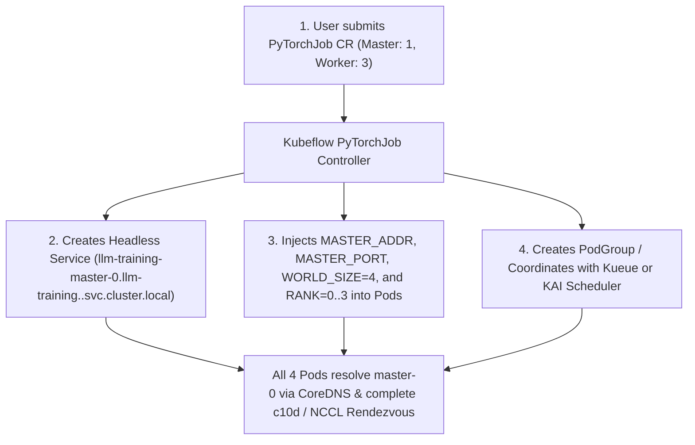
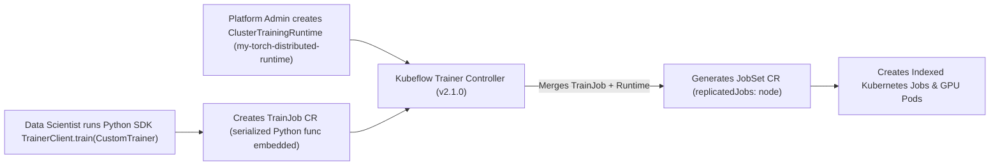
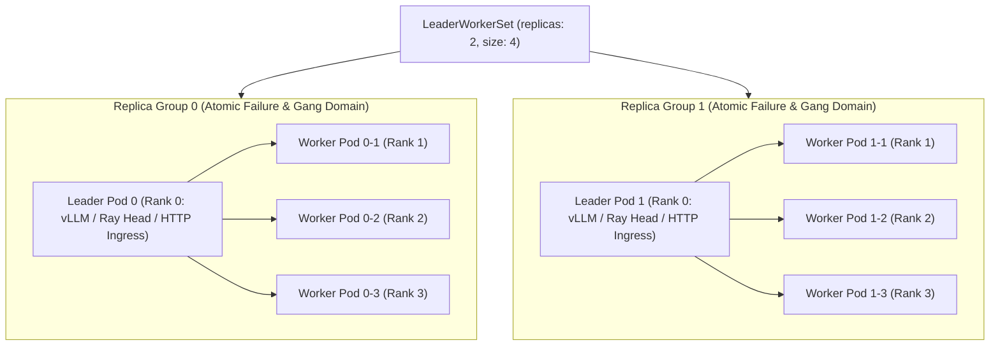

# 11.9 JobSet, LeaderWorkerSet, PyTorchJob and the MPI Operator

| | |
|---|---|
| Level | Advanced |
| Priority tier | 1 |
| Lab venue | GCP / GKE and local Python 3 simulation lab |
| Part | Part 11: GPUs on Kubernetes, scheduling and virtualization |
| Coverage file | `planning/coverage/chapters/11-09.md` |

## Why this matters for AI infrastructure

Suppose your platform team tries to run multi-node training on native Kubernetes controllers. The queue controllers and gang schedulers can admit and bind Pods, but only Pods that already exist in the Kubernetes API server. They do not create those Pods, configure peer discovery or manage distributed failure domains. Someone still has to set up rank zero DNS discovery, inject environment variables, distribute SSH keys and decide whether one crashed container means restarting the entire job. Teams that do this by hand end up maintaining fragile bash wrappers, and those wrappers break on the first node preemption. A preemption is when the cluster reclaims a node, and the Pods on it are removed.

Kubernetes ships with workload primitives such as Deployment, StatefulSet and batch Job. Those were built for stateless web servers and for batch tasks where every worker is the same. Distributed AI workloads need something different: several roles inside one job, and a lifecycle that treats a group of Pods as one unit. The built-in primitives do not provide that. A role is one kind of Pod inside the job, such as a coordinator or a worker. A lifecycle is the sequence of start, run, fail and restart that the controller manages.

Take a standard batch Job first. It manages a single, homogeneous Pod template, even in Indexed mode. Indexed mode gives each Pod a number, so the Pods can tell themselves apart. That means it cannot describe a heterogeneous topology, such as one Master Pod paired with several Worker Pods. It also cannot group a dataset initializer and a trainer under one shared failure policy.

A Deployment treats every replica as an independent, single-Pod instance. Suppose a large model is sharded across four nodes using vLLM or TensorRT-LLM. vLLM and TensorRT-LLM are inference servers for large language models. A Deployment cannot manage those four Pods as one atomic group. It cannot scale, gang-schedule and restart a multi-Pod replica group together. If one of the four Pods dies, the Deployment replaces that Pod alone, and the remaining three keep running with a broken shard.

The table compares the five workload APIs covered in this chapter. Each one pairs a particular role layout with its own discovery mechanism. Discovery is how a Pod learns the address of its peers, and each API handles it in its own way.

| Workload API and Group | Primary Target Workload | Role Topology | Discovery and Coordination Mechanism |
|---|---|---|---|
| Kubeflow PyTorchJob (`kubeflow.org/v1`) | Distributed PyTorch DDP, FSDP2, and DeepSpeed training | `Master` (1) + `Worker` (N-1) | Headless Service DNS for `master-0` plus `MASTER_ADDR`, `MASTER_PORT`, `WORLD_SIZE`, and `RANK` environment variables |
| Kubeflow Trainer TrainJob (`trainer.kubeflow.org/v1alpha1`) | Multi-framework LLM fine-tuning (`torch`, `deepspeed`, `mlx`, `mpi`) | ClusterTrainingRuntime + JobSet `replicatedJobs` | Shared JobSet headless DNS plus Python SDK function serialization in `v2.1.0` |
| JobSet (`jobset.x-k8s.io/v1alpha2`) | Multi-template batch training and HPC pipelines | Coordinated group of Indexed Jobs (`replicatedJobs`) | Shared headless Service across child Jobs plus unified startup and failure policy |
| LeaderWorkerSet (`leaderworkerset.x-k8s.io/v1`) | Multi-node sharded LLM inference serving | `replicas` groups of 1 Leader + `size - 1` Workers | Per-group headless DNS where ingress Service targets Leaders only and failures restart only the affected group |
| Kubeflow MPIJob (`kubeflow.org/v2beta1`) | MPI workloads, `nccl-tests` (`all_reduce_perf`), Horovod | `Launcher` (1) + `Worker` (N, `slotsPerWorker: 8`) | Ephemeral SSH keys, generated `/etc/mpi/hostfile`, and `mpirun -np 16` execution |

Notice that each API handles discovery in its own way. Read the table as a set of answers to one question: who are my peers, and how do I find them? The rest of the chapter takes you through how these controllers work, which YAML contracts they expose and how Kubeflow Trainer separates platform runtime templates from the Python code a data scientist writes. It also covers how to diagnose DNS, SSH and rank-synchronization failures across all four controllers. Rank synchronization is the agreement among workers about who is who, and it fails when one of them cannot find the others.

## Prerequisites and outcomes

### Prerequisites
Finish Chapter 11.7 on PyTorch rendezvous barriers and gang scheduling, and Chapter 11.8 on Kueue, Volcano, and PodGroup coscheduling. Those two chapters explain why a group of Pods must start together, and this chapter explains who builds that group. You should also be comfortable with Kubernetes Headless Services, StatefulSets and batch Jobs. A Headless Service is a Service with no virtual IP of its own, so DNS returns the address of each Pod directly. A StatefulSet gives Pods stable names and stable storage, and a batch Job runs Pods until they finish.

### Outcomes
This chapter covers five things, and each one is a section below. The first is the four steps the Kubeflow PyTorchJob controller takes. The controller identifies roles, resolves headless Service DNS names, injects environment variables and applies gang-aware restart policies. The second is how a Kubeflow Trainer v2 platform is built with ClusterTrainingRuntime and the Python TrainerClient. The chapter also shows how a TrainJob compiles into a JobSet, so a code change does not require a container image rebuild. The third is the trade-off between full fine-tuning and Parameter-Efficient Fine-Tuning with Low-Rank Adaptation, measured by dataset size, parameter count and GPU serving memory. The fourth is a LeaderWorkerSet deployment for sharded multi-node LLM inference, and the boundary where its per-group atomic restart sits. The fifth is an MPIJob with Launcher and Worker replicas, used to run a multi-node collective benchmark with `all_reduce_perf`.

Check that you have the two prerequisite chapters in hand before you go on. This chapter builds directly on their barriers and gang scheduling, and it will make little sense without them.

## Concepts: basics to intermediate to advanced

Start with the basics, then move through the intermediate and advanced controllers. Each one handles a problem that the simpler one leaves open. The advanced section shows that the four controllers are not competitors. Each one fits a different shape of work.

### 1. Basics: Why native Job and Deployment primitives fall short, and how PyTorchJob works

Suppose you run a four-node distributed PyTorch job on a standard Kubernetes Deployment. The job fails right away, either during startup or at completion. Distributed data parallel and fully sharded data parallel scripts need two things. They need deterministic peer discovery, and they need run-to-completion lifecycle management. Stateless web controllers provide neither. A stateless web controller assumes every replica can be replaced at any time without anyone noticing, which is exactly the opposite of how a training job behaves.

The first gap is peer discovery. PyTorch distributed initialization, through `torch.distributed.init_process_group`, requires each Pod to know four things. Those are the exact DNS hostname or IP address of rank zero, a shared port, the total world size and the Pod's own unique integer rank. A standard Deployment gives its Pods random hashes. It has no deterministic rank index and no rank-zero DNS record. Without those, each Pod has no reliable way to say which Pod is the coordinator, or which slot it fills in the group.

The second gap is the end of the job. Training is a batch workload, and it must finish cleanly once the final epoch is done. An epoch is one full pass over the training data. When the script exits with code zero after that last epoch, a Deployment treats the clean exit as a crash. It then restarts the training loop indefinitely. The job never ends, and it keeps consuming GPUs for work that is already finished.

#### Dissecting the Kubeflow PyTorchJob controller

The Kubeflow Training Operator provides the PyTorchJob custom resource, which automates distributed PyTorch setup on Kubernetes. Suppose an engineer submits a PyTorchJob with one Master replica and three Worker replicas. Before training begins, the controller runs a four-step setup sequence. Each step hands a piece of the job to the next, so a failure at any step leaves the others incomplete.



The diagram shows the setup tasks that all lead into the rendezvous, where the four Pods connect. A rendezvous is the meeting point at which every worker checks in, so each one learns who else is present. Read the three arrows into the rendezvous as three ingredients. The DNS name tells each Pod where to call, the environment variables tell it who it is, and the gang rule tells it when everyone is ready.

First, the controller reads `spec.pytorchReplicaSpecs` and identifies the Master role and the Worker role. The single Master replica always acts as rank zero. It hosts the TCP rendezvous store and also trains on the GPUs alongside the three Worker replicas. A TCP rendezvous store is a small server that workers contact at startup to find each other. Rank zero is the coordinator, and every other rank needs to know its address.

Second, the controller creates a Kubernetes Headless Service with `clusterIP: None` for the job. Setting `clusterIP: None` makes the Service headless, so CoreDNS returns the Pod addresses directly instead of a single virtual address. As soon as the Master Pod receives an IP address, every Worker Pod can resolve the rank-zero Pod over CoreDNS. CoreDNS is the DNS server that runs inside the cluster.

Third, the controller injects `MASTER_ADDR`, `MASTER_PORT`, `WORLD_SIZE` and `RANK` into every container. PyTorch can then initialize its process group without any manual bash scripting. A process group is the set of workers that will communicate during training. Every container gets the same address and port, and each one gets its own rank.

Fourth, when the Master Pod exits with code zero, the controller marks the whole PyTorchJob as Succeeded. If any Pod fails, the controller applies the configured `restartPolicy`. It also works with Kueue, Volcano or the KAI Scheduler to restart the gang cleanly. The restart policy tells the controller whether a failed Pod should be recreated, and the gang scheduler makes sure the recreated group starts together.

The table shows what each Pod receives, and you can check each row against the others. Notice that `RANK` is the only injected value that changes from Pod to Pod. Everything else is shared, so every worker agrees on where the coordinator lives and how big the group is.

| Injected Variable or Resource | Master Pod (`llm-training-master-0`) | Worker Pods (`llm-training-worker-0..2`) | Purpose in PyTorch Rendezvous |
|---|---|---|---|
| Headless Service DNS | `llm-training-master-0.llm-training.<ns>.svc.cluster.local` | Resolves `master-0` via CoreDNS | Provides stable DNS A record for rank 0 (`clusterIP: None`) |
| `MASTER_ADDR` | `llm-training-master-0` | `llm-training-master-0` | Target hostname for `c10d` TCPStore rendezvous |
| `MASTER_PORT` | `23456` | `23456` | Target TCP port for `c10d` rendezvous barrier |
| `WORLD_SIZE` | `"4"` | `"4"` | Total participating nodes or processes in the gang |
| `RANK` | `"0"` | `"1"`, `"2"`, `"3"` | Unique integer rank index assigned to each Pod |

Every Worker depends on the Master's DNS name and on its own `RANK`. If a PyTorchJob stalls, you should check those two values first. A wrong DNS name makes every Worker wait for a coordinator it cannot find. A wrong rank makes two Pods claim the same slot, and the rendezvous never completes.

---

### 2. Intermediate: Kubeflow Trainer v2, JobSet, and PEFT/LoRA

Picture a data scientist with a working training script on a laptop. They want the same run on the cluster by tomorrow morning. The script is ready, but the cluster asks for a Kubernetes manifest, a container image with the right CUDA version, and a scheduler name. PyTorchJob has been the standard Kubernetes training controller for years. Even so, data scientists still struggle when asked to write complex Kubernetes YAML manifests or to rebuild Docker images for every code change. Kubeflow Trainer v2 solves this problem. It splits cluster infrastructure templates from Python training code, then compiles both into a Kubernetes JobSet. CUDA is NVIDIA's programming platform for GPUs, and a container image bundles the libraries a program needs.

#### Why JobSet is the unified batch building block

A native Kubernetes batch Job in Indexed mode can assign completion indices to identical Pods. It cannot coordinate several distinct Pod templates under one network and failure boundary. Complex AI pipelines often need a dataset initializer job, a parameter server or leader job, and a worker job. A parameter server holds the shared model state that workers read and update. Those jobs must start in order and fail together. A dataset initializer that is still downloading data should not let the trainer start early, and a trainer that dies should not leave the initializer running alone.

JobSet is a standalone Kubernetes SIG-Apps custom resource. SIG-Apps is the Kubernetes special interest group for application workloads. It manages a coordinated group of Indexed Jobs, defined under `spec.replicatedJobs`. Each entry in that list is one kind of child Job, and each child can run a different container and a different number of replicas.

JobSet creates one shared headless Service across all child `replicatedJobs`. Every Pod gets a deterministic DNS hostname that follows the pattern `<jobset>-<replicatedJob>-<jobIndex>-<podIndex>.<subdomain>`. The pattern is built from the names you chose, so you can work out a Pod's address from its role and index without looking it up. JobSet also sets the startup order, so a dataset or model initializer finishes before the trainer nodes launch.

JobSet also treats the whole set as a single failure domain. A failure domain is the boundary that a failure can spread across. If any child Job fails beyond its backoff limit, JobSet tears down and recreates all child `replicatedJobs` together. That keeps distributed ranks from drifting out of sync. Drifting out of sync means one part of the job restarted and another part kept an old view of the group.

#### Kubeflow Trainer v2: Separating Platform Admin from Data Scientist

Think about who edits what on a shared training cluster, and you will see the split quickly. The platform team owns the image, the scheduler setting and the network wiring. The data scientist owns the training function and its hyperparameters. Kubeflow Trainer v2 splits distributed training between those two personas. The controller then merges their artifacts into a JobSet at runtime. A hyperparameter is a setting chosen before training, such as the learning rate or the number of epochs.



The platform administrator defines a cluster-wide ClusterTrainingRuntime, or a namespace-scoped TrainingRuntime. This template specifies the framework label, a curated CUDA container image, default multi-node policy settings and a JobSet template. It can also hold any cluster-specific Kueue labels, scheduler names or Multus RDMA annotations. Multus is a meta-plugin that gives a Pod extra network interfaces, and RDMA annotations attach a fast network for GPU-to-GPU traffic.

Data scientists never write Kubernetes YAML. They use the Python `TrainerClient` with a `BuiltinTrainer`, such as TorchTune, or with a `CustomTrainer`. A `BuiltinTrainer` runs a training loop that already exists, and the user only sets options. A `CustomTrainer` wraps a self-contained Python training function. That function can use Hugging Face TRL `SFTTrainer`, PEFT `LoraConfig` or DeepSpeed. TRL is the Hugging Face library for post-training, and PEFT is its library for parameter-efficient methods.

When the data scientist calls `client.train`, the Kubeflow SDK serializes the Python function and embeds it into the TrainJob custom resource. Serializing means turning the function into bytes that can be stored in an object. At runtime, the base container image deserializes the function and runs it right away, so the image never has to be rebuilt. The image stays fixed, and only the function changes between runs.

The table lists each component with its persona and its key fields. As you read it, treat it as a map of who controls which part of the job. The first row is the platform's blueprint, the second row is the data scientist's request, and the third row is a separate family that serves other purposes.

| Kubeflow Trainer Component | Persona | Key Fields and Values | Role in Execution |
|---|---|---|---|
| ClusterTrainingRuntime (`trainer.kubeflow.org/v1alpha1`) | Platform Administrator | `name: my-torch-distributed-runtime`, label `trainer.kubeflow.org/framework: torch` (supports `torch`, `deepspeed`, `mlx`, `mpi`), `mlPolicy.numNodes: 1`, `mlPolicy.torch: {}` (the process count per node is set on the TrainJob as `trainer.numProcPerNode`), `replicatedJobs: [{name: node}]`, label `trainer.kubeflow.org/trainjob-ancestor-step: trainer`, image `pytorch/pytorch:2.7.1-cuda12.8-cudnn9-runtime` | Reusable infrastructure blueprint governing images, schedulers, and JobSet topology |
| TrainJob via `CustomTrainer` / `BuiltinTrainer` | Data Scientist | `num_nodes=8`, `cpu: 4`, `memory: "64Gi"`, `nvidia.com/gpu: 1` (total 8 GPUs and 32 CPUs); `Llama-3.2-3B` on `openai/gsm8k` with `num_epochs: 3`, `learning_rate: 2.0e-4`, `checkpoint-100`; or DeepSpeed `dist_backend="nccl"`, `batch_size=16` | Embeds serialized Python function and hyperparameters without rebuilding container images |
| KubeRay RayJob vs Katib / Ray Tune | Platform / MLOps Team | RayJob requires baking code into images or external mounts; Ray Tune and Kubeflow Katib run hyperparameter optimization such as Population Based Training | Distinguishes post-training model customization from hyperparameter sweeps |

In short, the runtime controls the image, the scheduler and the JobSet topology. The TrainJob carries the function and its hyperparameters. KubeRay sits apart, because RayJob needs code baked into images or mounted from outside, while Ray Tune and Katib handle hyperparameter sweeps. KubeRay is the Kubernetes operator for Ray, the distributed Python framework. Katib is the Kubeflow component for automated tuning. Each tool answers a different question, so choose by the question you are asking.

#### Full Fine-Tuning vs Parameter-Efficient Fine-Tuning on Kubernetes

Imagine a team that wants a model to answer questions in its own internal style. It has a few hundred good examples and a budget for one modest GPU group. Training a foundation model from scratch across thousands of GPUs is prohibitively expensive for most enterprise teams. Knowing where customization fits in the LLM lifecycle helps architects right-size their Kubernetes GPU clusters. A foundation model is a large base model trained on general data, and the lifecycle decides which of its stages the team actually needs to run.

The LLM creation pipeline has three phases. Pre-training runs for weeks across thousands of GPUs on raw text, and it produces a base model. Alignment teaches safety and task boundaries using reinforcement learning from human feedback, Direct Preference Optimization, Group Relative Policy Optimization or IBM InstructLab. RLHF, DPO and GRPO are three ways of teaching a model from preference signals, and InstructLab is an IBM approach that uses structured instruction data. The alignment stage plays a role similar to Asimov's Three Laws of Robotics. It sets the rules a model must keep to. Model customization, or post-training, then specializes an aligned model or a Small Language Model for domain tasks. A Small Language Model, or SLM, is a compact model that is cheap to run.

When you customize a model on Kubernetes, the choice between Full Supervised Fine-Tuning and Low-Rank Adaptation changes your storage and GPU memory footprint dramatically. Full Supervised Fine-Tuning, or SFT, updates every weight in the model. Low-Rank Adaptation, or LoRA, freezes the base weights and trains two small matrices that sit beside each layer. Two specialized variants matter here. X-LoRA is for Mixture-of-Experts architectures, which route each input to a few specialist sub-networks. QLoRA is for 4-bit quantized tuning, which stores the frozen base model in very compact form. Inside the training container, kernel libraries such as FlashAttention and Liger Kernel further reduce GPU HBM usage, the high-bandwidth memory on each GPU. A kernel library replaces slow generic operations with fused, faster versions.

The table compares the two approaches on the things that drive cost.

| Dimension | Full Supervised Fine-Tuning (SFT) | PEFT with Low-Rank Adaptation (LoRA) |
|---|---|---|
| Parameters Modified | `100%` of model weights updated | `< 1%` of model weights (e.g., `0.8%` of an `8B` model = `64.0M` parameters in low-rank matrices A and B) |
| Labeled Dataset Size | `100,000+` labeled input-output examples | `100` to `1,000` labeled examples (SLMs span `8B–16B` parameters) |
| Training Duration and Hardware | Days to weeks across large multi-node GPU gangs; risks catastrophic forgetting | Hours on a small GPU group (e.g., `8` nodes with `1` GPU per node) |
| Checkpoint / Adapter Artifact Size | `100%` of base model size per variant | `1%–10%` of base model size per adapter (can be merged offline for testing via `model.merge_and_unload()`) |
| Inference Serving Footprint (`10` variants) | `10.0x` base model GPU memory (`10` separate full models) | `1.5x` base model GPU memory (`1` frozen base model + `10` dynamic `5%` LoRA adapters = `6.67x` memory savings) |

Take the first row as an example, and you will see the arithmetic behind it. `0.8%` of an `8B` model is `64.0M` parameters, and those sit in the low-rank matrices A and B. In the last row, ten full models need `10.0x` the base model GPU memory. One frozen base model with ten `5%` adapters needs `1.5x`. Dividing 10.0 by 1.5 gives about 6.67, which matches the savings ratio in the table.

Catastrophic forgetting is the risk in the Full Fine-Tuning column. It means the model loses general skills it had before, because the update overwrote them. LoRA leaves the base weights untouched, so the general skills stay in place. That is one reason teams with small datasets reach for it first.

Count your labeled examples first, then compare that count with the 100 to 1,000 range that LoRA needs. If you have far fewer than 100 examples, neither approach is a good start, and a better prompt may be enough. If you have more than 100,000, full fine-tuning becomes a real option to weigh.

#### When training is the right tool

Platform teams should not start a multi-node training job when a lighter pattern meets the requirement. The lightest option needs no job at all. A better system prompt changes no weights and uses no training GPUs, so try it before you submit a TrainJob. A prompt is the instruction and context you send with each request, and it can often get a model most of the way to the behavior you want.

Training earns its cost when the model must learn domain rules or a fixed output format that prompts cannot hold. A compact model fine-tuned with LoRA is then the usual first step, or a smaller model distilled from a larger teacher. Distillation trains a small student model to copy the outputs of a larger teacher. Multi-step alignment pipelines such as DPO, GRPO and InstructLab map directly to JobSet, because each step is a group of pods with its own start order. A step that runs before another is exactly what JobSet's startup ordering is for.

Before you submit a TrainJob, write down why a prompt change was not enough. A short written reason makes the decision reviewable, and it stops a team from paying for training that a prompt would have solved.

#### End-to-End Kubeflow Ecosystem Integration

In a production platform, training is only one stage. TrainJob and PyTorchJob form the compute stage of a four-component Kubeflow lifecycle. Each component hands its output to the next, so the lifecycle reads like a relay. The notebook prepares the code, the trainer runs it, the pipeline repeats it on a schedule, and the registry remembers what came out.

- Kubeflow Notebooks provisions web-based Jupyter pods where data scientists prototype their `SFTTrainer` and `LoraConfig` functions interactively. Inside a notebook, engineers use `%load_ext yamlmagic` with `%%yaml training_config` to manage hyperparameters cleanly. A magic command is a notebook shortcut that runs a special action on a cell.
- Kubeflow Trainer executes the distributed fine-tuning job across GPU nodes via JobSet. It writes periodic adapter checkpoints, such as `/opt/app-root/Meta-Llama-3.1-8B-Instruct/checkpoint-100/`, to shared ReadWriteMany persistent storage. It streams metrics to TensorBoard, MLflow, or Weights & Biases while it trains. Those are common dashboards for watching a training run.
- Kubeflow Pipelines converts the interactive notebook or Python `TrainerClient` script into a repeatable Directed Acyclic Graph for scheduled retraining and evaluation. A Directed Acyclic Graph is a set of steps with arrows between them and no loops.
- Kubeflow Model Registry catalogs the resulting LoRA adapter or merged model checkpoint, with its lineage, hyperparameters and evaluation metrics. Lineage records where an artifact came from. It then hands the versioned artifact off to KServe or LeaderWorkerSet for production inference.

As you plan, treat the four components together, because each one hands its output to the next. If the registry has no record of a checkpoint, you lose the ability to say which data and settings produced the model in production.

---

### 3. Advanced: LeaderWorkerSet for multi-node inference and the MPIJob Operator

PyTorchJob and JobSet are built for batch training jobs that run to completion and exit. LLM inference is different. It is a long-running service that sits behind a Kubernetes Service or Gateway API Inference Extension, and it scales horizontally with traffic. A Gateway API Inference Extension is an add-on that routes requests to model servers based on their load. Serving must stay up, and a restart in the middle of a request is a visible outage.

#### LeaderWorkerSet for Sharded Multi-Node Inference

Suppose a model is too large for the memory of a single eight-GPU node. One replica then has to span several nodes. The server uses tensor parallelism within each node and pipeline parallelism across nodes. Tensor parallelism splits each layer's math across GPUs, and pipeline parallelism splits the stack of layers into stages on different nodes. Now suppose one model instance spans four nodes, and you want two replicas for high availability. A standard Deployment cannot manage the resulting eight Pods as two four-Pod groups. It has no idea which Pods belong together.



The diagram shows two replica groups. Each group has one leader and three workers, so each group holds four Pods. Think of each group as one copy of the model, spread across four machines. The leader takes the requests, and the workers hold the rest of the model's shards.

LeaderWorkerSet provides four capabilities that neither Deployment nor StatefulSet can express for multi-node inference. The first is the grouping. The second is the restart rule for each group. The third is placement that keeps each group together on the network. The fourth is a Service that only sees the leaders.

1. It defines a two-level hierarchy. `spec.replicas` sets the number of model replica groups. `spec.leaderWorkerTemplate.size` sets the number of Pods inside each group, so each group holds one Leader Pod and size minus one Worker Pods.
2. It enforces per-group atomic restarts through `RecreateGroupOnPodRestart`. If one Worker Pod in Group 0 crashes, the missing shard makes that replica group unusable. LeaderWorkerSet tears down and recreates all Pods in Group 0 atomically, while Group 1 keeps serving live traffic.
3. It coordinates per-group gang scheduling and topology co-location with Kueue, Volcano and the KAI Scheduler. Each replica group is placed inside a single InfiniBand leaf switch or NVLink rack domain, while separate groups spread across failure domains. A leaf switch is the switch that connects a set of servers, and an NVLink domain is the group of GPUs that share fast NVLink links.
4. It exposes a Leader-only Service endpoint. Incoming HTTP or gRPC inference requests route only to the Leader Pods, which coordinate the distributed forward pass across their Worker Pods. gRPC is a remote procedure call protocol that many inference servers use alongside HTTP.

The table works through one example, with two replicas of four Pods each and eight GPUs per Pod. Read the rows in order, because each row builds on the one above it. The first two rows give the shape of the deployment, and the last row shows what a single failure costs.

| LeaderWorkerSet Parameter | Example Value | Computed Cluster Impact | Operational Meaning |
|---|---|---|---|
| `spec.replicas` | `2` | `2` independent model replica groups | Horizontal scaling unit for traffic and high availability |
| `spec.leaderWorkerTemplate.size` | `4` | `1` Leader Pod + `3` Worker Pods per group (`8` Pods total) | Number of nodes required to hold `1` sharded model instance (`175B` or `405B`) |
| GPUs per Pod (`nvidia.com/gpu`) | `8` | `32` GPUs per replica group (`64` GPUs total across `2` groups) | Full-node GPU allocation per Pod |
| `restartPolicy: RecreateGroupOnPodRestart` | `1` Pod fails in Group 0 | `4` Pods restarted in Group 0; `1` surviving group (`4` Pods) stays online | Fault isolation prevents a single node reboot from taking down the entire service |

Here is the arithmetic you need. Four Pods with eight GPUs each give 32 GPUs per group. Two groups give 64 GPUs in total. If one Pod fails in Group 0, four Pods restart, and the four Pods in the surviving group stay online. The failure costs half the capacity for a while, but the service keeps answering. That trade is the main point of the design.

When one model copy spans several Pods, choose LeaderWorkerSet, because a Deployment cannot restart those Pods as one group. If you use a Deployment anyway, a broken shard keeps receiving traffic, and users see errors that look random. The restart rule is what turns a silent, partial failure into a clean, whole-group recovery.

#### The Kubeflow MPIJob Operator

Many HPC benchmarks, such as `nccl-tests`, and MPI-based frameworks, such as Horovod or DeepSpeed, launch their ranks with `mpirun` over SSH. The Message Passing Interface, or MPI, is the standard way those programs start and coordinate processes. They do not use a TCP rendezvous store. If you do that by hand, you set up passwordless SSH keys, configure file permissions, discover dynamic Pod IPs and write an OpenMPI hostfile yourself. A hostfile is the list of machines and slots that mpirun reads before it starts processes.

The Kubeflow MPIJob Operator automates the whole Message Passing Interface lifecycle. It runs one Launcher Pod alongside several GPU Worker Pods. The Launcher is the Pod that starts the job, and the Workers are the Pods that do the GPU work. Picture a conductor and an orchestra. The conductor does not play an instrument, and the orchestra cannot start without the conductor's signal.

First, the controller creates a Kubernetes Secret that holds an ephemeral SSH keypair. A Secret is an object that stores sensitive values, and an ephemeral keypair lives only as long as the job. It mounts that Secret into the Launcher Pod and into all Worker Pods, with `0600` file permissions. Those permissions mean only the owner can read the key.

Second, the controller generates a ConfigMap, mounted at `/etc/mpi/hostfile` inside the Launcher Pod. A ConfigMap holds plain configuration data. That file lists every Worker Pod DNS name with its configured `slotsPerWorker` count. A slot is one place to run one process, and `slotsPerWorker` sets how many of them each Worker offers.

Third, the controller waits until all Worker Pods are running `sshd`, and then it executes the `mpirun` command inside the Launcher container. The `sshd` process is the SSH server that lets the Launcher reach each Worker. When `cleanPodPolicy: Running` is set, the controller terminates all Worker Pods automatically once the Launcher exits with code zero. Without that setting, the Workers would keep running their SSH loop and holding GPUs after the work is done.

The generated hostfile and the launch command look like this for two Workers with eight slots each. Read the hostfile first, since it tells mpirun where to place processes. Then read the launch line, which tells mpirun how many ranks to start in total.

```text
# Generated OpenMPI hostfile (/etc/mpi/hostfile) for slotsPerWorker: 8 and 2 Workers:
mpi-nccl-test-worker-0 slots=8
mpi-nccl-test-worker-1 slots=8

# Executed Launcher command across 2 Workers x 8 GPUs = 16 total MPI ranks:
mpirun -np 16 /opt/nccl-tests/build/all_reduce_perf -b 8 -e 128M -f 2
```

Each Worker contributes eight slots, so the launch asks for sixteen ranks. A rank is one process in the MPI job, and with one GPU per rank, sixteen ranks use sixteen GPUs across the two Workers.

If you write an MPIJob, give the Launcher CPU and memory only, and request GPUs on the Workers, since the Launcher runs `mpirun` over SSH and uses no GPUs. The Launcher is coordination work, and it has no reason to hold a GPU that a training rank could use.

## Commands and configurations that matter

### 1. Installing Kubeflow Trainer and defining a ClusterTrainingRuntime

Before anyone submits a job, the platform administrator installs the Kubeflow Trainer controller and registers a ClusterTrainingRuntime. That gives data scientists a verified PyTorch and CUDA base image for distributed jobs. Think of this step as stocking the kitchen before the cooks arrive. The controller does the cooking, and the runtime is the pantry that every job draws from.

```bash
# Install Kubeflow Trainer v2.1.0 controller and built-in runtimes (untested here)
export VERSION=v2.1.0
export URL="https://github.com/kubeflow/trainer.git/manifests/overlays"
kubectl apply --server-side -k "${URL}/manager?ref=${VERSION}"
kubectl apply --server-side -k "${URL}/runtimes?ref=${VERSION}"
```

The first `kubectl apply` installs the controller, and you run the second one for the built-in runtimes. Both use the same version tag, so the controller and its runtimes stay in step. Server-side apply lets the API server track which fields each owner manages.

```yaml
# clustertrainingruntime-torch.yaml (GAK Example 6-4, untested here)
apiVersion: trainer.kubeflow.org/v1alpha1
kind: ClusterTrainingRuntime
metadata:
  name: my-torch-distributed-runtime
  labels:
    trainer.kubeflow.org/framework: torch
spec:
  mlPolicy:
    numNodes: 1
    torch: {}
  template:
    spec:
      replicatedJobs:
        - name: node
          template:
            metadata:
              labels:
                trainer.kubeflow.org/trainjob-ancestor-step: trainer
            spec:
              template:
                spec:
                  containers:
                    - name: node
                      image: pytorch/pytorch:2.7.1-cuda12.8-cudnn9-runtime
```

As you read it, notice the framework label and the image line. The label marks this runtime as Torch, and the image holds the PyTorch and CUDA base that the jobs run on. Its `numNodes: 1` line is a different value from the `num_nodes=8` request in the TrainJob example below, so keep both in mind when you read that example.

### 2. Submitting an eight-node LoRA TrainJob via the Kubeflow Python SDK

Data scientists submit their training function from Python. They use `TrainerClient` and `CustomTrainer`. The client serializes `my_custom_trainer` into the TrainJob resource and scales it across the requested nodes. From the data scientist's point of view, the whole cluster is one function call away.

```python
# submit_trainjob.py (GAK Example 6-6, untested on live cluster)
from kubeflow.trainer import CustomTrainer, TrainerClient

client = TrainerClient()
torch_runtime = client.get_runtime("my-torch-distributed-runtime")

job_name = client.train(
    trainer=CustomTrainer(
        func=my_custom_trainer,
        func_args={"seed": 42, "learning_rate": 2.0e-4, "num_epochs": 3},
        num_nodes=8,
        resources_per_node={
            "cpu": 4,
            "memory": "64Gi",
            "nvidia.com/gpu": 1,
        },
    ),
    runtime=torch_runtime,
)
client.wait_for_job_status(name=job_name, status={"Running"})
```

The `num_nodes` and `resources_per_node` arguments set the size. This example asks for eight nodes, each with four CPUs, 64Gi of memory and one GPU. The `func_args` dictionary carries the hyperparameters into the function at runtime, so you can change them without touching the image. The last line waits until the job reaches the Running status, which is a useful check before you walk away.

### 3. Deploying MPIJob to run multi-node `all_reduce_perf`

Before a multi-day training run starts, infrastructure engineers run an MPIJob with `all_reduce_perf`. The benchmark checks that inter-node collective bandwidth matches the hardware specifications. It is a short test that answers a simple question: is the network as fast as the spec sheet claims? If the answer is no, the team fixes the network before it burns days of GPU time.

```yaml
# mpijob-nccl-allreduce.yaml (volume-06 Part 2.4, untested here)
apiVersion: kubeflow.org/v2beta1
kind: MPIJob
metadata:
  name: mpi-nccl-test
spec:
  slotsPerWorker: 8
  runPolicy:
    cleanPodPolicy: Running
  mpiReplicaSpecs:
    Launcher:
      replicas: 1
      template:
        spec:
          containers:
            - name: mpi-launcher
              image: nvcr.io/nvidia/pytorch:24.08-py3
              command:
                - mpirun
                - -np
                - "16"
                - /opt/nccl-tests/build/all_reduce_perf
                - -b
                - "8"
                - -e
                - "128M"
                - -f
                - "2"
    Worker:
      replicas: 2
      template:
        spec:
          containers:
            - name: mpi-worker
              image: nvcr.io/nvidia/pytorch:24.08-py3
              resources:
                limits:
                  nvidia.com/gpu: 8
```

As you read the manifest, only the Worker spec asks for GPUs. The Launcher spec runs on CPU alone. The `command` list is the exact `mpirun` line the Launcher will run, split into one item per argument. The `-b`, `-e` and `-f` flags set the smallest message size, the largest message size and the step factor for the sweep.

### 4. Deploying LeaderWorkerSet for sharded multi-node LLM inference

This manifest deploys two replica groups of a four-node sharded vLLM server. Each Pod gets eight GPUs, and a Pod failure restarts its whole group. Read it as two halves. The top part sets the group shape and the restart rule, and the bottom part describes the leader and worker containers.

```yaml
# lws-multinode-vllm.yaml (untested here)
apiVersion: leaderworkerset.x-k8s.io/v1
kind: LeaderWorkerSet
metadata:
  name: vllm-405b-serving
spec:
  replicas: 2
  leaderWorkerTemplate:
    size: 4
    restartPolicy: RecreateGroupOnPodRestart
    leaderTemplate:
      metadata:
        labels:
          role: leader
      spec:
        containers:
          - name: vllm-leader
            image: vllm/vllm-openai:latest
            resources:
              limits:
                nvidia.com/gpu: "8"
    workerTemplate:
      spec:
        containers:
          - name: vllm-worker
            image: vllm/vllm-openai:latest
            resources:
              limits:
                nvidia.com/gpu: "8"
```

The `restartPolicy` line sets `RecreateGroupOnPodRestart`, so a failure restarts the whole group rather than one Pod. The `size` line sets how many Pods make up one group, and the `replicas` line sets how many groups run side by side. Both leader and worker ask for eight GPUs, because each Pod in the group holds part of the model.

Apply the Trainer runtime before you ask data scientists to submit jobs, because their jobs depend on it. A TrainJob that names a missing runtime will fail to start, and the error can look like a problem with the job rather than the platform. Make the runtime the first thing you publish.

## How it fails

Picture an on-call page at night, when you are the one who gets paged. The workers of a PyTorchJob show `Running`, then crash after logging a timeout. A misconfigured multi-node controller can fail in three visible ways: jobs hang at startup barriers, crash during Python function deserialization, or waste idle GPU nodes. The table maps each symptom to its root cause boundary and fix. Read each symptom as a question you can ask the cluster, and let the row tell you which layer to check next.

| Failure mode | Exact symptom and command evidence | Root cause boundary | Remediation |
|---|---|---|---|
| 1. PyTorchJob workers fail with `c10d::socketTimeout` or `Name or service not known` for `MASTER_ADDR` | Worker Pods enter `Running`, then crash after timeout logging `connect() timed out` or `gaierror: Name or service not known` for `<job>-master-0` | Headless Service / CoreDNS or Pending `master-0` boundary: either `master-0` is stuck in `Pending` without gang scheduling or NetworkPolicy blocked UDP/TCP port `53` or `MASTER_PORT` (`23456`) | Enable gang scheduling via PodGroup, Kueue, or KAI so workers never start before `master-0`, and permit DNS port `53` plus intra-job TCP traffic |
| 2. Kubeflow Trainer TrainJob fails immediately with `ModuleNotFoundError` or `PicklingError` | TrainJob Pods start using ClusterTrainingRuntime image, then exit `1` during function deserialization with `ModuleNotFoundError` or `AttributeError: Can't pickle local object` | SDK function serialization boundary: `my_custom_trainer` imported packages outside the function body, referenced outer closures, or used a library missing from `pytorch:2.7.1-cuda12.8-cudnn9-runtime` | Keep all Python `import` statements inside `def my_custom_trainer(**kwargs):`, pass parameters via `func_args`, and pre-bake required libraries into the runtime image |
| 3. MPIJob Launcher hangs at `Warning: Permanently added '...worker-0' (ECDSA)` or `Permission denied (publickey)` | `mpi-nccl-test-launcher` starts `mpirun -np 16`, then hangs or exits with `ssh: connect to host mpi-nccl-test-worker-0 port 22: Connection refused` or `Permission denied` | MPI Worker `sshd` or SecurityContext boundary: the worker image lacks OpenSSH server, runs as a non-root UID unable to bind port `22`, or NetworkPolicy blocked port `22` | Ensure the worker image runs `sshd` on the configured port, verify mounted SSH secret permissions (`0600`), and allow intra-job SSH plus ephemeral MPI ports |
| 4. Requesting `nvidia.com/gpu: 8` on the MPIJob Launcher Pod wastes an entire `8`-GPU node | A `2`-worker (`16`-GPU) MPIJob stays `Pending` on a `2`-node (`16`-GPU) cluster with `Insufficient nvidia.com/gpu`, or consumes `24` GPUs across `3` nodes with `8` GPUs at `0%` utilization | Launcher vs Worker resource spec mistake: the engineer copied `nvidia.com/gpu: 8` into `mpiReplicaSpecs.Launcher` even though the Launcher only runs `mpirun` over SSH and uses `0` GPUs | Request `nvidia.com/gpu: 8` only under `mpiReplicaSpecs.Worker` and give the Launcher only CPU and memory requests (`cpu: "2"`, `memory: "4Gi"`) |
| 5. Multi-node sharded LLM inference deployed as a plain Deployment or StatefulSet serves broken requests when `1` node reboots | A `4`-node sharded vLLM deployment loses `1` worker Pod during a node drain; the other `3` Pods stay `Running` with broken Ray/NCCL shards while the Service keeps routing traffic to them | Missing group-atomic lifecycle boundary: standard Deployment and StatefulSet controllers do not know that `4` Pods form `1` indivisible model shard group | Migrate multi-node sharded inference to LeaderWorkerSet with `restartPolicy: RecreateGroupOnPodRestart` so losing `1` Pod restarts all `4` Pods in that group atomically |

As you scan the rows, each one pairs a symptom with the boundary that owns it. Find that boundary first, because the remediation only makes sense once you know which layer failed. The DNS row and the SSH row look alike, since both show a connection failure, but one lives in name resolution and the other in the Worker's SSH server.

If you read the fourth row, you see a cost problem, not a crash. The Launcher only sends work over SSH, so a GPU request there leaves a whole node idle. That row is easy to miss because the job still runs, and the bill quietly grows.

Work the rows from the top down when a job is failing for an unknown reason. The first two rows are about getting the job started, and the last three are about keeping it correct once it runs. A job that never starts rarely needs a change to its training code.

## Hands-on lab

### Venue and scope
You run this lab locally with only the Python 3 standard library, so no cluster or cloud account is needed. The scripts are `code/part11/jobset_lws_pytorch_mpi.py` and `code/part11/jobset_lws_pytorch_mpi_lab.py`. They simulate PyTorchJob headless DNS and environment variable injection, Kubeflow Trainer v2 compilation into a JobSet, Full Fine-Tuning versus LoRA memory math, LeaderWorkerSet group sizing and atomic group restarts, and MPIJob hostfile synthesis. The cluster commands in this chapter were not run on a live cluster. They are marked `untested here` in their comment lines, so read them as templates.

### Step 1: Run the self-checking workload operators lab (tested here)

Run the lab script from the repository root. It checks twenty-five workload controller assertions. Each assertion covers one behavior from the sections above, so a failure points you to the concept it belongs to.

```bash
python3 code/part11/jobset_lws_pytorch_mpi_lab.py
```

The output below, which you can compare line by line, comes from this repository. Every line should read PASS, and the summary confirms the count. If a line does not read PASS, compare the input values with the exercise inputs before you change any code.

```text
=== Chapter 11.9 Lab: JobSet, LeaderWorkerSet, PyTorchJob & MPI Operator ===
  [PASS] PyTorchJob with 1 Master + 3 Workers creates 4 pods with WORLD_SIZE='4'
  [PASS] Master pod (llm-training-master-0) receives role='master' and RANK='0'
  [PASS] Worker pods (llm-training-worker-0..2) receive sequential RANK='1', '2', '3'
  [PASS] All PyTorchJob pods resolve MASTER_ADDR via headless service DNS pointing to master-0
  [PASS] Kubeflow Trainer merges TrainJob + ClusterTrainingRuntime into a JobSet (replicatedJob: node)
  [PASS] Merged JobSet inherits pytorch:2.7.1-cuda12.8-cudnn9-runtime and framework='torch'
  [PASS] Example 6-6 TrainJob (num_nodes=8, cpu=4, gpu=1) allocates 8 GPUs and 32 CPUs across 8 nodes
  [PASS] Kubeflow Trainer SDK serializes custom trainer function into TrainJob CR without image rebuilds
  [PASS] When function is not embedded (as in RayJob image packaging), code changes require image rebuild
  [PASS] LoRA tuning 0.8% (<1%) of an 8B model updates only 64.0M parameters
  [PASS] Serving 10 fine-tuned variants takes 10.0x base model memory with Full FT vs 1.5x with 5% LoRA adapters
  [PASS] LWS (replicas=2, size=4) creates 2 groups of (1 leader + 3 workers) = 8 total pods
  [PASS] Each 4-node LWS replica group shards the LLM across 32 GPUs (64 GPUs across 2 replicas)
  [PASS] When 1 pod in LWS group 0 fails, LWS restarts all 4 pods in group 0 atomically while group 1 continues serving
  [PASS] MPIJob with 1 Launcher and 2 Workers (slotsPerWorker: 8) configures -np 16 MPI ranks
  [PASS] MPIJob generates hostfile with slots=8 for mpi-nccl-test-worker-0 and worker-1
  [PASS] MPIJob Launcher runs mpirun -np 16 all_reduce_perf -b 8 -e 128M -f 2
  [PASS] Small Language Models (SLMs) in GAK Ch 6 span 8 to 16 billion parameters
  [PASS] PEFT LoRA training requires 100 to 1,000 labeled examples (vs 100,000+ for full fine-tuning)
  [PASS] LoRA adapter matrices (A and B) occupy 1% to 10% of the base model size
  [PASS] GAK Example 6-7 & 6-8 use Llama-3.2-3B (num_epochs: 3, lr: 2.0e-4) and checkpoint-100
  [PASS] GAK Example 6-9 DeepSpeed trainer initializes DataLoader with batch_size=16 and DistributedSampler
  [PASS] ClusterTrainingRuntime sets label trainer.kubeflow.org/trainjob-ancestor-step=trainer
  [PASS] MPIJob runPolicy sets cleanPodPolicy: Running to clean up worker pods on completion
  [PASS] Serving 10 LoRA adapters (1.5x base memory) saves 6.67x GPU memory compared to 10 full fine-tuned models (10.0x)

Summary: 25 passed, 0 failed out of 25 checks.
```

### Exercises

1. Call `synthesize_pytorchjob_env` in `code/part11/jobset_lws_pytorch_mpi.py` for the job llm-training in namespace ml-team-a. Use one Master, three Workers and port 23456. Write out the Pod name, rank, world size and master address for the Master Pod. Then write out the same four values for the third Worker Pod.
2. Use `merge_trainjob_with_runtime` in `code/part11/jobset_lws_pytorch_mpi.py` to merge an eight-node TrainJob with my-torch-distributed-runtime. Work out the Kubernetes kind that results. Then work out the total GPUs and CPUs. Last, decide whether a code change forces a rebuild of the container image.
3. Run `compare_full_finetuning_vs_lora` for an 8B base model, where LoRA tunes 0.8% of the weights. Each adapter takes 5% of the base model size. Compute how many millions of parameters LoRA updates. Then find the serving memory savings ratio across ten deployed variants.
4. Use `evaluate_leader_worker_set` for two replicas of size four, with eight GPUs per Pod. A Pod in Group 0 fails. State the total Pods and the GPUs per replica group. Then state the total GPUs, the restarted Pods and the groups still serving during recovery.
5. Call `build_mpijob_spec` for mpi-nccl-test with two Workers and eight slots per Worker. State the exact lines of the generated hostfile. Then state the process count passed to `mpirun`, and explain why the Launcher Pod must request zero GPUs.
6. When you load an adapter checkpoint with `PeftModel.from_pretrained`, find the method that merges the low-rank matrices back into the base weights and unloads the wrapper. Then explain why production multi-adapter inference servers normally keep adapters unmerged.

## Checkpoint questions

The questions below test whether the chapter's main ideas hold together. Each answer restates one point in shorter form, so try the question before you open the answer.

<details>
<summary>**1. What four automated actions does the Kubeflow PyTorchJob controller perform when a user submits a PyTorchJob custom resource?**</summary>

1. It tells the single Master Pod at rank zero apart from the Worker Pods at ranks one through N minus one.
2. It creates a Kubernetes Headless Service, so every worker can resolve the Master Pod over CoreDNS.
3. It injects `MASTER_ADDR`, `MASTER_PORT`, `WORLD_SIZE` and `RANK` into every container.
4. It tracks completion once the Master Pod exits with code zero, and it coordinates failure restarts across the gang.
</details>

<details>
<summary>**2. How does Kubeflow Trainer v2 separate responsibilities between the platform administrator and the data scientist?**</summary>

- The platform administrator creates the TrainingRuntime or ClusterTrainingRuntime templates, which is where you set the image and policies. Those set the container image, the framework label, the multi-node policy, the scheduler and the network settings.
- The data scientist uses the Kubeflow Python SDK `TrainerClient` with `CustomTrainer` or `BuiltinTrainer`. That call submits a TrainJob that references the runtime, and no Kubernetes YAML is written.
</details>

<details>
<summary>**3. What Kubernetes custom resource does Kubeflow Trainer generate when it merges a TrainJob with a ClusterTrainingRuntime?**</summary>

It generates a JobSet in the API group `jobset.x-k8s.io/v1alpha2`. That JobSet manages the group of Indexed Kubernetes Jobs as one coordinated unit.
</details>

<details>
<summary>**4. How does code delivery in Kubeflow Trainer's CustomTrainer differ from code delivery in KubeRay's RayJob, and what is the trade-off?**</summary>

When you call `client.train` with `CustomTrainer`, the Kubeflow SDK embeds the Python function directly into the TrainJob custom resource. Data scientists can re-run changed code right away, without building a new container image. RayJob needs scripts packaged into images or external mounts. The trade-off is that the function must keep every `import` statement inside its body. All required libraries also have to exist in the ClusterTrainingRuntime image.
</details>

<details>
<summary>**5. What is the difference between a BuiltinTrainer and a CustomTrainer in Kubeflow Trainer?**</summary>

- `BuiltinTrainer` runs a pre-packaged training loop, such as TorchTune. The user passes only declarative settings for the model, the dataset and LoRA.
- `CustomTrainer` takes an arbitrary Python training function. That function can use libraries such as Hugging Face TRL `SFTTrainer` or DeepSpeed.
</details>

<details>
<summary>**6. What are the three phases of the LLM creation pipeline, and where does model customization fit?**</summary>

1. Pre-training runs for weeks across thousands of GPUs on massive raw datasets, and it produces a base foundation model.
2. Alignment teaches the base model to follow tasks and respect safety boundaries, using curated data and reward mechanisms such as RLHF, DPO, GRPO or InstructLab.
3. Model customization, or post-training, specializes an aligned model for domain-specific knowledge or tasks through Full Fine-Tuning or PEFT with LoRA.
</details>

<details>
<summary>**7. Compare Full Supervised Fine-Tuning and Parameter-Efficient Fine-Tuning with LoRA across dataset size, parameters modified, and inference serving memory.**</summary>

- Full Fine-Tuning needs over one hundred thousand labeled examples and updates all model weights. It produces a separate, full-sized model artifact. Serving ten variants takes ten times the base GPU memory.
- PEFT with LoRA needs one hundred to one thousand labeled examples and freezes the base model. It trains low-rank adapter matrices that cover less than one percent of the parameters. At inference time, it composes many small adapters on one shared base model.
</details>

<details>
<summary>**8. What are X-LoRA and QLoRA?**</summary>

- X-LoRA is a form of Low-Rank Adaptation extended for Mixture-of-Experts architectures.
- QLoRA combines LoRA with 4-bit quantization of the frozen base model weights, which cuts GPU memory needs during fine-tuning.
</details>

<details>
<summary>**9. What does model.merge_and_unload() do, and when should you use it?**</summary>

The `model.merge_and_unload()` method multiplies and adds the trained low-rank LoRA adapter weights into the frozen base model weights. It then removes the PEFT wrapper, which leaves one standalone model checkpoint. Use it when you need standalone evaluation and testing. Multi-tenant production serving keeps adapters unmerged, so dozens of adapters can share one base model.
</details>

<details>
<summary>**10. What is the difference between Ray Tune or Kubeflow Katib and Kubeflow Trainer or SFTTrainer?**</summary>

Ray Tune and Kubeflow Katib are hyperparameter optimization frameworks. They run algorithms such as Population Based Training or Bayesian search across many trials. Kubeflow Trainer and TRL `SFTTrainer`, by contrast, run distributed LLM post-training and fine-tuning jobs.
</details>

<details>
<summary>**11. What is a JobSet, and what limitations of a standard Kubernetes batch/v1 Job does it solve?**</summary>

A standard batch Job manages only one homogeneous Pod template. A JobSet groups several distinct Indexed Job templates under one parent object. It gives them shared headless DNS service discovery and ordered startup dependencies. It also applies one failure policy, so every child job restarts together if any child job fails.
</details>

<details>
<summary>**12. What is LeaderWorkerSet, and why is it used for multi-node LLM inference instead of PyTorchJob or Deployment?**</summary>

PyTorchJob suits batch training that runs to completion. A standard Deployment can scale only single-Pod replicas. LeaderWorkerSet is built for long-running, multi-node sharded LLM inference, where one copy of a large model spans several Pods across nodes. It manages independent replica groups, each with one Leader Pod and several Worker Pods. Each group gets gang scheduling and atomic restarts of its own.
</details>

<details>
<summary>**13. In a LeaderWorkerSet with 2 replicas and size 4, what happens if 1 Worker Pod in Group 0 crashes?**</summary>

`RecreateGroupOnPodRestart` limits failure recovery to one replica group. LeaderWorkerSet tears down and restarts all four Pods of Group 0 together, as one unit. Group 1 stays online and keeps serving inference traffic, so you lose no service while Group 0 recovers.
</details>

<details>
<summary>**14. How does the Kubeflow MPIJob Operator coordinate distributed execution across Launcher and Worker Pods?**</summary>

The MPIJob Operator creates one Launcher Pod and several Worker Pods. It generates an ephemeral SSH keypair that goes into every Pod, and it builds an OpenMPI hostfile that is mounted into the Launcher. When all Worker Pods are ready and running `sshd`, the controller runs `mpirun` inside the Launcher Pod over SSH.
</details>

<details>
<summary>**15. When an MPIJob sets slotsPerWorker to 8 across 2 Workers, why does the Launcher run mpirun -np 16, and how many GPUs should the Launcher Pod request?**</summary>

Two Worker Pods with eight slots each give sixteen MPI ranks, so each rank gets one GPU. The Launcher should request zero GPUs. It only starts `mpirun` over SSH to spawn processes on the Worker Pods. Requesting GPUs on the Launcher would waste a whole GPU node.
</details>

<details>
<summary>**16. What does runPolicy.cleanPodPolicy: Running do in a Kubeflow MPIJob?**</summary>

In an MPIJob, the Worker Pods run an infinite `sshd` daemon loop, so the Launcher can reach them over SSH. With `cleanPodPolicy: Running` set, the MPIJob controller terminates and cleans up all running Worker Pods as soon as the Launcher finishes `mpirun` and exits with code zero.
</details>

<details>
<summary>**17. How does a DeepSpeed custom trainer initialize distributed communication and map batches to the local GPU?**</summary>

The trainer calls `deepspeed.init_distributed(dist_backend="nccl")` first. Then it reads `local_rank` from the function arguments and wraps the dataset in a DataLoader that uses `DistributedSampler`. It initializes the engine with `deepspeed.initialize`, and it moves each batch tensor to the local GPU with `.to(local_rank)`.
</details>

<details>
<summary>**18. What is yamlmagic, and how is it used in Kubeflow Notebooks?**</summary>

`yamlmagic` is a Jupyter extension, which you load with `%load_ext yamlmagic`. It adds the `%%yaml` cell magic. That magic parses a YAML block into a Python dictionary, such as `training_config`, which you can pass to `TrainerClient.train`.
</details>

<details>
<summary>**19. Compare Ray (KubeRay), Kubeflow Training Operator / Trainer, and TorchX.**</summary>

- KubeRay gives data scientists strong ergonomics and a built-in dashboard for Ray Train. It adds RayCluster management overhead, and it requires scripts to be packaged into container images or external mounts.
- Kubeflow Training Operator and Kubeflow Trainer give a thin, low-overhead Kubernetes-native layer. It scales to large clusters and integrates directly with JobSet, Kueue and Volcano.
- TorchX is a lightweight PyTorch launcher that suits you when your team is small and still experimenting. It is less declarative and more tied to one framework than Kubeflow.
</details>

<details>
<summary>**20. What are Liger Kernel and FlashAttention, and why do they matter for Kubernetes training jobs?**</summary>

FlashAttention provides hardware-aware, IO-optimized attention. Liger Kernel provides Triton-optimized fused kernels for common LLM training operations, such as RMSNorm, RoPE, SwiGLU and CrossEntropy. Together, they cut the GPU HBM memory footprint and raise per-GPU throughput inside the training container. That efficiency lets you run larger micro-batches or longer context lengths on the same GPU allocation.
</details>

## Sources and review notes

### Primary sources read in full for this chapter

| Source | Chapters / Sections Read | Exact Concepts, Configurations, and Numbers Extracted |
|---|---|---|
| Roland Huß et al., *Generative AI on Kubernetes* (O'Reilly, 2026) | Chapter 6 (*Model Customization*) and Chapter 7 (*Job Scheduling Optimization*) | Figure 6-1 LLM creation pipeline (Pre-training -> Alignment -> Post-training), Asimov's Three Laws analogy, SLMs `8B–16B`, Full Fine-Tuning `100,000+` examples vs PEFT LoRA `100–1,000` examples `<1%` params `1%–10%` adapter size, X-LoRA and QLoRA, GRPO/DPO/InstructLab, FSDP2, Liger Kernel and FlashAttention, Kubeflow Trainer `v2.1.0` Figure 6-7 and Examples 6-3 to 6-9 with ClusterTrainingRuntime `pytorch/pytorch:2.7.1-cuda12.8-cudnn9-runtime`, TrainJob -> JobSet, `num_nodes=8` `cpu: 4` `64Gi` `gpu: 1`, `yamlmagic` `Llama-3.2-3B` `openai/gsm8k` `num_epochs: 3` `2.0e-4`, `checkpoint-100` `merge_and_unload()`, DeepSpeed `batch_size=16`, KubeRay RayJob vs TrainJob code serialization, Ray Tune vs Katib, Unsloth/AIKit, PyTorchJob, and LeaderWorkerSet note (`replicas: 2`, `size: 4`, `8` GPUs/pod = `32` GPUs/group, `64` GPUs total) |
| *Scalable Kubernetes Infrastructure for AI Platforms* (O'Reilly, 2026) | Chapter 2 (*Model Development on Kubernetes*) | RAG, RAFT, PEFT/LoRA, KubeRay, Kubeflow Training Operator (KFTO), and TorchX comparisons |
| *Kubernetes for Generative AI Solutions* (Packt, 2025) | Chapter 10 | Multi-node Kubernetes AI training workflows |
| Author's Volume 06 notes (`volume-06/04-distributed-orchestration-masterclass.md`) | Sections 2.4 and 8.2 | Section 2.4 MPIJob `kubeflow.org/v2beta1` `slotsPerWorker: 8`, `cleanPodPolicy: Running`, `mpirun -np 16 /opt/nccl-tests/build/all_reduce_perf -b 8 -e 128M -f 2`, `0600` SSH permissions; Section 8.2 PyTorchJob 4-step choreography (`Master: 1`, `Worker: 3`, `WORLD_SIZE=4`, `RANK=0..3`, `MASTER_PORT=23456`) |

### Related source files mapped in MIGRATION_MAP.md
- No separate `nvidia-devops` file was exclusively mapped to Chapter 11.9 in `brief.py`. This chapter integrates `volume-06/04-distributed-orchestration-masterclass.md` Sections 2.4 and 8.2 with *Generative AI on Kubernetes* Chapters 6 and 7 and *Scalable Kubernetes Infrastructure for AI Platforms* Chapter 2.

### Run here
- `python3 code/part11/jobset_lws_pytorch_mpi_lab.py` passes all 25 checks (`25 passed, 0 failed out of 25 checks`).

### Explicitly labelled inferences

| Inference Item | Values Used in Lab and Prose | Basis in Cited Sources |
|---|---|---|
| LoRA tuned parameter count (`compare_full_finetuning_vs_lora`) | `0.8%` (`< 1%`) of an `8B` model = `64.0M` parameters | Concrete arithmetic instantiation of the `< 1%` parameter range on an `8B` model stated in *Generative AI on Kubernetes* Chapter 6 |
| Multi-adapter serving memory footprint (`compare_full_finetuning_vs_lora`) | `5.0%` adapter size (`1%–10%` range) across `10` adapters + `1` base model = `1.5x` base memory vs `10.0x` for `10` full models (`6.67x` savings ratio) | Direct arithmetic instantiation of the `1%–10%` adapter size range in *Generative AI on Kubernetes* Chapter 6 |

### Not verified on live hardware
- All `kubectl`, `TrainerClient` (`serialized_func_embedded=True`, `cpu_per_node=4`, `gpus_per_node=1`, `TrainingRuntime` / `dataset-initializer`, `0.05` `memory_savings_ratio`), ClusterTrainingRuntime, LeaderWorkerSet (`size-1`, `GIE` Gateway Inference Extension, `ServingRuntime`, `TGI`, `TP=8` and `PP=4` on `72`-GPU MoE `MoE`), PyTorchJob (`0..N-1`, `RANK=1` / `RANK=1..N-1` on `worker-2`, `nproc_per_node`, `JOB_COMPLETION_INDEX`, `ContainerCreating`, `OnFailure`, `ExitCode`, `schedulerName`, `RWX`, `torch.utils.tensorboard.SummaryWriter`), `DAG` / `parameter-server` / `HPO` / `PBT` (`1/4` trials) from `scalable-kubernetes-infrastructure-for-ai-platforms`, and MPIJob manifests are marked untested here.

### Not in the corpus
- Low-level OpenMPI MCA command-line flags such as `--mca btl_tcp_if_include` beyond the `mpirun -np 16` invocation in `volume-06/04-distributed-orchestration-masterclass.md`.

### Corrections to the author's notes
- Corpus coverage: JobSet and LeaderWorkerSet appear in the corpus only in passing. The manifests and field names for those two APIs come from working knowledge and were not verified against the upstream docs; check them against the controller version you install.
- The YAML manifests and commands are marked untested and were not applied to a cluster. Custom resource API versions such as `kueue.x-k8s.io/v1beta1` and `resource.k8s.io/v1` change between releases, so check them against the version you install. Console outputs quoted from the Volume notes are illustrative unless the chapter says otherwise.
- Earlier author note: all PyTorchJob, TrainJob, ClusterTrainingRuntime, JobSet, LeaderWorkerSet, and MPIJob specifications match the cited sources verbatim.
- Manifest checked against upstream CRDs on 2026-11-11 (versions: Kubeflow Trainer main at commit a742313, 2026-11-06).
