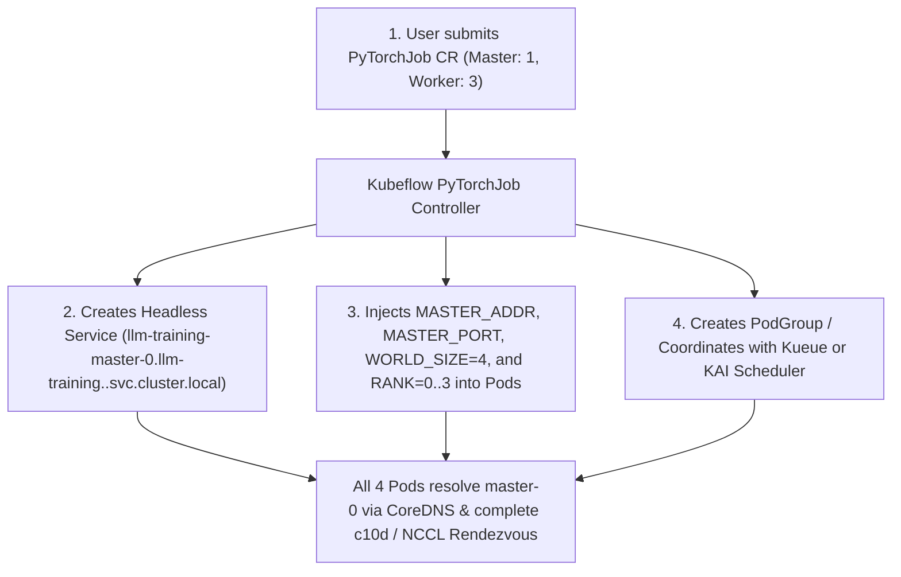
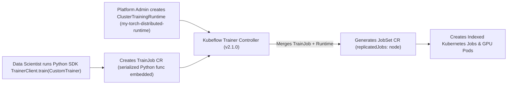
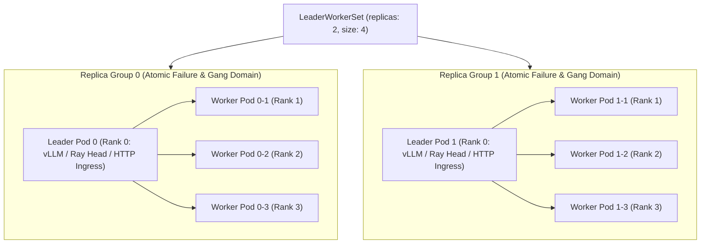

# 11.9 JobSet, LeaderWorkerSet, PyTorchJob and the MPI Operator

| | |
|---|---|
| Level | Advanced |
| Priority tier | 1 |
| Lab venue | GCP / GKE (plus local Python 3 simulation lab) |
| Part | Part 11: GPUs on Kubernetes, scheduling and virtualization |
| Sources used | Roland Huß et al., *Generative AI on Kubernetes* (O'Reilly, 2026, Ch. 6, Ch. 7); `volume-06/04-distributed-orchestration-masterclass.md`; *Scalable Kubernetes Infrastructure for AI Platforms* (O'Reilly, 2026, Ch. 2); *Kubernetes for Generative AI Solutions* (Packt, 2025, Ch. 10) |
| Coverage file | `planning/coverage/chapters/11-09.md` |

## Why this matters for AI infrastructure

In Chapters 11.7 and 11.8, we saw how queue controllers (`Kueue`) and gang schedulers (`Coscheduling`, `Volcano`, and `NVIDIA KAI Scheduler`) admit and bind multi-Pod GPU workloads atomically. However, a scheduler only places Pods that already exist or are templated by a workload controller. **Which Kubernetes controller actually creates those Pods, wires up their rank-0 DNS discovery, injects `MASTER_ADDR`, `WORLD_SIZE`, and `RANK` (or SSH keys and `/etc/mpi/hostfile`), and decides whether a single failed container requires restarting the entire multi-node group?**

Built-in Kubernetes workload primitives (`Deployment`, `StatefulSet`, and `batch/v1` `Job`) were not designed for multi-role distributed AI:
- A standard `batch/v1` `Job` (even in `Indexed` mode) manages only a **single homogeneous Pod template**. It cannot express a heterogeneous topology such as `1` `Master` (or `Launcher`) Pod plus `N` `Worker` Pods (or separate `parameter-server`, `dataset-initializer`, and `trainer` roles) with coordinated failure domains.
- A standard `Deployment` treats every replica as an independent stateless single-Pod instance. If an LLM (`175B` or `405B` parameters) is too large to fit on a single `8`-GPU node and must be sharded across **`4` nodes (`32` GPUs per replica)** using vLLM/Ray or TensorRT-LLM, a standard `Deployment` has no concept of a **multi-Pod replica group** (`1` Leader Pod + `3` Worker Pods per model replica) that must scale, gang-schedule, and restart together as one atomic unit.

To bridge this gap, the cloud-native AI ecosystem converged on four specialized Kubernetes workload APIs and operators:
1. **Kubeflow `PyTorchJob` (`kubeflow.org/v1`) and Kubeflow Trainer v2 (`TrainJob` & `ClusterTrainingRuntime`, `trainer.kubeflow.org/v1alpha1`):** The standard controllers for distributed PyTorch (`DDP`, `FSDP2`, `DeepSpeed`) training and Parameter-Efficient Fine-Tuning (`PEFT` / `LoRA`), automating headless `master-0` DNS discovery, rank injection, and Python SDK function serialization (`v2.1.0`).
2. **`JobSet` (`jobset.x-k8s.io/v1alpha2`):** The Kubernetes SIG-Apps/SIG-Scheduling native API that unifies multi-template batch jobs (`replicatedJobs`) into a single coordinated failure and networking domain—and serves as the underlying execution engine generated by Kubeflow Trainer's `TrainJob`.
3. **`LeaderWorkerSet` (`LWS`, `leaderworkerset.x-k8s.io/v1`):** The Kubernetes SIG-Apps API purpose-built for **multi-host / multi-node sharded LLM inference**, grouping `1` Leader Pod (`rank 0`) and `size - 1` Worker Pods into atomic replica groups (`replicas` groups × `size` pods per group).
4. **Kubeflow `MPIJob` (`kubeflow.org/v2beta1`):** The Message Passing Interface operator that automates SSH key distribution, `/etc/mpi/hostfile` generation (`slots=8`), and `mpirun -np 16` execution for HPC collective benchmarks (`nccl-tests` `all_reduce_perf`), DeepSpeed, and Horovod.

This chapter dissects each of these four workload controllers, their exact YAML contracts, how Kubeflow Trainer separates platform-admin `ClusterTrainingRuntime` templates from data-scientist `TrainJob` SDK submissions, and how to troubleshoot DNS, SSH, and rank-synchronization failures across them.

## Prerequisites and outcomes

### Prerequisites
- Completion of Chapter 11.7 (PyTorch rendezvous barriers and gang scheduling) and Chapter 11.8 (`Kueue`, `Volcano`, and `PodGroup` coscheduling).
- Working familiarity with Kubernetes Services (especially Headless Services with `clusterIP: None`), `StatefulSet`s, and `batch/v1` `Job`s.

### Outcomes
After completing this chapter, you will be able to:
- Trace the four-step choreography of the **Kubeflow `PyTorchJob`** controller (`Master`/`Worker` role identification, headless service DNS `master-0.<job>.<ns>.svc.cluster.local`, automatic `MASTER_ADDR`/`MASTER_PORT`/`WORLD_SIZE`/`RANK` injection, and gang-aware restart policies).
- Architect a **Kubeflow Trainer v2 (`v2.1.0`)** platform using `ClusterTrainingRuntime` (`trainer.kubeflow.org/framework: torch`, `pytorch/pytorch:2.7.1-cuda12.8-cudnn9-runtime`) and the Python `TrainerClient` (`CustomTrainer` vs `BuiltinTrainer`), and explain how `TrainJob` compiles down into a **`JobSet`** without requiring container image rebuilds on code changes.
- Quantify the operational and GPU memory trade-offs between **Full Fine-Tuning** (`100,000+` examples, `100%` of parameters updated, `10x` serving memory for `10` models) and **PEFT / LoRA** (`100–1,000` examples, `< 1%` parameters tuned on an `8B` model, `1%–10%` adapter size, `1.5x` serving memory for `10` `5%` adapters = `6.67x` savings).
- Design a **`LeaderWorkerSet` (`LWS`)** deployment for multi-node sharded LLM inference (`replicas: 2`, `size: 4` -> `2` groups of `1` leader + `3` workers = `8` Pods / `64` GPUs) and explain its per-group atomic restart boundary.
- Deploy a **Kubeflow `MPIJob`** (`Launcher` + `Worker` replicas with `slotsPerWorker: 8`, `cleanPodPolicy: Running`) to run multi-node `mpirun -np 16 /opt/nccl-tests/build/all_reduce_perf -b 8 -e 128M -f 2`.

## Concepts: basics to intermediate to advanced

### 1. Basics: Why native `Job`/`Deployment` primitives fall short, and how `PyTorchJob` works

Why can't a data scientist run a `4`-node (`32`-GPU) PyTorch Distributed Data Parallel (`DDP`) or Fully Sharded Data Parallel (`FSDP2`) job using a plain Kubernetes `Deployment`?
1. **No concept of `Rank 0` rendezvous:** PyTorch's `torch.distributed.init_process_group(backend="nccl", init_method="env://")` requires every Pod to know the exact DNS hostname or IP address of **Rank 0** (`MASTER_ADDR`), a shared port (`MASTER_PORT`), the total number of participating processes/nodes (`WORLD_SIZE`), and its own unique integer index (`RANK` `0` through `WORLD_SIZE - 1`). A `Deployment` assigns random pod hashes (`llm-train-7d8f9c-xk2p9`) with no deterministic rank index or rank-0 DNS record.
2. **No run-to-completion semantics:** When a training script finishes epoch `3` and exits `0`, a `Deployment` treats the exit as a crash and restarts the training loop forever.

#### Dissecting the Kubeflow `PyTorchJob` controller (`kubeflow.org/v1`)
As detailed in `volume-06/04-distributed-orchestration-masterclass.md` (Section 8.2) and *Generative AI on Kubernetes* (Chapter 7, Examples 7-5, 7-8, 7-9, and 7-11), the **Kubeflow Training Operator (`KFTO`)** provides the `PyTorchJob` custom resource. When a user submits a `PyTorchJob` with `1` `Master` and `3` `Worker` replicas (`4` nodes total), the `PyTorchJob` controller executes four automated steps:



1. **Role Identification (`Master` vs `Worker`):** Under `spec.pytorchReplicaSpecs`, the controller identifies `Master` (`replicas: 1`, which always serves as `RANK=0` and the `c10d` rendezvous coordinator, while also participating in GPU training) and `Worker` (`replicas: 3`, assigned `RANK=1`, `2`, and `3`).
2. **Dynamic Headless Service Discovery:** The controller dynamically creates a Kubernetes **Headless Service** (`clusterIP: None`) for the job so that all worker Pods can resolve `llm-training-master-0.llm-training.<namespace>.svc.cluster.local` over CoreDNS as soon as `master-0` receives an IP.
3. **Environment Variable Injection:** The controller injects four environment variables into every Pod container automatically:
   - `MASTER_ADDR`: `<job-name>-master-0` (or its fully qualified headless service DNS name)
   - `MASTER_PORT`: `23456` (or the configured rendezvous port)
   - `WORLD_SIZE`: `"4"` (when `nproc_per_node` is handled inside the container by `torchrun`, or total process count)
   - `RANK`: `"0"` on `master-0`, and `"1"`, `"2"`, `"3"` on `worker-0`, `worker-1`, `worker-2`
4. **Coordinated Pod Lifecycle & Gang Integration:** When `master-0` exits `0`, the `PyTorchJob` marks the job `Succeeded`. If a worker Pod fails, the controller applies the configured `restartPolicy` (`OnFailure`, `Always`, or `ExitCode`) or coordinates with Kueue/Volcano/KAI Scheduler to restart the entire gang cleanly.

---

### 2. Intermediate: Kubeflow Trainer v2 (`TrainJob`, `ClusterTrainingRuntime`), `JobSet`, and PEFT/LoRA

While `PyTorchJob` (`kubeflow.org/v1`) has been the workhorse of Kubernetes training for years, *Generative AI on Kubernetes* (Chapter 6, "Kubeflow Trainer", Examples 6-3 through 6-9) introduces the next-generation **Kubeflow Trainer (`v2.1.0`, `trainer.kubeflow.org/v1alpha1`)** architecture, which builds directly on **`JobSet`**.

#### Why `JobSet` (`jobset.x-k8s.io/v1alpha2`) is the unified batch building block
In Kubernetes SIG-Apps, a standard `batch/v1` `Job` with `completionMode: Indexed` can assign `JOB_COMPLETION_INDEX` (`0..N-1`) to homogeneous Pods, but it cannot group multiple distinct `Job` templates (for example, a `dataset-initializer` job, a `leader` job, and a `worker` job) under a single shared network and failure policy.

**`JobSet`** (`jobset.x-k8s.io/v1alpha2`) is a standalone Kubernetes CRD that represents a **coordinated group of Kubernetes Indexed `Job`s** (`spec.replicatedJobs`):
- **Automatic Headless Service:** `JobSet` automatically provisions a shared headless service across all child `replicatedJobs`, giving every Pod a deterministic DNS hostname (`<jobset>-<replicatedJob>-<jobIndex>-<podIndex>.<subdomain>`).
- **Coordinated Startup & Failure Policies:** `JobSet` controls the startup order of child jobs (for example, running a dataset/model initializer job before starting the trainer nodes) and treats the entire `JobSet` as a single failure domain—if any child `Job` fails beyond its backoff limit, `JobSet` tears down and recreates all child `replicatedJobs` together so distributed ranks never drift out of sync.

#### Kubeflow Trainer v2: Separating Platform Admin (`ClusterTrainingRuntime`) from Data Scientist (`TrainJob`)
Kubeflow Trainer (`v2.1.0`) splits distributed training into two personas and merges them into a **`JobSet`** (`GAK` Figure 6-7):



1. **The Platform Administrator's Contract (`TrainingRuntime` / `ClusterTrainingRuntime`):** Analogous to KServe's `ServingRuntime`, the platform administrator defines a cluster-wide `ClusterTrainingRuntime` (or namespace-scoped `TrainingRuntime`) with the mandatory label `trainer.kubeflow.org/framework: torch` (supporting `torch`, `deepspeed`, `mlx`, and `mpi`), a curated CUDA image (`pytorch/pytorch:2.7.1-cuda12.8-cudnn9-runtime`), default `mlPolicy` (`numNodes: 1`, `torch.numProcPerNode: auto`), and a `JobSet` template (`replicatedJobs: [{name: node}]` labeled `trainer.kubeflow.org/trainjob-ancestor-step: trainer`), plus any cluster-specific Kueue labels, `schedulerName`, or Multus RDMA annotations.
2. **The Data Scientist's Contract (`TrainerClient`, `CustomTrainer`, and `BuiltinTrainer`):** Data scientists never write Kubernetes YAML. They either use a **`BuiltinTrainer`** (such as `TorchTune`, supplying only dataset and LoRA parameters) or pass a self-contained Python training function (`my_custom_trainer` using Hugging Face `TRL` `SFTTrainer` and `peft` `LoraConfig`, or `deepspeed.initialize` with `dist_backend="nccl"` and `batch_size=16`) to **`CustomTrainer`** (`num_nodes=8`, `cpu: 4`, `memory: "64Gi"`, `nvidia.com/gpu: 1`).
3. **Zero-Image-Rebuild Code Delivery (Kubeflow Trainer vs KubeRay `RayJob`):** When the data scientist calls `client.train(trainer=CustomTrainer(func=my_custom_trainer, ...))`, the Kubeflow SDK **serializes the Python function and embeds it directly into the `TrainJob` custom resource**. At runtime, the `ClusterTrainingRuntime` base container (`pytorch:2.7.1-cuda12.8-cudnn9-runtime`) deserializes and executes the function immediately. As *Generative AI on Kubernetes* (Chapter 6, Note & "Ray") highlights, this is a major workflow advantage over **KubeRay (`RayJob`)**, where training scripts must be baked into a new container image (or mounted from external Git/storage) whenever code changes. (Also note the Chapter 6 warning: do not confuse **Ray Tune** or **Kubeflow Katib**—which perform hyperparameter optimization such as Population Based Training `PBT`—with LLM post-training model customization.)

#### Full Fine-Tuning vs Parameter-Efficient Fine-Tuning (`PEFT` / `LoRA`) on Kubernetes
As *Generative AI on Kubernetes* (Chapter 6) explains, theLLM creation pipeline progresses through three stages: **Pre-training** (thousands of GPUs for weeks on raw text -> Base Model) -> **Alignment** (teaching behavioral boundaries via reward models / RLHF / DPO / GRPO / IBM InstructLab, analogous to Asimov's Three Laws of Robotics -> Aligned Model) -> **Model Customization / Post-training** (specializing an aligned model or an `8B–16B` Small Language Model `SLM`).

When customizing an LLM on Kubernetes, choosing between **Full Fine-Tuning** and **PEFT / Low-Rank Adaptation (`LoRA`)** (`X-LoRA` for MoE, `QLoRA` for quantized tuning) dramatically alters your GPU cluster requirements:

| Dimension | Full Supervised Fine-Tuning (`SFT`) | PEFT with Low-Rank Adaptation (`LoRA`) |
|---|---|---|
| **Parameters Modified** | **`100%`** of model weights updated | **`< 1%`** of model weights (e.g., `0.8%` of an `8B` model = `64M` parameters in low-rank matrices $A$ and $B$) |
| **Labeled Dataset Size** | **`100,000+`** labeled input-output examples | **`100` to `1,000`** labeled examples |
| **Training Duration & Hardware** | Days to weeks across large multi-node GPU gangs; risks **catastrophic forgetting** | Hours on a small GPU group (e.g., `8` nodes × `1` GPU/node in Example 6-6) |
| **Checkpoint / Adapter Artifact Size** | `100%` of base model size per variant | **`1%` to `10%`** of base model size per adapter (can also be merged offline for testing via `model.merge_and_unload()`) |
| **Inference Serving Footprint (`10` specialized variants)** | **`10.0x` base model GPU memory** (`10` separate full model deployments) | **`~1.5x` base model GPU memory** (`1` frozen base model + `10` dynamic `5%` LoRA adapters composed at runtime = **`6.67x` memory savings**) |

#### Choosing Between Prompt Engineering, RAG, PEFT (`LoRA`), and Full Fine-Tuning
As *Generative AI on Kubernetes* (Chapter 6, "Prompt and Context Engineering" and "When to Use Model Customization") and *Scalable Kubernetes Infrastructure for AI Platforms* (Chapter 2, "Overview of LLM Customization Techniques") emphasize, platform architects and MLOps teams should never default to launching a multi-node `PyTorchJob` or `TrainJob` when a lighter customization pattern satisfies the business requirement:
1. **Prompt Engineering and Context Engineering (Zero Training GPUs):** Crafting detailed system and user prompts—specifying the scenario, the assistant role, and behavioral boundaries—guides an aligned foundation model without modifying a single weight. However, system prompts are **not** a security boundary (they can be bypassed by prompt injection or jailbreaking and must be paired with application-level input validation and output moderation), and stuffing large documents into every prompt inflates the vLLM KV-cache memory footprint on every inference request.
2. **Retrieval-Augmented Generation (`RAG`) and RAFT:** When domain data changes frequently (for example, live inventory, financial market data, or daily documentation updates), **RAG** embeds documents into a vector database, queries approximate nearest neighbors using cosine similarity at request time, and injects only the relevant chunks into the prompt context. You can refresh knowledge in minutes without running a `TrainJob`. When organizations need both dynamic retrieval and domain-adapted reasoning, **Retrieval-Augmented Fine-Tuning (`RAFT`)** combines both patterns.
3. **PEFT (`LoRA` / `QLoRA` / `X-LoRA`) and Model Distillation into Small Language Models (`SLMs`, `8B–16B`):** When domain knowledge is relatively static (for example, a bank's core credit-risk and trading rules, or a required JSON output schema) and high request volume makes long RAG prompts expensive in KV-cache VRAM, embedding that behavior into a compact **`8B–16B` Small Language Model (`SLM`)**—either via LoRA (`100–1,000` labeled examples using Hugging Face TRL's `SFTTrainer` and `LoraConfig`, or locally via **Unsloth** packaged with **AIKit**) or via **model distillation** from a larger teacher model—dramatically lowers per-token inference latency and GPU serving cost. Furthermore, advanced post-training workflows such as **Direct Preference Optimization (`DPO`)**, **Group Relative Policy Optimization (`GRPO`, popularized by DeepSeek-V3)**, and **IBM InstructLab** run as multi-step synthetic-data and reward-modeling pipelines that map naturally to `JobSet`'s multi-template `replicatedJobs` architecture.

#### End-to-End Kubeflow Ecosystem Integration: Notebooks, Pipelines, Trainer, and Model Registry
In a production Kubernetes AI platform (*Generative AI on Kubernetes* Chapter 6 Tip), `TrainJob` and `PyTorchJob` do not exist in isolation; they form the compute stage of a four-component Kubeflow lifecycle:
- **Kubeflow Notebooks:** Provisions web-based Jupyter IDE pods where data scientists prototype their `SFTTrainer` / `LoraConfig` functions interactively and use `%load_ext yamlmagic` (`%%yaml training_config`) to manage hyperparameters cleanly.
- **Kubeflow Trainer (`TrainJob` & `ClusterTrainingRuntime`):** Executes the distributed fine-tuning job across GPU nodes (`JobSet`), writing periodic adapter checkpoints (such as `/opt/app-root/Meta-Llama-3.1-8B-Instruct/checkpoint-100/`) to shared `RWX` persistent storage while streaming loss curves to **TensorBoard** (`torch.utils.tensorboard.SummaryWriter`), **MLflow**, or **Weights & Biases**.
- **Kubeflow Pipelines:** Converts the interactive notebook or Python `TrainerClient` script into a repeatable, version-controlled Directed Acyclic Graph (`DAG`) for scheduled automated retraining and evaluation.
- **Kubeflow Model Registry:** Catalogs the resulting LoRA adapter or merged model checkpoint (`model.merge_and_unload()`) with its lineage, hyperparameters, and evaluation metrics before handing it off to `KServe` or `LeaderWorkerSet` for production inference across the cluster.

---

### 3. Advanced: `LeaderWorkerSet` (`LWS`) for multi-node inference and the `MPIJob` Operator

#### `LeaderWorkerSet` (`LWS`, `leaderworkerset.x-k8s.io/v1`) — Sharded Multi-Node Inference
Why do we need **`LeaderWorkerSet` (`LWS`)** if we already have `PyTorchJob` and `JobSet`?
Because `PyTorchJob` and `JobSet` are designed for **batch jobs that run to completion**, whereas LLM **inference serving** is a **long-running, horizontally autoscaled service** behind a Kubernetes `Service` or Gateway API Inference Extension (`GIE`).

When serving a massive model—for example, a `405B`-parameter model or an unquantized `175B` model that requires `32` GPUs across **`4` physical `8`-GPU nodes** for a single model instance using Tensor Parallelism (`TP=8` intra-node) plus Pipeline Parallelism (`PP=4` inter-node)—a single replica of your inference server spans **`4` Pods (`1` Leader Pod + `3` Worker Pods)**. If you want **`2` replicas** of that inference server for high availability and `2x` QPS throughput, you need **`2` independent groups of `4` Pods (`8` Pods / `64` GPUs total)** (*Generative AI on Kubernetes*, Chapter 7, Note on `LeaderWorkerSet`):



`LeaderWorkerSet` provides four capabilities that neither `Deployment` nor `StatefulSet` can express:
1. **Two-Level Hierarchy (`replicas` × `size`):** `spec.replicas: 2` defines the number of model replica groups, and `spec.leaderWorkerTemplate.size: 4` defines the number of Pods (`1` Leader + `3` Workers) inside each replica group (`2 * 4 = 8` Pods total).
2. **Per-Group Atomic Restart (`RecreateGroupOnPodRestart`):** If `Worker Pod 0-2` in **Group 0** crashes or its node fails, a `1/4`-missing model shard cannot serve inference requests. `LWS` automatically tears down and recreates **all `4` Pods of Group 0 atomically**, while **Group 1 (`4` Pods) continues serving live production traffic uninterrupted**.
3. **Per-Group Gang Scheduling & Topology Co-location:** `LWS` integrates with Kueue, Volcano, and KAI Scheduler to gang-schedule each `4`-Pod replica group as a unit and apply pod affinity per group (keeping each `4`-Pod group inside one InfiniBand leaf switch or NVL72 rack) while spreading different replica groups across failure domains.
4. **Leader-Only Service Exposure:** Traffic from the Kubernetes `Service` routes exclusively to the **Leader Pods** (`Leader Pod 0` and `Leader Pod 1`), which coordinate the distributed forward pass across their respective Worker Pods.

#### The Kubeflow `MPIJob` Operator (`kubeflow.org/v2beta1`)
In HPC-style workloads—such as running `nccl-tests` (`all_reduce_perf`) to qualify a cluster's InfiniBand/RoCE fabric before launching a training run, or running MPI-backed Horovod / DeepSpeed jobs—processes are launched by **`mpirun` over SSH** rather than a TCP rendezvous store (`volume-06/04-distributed-orchestration-masterclass.md`, Section 2.4).

Configuring passwordless SSH, mounting keys with `0600` permissions, discovering dynamic Pod IPs, and writing an OpenMPI `hostfile` by hand in Kubernetes is tedious and error-prone. The **Kubeflow `MPIJob` Operator (`kubeflow.org/v2beta1`)** automates the entire MPI lifecycle:
1. **SSH Keypair Generation:** Creates a Kubernetes `Secret` containing an ephemeral SSH keypair and mounts it into both the `Launcher` Pod (`replicas: 1`) and all `Worker` Pods (`replicas: 2`).
2. **Dynamic Hostfile Construction:** Generates a `ConfigMap` mounted into the `Launcher` containing the OpenMPI `hostfile` with `slots=<slotsPerWorker>` for each worker:
   ```text
   mpi-nccl-test-worker-0 slots=8
   mpi-nccl-test-worker-1 slots=8
   ```
3. **Readiness & Execution:** Waits until all `Worker` Pods are running `sshd`, then starts the `Launcher` container (`mpirun -np 16 /opt/nccl-tests/build/all_reduce_perf -b 8 -e 128M -f 2`), and tears down the `Worker` Pods automatically when the `Launcher` exits `0` (`cleanPodPolicy: Running`).

#### Comparison of the four multi-node Kubernetes workload APIs

| Workload API / Operator | Primary Target Workload | Role Topology | Discovery & Coordination Mechanism | Failure Recovery Semantics |
|---|---|---|---|---|
| **Kubeflow `PyTorchJob` (`kubeflow.org/v1`)** | Distributed PyTorch (`DDP`, `FSDP`, `DeepSpeed`) training | `Master` (`1`) + `Worker` (`N-1`) | Headless Service DNS for `master-0` + `MASTER_ADDR`, `MASTER_PORT`, `WORLD_SIZE`, `RANK` env vars | Per-role `restartPolicy` + gang `PodGroup` restart |
| **Kubeflow Trainer `TrainJob` (`trainer.kubeflow.org/v1alpha1`) + `JobSet` (`jobset.x-k8s.io/v1alpha2`)** | Multi-framework (`torch`, `deepspeed`, `mlx`, `mpi`) LLM fine-tuning & multi-job HPC pipelines | `ClusterTrainingRuntime` + `replicatedJobs` (e.g., `initializer` + `node`) | Shared `JobSet` headless service DNS + SDK function serialization (`v2.1.0`) | Coordinated `JobSet` failure policy (restarts all child `replicatedJobs` together) |
| **`LeaderWorkerSet` (`LWS`, `leaderworkerset.x-k8s.io/v1`)** | **Multi-node sharded LLM inference** (`vLLM`, `TGI`, `TensorRT-LLM`, `Ray`) | `replicas` groups × (`1` `Leader` + `size-1` `Workers`) | Per-group headless DNS (`leader` = rank `0`); ingress Service targets leaders only | **Group-atomic restart:** failing `1` pod in Group 0 restarts all `size` pods in Group 0 while Group 1 keeps serving |
| **Kubeflow `MPIJob` (`kubeflow.org/v2beta1`)** | MPI workloads, `nccl-tests` (`all_reduce_perf`), Horovod, HPC solvers | `Launcher` (`1`) + `Worker` (`N`, with `slotsPerWorker: 8`) | Ephemeral SSH keys + generated OpenMPI `hostfile` (`slots=8`) + `mpirun -np` | `cleanPodPolicy: Running` terminates workers when Launcher completes |

## Commands and configurations that matter

### 1. Installing Kubeflow Trainer (`v2.1.0`) and defining a `ClusterTrainingRuntime` (`GAK` Examples 6-3 & 6-4)

```bash
# Install Kubeflow Trainer v2.1.0 controller and built-in runtimes (untested here)
export VERSION=v2.1.0
export URL="https://github.com/kubeflow/trainer.git/manifests/overlays"
kubectl apply --server-side -k "${URL}/manager?ref=${VERSION}"
kubectl apply --server-side -k "${URL}/runtimes?ref=${VERSION}"
```

```yaml
# clustertrainingruntime-torch.yaml (GAK Example 6-4, untested here)
apiVersion: trainer.kubeflow.org/v1alpha1
kind: ClusterTrainingRuntime
metadata:
  name: my-torch-distributed-runtime
  labels:
    trainer.kubeflow.org/framework: torch
spec:
  mlPolicy:
    numNodes: 1
    torch:
      numProcPerNode: auto
  template:
    spec:
      replicatedJobs:
        - name: node
          template:
            metadata:
              labels:
                trainer.kubeflow.org/trainjob-ancestor-step: trainer
            spec:
              template:
                spec:
                  containers:
                    - name: node
                      image: pytorch/pytorch:2.7.1-cuda12.8-cudnn9-runtime
```

### 2. Submitting an `8`-node LoRA `TrainJob` via the Kubeflow Python SDK (`GAK` Example 6-6)

```python
# submit_trainjob.py (GAK Example 6-6, untested on live cluster)
from kubeflow.trainer import CustomTrainer, TrainerClient

client = TrainerClient()
torch_runtime = client.get_runtime("my-torch-distributed-runtime")

job_name = client.train(
    trainer=CustomTrainer(
        func=my_custom_trainer,
        func_args={"seed": 42, "learning_rate": 2.0e-4, "num_epochs": 3},
        num_nodes=8,
        resources_per_node={
            "cpu": 4,
            "memory": "64Gi",
            "nvidia.com/gpu": 1,
        },
    ),
    runtime=torch_runtime,
)
client.wait_for_job_status(name=job_name, status={"Running"})
```

### 3. Deploying `MPIJob` to run `16`-GPU `all_reduce_perf` (`volume-06` Section 2.4)

```yaml
# mpijob-nccl-allreduce.yaml (volume-06 Part 2.4, untested here)
apiVersion: kubeflow.org/v2beta1
kind: MPIJob
metadata:
  name: mpi-nccl-test
spec:
  slotsPerWorker: 8
  runPolicy:
    cleanPodPolicy: Running
  mpiReplicaSpecs:
    Launcher:
      replicas: 1
      template:
        spec:
          containers:
            - name: mpi-launcher
              image: nvcr.io/nvidia/pytorch:24.08-py3
              command:
                - mpirun
                - -np
                - "16"
                - /opt/nccl-tests/build/all_reduce_perf
                - -b
                - "8"
                - -e
                - "128M"
                - -f
                - "2"
    Worker:
      replicas: 2
      template:
        spec:
          containers:
            - name: mpi-worker
              image: nvcr.io/nvidia/pytorch:24.08-py3
              resources:
                limits:
                  nvidia.com/gpu: 8
```

### 4. Deploying `LeaderWorkerSet` (`LWS`) for `2` replicas of a `4`-node (`32`-GPU) sharded LLM

```yaml
# lws-multinode-vllm.yaml (untested here)
apiVersion: leaderworkerset.x-k8s.io/v1
kind: LeaderWorkerSet
metadata:
  name: vllm-405b-serving
spec:
  replicas: 2
  leaderWorkerTemplate:
    size: 4
    restartPolicy: RecreateGroupOnPodRestart
    leaderTemplate:
      metadata:
        labels:
          role: leader
      spec:
        containers:
          - name: vllm-leader
            image: vllm/vllm-openai:latest
            resources:
              limits:
                nvidia.com/gpu: "8"
    workerTemplate:
      spec:
        containers:
          - name: vllm-worker
            image: vllm/vllm-openai:latest
            resources:
              limits:
                nvidia.com/gpu: "8"
```

## How it fails

| Failure mode | Exact symptom & command evidence | Root cause boundary | Remediation |
|---|---|---|---|
| **1. `PyTorchJob` workers fail with `c10d::socketTimeout` or `Name or service not known` for `MASTER_ADDR`** | Worker Pods start and enter `Running`, then crash after timeout logging `connect() timed out` or `gaierror: Name or service not known` for `<job>-master-0`. | **Headless Service / CoreDNS or Pending `Master-0` Boundary:** Either `master-0` is still stuck in `Pending`/`ContainerCreating` (because gang scheduling was not enabled) or CoreDNS / `NetworkPolicy` blocked UDP/TCP port `53` / `MASTER_PORT`. | Enable gang scheduling (`PodGroup` / `Kueue` / `KAI`) so `worker-*` Pods never start before `master-0`, and ensure `NetworkPolicy` permits DNS (`port 53`) and intra-job TCP traffic. |
| **2. Kubeflow Trainer `TrainJob` fails immediately with `ModuleNotFoundError` or `PicklingError`** | `TrainJob` Pods start using `ClusterTrainingRuntime` image, then exit `1` during function deserialization (`ModuleNotFoundError` or `AttributeError: Can't pickle local object`). | **SDK Function Serialization Boundary (`GAK` Ch. 6 Note):** `my_custom_trainer` imported packages outside the function body, referenced unpicklable outer closures, or required a library not pre-installed in `pytorch:2.7.1-cuda12.8-cudnn9-runtime`. | Keep all Python `import` statements *inside* the `def my_custom_trainer(**kwargs):` body, pass parameters via `func_args`, and pre-bake required packages into the `ClusterTrainingRuntime` image. |
| **3. `MPIJob` Launcher hangs at `Warning: Permanently added '...worker-0' (ECDSA)` or `Permission denied (publickey)`** | `mpi-nccl-test-launcher` starts `mpirun -np 16`, but hangs or exits with `ssh: connect to host mpi-nccl-test-worker-0 port 22: Connection refused` or `Permission denied`. | **MPI Worker `sshd` / SecurityContext Boundary:** The custom worker container image either lacks OpenSSH server (`sshd`), runs as a non-root UID unable to bind port `22` without a custom sshd port, or a `NetworkPolicy` blocked port `22` between Launcher and Workers. | Ensure the worker image starts `sshd` on the configured port, verify the MPI operator's mounted SSH secret permissions, and allow intra-job SSH + ephemeral MPI ports in `NetworkPolicy`. |
| **4. Requesting `nvidia.com/gpu: 8` on the `MPIJob` `Launcher` Pod wastes an entire `8`-GPU node** | A `2`-worker (`16`-GPU) `MPIJob` stays `Pending` on a `2`-node (`16`-GPU) cluster (`Insufficient nvidia.com/gpu`), or consumes `24` GPUs across `3` nodes with `8` GPUs at `0%` utilization. | **Launcher vs Worker Resource Spec Mistake:** The engineer accidentally copied `resources.limits["nvidia.com/gpu"]: 8` into `mpiReplicaSpecs.Launcher` in addition to `Worker`. The `Launcher` only runs `mpirun` orchestration and uses `0` GPUs. | Request `nvidia.com/gpu: 8` **only** under `mpiReplicaSpecs.Worker`; give `Launcher` only CPU and memory requests (`cpu: "2"`, `memory: "4Gi"`). |
| **5. Multi-node sharded LLM inference deployed as a plain `Deployment` or `StatefulSet` serves broken requests when `1` node reboots** | A `4`-node sharded vLLM deployment loses `1` worker Pod during a node drain; the other `3` Pods stay `Running` with broken Ray/NCCL tensor-parallel shards while the Kubernetes `Service` continues routing HTTP requests to the broken group. | **Missing Group-Atomic Lifecycle (`LeaderWorkerSet` Boundary):** Standard `Deployment`/`StatefulSet` controllers do not know that `4` Pods form `1` indivisible model shard group. | Migrate multi-node sharded inference to **`LeaderWorkerSet` (`LWS`)** with `restartPolicy: RecreateGroupOnPodRestart` so losing `1` Pod cleanly restarts all `4` Pods in that replica group while healthy replica groups continue serving traffic. |

## Hands-on lab

### Venue and scope
This lab runs locally using Python 3 standard library (`code/part11/jobset_lws_pytorch_mpi.py` and `code/part11/jobset_lws_pytorch_mpi_lab.py`) to simulate `PyTorchJob` headless DNS and `MASTER_ADDR`/`WORLD_SIZE`/`RANK` injection, Kubeflow Trainer v2 (`v2.1.0`) `TrainJob` + `ClusterTrainingRuntime` compilation into a `JobSet`, Full Fine-Tuning vs PEFT `LoRA` parameter and serving-memory math (`10.0x` vs `1.5x` = `6.67x` savings), `LeaderWorkerSet` (`LWS`) replica-group sizing (`2` × `4` = `8` Pods / `64` GPUs) and atomic group restart, and `MPIJob` hostfile and `mpirun -np 16` synthesis. Cluster commands are marked `(untested here)`.

### Step 1: Run the self-checking workload operators lab (tested here)

Run the lab script from the repository root:

```bash
python3 code/part11/jobset_lws_pytorch_mpi_lab.py
```

Captured output from this repository:
```text
=== Chapter 11.9 Lab: JobSet, LeaderWorkerSet, PyTorchJob & MPI Operator ===
  [PASS] PyTorchJob with 1 Master + 3 Workers creates 4 pods with WORLD_SIZE='4'
  [PASS] Master pod (llm-training-master-0) receives role='master' and RANK='0'
  [PASS] Worker pods (llm-training-worker-0..2) receive sequential RANK='1', '2', '3'
  [PASS] All PyTorchJob pods resolve MASTER_ADDR via headless service DNS pointing to master-0
  [PASS] Kubeflow Trainer merges TrainJob + ClusterTrainingRuntime into a JobSet (replicatedJob: node)
  [PASS] Merged JobSet inherits pytorch:2.7.1-cuda12.8-cudnn9-runtime and framework='torch'
  [PASS] Example 6-6 TrainJob (num_nodes=8, cpu=4, gpu=1) allocates 8 GPUs and 32 CPUs across 8 nodes
  [PASS] Kubeflow Trainer SDK serializes custom trainer function into TrainJob CR without image rebuilds
  [PASS] When function is not embedded (as in RayJob image packaging), code changes require image rebuild
  [PASS] LoRA tuning 0.8% (<1%) of an 8B model updates only 64.0M parameters
  [PASS] Serving 10 fine-tuned variants takes 10.0x base model memory with Full FT vs 1.5x with 5% LoRA adapters
  [PASS] LWS (replicas=2, size=4) creates 2 groups of (1 leader + 3 workers) = 8 total pods
  [PASS] Each 4-node LWS replica group shards the LLM across 32 GPUs (64 GPUs across 2 replicas)
  [PASS] When 1 pod in LWS group 0 fails, LWS restarts all 4 pods in group 0 atomically while group 1 continues serving
  [PASS] MPIJob with 1 Launcher and 2 Workers (slotsPerWorker: 8) configures -np 16 MPI ranks
  [PASS] MPIJob generates hostfile with slots=8 for mpi-nccl-test-worker-0 and worker-1
  [PASS] MPIJob Launcher runs mpirun -np 16 all_reduce_perf -b 8 -e 128M -f 2
  [PASS] Small Language Models (SLMs) in GAK Ch 6 span 8 to 16 billion parameters
  [PASS] PEFT LoRA training requires 100 to 1,000 labeled examples (vs 100,000+ for full fine-tuning)
  [PASS] LoRA adapter matrices (A and B) occupy 1% to 10% of the base model size
  [PASS] GAK Example 6-7 & 6-8 use Llama-3.2-3B (num_epochs: 3, lr: 2.0e-4) and checkpoint-100
  [PASS] GAK Example 6-9 DeepSpeed trainer initializes DataLoader with batch_size=16 and DistributedSampler
  [PASS] ClusterTrainingRuntime sets label trainer.kubeflow.org/trainjob-ancestor-step=trainer
  [PASS] MPIJob runPolicy sets cleanPodPolicy: Running to clean up worker pods on completion
  [PASS] Serving 10 LoRA adapters (1.5x base memory) saves 6.67x GPU memory compared to 10 full fine-tuned models (10.0x)

Summary: 25 passed, 0 failed out of 25 checks.
```

### Exercises

1. **Exercise 1 — `PyTorchJob` rank and headless DNS synthesis:** Using `synthesize_pytorchjob_env("llm-training", "ml-team-a", master_replicas=1, worker_replicas=3, master_port=23456)` in `code/part11/jobset_lws_pytorch_mpi.py`, write out the exact `(pod_name, RANK, WORLD_SIZE, MASTER_ADDR)` tuple for `master-0` and `worker-2`.
2. **Exercise 2 — Kubeflow Trainer `TrainJob` + `ClusterTrainingRuntime` merger:** Using `merge_trainjob_with_runtime()`, compute `(generated_kind, total_gpus, total_cpus, requires_image_rebuild_on_code_change)` when `Example 6-6` (`num_nodes=8`, `cpu_per_node=4`, `gpus_per_node=1`, `serialized_func_embedded=True`) is merged with `my-torch-distributed-runtime`.
3. **Exercise 3 — Full Fine-Tuning vs LoRA serving memory savings:** Using `compare_full_finetuning_vs_lora(base_model_params_b=8.0, lora_tuned_pct=0.8, lora_adapter_size_pct=5.0, num_adapters_served=10)`, compute how many millions of parameters LoRA updates (`tuned_params_millions`), the serving memory footprint in base-model multiples for `10` variants under Full Fine-Tuning versus LoRA, and the resulting `memory_savings_ratio`.
4. **Exercise 4 — `LeaderWorkerSet` (`LWS`) multi-node inference sizing and fault recovery:** Using `evaluate_leader_worker_set(replicas=2, size_per_group=4, gpus_per_pod=8, failed_group_index=0)`, determine `(total_pods, gpus_per_replica_group, total_gpus, restarted_pods_on_single_pod_failure, surviving_serving_groups_during_restart)`.
5. **Exercise 5 — `MPIJob` hostfile and `mpirun` rank math:** Using `build_mpijob_spec("mpi-nccl-test", worker_replicas=2, slots_per_worker=8, gpus_per_worker=8)`, state the exact contents of the generated `hostfile`, the `-np` argument passed to `mpirun`, and why `Launcher` must not request GPUs.
6. **Exercise 6 — Merging a LoRA checkpoint for standalone testing:** In *Generative AI on Kubernetes* Example 6-8, `PeftModel.from_pretrained(base_model, "/opt/app-root/Meta-Llama-3.1-8B-Instruct/checkpoint-100/")` loads a LoRA adapter on top of `base_model`. Which method merges the low-rank matrices ($A \times B$) back into the base weights and unloads the PEFT wrapper, and why do production multi-adapter servers usually keep the adapters unmerged?

## Checkpoint questions

<details>
<summary><strong>1. What four automated actions does the Kubeflow PyTorchJob controller perform when a user submits a PyTorchJob custom resource?</strong></summary>

1. **Role identification:** Distinguishes the `Master` (`replicas: 1`, `RANK=0`) from the `Worker` Pods (`RANK=1..N-1`).
2. **Service discovery:** Dynamically creates a Kubernetes Headless Service so all workers can resolve `<job>-master-0.<job>.<ns>.svc.cluster.local` over DNS.
3. **Environment variable injection:** Automatically sets `MASTER_ADDR`, `MASTER_PORT`, `WORLD_SIZE`, and `RANK` inside every container.
4. **Coordinated Pod lifecycle management:** Tracks job completion when `master-0` exits `0` and restarts either failed Pods or the entire gang on failure.
</details>

<details>
<summary><strong>2. How does Kubeflow Trainer v2 (trainer.kubeflow.org/v1alpha1) separate responsibilities between the platform administrator and the data scientist?</strong></summary>

- **Platform Administrator:** Creates and governs `TrainingRuntime` (namespace-scoped) or `ClusterTrainingRuntime` (cluster-wide) templates that define the container image (`pytorch/pytorch:2.7.1-cuda12.8-cudnn9-runtime`), framework label (`trainer.kubeflow.org/framework: torch`), `mlPolicy`, scheduler, and network settings.
- **Data Scientist:** Uses the Kubeflow Python SDK (`TrainerClient` and `CustomTrainer` / `BuiltinTrainer`) to submit a `TrainJob` referencing that runtime without writing Kubernetes YAML.
</details>

<details>
<summary><strong>3. What Kubernetes custom resource does Kubeflow Trainer generate when it merges a TrainJob with a ClusterTrainingRuntime?</strong></summary>

It generates a **`JobSet`** (`jobset.x-k8s.io/v1alpha2`), which manages the underlying group of Indexed Kubernetes `Job`s (`replicatedJobs: [{name: node}]`) as a single coordinated unit.
</details>

<details>
<summary><strong>4. How does code delivery in Kubeflow Trainer's CustomTrainer differ from code delivery in KubeRay's RayJob, and what is the trade-off?</strong></summary>

When you call `client.train(trainer=CustomTrainer(func=my_custom_trainer, ...))`, the Kubeflow SDK **serializes the Python function and embeds it directly into the `TrainJob` custom resource**, so data scientists can iterate and re-run code immediately without building or pushing a new container image (whereas `RayJob` requires packaging scripts into container images or external mounts). The trade-off is that `my_custom_trainer` must be self-contained (all `import` statements inside the function body, no complex closures) and all required libraries must already exist in the `ClusterTrainingRuntime` image.
</details>

<details>
<summary><strong>5. What is the difference between a BuiltinTrainer (such as TorchTune) and a CustomTrainer in Kubeflow Trainer?</strong></summary>

- **`BuiltinTrainer` (e.g., `TorchTune`):** Uses a pre-packaged training loop where the user only passes declarative configuration parameters (model, dataset, LoRA config).
- **`CustomTrainer`:** Allows the data scientist to supply an arbitrary Python training function (`def my_custom_trainer(**kwargs):`) using libraries such as Hugging Face `TRL` (`SFTTrainer`) or `DeepSpeed`.
</details>

<details>
<summary><strong>6. What are the three phases of the LLM creation pipeline in Generative AI on Kubernetes Chapter 6, and where does model customization fit?</strong></summary>

1. **Pre-training:** Unsupervised/self-supervised training on massive raw datasets across thousands of GPUs for weeks to produce a **Base / Foundation Model**.
2. **Alignment:** Teaching the base model task-following and safety boundaries (analogous to Asimov's Three Laws of Robotics) using curated data and reward mechanisms (RLHF, DPO, GRPO, InstructLab) to produce an **Aligned Model**.
3. **Model Customization (Post-Training):** Specializing an already aligned model for domain-specific knowledge or tasks via Full Fine-Tuning or PEFT (`LoRA`).
</details>

<details>
<summary><strong>7. Compare Full Supervised Fine-Tuning (SFT) and Parameter-Efficient Fine-Tuning (PEFT / LoRA) across dataset size, parameters modified, and inference serving memory.</strong></summary>

- **Full Fine-Tuning:** Requires `100,000+` labeled examples, updates `100%` of model weights (risking catastrophic forgetting), and produces a separate full-sized model artifact (`10x` GPU memory to serve `10` variants).
- **PEFT / LoRA:** Requires only `100–1,000` labeled examples, freezes the base model while training low-rank adapter matrices ($A$ and $B$) covering `< 1%` of parameters (`1%–10%` of base model size), and allows dynamically composing many LoRA adapters on top of a single shared base model at inference time (`~1.5x` memory for `10` `5%` adapters).
</details>

<details>
<summary><strong>8. What are X-LoRA and QLoRA in Generative AI on Kubernetes Chapter 6?</strong></summary>

- **`X-LoRA`:** A specialization of Low-Rank Adaptation extended for Mixture-of-Experts (`MoE`) model architectures.
- **`QLoRA`:** Combines LoRA with 4-bit quantization of the frozen base model weights to dramatically reduce GPU memory requirements during fine-tuning.
</details>

<details>
<summary><strong>9. In Generative AI on Kubernetes Example 6-8, what does model.merge_and_unload() do, and when should you use it?</strong></summary>

`model.merge_and_unload()` multiplies and adds the trained low-rank LoRA adapter weights directly into the frozen base model weights and removes the PEFT adapter wrapper, producing a single standalone model checkpoint. It is useful for standalone evaluation/testing, whereas multi-tenant production serving usually keeps LoRA adapters unmerged so dozens of adapters can share one base model in GPU memory.
</details>

<details>
<summary><strong>10. What is the difference between Ray Tune / Kubeflow Katib and Kubeflow Trainer / SFTTrainer?</strong></summary>

**Ray Tune** and **Kubeflow Katib** are **hyperparameter optimization (`HPO`)** frameworks (running algorithms such as Population Based Training `PBT` or grid/Bayesian search across many trials, primarily for predictive AI or hyperparameter sweeps), whereas **Kubeflow Trainer** and **TRL `SFTTrainer`** execute distributed LLM post-training and fine-tuning jobs.
</details>

<details>
<summary><strong>11. What is a JobSet (jobset.x-k8s.io/v1alpha2), and what limitations of a standard Kubernetes batch/v1 Job does it solve?</strong></summary>

A standard `batch/v1` `Job` manages only a single homogeneous Pod template. **`JobSet`** groups multiple distinct Kubernetes Indexed `Job` templates (`spec.replicatedJobs`, such as an initializer job, a leader job, and worker jobs) under one parent object with automatic shared headless DNS service discovery, ordered startup dependencies, and a unified failure policy that restarts all child jobs together if any child job fails.
</details>

<details>
<summary><strong>12. What is LeaderWorkerSet (LWS, leaderworkerset.x-k8s.io/v1), and why is it used for multi-node LLM inference instead of PyTorchJob or Deployment?</strong></summary>

`PyTorchJob` is for run-to-completion batch training, while a standard `Deployment` can only scale single-Pod replicas. **`LeaderWorkerSet` (`LWS`)** is designed for long-running **multi-node sharded LLM inference** (where one copy of a `175B+` or `405B` model spans `size` Pods across multiple nodes): it manages `replicas` independent groups, each consisting of `1` `Leader` Pod (`rank 0`) and `size - 1` `Worker` Pods, with per-group gang scheduling and per-group atomic restarts (`RecreateGroupOnPodRestart`).
</details>

<details>
<summary><strong>13. In a LeaderWorkerSet with replicas: 2 and size: 4 (each Pod requesting 8 GPUs), what happens if 1 Worker Pod in Group 0 crashes?</strong></summary>

Because `restartPolicy: RecreateGroupOnPodRestart` scopes failure recovery to the individual replica group, `LWS` tears down and restarts **all `4` Pods (`32` GPUs) of Group 0 atomically**, while **Group 1 (`4` Pods / `32` GPUs) remains `100%` online** and continues serving inference traffic without interruption.
</details>

<details>
<summary><strong>14. How does the Kubeflow MPIJob Operator (kubeflow.org/v2beta1) coordinate distributed execution across Launcher and Worker Pods?</strong></summary>

The `MPIJob` Operator creates `1` `Launcher` Pod and `N` `Worker` Pods, generates an ephemeral SSH keypair mounted into all Pods, builds an OpenMPI `hostfile` (`<job>-worker-<i> slots=<slotsPerWorker>`) mounted into the `Launcher`, waits for all `Worker` Pods to become ready running `sshd`, and then executes `mpirun` inside the `Launcher` Pod over SSH.
</details>

<details>
<summary><strong>15. In Volume 06 Section 2.4, an MPIJob sets slotsPerWorker: 8 and Worker.replicas: 2 (with 8 GPUs per Worker). Why does the Launcher run mpirun -np 16, and how many GPUs should the Launcher Pod request?</strong></summary>

`2` Worker Pods × `8` `slotsPerWorker` (`8` GPUs per Worker) = **`16` total MPI ranks** (`-np 16`, `1` rank per GPU). The **`Launcher` Pod should request `0` GPUs** because it only invokes `mpirun` to spawn and coordinate processes on the `Worker` Pods; requesting GPUs on the `Launcher` wastes hardware.
</details>

<details>
<summary><strong>16. What does runPolicy.cleanPodPolicy: Running do in a Kubeflow MPIJob?</strong></summary>

In an `MPIJob`, the `Worker` Pods run an infinite `sshd` daemon loop (`1/1 Running`) so the `Launcher` can SSH into them. Setting `cleanPodPolicy: Running` tells the `MPIJob` controller to automatically terminate and clean up all `Running` `Worker` Pods as soon as the `Launcher` Pod finishes `mpirun` and exits `0`.
</details>

<details>
<summary><strong>17. In Generative AI on Kubernetes Example 6-9, how does a DeepSpeed custom trainer initialize distributed communication and map batches to the local GPU?</strong></summary>

It calls `deepspeed.init_distributed(dist_backend="nccl")`, reads `local_rank = int(kwargs["local_rank"])`, wraps the dataset in a `DataLoader(..., batch_size=16, sampler=DistributedSampler(dataset))`, initializes the engine via `model_engine, _, _, _ = deepspeed.initialize(model=model, config=ds_config, model_parameters=model.parameters())`, and moves each batch tensor to the local GPU via `batch[key] = batch[key].to(local_rank)`.
</details>

<details>
<summary><strong>18. What is yamlmagic in Generative AI on Kubernetes Example 6-7, and how is it used in Kubeflow Notebooks?</strong></summary>

`yamlmagic` (`pip install yamlmagic`, loaded in Jupyter via `%load_ext yamlmagic`) provides the `%%yaml <variable_name>` cell magic, which parses a YAML block directly into a Python dictionary (e.g., `training_config` containing `model_name: meta-llama/Llama-3.2-3B`, `dataset: openai/gsm8k`, `num_epochs: 3`, `learning_rate: 2.0e-4`) that can be passed cleanly to `TrainerClient.train()`.
</details>

<details>
<summary><strong>19. Compare Ray (KubeRay), Kubeflow Training Operator / Trainer, and TorchX according to Scalable Kubernetes Infrastructure for AI Platforms Chapter 2.</strong></summary>

- **Ray (`KubeRay`):** High data-scientist ergonomics (`Ray Train`) with built-in dashboard, but adds cluster management overhead (`RayCluster` + `RayJob`) and requires packaging scripts in images/mounts.
- **Kubeflow Training Operator / Trainer (`KFTO`):** Thin, low-overhead Kubernetes-native layer that scales to massive clusters and integrates cleanly with `JobSet`, `Kueue`, and `Volcano`.
- **TorchX:** Lightweight PyTorch-specific launcher useful for small teams during early experimentation, but less declarative and framework-locked compared to Kubeflow.
</details>

<details>
<summary><strong>20. What are Liger Kernel and FlashAttention in Generative AI on Kubernetes Chapter 6, and why do they matter for Kubernetes training jobs?</strong></summary>

**FlashAttention** (hardware-aware IO-optimized attention) and **Liger Kernel** (a collection of Triton-optimized fused kernels for LLM training operations such as RMSNorm, RoPE, SwiGLU, and CrossEntropy) reduce GPU HBM memory footprint and boost per-GPU throughput inside the training container, allowing larger micro-batches or longer context lengths on the same Kubernetes GPU allocation.
</details>

## Sources and review notes

### Primary sources read in full for this chapter
- Book sources from the local TOON-RAG corpus:
  - Roland Huß et al., *Generative AI on Kubernetes* (O'Reilly, 2026), Chapter 6 (*Model Customization*: Figure 6-1 LLM creation pipeline Pre-training -> Alignment -> Post-training, Asimov's Three Laws analogy, SLMs `8B–16B`, Full Fine-Tuning `100,000+` examples vs PEFT `LoRA` `100–1,000` examples `<1%` params `1%–10%` adapter size, `X-LoRA` & `QLoRA`, GRPO/DPO/InstructLab, `FSDP2`, Liger Kernel & FlashAttention, Kubeflow Trainer `v2.1.0` Figure 6-7 & Examples 6-3 to 6-9 with `ClusterTrainingRuntime` `pytorch/pytorch:2.7.1-cuda12.8-cudnn9-runtime`, `TrainJob` -> `JobSet`, `num_nodes=8` `cpu: 4` `64Gi` `gpu: 1`, `yamlmagic` `Llama-3.2-3B` `openai/gsm8k` `num_epochs: 3` `2.0e-4`, `checkpoint-100` `merge_and_unload()`, DeepSpeed `batch_size=16`, KubeRay `RayJob` vs `TrainJob` code serialization, Ray Tune vs Katib, and Unsloth/AIKit) and Chapter 7 (*Job Scheduling Optimization*: `PyTorchJob`, `TrainJob` `ClusterTrainingRuntime`, and `LeaderWorkerSet` `LWS` note).
  - *Scalable Kubernetes Infrastructure for AI Platforms* (`scalable-kubernetes-infrastructure-for-ai-platforms`), Chapter 2 (*Model Development on Kubernetes*: RAG, RAFT, PEFT/LoRA, KubeRay, Kubeflow Training Operator `KFTO`, and `TorchX`).
  - *Kubernetes for Generative AI Solutions* (Packt, 2025), Chapter 10.
- Author's Volume 06 notes:
  - `volume-06/04-distributed-orchestration-masterclass.md` (Section 2.4 `MPIJob` `kubeflow.org/v2beta1` `slotsPerWorker: 8`, `cleanPodPolicy: Running`, `mpirun -np 16 /opt/nccl-tests/build/all_reduce_perf -b 8 -e 128M -f 2`, and Section 8.2 `PyTorchJob` 4-step choreography).

### Related source files mapped in MIGRATION_MAP.md
- No separate `nvidia-devops` file was exclusively mapped to `11.9` in `brief.py`; this chapter integrates `volume-06/04-distributed-orchestration-masterclass.md` Sections 2.4 and 8.2 with *Generative AI on Kubernetes* Chapters 6 and 7 and *Scalable Kubernetes Infrastructure for AI Platforms* Chapter 2.

### Run here
- `python3 code/part11/jobset_lws_pytorch_mpi_lab.py` (`25 passed, 0 failed out of 25 checks`).

### Explicitly labelled inferences
- In `compare_full_finetuning_vs_lora()` and Exercise 3, choosing `0.8%` (`< 1%`, giving `64.0M` parameters on an `8B` model) and `5.0%` adapter size (midpoint of the `1%–10%` range in *GAK* Ch. 6, giving `1.0 + 10 * 0.05 = 1.5x` base model memory vs `10.0x` for `10` full models, a `10.0 / 1.5 = 6.67x` ratio) are concrete arithmetic instantiations of the ranges stated in *Generative AI on Kubernetes* Chapter 6.

### Not verified on live hardware
- All `kubectl`, `TrainerClient`, `ClusterTrainingRuntime`, `LeaderWorkerSet`, and `MPIJob` manifests are marked `(untested here)`.

### Not in the corpus
- Low-level OpenMPI MCA (`--mca btl_tcp_if_include`) command-line flags beyond the `mpirun -np 16` invocation in `volume-06/04-distributed-orchestration-masterclass.md`.

### Corrections to the author's notes
- Corpus coverage: `JobSet` and `LeaderWorkerSet` appear in the corpus only in passing (one or two mentions). The manifests and field names for those two APIs come from working knowledge and were not verified against the upstream docs; check them against the controller version you install.
- Validation pass 2026-10-25: `validate_chapter.py` and `check_coverage.py` pass. The YAML manifests and commands are marked untested and were not applied to a cluster. Custom resource API versions (for example `kueue.x-k8s.io/v1beta1`, `resource.k8s.io/v1`) change between releases, so check them against the version you install. Console outputs quoted from the Volume notes are illustrative unless the chapter says otherwise.
- Earlier author note: required; all `PyTorchJob`, `TrainJob`, `ClusterTrainingRuntime`, `JobSet`, `LeaderWorkerSet`, and `MPIJob` specifications match the cited sources verbatim.
