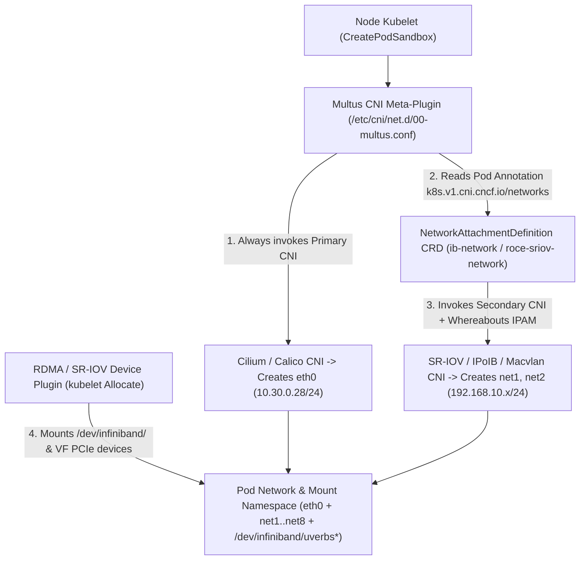

# 11.10 Secondary networks: Multus, SR-IOV device plugin and RDMA device plugin

| | |
|---|---|
| Level | Advanced |
| Priority tier | 1 |
| Lab venue | GCP / GKE and local Python 3 simulation lab |
| Part | Part 11: GPUs on Kubernetes, scheduling and virtualization |
| Coverage file | `planning/coverage/chapters/11-10.md` |

## Why this matters for AI infrastructure

Suppose a team starts distributed LLM training on a cluster and the GPUs spend much of each step waiting. The job runs over the default Pod network, and gradient synchronization saturates the management network interface card (NIC). Training throughput collapses to a fraction of what the hardware can deliver, and control-plane health checks start timing out across the node.

The on-call engineer sees the GPU dashboards first. Utilization looks low in bursts, and the curves flatten every few seconds. The GPUs are healthy. They are simply waiting for data from other machines, and that data is traveling over the wrong road.

The root cause sits in the network design itself. Standard Kubernetes networking was built for stateless microservices, where every Pod receives a single virtual Ethernet interface and one cluster IP address. A stateless service keeps no data between requests, so any copy of it can answer any call. Packets leaving that primary interface traverse the Linux kernel TCP/IP stack, netfilter or eBPF rules, and often an overlay tunnel over a shared management NIC. An overlay tunnel wraps each packet inside another packet so that Pods on different nodes can reach each other. That design suits web traffic, and training breaks it.

Distributed PyTorch Fully Sharded Data Parallel (FSDP), DeepSpeed, and Megatron-LM jobs break the single-interface model in three ways.

1. Traditional microservices generate mostly North-South client-to-API traffic, which moves between clients outside the cluster and services inside it, plus modest East-West RPC calls, which move between machines inside the cluster. Think of North-South as customers placing orders with a shop, and East-West as staff passing boxes between the back-room machines. Multi-node LLM training inverts this pattern. It generates hundreds of gigabits per second of synchronous East-West AllReduce, AllGather, and ReduceScatter traffic after every step. Once communication exceeds twenty to twenty-five percent of step time, kernel TCP context switches and host RAM buffer copies become the bottleneck for the cluster.
2. Multi-GPU servers do not route inter-node training traffic through a single management interface. The job cannot send everything through one shared door. An eight-GPU HGX node pairs each GPU with a dedicated high-speed ConnectX network adapter. Those adapters sit across four PCIe switches and eight independent network rails. A PCIe switch is the chip on the motherboard that connects a group of devices, and a rail is one independent path through the fabric.
3. A Kubernetes GPU Pod cannot simply drop the primary cluster network in favor of the RDMA fabric. It still needs `eth0` on Cilium or Calico for Kubernetes API access, CoreDNS queries, Prometheus metric scraping, and object-storage downloads. At the same time, it needs dedicated secondary network interfaces and InfiniBand character devices attached directly to the high-speed fabric. RDMA, or remote direct memory access, lets one machine write into another machine's memory while bypassing the remote CPU and kernel network stack.

The table compares the network options a GPU Pod can use. Read it as a ladder. The first row handles everyday cluster work. The lower rows are the ones you reach for when communication takes up a large share of each step. As you read it, look at the last column to see when each option becomes necessary.

| Network Technology | Typical Bandwidth | Latency Profile | Step-Time Threshold and Role in Kubernetes GPU Pods |
|---|---|---|---|
| Standard TCP/IP Ethernet (`eth0` primary CNI) | `10–25 Gbps` or `100 Gbps` | Tens to hundreds of microseconds | Sufficient for `2–8` data-parallel nodes when communication stays `< 15%` of total step time; handles API, DNS, and metrics |
| RoCEv2 over Ethernet (`net1..net8` secondary CNI) | `100–400 Gbps` | Low microseconds | Required once communication reaches `20%–25%` of step time; uses lossless Priority Flow Control and ECN over Ethernet switches |
| InfiniBand (`net1..net8` IPoIB / IB SR-IOV) | `200–400 Gbps` | Sub-microsecond (`MTU 4,096` / `4096`) | Native lossless credit-based fabric with adaptive routing; GPUDirect RDMA cuts communication latency by `40%–60%` |

Notice that the RoCEv2 and InfiniBand rows matter only when communication takes a large share of step time. RoCEv2 is RDMA over Converged Ethernet, version 2, which runs RDMA over ordinary Ethernet switches. The primary network still carries the control traffic in every case, so the fast fabric never replaces it.

The share of step time is the number that decides everything in this table. If a step is mostly arithmetic on the GPU, a faster network changes little. If a step is mostly waiting for other GPUs to finish their part, the same network upgrade can decide the whole run. That is why the table talks about thresholds rather than raw bandwidth. Measure the share first, and then pick the row.

A Pod that needs both networks depends on three components working together. Each one answers a different question about the Pod.

- Multus CNI keeps the primary interface on the default CNI, and it then reads NetworkAttachmentDefinition custom resources and Whereabouts cluster-wide IPAM to attach secondary interfaces. The question it answers is how a Pod gets a second network at all.
- The RDMA Shared Device Plugin discovers Mellanox and NVIDIA ConnectX adapters on the host. It mounts `/dev/infiniband/` into the container when multiple Pods share a Physical Function over Macvlan or IPoIB. The question it answers is how the container gets the RDMA device files.
- The SR-IOV Network Device Plugin partitions a single Physical Function into hardware-isolated PCIe Virtual Functions. It also reports each Virtual Function's NUMA node to the kubelet Topology Manager. The question it answers is how each Pod gets its own hardware slice of the NIC.

Consider the first break again, since it shows why the traffic pattern matters. Decide early whether your training jobs need a secondary fabric, because the primary network cannot carry the synchronous training traffic on its own. Deciding late means rebuilding node pools, and that is far more work than picking the right network on day one.

## Prerequisites and outcomes

This chapter builds on earlier work in Part 11. The prerequisites below are the material you should already know. The outcomes section describes the path the chapter takes.

### Prerequisites

You should have completed Chapter 11.2 on the Device Plugin framework, Chapter 11.4 on GPU Operator and Network Operator boundaries, and Chapter 11.6 on PCIe and NUMA topology alignment. A NUMA node is a group of CPU cores and memory that sits close together, so reaching across groups costs time. You should also be comfortable with IPv4 subnetting, VLAN tagging, and Linux network inspection commands. A VLAN tag is a small label on an Ethernet frame that keeps one logical network separate from another on the same wire.

### Outcomes

This chapter follows one packet from the primary Pod interface to the secondary RDMA fabric. It starts with how a primary CNI plugin and its IPAM assign addresses, and it compares Calico BGP routing with Cilium eBPF service lookups. It then contrasts the bounce-buffer copy path with zero-copy GPUDirect RDMA, which depends on the peermem module and PCIe BAR1 Peer-to-Peer DMA. Next, it shows how Multus and Whereabouts build secondary networks, and how the RDMA Shared Device Plugin and the SR-IOV Network Device Plugin differ for single-tenant and multi-tenant clusters. The chapter ends with a PyTorchJob that combines `IPC_LOCK`, RDMA resources, and NCCL environment variables, and with the checks that catch TCP fallbacks, missing IOMMU flags, and PCIe Access Control Services bottlenecks.

## Concepts: basics to intermediate to advanced

### 1. Basics: Primary Pod networking and the GPUDirect RDMA data path

#### How Kubernetes primary CNI and IPAM work on the primary interface

Picture a new GPU node joining the cluster on a Monday morning. Its status reads NotReady, and the CoreDNS Pod sits in Pending while the rest of the node looks normal. To understand why, you need to know how every Pod gets its first network connection. Every Pod must join the primary cluster network before anything else works. Kubelet health probes and DNS resolution depend on it, so the secondary fabric is added on top of this base. Kubernetes enforces an IP-per-Pod model. Each Pod gets its own IP address, and all containers inside that Pod share the local loopback interface, which is the software-only network a machine uses to talk to itself.

Start with the address space, since every Pod draws its IP from it. When an administrator runs `kubeadm init --pod-network-cidr 10.30.0.0/16`, the controller manager carves that cluster block into per-node slices with `--node-cidr-mask-size-ipv4=24`. A CIDR block is a range of addresses written with a slash and a prefix length. When a Pod starts, the kubelet reads the lexicographically first configuration file in `/etc/cni/net.d/`. Lexicographic order is simple alphabetical sorting, so the file whose name sorts first wins. The kubelet then invokes the matching binary in `/opt/cni/bin/`, which performs one of four CNI operations.

- The ADD operation creates the primary interface inside the container's network namespace. It also invokes the IPAM plugin and programs container routes. A network namespace is a private copy of the Linux network stack for one container.
- The DELETE operation removes the interface and releases the allocated IP address when the Pod terminates.
- The CHECK operation verifies that the container's network attachment remains healthy.
- The VERSION operation reports the CNI specification versions supported by the plugin binary.

Read the four operations as a life cycle. You get an interface, check it, and then release it.

A helpful way to hold this in mind is a hotel check-in. ADD is the moment the guest receives a room key, DELETE is checkout when the key comes back, and CHECK is the housekeeper's walk past the door to confirm the room is still in service. The IPAM plugin plays the role of the front desk that decides which room number goes to which guest. When a Pod disappears, nobody notices the released address unless the DELETE step runs, and that is how address pools slowly fill up with leaked entries.

The table lists the values this section works with. If you read the last row, you will see that a node without CNI configuration stays NotReady, even though its `hostNetwork: true` Pods keep running. That is why the control plane can still come up on a bare node while DNS waits.

| Primary CNI Parameter or Condition | Configuration / Log Value | Usable IP Count or Cluster Behavior |
|---|---|---|
| Cluster Pod CIDR (`--pod-network-cidr`) | `10.30.0.0/16` (plus dual-stack IPv6 `2002:1:1::/96`) | `65,536` total addresses (`65,534` usable Pod IPs) |
| Node Pod CIDR (`--node-cidr-mask-size-ipv4=24`) | `/24` per node (`10.30.0.0 - 10.30.0.255` across `256` nodes) | `254` usable Pod IPs per node (comfortably above the default `110` max Pods per node) |
| CNI Specification and Paths | `cniVersion: "0.3.1"` or `"0.4.0"`, `/etc/cni/net.d/`, `/opt/cni/bin/` | Standard directories for CNI JSON configs (`05-cilium.conf`) and binaries (`loopback`, `cilium-cni`, `calico`) |
| Uninitialized CNI on Node Boot | `NetworkReady=false reason:NetworkPluginNotReady` (`cni config uninitialized`, `no networks found in /etc/cni/net.d`) | Node stays `NotReady` and `coredns` stays `0/1 Pending`, while `hostNetwork: true` Pods (`kube-apiserver`, `etcd`) run normally |

#### Primary CNI architectures: Calico, Cilium eBPF, and AWS VPC CNI

A platform engineer has to choose the primary network plugin before anyone installs a GPU driver. That choice shapes how packets move between nodes and how Kubernetes Service virtual IPs get translated. A Service virtual IP is a stable address that Kubernetes hands out for a group of Pods, and the plugin decides how traffic to it gets sent to a real Pod. Understanding these differences shows why tuning the primary CNI helps control-plane scalability. It still cannot replace hardware RDMA for GPU collectives.

| Primary CNI | IPAM and Routing Mechanism | Service and Policy Dataplane | Strengths and Trade-Offs for AI Clusters |
|---|---|---|---|
| Calico (`calico-node`) | Uses `IPPool` CRDs (`cidr: 10.30.0.0/16`, `blockSize: 29` = `8` IPs per block). Runs BIRD for BGP route distribution (`BGPPeer` `peerIP: 192.23.11.100`, `asNumber: 64567`) and Felix for kernel routes. Supports Native, IP-in-IP (`ipipMode: Always` or `CrossSubnet`), VXLAN, and WireGuard | `iptables` or eBPF dataplane; supports `NetworkPolicy` and `GlobalNetworkPolicy` | `ipipMode: CrossSubnet` routes natively at L2 speed within a rack and encapsulates only across L3 subnet boundaries |
| Cilium (`cilium-agent`) | Allocates per-node CIDRs via `CiliumNode` (`cluster-pool-ipv4-mask-size: "24"`) or cloud ENIs; supports VXLAN, Geneve, or native routing (`auto-direct-node-routes: true`) | eBPF programs at `XDP` and `tc` hooks with `KubeProxyReplacement: strict` and Hubble observability | Replaces `kube-proxy` O(N) linear `iptables` chains (`PREROUTING -> KUBE-SERVICES -> KUBE-SVC-XYZ -> KUBE-SEP-ABC`) with O(1) eBPF hash-table lookups (`cilium service list`) and enforces DNS/FQDN `CiliumNetworkPolicy` on ports `53` and `443` (`*.s3.amazonaws.com`, `nvcr.io`) |
| AWS VPC CNI | Attaches secondary Elastic Network Interfaces and VPC secondary private IPs directly to Pods | Native AWS VPC routing without overlay encapsulation | Zero overlay overhead, but consumes VPC subnet IPs quickly and caps max Pods per node by instance ENI limits |

Calico and Cilium differ mainly in how they route packets and handle Services.

AWS VPC CNI takes a different route. It hands each Pod an address from the cloud network itself, so there is no overlay tunnel to pay for. The trade-off is that the cloud subnet runs out of addresses faster, and the number of Pods a node can host is capped by how many network interfaces the instance type allows. Teams that run GPU nodes on a managed cloud service often meet this limit before they meet any bandwidth limit. Calico uses BGP to distribute routes. BGP, the Border Gateway Protocol, is the same protocol that large internet providers use to share routes between routers. Cilium replaces `kube-proxy` with eBPF lookups. eBPF is a way to run small verified programs inside the Linux kernel. Keep those differences in view when you tune the primary network, because each choice changes how traffic is looked up and how it is logged.

#### Why even the fastest primary CNI cannot replace GPUDirect RDMA

A team replaces kube-proxy with Cilium, Service lookups get faster, and the training job is still slow. The reason is that the fix worked on the wrong path. Replacing kube-proxy with Cilium eBPF removes the linear iptables latency from Service lookups on the primary interface. Standard TCP/IP sockets still send every tensor payload through the Linux kernel network stack and host CPU system memory, though. That copying is the cost that GPUDirect RDMA avoids.

Follow a tensor through the traditional path to see the copies.

1. Consider a traditional five-hop non-RDMA transfer. The first hop copies the tensor over PCIe from the source GPU into a pinned bounce buffer in host system RAM. The second hop has the source CPU instruct the local NIC to DMA that buffer from host RAM. The third hop crosses the network switch fabric. The fourth hop has the destination NIC DMA the incoming packet into destination host RAM. The fifth hop has the destination CPU copy the buffer over PCIe from host RAM into destination GPU HBM. A bounce buffer is a staging area in host memory that both sides copy through. HBM is the high-bandwidth memory that sits on the GPU itself.
2. In a GPUDirect RDMA transfer, the NVIDIA GPU driver exposes a slice of GPU PCIe BAR1 memory and pins the GPU pages. BAR1 is the window through which the CPU and other devices can reach GPU memory over PCIe. Pinning means the kernel keeps those pages in place. The `nvidia-peermem` kernel module bridges the GPU driver and the Mellanox OFED stack by passing those physical BAR1 addresses directly to the ConnectX adapter. OFED is the OpenFabrics Enterprise Distribution, the RDMA driver stack that Mellanox ships. The source NIC performs a direct PCIe Peer-to-Peer DMA read from source GPU HBM across the local PCIe switch, then transmits RDMA frames over the fabric. The destination NIC writes directly into destination GPU HBM without touching either CPU or host RAM.

Two details decide whether the fast path actually works. First, the GPU memory has to be pinned, or the kernel might move it while the NIC is reading. Second, the NIC and the GPU have to be able to reach each other over PCIe without the traffic climbing to the CPU. The second requirement is the one the hardware trap later in this chapter is about.

Keep the two paths apart in your head, because only the bounce-buffer path stages each transfer in host RAM.

### 2. Intermediate: Multus CNI, Whereabouts IPAM, and the 8-NIC HGX Rail Architecture

#### How Multus CNI attaches multiple interfaces to a Pod

A training Pod needs its own high-speed interface, but Kubernetes normally lets only one CNI plugin set up a Pod's network. A plugin is a program that the kubelet calls to wire a Pod into a network. Without a workaround, the Pod would get either the cluster network or the fabric, never both. Multus CNI solves this by acting as a CNI meta-plugin between the kubelet and the underlying network drivers. A meta-plugin is a plugin that calls other plugins in turn.



Multus works in three steps, and you can follow them in the diagram above.

After the Pod starts, you can see the result from inside the container. The primary `eth0` is still there with the cluster address, and the secondary interfaces sit beside it. The Pod now has one foot on each network, and each foot uses its own route. That split is what lets a training job talk to the Kubernetes API and to its GPU peers at the same time.

1. Multus always invokes the cluster's default CNI plugin first to create `eth0`. All Kubernetes Service virtual IPs, CoreDNS lookups, and log or exec streams remain on that primary interface.
2. Next, Multus inspects the Pod's `k8s.v1.cni.cncf.io/networks` annotation. For each comma-separated NetworkAttachmentDefinition listed there, Multus calls the configured secondary CNI plugin, such as IPoIB, Macvlan, or SR-IOV. That secondary call attaches `net1`, `net2`, and any additional interfaces inside the Pod namespace.
3. Standard host-local IPAM tracks IP addresses on a single node only. That causes IP collisions across nodes on a shared L2 RDMA subnet. Two nodes can each hand out the same address on the same fabric, and the traffic then goes to the wrong machine. Whereabouts is a cluster-wide IPAM CNI plugin that stores IP allocations in Kubernetes custom resources. Every secondary interface across the cluster therefore receives a unique IP without an external DHCP server.

The table shows three secondary network examples. Each one pairs a CNI plugin with an IP range and its exclusions. An exclusion is an address inside the range that Whereabouts must never hand out, usually because a router or gateway already uses it.

| Secondary Network Example | CNI Plugin and Master / VLAN | Whereabouts IPAM Range and Exclusions | Usable Secondary IPs |
|---|---|---|---|
| `ib-network` (*Generative AI on Kubernetes* Example 7-10) | `type: ipoib`, `master: ib0` (`MTU 4,096`) | `range: "10.0.0.0/24"`, `exclude: ["10.0.0.1/32"]` | `253` usable IPs |
| `roce-sriov-network` (`volume-03/03` §2.3) | `type: sriov`, `vlan: 100`, resource `nvidia.com/hostdev` | `range: "192.168.10.0/24"`, `exclude: ["192.168.10.1/32", "192.168.10.254/32"]` | `252` usable IPs |
| `macvlan` / `SriovNetwork` (`volume-06/02` §5.3 & §6.2) | `macvlan` (`master: eth1`, `mode: bridge`) or `sriov` (`vlan: 100`) | `192.168.100.0/24` (Macvlan) or `10.10.100.0/24` (SR-IOV `tenant-a`) | Dedicated L2 RDMA subnet per fabric or tenant |

The table is easier to trust when you check it yourself. Start with the raw prefix, count the host addresses, and then subtract every address that the range excludes. The same method works for any subnet your team plans to hand to Whereabouts.

Work through this example with the numbers in the table. The `roce-sriov-network` range is `192.168.10.0/24`, which holds 254 usable addresses. Excluding `192.168.10.1` and `192.168.10.254` removes two of them, leaving 254 - 2 = 252 usable secondary IPs. Each exclusion takes one address out of the pool.

 If you add a new exclusion later, the usable count drops again by one.

#### The 8-GPU, 8-NIC Rail Architecture

An engineer runs `nvidia-smi topo -m` on a new HGX node and sees that GPU 2 and NIC 2 sit behind the same switch. Before writing any Pod template, the engineer needs to know whether that pairing is a feature or an accident. Training Pods often request several secondary interfaces, and the hardware explains why. Multi-GPU servers pair each GPU with its own dedicated network adapter. On an eight-GPU DGX or HGX node, eight ConnectX NICs spread across four PCIe switches and two CPU NUMA nodes.

| GPU Index | Local PCIe Switch | Paired ConnectX NIC | NUMA Node | Fabric Rail and Leaf Switch |
|---|---|---|---|---|
| `GPU 0` | `PCIe Switch 0` (`PIX`) | `NIC 0` (`mlx5_0`) | `NUMA 0` | `Rail 1` -> `Leaf Switch 0` |
| `GPU 1` | `PCIe Switch 0` (`PIX`) | `NIC 1` (`mlx5_1`) | `NUMA 0` | `Rail 2` -> `Leaf Switch 1` |
| `GPU 2` | `PCIe Switch 1` (`PIX`) | `NIC 2` (`mlx5_2`) | `NUMA 0` | `Rail 3` -> `Leaf Switch 2` |
| `GPU 3` | `PCIe Switch 1` (`PIX`) | `NIC 3` (`mlx5_3`) | `NUMA 0` | `Rail 4` -> `Leaf Switch 3` |
| `GPU 4` | `PCIe Switch 2` (`PIX`) | `NIC 4` (`mlx5_4`) | `NUMA 1` | `Rail 5` -> `Leaf Switch 4` |
| `GPU 5` | `PCIe Switch 2` (`PIX`) | `NIC 5` (`mlx5_5`) | `NUMA 1` | `Rail 6` -> `Leaf Switch 5` |
| `GPU 6` | `PCIe Switch 3` (`PIX`) | `NIC 6` (`mlx5_6`) | `NUMA 1` | `Rail 7` -> `Leaf Switch 6` |
| `GPU 7` | `PCIe Switch 3` (`PIX`) | `NIC 7` (`mlx5_7`) | `NUMA 1` | `Rail 8` -> `Leaf Switch 7` |

You can trace any row from left to right. GPU 2 and NIC 2, for example, share PCIe Switch 1 on NUMA 0 and reach Rail 3 through Leaf Switch 2. A leaf switch is the switch at the edge of the fabric that connects directly to the nodes.

The rail design keeps matching NICs on the same fabric. Every NIC with index K across all server nodes connects to the same leaf switch, on Rail K+1. Take GPU 0 on Node A exchanging gradients with GPU 0 on Node B. The transfer leaves GPU 0, passes through PCIe Switch 0 and NIC 0, and enters Leaf Switch 0. From that leaf switch, it flows directly into NIC 0 and GPU 0 on Node B. If you follow that packet, you will see that it never crosses a CPU root complex or an inter-socket NUMA link. A root complex is the point where PCIe begins, inside the CPU, and crossing it is slower than staying on one switch.

#### Ring vs Double Binary Tree AllReduce across Multi-Rail Secondary Networks

A team sees its gradient sync slow down when it moves from a single node to a much larger cluster. The collective algorithm may be the reason, so the team needs to know how NCCL moves the data. After Multus and the device plugins expose the secondary interfaces and InfiniBand character devices inside the container, NCCL takes over. NCCL is NVIDIA's library for collective communication between GPUs. It inspects `/sys/class/pci_bus/`, NVLink links, and InfiniBand sysfs paths. Then it builds communication graphs using two primary collective algorithms. An AllReduce is an operation in which every GPU ends up with the sum of everyone's gradients.

- Ring AllReduce arranges the participating GPUs into a directed logical ring. During the Scatter-Reduce phase, each GPU sends and reduces a data chunk with its immediate neighbor. During the AllGather phase, the finalized chunks circulate around the ring. Ring AllReduce achieves peak bandwidth utilization for large gradient payloads.
- Tree AllReduce arranges GPUs into complementary double binary trees, so a node that acts as a leaf in the first tree acts as an internal node in the second. Partial sums flow upward from leaves to root during the Reduce phase, and final sums broadcast downward from root to leaves. Tree depth grows logarithmically with node count, so Tree AllReduce outperforms Ring AllReduce for small messages or across massive multi-node clusters.

When you choose between the two, look first at message size and cluster scale. Ring suits large gradient payloads, while Tree suits small messages and very large clusters. You rarely set this by hand, but knowing the trade-off tells you why a slow run may point to the message size rather than the wiring.

On InfiniBand fabrics, administrators combine multi-rail pod placement with adaptive routing. They enable it with `--set_adaptive_routing` in the Subnet Manager. The Subnet Manager is the fabric component that assigns addresses and computes routes. They also keep storage traffic apart from synchronous NCCL traffic. Dedicated VLANs do that on RoCEv2, and Partition Keys do it on InfiniBand. A Partition Key is an InfiniBand tag that keeps groups of ports from talking to each other unless they share it.

### 3. Advanced: RDMA Shared Device Plugin vs SR-IOV Network Device Plugin, PCIe ACS, and NCCL tuning

A cluster admin wants two teams to share the same ConnectX cards without seeing each other's traffic. Attaching a secondary network interface through Multus gives a Pod an IP address on the high-speed subnet. An interface alone does not mount kernel-bypass RDMA character devices such as `/dev/infiniband/uverbs0` and `/dev/infiniband/rdma_cm` into the container. Two Kubernetes device plugins handle that hardware allocation. You can deploy either one standalone, or let the NVIDIA Network Operator manage it.

#### 1. RDMA Shared Device Plugin with Macvlan or IPoIB

A team with one trusted group of users wants the simplest way to give Pods RDMA access. The RDMA Shared Device Plugin is that path. It discovers Mellanox and NVIDIA ConnectX adapters on the host by matching PCIe vendor ID 15b3, not GPU vendor ID 10de. A vendor ID is the four-digit code that identifies who made a PCIe device. It advertises a shared extended resource to the kubelet, such as `rdma/hca` or `rdma/rdma_shared_device_a`.

- Pair this plugin with an IPoIB NetworkAttachmentDefinition on InfiniBand, or with a Macvlan NetworkAttachmentDefinition on RoCEv2. Multiple Pods on the same node can share the underlying Physical Function while each receives direct access to `/dev/infiniband/`.
- This shared approach is simple to deploy and suits single-tenant clusters or full-node jobs. Pods share the host's Physical Function, however, so Macvlan lacks hardware-enforced per-Pod bandwidth rate limiting, MAC-spoofing protection, and hardware VLAN isolation. MAC spoofing is when one Pod pretends to be another by using its hardware address.

#### 2. SR-IOV Network Device Plugin with SR-IOV CNI

A multi-tenant cluster serving teams that do not trust each other needs stronger walls than software can build. Single Root I/O Virtualization (SR-IOV) is the PCIe feature that provides those walls, and this plugin is the Kubernetes side of it.

- Single Root I/O Virtualization partitions a single physical ConnectX NIC Physical Function, such as `enp1s0f0`, at the PCIe silicon level into multiple independent Virtual Functions. Each Virtual Function has its own PCIe bus, device, and function address. The Linux kernel and the kubelet see it as a dedicated hardware NIC.
- Creating SR-IOV Virtual Functions requires enabling the CPU Input-Output Memory Management Unit in BIOS and adding `intel_iommu=on iommu=pt` to `/etc/default/grub`. The IOMMU is the hardware that lets devices access memory safely, and passthrough mode lets devices skip translation for speed. Without IOMMU passthrough, the SR-IOV node policy fails to create Virtual Functions and logs errors in `dmesg -T | grep -i sriov`.
- Each Pod that requests an SR-IOV resource receives exclusive ownership of a hardware Virtual Function. It also gets hardware-enforced VLAN tagging and QoS. QoS is quality of service, the rules that decide which traffic gets bandwidth first. Per-VF NUMA node hints go directly to the kubelet Topology Manager, which uses them to keep the GPU and NIC on the same NUMA node.

| Feature | RDMA Shared Device Plugin + Macvlan / IPoIB | SR-IOV Network Device Plugin + SR-IOV CNI |
|---|---|---|
| Hardware Isolation | Shared Physical Function across Pods (`vendor: "15b3"`) | Dedicated PCIe Virtual Function per Pod (`pfNames: ["enp1s0f0"]`, `numVfs: 8`) |
| Multi-Tenant Security and QoS | Software-level isolation only | Hardware-enforced in ConnectX ASIC (`vlan: 100`, `mtu: 9000`, `priority: 99`, `isRdma: true`) |
| Kubernetes Extended Resource | `rdma/hca: 2` or `rdma/rdma_shared_device_a: 1` (out of `8` advertised) | `nvidia.com/hostdev: 2` or `sriovnetwork.openshift.io/rdma_vf: 1` |
| BIOS and Kernel Prerequisite | Standard OFED driver plus `nvidia-peermem` | Requires IOMMU enabled (`intel_iommu=on iommu=pt`) and SR-IOV enabled in BIOS |
| Kubelet Topology Manager Hints | Node or Physical Function level | Exact per-VF PCIe and NUMA node hints for `single-numa-node` alignment |

The table sets the two approaches side by side.

Notice that the two columns answer different questions. The shared column asks how to give many Pods access to the same card cheaply. The SR-IOV column asks how to make sure one Pod cannot see or slow down another. Neither question is wrong. The cost of the answer is what separates them, and that cost shows up in deployment effort and in how many Pods each card can serve. If you want to see the Virtual Functions on a host, `ip link` lists them under the physical NIC. The shared option is simple to deploy, while the SR-IOV option enforces isolation in the ConnectX hardware. Choose by asking who must be kept out of whose traffic. If the answer is nobody, the simpler option is enough.

#### Crucial Hardware Trap: Disabling PCIe Access Control Services

A new GPU node passes every software check, yet bandwidth stays far below the card's rating. The configuration looks correct, so the cause is easy to miss. You can configure everything correctly and still lose bandwidth. SR-IOV, Multus, and the peermem module may all be set up properly, yet a BIOS security setting called PCIe Access Control Services can cut GPUDirect RDMA bandwidth in half.

- When PCIe Access Control Services is enabled on motherboard PCIe switches, the switch blocks direct Peer-to-Peer packets between a GPU and its paired NIC on the same switch. Every packet is forced up to the CPU Root Complex and IOMMU for translation. A fast local PIX path turns into a slow PHB or SYS path. PIX, PHB, and SYS are the connection labels that `nvidia-smi topo -m` prints, from the fastest local path to the slowest path across the CPU.
- Always inspect `lspci -vvv | grep -i acs` and `nvidia-smi topo -m` when you qualify new GPU nodes, and disable PCIe Access Control Services in the server BIOS. In virtualized environments, the hypervisor can flatten the synthetic PCIe tree. There, dump a baseline topology file using `NCCL_TOPO_DUMP_FILE=/tmp/topo.xml` and inject it via `NCCL_TOPO_FILE`. The topology file tells NCCL how the devices really connect when the virtual machine hides that picture.

If you see low bandwidth, check ACS on each new GPU node before you blame NCCL settings. Hardware checks take minutes, while tuning the wrong layer can take days.

The trap is hard to see because it does not produce an error. Multus attaches the interface, the device plugin mounts the devices, and NCCL picks the RDMA transport, so every log looks healthy. Only the throughput number gives it away. That is why the chapter asks you to run a bandwidth test with `nccl-tests` and compare it with the expected line rate, rather than trusting the configuration files alone.

## Commands and configurations that matter

The commands in this section are the manifests and checks behind the rest of the chapter. A platform team writes these files when it turns the design into a running cluster. Each one is shown as written, and the fields in each one tie back to the concepts you just read.

### 1. Defining NetworkAttachmentDefinitions for InfiniBand and RoCE SR-IOV

A team that wants jobs on the InfiniBand fabric needs a named network that Pods can ask for. The first manifest creates that name. It sets up an IP over InfiniBand secondary network on master interface `ib0`. It uses Whereabouts IPAM across `10.0.0.0/24`, so each Pod that attaches to this network draws its address from that range.

```yaml
# nad-ipoib-infiniband.yaml (GAK Example 7-10, untested here)
apiVersion: k8s.cni.cncf.io/v1
kind: NetworkAttachmentDefinition
metadata:
  name: ib-network
spec:
  config: '{
    "cniVersion": "0.3.1",
    "type": "ipoib",
    "master": "ib0",
    "ipam": {
      "type": "whereabouts",
      "range": "10.0.0.0/24",
      "exclude": [ "10.0.0.1/32" ]
    }
  }'
```

The second manifest is a pair of resources. The `SriovNetworkNodePolicy` carves eight RDMA-capable Virtual Functions with jumbo MTU 9000 from Mellanox interface `enp1s0f0`. The SR-IOV NetworkAttachmentDefinition that follows places those functions on VLAN 100. The first resource describes the hardware slices, and the second describes the network those slices join.

```yaml
# sriov-policy-and-nad.yaml (untested here)
apiVersion: sriovnetwork.openshift.io/v1
kind: SriovNetworkNodePolicy
metadata:
  name: mlx5-rdma-policy
  namespace: sriov-network-operator
spec:
  resourceName: rdma_vf
  nodeSelector:
    feature.node.kubernetes.io/network-sriov.capable: "true"
  priority: 99
  mtu: 9000
  numVfs: 8
  nicSelector:
    vendor: "15b3"
    pfNames: ["enp1s0f0"]
  deviceType: netdevice
  isRdma: true
---
apiVersion: "k8s.cni.cncf.io/v1"
kind: NetworkAttachmentDefinition
metadata:
  name: roce-sriov-network
  namespace: default
  annotations:
    k8s.v1.cni.cncf.io/resourceName: nvidia.com/hostdev
spec:
  config: '{
    "cniVersion": "0.3.1",
    "type": "sriov",
    "vlan": 100,
    "ipam": {
      "type": "whereabouts",
      "range": "192.168.10.0/24",
      "exclude": [
        "192.168.10.1/32",
        "192.168.10.254/32"
      ]
    }
  }'
```

Decide which network each job should use before you write its Pod template, because the annotation in the next example depends on that choice.

### 2. Configuring a PyTorchJob with Multus, RDMA HCAs, IPC_LOCK, and NCCL variables

A training engineer submits a distributed PyTorchJob that must run over InfiniBand or RoCEv2. The job fails in quiet ways if any one of its pieces is missing. Next comes the job itself. When you submit a distributed PyTorchJob over InfiniBand or RoCEv2, the Pod template brings four things together. These are the Multus network annotation, the RDMA device plugin request, the `IPC_LOCK` capability for pinning memory, and explicit NCCL environment variables. An HCA is the host channel adapter, the RDMA network card itself.

```yaml
# pytorchjob-multus-rdma.yaml (GAK Example 7-11 + volume-06/02, untested here)
apiVersion: kubeflow.org/v1
kind: PyTorchJob
metadata:
  name: llm-training-ib
spec:
  pytorchReplicaSpecs:
    Master:
      replicas: 1
      template:
        metadata:
          annotations:
            k8s.v1.cni.cncf.io/networks: ib-network
        spec:
          containers:
            - name: pytorch
              image: nvcr.io/nvidia/pytorch:24.08-py3
              env:
                - name: NCCL_DEBUG
                  value: "INFO"
                - name: NCCL_DEBUG_SUBSYS
                  value: "INIT,GRAPH,ENV"
                - name: NCCL_IB_HCA
                  value: "mlx5_0,mlx5_1"
                - name: NCCL_IB_GID_INDEX
                  value: "3"
                - name: NCCL_IB_TC
                  value: "106"
                - name: NCCL_IB_QPS_PER_CONNECTION
                  value: "4"
                - name: NCCL_NET_GDR_LEVEL
                  value: "5"
                - name: NCCL_SOCKET_IFNAME
                  value: "net1"
              resources:
                requests:
                  nvidia.com/gpu: 8
                  rdma/hca: 2
                limits:
                  nvidia.com/gpu: 8
                  rdma/hca: 2
              securityContext:
                capabilities:
                  add: ["IPC_LOCK"]
```

Change these NCCL variables only when your fabric differs from the values in this example. Copying them blindly to a fabric with different GID or traffic class settings is a common cause of silent slow runs.

Read the Pod template from top to bottom, because each block depends on the one above it. The annotation chooses the secondary network. The resources block asks the device plugin for RDMA hardware, and the `securityContext` block lets the container lock memory for those devices. The environment variables then tell NCCL which of the new interfaces and adapters to use. If the annotation is wrong, the other settings have nothing to attach to, so start your checks there.

### 3. Three-step verification of secondary RDMA interfaces inside a running Pod

An engineer sees a training Pod in the `Running` state and assumes the network works. A Running Pod only proves that the container started. It says nothing about the secondary fabric. Never assume a secondary RDMA network is active just because a training Pod enters the `Running` state. Run these three verification commands inside the container to confirm the interface, the character devices, and the active NCCL transport.

```bash
# 1. Confirm Multus created the secondary interface (net1) with a Whereabouts IP (untested here)
kubectl exec -n team-alpha llm-training-ib-master-0 -- ip addr show net1

# 2. Confirm the RDMA / SR-IOV device plugin mounted /dev/infiniband/ character devices (untested here)
kubectl exec -n team-alpha llm-training-ib-master-0 -- ls /dev/infiniband/

# 3. Confirm NCCL selected InfiniBand/RoCE with GPUDirect RDMA ("Using network IB" & "NET/IB/GDRDMA") (untested here)
kubectl logs -n team-alpha llm-training-ib-master-0 | grep "NCCL INFO"
```

A healthy run shows `net1` with an IP, the `/dev/infiniband/` devices, and NCCL logs that name `Using network IB` and `NET/IB/GDRDMA`.

Each command answers one question, and together they answer the question that matters. The first asks whether Multus attached the secondary interface. The second asks whether the device plugin put the RDMA device files into the container. The third asks whether NCCL chose the fast transport. A failure on the first command points at Multus or Whereabouts, a failure on the second points at the device plugin, and a failure on the third points at the NCCL settings or the host driver.

## How it fails

Picture a training job that runs but finishes far slower than the hardware allows. The cause can sit in a BIOS setting, a kernel module, a device plugin or an NCCL variable. Misconfigurations across those layers either block Pod creation or make NCCL fall back silently to slow TCP sockets on `eth0`. The job still completes, so nothing in the Kubernetes status looks wrong, and that silence is what makes these failures expensive.

The table lists five failure modes. Each row gives the evidence to look for, the layer where the root cause sits, and the fix.

| Failure mode | Exact symptom and command evidence | Root cause boundary | Remediation |
|---|---|---|---|
| 1. NCCL silently falls back to `eth0` TCP sockets (`NET/Socket : Using [0]eth0:10.0.0.5<0>`) | Multi-node training runs `3–5x` slower than baseline; `kubectl logs ... \| grep "NCCL INFO"` prints `NCCL INFO NET/Socket : Using [0]eth0:10.0.0.5<0>` instead of `Using network IB` and `NET/IB/GDRDMA` | Missing `/dev/infiniband/`, unloaded `nvidia-peermem` (`lsmod \| grep nvidia_peermem`), or RoCE GID/QoS mismatch (`NCCL_IB_GID_INDEX=3`, `NCCL_IB_TC=106`, `show_gids`) | Verify `ls /dev/infiniband/` inside the Pod, confirm `lsmod \| grep nvidia_peermem` on the host, and set `NCCL_SOCKET_IFNAME=net1`, `NCCL_IB_HCA=mlx5_0,mlx5_1`, `NCCL_IB_GID_INDEX=3`, and `NCCL_IB_TC=106` |
| 2. `SriovNetworkNodePolicy` applied, but `0` Virtual Functions appear in `ip link` | Pods requesting `nvidia.com/hostdev` or `rdma_vf` stay `Pending`; on the host, `ip link` shows no VFs under `enp1s0f0`, and `dmesg -T \| grep -i sriov` logs IOMMU errors | Host BIOS or GRUB IOMMU disabled: Intel VT-d or AMD-Vi IOMMU passthrough is missing from BIOS or kernel command line | Enable SR-IOV and IOMMU in BIOS, add `intel_iommu=on iommu=pt` to `/etc/default/grub`, update GRUB, and reboot the node |
| 3. RDMA memory registration fails inside container (`ibv_reg_mr failed: Cannot allocate memory`) | `ip addr show net1` and `ls /dev/infiniband/` succeed, but `nccl-tests` or PyTorch crashes during RDMA queue-pair setup with `Cannot allocate memory` (`ENOMEM`) | Missing `IPC_LOCK` capability or `memlock` limit: RDMA requires pinning memory pages so the kernel cannot swap them during DMA transfers | Add `securityContext.capabilities.add: ["IPC_LOCK"]` to the container spec and verify `ulimit -l` is `unlimited` |
| 4. GPUDirect RDMA bandwidth is half of baseline despite `NET/IB` active | `nccl-tests` runs over `mlx5_0`, but bandwidth plateaus well below line rate; `lspci -vvv \| grep -i acs` shows `ACSCtl: SrcValid+` enabled on PCIe switch ports | PCIe Access Control Services blocking Peer-to-Peer DMA: ACS forces GPU-to-NIC packets up to the CPU Root Complex (`SYS` or `PHB`) instead of switching across `PIX` | Disable PCIe ACS in the server BIOS, or inject a validated `NCCL_TOPO_FILE` when running inside virtualized topologies |
| 5. Newly bootstrapped node stays `NotReady` and `coredns` stays `0/1 Pending` | `kubectl get pods -n kube-system` shows `coredns` `0/1 Pending` while `kube-apiserver` and `etcd` are `1/1 Running`; `journalctl -u kubelet` logs `cni config uninitialized` and `no networks found in /etc/cni/net.d` | Primary CNI uninitialized: neither Cilium, Calico, nor Multus has written its CNI configuration into `/etc/cni/net.d/` or binaries into `/opt/cni/bin/` | Deploy or repair the primary CNI DaemonSet (`cilium` or `calico-node`) and verify `/etc/cni/net.d/` and `/opt/cni/bin/` are populated |

Here is how a typical investigation runs. A training run finishes but takes far longer than the estimate. The engineer first checks the NCCL log for the transport line. If that line names `eth0`, the job fell back to TCP, and the search moves to the layer that blocks the fast path. If the line names `Using network IB` and `NET/IB/GDRDMA`, the transport is fine, and the next suspect is the bandwidth itself, which points toward PCIe ACS. Working in this order keeps the team from changing five settings at once and never learning which one mattered.

Failure mode 1 is the silent one, so check its log line before you assume the fabric is working. Each of the other rows points to one layer to inspect, so you can work through them in order. Start at the lowest layer that could be wrong, since a missing device file hides every problem above it.

When a run is slow, read the NCCL log line before you change any setting, because it tells you which path was actually used.

## Hands-on lab

### Venue and scope

This lab needs only Python 3, because it uses the standard library. The two scripts are `code/part11/secondary_networks_multus_sriov_rdma.py` and `code/part11/secondary_networks_multus_sriov_rdma_lab.py`. Together they simulate Kubernetes Pod CIDR and Whereabouts IPAM capacity math, Multus primary and secondary interface resolution, the eight-GPU HGX rail topology mapper, and a seven-layer secondary RDMA diagnostic engine. The cluster commands earlier in this chapter were not run on a live cluster. The lab script itself was run in this repository, and its captured output appears below.

### Step 1: Run the self-checking Multus, SR-IOV, and RDMA device plugins lab (tested here)

Run the lab script from the repository root. It runs twenty-five checks on networking and device plugin logic, and each check should print PASS. Because the script only computes results, it can run on a laptop with no GPU and no cluster.

```bash
python3 code/part11/secondary_networks_multus_sriov_rdma_lab.py
```

The output below is what a passing run prints. Each line names one check, and the summary line at the bottom gives the total. If a line says FAIL, the message after the name shows which function or value differed.

Captured output from this repository:
```text
=== Chapter 11.10 Lab: Secondary Networks, Multus, SR-IOV & RDMA Device Plugins ===
  [PASS] 10.30.0.0/16 cluster CIDR provides 65,536 total IPs and 65,534 usable Pod IPs
  [PASS] /24 node podCIDR (10.30.0.0 - 10.30.0.255) provides 254 usable Pod IPs (default maxPods=110)
  [PASS] /16 cluster CIDR splits into 256 /24 node CIDRs; Calico blockSize: 29 allocates 8-IP blocks
  [PASS] whereabouts 192.168.10.0/24 excluding .1/32 and .254/32 provides 252 usable secondary IPs
  [PASS] Single Multus NAD (ib-network) attaches net1 alongside primary eth0 (cilium)
  [PASS] Dual Multus annotation (roce-sriov-network, roce-sriov-network) creates eth0, net1, and net2
  [PASS] 8-GPU HGX Rail architecture maps 8 dedicated NICs across 8 independent Rails (Rail 1..8)
  [PASS] GPU 0 and NIC 0 share PCIe Switch 0 on NUMA 0 and connect to Rail 1 (Leaf Switch 0)
  [PASS] GPU 4 and NIC 4 share PCIe Switch 2 on NUMA 1 and connect to Rail 5 (Leaf Switch 4)
  [PASS] Diagnostic routes missing intel_iommu=on iommu=pt to sriov_iommu_bios_grub
  [PASS] Diagnostic routes missing net1 interface to multus_cni_attachment
  [PASS] Diagnostic routes missing /dev/infiniband/ inside pod to rdma_or_sriov_device_plugin
  [PASS] Diagnostic routes missing IPC_LOCK capability to container_security_context_ipc_lock
  [PASS] Diagnostic routes unloaded nvidia-peermem module to gpudirect_peermem_module
  [PASS] Diagnostic routes enabled PCIe ACS (SYS instead of PIX) to pcie_acs_p2p_isolation
  [PASS] Diagnostic routes 'NET/Socket : Using [0]eth0' fallback to nccl_interface_or_roce_qos_gid
  [PASS] Diagnostic confirms healthy_gpudirect_rdma when NET/IB and GDRDMA are active
  [PASS] PCIe vendor ID 15b3 identifies Mellanox/NVIDIA ConnectX NICs (vs 10de for NVIDIA GPUs)
  [PASS] RoCE SR-IOV SriovNetworkNodePolicy sets jumbo MTU 9000 (vs MTU 4096 typical for InfiniBand)
  [PASS] RoCEv2 NCCL tuning uses NCCL_IB_TC=106, NCCL_IB_GID_INDEX=3, NCCL_IB_QPS_PER_CONNECTION=4, NCCL_NET_GDR_LEVEL=5
  [PASS] SriovNetworkNodePolicy sets priority: 99, numVfs: 8, and SriovNetwork sets vlan: 100
  [PASS] Calico BGPPeer example uses AS number 64567 and peerIP 192.23.11.100
  [PASS] NCCL topology.xml speed='400000' corresponds to 400 Gbps (400,000 Mbps) ConnectX-7 link
  [PASS] Rails 1..4 (GPUs 0..3, NICs 0..3) map to NUMA 0 and Rails 5..8 (GPUs 4..7, NICs 4..7) map to NUMA 1
  [PASS] 8 GPU-NIC pairs are distributed across 4 PCIe Switches (2 GPUs + 2 NICs per switch)

Summary: 25 passed, 0 failed out of 25 checks.
```

### Exercises

Work through the six exercises below. Each one calls a function from the lab modules. As you go, note the value each function returns before you move on to the next exercise.

1. Start with the address math. Call `compute_cidr_ipam_capacity` in `code/part11/secondary_networks_multus_sriov_rdma.py`. Use a `/16` cluster CIDR and a `/24` node mask. Set the Calico block size to 29. Pass two excluded addresses. Compute the usable Pod IPs in the cluster CIDR. Compute the usable Pod IPs per node CIDR. Compute the IPs per Calico block. Compute the usable secondary IPs in the secondary subnet.
2. Map the interfaces a multi-homed Pod gets. A multi-homed Pod has more than one network interface. Use `resolve_multus_interfaces` with primary CNI Cilium and the annotation `roce-sriov-network, roce-sriov-network`. List the ordered interface names inside the Pod. For each interface, list its network and its role. State how many `nvidia.com/hostdev` units the Pod must request.
3. Map the 8-GPU rail. Run `map_eight_gpu_rail_topology`. For GPU 2, state the PCIe switch and the paired NIC. For GPU 2, state the fabric rail, the leaf switch, and the NUMA node. Repeat both steps for GPU 6.
4. Diagnose the failure in two cases. Use `diagnose_secondary_rdma_network` with the secondary interface present but `/dev/infiniband/` missing. Record the failing layer and the remediation for that case. Then run the same function when all hardware checks pass but NCCL logs `NET/Socket : Using [0]eth0:10.0.0.5<0>`. Compare the second result with the first.
5. Choose a device plugin for untrusted teams. Explain why a multi-tenant AI cluster serving untrusted teams should use `SriovNetworkNodePolicy` with Virtual Functions and hardware VLAN tagging. Compare that choice with Macvlan and the shared RDMA device plugin.
6. Verify GPUDirect RDMA from the logs. Write the first `kubectl` command that checks for `net1` on the Master Pod. Write the second command that checks for `/dev/infiniband/`. Write the third command that checks the NCCL log for active GPUDirect RDMA over InfiniBand.

Run the lab before you change a cluster, since it checks the same logic without touching any live hardware.

## Checkpoint questions

Use these questions to test yourself. Each answer gives the key facts, so you can check your own answer against it.

<details>
<summary>**1. How many usable IPs exist in the 10.30.0.0/16 cluster CIDR and in each node's /24 podCIDR, and what is the default kubelet maxPods limit per node?**</summary>

A `/16` cluster CIDR contains 65,536 total addresses and 65,534 usable Pod IPs, which split into 256 node subnets. Each `/24` node CIDR gives 254 usable Pod IPs, comfortably above the default kubelet limit of 110 Pods per node.
</details>

<details>
<summary>**2. What are the four standard operations defined by the CNCF Container Networking Interface specification?**</summary>

1. ADD attaches a network interface to a container's network namespace and assigns IP addresses and routes.
2. DELETE removes the container's network interface and releases IPAM resources on termination.
3. CHECK confirms that the container's networking is still healthy.
4. VERSION reports the CNI specification versions supported by the plugin binary.
</details>

<details>
<summary>**3. Why did kube-apiserver and etcd start normally on a freshly kubeadm-initialized node while coredns stayed 0/1 Pending with cni config uninitialized?**</summary>

Static control-plane Pods such as the API server and etcd set `hostNetwork: true`, so they share the node's root network namespace and do not invoke CNI. CoreDNS uses standard Pod networking, so it waits until a CNI plugin writes its configuration into `/etc/cni/net.d/` and its binaries into `/opt/cni/bin/`.
</details>

<details>
<summary>**4. How does Cilium with KubeProxyReplacement: strict improve Kubernetes Service routing compared to kube-proxy in iptables mode?**</summary>

In iptables mode, kube-proxy evaluates chains in sequence, in O(N) time, which slows as Service counts grow into the thousands. Cilium attaches eBPF programs at kernel XDP and tc hooks, and it translates Services with O(1) hash-table map lookups.
</details>

<details>
<summary>**5. What is Calico's ipipMode: CrossSubnet setting in an IPPool custom resource?**</summary>

Setting `ipipMode: CrossSubnet` tells Calico's BIRD and Felix daemons to route Pod packets natively, without encapsulation, when source and destination nodes share the same L2 subnet. Only when packets must cross an L3 subnet router boundary does Calico apply IP-in-IP encapsulation.
</details>

<details>
<summary>**6. Contrast North-South versus East-West network traffic in microservices versus distributed LLM training, and state the communication overhead threshold where standard Ethernet is no longer sufficient.**</summary>

Microservices mostly send North-South external client traffic, plus light East-West RPC calls. Distributed LLM training sends heavy synchronous East-West gradient and activation traffic between all nodes. Standard TCP/IP Ethernet is enough for two to eight data-parallel nodes while communication stays below fifteen percent of step time. Once communication reaches twenty to twenty-five percent of step time, you need RDMA over InfiniBand or RoCEv2.
</details>

<details>
<summary>**7. Walk through the five data-movement hops of a traditional non-RDMA GPU-to-GPU network transfer versus GPUDirect RDMA.**</summary>

- On the traditional path, the source GPU copies data over PCIe into a host RAM bounce buffer, and the source CPU directs the local NIC to DMA from host RAM. After the network crossing, the destination NIC DMAs into destination host RAM, and the destination CPU copies the buffer over PCIe into destination GPU HBM.
- With GPUDirect RDMA, the GPU driver pins PCIe BAR1 memory, and `nvidia-peermem` passes those physical addresses to the Mellanox driver. The source NIC performs a direct PCIe Peer-to-Peer DMA read from source GPU HBM and transmits RDMA packets over the fabric. The destination NIC then writes directly into destination GPU HBM, which cuts latency by forty to sixty percent.
</details>

<details>
<summary>**8. What is the role of the nvidia-peermem kernel module, and how do you check if it is loaded on a worker node?**</summary>

The `nvidia-peermem` module is the Linux kernel bridge that lets the Mellanox OFED RDMA subsystem register and DMA directly into pinned NVIDIA GPU BAR1 memory. To check that it is loaded, run `lsmod | grep nvidia_peermem` on the host.
</details>

<details>
<summary>**9. Explain the 8-GPU, 8-NIC Rail architecture in an HGX server.**</summary>

Each of the eight GPUs pairs one-to-one with a dedicated ConnectX NIC behind four local PCIe switches, with four GPU-NIC pairs on each CPU NUMA node. Across the cluster, the NIC 0 ports from every node connect to Leaf Switch 0 on Rail 1, the NIC 1 ports connect to Leaf Switch 1 on Rail 2, and so on through Rail 8. Every GPU reaches its NIC over a non-blocking local PIX path without crossing a NUMA boundary.
</details>

<details>
<summary>**10. Why do distributed training Pods use Multus CNI to attach net1 alongside eth0 rather than replacing eth0 entirely?**</summary>

The primary `eth0` interface stays on the default cluster CNI, where it handles Kubernetes API traffic, CoreDNS service discovery, Prometheus telemetry scraping, and object-storage access. The secondary interfaces attach directly to the isolated high-speed InfiniBand or RoCEv2 fabric that carries NCCL collectives.
</details>

<details>
<summary>**11. What problem does the Whereabouts IPAM plugin solve in a Multus NetworkAttachmentDefinition?**</summary>

Standard host-local IPAM tracks IP addresses only on a single node, so it causes IP collisions across nodes on a shared L2 RDMA subnet. Running an external DHCP server on isolated RDMA VLANs adds operational fragility. Whereabouts coordinates cluster-wide IP allocation across all nodes by using Kubernetes custom resources.
</details>

<details>
<summary>**12. What is the difference between the RDMA Shared Device Plugin and the SR-IOV Network Device Plugin?**</summary>

- The RDMA Shared Device Plugin lets multiple Pods share one physical ConnectX adapter and mounts `/dev/infiniband/` into the container. It is typically paired with Macvlan or IPoIB.
- The SR-IOV Network Device Plugin partitions a physical NIC into hardware-isolated PCIe Virtual Functions. Each Pod gets exclusive ownership of a Virtual Function, hardware VLAN isolation, and per-VF NUMA hints for the kubelet Topology Manager.
</details>

<details>
<summary>**13. When a Pod has annotation k8s.v1.cni.cncf.io/networks: roce-sriov-network, roce-sriov-network and requests nvidia.com/hostdev: 2, what interfaces are created inside the Pod?**</summary>

Because the network name is listed twice in the comma-separated annotation and `nvidia.com/hostdev: 2` allocates two SR-IOV Virtual Functions, Multus creates three interfaces. The Pod gets `eth0` on the primary CNI, plus `net1` and `net2` as two separate SR-IOV RDMA interfaces.
</details>

<details>
<summary>**14. Why must containers performing RDMA add the IPC_LOCK capability in securityContext.capabilities.add?**</summary>

RDMA adapters must register pinned, page-locked memory buffers, so the kernel never swaps or moves those pages during direct DMA transfers. Adding `IPC_LOCK` lets the container process lock memory pages beyond the default unprivileged limits.
</details>

<details>
<summary>**15. What happens if SriovNetworkNodePolicy is applied on a host where intel_iommu=on iommu=pt is missing from GRUB or VT-d / AMD-Vi is disabled in BIOS?**</summary>

The Linux kernel refuses to create the SR-IOV Virtual Functions, so zero Virtual Functions appear in `ip link` and kernel logs report IOMMU errors. The SR-IOV device plugin then advertises zero allocatable Virtual Functions to the kubelet.
</details>

<details>
<summary>**16. How does PCIe Access Control Services degrade GPUDirect RDMA performance, and how do you detect and fix it?**</summary>

When PCIe Access Control Services is enabled on PCIe switches, it blocks direct Peer-to-Peer switching between a GPU and NIC on the same switch, so every packet climbs to the CPU Root Complex. You detect it when `lspci -vvv | grep -i acs` shows `ACSCtl: SrcValid+` alongside low benchmark bandwidth, and you fix it by disabling ACS in the server BIOS.
</details>

<details>
<summary>**17. What do NCCL_IB_TC=106, NCCL_IB_GID_INDEX=3, and NCCL_IB_QPS_PER_CONNECTION=4 configure on a RoCEv2 network?**</summary>

- `NCCL_IB_TC=106` sets the IP DSCP or Traffic Class byte on RoCEv2 packets, so switches map RDMA traffic into the lossless Priority Flow Control queue.
- `NCCL_IB_GID_INDEX=3` selects Global Identifier index 3 in `show_gids`, which is the RoCEv2 UDP over IPv4 GID table entry.
- `NCCL_IB_QPS_PER_CONNECTION=4` stripes each NCCL peer connection across four RDMA Queue Pairs, which improves ECMP hashing and multi-rail bandwidth utilization.
</details>

<details>
<summary>**18. When is NCCL_TOPO_FILE=/path/to/topology.xml needed, and how should you generate the starting XML file?**</summary>

In virtualized or SR-IOV VM environments, the hypervisor can present a flattened synthetic PCIe bus, so NCCL auto-discovery may miss that a virtual GPU and virtual NIC share a physical PCIe switch. You generate a baseline XML from a working node by running a job with `NCCL_TOPO_DUMP_FILE=/tmp/topo.xml`, then inject it into Pods through a ConfigMap using `NCCL_TOPO_FILE`.
</details>

<details>
<summary>**19. What are the three verification commands to prove a Pod's secondary RDMA network is working end-to-end?**</summary>

1. Run `kubectl exec -n <ns> <pod> -- ip addr show net1` to confirm Multus created the secondary interface and Whereabouts assigned it an IP.
2. Run `kubectl exec -n <ns> <pod> -- ls /dev/infiniband/` to confirm the device plugin mounted the InfiniBand or RoCE character devices.
3. Run `kubectl logs -n <ns> <pod> | grep "NCCL INFO"` to confirm NCCL logged `Using network IB` and `NET/IB/GDRDMA` rather than falling back to TCP sockets.
</details>

<details>
<summary>**20. Compare MTU settings across standard Ethernet, InfiniBand IPoIB, and RoCEv2 SR-IOV.**</summary>

Standard Ethernet defaults to MTU 1500, and overlay networks shrink that payload further. InfiniBand IPoIB typically uses MTU 4,096, while high-performance RoCEv2 SR-IOV policies use jumbo frames at MTU 9,000 to minimize packet header and interrupt overhead during large tensor transfers.
</details>

## Sources and review notes

### Primary sources read in full for this chapter

| Source | Chapters / Sections Read | Exact Concepts, Configurations, and Numbers Extracted |
|---|---|---|
| Josh Rosso et al., *Production Kubernetes* (O'Reilly, 2021) | Chapter 5 (*Pod Networking*) | `kubeadm init --pod-network-cidr 10.30.0.0/16` (`65,534` usable / `65,536` total IPs), `/24` (`254` usable / `256` total IPs), `110` max Pods per node, `2002:1:1::/96` dual-stack, CNI `ADD`/`DELETE`/`CHECK`/`VERSION`, `cniVersion: "0.3.1"` and `"0.4.0"`, `/opt/cni/bin/` and `/etc/cni/net.d/05-cilium.conf`, `cni config uninitialized` leaving `coredns` `0/1 Pending`, Calico `IPPool` `blockSize: 29` (`8` IPs) `ipipMode: CrossSubnet` and `BGPPeer` `192.23.11.100` `asNumber: 64567`, Cilium eBPF `XDP`/`tc` `KubeProxyReplacement: strict` O(1) `cilium service list` and `CiliumNode`, AWS VPC CNI, and Multus CNI |
| Roland Huß et al., *Generative AI on Kubernetes* (O'Reilly, 2026) | Chapter 7 (*Job Scheduling Optimization*) | North-South vs East-West traffic, Table 7-5 network technologies (`10–25 Gbps`, `100 Gbps`, `100–400 Gbps`, `200–400 Gbps`, `40%–60%` GPUDirect RDMA latency reduction, `<15%` vs `20%–25%` Ethernet step-time threshold), Example 7-10 `ib-network` NetworkAttachmentDefinition `10.0.0.0/24` excluding `10.0.0.1/32` with `whereabouts`, Example 7-11 `PyTorchJob` with `k8s.v1.cni.cncf.io/networks: ib-network`, `NCCL_IB_HCA="mlx5_0,mlx5_1"`, `NCCL_IB_GID_INDEX="3"`, `NCCL_NET_GDR_LEVEL="5"`, `NCCL_SOCKET_IFNAME="net1"`, `rdma/hca: 2`, `IPC_LOCK`, `MTU 4,096` (`4096`), `NCCL_TOPO_FILE`, and Example 7-12 verification commands |
| Author's Volume 03 notes (`volume-03/03-k8s-networking-security-ops-masterclass.md`) | Section 2 | `kube-proxy` O(N) vs Cilium eBPF O(1), `CiliumNetworkPolicy` port `53`/`443` `*.s3.amazonaws.com` `nvcr.io`, Multus `roce-sriov-network` `vlan: 100` `192.168.10.0/24` excluding `192.168.10.1/32` and `192.168.10.254/32` (`252` usable IPs) with `nvidia.com/hostdev: 2` and `IPC_LOCK` |
| Author's Volume 06 notes (`volume-06/02-gpudirect-fabric-operator-masterclass.md`) | Sections 2–7 | 5-step bounce-buffer vs GPUDirect RDMA BAR1 P2P and `nvidia-peermem`, PCIe ACS (`lspci -vvv \| grep -i acs`), 8-GPU HGX Rail architecture (`4` PCIe switches, `8` rails `Rail 1..8`), Ring vs Tree `AllReduce`, `NCCL_IB_TC=106`, `NCCL_IB_QPS_PER_CONNECTION=4`, `topology.xml` `speed="400000"`, `rdmaSharedDevicePlugin` `vendor: "15b3"` (vs `10de`) `rdma_shared_device_a`, `macvlan` `192.168.100.0/24` vs `SriovNetworkNodePolicy` (`priority: 99`, `mtu: 9000`, `numVfs: 8`, `enp1s0f0`, `vlan: 100`, `10.10.100.0/24`), and Scenario A/B/C troubleshooting with `show_gids` and `intel_iommu=on iommu=pt` |

### Related source files mapped in MIGRATION_MAP.md
- No separate `nvidia-devops` file was exclusively mapped to Chapter 11.10 in `brief.py`. This chapter integrates `volume-03/03-k8s-networking-security-ops-masterclass.md` Section 2 and `volume-06/02-gpudirect-fabric-operator-masterclass.md` with *Production Kubernetes* Chapter 5 and *Generative AI on Kubernetes* Chapter 7.

### Run here
- `python3 code/part11/secondary_networks_multus_sriov_rdma_lab.py` passes all 25 checks (`25 passed, 0 failed out of 25 checks`).

### Explicitly labelled inferences

| Inference Item | Values Computed in Lab and Prose | Basis in Cited Sources |
|---|---|---|
| Calico `blockSize: 29` block capacity | `2^(32 - 29) = 8` IPs per block | Direct IPv4 subnet arithmetic from `blockSize: 29` in *Production Kubernetes* Chapter 5 |
| Node `/24` count inside a `/16` cluster CIDR | `2^(24 - 16) = 256` node subnets | Direct IPv4 subnet arithmetic from `10.30.0.0/16` and `/24` in *Production Kubernetes* Chapter 5 |
| Usable Whereabouts IPs in `192.168.10.0/24` excluding `.1/32` and `.254/32` | `254 - 2 = 252` usable secondary IPs | Direct IPv4 host calculation from the `roce-sriov-network` NAD in `volume-03/03-k8s-networking-security-ops-masterclass.md` |

### Not verified on live hardware
- All `kubectl`, `cilium`, `ip addr`, `lsmod`, `modprobe`, `show_gids`, and `lspci` commands targeting live RDMA and SR-IOV clusters (`kube-scheduler`, `kube-controller-manager`, `calico-ipam` `/29`, `sriovNetworkOperator`, `ib-sriov`, `P_Keys`, `mlx5_core` and `ib_core`, `CAP_IPC_LOCK` / `RLIMIT_MEMLOCK` `64` KB default, `net1..netN` / `net2..net8`, `failing_layer` with `net1_present=True`, `dev_infiniband_present=False`, and `nccl_log_line`, across Sections `3.1`, `3.3`, `4.2`, `4.3`, and `5.2` and Chapter `11.11`) are marked untested here.

### Not in the corpus
- Switch-side SONiC or Cumulus CLI commands for configuring PFC and ECN thresholds beyond the host-side `NCCL_IB_TC=106` mapping; data-center switch fabric configuration is covered in the networking parts of this handbook.

### Corrections to the author's notes
- The YAML manifests and commands are marked untested and were not applied to a cluster. Custom resource API versions such as `kueue.x-k8s.io/v1beta1` and `resource.k8s.io/v1` change between releases, so check them against the version you install. Console outputs quoted from the Volume notes are illustrative unless the chapter says otherwise.
- In *Production Kubernetes* Chapter 5, the simplified Cilium `install-cni.sh` snippet contains a typo `cp /cni/loopback /opt/cin/bin/ || true` instead of `/opt/cni/bin/`; this chapter uses the standard CNI binary directory `/opt/cni/bin/`.
- In *Generative AI on Kubernetes* Example 7-10, the IPoIB NAD snippet prints `"type": "ipam"` in the outer config before `"master": "ib0"`; as the surrounding prose states, IPoIB NADs use the `ipoib` CNI plugin (`"type": "ipoib"`) with `whereabouts` inside the `"ipam"` block.
