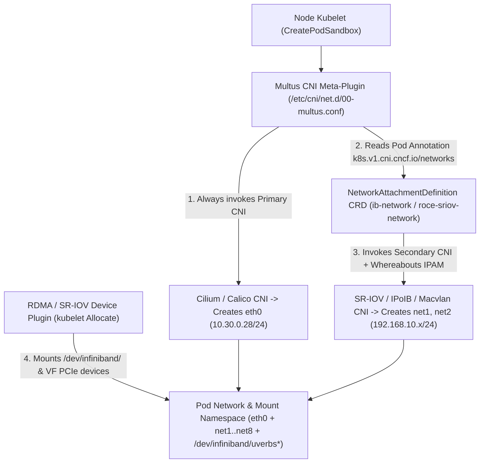

# 11.10 Secondary networks: Multus, SR-IOV device plugin and RDMA device plugin

| | |
|---|---|
| Level | Advanced |
| Priority tier | 1 |
| Lab venue | GCP / GKE (plus local Python 3 simulation lab) |
| Part | Part 11: GPUs on Kubernetes, scheduling and virtualization |
| Sources used | Josh Rosso et al., *Production Kubernetes* (O'Reilly, 2021, Ch. 5); Roland Huß et al., *Generative AI on Kubernetes* (O'Reilly, 2026, Ch. 7); `volume-03/03-k8s-networking-security-ops-masterclass.md`; `volume-06/02-gpudirect-fabric-operator-masterclass.md` |
| Coverage file | `planning/coverage/chapters/11-10.md` |

## Why this matters for AI infrastructure

Standard Kubernetes networking was built for stateless microservices: every Pod receives a single virtual Ethernet interface (`eth0`) and a single IP address allocated from a cluster-wide CIDR (such as `10.30.0.0/16`, providing `65,534` usable IPs split into `/24` per-node slices of `254` usable IPs for up to `110` default Pods per node). Packets leaving `eth0` traverse the Linux kernel's TCP/IP stack, `iptables` or eBPF rules, and often a VXLAN or Geneve overlay tunnel over a `10–25 Gbps` (or `100 Gbps`) management Ethernet NIC.

For distributed LLM training (`PyTorch FSDP`, `DeepSpeed`, `Megatron-LM`) and multi-node disaggregated inference, that single-interface overlay model breaks down completely:
1. **Traffic direction and bandwidth inversion:** Traditional microservices generate primarily **North-South** client-to-API traffic and modest East-West RPCs. An `8`-node (`64`-GPU) LLM training job inverts this pattern, generating hundreds of gigabits per second of synchronous **East-West** `AllReduce`, `AllGather`, and `ReduceScatter` traffic after every forward and backward pass. As *Generative AI on Kubernetes* (Chapter 7, Table 7-5) shows, once communication exceeds **`20%–25%` of total step time** (above the `< 15%` baseline where standard Ethernet suffices for `2–8` nodes), TCP/IP kernel context switches and host RAM buffer copies starve the GPUs. You need **`200–400 Gbps` InfiniBand** (sub-microsecond latency) or **`100–400 Gbps` RoCEv2** (low-microsecond latency) with **GPUDirect RDMA**—which bypasses host CPU RAM entirely to cut communication latency by **`40%–60%`**.
2. **Physical Rail Topology (`8` GPUs = `8` Dedicated NICs):** On an 8-GPU HGX A100, H100, or B200 node (`volume-06/02-gpudirect-fabric-operator-masterclass.md`, Section 3.3), the server does not rely on a single shared management NIC. Instead, it wires **`8` dedicated ConnectX NICs** (PCIe vendor ID **`15b3`**) across **`4` PCIe switches** (`GPU 0..1` + `NIC 0..1` on `PCIe Switch 0` / `NUMA 0`; `GPU 2..3` + `NIC 2..3` on `PCIe Switch 1` / `NUMA 0`; `GPU 4..5` + `NIC 4..5` on `PCIe Switch 2` / `NUMA 1`; `GPU 6..7` + `NIC 6..7` on `PCIe Switch 3` / `NUMA 1`) into **`8` independent network rails (`Rail 1..8`)**.
3. **Why a Pod needs *both* `eth0` and secondary RDMA interfaces (`net1..net8`):** A Kubernetes GPU Pod still needs `eth0` on the primary CNI (`Cilium` or `Calico`) for Kubernetes API access, CoreDNS resolution (`master-0`), Prometheus metric scraping, and S3/OCI control traffic. Simultaneously, it needs dedicated secondary network interfaces (`net1`, `net2`, ..., `net8`) and character device files (`/dev/infiniband/uverbs*`, `/dev/infiniband/rdma_cm`) attached directly to the high-speed InfiniBand or RoCEv2 NICs.

Providing both networks inside a single Pod requires orchestrating three components that work in concert:
- **Multus CNI:** A CNCF meta-plugin that keeps `eth0` on the primary CNI while reading `NetworkAttachmentDefinition` (`NAD`) custom resources (`k8s.cni.cncf.io/v1`) and **Whereabouts** cluster-wide IPAM to attach `net1..netN` (`IPoIB`, `Macvlan`, or `SR-IOV`).
- **The RDMA Shared Device Plugin (`rdma/hca` or `rdma/rdma_shared_device_a`):** Exposes Mellanox/NVIDIA ConnectX HCAs (`vendor: 15b3`) and mounts `/dev/infiniband/` into the container when multiple Pods share a physical NIC or Macvlan/IPoIB interface.
- **The SR-IOV Network Device Plugin (`nvidia.com/hostdev` or `sriovnetwork.openshift.io/rdma_vf`):** Partitions a single Physical Function (`PF`, e.g., `enp1s0f0`) into hardware-isolated PCIe Virtual Functions (`numVfs: 8`, `mtu: 9000`, `vlan: 100`, `isRdma: true`), reporting each VF's exact NUMA node to the `kubelet` Topology Manager for zero-copy, multi-tenant GPUDirect RDMA.

## Prerequisites and outcomes

### Prerequisites
- Completion of Chapter 11.2 (Device Plugin framework), Chapter 11.4 (GPU Operator vs Network Operator boundaries), and Chapter 11.6 (`nvidia-smi topo -m` `PIX` vs `SYS` paths and `kubelet` Topology Manager).
- Basic familiarity with IPv4 subnetting (`/16`, `/24`, `/29`), VLANs, and Linux network interfaces (`ip addr`, `ip link`).

### Outcomes
After completing this chapter, you will be able to:
- Explain how Kubernetes CNI plugins (`ADD`, `DELETE`, `CHECK`, `VERSION` in `/opt/cni/bin/` and `/etc/cni/net.d/`), IPAM (`10.30.0.0/16` = `65,534` usable IPs, `/24` = `254` usable IPs, Calico `blockSize: 29` = `8` IPs), BGP native routing (`AS 64567`, `CrossSubnet`), and **Cilium eBPF** ($O(1)$ hash-table service lookup vs $O(N)$ `kube-proxy` `iptables`) operate on the primary network (`eth0`).
- Contrast the five steps of a traditional CPU bounce-buffer network transfer against zero-copy **GPUDirect RDMA** (`nvidia-peermem`, PCIe BAR1 P2P DMA, `40%–60%` latency reduction) and map an `8`-GPU HGX **Rail architecture** (`GPU 0..7 <-> PCIe Switch 0..3 <-> NIC 0..7 <-> Rail 1..8`).
- Configure **Multus CNI** `NetworkAttachmentDefinition` CRDs and **Whereabouts** IPAM (`10.0.0.0/24` or `192.168.10.0/24` excluding `.1/32` and `.254/32` = `252` usable IPs) across **IPoIB** (`master: ib0`, `MTU 4096`), **Macvlan** (`master: eth1`, `mode: bridge`), and **SR-IOV** (`type: sriov` / `ib-sriov`, `vlan: 100`, `mtu: 9000`).
- Choose between the **RDMA Shared Device Plugin** (`rdma/hca: 2` or `rdma/rdma_shared_device_a: 1`) and the **SR-IOV Network Device Plugin** (`SriovNetworkNodePolicy` with `vendor: "15b3"`, `numVfs: 8`, `isRdma: true`, `nvidia.com/hostdev: 2` or `rdma_vf: 1`).
- Configure a `PyTorchJob` or training Pod with `IPC_LOCK`, `NCCL_IB_HCA="mlx5_0,mlx5_1"`, `NCCL_IB_GID_INDEX="3"`, `NCCL_IB_TC="106"`, `NCCL_IB_QPS_PER_CONNECTION="4"`, `NCCL_NET_GDR_LEVEL="5"`, and `NCCL_SOCKET_IFNAME="net1"`, and diagnose TCP fallbacks (`NET/Socket : Using [0]eth0`), missing IOMMU (`intel_iommu=on iommu=pt`), and PCIe ACS P2P blocks (`lspci -vvv | grep -i acs`).

## Concepts: basics to intermediate to advanced

### 1. Basics: Primary Pod networking (CNI, IPAM, Calico BGP, Cilium eBPF) and the GPUDirect RDMA data path

#### How Kubernetes primary CNI and IPAM work (`eth0`)
As detailed in *Production Kubernetes* (Chapter 5, "Pod Networking"), Kubernetes enforces an **IP-per-Pod** model: every Pod gets its own unique IP address so containers inside a Pod share `localhost` and never collide on host ports.

When you bootstrap a cluster (for example, `kubeadm init --pod-network-cidr 10.30.0.0/16`), `kube-controller-manager` carves that `/16` block (`65,536` total addresses, **`65,534` usable Pod IPs**) into per-node `/24` subnets (`--node-cidr-mask-size-ipv4=24`, giving **`254` usable IPs** from `10.30.0.0` to `10.30.0.255` on `master-0` to cover the default `110` max Pods per node, and supporting dual-stack IPv6 such as `2002:1:1::/96`).

To wire up `eth0` when a Pod starts, `kubelet` reads the lexicographically first configuration file in `/etc/cni/net.d/` (such as `05-cilium.conf`, `cniVersion: "0.3.1"` or `"0.4.0"`) and invokes the corresponding CNI binary in `/opt/cni/bin/` (`loopback` and `cilium-cni` or `calico`), which implements the four standard CNI specification verbs:
- **`ADD`:** Creates the network interface (`eth0`) inside the container's network namespace, invokes the IPAM driver (`host-local`, `calico-ipam`, or `cilium`), and returns the assigned IP and routes.
- **`DELETE`:** Tears down the interface and releases the IP when the Pod terminates.
- **`CHECK`:** Verifies the container's network configuration is intact.
- **`VERSION`:** Reports supported CNI specification versions.

If `/etc/cni/net.d/` is uninitialized when a node boots, `kubelet` logs `Container runtime network not ready: NetworkReady=false reason:NetworkPluginNotReady message:docker: network plugin is not ready: cni config uninitialized` (`Unable to update cni config: no networks found in /etc/cni/net.d`), leaving the node `NotReady` and `coredns` Pods stuck in `0/1 Pending` while host-networked Pods (`kube-apiserver`, `etcd`) start normally.

#### Primary CNI architectures: Calico (BGP / IP-in-IP / VXLAN), Cilium (eBPF), and AWS VPC CNI
Different primary CNIs trade off encapsulation overhead, IP address conservation, and dataplane scalability (*Production Kubernetes* Chapter 5 and `volume-03/03-k8s-networking-security-ops-masterclass.md` Section 2):

| Primary CNI | IPAM & Routing Mechanism | Service & Policy Dataplane | Strengths & Trade-Offs for AI Clusters |
|---|---|---|---|
| **Calico (`calico-node`)** | Uses `IPPool` CRDs (`cidr: 10.30.0.0/16`, `blockSize: 29` = `8` IPs/block). Runs **BIRD** daemon for **BGP** route distribution (can peer with Top-of-Rack switches via `BGPPeer` `peerIP: 192.23.11.100`, `asNumber: 64567`) and **Felix** to program kernel routes. Supports **Native** (unencapsulated), **IP-in-IP** (`ipipMode: Always` or **`CrossSubnet`**), and **VXLAN**, plus WireGuard encryption. | `iptables` or eBPF dataplane; supports `NetworkPolicy` and cluster-wide `GlobalNetworkPolicy`. | `ipipMode: CrossSubnet` gives native L2 speed within a rack/subnet and encapsulates only across L3 subnet boundaries. |
| **Cilium (`cilium-agent`)** | Manages per-node CIDRs via `CiliumNode` CRD (`cluster-pool-ipv4-mask-size: "24"`) or cloud ENIs; supports VXLAN/Geneve or native routing (`auto-direct-node-routes: true`). | **eBPF (`XDP` and `tc` kernel hooks)** with **`KubeProxyReplacement: strict`** and **Hubble** observability. | Replaces `kube-proxy`'s $O(N)$ linear `iptables` traversal (`PREROUTING -> KUBE-SERVICES -> KUBE-SVC-XYZ -> KUBE-SEP-ABC`) with **$O(1)$ eBPF hash-table lookups** (`cilium service list`) and enforces L3/L4/L7 + DNS/FQDN `CiliumNetworkPolicy` (`*.s3.amazonaws.com`, `nvcr.io`). |
| **AWS VPC CNI** | Attaches secondary Elastic Network Interfaces (`ENIs`) and VPC secondary private IPs directly to Pods. | Native AWS VPC routing without overlay encapsulation. | Zero overlay overhead, but consumes VPC subnet IPs rapidly and caps max Pods per node by instance ENI limits. |

#### Why even the fastest primary CNI (`eth0`) cannot replace GPUDirect RDMA
Replacing `kube-proxy` with Cilium eBPF eliminates $O(N)$ Service lookup latency for control-plane and inference HTTP traffic on `eth0`. However, standard TCP/IP over `eth0` still routes tensor payloads through the **Linux kernel TCP/IP stack and host CPU RAM**.

Compare the **five-hop traditional network path** against **GPUDirect RDMA** (`volume-06/02-gpudirect-fabric-operator-masterclass.md`, Section 2):
- **Traditional CPU Bounce-Buffer Path (5 Hops):**
  1. `GPU A` copies tensor over PCIe into a pinned bounce buffer in `Host A System RAM`.
  2. `CPU A` instructs `NIC A` to DMA the buffer from `Host A System RAM`.
  3. Packet transits the network switch fabric.
  4. `NIC B` DMAs the incoming packet into `Host B System RAM`.
  5. `CPU B` copies the buffer over PCIe from `Host B System RAM` into `GPU B HBM`.
- **GPUDirect RDMA Path (Zero CPU / Host RAM Copies):**
  1. The NVIDIA GPU driver exposes a slice of `GPU A`'s PCIe **BAR1 (Base Address Register)** memory and pins the GPU pages.
  2. The **`nvidia-peermem`** kernel module bridges the NVIDIA GPU driver and the Mellanox OFED (`mlx5_core` / `ib_core`) stack, handing the physical BAR1 addresses directly to the ConnectX NIC.
  3. `NIC A` performs a direct **PCIe Peer-to-Peer (`P2P`) DMA read** from `GPU A` HBM across the local PCIe switch (`PIX`), transmits RDMA frames over InfiniBand or lossless RoCEv2, and `NIC B` performs a direct **PCIe `P2P` DMA write** into `GPU B` HBM—**bypassing `CPU A`, `Host A RAM`, `CPU B`, and `Host B RAM` completely** and reducing latency by **`40%–60%`** (*Generative AI on Kubernetes* Table 7-5).

---

### 2. Intermediate: Multus CNI, Whereabouts IPAM, and the 8-NIC HGX Rail Architecture

#### How Multus CNI attaches multiple interfaces (`eth0` + `net1..net8`) to a Pod
Because Kubernetes natively binds only one CNI plugin per cluster, **Multus CNI** acts as a **meta-plugin** (*Production Kubernetes* Chapter 5, *Generative AI on Kubernetes* Chapter 7, and `volume-03/03` Section 2.3):



1. **Primary interface (`eth0`):** Multus always calls the cluster's default CNI (`Cilium` or `Calico`) first to create `eth0`. All Kubernetes Service IPs, CoreDNS queries, and `kubectl logs`/`exec` traffic stay on `eth0`.
2. **Secondary interfaces (`net1`, `net2`, ...):** Multus inspects the Pod's `metadata.annotations["k8s.v1.cni.cncf.io/networks"]` field. For each comma-separated **`NetworkAttachmentDefinition` (`NAD`, `k8s.cni.cncf.io/v1`)** listed, Multus invokes the specified secondary CNI plugin (`ipoib`, `macvlan`, `sriov`, or `ib-sriov`) and attaches `net1`, `net2`, and so on into the Pod's network namespace.
3. **Cluster-wide secondary IPAM with `Whereabouts`:** Standard `host-local` IPAM only tracks IPs on a single node, whereas running an external DHCP server on isolated RDMA VLANs adds operational fragility. **Whereabouts** (`"type": "whereabouts"`) is a Kubernetes-native IPAM CNI plugin that stores IP allocations in Kubernetes CRDs across the cluster, allocating unique IPs from a secondary range (for example, `10.0.0.0/24` excluding `10.0.0.1/32` in *Generative AI on Kubernetes* Example 7-10, or `192.168.10.0/24` excluding `192.168.10.1/32` and `192.168.10.254/32` = **`252` usable IPs** in `volume-03/03` Section 2.3).

#### The 8-GPU, 8-NIC Rail Architecture (`volume-06/02` Section 3.3)
Why does a production training Pod often attach `2` to `8` secondary interfaces (`net1..net8`)? Look at the internal PCIe and network switch layout of an 8-GPU DGX/HGX node (`volume-06/02-gpudirect-fabric-operator-masterclass.md`, Section 3.3):

| GPU Index | Local PCIe Switch | Paired ConnectX NIC | NUMA Node | Fabric Rail & Leaf Switch |
|---|---|---|---|---|
| `GPU 0` | `PCIe Switch 0` (`PIX`) | `NIC 0` (`mlx5_0`) | `NUMA 0` | `Rail 1` -> `Leaf Switch 0` |
| `GPU 1` | `PCIe Switch 0` (`PIX`) | `NIC 1` (`mlx5_1`) | `NUMA 0` | `Rail 2` -> `Leaf Switch 1` |
| `GPU 2` | `PCIe Switch 1` (`PIX`) | `NIC 2` (`mlx5_2`) | `NUMA 0` | `Rail 3` -> `Leaf Switch 2` |
| `GPU 3` | `PCIe Switch 1` (`PIX`) | `NIC 3` (`mlx5_3`) | `NUMA 0` | `Rail 4` -> `Leaf Switch 3` |
| `GPU 4` | `PCIe Switch 2` (`PIX`) | `NIC 4` (`mlx5_4`) | `NUMA 1` | `Rail 5` -> `Leaf Switch 4` |
| `GPU 5` | `PCIe Switch 2` (`PIX`) | `NIC 5` (`mlx5_5`) | `NUMA 1` | `Rail 6` -> `Leaf Switch 5` |
| `GPU 6` | `PCIe Switch 3` (`PIX`) | `NIC 6` (`mlx5_6`) | `NUMA 1` | `Rail 7` -> `Leaf Switch 6` |
| `GPU 7` | `PCIe Switch 3` (`PIX`) | `NIC 7` (`mlx5_7`) | `NUMA 1` | `Rail 8` -> `Leaf Switch 7` |

In this **Rail-optimized architecture**, every `NIC k` across all nodes connects to `Leaf Switch k` (`Rail k+1`). When `GPU 0` on Node A exchanges gradients with `GPU 0` on Node B, the DMA transfer goes `GPU 0 -> PCIe Switch 0 -> NIC 0 -> Leaf Switch 0 (Rail 1) -> Node B NIC 0 -> PCIe Switch 0 -> Node B GPU 0`, never crossing a CPU root complex (`PHB`) or inter-socket UPI link (`SYS`).

#### Ring vs Double Binary Tree `AllReduce` across Multi-Rail Secondary Networks (`volume-06/02` §4.2)
Once Multus and the RDMA/SR-IOV device plugins expose `net1..net8` and `/dev/infiniband/` into the container, **NCCL** (`NVIDIA Collective Communications Library`) inspects `/sys/class/pci_bus/`, NVML NVLink topology, and InfiniBand/RoCE sysfs distances to build communication graphs across two primary algorithms:
- **Ring `AllReduce`:** Organizes participating GPUs into a logical directed ring (`GPU 0 -> GPU 1 -> ... -> GPU N-1 -> GPU 0`). In the **Scatter-Reduce** phase, each GPU sends and reduces a chunk with its neighbor; in the **AllGather** phase, the finalized chunks circulate around the ring. Ring `AllReduce` is optimal for large, bandwidth-bound gradient payloads.
- **Tree `AllReduce` (Double Binary Tree):** Organizes GPUs into two complementary binary trees so a node that is a leaf in Tree 1 is an internal node in Tree 2. In the **Reduce** phase, partial sums flow up from leaves to root; in the **Broadcast** phase, the final sum flows down from root to leaves. Tree `AllReduce` scales logarithmically in network hops and outperforms Ring `AllReduce` for small-to-medium message sizes or massive multi-node clusters where ring latency would grow linearly with node count.

For ConnectX adapters running over InfiniBand or RoCEv2 (*Generative AI on Kubernetes* Chapter 7 Sidebar), combine multi-rail pod placement with **adaptive routing** (`--set_adaptive_routing` in the InfiniBand Subnet Manager) and dedicated VLANs or InfiniBand partitions (`P_Keys`) so storage and general cluster traffic never contend with synchronous NCCL collective rings and trees.

---

### 3. Advanced: RDMA Shared Device Plugin vs SR-IOV Network Device Plugin, PCIe ACS, and NCCL tuning

Attaching a secondary network interface (`net1`) via Multus gives a Pod an IP address on the high-speed subnet, **but a network interface alone does not expose kernel-bypass RDMA character devices (`/dev/infiniband/uverbs0`, `/dev/infiniband/rdma_cm`) into the container's `/dev` tree**. That hardware allocation is performed by one of two Kubernetes device plugins (deployed standalone or managed by the **NVIDIA Network Operator**, covered further in Chapter 11.11):

#### 1. RDMA Shared Device Plugin (`rdmaSharedDevicePlugin`) + `Macvlan` or `IPoIB`
- **How it works:** The **RDMA Shared Device Plugin** discovers Mellanox/NVIDIA ConnectX adapters (`vendors: ["15b3"]`) on the host and advertises a shared extended resource to `kubelet`—such as `rdma/hca` (*Generative AI on Kubernetes* Example 7-11, where a Pod requests `rdma/hca: 2`) or `rdma/rdma_shared_device_a` (`volume-06/02` Section 5.2, where a node advertises `rdma/rdma_shared_device_a: 8` and a Pod requests `rdma/rdma_shared_device_a: 1`).
- **Paired CNI (`IPoIB` or `Macvlan`):** Paired with an `ipoib` NAD (`master: ib0`, `MTU 4096` for InfiniBand) or a `macvlan` NAD (`master: eth1`, `mode: bridge` for RoCEv2). Multiple Pods on the same node can share the underlying Physical Function (`PF`) while receiving direct access to `/dev/infiniband/`.
- **Trade-off:** Simple to configure and ideal for single-tenant clusters or full-node jobs, but because Pods share the host's physical NIC function, `Macvlan` lacks hardware-enforced per-Pod bandwidth rate limiting, MAC-spoofing protection, and hardware VLAN isolation.

#### 2. SR-IOV Network Device Plugin (`sriovNetworkOperator`) + `sriov` / `ib-sriov` CNI
- **How it works:** **Single Root I/O Virtualization (`SR-IOV`)** partitions a single physical ConnectX NIC (**Physical Function, `PF`**, such as `enp1s0f0`) at the PCIe silicon level into multiple independent **Virtual Functions (`VFs`, e.g., `numVfs: 8`)**. Each VF has its own PCIe bus/device/function address and appears to the Linux kernel and `kubelet` as a dedicated hardware NIC.
- **Prerequisites in BIOS and GRUB (`intel_iommu=on iommu=pt`):** Creating SR-IOV VFs requires the CPU's Input-Output Memory Management Unit (**IOMMU**: Intel `VT-d` or AMD-Vi) enabled in BIOS and kernel boot parameters (`intel_iommu=on iommu=pt` in `/etc/default/grub`). Without IOMMU passthrough, `SriovNetworkNodePolicy` fails to instantiate VFs (`dmesg -T | grep -i sriov`).
- **Hardware-Enforced Multi-Tenancy and NUMA Alignment:** Using `SriovNetworkNodePolicy` (`resourceName: rdma_vf`, `vendor: "15b3"`, `pfNames: ["enp1s0f0"]`, `numVfs: 8`, `mtu: 9000`, `deviceType: netdevice`, `isRdma: true`, `priority: 99`) and `SriovNetwork` (`vlan: 100` for `tenant-a`, `whereabouts` `10.10.100.0/24`), each Pod requesting `sriovnetwork.openshift.io/rdma_vf: 1` (or `nvidia.com/hostdev: 2` in `volume-03/03`) receives **exclusive ownership of a hardware VF** with hardware-enforced VLAN `100` tagging, QoS, and NUMA topology hints reported directly to `kubelet` Topology Manager.

| Feature | RDMA Shared Device Plugin + `Macvlan` / `IPoIB` | SR-IOV Network Device Plugin + `sriov` / `ib-sriov` |
|---|---|---|
| **Hardware Isolation** | Shared Physical Function (`PF`) across Pods | Dedicated PCIe Virtual Function (`VF`) per Pod allocation |
| **Multi-Tenant Security (VLAN / Spoof Check / QoS)** | Software-level only | **Hardware-enforced** in ConnectX ASIC (`vlan: 100`, rate limits) |
| **Kubernetes Extended Resource** | `rdma/hca` or `rdma/rdma_shared_device_a` | `nvidia.com/hostdev` or `sriovnetwork.openshift.io/rdma_vf` |
| **BIOS / Kernel Prerequisite** | Standard driver + `nvidia-peermem` | Requires **IOMMU enabled** (`intel_iommu=on iommu=pt`) + SR-IOV in BIOS |
| **Kubelet Topology Manager NUMA Hints** | Node/PF level | Exact per-VF PCIe / NUMA node hints for `single-numa-node` alignment |

#### Crucial Hardware Trap: Disabling PCIe Access Control Services (`ACS`)
Even when SR-IOV, Multus, and `nvidia-peermem` are configured properly, a BIOS security feature called **PCIe Access Control Services (`ACS`)** can silently destroy GPUDirect RDMA bandwidth (`volume-06/02-gpudirect-fabric-operator-masterclass.md`, Section 3.1 and Scenario C):
- When PCIe `ACS` is enabled on the motherboard's PCIe switches, the switch is forbidden from routing Peer-to-Peer (`P2P`) packets directly between `GPU 0` and `NIC 0` (`PIX`). Instead, `ACS` forces every P2P packet up to the CPU Root Complex / IOMMU for translation, turning a fast `PIX` path into a slow `PHB` or `SYS` path.
- Always check `lspci -vvv | grep -i acs` and `nvidia-smi topo -m` on new node hardware, and disable PCIe `ACS` (P2P Isolation) in the server BIOS for bare-metal AI clusters.

## Commands and configurations that matter

### 1. Defining `NetworkAttachmentDefinition`s for InfiniBand (`IPoIB`) and RoCE (`SR-IOV`)

From *Generative AI on Kubernetes* (Example 7-10), here is the `NetworkAttachmentDefinition` for IP over InfiniBand (`ib0`) using `whereabouts` IPAM (`10.0.0.0/24` excluding `10.0.0.1/32`):

```yaml
# nad-ipoib-infiniband.yaml (GAK Example 7-10, untested here)
apiVersion: k8s.cni.cncf.io/v1
kind: NetworkAttachmentDefinition
metadata:
  name: ib-network
spec:
  config: '{
    "cniVersion": "0.3.1",
    "type": "ipoib",
    "master": "ib0",
    "ipam": {
      "type": "whereabouts",
      "range": "10.0.0.0/24",
      "exclude": [ "10.0.0.1/32" ]
    }
  }'
```

From `volume-03/03-k8s-networking-security-ops-masterclass.md` (Section 2.3) and `volume-06/02-gpudirect-fabric-operator-masterclass.md` (Section 6.2), here are the `SriovNetworkNodePolicy` (`vendor: "15b3"`, `mtu: 9000`, `numVfs: 8`, `isRdma: true`) and the SR-IOV `NetworkAttachmentDefinition` (`vlan: 100`, `192.168.10.0/24` excluding `.1/32` and `.254/32`):

```yaml
# sriov-policy-and-nad.yaml (untested here)
apiVersion: sriovnetwork.openshift.io/v1
kind: SriovNetworkNodePolicy
metadata:
  name: mlx5-rdma-policy
  namespace: sriov-network-operator
spec:
  resourceName: rdma_vf
  nodeSelector:
    feature.node.kubernetes.io/network-sriov.capable: "true"
  priority: 99
  mtu: 9000
  numVfs: 8
  nicSelector:
    vendor: "15b3"
    pfNames: ["enp1s0f0"]
  deviceType: netdevice
  isRdma: true
---
apiVersion: "k8s.cni.cncf.io/v1"
kind: NetworkAttachmentDefinition
metadata:
  name: roce-sriov-network
  namespace: default
  annotations:
    k8s.v1.cni.cncf.io/resourceName: nvidia.com/hostdev
spec:
  config: '{
    "cniVersion": "0.3.1",
    "type": "sriov",
    "vlan": 100,
    "ipam": {
      "type": "whereabouts",
      "range": "192.168.10.0/24",
      "exclude": [
        "192.168.10.1/32",
        "192.168.10.254/32"
      ]
    }
  }'
```

### 2. Configuring a `PyTorchJob` with Multus, RDMA HCAs, `IPC_LOCK`, and deterministic `NCCL_*` variables (`GAK` Example 7-11 & `volume-06/02` §4.3)

```yaml
# pytorchjob-multus-rdma.yaml (GAK Example 7-11 + volume-06/02, untested here)
apiVersion: kubeflow.org/v1
kind: PyTorchJob
metadata:
  name: llm-training-ib
spec:
  pytorchReplicaSpecs:
    Master:
      replicas: 1
      template:
        metadata:
          annotations:
            k8s.v1.cni.cncf.io/networks: ib-network
        spec:
          containers:
            - name: pytorch
              image: nvcr.io/nvidia/pytorch:24.08-py3
              env:
                - name: NCCL_DEBUG
                  value: "INFO"
                - name: NCCL_DEBUG_SUBSYS
                  value: "INIT,GRAPH,ENV"
                - name: NCCL_IB_HCA
                  value: "mlx5_0,mlx5_1"
                - name: NCCL_IB_GID_INDEX
                  value: "3"
                - name: NCCL_IB_TC
                  value: "106"
                - name: NCCL_IB_QPS_PER_CONNECTION
                  value: "4"
                - name: NCCL_NET_GDR_LEVEL
                  value: "5"
                - name: NCCL_SOCKET_IFNAME
                  value: "net1"
              resources:
                requests:
                  nvidia.com/gpu: 8
                  rdma/hca: 2
                limits:
                  nvidia.com/gpu: 8
                  rdma/hca: 2
              securityContext:
                capabilities:
                  add: ["IPC_LOCK"]
```

### 3. Three-step verification of secondary RDMA interfaces inside a running Pod (`GAK` Example 7-12)

Never assume a secondary RDMA network is active just because the Pod is `Running`. Run these three checks inside the master/worker container:

```bash
# 1. Confirm Multus created the secondary interface (net1) with a Whereabouts IP (untested here)
kubectl exec -n team-alpha llm-training-ib-master-0 -- ip addr show net1

# 2. Confirm the RDMA / SR-IOV device plugin mounted /dev/infiniband/ character devices (untested here)
kubectl exec -n team-alpha llm-training-ib-master-0 -- ls /dev/infiniband/

# 3. Confirm NCCL selected InfiniBand/RoCE with GPUDirect RDMA ("Using network IB" & "NET/IB/GDRDMA") (untested here)
kubectl logs -n team-alpha llm-training-ib-master-0 | grep "NCCL INFO"
```

## How it fails

| Failure mode | Exact symptom & command evidence | Root cause boundary | Remediation |
|---|---|---|---|
| **1. NCCL silently falls back to `eth0` TCP sockets (`NET/Socket : Using [0]eth0:10.0.0.5<0>`)** | Multi-node training runs `3–5x` slower than baseline. `kubectl logs ... \| grep "NCCL INFO"` prints `NCCL INFO NET/Socket : Using [0]eth0:10.0.0.5<0>` instead of `Using network IB` / `NET/IB/GDRDMA`. | **Missing `/dev/infiniband/`, Missing `nvidia-peermem`, or RoCE GID/QoS Mismatch (`volume-06/02` Scenario A):** Either the Pod omitted `rdma/hca` (`rdma/rdma_shared_device_a`), `nvidia-peermem` is unloaded on the host (`lsmod \| grep nvidia_peermem`), or `NCCL_IB_GID_INDEX` (`3`) / `NCCL_IB_TC` (`106`) mismatched the switch's RoCEv2 lossless queue (`show_gids`). | Verify `ls /dev/infiniband/` inside the Pod, confirm `lsmod \| grep nvidia_peermem` on the host, and set `NCCL_SOCKET_IFNAME=net1`, `NCCL_IB_HCA=mlx5_0,mlx5_1`, `NCCL_IB_GID_INDEX=3`, and `NCCL_IB_TC=106`. |
| **2. `SriovNetworkNodePolicy` applied, but `0` Virtual Functions (`VFs`) appear in `ip link`** | Pods requesting `nvidia.com/hostdev` or `rdma_vf` stay `Pending` (`Insufficient ...`). On the host, `ip link` shows no VFs under `enp1s0f0`, and `dmesg -T \| grep -i sriov` logs IOMMU errors. | **Host BIOS / GRUB IOMMU Disabled (`volume-06/02` Scenario B):** Intel `VT-d` or AMD-Vi IOMMU passthrough is disabled in BIOS or kernel command line. | Enable SR-IOV and IOMMU in BIOS, add `intel_iommu=on iommu=pt` (or AMD equivalent) to `/etc/default/grub`, update GRUB, and reboot the node. |
| **3. RDMA memory registration fails inside container (`ibv_reg_mr failed: Cannot allocate memory`)** | `ip addr show net1` and `ls /dev/infiniband/` succeed, but `nccl-tests` or PyTorch crashes during RDMA queue-pair initialization with `Cannot allocate memory` (`ENOMEM`). | **Missing `IPC_LOCK` Capability / `memlock` Limit (`GAK` Example 7-11 & `volume-03/03`):** RDMA requires locking (pinning) memory buffers so the kernel cannot swap them; standard non-root containers cap `RLIMIT_MEMLOCK` unless granted `CAP_IPC_LOCK`. | Add `securityContext.capabilities.add: ["IPC_LOCK"]` to the container spec and ensure `ulimit -l` is `unlimited`. |
| **4. GPUDirect RDMA bandwidth is half of baseline despite `NET/IB` active (`PCIe ACS` enabled)** | `nccl-tests` runs over `mlx5_0`, but bandwidth plateaus well below line rate. `lspci -vvv \| grep -i acs` shows `ACSCtl: SrcValid+` enabled on PCIe switch ports. | **PCIe Access Control Services (`ACS`) Blocking P2P (`volume-06/02` Scenario C):** `ACS` forces GPU-to-NIC P2P packets up to the CPU Root Complex/IOMMU instead of switching directly across `PIX`. | Disable PCIe `ACS` ("P2P Isolation") in the server BIOS (or inject a validated `NCCL_TOPO_FILE` when running inside virtualized topologies). |
| **5. Newly bootstrapped node stays `NotReady` and `coredns` stays `0/1 Pending`** | `kubectl get pods -n kube-system` shows `coredns` `0/1 Pending` while `kube-apiserver` and `etcd` are `1/1 Running`. `journalctl -u kubelet` logs `cni config uninitialized` and `no networks found in /etc/cni/net.d`. | **Primary CNI Uninitialized (`Production Kubernetes` Ch. 5):** Neither Cilium/Calico nor Multus has written its CNI configuration into `/etc/cni/net.d/` or binaries into `/opt/cni/bin/` yet. | Deploy or repair the primary CNI DaemonSet (`cilium` / `calico-node`) and verify `/etc/cni/net.d/` and `/opt/cni/bin/` are populated before troubleshooting secondary Multus NADs. |

## Hands-on lab

### Venue and scope
This lab runs locally using Python 3 standard library (`code/part11/secondary_networks_multus_sriov_rdma.py` and `code/part11/secondary_networks_multus_sriov_rdma_lab.py`) to simulate Kubernetes Pod CIDR and Whereabouts IPAM math (`65,534`, `254`, `8`, `252` IPs), Multus primary (`eth0`) + secondary (`net1`, `net2`) interface resolution, the `8`-GPU HGX Rail topology mapper (`GPU 0..7 <-> PCIe Switch 0..3 <-> NIC 0..7 <-> Rail 1..8`), and the 7-layer secondary RDMA diagnostic engine. Cluster commands are marked `(untested here)`.

### Step 1: Run the self-checking Multus, SR-IOV, and RDMA device plugins lab (tested here)

Run the lab script from the repository root:

```bash
python3 code/part11/secondary_networks_multus_sriov_rdma_lab.py
```

Captured output from this repository:
```text
=== Chapter 11.10 Lab: Secondary Networks, Multus, SR-IOV & RDMA Device Plugins ===
  [PASS] 10.30.0.0/16 cluster CIDR provides 65,536 total IPs and 65,534 usable Pod IPs
  [PASS] /24 node podCIDR (10.30.0.0 - 10.30.0.255) provides 254 usable Pod IPs (default maxPods=110)
  [PASS] /16 cluster CIDR splits into 256 /24 node CIDRs; Calico blockSize: 29 allocates 8-IP blocks
  [PASS] whereabouts 192.168.10.0/24 excluding .1/32 and .254/32 provides 252 usable secondary IPs
  [PASS] Single Multus NAD (ib-network) attaches net1 alongside primary eth0 (cilium)
  [PASS] Dual Multus annotation (roce-sriov-network, roce-sriov-network) creates eth0, net1, and net2
  [PASS] 8-GPU HGX Rail architecture maps 8 dedicated NICs across 8 independent Rails (Rail 1..8)
  [PASS] GPU 0 and NIC 0 share PCIe Switch 0 on NUMA 0 and connect to Rail 1 (Leaf Switch 0)
  [PASS] GPU 4 and NIC 4 share PCIe Switch 2 on NUMA 1 and connect to Rail 5 (Leaf Switch 4)
  [PASS] Diagnostic routes missing intel_iommu=on iommu=pt to sriov_iommu_bios_grub
  [PASS] Diagnostic routes missing net1 interface to multus_cni_attachment
  [PASS] Diagnostic routes missing /dev/infiniband/ inside pod to rdma_or_sriov_device_plugin
  [PASS] Diagnostic routes missing IPC_LOCK capability to container_security_context_ipc_lock
  [PASS] Diagnostic routes unloaded nvidia-peermem module to gpudirect_peermem_module
  [PASS] Diagnostic routes enabled PCIe ACS (SYS instead of PIX) to pcie_acs_p2p_isolation
  [PASS] Diagnostic routes 'NET/Socket : Using [0]eth0' fallback to nccl_interface_or_roce_qos_gid
  [PASS] Diagnostic confirms healthy_gpudirect_rdma when NET/IB and GDRDMA are active
  [PASS] PCIe vendor ID 15b3 identifies Mellanox/NVIDIA ConnectX NICs (vs 10de for NVIDIA GPUs)
  [PASS] RoCE SR-IOV SriovNetworkNodePolicy sets jumbo MTU 9000 (vs MTU 4096 typical for InfiniBand)
  [PASS] RoCEv2 NCCL tuning uses NCCL_IB_TC=106, NCCL_IB_GID_INDEX=3, NCCL_IB_QPS_PER_CONNECTION=4, NCCL_NET_GDR_LEVEL=5
  [PASS] SriovNetworkNodePolicy sets priority: 99, numVfs: 8, and SriovNetwork sets vlan: 100
  [PASS] Calico BGPPeer example uses AS number 64567 and peerIP 192.23.11.100
  [PASS] NCCL topology.xml speed='400000' corresponds to 400 Gbps (400,000 Mbps) ConnectX-7 link
  [PASS] Rails 1..4 (GPUs 0..3, NICs 0..3) map to NUMA 0 and Rails 5..8 (GPUs 4..7, NICs 4..7) map to NUMA 1
  [PASS] 8 GPU-NIC pairs are distributed across 4 PCIe Switches (2 GPUs + 2 NICs per switch)

Summary: 25 passed, 0 failed out of 25 checks.
```

### Exercises

1. **Exercise 1 — Primary and Whereabouts IPAM calculations:** Using `compute_cidr_ipam_capacity(16, 24, 29, 2)` in `code/part11/secondary_networks_multus_sriov_rdma.py`, compute: (a) usable Pod IPs in `10.30.0.0/16`, (b) usable Pod IPs per `/24` node CIDR, (c) IPs per Calico `blockSize: 29` allocation block, and (d) usable secondary IPs in a `whereabouts` `192.168.10.0/24` subnet that excludes `.1/32` and `.254/32`.
2. **Exercise 2 — Multi-homed Pod interface mapping:** Using `resolve_multus_interfaces("cilium", "roce-sriov-network, roce-sriov-network")`, list the ordered `(ifname, network, role)` entries created inside the Pod and state how many `nvidia.com/hostdev` units the Pod must request in `resources.limits`.
3. **Exercise 3 — 8-GPU HGX Rail topology mapping:** Using `map_eight_gpu_rail_topology()`, state the `(pcie_switch, nic, rail, leaf_switch, numa_node)` mapping for `GPU 2` and `GPU 6`.
4. **Exercise 4 — Diagnosing TCP fallback vs missing RDMA device nodes:** Using `diagnose_secondary_rdma_network()`, compare the `failing_layer` and `remediation` when: (a) `net1_present=True` and `dev_infiniband_present=False`, versus (b) all hardware/device checks are `True` but `nccl_log_line` prints `NCCL INFO NET/Socket : Using [0]eth0:10.0.0.5<0>`.
5. **Exercise 5 — Macvlan + RDMA Shared Device Plugin vs SR-IOV Device Plugin:** Explain why a multi-tenant AI cluster serving untrusted teams should use `SriovNetworkNodePolicy` (`numVfs: 8`, `vlan: 100`, `isRdma: true`) instead of `macvlan` + `rdma/rdma_shared_device_a`.
6. **Exercise 6 — Verifying GPUDirect RDMA in logs:** Write the three `kubectl` commands from *Generative AI on Kubernetes* Example 7-12 used to verify that `llm-training-ib-master-0` has `net1`, `/dev/infiniband/`, and active GPUDirect RDMA over InfiniBand.

## Checkpoint questions

<details>
<summary><strong>1. In Production Kubernetes Chapter 5, how many usable IPs exist in the 10.30.0.0/16 cluster CIDR and in each node's /24 podCIDR, and what is the default kubelet maxPods limit per node?</strong></summary>

A `/16` CIDR (`10.30.0.0/16`) contains `65,536` total addresses (`65,534` usable IPs), which splits into `256` `/24` node subnets. Each `/24` `podCIDR` (`10.30.0.0 - 10.30.0.255`) provides **`254` usable Pod IPs**, comfortably above the default `kubelet` limit of **`110` Pods per node**.
</details>

<details>
<summary><strong>2. What are the four standard operations defined by the CNCF Container Networking Interface (CNI) specification?</strong></summary>

1. **`ADD`:** Attaches a network interface to a container's network namespace and assigns IP(s)/routes.
2. **`DELETE`:** Removes the container's network interface and releases IPAM resources on termination.
3. **`CHECK`:** Verifies that the container's networking remains healthy.
4. **`VERSION`:** Reports the CNI specification versions (`0.3.1`, `0.4.0`, etc.) supported by the binary.
</details>

<details>
<summary><strong>3. Why did kube-apiserver and etcd start normally on a freshly kubeadm-initialized node while coredns stayed 0/1 Pending with cni config uninitialized?</strong></summary>

Static control-plane Pods (`kube-apiserver`, `etcd`, `kube-controller-manager`, `kube-scheduler`) use `hostNetwork: true` and share the node's root network namespace, so they do not invoke CNI. `coredns` uses standard Pod networking and cannot start until a CNI plugin writes its configuration into `/etc/cni/net.d/` and binaries into `/opt/cni/bin/`.
</details>

<details>
<summary><strong>4. How does Cilium with KubeProxyReplacement: strict improve Kubernetes Service routing compared to kube-proxy in iptables mode?</strong></summary>

`kube-proxy` in `iptables` mode evaluates chains (`PREROUTING -> KUBE-SERVICES -> KUBE-SVC-XYZ -> KUBE-SEP-ABC`) sequentially in **$O(N)$** time, which degrades as Service counts grow into the thousands. Cilium attaches **eBPF** programs at kernel `XDP` and `tc` hooks to perform Service translation via **$O(1)$ hash-table map lookups** (`cilium service list`).
</details>

<details>
<summary><strong>5. What is Calico's ipipMode: CrossSubnet setting in an IPPool custom resource?</strong></summary>

`ipipMode: CrossSubnet` tells Calico (`BIRD` + `Felix`) to route Pod packets **natively without encapsulation** whenever the source and destination nodes sit on the same L2 subnet, and to apply **IP-in-IP encapsulation only** when packets must cross an L3 subnet router boundary.
</details>

<details>
<summary><strong>6. Contrast North-South versus East-West network traffic in microservices versus distributed LLM training, and state the communication overhead threshold where standard Ethernet is no longer sufficient.</strong></summary>

Microservices are dominated by **North-South** external client traffic and light East-West RPCs. Distributed LLM training generates massive synchronous **East-West** gradient/activation exchanges (`AllReduce`, `AllGather`, `ReduceScatter`). Standard TCP/IP Ethernet (`10–100 Gbps`) suffices for `2–8` data-parallel nodes when communication is **`< 15%`** of step time; once communication exceeds **`20%–25%`** of step time, RDMA over InfiniBand (`200–400 Gbps`) or RoCEv2 (`100–400 Gbps`) is required.
</details>

<details>
<summary><strong>7. Walk through the five data-movement hops of a traditional non-RDMA GPU-to-GPU network transfer versus GPUDirect RDMA.</strong></summary>

- **Traditional path (5 hops):** (1) `GPU A` copies over PCIe to a host RAM bounce buffer on Node A; (2) `CPU A` directs `NIC A` to DMA from host RAM; (3) network transit; (4) `NIC B` DMAs into host RAM on Node B; (5) `CPU B` copies over PCIe into `GPU B` HBM.
- **GPUDirect RDMA:** The GPU driver pins PCIe BAR1 memory and `nvidia-peermem` passes those physical addresses to `mlx5_core`. `NIC A` performs a direct PCIe Peer-to-Peer (`P2P`) DMA read from `GPU A` HBM, sends RDMA packets over IB/RoCEv2, and `NIC B` performs a direct PCIe `P2P` DMA write into `GPU B` HBM—bypassing both CPUs and both host RAMs and cutting latency by **`40%–60%`**.
</details>

<details>
<summary><strong>8. What is the role of the nvidia-peermem kernel module, and how do you check if it is loaded on a worker node?</strong></summary>

`nvidia-peermem` is the Linux kernel bridge module that allows the Mellanox OFED (`ib_core` / `mlx5_core`) RDMA subsystem to register and DMA directly into pinned NVIDIA GPU BAR1 memory for GPUDirect RDMA. Verify it with `lsmod | grep nvidia_peermem` (and load it with `modprobe nvidia-peermem` or via the Network/GPU Operator).
</details>

<details>
<summary><strong>9. Explain the 8-GPU, 8-NIC Rail architecture in an HGX H100 server.</strong></summary>

Each of the `8` GPUs (`GPU 0..7`) is paired `1:1` with a dedicated ConnectX NIC (`NIC 0..7`) behind `4` local PCIe switches (`2` GPUs + `2` NICs per PCIe switch; `GPUs 0..3` on `NUMA 0`, `GPUs 4..7` on `NUMA 1`). Across the cluster, all `NIC 0` ports connect to `Leaf Switch 0` (`Rail 1`), all `NIC 1` ports connect to `Leaf Switch 1` (`Rail 2`), up to `Rail 8`—ensuring every GPU communicates over a non-blocking local `PIX` path without ever crossing a NUMA boundary (`SYS`).
</details>

<details>
<summary><strong>10. Why do distributed training Pods use Multus CNI to attach net1 alongside eth0 rather than replacing eth0 entirely?</strong></summary>

`eth0` remains on the primary cluster CNI (`Cilium` / `Calico`) to handle Kubernetes API communication, CoreDNS service discovery, Prometheus telemetry scraping, and object-storage access, while `net1` (and `net2..net8`) attaches directly to the isolated, non-routable high-speed InfiniBand or RoCEv2 fabric (`ib-network` or `roce-sriov-network`) dedicated to NCCL collectives.
</details>

<details>
<summary><strong>11. What problem does the Whereabouts IPAM plugin solve in a Multus NetworkAttachmentDefinition?</strong></summary>

Standard `host-local` IPAM only tracks IP addresses on a single node (causing IP collisions across nodes on a shared L2 VLAN/InfiniBand subnet), while running an external DHCP server on isolated RDMA subnets adds infrastructure dependencies. **Whereabouts** coordinates cluster-wide IP allocation across all nodes using Kubernetes CRDs (e.g., `192.168.10.0/24` excluding `.1/32` and `.254/32` = `252` usable IPs).
</details>

<details>
<summary><strong>12. What is the difference between the RDMA Shared Device Plugin and the SR-IOV Network Device Plugin?</strong></summary>

- **RDMA Shared Device Plugin (`rdma/hca` or `rdma/rdma_shared_device_a`):** Allows multiple Pods to share a single physical ConnectX HCA (`vendor: 15b3`) and mounts `/dev/infiniband/` into the container (typically paired with `macvlan` or `ipoib`).
- **SR-IOV Network Device Plugin (`nvidia.com/hostdev` or `sriovnetwork.openshift.io/rdma_vf`):** Partitions a physical NIC (`PF`) into hardware-isolated PCIe Virtual Functions (`numVfs: 8`), giving each Pod exclusive hardware VF ownership, hardware VLAN/QoS isolation, and per-VF NUMA hints for `kubelet` Topology Manager.
</details>

<details>
<summary><strong>13. In Volume 03 Section 2.3, a Pod has annotation k8s.v1.cni.cncf.io/networks: roce-sriov-network, roce-sriov-network and requests nvidia.com/hostdev: 2. What interfaces are created inside the Pod?</strong></summary>

Because `roce-sriov-network` is listed **twice** in the comma-separated annotation and `nvidia.com/hostdev: 2` allocates `2` SR-IOV Virtual Functions, Multus creates **`eth0`** (primary CNI) plus **`net1`** and **`net2`** (two separate SR-IOV RDMA interfaces inside the Pod).
</details>

<details>
<summary><strong>14. Why must containers performing RDMA add the IPC_LOCK capability in securityContext.capabilities.add?</strong></summary>

RDMA network adapters require registering **pinned (page-locked) memory buffers** so the OS kernel never swaps or moves pages during direct DMA transfers. Adding `IPC_LOCK` (`CAP_IPC_LOCK`) permits the container process to lock memory pages beyond default unprivileged `memlock` limits.
</details>

<details>
<summary><strong>15. What happens if SriovNetworkNodePolicy is applied on a host where intel_iommu=on iommu=pt is missing from GRUB or VT-d / AMD-Vi is disabled in BIOS?</strong></summary>

The Linux kernel refuses to instantiate the SR-IOV Virtual Functions (`0` VFs appear in `ip link`, and `dmesg -T | grep -i sriov` logs IOMMU errors), leaving the SR-IOV device plugin advertising `0` allocatable VFs.
</details>

<details>
<summary><strong>16. How does PCIe Access Control Services (ACS) degrade GPUDirect RDMA performance, and how do you detect and fix it?</strong></summary>

When PCIe `ACS` is enabled on PCIe switches, it blocks direct Peer-to-Peer (`P2P`) switching between a GPU and NIC (`PIX`) and forces every packet up to the CPU Root Complex/IOMMU (`PHB`/`SYS`). You detect it via `lspci -vvv | grep -i acs` (`ACSCtl: SrcValid+`) and low `nccl-tests` bandwidth, and fix it by disabling `ACS` ("P2P Isolation") in the server BIOS.
</details>

<details>
<summary><strong>17. What do NCCL_IB_TC=106, NCCL_IB_GID_INDEX=3, and NCCL_IB_QPS_PER_CONNECTION=4 configure on a RoCEv2 network?</strong></summary>

- `NCCL_IB_TC=106`: Sets the IP DSCP / Traffic Class byte on RoCEv2 packets so network switches map RDMA traffic into the lossless Priority Flow Control (`PFC`) / ECN queue.
- `NCCL_IB_GID_INDEX=3`: Selects Global Identifier index `3` (verify with `show_gids`), which corresponds to the RoCEv2 UDP/IPv4 GID table entry.
- `NCCL_IB_QPS_PER_CONNECTION=4`: Stripes each NCCL peer connection across `4` RDMA Queue Pairs (`QPs`) to improve ECMP hashing and multi-rail bandwidth utilization.
</details>

<details>
<summary><strong>18. When is NCCL_TOPO_FILE=/path/to/topology.xml needed, and how should you generate the starting XML file?</strong></summary>

In virtualized or SR-IOV VM environments where the hypervisor presents a flattened synthetic PCIe bus, NCCL's sysfs auto-discovery may fail to see that a virtual GPU and virtual NIC share the same physical PCIe switch (`gdr="1"`). Generate a valid baseline XML from a working node by running a job with `NCCL_TOPO_DUMP_FILE=/tmp/topo.xml` and inject it into Pods via a `ConfigMap` using `NCCL_TOPO_FILE`.
</details>

<details>
<summary><strong>19. What are the three verification commands in Generative AI on Kubernetes Example 7-12 to prove a Pod's secondary RDMA network is working end-to-end?</strong></summary>

1. `kubectl exec -n <ns> <pod> -- ip addr show net1` (proves Multus created `net1` and Whereabouts assigned an IP).
2. `kubectl exec -n <ns> <pod> -- ls /dev/infiniband/` (proves the RDMA/SR-IOV device plugin mounted the InfiniBand/RoCE character devices).
3. `kubectl logs -n <ns> <pod> | grep "NCCL INFO"` (proves NCCL logged `Using network IB` and `NET/IB/GDRDMA` rather than falling back to `NET/Socket : Using [0]eth0`).
</details>

<details>
<summary><strong>20. Compare MTU settings across standard Ethernet, InfiniBand IPoIB (GAK Chapter 7), and RoCEv2 SR-IOV (Volume 06 Section 6.2).</strong></summary>

Standard Ethernet defaults to `MTU 1500` (even smaller inside VXLAN overlays). InfiniBand IPoIB typically configures **`MTU 4,096`** (`4096`), while high-performance RoCEv2 SR-IOV policies (`SriovNetworkNodePolicy`) configure jumbo frames at **`MTU 9,000`** (`mtu: 9000`) to minimize packet header and interrupt overhead during large tensor transfers.
</details>

## Sources and review notes

### Primary sources read in full for this chapter
- Book sources from the local TOON-RAG corpus:
  - Josh Rosso et al., *Production Kubernetes* (O'Reilly, 2021), Chapter 5 (*Pod Networking*: `kubeadm init --pod-network-cidr 10.30.0.0/16` `65,534` / `65,536` IPs, `/24` `254` IPs, `110` max Pods per node, `2002:1:1::/96` dual-stack, CNI `ADD`/`DELETE`/`CHECK`/`VERSION`, `/opt/cni/bin/` & `/etc/cni/net.d/05-cilium.conf`, `cni config uninitialized` `coredns` `0/1 Pending`, Calico `IPPool` `blockSize: 29` `ipipMode: CrossSubnet` & `BGPPeer` `192.23.11.100` `asNumber: 64567`, Cilium eBPF `XDP`/`tc` `KubeProxyReplacement: strict` $O(1)$ `cilium service list` & `CiliumNode`, AWS VPC CNI, and Multus CNI).
  - Roland Huß et al., *Generative AI on Kubernetes* (O'Reilly, 2026), Chapter 7 (*Job Scheduling Optimization*: North-South vs East-West traffic, Table 7-5 network technologies `40%–60%` GPUDirect RDMA latency reduction & `<15%` vs `20%–25%` Ethernet threshold, Example 7-10 `ib-network` `NetworkAttachmentDefinition` `10.0.0.0/24` `whereabouts`, Example 7-11 `PyTorchJob` with `k8s.v1.cni.cncf.io/networks: ib-network`, `NCCL_IB_HCA="mlx5_0,mlx5_1"`, `NCCL_IB_GID_INDEX="3"`, `NCCL_NET_GDR_LEVEL="5"`, `NCCL_SOCKET_IFNAME="net1"`, `rdma/hca: 2`, `IPC_LOCK`, `MTU 4,096`, `NCCL_TOPO_FILE`, and Example 7-12 verification commands).
- Author's Volume 03 and Volume 06 notes:
  - `volume-03/03-k8s-networking-security-ops-masterclass.md` (Section 2: `kube-proxy` $O(N)$ vs Cilium eBPF $O(1)$, `CiliumNetworkPolicy` port `53`/`443` `*.s3.amazonaws.com` `nvcr.io`, Multus `roce-sriov-network` `vlan: 100` `192.168.10.0/24` excluding `.1/32` and `.254/32` with `nvidia.com/hostdev: 2` and `IPC_LOCK`).
  - `volume-06/02-gpudirect-fabric-operator-masterclass.md` (Sections 2–7: 5-step bounce-buffer vs GPUDirect RDMA BAR1 P2P & `nvidia-peermem`, PCIe `ACS`, 8-GPU HGX Rail architecture `Rail 1..8`, Ring vs Tree `AllReduce`, `NCCL_IB_TC=106`, `NCCL_IB_QPS_PER_CONNECTION=4`, `topology.xml` `speed="400000"`, `rdmaSharedDevicePlugin` `vendor: "15b3"` `rdma_shared_device_a`, `macvlan` `192.168.100.0/24` vs `SriovNetworkNodePolicy` `priority: 99`, `mtu: 9000`, `numVfs: 8`, `enp1s0f0`, `vlan: 100` `10.10.100.0/24`, and Scenario A/B/C troubleshooting with `show_gids`, `intel_iommu=on iommu=pt`, and `lspci -vvv | grep -i acs`).

### Related source files mapped in MIGRATION_MAP.md
- No separate `nvidia-devops` file was exclusively mapped to `11.10` in `brief.py`; this chapter integrates `volume-03/03-k8s-networking-security-ops-masterclass.md` Section 2 and `volume-06/02-gpudirect-fabric-operator-masterclass.md` with *Production Kubernetes* Chapter 5 and *Generative AI on Kubernetes* Chapter 7.

### Run here
- `python3 code/part11/secondary_networks_multus_sriov_rdma_lab.py` (`25 passed, 0 failed out of 25 checks`).

### Explicitly labelled inferences
- The per-block IP count for Calico `blockSize: 29` (`2^(32 - 29) = 8` IPs), the node count in a `/16` CIDR with `/24` node masks (`2^(24 - 16) = 256` nodes), and the usable IP count in `192.168.10.0/24` after excluding `.1/32` and `.254/32` (`254 - 2 = 252` usable IPs) are direct IPv4 subnet calculations verified by `code/part11/secondary_networks_multus_sriov_rdma_lab.py`.

### Not verified on live hardware
- All `kubectl`, `cilium`, `ip addr`, `lsmod`, `modprobe`, `show_gids`, and `lspci` commands targeting live RDMA/SR-IOV clusters are marked `(untested here)`.

### Not in the corpus
- Switch-side SONiC / Cumulus CLI commands for configuring PFC/ECN thresholds (`NCCL_IB_TC=106` host-to-switch mapping is covered from the Kubernetes/host perspective; data-center switch fabric configuration is covered in the networking parts of this handbook).

### Corrections to the author's notes
- Validation pass 2026-10-25: `validate_chapter.py` and `check_coverage.py` pass. The YAML manifests and commands are marked untested and were not applied to a cluster. Custom resource API versions (for example `kueue.x-k8s.io/v1beta1`, `resource.k8s.io/v1`) change between releases, so check them against the version you install. Console outputs quoted from the Volume notes are illustrative unless the chapter says otherwise.
- In *Production Kubernetes* Chapter 5, the simplified Cilium `install-cni.sh` snippet contains a typo `cp /cni/loopback /opt/cin/bin/ || true` (instead of `/opt/cni/bin/`); this chapter uses the correct standard CNI binary directory `/opt/cni/bin/`.
- In *Generative AI on Kubernetes* Example 7-10, the IPoIB NAD snippet prints `"type": "ipam"` in the outer config before `"master": "ib0"`; as the surrounding prose states, IPoIB NADs use the `ipoib` CNI plugin (`"type": "ipoib"`) with `whereabouts` inside the `"ipam"` block.
