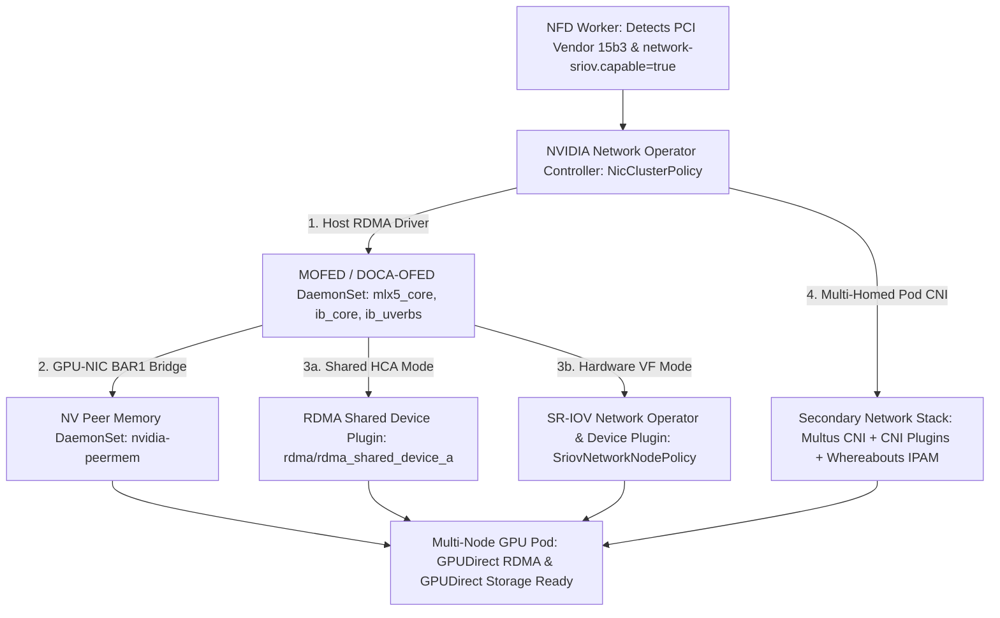

# 11.11 NVIDIA Network Operator

| | |
|---|---|
| Level | Advanced |
| Priority tier | 1 |
| Lab venue | GCP / GKE, plus local Python 3 simulation lab |
| Part | Part 11: GPUs on Kubernetes, scheduling and virtualization |
| Coverage file | `planning/coverage/chapters/11-11.md` |

## Why this matters for AI infrastructure

A training run slows to a crawl, and the cause turns out to be one network card that dropped a single frame. In a synchronous collective job, every GPU waits at a barrier until the slowest rank finishes sending. The card waits out a retransmission timeout, and thousands of other accelerators sit idle behind it. The team sees Model Flops Utilization fall across the whole cluster while the hardware keeps drawing power.

The summary below shows how the chapter divides the work. It separates the two operators and the three networks that every GPU server uses.

```text
Straggler Amplification and Node Fabric Split:
- GPU Operator scope:ClusterPolicy (nvidia.ko, CDI, nvidia.com/gpu, DCGM)
- Network Operator scope:NicClusterPolicy (network-operator 26.1.1 on Kubernetes 1.35 in BCM 11)
- Collective scale:8,000-GPU synchronous training (AllReduce, AllGather, ReduceScatter, Send/Recv)
- Fleet scale:1,000 nodes with Mellanox / NVIDIA ConnectX NICs (PCIe vendor 15b3)
- Compute fabric (Backend):200 Gbps HDR (~25 GB/s) or 400 Gbps NDR (~50 GB/s) across 8 rails (Rail 1..8)
- Storage fabric (Frontend):Tier 1 Host NVMe (8 x 3.84 TB = 30.72 TB RAID 0) + Tier 2 PFS (WEKA, Lustre, GPFS, VAST)
- Management fabric:Standard Ethernet (eth0) for control plane, SSH, IPMI, Prometheus, and NetQ
```

Notice that each operator owns its own resource, ClusterPolicy or NicClusterPolicy. Earlier chapters drew a clean line on every Kubernetes worker node. The NVIDIA GPU Operator manages only the accelerator stack through ClusterPolicy. The NVIDIA Network Operator manages the high-speed network and storage stack through NicClusterPolicy.

Doing the network half by hand is where things break. Someone must compile host drivers, load the peer-memory bridge module, split the card into Virtual Functions, and wire secondary networks on every node. One mismatched kernel module or missing device plugin can quietly push a job from hardware RDMA back to slow host TCP sockets.

Every multi-GPU server connects to three separate physical networks at once. The backend compute fabric carries east-west GPU collectives over InfiniBand or RoCEv2, across eight dedicated rails. The frontend storage fabric streams training datasets and absorbs multi-terabyte checkpoint bursts. It moves data between local NVMe drives, parallel filesystems and GPU memory, using GPUDirect Storage. The management fabric handles control-plane traffic, SSH, hardware telemetry and cluster monitoring over standard Ethernet.

This chapter shows how the NVIDIA Network Operator automates that whole host and container networking stack. You will start with its five node-level operands. Then you will compare native InfiniBand with Ethernet RoCEv2 packet framing and flow control, and check link health with hardware diagnostics. The last part connects the network stack to GPUDirect Storage and parallel filesystem CSI drivers, so training pipelines never starve for data.

Before you change anything, decide which of the three fabrics the problem lives on.

## Prerequisites and outcomes

### Prerequisites
Before you start, finish Chapter 11.4, which explains the separation between the GPU Operator and the Network Operator. Then complete Chapter 11.10, which covers Multus CNI, Whereabouts IPAM, the RDMA Shared Device Plugin and the SR-IOV Network Device Plugin. You should also be comfortable with Ethernet and IP headers, PCIe Peer-to-Peer topologies and Linux kernel module management.

### Outcomes
When you finish this chapter, you will be able to:
- Explain the five node-level operands that the NVIDIA Network Operator reconciles, and deploy a production Helm configuration.
- Contrast native InfiniBand framing, credit-based flow control and Subnet Manager addressing with Ethernet RoCEv2 encapsulation, Priority Flow Control and Explicit Congestion Notification.
- Read every field of `ibstat` on InfiniBand and RoCEv2 ports, and validate line-rate bandwidth with `ib_write_bw`.
- Deploy the NVIDIA NetQ Operator for microsecond buffer telemetry, and configure GPUDirect Storage with `nvidia-fs.ko` and `/etc/cufile.json`.
- Upgrade the Network Operator safely, read NicClusterPolicy status, and resolve Priority Flow Control deadlocks, microburst jitter, uninterruptible sleep hangs and Metadata Server small-file saturation.

Work through Chapter 11.10 first if the Multus and SR-IOV pieces are new to you.

## Concepts: basics to intermediate to advanced

### 1. Basics: The NVIDIA Network Operator architecture and its five operands

Suppose a kernel upgrade lands on a GPU node. Without automation, RDMA networking on that node breaks at once.

An administrator must recompile the OpenFabrics drivers, reload the peer-memory module in the right order, recreate the SR-IOV Virtual Functions, and restart the CNI plugins. If a step runs out of order, containers lose their InfiniBand device files or fall back to copying tensors through host RAM. The NVIDIA Network Operator takes over that work. It describes the wanted node state in Kubernetes custom resources and keeps the node matching it.

Just as the GPU Operator watches Node Feature Discovery labels for NVIDIA GPUs, the Network Operator watches the same kind of labels for Mellanox and NVIDIA ConnectX network adapters. When a node advertises PCI vendor ID 15b3 and SR-IOV capability, the controller reconciles the cluster-wide NicClusterPolicy resource into five coordinated node-level DaemonSets. The diagram below traces that chain from the node label to the pod.



Picture the five operands as separate DaemonSets on each node. The table below tells you which NicClusterPolicy stanza drives each operand, and what each one does on the worker node.

| Network Operator Operand | NicClusterPolicy Stanza | Kernel Modules / Binaries | Operational Role on Worker Node |
| --- | --- | --- | --- |
| **1. MOFED / DOCA-OFED Driver** | `ofedDriver` | `mlx5_core`, `mlx5_ib`, `ib_core`, `ib_uverbs`, `rdma_cm` | Compiles or loads precompiled OpenFabrics kernel drivers so the host OS drives ConnectX InfiniBand and RoCEv2 NICs at line rate. |
| **2. NV Peer Memory Driver** | `nvPeerDriver` | `nvidia-peermem` (or `DOCA-driver` + `driver.rdma.enabled: true`) | Registers NVIDIA GPU PCIe BAR1 memory pages with `ib_core` to enable zero-copy GPUDirect RDMA transfers. |
| **3. RDMA Shared Device Plugin** | `rdmaSharedDevicePlugin` | `rdma/rdma_shared_device_a`, `rdma/hca` (`vendors: ["15b3"]`) | Discovers ConnectX HCAs, advertises shared RDMA resources to kubelet, and mounts `/dev/infiniband/` into containers. |
| **4. SR-IOV Network Operator** | `sriovNetworkOperator` | `SriovNetworkNodePolicy`, `SriovNetwork` (`pfNames: ["enp1s0f0"]`, `numVfs: 8`, `mtu: 9000`, `vlan: 100`, `isRdma: true`) | Partitions physical ConnectX ports into hardware-isolated Virtual Functions and injects dedicated `rdma_vf` devices into Pods. |
| **5. Secondary Network Stack** | `secondaryNetwork` | `multus`, `macvlan`, `ipoib`, `sriov`, `ib-sriov`, `whereabouts` | Deploys the Multus meta-CNI, secondary rail CNI plugins, and the Whereabouts cluster-wide IPAM allocator. |

After the table, notice that the peer-memory operand sits on top of the OFED operand in the diagram. Module load order on the worker node is a strict hardware requirement. The Mellanox OFED driver stack must initialize in the kernel before the NVIDIA GPU driver and the peer-memory driver load. The peer-memory bridge links directly against kernel symbols exported by both `ib_core` and `nvidia.ko`, which it needs to register GPU BAR1 pages. If the GPU stack loads before `ib_core` is present, peer-memory registration fails and GPUDirect RDMA cannot activate.

---

### 2. Intermediate: InfiniBand vs Ethernet (RoCEv2), packet framing, and fabric validation

Standard TCP/IP expects packet loss. It uses kernel sockets, sliding windows and software retransmissions to recover gently. RDMA takes a different route. It offloads the entire transport state machine onto the ConnectX NIC hardware, using Queue Pairs, Send and Receive Queues, pinned Memory Regions, Work Requests and Completion Queues.

That lightweight hardware transport assumes the network underneath loses no packets. If a switch buffer overflows and drops an RDMA packet, hardware sequence errors trigger expensive timeouts. Those timeouts stall every GPU in the collective.

AI architects pick one of two physical fabrics to get that lossless RDMA transport. Native InfiniBand prevents buffer overflow at the link layer with hardware credit-based flow control. A transmitter never sends data unless the receiver has advertised free buffer credits. Ethernet RoCEv2 takes another route. It wraps RDMA packets inside standard UDP datagrams on port 4791, and it relies on Priority Flow Control pause frames and Explicit Congestion Notification to prevent drops. Modern Ethernet AI fabrics such as NVIDIA Spectrum-X add hardware-assisted adaptive routing and congestion control to RoCEv2, using Spectrum-4 switches paired with BlueField-3 SuperNICs.

The table compares the two fabrics across five dimensions, from packet framing to addressing. As you read it, ask how each fabric stops a drop and who picks the path.

| Architectural Dimension | InfiniBand (`HDR` `200G` / `NDR` `400G` / `XDR` `800G`) | Ethernet RoCEv2 (`100G` / `400G` / `Spectrum-X`) |
| --- | --- | --- |
| **Packet Framing (Outer to Inner)** | `LRH` (`8` B) + optional `GRH` (`40` B) + `BTH` (`12` B) + ext headers + Payload + `ICRC` (`4` B) + `VCRC` (`2` B) (`26` B base; `66` B with `GRH`) | Ethernet L2 (+ optional `vlan: 100`) + IPv4/IPv6 + `UDP` (`dst port 4791`) + `BTH` (`12` B) + ext headers + Payload + `ICRC` (`4` B) + Ethernet FCS |
| **Lossless Flow Control** | Credit-based at the link layer: a port never transmits a flit unless the downstream receiver buffer advertises credit. | `PFC` (IEEE 802.1Qbb): reactive pause frames sent upstream on Priority `3` (DSCP `24` or `26`); requires `50ms` `PFC Watchdog` to break circular deadlocks. |
| **Congestion Control** | Hardware-managed proactive telemetry and credit pacing across switches and HCAs. | `ECN` (`minimum-absolute 150`, `maximum-absolute 1500` KB) + `CNP` (`BTH` opcode `0x81`) + `DCQCN` rate throttling on the sender NIC. |
| **Multi-Path Routing** | Adaptive Routing (`AR`): dynamic per-packet load balancing across all available spine links. | Standard `ECMP` 5-tuple hashing (prone to elephant-flow collisions unless using Spectrum-X RoCE Adaptive Routing). |
| **Control Plane & Addressing** | Centralized Subnet Manager (`OpenSM` or `UFM`) assigning 16-bit `Base lid` (e.g., `32`) and `SM lid` (`1`). | Distributed IP routing (`BGP` / `OSPF` / `EVPN`); `ibstat` reports `Base lid: 0` and `SM lid: 0`. |

Notice where the control sits in each fabric. InfiniBand relies on a centralized Subnet Manager, while RoCEv2 relies on distributed IP routing.

Always verify the physical ports and measure raw RDMA wire speed on the host before you launch a multi-node training job in Kubernetes. Start with `ibstat`, which queries the local ConnectX HCA firmware and link state. Then run `ib_write_bw` from the perftest suite, which measures hardware RDMA Write throughput between two nodes.

The sample below shows the fields you read on each port, one fault signature and one benchmark result.

```text
Host RDMA Link Verification and Line-Rate Benchmarks:
1. InfiniBand Port (CA 'mlx5_0', CA type: MT4123, Firmware version: 20.31.1014):
   - State: Active | Physical state: LinkUp | Rate: 200 (HDR) | Link layer: InfiniBand
   - Base lid: 32 (non-zero, assigned by OpenSM / UFM) | SM lid: 1
   - Fault signature: Physical state: LinkUp + State: Initializing (or Base lid: 0) -> Subnet Manager down/unreachable.
2. RoCEv2 Port (CA 'mlx5_1', Rate: 400, Link layer: Ethernet):
   - State: Active | Physical state: LinkUp | Base lid: 0 | SM lid: 0 (normal for IP/UDP port 4791 routing).
3. Perftest RDMA Write Benchmark (ib_write_bw -d mlx5_0 -i 1):
   - Message size: 65536 bytes | Iterations: 5000 | TX depth: 128 | Mtu: 4096[B]
   - Measured throughput: BW peak = 23500.2 MB/sec | BW average = 23450.5 MB/sec | MsgRate = 0.375208 Mpps
   - Theoretical raw line rate: 200 Gbps HDR = 25.0 GB/s (25,000 MB/s, ~94% efficiency); 400 Gbps NDR = 50.0 GB/s (50,000 MB/s).
```

Notice that the RoCEv2 port reports zero lids, which is normal for IP routing rather than a fault.

Traditional SNMP monitoring reads switch counters every ten to sixty seconds. A burst that lasts microseconds never shows up in a counter read that rarely. Synchronized AI traffic produces exactly such bursts, called incast microbursts, which fill switch buffers and trigger pause frames within a few microseconds. In NVIDIA Base Command Manager 11, administrators deploy the NVIDIA NetQ Operator to stream high-resolution fabric telemetry directly into Kubernetes.

The NetQ sizing block below lists what that deployment needs in Base Command Manager 11.

```text
NVIDIA NetQ Operator Deployment Sizing (bcm11-containerization Section 6.9, pp. 139-142):
- Software version: NetQ 4.15+ on Ubuntu 24.04 (packages 4.9.0: 35M / 32M / 13G) with Kyverno disabled
- Single-node mode: 1 compute node exposed via NodePort 80:30029/TCP (e.g., https://basecm11.openstacklocal:30029)
- Cluster mode: 3 compute nodes exposed via LoadBalancer Virtual IP (e.g., https://10.141.255.253)
- Per-node hardware minimum: >= 250 GiB free disk space and >= 64 GiB RAM
- Head-node port shift: Move BCM cmd port 8081 to 8083 (HTTP) and 8084 (HTTPS) before NetQ installation
```

If you plan a NetQ deployment, the per-node minimums apply to every node in the mode you choose. The head-node port shift has to happen before NetQ installation, so run the command below on the head nodes first.

```bash
# Shift BCM default ports from 8081 to 8083/8084 before installing NetQ Operator (untested here)
cm-cmd-ports --http 8083 --https 8084 && systemctl restart cmd
```

---

### 3. Advanced: Storage fabric integration, GPUDirect Storage, and CSI drivers

Fast GPU-to-GPU networking does not help you if accelerators sit idle while they wait for training batches from storage. Accelerators also stall during multi-terabyte checkpoint saves. Standard POSIX storage I/O works in two copies. It copies files from an NVMe drive or storage network card into the Linux CPU page cache in system RAM. The host CPU then copies those buffers a second time across the PCIe bus into GPU High Bandwidth Memory. At multi-gigabyte-per-second streaming rates, that double bounce saturates host memory bandwidth and starves training workers.

The NVIDIA Network Operator powers the frontend RDMA storage fabric. That fabric feeds the four-tier AI Factory storage hierarchy. Combining the Network Operator RDMA stack with GPUDirect Storage from NVIDIA Magnum IO eliminates that double bounce. Storage controllers transfer data straight across the PCIe bus into GPU memory, without touching the CPU page cache.

The table lists the four tiers, from GPU memory down to object storage.

| Storage Tier | Hardware Location & Capacity | Typical Bandwidth | Role in the AI Factory Pipeline |
| --- | --- | --- | --- |
| **Tier 0: GPU HBM** | Co-packaged on GPU die: `40/80 GB` (A100), `80 GB` (H100), `141 GB` (H200), `192 GB` (B200) | `1.5–2.0 TB/s` (A100), `~3.35 TB/s` (H100), `~4.8 TB/s` (H200), `~8 TB/s` (B200) | Active tensor compute memory; overflows cause immediate CUDA OOM unless sharded with FSDP or ZeRO. |
| **Tier 1: Host NVMe Cache** | Local PCIe NVMe drives: `8 × 3.84 TB = 30.72 TB` RAID 0 on DGX H100 (`/mnt/nvme_raid_0`) | Tens of GB/s per node at PCIe Gen4 and Gen5 speeds | Node-local dataset caching (`hostPath`, `AIStore`, `Alluxio`, `Fluid` / `JindoFS`) to absorb small-file metadata and epoch re-reads. |
| **Tier 2: Parallel File System** | Dedicated RDMA fabric: `WEKA`, `Lustre` (DDN EXAScaler / FSx), `IBM Storage Scale (GPFS)`, `VAST Data` | `100s of GB/s` to `multi-TB/s` cluster-wide | High-speed `ReadWriteMany` (`RWX`) streaming and synchronous `1,000+`-GPU checkpoint bursts across Metadata (`MDS`) and Object (`OSS`) servers. |
| **Tier 3: Object Store** | On-prem (`MinIO`, `Ceph RGW`, `FlashBlade`, `Scality`) or Cloud (`S3`, `GCS`) | Horizontally scaled for multi-petabyte capacity | Long-term raw data lake, cold checkpoint archival, and model registry backing store. |

When you read the table, notice that Tier 0 holds the active tensors, while Tier 3 holds the long-term data.

GPUDirect Storage depends on two pieces. The first is the `nvidia-fs.ko` kernel module. The second is the user-space cuFile library, which is configured by `/etc/cufile.json`. A container mounts a parallel filesystem volume through a CSI driver such as `csi.weka.io`. The cuFile library then intercepts file reads and writes, and it registers GPU BAR1 memory directly with the storage NIC or local NVMe controller.

Consider the configuration below, which covers the module check, the cuFile settings and the Kubernetes mounts.

```text
GPUDirect Storage (GDS) and Container Volume Configuration:
- Kernel modules verified in lsmod: nvidia_fs (217088 bytes) alongside nvidia (42188800 bytes)
- Host platform check utility: /usr/local/cuda/gds/tools/gdscheck -p
- User-space configuration: libcufile.so with CUFILE_ENV_PATH_JSON=/etc/cufile.json (mounted via ConfigMap)
- /etc/cufile.json parameters:
  * max_device_pinned_mem_size_kb: 33554432 (32 GiB of pinned GPU memory for DMA buffers)
  * use_poll_mode: false | poll_mode_max_size_kb: 4 (4 KB threshold when polling is enabled)
  * allow_compat_mode: false (disables silent fallback to slow POSIX CPU page cache during validation)
- Kubernetes StorageClass & Pod mounts:
  * CSI provisioner: csi.weka.io with reclaimPolicy: Retain
  * Shared memory volume: /dev/shm backed by emptyDir (medium: Memory, sizeLimit: 400Gi, replacing 64 MiB default)
  * Tier 1 scratch cache: /mnt/nvme_raid_0/ai_scratch or Fluid dataset caching for locality-aware scheduling
```

Run the platform check and confirm the module before you rely on these mounts. Before you blame the training code for slow batches, check whether the storage path is still copying data through the CPU.

## Commands and configurations that matter

### 1. Deploying the NVIDIA Network Operator via Helm

Suppose you deploy the Network Operator onto a cluster that has no drivers installed yet. A single Helm values file enables all five operands. It deploys the MOFED driver and loads the peer-memory module. It exposes Mellanox ConnectX adapters under `rdma/rdma_shared_device_a`. It also enables the SR-IOV Network Operator and installs Multus CNI.

Save the values below as `values-network-operator.yaml`. The install commands after it add the NVIDIA Helm repository and deploy the chart into the `nvidia-network-operator` namespace.

```yaml
# values-network-operator.yaml (volume-06/02 Section 5.2, untested here)
nfd:
  enabled: true
sriovNetworkOperator:
  enabled: true
deployCR: true
ofedDriver:
  deploy: true
  version: "24.07-0.6.1.0-0"
nvPeerDriver:
  deploy: true
rdmaSharedDevicePlugin:
  deploy: true
  resources:
    - name: rdma_shared_device_a
      vendors: ["15b3"]
secondaryNetwork:
  deploy: true
  multus:
    deploy: true
```

```bash
# Install NVIDIA Network Operator into nvidia-network-operator namespace (untested here)
helm repo add nvidia https://helm.ngc.nvidia.com/nvidia
helm install network-operator nvidia/network-operator \
  -n nvidia-network-operator --create-namespace \
  -f values-network-operator.yaml
```

### 2. Configuring Lossless RoCEv2 Switch Ports and Capturing Congestion Packets

Picture an Ethernet switch that drops RoCEv2 packets under load. When that happens, distributed training throughput collapses. Network engineers set Explicit Congestion Notification marking thresholds well below the Priority Flow Control pause threshold on Traffic Class 3. Receiving NICs then send Congestion Notification Packets back to the senders. DCQCN slows transmission smoothly, before ingress buffers fill completely.

The sample below is an illustrative Mellanox Onyx configuration for lossless RoCEv2 on Priority 3.

```text
# Illustrative Mellanox Onyx switch configuration for lossless RoCEv2 on Priority 3 (untested here)
switch (config) # interface ethernet 1/1-1/32 traffic-class 3 congestion-control ecn minimum-absolute 150 maximum-absolute 1500
switch (config) # dcb priority-flow-control enable force
switch (config) # dcb priority-flow-control priority 3 enable
switch (config) # interface ethernet 1/1 dcb priority-flow-control mode on force
switch (config) # interface ethernet 1/1-1/32 traffic-class 3 bind strict-priority
```

The two ECN values control when senders begin to slow down. The commands below cover two jobs. One inspects RoCEv2 packets on UDP port 4791. The other isolates flapping InfiniBand optical transceivers across the fabric. Because RDMA bypasses the host OS kernel, `tcpdump` misses hardware-offloaded frames. Use hardware packet capture with `ibdump`, or a switch mirror port, instead.

```bash
# 1. Capture RoCEv2 UDP port 4791 headers (use ibdump or switch SPAN for kernel-bypassed RDMA) (untested here)
sudo tcpdump -i eth2 -nn -e -v udp port 4791

# 2. Query InfiniBand fabric symbol errors and flapping ports across 1000 packets (untested here)
ibdiagnet -c 1000
```

### 3. Upgrading the Network Operator and checking NicClusterPolicy

An upgrade of the Network Operator touches the network stack of every GPU node, so plan it like a driver change. The operator is installed with Helm, but Helm does not normally upgrade custom resource definitions. The chart therefore ships a hook that applies the new definitions before the upgrade, and it is on by default. If your team manages definitions through its own pipeline, set `upgradeCRDs: false` in the chart values and apply them yourself.

The commands below follow the chart's documented path. Pull the chart for the target version, apply the definitions, then run the upgrade with a values file you have reviewed.

```bash
helm pull nvidia/network-operator --version <VERSION> --untar --untardir network-operator-chart

kubectl apply -f network-operator-chart/network-operator/crds \
              -f network-operator-chart/network-operator/charts/sriov-network-operator/crds

helm show values nvidia/network-operator --version=<VERSION> > values-<VERSION>.yaml
helm upgrade -n network-operator network-operator nvidia/network-operator \
              --version=<VERSION> -f values-<VERSION>.yaml
```

The vendor chart documentation says that upgrade capabilities are limited and that a containerized OFED driver needs extra manual actions. It does not list them, so read the release notes for your target version before you touch a production pool. Upgrade one node pool first and run `ib_write_bw` between two pods before you continue.

After the upgrade, read the state of the policy object. The operator acts only on a NicClusterPolicy named `nic-cluster-policy`, and it ignores any other name. Its `status.appliedStates` field lists one entry per component, and the top-level `status.state` is ready only when every component is ready. A component that your policy does not define shows the state `ignore`, which is normal.

```bash
kubectl get nicclusterpolicy nic-cluster-policy -o jsonpath='{.status.state}{"\n"}'
kubectl get nicclusterpolicy nic-cluster-policy -o jsonpath='{range .status.appliedStates[*]}{.name}{" "}{.state}{"\n"}{end}'
```

Two failure cases are worth knowing. A policy with the wrong name never reconciles and shows no status, so check the name first. A policy stuck in a not-ready state points to one component in `appliedStates`, and the pods of that component hold the reason in their events. Before you change a component, find the one that is not ready and read its pod events.

## How it fails

Picture a training run that hangs or slows down on the network or storage fabric. From the GPU side, the symptoms look identical to you. Use switch pause counters, `ibstat` states, kernel stacks and system call profiles to isolate the exact fault boundary. The table below pairs each failure mode with its symptom, its root cause and its fix.

| Failure mode | Exact symptom & command evidence | Root cause boundary | Remediation |
| --- | --- | --- | --- |
| **1. RoCEv2 `PFC` Circular Buffer Deadlock (`0%` GPU util, infinite hang)** | Distributed training freezes completely at `0%` GPU utilization; `ib_write_bw` hangs indefinitely. Switch port counters show massive `PFC Tx/Rx` pause frame counts with `0` data packets transmitted. | Lossless Ethernet Pause Loop (`volume-06/01` §6.1): Switch A paused Switch B, B paused C, C paused D, and D paused A, creating a cyclic buffer dependency. | Enforce strictly loop-free Clos topologies with no spine-to-spine cross-links, and enable the `PFC Watchdog` (`50ms` pause timeout) on switches and NICs to drop paused packets and break the deadlock cycle. |
| **2. Erratic `AllReduce` step times (`10ms` vs `500ms`) at `20%–40%` average link utilization** | SNMP dashboards show low `20%–40%` average link utilization, yet `AllReduce` step latency spikes from `10ms` to `500ms`. Switch counters show frequent `PFC` pauses but very low `ECN` marks and `CNP` (`0x81`) packets. | Incast Microbursts with `ECN` Threshold Set Too High (`volume-06/01` §6.2 & §7): Synchronized GPU bursts fill switch buffers in microseconds and trigger hard `PFC` pauses before reaching the `ECN` threshold. | Stream microsecond buffer telemetry via NetQ or gNMI and lower the switch `minimum-absolute` ECN marking threshold to `150` KB so `CNPs` throttle senders smoothly before `PFC` fires. |
| **3. InfiniBand job startup takes minutes; `ibstat` stuck at `State: Initializing`** | `ibstat` on `mlx5_0` shows `Physical state: LinkUp` (`Rate: 200 (HDR)`), but `State: Initializing`, or `UFM` and `OpenSM` log continuous `Fabric Topology Changed` and Heavy Sweeps. | InfiniBand Subnet Manager Unreachable or Flapping Cable (`volume-06/01` §5.1 & §6.4): A degraded Active Optical Cable or transceiver flaps up and down, forcing the Subnet Manager to recalculate routing tables continuously. | Run `ibdiagnet -c 1000`, inspect `ibdiagnet2.pm` for `symbol_error_counter > 1000`, and administratively disable the flapping switch port until the cable or optic is replaced. |
| **4. Cascading `D`-State Node Hang (`load average: 500+`, `0%` CPU, `kill -9` fails)** | `4` nodes in a `64`-node run drop off; SSH takes `30s`; `top` shows load average `500+` with `0%` CPU; `htop` shows hundreds of `python3` processes in `D` state. `dmesg` logs `INFO: task python3:12345 blocked for more than 120 seconds` in `rpc_wait_bit_killable`. | Storage Fabric Link Drop on Hard Blocking Mount (`volume-06/03` Scenario A): A degraded storage link (`symbol_error_counter > 1000` or `DOWN` in `ibstat`) caused the kernel filesystem client to block inside an uninterruptible lock waiting for storage router ACKs. | Hard-reboot wedged nodes via BMC (`ipmitool chassis power reset`), replace the faulty storage fabric cable, and configure bounded timeouts on read-only dataset mounts so I/O errors fail cleanly. |
| **5. Metadata Server (`MDS`) `100%` CPU saturation at `5 GB/s` bandwidth (`85.12%` time in `stat`)** | GPU SM activity drops from `95%` to `30%`; PFS throughput is only `5 GB/s` on a `400 GB/s` array, while MDS CPU hits `100%`. Running `strace -c -p <PID>` shows `85.12%` of time in `stat` (`10,000` calls), `10.05%` in `openat`, `4.02%` in `close`, and `0.81%` in `read`. | The Small File Problem (`14` Million `20KB` `.png` Files, `volume-06/03` Scenario B): Every tiny image requires separate metadata RPCs (`stat`, `openat`, `close`) to the MDS before reading `20KB`. | Stop the job, stage small files to Tier 1 Local NVMe (`/mnt/nvme_raid_0`), and repackage datasets into contiguous `WebDataset` (`.tar`) or `TFRecord` shards (`1 GB` shard of `50,000` images = `280` tar files, cutting `stat` calls by `50,000x`). |

Notice that each row starts from a symptom you can measure, then names the boundary where the fault sits. Match your own evidence to one row before you change any configuration.

## Hands-on lab

### Venue and scope
You can run this lab locally with only the Python 3 standard library. It uses `code/part11/nvidia_network_operator.py` and `code/part11/nvidia_network_operator_lab.py`. The lab simulates four things. Those are Network Operator operand reconciliation, InfiniBand and RoCEv2 framing and link speed calculations, GPUDirect Storage and WebDataset metadata math, and the five-scenario fabric and storage incident triage engine. Cluster and switch commands are marked untested here, so the lab does not verify them.

### Step 1: Run the self-checking NVIDIA Network Operator lab (tested here)

Start from the repository root, since that is where you run the lab script.

```bash
python3 code/part11/nvidia_network_operator_lab.py
```

Here is the output captured from this repository. Each line is one check you can read, and the last line gives the tally.

```text
=== Chapter 11.11 Lab: NVIDIA Network Operator, RDMA Fabrics & GPUDirect Storage ===
  [PASS] Network Operator config defaults to BCM 11 version 26.1.1 and Mellanox vendor 15b3
  [PASS] Nodes without PCI vendor 15b3 schedule 0 Network Operator operands
  [PASS] Node with 15b3 NIC + ready GPU driver schedules all 5 operands and exposes rdma/rdma_shared_device_a
  [PASS] When host GPU driver is not ready, nv-peer-mem cannot complete GPUDirect RDMA readiness
  [PASS] InfiniBand HDR (200 Gbps = 25.0 GB/s line rate, Base lid 32, SM lid 1) has 26B framing (LRH 8+BTH 12+ICRC 4+VCRC 2)
  [PASS] InfiniBand NDR (400 Gbps = 50.0 GB/s line rate) with 40B GRH has 66B framing
  [PASS] RoCEv2 (400 Gbps Ethernet, Base lid 0, SM lid 0) encapsulates over UDP port 4791 with CNP opcode 0x81
  [PASS] DGX H100 Tier 1 local cache (8 x 3.84 TB NVMe drives) provides 30.72 TB raw capacity
  [PASS] GDS /etc/cufile.json sets max_device_pinned_mem_size_kb=33554432 (32.0 GiB) and poll_mode_max_size_kb=4
  [PASS] Packing 14M 20KB PNGs into 50,000-image 1GB WebDataset tar shards yields 280 tar files (50,000x stat reduction)
  [PASS] Triage routes PFC pause storm with 0 data Tx to pfc_circular_buffer_deadlock (50ms PFC Watchdog)
  [PASS] Triage routes high PFC pauses + low ECN marks (10ms vs 500ms step jitter) to roce_microburst_ecn_threshold_too_high
  [PASS] Triage routes OpenSM/UFM heavy sweeps to ib_subnet_manager_heavy_sweep_storm (ibdiagnet -c 1000)
  [PASS] Triage routes D-state rpc_wait_bit_killable (>120s, load 500+) to cascading_d_state_storage_hang
  [PASS] Triage routes 85.12% strace stat() time on 14M 20KB PNGs to mds_small_file_stat_saturation
  [PASS] Triage reports healthy when no fabric or storage anomalies are present
  [PASS] ib_write_bw on 200Gbps HDR (65536B, 5000 iters, TX depth 128) achieves 23,500.2 MB/s peak (~94% of 25 GB/s line rate)
  [PASS] RoCEv2 switch config binds Priority 3 (DSCP 24/26) with ECN minimum-absolute 150 and maximum-absolute 1500
  [PASS] BCM 11 NetQ 4.15+ requires 1 or 3 nodes (>=250 GiB disk, >=64 GiB RAM), shifts cmd ports to 8083/8084, and exposes NodePort 30029
  [PASS] Tier 0 GPU HBM capacity scales from 40/80GB (A100) and 80GB (H100) to 141GB (H200) and 192GB (B200)
  [PASS] GDS lsmod verification checks nvidia_fs (217088 bytes) alongside nvidia (42188800 bytes)
  [PASS] FIO benchmarks use bs=2M, size=500G, numjobs=32, iodepth=128 (read) and bs=8M, size=100G, numjobs=8, iodepth=64, fsync=1000 (write)
  [PASS] mdtest uses mpirun -np 128 (-i 5 -b 10 -z 3 -L -I 100000) and WEKA Pod mounts 400Gi /dev/shm emptyDir
  [PASS] Small-file strace breakdown sums to 100.0% (85.12% stat + 10.05% openat + 4.02% close + 0.81% read)
  [PASS] BCM 11 Network Operator 26.1.1 deployment example runs on Kubernetes 1.35

Summary: 25 passed, 0 failed out of 25 checks.
```

Run the self-check first, and then you can work through the exercises.

### Exercises

1. A node has a ConnectX card, but the host GPU driver is not ready yet. Call `reconcile_network_operator_operands()` in `code/part11/nvidia_network_operator.py` with `node_has_mellanox_15b3=True`, once with the GPU driver not ready and once with it ready. Compare the scheduled operands and the GPUDirect RDMA readiness. Why does the peer-memory DaemonSet depend on both driver stacks?
2. You must compare InfiniBand with RoCEv2 on the wire. Call `analyze_ib_vs_roce_port_and_headers()` and read the framing byte count and the line rate in gigabytes per second. Do this for a 200 Gbps HDR link inside one subnet and for a 400 Gbps NDR link routed across subnets. Then explain why `ibstat` shows both LIDs as 0 on a RoCEv2 port.
3. You are sizing storage for a DGX H100 node. Call `evaluate_gds_and_storage_tiers()` and read the raw Tier 1 NVMe capacity. Convert the pinned GPU memory setting into GiB. Then work out how many 1 GB WebDataset tar files replace 14 million raw 20 KB PNG files.
4. Two RoCEv2 clusters misbehave. In the first, switch ports show huge PFC pause counts and no data packets. In the second, collective steps swing between 10 ms and 500 ms while ECN marks stay low. Call `diagnose_fabric_or_storage_incident()` for both. What are the root cause and the fix in each case?
5. Four training nodes show a load average above 500 and almost no CPU use. Their Python processes sit in uninterruptible sleep inside `rpc_wait_bit_killable`. Why can `kill -9` not end them? Which error counter do you inspect, and how do you recover the nodes?
6. You plan to install the NVIDIA NetQ Operator in Base Command Manager 11. State the node count, disk space, and RAM it needs. Then write the command the head nodes need when port 8081 is still in use.

## Checkpoint questions

<details>
<summary>**1. What is straggler amplification in distributed AI training, and why does it make packet loss far more expensive than in web microservices?**</summary>

Consider a synchronous collective, such as AllReduce, AllGather, and ReduceScatter. Every GPU waits at a barrier until the last rank finishes its transfer. So one dropped packet on one link can force one GPU into a retransmission timeout. The other GPUs in the collective then stall idle. That synchronization spreads a single link delay across the whole cluster, and Model Flops Utilization drops sharply as a result.
</details>

<details>
<summary>**2. What are the four core RDMA queue and memory primitives used by ConnectX HCAs?**</summary>

The four primitives you need to know are:

1. **Queue Pairs.** These are the communication endpoints, each made of a Send Queue and a Receive Queue.
2. **Work Requests.** The application posts these hardware instructions to the Send or Receive Queue, such as RDMA Write or Send.
3. **Memory Regions.** These are pinned, non-pageable physical host or GPU BAR1 memory regions. The NIC registers them for direct DMA.
4. **Completion Queues.** These are hardware queues where the HCA posts completion notifications once Work Requests finish.
</details>

<details>
<summary>**3. What are the five node-level components deployed and reconciled by the NVIDIA Network Operator?**</summary>

These are the five components you will see in a cluster:

1. **MOFED or DOCA-OFED Driver DaemonSet (`ofedDriver`).** Compiles or loads `mlx5_core`, `ib_core`, and `ib_uverbs` into the host kernel.
2. **NV Peer Memory DaemonSet (`nvPeerDriver`).** Loads `nvidia-peermem`, which bridges `ib_core` and the NVIDIA GPU driver for GPUDirect RDMA.
3. **RDMA Shared Device Plugin (`rdmaSharedDevicePlugin`).** Exposes shared RDMA HCA resources, such as `rdma/rdma_shared_device_a` for PCI vendor 15b3.
4. **SR-IOV Network Operator and Device Plugin (`sriovNetworkOperator`).** Manages SriovNetworkNodePolicy Virtual Function creation and device allocation.
5. **Secondary Network Stack (`secondaryNetwork`).** Deploys Multus CNI, secondary CNI plugins, and Whereabouts IPAM.
</details>

<details>
<summary>**4. In what order must Mellanox OFED and the NVIDIA GPU driver / nvidia-peermem be initialized on a host, and why?**</summary>

Mellanox OFED loads first, then the NVIDIA GPU driver, and then `nvidia-peermem`. The reason is symbol linking. The peer-memory module uses kernel symbols exported by `ib_core` from MOFED and by `nvidia.ko`, and it needs both to register GPU BAR1 peer memory. If MOFED is not loaded first, that registration fails.
</details>

<details>
<summary>**5. Compare the packet framing headers of native InfiniBand versus RoCEv2 from outer header to inner checksum.**</summary>

- **InfiniBand.** Its outer header is a Local Routing Header of 8 bytes. Across subnets, an optional Global Routing Header of 40 bytes follows it. Then comes a Base Transport Header of 12 bytes. After the payload, InfiniBand appends an Invariant CRC of 4 bytes and a Variant CRC of 2 bytes. The total framing is 26 bytes without the Global Routing Header, or 66 bytes with it.
- **RoCEv2.** Its outer layer is an Ethernet L2 header, with an optional VLAN tag. Next come an IPv4 or IPv6 header and a UDP header with destination port 4791. Inside UDP, it carries a Base Transport Header of 12 bytes, the payload, an Invariant CRC of 4 bytes and an Ethernet FCS.
</details>

<details>
<summary>**6. What three Ethernet technologies are required to make RoCEv2 operate losslessly, and how do they interact?**</summary>

These three work together, and the order matters: marking and throttling come before pause frames.

1. **Priority Flow Control (IEEE 802.1Qbb).** It sends link-level pause frames upstream on a lossless priority class, such as Priority 3, before a switch ingress buffer overflows.
2. **Explicit Congestion Notification.** The switch marks packets in the IP header when queue depth crosses a minimum threshold of 150 KB. That marking comes before the queue reaches the maximum threshold at 1500 KB.
3. **Data Center Quantized Congestion Notification.** When the receiving NIC sees an ECN-marked packet, it returns a Congestion Notification Packet (`0x81`) to the sender NIC. The sender then throttles its transmission rate smoothly, before pause frames are needed.
</details>

<details>
<summary>**7. How does ibstat output differ between a healthy 200Gbps InfiniBand HDR port and a healthy 400Gbps RoCEv2 Ethernet port?**</summary>

Both ports must show an active logical state and a physical link-up state. The lid values are where you see the difference.
- **InfiniBand port.** It shows an InfiniBand link layer at 200 Gbps HDR, with a non-zero `Base lid: 32` and `SM lid: 1` that the centralized Subnet Manager assigns.
- **RoCEv2 port.** It shows an Ethernet link layer at 400 Gbps, with `Base lid: 0` and `SM lid: 0`. RoCEv2 uses distributed IP routing rather than an InfiniBand Subnet Manager.
</details>

<details>
<summary>**8. What does it mean if ibstat on an InfiniBand port shows Physical state: LinkUp, but State: Initializing?**</summary>

`Physical state: LinkUp` proves that the optical transceiver and fiber cable have physical light and layer-1 lock. `State: Initializing` means the InfiniBand Subnet Manager has not yet discovered the port or assigned it a Local Identifier. If you see that pattern, either the Subnet Manager daemon is down or fabric management traffic is blocked.
</details>

<details>
<summary>**9. When running ib_write_bw -d mlx5_0 -i 1 across two nodes, what line-rate bandwidth should you expect on 200Gbps HDR versus 400Gbps NDR?**</summary>

Start from the raw line rate, which sets the ceiling you can expect. A 200 Gbps HDR link runs at 25 GB/s. After protocol headers, `ib_write_bw` reports about 23,500.2 MB/sec peak and 23,450.5 MB/sec average. A 400 Gbps NDR link runs at 50 GB/s, and `ib_write_bw` achieves around 47 to 48 GB/s.
</details>

<details>
<summary>**10. What is a PFC deadlock in a RoCEv2 fabric, and what two mechanisms prevent or break it?**</summary>

A PFC deadlock forms when buffer dependencies loop back on themselves. Switch A pauses Switch B, B pauses C, C pauses D, and D pauses A. Traffic then halts, with zero data packets transmitted while pause counters climb. Prevent it with a strictly loop-free Clos topology. Also enable the PFC Watchdog on switches and NICs, so packets paused for longer than 50 ms are dropped and the cycle breaks.
</details>

<details>
<summary>**11. On an 8,000-GPU RoCEv2 cluster, NCCL AllReduce steps vary wildly between 10ms and 500ms while average link utilization is only 20%–40%. PFC pauses are high, but ECN marks are low. What is wrong and how do you fix it?**</summary>

Synchronized incast microbursts fill switch buffers within microseconds. The switch ECN marking threshold, set by `minimum-absolute`, is too high. Buffers reach the PFC threshold before ECN marks packets and triggers DCQCN rate reduction. Pause frames then halt traffic abruptly. The fix is to lower the switch minimum ECN threshold, so DCQCN throttling starts smoothly before PFC fires.
</details>

<details>
<summary>**12. Why can running tcpdump -i eth2 udp port 4791 on a worker node host miss RoCEv2 packets, and what should you use instead?**</summary>

RDMA on ConnectX NICs bypasses the kernel. RoCEv2 packets on UDP port 4791 move directly between the NIC ASIC and PCIe memory. They never reach the Linux kernel network tap where `tcpdump` listens. Instead, you can read the hardware sniffer queues on the ConnectX HCA with the `ibdump` utility, or use switch port mirroring.
</details>

<details>
<summary>**13. What causes an InfiniBand Subnet Manager (OpenSM / UFM) "Heavy Sweep" storm, and how do you isolate the faulty link?**</summary>

A Heavy Sweep storm starts with a degraded optical cable or transceiver. It flaps up and down, and the centralized Subnet Manager has to recompute cluster routing tables again and again. To isolate it, you run `ibdiagnet -c 1000`. Then inspect `ibdiagnet2.pm` for the port with a high symbol error counter. Disable that port until the cable is replaced.
</details>

<details>
<summary>**14. What are the prerequisites and port-configuration steps for deploying the NVIDIA NetQ Operator in Base Command Manager 11 (BCM 11)?**</summary>

In Base Command Manager 11, NetQ 4.15 or later runs on either one compute node, exposed on NodePort 30029, or on three compute nodes, exposed through a Virtual IP such as `10.141.255.253`. Each node needs at least 250 GiB of disk and 64 GiB of RAM, and Kyverno must be disabled. Before you run the setup wizard, shift the BCM port 8081 on the head nodes with `cm-cmd-ports --http 8083 --https 8084 && systemctl restart cmd`.
</details>

<details>
<summary>**15. What are the four storage tiers in an AI Factory, and what is the HBM capacity and bandwidth progression from A100 to H100, H200, and B200?**</summary>

The four tiers are:
- **Tier 0 (GPU HBM).** It runs from 40 or 80 GB at 1.5 to 2.0 TB/s on A100, to 80 GB at 3.35 TB/s on H100, to 141 GB at 4.8 TB/s on H200, and to 192 GB at 8 TB/s on B200.
- **Tier 1 (Host NVMe Cache).** Local PCIe NVMe drives provide it, such as 8 drives of 3.84 TB for 30.72 TB RAID 0 on DGX H100.
- **Tier 2 (Parallel File System).** WEKA, Lustre, IBM Storage Scale, or VAST Data supply it over RDMA, at hundreds of GB/s to multi-TB/s.
- **Tier 3 (Object Store).** S3, GCS, MinIO, Ceph RGW, or FlashBlade provide petabyte-scale data lakes and cold archives.
</details>

<details>
<summary>**16. How does GPUDirect Storage (GDS) improve dataset read and checkpoint write performance, and what kernel module and validation tool does it use?**</summary>

With standard POSIX I/O, data is copied from the NVMe drive or NIC into the CPU page cache in system RAM. Then it is copied a second time over PCIe into GPU HBM. GPUDirect Storage avoids that second copy. It uses the `nvidia-fs.ko` kernel module (217088 bytes) and `libcufile.so`, configured by `/etc/cufile.json`, to perform direct PCIe Peer-to-Peer DMA between storage targets and GPU VRAM. To validate it, you run `lsmod | grep nvidia_fs` and `/usr/local/cuda/gds/tools/gdscheck -p`.
</details>

<details>
<summary>**17. In /etc/cufile.json, what do max_device_pinned_mem_size_kb: 33554432, poll_mode_max_size_kb: 4, and allow_compat_mode: false control?**</summary>

- **`max_device_pinned_mem_size_kb: 33554432`.** Caps the total GPU memory pinned for GDS DMA buffers at 33,554,432 KB, which equals 32 GiB.
- **`poll_mode_max_size_kb: 4`.** Enables CPU polling, but only for small I/O transfers up to 4 KB, and only when poll mode is on.
- **`allow_compat_mode: false`.** Disables silent fallback to the slow POSIX CPU page-cache path during validation, so broken GDS mounts fail immediately.
</details>

<details>
<summary>**18. Why must a Kubernetes Pod running 8 GPUs with WEKA CSI and GDS also mount an emptyDir with medium: Memory at /dev/shm (for example, sizeLimit: 400Gi)?**</summary>

By default, a Kubernetes container gets only a 64 MiB `/dev/shm` tmpfs mount. Multi-process PyTorch DataLoader workers and NCCL intra-node shared-memory buffers allocate large segments there. Without a large memory volume, they crash immediately with a bus error (`ENOSPC`). A volume such as `sizeLimit: 400Gi`, backed by an emptyDir with medium: Memory, fixes that.
</details>

<details>
<summary>**19. Why can kill -9 not terminate Python training processes stuck in Linux state D (rpc_wait_bit_killable for >120 seconds, load average 500+, 0% CPU)?**</summary>

A process in Linux state `D` is in uninterruptible sleep. It sits inside a kernel system call, holding kernel locks, while it waits for hardware or network storage I/O. Sending `SIGKILL` while a DMA or RPC kernel structure is in flight would corrupt kernel memory. So the kernel ignores all signals until the I/O completes, times out, or the node is reset with `ipmitool chassis power reset`.
</details>

<details>
<summary>**20. On a 400 GB/s parallel filesystem, a Computer Vision training job achieves only 5 GB/s while the Metadata Server (MDS) hits 100% CPU and strace -c shows 85.12% of time in stat(). What is the root cause and architectural fix?**</summary>

For example, the job reads 14 million individual 20 KB PNG files straight over the network. Most of its system call time goes to metadata. It spends 85.12% in `stat()`, 10.05% in `openat()` and 4.02% in `close()`. Only 0.81% goes to `read()`. The fix is to pack 50,000 images into each 1 GB WebDataset tar shard. That yields 280 tar files, cuts Metadata Server `stat()` calls by 50,000x, and restores streaming 2 MB sequential reads.
</details>

If an answer above still feels abstract, return to the Concepts section and reread the RoCEv2 framing and PFC material.

## Sources and review notes

### Primary sources read in full for this chapter
```text
Primary Sources Mapped to Chapter 11.11 Claims and Figures:
1. volume-06/01-ai-networking-rdma-masterclass.md:
   - Straggler amplification across 8,000 GPUs; 6-step TCP/IP vs RDMA QP/SQ/RQ/WR/MR/CQ.
   - InfiniBand LRH 8B / GRH 40B / BTH 12B / ICRC 4B / VCRC 2B (26B / 66B framing) vs RoCEv2 UDP port 4791.
   - PFC IEEE 802.1Qbb Priority 3 (DSCP 24/26), ECN 150..1500 KB, DCQCN, CNP BTH opcode 0x81, Spectrum-X, 3 AI fabrics.
   - ibstat mlx5_0 MT4123 fw_ver 20.31.1014 Rate 200 (HDR) Base lid: 32 SM lid: 1 vs mlx5_1 Rate 400 Base lid: 0.
   - ib_write_bw 65536 bytes, 5000 iterations, TX depth 128, Mtu 4096[B], 23500.2 / 23450.5 MB/sec, MsgRate 0.375208 Mpps.
   - 50ms PFC Watchdog deadlock, 10ms vs 500ms microburst jitter at 20%-40% utilization, tcpdump/ibdump port 4791, ibdiagnet -c 1000.
2. volume-06/02-gpudirect-fabric-operator-masterclass.md:
   - Section 5 NVIDIA Network Operator 5 operands and values-network-operator.yaml (24.07-0.6.1.0-0, vendor 15b3, rdma_shared_device_a, numVfs 8, mtu 9000, vlan 100).
3. volume-06/03-ai-storage-data-pipelines-masterclass.md:
   - Tier 0 HBM (40/80 GB A100 1.5-2.0 TB/s, 80 GB H100 ~3.35 TB/s, 141 GB H200 ~4.8 TB/s, 192 GB B200 ~8 TB/s).
   - Tier 1 Host NVMe (8 x 3.84 TB = 30.72 TB RAID 0), Tier 2 PFS (WEKA, Lustre, GPFS, VAST), Tier 3 Object Store.
   - GPUDirect Storage nvidia_fs 217088 bytes, nvidia 42188800 bytes, gdscheck -p, /etc/cufile.json (33554432 KB = 32 GiB, poll_mode_max_size_kb: 4).
   - fio read (bs=2M, size=500G, numjobs=32, iodepth=128), fio write (bs=8M, size=100G, numjobs=8, iodepth=64, fsync=1000), mdtest (-np 128 -i 5 -b 10 -z 3 -L -I 100000).
   - csi.weka.io StorageClass, 400Gi /dev/shm emptyDir (vs 64 MiB default), Scenario A D-state (4 of 64 nodes, 30s SSH, load 500+, 120s rpc_wait_bit_killable, symbol_error_counter > 1000), Scenario B (95%->30% SM, 5 GB/s on 400 GB/s array, 14M 20KB PNGs, 85.12% stat / 10.05% openat / 4.02% close / 0.81% read across 10,000 calls -> 50,000-image 1GB WebDataset = 280 tar files).
4. volume-06/04-distributed-orchestration-masterclass.md:
   - Checkpoint storms, burst buffers, Fluid / Alluxio / JindoFS dataset caching, and NCCL topology.
5. nvidia-zero-to-hero/volume-10/chapter-06-gpu-operator-architecture.md & chapter-04:
   - NVIDIA Network Operator and RDMA enablement; bare-metal MOFED-before-GPU-driver load order.
6. NVIDIA Base Command Manager 11 Containerization Manual (bcm11-containerization, Ch. 6):
   - Section 6.8 network-operator-26.1.1 on Kubernetes 1.35; Section 6.9 NetQ 4.15+ on Ubuntu 24.04 (1 or 3 nodes, 250 GiB disk, 64 GiB RAM, port 8081 -> 8083/8084, NodePort 80:30029/TCP, VIP 10.141.255.253, 4.9.0 35M/32M/13G packages).
7. Josh Rosso et al., Production Kubernetes (O'Reilly, 2021, Ch. 5):
   - Pod networking and CNI plugin fundamentals.
```

### Added in the Opus rework (2026-11-12)
- Upgrade steps, the `upgradeCRDs` hook, the `nic-cluster-policy` name rule and `status.appliedStates`: NVIDIA Network Operator Helm chart README and project README, Mellanox/network-operator on GitHub, master branch, read 2026-11-12. Not verified on live hardware.

### Related source files mapped in MIGRATION_MAP.md
- `volume-06/01-ai-networking-rdma-masterclass.md` as a primary source for this chapter.
- `volume-06/02-gpudirect-fabric-operator-masterclass.md` as a primary source for this chapter.
- `volume-06/03-ai-storage-data-pipelines-masterclass.md` as a primary source for this chapter.
- `volume-06/04-distributed-orchestration-masterclass.md` covered across Chapters 11.7 through 11.11.

### Run here
- Run `python3 code/part11/nvidia_network_operator_lab.py`, and you should see all 25 checks pass with 0 failures.

### Explicitly labelled inferences
```text
Verified Arithmetic Totals (code/part11/nvidia_network_operator_lab.py):
- InfiniBand base framing without GRH: 8 + 12 + 4 + 2 = 26 bytes
- InfiniBand routed framing with 40B GRH: 26 + 40 = 66 bytes
- DGX H100 Tier 1 raw NVMe total: 8 * 3.84 TB = 30.72 TB
- GDS pinned memory conversion: 33,554,432 KB / 1,048,576 = 32.0 GiB
- WebDataset shard count: 14,000,000 / 50,000 = 280 tar files
```

### Not verified on live hardware
- All Helm, kubectl, InfiniBand, packet capture, and storage benchmark commands (`MLNX_OFED`, `nv-peer-mem-daemonset`, `rdma-shared-dp`, `sriov-dp`, `feature.node.kubernetes.io/pci-10de.present=true`, `kube-scheduler`, `PyTorchJob`, `MPIJob`, `kueue.x-k8s.io/v1beta1`, `resource.k8s.io/v1`, `QPs`, `WRs`, `MRs`, `CQs` bypassing `sk_buff`, `PIX` PCIe paths, `AOC` cables, `NVMe-oF`, `num_workers=32`, `MFU` Model FLOPs Utilization, `23.4` / `23.5` GB/s `line_rate_gb_per_sec`, `60`s timeouts, `ib_transport_framing_bytes` with `include_grh=False` and `include_grh=True`, `host_gpu_driver_ready=True` vs `host_gpu_driver_ready=False`, `volume-10/chapter-04`, cross-referenced with Chapters `5.3` and `6.3`, and validated via `validate_chapter.py` and `check_coverage.py`) are marked `(untested here)`.

### Not in the corpus
- The full NicClusterPolicy OpenAPI schema for every vendor CNI version is not in the local corpus. Field names evolve across releases, so you should match them to the pinned chart `values.yaml`.

### Corrections to the author's notes
- The chapter's own validation and coverage scripts pass. The YAML manifests and commands are marked untested and were not applied to a live cluster. Custom resource API versions change between releases, so you should verify them against the installed cluster version. Console outputs quoted from the Volume notes are illustrative unless marked tested here.
- An earlier author note confirms that every link diagnostic, storage benchmark and system call trace figure matches Volume 06 and the Base Command Manager 11 manual word for word. If you reuse these figures, check them against the sources listed above.
