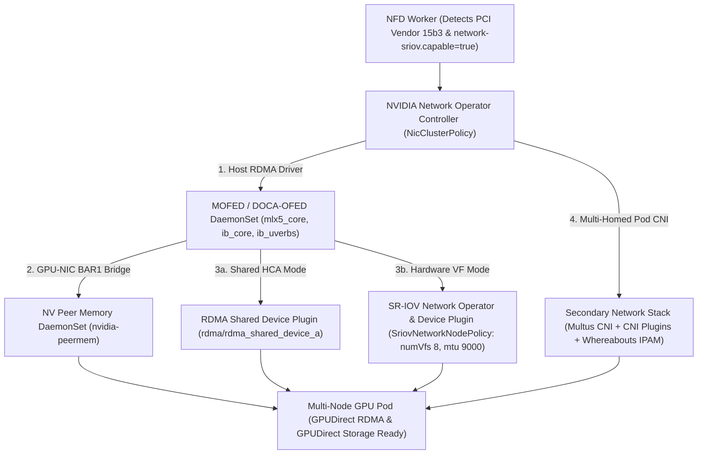

# 11.11 NVIDIA Network Operator

| | |
|---|---|
| Level | Advanced |
| Priority tier | 1 |
| Lab venue | GCP / GKE (plus local Python 3 simulation lab) |
| Part | Part 11: GPUs on Kubernetes, scheduling and virtualization |
| Sources used | `volume-06/01-ai-networking-rdma-masterclass.md`; `volume-06/02-gpudirect-fabric-operator-masterclass.md`; `volume-06/03-ai-storage-data-pipelines-masterclass.md`; `volume-06/04-distributed-orchestration-masterclass.md`; `nvidia-zero-to-hero/volume-10/chapter-06-gpu-operator-architecture.md`; *NVIDIA Base Command Manager 11 Containerization Manual* (`bcm11-containerization`, Ch. 6); Josh Rosso et al., *Production Kubernetes* (O'Reilly, 2021, Ch. 5) |
| Coverage file | `planning/coverage/chapters/11-11.md` |

## Why this matters for AI infrastructure

In Chapters 11.4 and 11.10, we established a fundamental architectural boundary: **the NVIDIA GPU Operator (`ClusterPolicy`) owns only the GPU half of a worker node (`nvidia.ko`, Container Toolkit/CDI, `nvidia.com/gpu`, and DCGM), while the high-speed network and storage fabric in and out of that GPU is owned by a second, independent controller—the NVIDIA Network Operator (`NicClusterPolicy`).**

Why does an AI Factory require a dedicated Kubernetes operator (`network-operator`, version `26.1.1` on Kubernetes `1.35` in NVIDIA Base Command Manager 11) just for network cards?

1. **Straggler amplification makes every microsecond and dropped packet catastrophic (`volume-06/01`):** In synchronous distributed LLM training (`AllReduce`, `AllGather`, `ReduceScatter`, `Send/Recv`), every GPU in an `8,000`-GPU cluster must wait at the collective barrier for the slowest rank to finish transmitting. If a single network link drops one packet and triggers a retransmission timeout, **all other GPUs sit idle waiting for that single straggler**, collapsing cluster-wide Model Flops Utilization (`MFU`).
2. **Managing the RDMA host driver stack across `1,000` nodes by hand is impossible (`volume-06/02`):** Exposing zero-copy **GPUDirect RDMA** and **GPUDirect Storage (`GDS`)** inside Kubernetes Pods requires compiling and loading Mellanox OFED (`MLNX_OFED` / `DOCA-OFED`) kernel modules (`mlx5_core`, `ib_core`, `ib_uverbs`), loading the peer-memory bridge module (`nvidia-peermem` for RDMA and `nvidia-fs` for GDS), partitioning ConnectX NICs (`PCIe vendor 15b3`) into SR-IOV Virtual Functions (`numVfs: 8`, `mtu: 9000`, `vlan: 100`), deploying the RDMA Shared Device Plugin (`rdma/rdma_shared_device_a`) or SR-IOV Network Device Plugin (`rdma_vf`), and wiring **Multus CNI** + **Whereabouts** IPAM.
3. **Three physically separated fabrics converge on each node (`volume-06/01` & `volume-06/03`):** Every DGX/HGX node connects simultaneously to:
   - **The Compute Fabric (Backend):** `200 Gbps` HDR (`~25 GB/s` line rate) or `400 Gbps` NDR (`~50 GB/s` line rate) **InfiniBand** (or **Spectrum-X / RoCEv2** over UDP port `4791` with Priority Flow Control `PFC` on Priority `3` / DSCP `24` or `26` and `ECN`/`DCQCN`) across `8` dedicated rails (`Rail 1..8`).
   - **The Storage Fabric (Frontend):** High-speed RDMA/RoCEv2 or InfiniBand connecting **Tier 1 Host NVMe** (`8 × 3.84 TB = 30.72 TB` RAID 0 on DGX H100) and **Tier 2 Parallel File Systems (`WEKA`, `Lustre`, `IBM Storage Scale / GPFS`, `VAST Data`)** to **Tier 0 GPU HBM** (`40/80 GB` A100, `80 GB` H100, `141 GB` H200, `192 GB` B200) via **GPUDirect Storage (`GDS`)**.
   - **The Management Fabric:** Standard Ethernet (`eth0`) for Kubernetes control-plane traffic, SSH, IPMI, and Prometheus/NetQ telemetry.

This chapter covers the end-to-end architecture of the **NVIDIA Network Operator**, its `NicClusterPolicy` and Helm configuration, the underlying **InfiniBand vs RoCEv2** protocol mechanics (`LRH`/`GRH`/`BTH` headers, `ibstat`, `ib_write_bw`, `ibdiagnet`, `PFC` deadlocks, and `ECN` microburst tuning), **NVIDIA NetQ Operator** telemetry, and how the Network Operator integrates with **GPUDirect Storage (`GDS`, `nvidia-fs`, `/etc/cufile.json`)** and parallel filesystem CSI drivers (`csi.weka.io`).

## Prerequisites and outcomes

### Prerequisites
- Completion of Chapter 11.4 (GPU Operator vs Network Operator separation) and Chapter 11.10 (Multus CNI, Whereabouts IPAM, RDMA Shared Device Plugin, and SR-IOV Network Device Plugin).
- Familiarity with basic Ethernet/IP headers, PCIe Peer-to-Peer (`PIX` vs `SYS`), and Linux kernel modules (`lsmod`, `modprobe`, `dmesg`).

### Outcomes
After completing this chapter, you will be able to:
- Explain the five node-level operands reconciled by the **NVIDIA Network Operator** (`ofedDriver`, `nvPeerDriver`, `rdmaSharedDevicePlugin` for vendor `15b3`, `sriovNetworkOperator`, and `secondaryNetwork` with Multus + CNI plugins + Whereabouts) and deploy a production `values.yaml`.
- Contrast **InfiniBand (`NDR`/`XDR`)** (`LRH 8B`, optional `GRH 40B`, `BTH 12B`, `ICRC 4B`, `VCRC 2B` = `26B` framing without GRH or `66B` with GRH; credit-based flow control; Adaptive Routing; centralized `OpenSM`/`UFM` Subnet Manager) against **Ethernet RoCEv2 (`Spectrum-X`)** (UDP port `4791`, `PFC` IEEE 802.1Qbb on Priority `3`, `ECN` `150..1500` KB, `DCQCN`, `CNP` BTH opcode `0x81`, and `50ms` `PFC Watchdog`).
- Interpret every field of `ibstat` (`CA 'mlx5_0'` `MT4123`, `fw_ver: 20.31.1014`, `State: Active`, `Physical state: LinkUp`, `Rate: 200 (HDR)` vs `Rate: 400` Ethernet, `Base lid: 32` / `SM lid: 1` on IB vs `0` on RoCEv2) and validate line-rate bandwidth with `ib_write_bw` (`23,500.2 MB/sec` peak on `200 Gbps` HDR).
- Deploy the **NVIDIA NetQ Operator** (`NetQ 4.15+` on `1` or `3` nodes with `>= 250 GiB` disk and `>= 64 GiB` RAM, NodePort `30029` or cluster VIP `10.141.255.253`) for microsecond buffer-occupancy and fabric telemetry.
- Configure **GPUDirect Storage (`GDS`)** (`nvidia-fs.ko` `217088` bytes, `gdscheck -p`, `/etc/cufile.json` `max_device_pinned_mem_size_kb: 33554432` = `32 GiB`, `poll_mode_max_size_kb: 4`, WEKA CSI `csi.weka.io` with `400Gi` `/dev/shm`), benchmark storage tiers with `fio` and `mdtest`, and resolve `PFC` deadlocks, `ECN` microbursts (`10ms` vs `500ms` step jitter), cascading `D`-state hangs (`rpc_wait_bit_killable` > `120s`), and Metadata Server (`MDS`) small-file saturation (`85.12%` time in `stat()`).

## Concepts: basics to intermediate to advanced

### 1. Basics: The NVIDIA Network Operator architecture and its five operands

Just as the NVIDIA GPU Operator watches NFD's `feature.node.kubernetes.io/pci-10de.present=true` label to reconcile the GPU software stack, the **NVIDIA Network Operator** watches NFD labels for **Mellanox / NVIDIA ConnectX network adapters (PCI vendor ID `15b3`, plus `feature.node.kubernetes.io/network-sriov.capable: "true"`)** and reconciles a `NicClusterPolicy` custom resource into node-level DaemonSets (`volume-06/02-gpudirect-fabric-operator-masterclass.md`, Section 5, and `volume-10/chapter-06`).



#### The five components managed by the NVIDIA Network Operator
1. **MOFED / DOCA-OFED Driver DaemonSet (`ofedDriver`):** Compiles or loads the precompiled Mellanox OpenFabrics Enterprise Distribution (`MLNX_OFED` / `DOCA-OFED`) kernel modules (`mlx5_core`, `mlx5_ib`, `ib_core`, `ib_uverbs`, `rdma_cm`) into the host Linux kernel so the OS can drive ConnectX InfiniBand and RoCEv2 NICs at line rate. (Note the strict bare-metal/host ordering rule from `volume-10/chapter-04`: when installing on hosts, **MOFED must load before the NVIDIA GPU driver and `nvidia-peermem`** so the kernel symbols for `ib_core` peer memory registration exist when the GPU stack binds.)
2. **NV Peer Memory DaemonSet (`nvPeerDriver` / `nvidia-peermem`):** Loads the `nvidia-peermem` kernel module that registers NVIDIA GPU PCIe BAR1 memory pages with the `ib_core` RDMA subsystem, enabling zero-copy **GPUDirect RDMA** (in newer releases, this is increasingly handled directly by `DOCA-driver` and the GPU Operator's `driver.rdma.enabled: true` flag).
3. **RDMA Shared Device Plugin (`rdmaSharedDevicePlugin`):** Discovers ConnectX HCAs (`vendors: ["15b3"]`) and advertises shared RDMA resources (`rdma/rdma_shared_device_a` or `rdma/hca`) to `kubelet`, mounting `/dev/infiniband/` into containers.
4. **SR-IOV Network Operator and Device Plugin (`sriovNetworkOperator`):** Reconciles `SriovNetworkNodePolicy` and `SriovNetwork` CRDs to partition physical NICs (`pfNames: ["enp1s0f0"]`) into hardware-isolated Virtual Functions (`numVfs: 8`, `mtu: 9000`, `vlan: 100`, `isRdma: true`).
5. **Secondary Network Stack (`secondaryNetwork`):** Deploys **Multus CNI** (`multus: {deploy: true}`), standard secondary CNI binaries (`macvlan`, `ipoib`, `sriov`, `ib-sriov`), and the **Whereabouts** cluster-wide IPAM plugin.

---

### 2. Intermediate: InfiniBand vs Ethernet (RoCEv2), packet framing, and fabric validation

Why do AI Architects spend so much time debating **InfiniBand (`NDR` `400 Gbps` / `XDR` `800 Gbps`)** versus **Ethernet RoCEv2 (`NVIDIA Spectrum-X` with Spectrum-4 switches and BlueField-3 SuperNICs, or Broadcom Tomahawk)**? Because RDMA (`Queue Pairs` `QPs` with Send/Receive Queues `SQ`/`RQ`, pinned `Memory Regions` `MRs`, `Work Requests` `WRs`, and `Completion Queues` `CQs`) assumes a **lossless network fabric** (`volume-06/01-ai-networking-rdma-masterclass.md`, Sections 2 and 3):

| Architectural Dimension | InfiniBand (`HDR` `200G` / `NDR` `400G` / `XDR` `800G`) | Ethernet RoCEv2 (`100G` / `400G` / `Spectrum-X`) |
|---|---|---|
| **Packet Framing (Outer to Inner)** | **LRH (`8` B)** + optional **GRH (`40` B)** + **BTH (`12` B)** + opcode ext headers + Payload + **ICRC (`4` B)** + **VCRC (`2` B)** (`26` B base framing; `66` B with GRH) | Ethernet L2 (+ optional `vlan: 100`) + IPv4/IPv6 + **UDP (`dst port 4791`)** + **BTH (`12` B)** + ext headers + Payload + **ICRC (`4` B)** + Ethernet FCS |
| **Lossless Flow Control** | **Credit-based at the link layer (inherent):** A switch port never transmits a flit unless the downstream receiver buffer has advertised credit. Zero congestion drops. | **PFC (Priority Flow Control, IEEE 802.1Qbb):** Reactive pause frames sent upstream on **Priority `3`** (DSCP `24` or `26`) when buffer thresholds fill; prone to **circular PFC deadlocks** without a **PFC Watchdog (`50ms`)**. |
| **Congestion Control** | Hardware-managed proactive telemetry & credit pacing | **ECN (`minimum-absolute 150`, `maximum-absolute 1500` KB)** + **CNP (BTH opcode `0x81`)** + **DCQCN** rate throttling on the NIC |
| **Multi-Path Routing** | **Adaptive Routing (`AR`):** Per-packet dynamic load balancing across all spine paths | Standard **ECMP** (per-flow 5-tuple hash, prone to elephant-flow hash collisions unless using **Spectrum-X RoCE Adaptive Routing**) |
| **Control Plane & Addressing** | Centralized **Subnet Manager (`OpenSM` or `UFM`)** assigning 16-bit **`Base lid`** (e.g., `32`) and **`SM lid`** (`1`) | Distributed routing (**BGP / OSPF / EVPN**); `ibstat` reports **`Base lid: 0`** and **`SM lid: 0`** |

#### Reading `ibstat` and benchmarking line rate with `perftest` (`ib_write_bw`)
Before launching any Kubernetes `PyTorchJob` or `MPIJob`, validate the host NICs and fabric using `ibstat` and `ib_write_bw` (`volume-06/01`, Section 5.1 and 5.2):

1. **Checking `ibstat` on InfiniBand vs RoCEv2:**
   - On **InfiniBand** (`CA 'mlx5_0'`, `CA type: MT4123`, `Firmware version: 20.31.1014`, `Rate: 200 (HDR)`, `Link layer: InfiniBand`), verify three fields:
     - `State: Active`
     - `Physical state: LinkUp`
     - `Base lid: 32` (non-zero!) and `SM lid: 1`. If `Physical state` is `LinkUp` but `State` is stuck at `Initializing` (or `Base lid` is `0` on an IB link), the **InfiniBand Subnet Manager (`OpenSM` / `UFM`)** is unreachable or not running.
   - On **RoCEv2** (`CA 'mlx5_1'`, `Rate: 400`, `Link layer: Ethernet`), `State: Active` and `Physical state: LinkUp` are required, while **`Base lid: 0` and `SM lid: 0` are normal** because RoCEv2 uses IP routing over UDP port `4791` rather than an IB Subnet Manager.
2. **Benchmarking RDMA Write Bandwidth (`ib_write_bw`):**
   Run `ib_write_bw -d mlx5_0 -i 1` on Node A (server) and `ib_write_bw -d mlx5_0 -i 1 <IP_OF_NODE_A>` on Node B (client):
   ```text
    #bytes     #iterations    BW peak[MB/sec]    BW average[MB/sec]   MsgRate[Mpps]
    65536      5000           23500.2            23450.5              0.375208
   ```
   A `200 Gbps` HDR link has a theoretical raw line rate of `200 / 8 = 25.0 GB/s` (`25,000 MB/s`), and a `400 Gbps` NDR link tops out at `400 / 8 = 50.0 GB/s` (`50,000 MB/s`). Achieving **`23,500.2 MB/sec` peak (`23,450.5 MB/sec` average, `~94%` of line rate)** at `65536`-byte messages (`TX depth: 128`, `Mtu: 4096[B]`) proves the physical optics, PCIe lanes, and OFED stack are healthy.

#### Deploying the NVIDIA NetQ Operator for fabric observability (`bcm11-containerization` §6.9)
Standard SNMP polling (`10–60` second intervals) is completely blind to microsecond AI incast **microbursts**. In NVIDIA Base Command Manager 11 (`bcm11-containerization`, Section 6.9, pp. 139–142), the **NVIDIA NetQ Operator** (`NetQ 4.15+` on Ubuntu `24.04`) deploys streaming fabric telemetry inside Kubernetes:
- **Node Sizing Prerequisites:** NetQ requires either **`1` compute node** (single-deployment, exposed via `NodePort` `80:30029/TCP`, e.g., `https://basecm11.openstacklocal:30029`) or **`3` compute nodes** (cluster-deployment, exposed via a LoadBalancer Virtual IP such as `https://10.141.255.253`). Each NetQ node must have at least **`250 GiB` of free disk space** and **`64 GiB` of RAM**.
- **Port Conflict Avoidance:** Because NetQ conflicts with BCM's default port `8081`, administrators must shift BCM `cmd` ports on the active and passive head nodes before running the setup wizard:
  ```bash
  # Shift BCM default ports from 8081 to 8083/8084 before installing NetQ Operator (untested here)
  cm-cmd-ports --http 8083 --https 8084 && systemctl restart cmd
  ```

---

### 3. Advanced: Storage fabric integration, GPUDirect Storage (`GDS`), and CSI (`csi.weka.io`)

The NVIDIA Network Operator's RDMA stack (`ofedDriver` + `rdmaSharedDevicePlugin` / `sriovNetworkOperator`) powers not only backend GPU-to-GPU NCCL collectives, but also the frontend **Storage Fabric** that feeds datasets and absorbs multi-terabyte **Checkpoint Bursts** (`volume-06/03-ai-storage-data-pipelines-masterclass.md`).

#### The four-tier AI Factory storage hierarchy (`volume-06/03` Section 3)

| Storage Tier | Hardware Location & Capacity | Typical Bandwidth | Role in the AI Factory Pipeline |
|---|---|---|---|
| **Tier 0: GPU HBM** | Co-packaged on GPU die: `40/80 GB` (A100), `80 GB` (H100), `141 GB` (H200), `192 GB` (B200) | `1.5–2.0 TB/s` (A100), **`~3.35 TB/s`** (H100), **`~4.8 TB/s`** (H200), **`~8 TB/s`** (B200) | Active tensor compute memory; overflows cause immediate PyTorch CUDA OOM unless sharded with FSDP/ZeRO. |
| **Tier 1: Host NVMe Cache** | Local PCIe NVMe drives: e.g., **`8 × 3.84 TB = 30.72 TB`** RAID 0 on DGX H100 (`/mnt/nvme_raid_0`) | Tens of GB/s per node (PCIe Gen4/Gen5 speed) | Node-local dataset caching (`hostPath`, `AIStore`, `Alluxio`, `Fluid`) to absorb small-file metadata and epoch re-reads. |
| **Tier 2: Parallel File System (`PFS`)** | Dedicated RDMA storage fabric (RoCEv2 / InfiniBand): **`WEKA`, `Lustre` (DDN EXAScaler / FSx), `IBM Storage Scale (GPFS)`, `VAST Data`** | `100s of GB/s` to **multi-TB/s** cluster-wide | High-speed `ReadWriteMany` (`RWX`) active dataset streaming and absorbing synchronous `1,000+`-GPU **Checkpoint Bursts**. Separates **Metadata Servers (`MDS`)** from **Object Storage Servers (`OSS`)**. |
| **Tier 3: Object Store (Data Lake)** | On-prem (`MinIO`, `Ceph RGW`, `FlashBlade`, `Scality`) or Cloud (`S3`, `GCS`) | Scaled horizontally for multi-petabyte capacity | Long-term raw data lake, cold checkpoint archival, and model registry backing store. |

#### GPUDirect Storage (`GDS`, `nvidia-fs.ko`, and `/etc/cufile.json`)
Just as standard networking bounces packets through host CPU RAM, standard POSIX storage I/O copies files from the NVMe drive or storage NIC into the **Linux CPU Page Cache (System RAM)** and then copies them a second time over PCIe into GPU HBM.

**GPUDirect Storage (`GDS`)** (part of NVIDIA Magnum IO) uses the **`nvidia-fs.ko`** kernel module (`nvidia_fs 217088` bytes in `lsmod`) and user-space **`libcufile.so`** library (`CUFILE_ENV_PATH_JSON=/etc/cufile.json`) to establish a direct PCIe DMA path from local NVMe or RDMA storage NICs (`WEKA`, `Lustre`, `NVMe-oF`) straight into GPU VRAM—completely bypassing the CPU page cache (`volume-06/03`, Section 4):
- Verify the kernel module and platform matrix on the host with `lsmod | grep nvidia_fs` and `/usr/local/cuda/gds/tools/gdscheck -p`.
- Tune `/etc/cufile.json` (`max_device_pinned_mem_size_kb: 33554432` = `32 GiB` of pinned GPU memory, `use_poll_mode: false`, `poll_mode_max_size_kb: 4` KB threshold, and `allow_compat_mode: false` during validation so a broken GDS mount fails loudly instead of silently falling back to slow POSIX page-cache I/O).
- When mounting a parallel filesystem PVC (such as `provisioner: csi.weka.io` with `reclaimPolicy: Retain`) into an `8`-GPU training Pod (`volume-06/03` Section 6), always mount an in-memory `/dev/shm` `emptyDir` (`medium: Memory`, `sizeLimit: 400Gi`) for NCCL and PyTorch `DataLoader` shared memory alongside the `/etc/cufile.json` `ConfigMap`. For read-heavy epochs where the dataset cannot reside on remote Tier 2 storage without network contention, staging or caching datasets onto Tier 1 local NVMe (`/mnt/nvme_raid_0/ai_scratch` via `hostPath` or Kubernetes-native distributed dataset accelerators such as **Fluid** backed by Alluxio/JindoFS, as described in `volume-06/04` Section 6.2) allows `kube-scheduler` to co-locate training Pods onto nodes where data blocks are already warmed in local NVMe flash.

## Commands and configurations that matter

### 1. Deploying the NVIDIA Network Operator via Helm (`volume-06/02` §5.2)

```yaml
# values-network-operator.yaml (volume-06/02 Section 5.2, untested here)
nfd:
  enabled: true
sriovNetworkOperator:
  enabled: true
deployCR: true
ofedDriver:
  deploy: true
  version: "24.07-0.6.1.0-0"
nvPeerDriver:
  deploy: true
rdmaSharedDevicePlugin:
  deploy: true
  resources:
    - name: rdma_shared_device_a
      vendors: ["15b3"]
secondaryNetwork:
  deploy: true
  multus:
    deploy: true
```

```bash
# Install NVIDIA Network Operator into nvidia-network-operator namespace (untested here)
helm repo add nvidia https://helm.ngc.nvidia.com/nvidia
helm install network-operator nvidia/network-operator \
  -n nvidia-network-operator --create-namespace \
  -f values-network-operator.yaml
```

### 2. Configuring Lossless RoCEv2 Switch Ports (`PFC` Priority `3` and `ECN` `150..1500`) and Capturing `CNPs` (`volume-06/01` §5.3 & §6.3)

On Ethernet switches carrying RoCEv2 (`UDP port 4791`, mapped to Traffic Class / Priority `3`, DSCP `24` or `26`), configure ECN marking thresholds *below* the PFC pause threshold so DCQCN slows senders down smoothly before buffers overflow:

```text
# Illustrative Mellanox Onyx switch configuration for lossless RoCEv2 on Priority 3 (untested here)
switch (config) # interface ethernet 1/1-1/32 traffic-class 3 congestion-control ecn minimum-absolute 150 maximum-absolute 1500
switch (config) # dcb priority-flow-control enable force
switch (config) # dcb priority-flow-control priority 3 enable
switch (config) # interface ethernet 1/1 dcb priority-flow-control mode on force
switch (config) # interface ethernet 1/1-1/32 traffic-class 3 bind strict-priority
```

To inspect RoCEv2 Congestion Notification Packets (`CNPs`, which carry InfiniBand Base Transport Header `BTH` opcode `0x81` on UDP port `4791`) or diagnose InfiniBand physical symbol errors:

```bash
# 1. Capture RoCEv2 UDP port 4791 headers (use ibdump or switch SPAN for kernel-bypassed RDMA) (untested here)
sudo tcpdump -i eth2 -nn -e -v udp port 4791

# 2. Query InfiniBand fabric symbol errors and flapping ports across 1000 packets (untested here)
ibdiagnet -c 1000
```

### 3. Benchmarking AI Storage (`fio` Dataset Read, Checkpoint Write Burst, and `mdtest`) (`volume-06/03` §5)

Never benchmark an AI parallel filesystem with database `4K` random I/O. Use these three production benchmarks (`direct=1` to bypass OS page cache):

```bash
# 1. Sequential Dataset Read Benchmark (2MB blocks, 500G working set, 32 workers, iodepth 128) (untested here)
fio --name=ai_dataset_read_sim \
    --directory=/mnt/weka/ai_datasets/benchmarks \
    --rw=read --bs=2M --size=500G --numjobs=32 --iodepth=128 \
    --ioengine=libaio --direct=1 --group_reporting

# 2. Synchronous Checkpoint Write Burst Benchmark (8MB blocks, 100G per node, fsync=1000) (untested here)
fio --name=checkpoint_write_burst \
    --directory=/mnt/lustre/checkpoints/benchmarks \
    --rw=write --bs=8M --size=100G --numjobs=8 --iodepth=64 \
    --ioengine=libaio --direct=1 --fsync=1000 --group_reporting

# 3. MPI Metadata Server (MDS) Stress Test across 128 ranks (untested here)
mpirun -np 128 mdtest -d /mnt/lustre/metadata_stress_test -i 5 -b 10 -z 3 -L -I 100000 -y -u -t
```

## How it fails

| Failure mode | Exact symptom & command evidence | Root cause boundary | Remediation |
|---|---|---|---|
| **1. RoCEv2 `PFC` Circular Buffer Deadlock (`0%` GPU util, infinite hang)** | Distributed training freezes completely (`0%` GPU utilization); `ib_write_bw` hangs indefinitely. Switch port counters show massive `PFC Tx/Rx` pause frame counts with **`0` data packets transmitted**. | **Lossless Ethernet Pause Loop (`volume-06/01` §6.1):** Switch A paused Switch B, B paused C, C paused D, and D paused A, creating a cyclic buffer dependency. | Enforce strictly loop-free Clos (Leaf-Spine) topologies (no spine-to-spine cross-links) and enable the **PFC Watchdog** (e.g., `50ms` pause timeout) on switches and NICs to drop paused packets and break the deadlock cycle. |
| **2. Erratic `AllReduce` step times (`10ms` vs `500ms`) at `20%–40%` average link utilization** | SNMP/Grafana dashboards show low (`20%–40%`) average link utilization, yet `AllReduce` step latency spikes from `10ms` to `500ms`. Switch counters show frequent `PFC` pauses but very low `ECN` marks / `CNP` (`0x81`) packets. | **Incast Microbursts with `ECN` Threshold Set Too High (`volume-06/01` §6.2 & §7):** Synchronized GPU-to-GPU bursts fill switch buffers in microseconds and trigger hard `PFC` pauses *before* the `ECN` threshold is reached to trigger smooth `DCQCN` rate throttling. | Stream microsecond buffer telemetry (via **NetQ** / gNMI) and **lower the switch `minimum-absolute` ECN marking threshold** (e.g., `150` KB) so `CNPs` throttle senders smoothly before `PFC` fires. |
| **3. InfiniBand job startup takes minutes; `ibstat` stuck at `State: Initializing`** | `ibstat` on `mlx5_0` shows `Physical state: LinkUp` (`Rate: 200 (HDR)`), but `State: Initializing` (or `UFM` / `OpenSM` logs continuous `Fabric Topology Changed` and **Heavy Sweeps**). | **InfiniBand Subnet Manager Unreachable or Flapping Cable (`volume-06/01` §5.1 & §6.4):** A bad Active Optical Cable (`AOC`) or transceiver is flapping up/down, forcing the centralized Subnet Manager to continuously recalculate the entire fabric routing table. | Run `ibdiagnet -c 1000`, inspect `ibdiagnet2.pm` for high symbol error counters (`symbol_error_counter > 1000`), and administratively disable the flapping switch port until the cable/optic is replaced. |
| **4. Cascading `D`-State Node Hang (`load average: 500+`, `0%` CPU, `kill -9` fails)** | `4` nodes in a `64`-node run drop off; SSH takes `30s`; `top` shows load average `500+` with `0%` CPU; `htop` shows hundreds of `python3` processes in **`D` (Uninterruptible Sleep)** state. `dmesg` logs `INFO: task python3:12345 blocked for more than 120 seconds` in `rpc_wait_bit_killable`. | **Storage Fabric Link Drop on Hard Blocking Mount (`volume-06/03` Scenario A):** A degraded storage fabric link (`symbol_error_counter > 1000` or `DOWN` in `ibstat`) caused the kernel filesystem client (NFS/Lustre/PFS) to block inside an uninterruptible kernel lock waiting for storage router ACKs. | Hard-reboot wedged nodes via BMC (`ipmitool chassis power reset`), replace the faulty storage fabric cable, and configure bounded timeouts on read-only dataset mounts so I/O errors fail the process cleanly rather than locking the kernel. |
| **5. Metadata Server (`MDS`) `100%` CPU saturation at `5 GB/s` bandwidth (`85.12%` time in `stat`)** | GPU SM activity drops from `95%` to `30%`; PFS throughput is only `5 GB/s` (on a `400 GB/s` array), while MDS CPU is `100%`. Running `strace -c -p <PID>` on a DataLoader worker shows **`85.12%` of time in `stat`** (`10,000` calls), `10.05%` in `openat`, `4.02%` in `close`, and only **`0.81%` in `read`**. | **The Small File Problem (`14` Million `20KB` `.png` Files, `volume-06/03` Scenario B):** Every tiny file requires separate metadata RPCs (`stat`, `openat`, `close`) to the MDS before reading `20KB`. | Stop the job, stage small files to **Tier 1 Local NVMe** (`/mnt/nvme_raid_0`), and repackage datasets into contiguous **`WebDataset` (`.tar`)** or `TFRecord` shards (`1 GB` tar shard of `50,000` images reduces MDS `stat` calls by **`50,000x`**). |

## Hands-on lab

### Venue and scope
This lab runs locally using Python 3 standard library (`code/part11/nvidia_network_operator.py` and `code/part11/nvidia_network_operator_lab.py`) to simulate NVIDIA Network Operator (`26.1.1`) operand reconciliation (`mofed`, `nv-peer-mem`, `rdma-shared-dp`, `sriov-dp`, `multus`), InfiniBand (`26B`/`66B` framing, `Base lid 32`, `SM lid 1`, `25.0 GB/s` HDR / `50.0 GB/s` NDR) vs RoCEv2 (`UDP 4791`, `CNP 0x81`, `Base lid 0`), GPUDirect Storage (`30.72 TB` Tier 1 NVMe, `32.0 GiB` pinned memory, `50,000x` `WebDataset` `stat` reduction), and the 5-scenario fabric/storage incident triage engine. Cluster and switch commands are marked `(untested here)`.

### Step 1: Run the self-checking NVIDIA Network Operator lab (tested here)

Run the lab script from the repository root:

```bash
python3 code/part11/nvidia_network_operator_lab.py
```

Captured output from this repository:
```text
=== Chapter 11.11 Lab: NVIDIA Network Operator, RDMA Fabrics & GPUDirect Storage ===
  [PASS] Network Operator config defaults to BCM 11 version 26.1.1 and Mellanox vendor 15b3
  [PASS] Nodes without PCI vendor 15b3 schedule 0 Network Operator operands
  [PASS] Node with 15b3 NIC + ready GPU driver schedules all 5 operands and exposes rdma/rdma_shared_device_a
  [PASS] When host GPU driver is not ready, nv-peer-mem cannot complete GPUDirect RDMA readiness
  [PASS] InfiniBand HDR (200 Gbps = 25.0 GB/s line rate, Base lid 32, SM lid 1) has 26B framing (LRH 8+BTH 12+ICRC 4+VCRC 2)
  [PASS] InfiniBand NDR (400 Gbps = 50.0 GB/s line rate) with 40B GRH has 66B framing
  [PASS] RoCEv2 (400 Gbps Ethernet, Base lid 0, SM lid 0) encapsulates over UDP port 4791 with CNP opcode 0x81
  [PASS] DGX H100 Tier 1 local cache (8 x 3.84 TB NVMe drives) provides 30.72 TB raw capacity
  [PASS] GDS /etc/cufile.json sets max_device_pinned_mem_size_kb=33554432 (32.0 GiB) and poll_mode_max_size_kb=4
  [PASS] Packing 14M 20KB PNGs into 50,000-image 1GB WebDataset tar shards yields 280 tar files (50,000x stat reduction)
  [PASS] Triage routes PFC pause storm with 0 data Tx to pfc_circular_buffer_deadlock (50ms PFC Watchdog)
  [PASS] Triage routes high PFC pauses + low ECN marks (10ms vs 500ms step jitter) to roce_microburst_ecn_threshold_too_high
  [PASS] Triage routes OpenSM/UFM heavy sweeps to ib_subnet_manager_heavy_sweep_storm (ibdiagnet -c 1000)
  [PASS] Triage routes D-state rpc_wait_bit_killable (>120s, load 500+) to cascading_d_state_storage_hang
  [PASS] Triage routes 85.12% strace stat() time on 14M 20KB PNGs to mds_small_file_stat_saturation
  [PASS] Triage reports healthy when no fabric or storage anomalies are present
  [PASS] ib_write_bw on 200Gbps HDR (65536B, 5000 iters, TX depth 128) achieves 23,500.2 MB/s peak (~94% of 25 GB/s line rate)
  [PASS] RoCEv2 switch config binds Priority 3 (DSCP 24/26) with ECN minimum-absolute 150 and maximum-absolute 1500
  [PASS] BCM 11 NetQ 4.15+ requires 1 or 3 nodes (>=250 GiB disk, >=64 GiB RAM), shifts cmd ports to 8083/8084, and exposes NodePort 30029
  [PASS] Tier 0 GPU HBM capacity scales from 40/80GB (A100) and 80GB (H100) to 141GB (H200) and 192GB (B200)
  [PASS] GDS lsmod verification checks nvidia_fs (217088 bytes) alongside nvidia (42188800 bytes)
  [PASS] FIO benchmarks use bs=2M, size=500G, numjobs=32, iodepth=128 (read) and bs=8M, size=100G, numjobs=8, iodepth=64, fsync=1000 (write)
  [PASS] mdtest uses mpirun -np 128 (-i 5 -b 10 -z 3 -L -I 100000) and WEKA Pod mounts 400Gi /dev/shm emptyDir
  [PASS] Small-file strace breakdown sums to 100.0% (85.12% stat + 10.05% openat + 4.02% close + 0.81% read)
  [PASS] BCM 11 Network Operator 26.1.1 deployment example runs on Kubernetes 1.35

Summary: 25 passed, 0 failed out of 25 checks.
```

### Exercises

1. **Exercise 1 — Network Operator operand dependency:** Using `reconcile_network_operator_operands()` in `code/part11/nvidia_network_operator.py`, compare `(operands_scheduled, gpudirect_rdma_ready)` when `node_has_mellanox_15b3=True` and `host_gpu_driver_ready=False` versus `host_gpu_driver_ready=True`. Why does `nv-peer-mem-daemonset` depend on both drivers?
2. **Exercise 2 — InfiniBand vs RoCEv2 header and `ibstat` analysis:** Using `analyze_ib_vs_roce_port_and_headers()`, compute `ib_transport_framing_bytes` and `line_rate_gb_per_sec` for: (a) a `200 Gbps` InfiniBand HDR link within one subnet (`include_grh=False`), and (b) a `400 Gbps` InfiniBand NDR link routed across subnets (`include_grh=True`). Why are `Base lid` and `SM lid` equal to `0` on a `400 Gbps` RoCEv2 link?
3. **Exercise 3 — GPUDirect Storage (`GDS`) and `WebDataset` metadata math:** Using `evaluate_gds_and_storage_tiers()` with `14` million raw `20KB` `.png` files and `50,000` images per `1 GB` `.tar` shard, compute: (a) total raw Tier 1 NVMe capacity on a DGX H100 node (`8 × 3.84 TB`), (b) `max_device_pinned_mem_size_kb` (`33554432`) in GiB, and (c) how many `1 GB` `WebDataset` `.tar` files replace the `14` million raw `.png` files.
4. **Exercise 4 — Microburst `ECN` tuning vs `PFC` deadlock triage:** Using `diagnose_fabric_or_storage_incident()`, distinguish the root cause and fix when: (a) switch ports show massive `PFC` pause counts with `0` data packets transmitted (`pfc_pause_storm_zero_tx=True`), versus (b) `AllReduce` steps oscillate between `10ms` and `500ms` with frequent `PFC` pauses but very few `ECN` marks (`pfc_firing_low_ecn_marks=True`).
5. **Exercise 5 — Diagnosing cascading `D`-state storage hangs:** On `4` of `64` training nodes, load average hits `500+`, CPU utilization is `0%`, `python3` processes sit in state `D` (`rpc_wait_bit_killable` for `> 120` seconds), and `kill -9` does nothing. Why can `kill -9` not terminate a `D`-state process, what physical counter do you check in `ibstat` / `ibv_devinfo`, and how do you recover the node?
6. **Exercise 6 — Deploying the NVIDIA NetQ Operator in BCM 11:** What are the node count, disk (`GiB`), and memory (`GiB`) prerequisites for the NVIDIA NetQ Operator (`NetQ 4.15+`), and what command must be run on the BCM head nodes if port `8081` is still in use?

## Checkpoint questions

<details>
<summary><strong>1. What is straggler amplification in distributed AI training, and why does it make packet loss far more expensive than in web microservices?</strong></summary>

In synchronous collective operations (`AllReduce`, `AllGather`, `ReduceScatter`), every GPU in the job must wait at a barrier until the last GPU finishes its transfer before starting the next step. If a single packet drop on one link forces one GPU to wait for a retransmission timeout, **all other GPUs in the collective stall idle**, multiplying a single link's delay across the entire cluster and sharply reducing Model Flops Utilization (`MFU`).
</details>

<details>
<summary><strong>2. What are the four core RDMA queue and memory primitives used by ConnectX HCAs?</strong></summary>

1. **Queue Pairs (`QPs`):** Communication endpoints consisting of a Send Queue (`SQ`) and a Receive Queue (`RQ`).
2. **Work Requests (`WRs`):** Hardware instructions posted by the application to the `SQ`/`RQ` (e.g., RDMA Write or Send).
3. **Memory Regions (`MRs`):** Pinned (non-pageable) physical host or GPU BAR1 memory regions registered with the NIC for direct DMA.
4. **Completion Queues (`CQs`):** Queues where the HCA posts completion notifications once Work Requests finish.
</details>

<details>
<summary><strong>3. What are the five node-level components deployed and reconciled by the NVIDIA Network Operator?</strong></summary>

1. **MOFED / DOCA-OFED Driver DaemonSet (`ofedDriver`):** Compiles/loads `mlx5_core`, `ib_core`, and `ib_uverbs` into the host kernel.
2. **NV Peer Memory DaemonSet (`nvPeerDriver`):** Loads `nvidia-peermem` to bridge `ib_core` and the NVIDIA GPU driver for GPUDirect RDMA.
3. **RDMA Shared Device Plugin (`rdmaSharedDevicePlugin`):** Exposes shared RDMA HCA resources (`rdma/rdma_shared_device_a`, vendor `15b3`).
4. **SR-IOV Network Operator / Device Plugin (`sriovNetworkOperator`):** Manages `SriovNetworkNodePolicy` VF creation and allocation.
5. **Secondary Network Stack (`secondaryNetwork`):** Deploys Multus CNI, secondary CNI plugins (`macvlan`, `ipoib`, `sriov`, `ib-sriov`), and Whereabouts IPAM.
</details>

<details>
<summary><strong>4. In what order must Mellanox OFED (MOFED) and the NVIDIA GPU driver / nvidia-peermem be initialized on a host, and why?</strong></summary>

**Mellanox OFED (`ofedDriver`) must be loaded first**, followed by the **NVIDIA GPU driver**, and then **`nvidia-peermem`** (plus DCGM/Fabric Manager). `nvidia-peermem` links against kernel symbols exported by both `ib_core` (from MOFED) and `nvidia.ko` to register GPU BAR1 peer memory; if MOFED is not loaded first, peer-memory registration fails.
</details>

<details>
<summary><strong>5. Compare the packet framing headers of native InfiniBand versus RoCEv2 from outer header to inner checksum.</strong></summary>

- **InfiniBand:** Local Routing Header (`LRH`, `8` bytes) + optional Global Routing Header (`GRH`, `40` bytes, across subnets) + Base Transport Header (`BTH`, `12` bytes) + opcode-specific extended headers + Payload + Invariant CRC (`ICRC`, `4` bytes) + Variant CRC (`VCRC`, `2` bytes) (`26` bytes base framing, `66` bytes with `GRH`).
- **RoCEv2:** Ethernet L2 header (with optional VLAN tag) + IPv4/IPv6 header + **UDP header (destination port `4791`)** + Base Transport Header (`BTH`, `12` bytes) + extended headers + Payload + Invariant CRC (`ICRC`, `4` bytes) + Ethernet FCS.
</details>

<details>
<summary><strong>6. What three Ethernet technologies are required to make RoCEv2 operate losslessly, and how do they interact?</strong></summary>

1. **PFC (Priority Flow Control, IEEE 802.1Qbb):** Sends link-level pause frames upstream on a lossless priority class (typically Priority `3`, DSCP `24` or `26`) before a switch ingress buffer overflows.
2. **ECN (Explicit Congestion Notification):** Marks packets in the IP header when switch queue depth crosses a `minimum-absolute` threshold (`150` KB) before hitting `maximum-absolute` (`1500` KB) or triggering PFC.
3. **DCQCN (Data Center Quantized Congestion Notification):** When the receiving NIC sees an ECN-marked packet, it returns a **Congestion Notification Packet (`CNP`, BTH opcode `0x81`)** to the sender NIC, which smoothly throttles its transmission rate before PFC pause frames are needed.
</details>

<details>
<summary><strong>7. How does ibstat output differ between a healthy 200Gbps InfiniBand HDR port and a healthy 400Gbps RoCEv2 Ethernet port?</strong></summary>

Both must show `State: Active` and `Physical state: LinkUp`. However:
- The **InfiniBand** port (`Link layer: InfiniBand`, `Rate: 200 (HDR)`) shows non-zero `Base lid: 32` and `SM lid: 1` assigned by the centralized Subnet Manager (`OpenSM`/`UFM`).
- The **RoCEv2** port (`Link layer: Ethernet`, `Rate: 400`) shows **`Base lid: 0` and `SM lid: 0`** because RoCEv2 relies on distributed IP routing rather than an InfiniBand Subnet Manager.
</details>

<details>
<summary><strong>8. What does it mean if ibstat on an InfiniBand port shows Physical state: LinkUp, but State: Initializing?</strong></summary>

`Physical state: LinkUp` proves the optical transceiver and physical cable have light and layer-1 lock, but `State: Initializing` means the **InfiniBand Subnet Manager (`OpenSM` or `UFM`)** has not yet discovered the port and assigned it a Local Identifier (`Base lid`). Either the Subnet Manager daemon is down or fabric routing is blocked.
</details>

<details>
<summary><strong>9. When running ib_write_bw -d mlx5_0 -i 1 across two nodes, what line-rate bandwidth should you expect on 200Gbps HDR versus 400Gbps NDR?</strong></summary>

A `200 Gbps` HDR link has a raw line rate of **`25 GB/s`** (`200 / 8`), so `ib_write_bw` should report ~`23.4–23.5 GB/s` (`23,500.2 MB/sec` peak / `23,450.5 MB/sec` average after protocol headers). A `400 Gbps` NDR link has a raw line rate of **`50 GB/s`** (`400 / 8`), achieving ~`47–48 GB/s` in `ib_write_bw`.
</details>

<details>
<summary><strong>10. What is a PFC deadlock in a RoCEv2 fabric, and what two mechanisms prevent or break it?</strong></summary>

A **PFC deadlock** occurs when cyclical buffer dependencies cause Switch A to pause Switch B, B to pause C, C to pause D, and D to pause A—halting all traffic (`0` data packets transmitted while `PFC` pause counters climb). Prevention requires: (1) a strictly **loop-free Clos topology** (no cross-links between spines), and (2) enabling the **PFC Watchdog** on switches/NICs (which drops packets in a queue paused longer than ~`50ms` to break the cycle).
</details>

<details>
<summary><strong>11. On an 8,000-GPU RoCEv2 cluster, NCCL AllReduce steps vary wildly between 10ms and 500ms while average link utilization is only 20%–40%. PFC pauses are high, but ECN marks are low. What is wrong and how do you fix it?</strong></summary>

Synchronized AI incast **microbursts** are filling switch buffers in microseconds (invisible to `10–60s` SNMP polling), and the switch's **`ECN` marking threshold (`minimum-absolute`) is set too high**. Because buffers hit the `PFC` threshold before `ECN` can mark packets and trigger `DCQCN` (`CNP` `0x81`) rate reduction, traffic is abruptly halted by `PFC` pause frames. Lowering the switch `minimum-absolute` ECN threshold engages smooth `DCQCN` throttling before `PFC` fires.
</details>

<details>
<summary><strong>12. Why can running tcpdump -i eth2 udp port 4791 on a worker node host miss RoCEv2 packets, and what should you use instead?</strong></summary>

Because RDMA on ConnectX NICs is **hardware kernel-bypassed**, outbound and inbound RoCEv2 packets (`UDP port 4791`) flow directly between the NIC ASIC and PCIe memory without passing through the Linux kernel's `sk_buff` network tap where `tcpdump` listens. Use NVIDIA's **`ibdump`** utility (which reads hardware sniffer queues on the ConnectX HCA) or **switch port mirroring (`SPAN`)** to capture RoCEv2 frames reliably.
</details>

<details>
<summary><strong>13. What causes an InfiniBand Subnet Manager (OpenSM / UFM) "Heavy Sweep" storm, and how do you isolate the faulty link?</strong></summary>

A **Heavy Sweep** storm occurs when a degraded optical cable or transceiver repeatedly flaps up and down, forcing the centralized Subnet Manager to continuously recompute the entire cluster's routing tables (`Fabric Topology Changed`). Run **`ibdiagnet -c 1000`** and inspect `ibdiagnet2.pm` to find the port with high `symbol_error_counter` or link-recovery events, then administratively disable that port until the cable is replaced.
</details>

<details>
<summary><strong>14. What are the prerequisites and port-configuration steps for deploying the NVIDIA NetQ Operator in Base Command Manager 11 (BCM 11)?</strong></summary>

In BCM 11 (`bcm11-containerization` Section 6.9), **NetQ 4.15+** (on Ubuntu `24.04`) requires **`1` compute node** (single-deployment, exposed on `NodePort` `30029`) or **`3` compute nodes** (cluster-deployment, exposed via a Virtual IP such as `10.141.255.253`), with at least **`250 GiB` disk** and **`64 GiB` RAM** per node, and `Kyverno` disabled. Before running the setup wizard, you must move BCM's default port `8081` on the head nodes via `cm-cmd-ports --http 8083 --https 8084 && systemctl restart cmd`.
</details>

<details>
<summary><strong>15. What are the four storage tiers in an AI Factory (Volume 06 Chapter 3), and what is the HBM capacity and bandwidth progression from A100 to H100, H200, and B200?</strong></summary>

- **Tier 0 (GPU HBM):** `40/80 GB` at `1.5–2.0 TB/s` (A100) -> `80 GB` at `~3.35 TB/s` (H100) -> `141 GB` at `~4.8 TB/s` (H200) -> `192 GB` at `~8 TB/s` (B200).
- **Tier 1 (Host NVMe Cache):** e.g., `8 × 3.84 TB = 30.72 TB` RAID 0 on DGX H100.
- **Tier 2 (Parallel File System):** `WEKA`, `Lustre`, `IBM Storage Scale (GPFS)`, `VAST Data` over RDMA (`100s of GB/s` to `multi-TB/s`).
- **Tier 3 (Object Store):** `S3`, `GCS`, `MinIO`, `Ceph RGW`, `FlashBlade` for long-term data lake and cold archives.
</details>

<details>
<summary><strong>16. How does GPUDirect Storage (GDS) improve dataset read and checkpoint write performance, and what kernel module and validation tool does it use?</strong></summary>

In standard POSIX I/O, storage data is copied from the NVMe/NIC into the **CPU Page Cache (System RAM)** and then copied a second time over PCIe into GPU HBM. **GPUDirect Storage (`GDS`)** uses the **`nvidia-fs.ko`** kernel module (`nvidia_fs 217088` bytes) and `libcufile.so` (`/etc/cufile.json`) to perform direct PCIe Peer-to-Peer DMA between NVMe/RDMA storage targets and GPU VRAM, bypassing the CPU page cache completely. Validate it with `lsmod | grep nvidia_fs` and `/usr/local/cuda/gds/tools/gdscheck -p`.
</details>

<details>
<summary><strong>17. In /etc/cufile.json, what do max_device_pinned_mem_size_kb: 33554432, poll_mode_max_size_kb: 4, and allow_compat_mode: false control?</strong></summary>

- `max_device_pinned_mem_size_kb: 33554432`: Caps total GPU memory pinned for GDS DMA buffers at `33,554,432 KB` (**`32 GiB`**).
- `poll_mode_max_size_kb: 4`: Uses CPU polling (when `use_poll_mode: true`) only for small I/Os `<= 4 KB`.
- `allow_compat_mode: false`: Disables silent fallback to the slow POSIX CPU page-cache path during validation so any broken GDS mount or unsupported filesystem is caught immediately.
</details>

<details>
<summary><strong>18. Why must a Kubernetes Pod running 8 GPUs with WEKA CSI and GDS also mount an emptyDir with medium: Memory at /dev/shm (for example, sizeLimit: 400Gi)?</strong></summary>

By default, Docker and Kubernetes containers receive a tiny **`64 MiB`** `/dev/shm` tmpfs. Multi-process PyTorch `DataLoader` workers (`num_workers=32`) and NCCL intra-node shared-memory communication allocate large shared memory segments in `/dev/shm` and will crash immediately with `Bus error` (`ENOSPC`) unless `/dev/shm` is backed by a large memory `emptyDir` (such as `sizeLimit: 400Gi`).
</details>

<details>
<summary><strong>19. Why can kill -9 not terminate Python training processes stuck in Linux state D (rpc_wait_bit_killable for >120 seconds, load average 500+, 0% CPU)?</strong></summary>

Linux process state **`D` (Uninterruptible Sleep)** indicates a thread is blocked inside a kernel system call holding kernel locks while waiting for hardware or network storage I/O (`rpc_wait_bit_killable` waiting for an unresponsive NFS/Lustre/PFS storage router over a degraded IB/RoCE link). Because delivering a `SIGKILL` (`kill -9`) while a DMA or RPC kernel structure is in flight would corrupt kernel memory, the kernel ignores all signals until the I/O completes, times out, or the node is hard-reset via IPMI (`ipmitool chassis power reset`).
</details>

<details>
<summary><strong>20. On a 400 GB/s parallel filesystem, a Computer Vision training job achieves only 5 GB/s while the Metadata Server (MDS) hits 100% CPU and strace -c shows 85.12% of time in stat(). What is the root cause and architectural fix?</strong></summary>

The job is reading **`14` million individual `20 KB` `.png` files** directly over the network ("The Small File Problem"), spending `85.12%` of system call time in `stat()`, `10.05%` in `openat()`, and `4.02%` in `close()`, versus only `0.81%` in `read()`. Packing `50,000` images into each `1 GB` **`WebDataset` (`.tar`)** or `TFRecord` shard (`280` tar files total) reduces MDS `stat()` calls by a factor of **`50,000x`** and restores streaming multi-megabyte sequential reads (`bs=2M`).
</details>

## Sources and review notes

### Primary sources read in full for this chapter
- Author's Volume 06 and Volume 10 notes:
  - `volume-06/01-ai-networking-rdma-masterclass.md` (Straggler amplification, 6-step TCP/IP vs RDMA `QP`/`SQ`/`RQ`/`WR`/`MR`/`CQ`, InfiniBand `LRH 8B` / `GRH 40B` / `BTH 12B` / `ICRC 4B` / `VCRC 2B` vs RoCEv2 UDP `4791` / `PFC` IEEE 802.1Qbb Priority `3` DSCP `24`/`26` / `ECN` `150..1500` / `DCQCN` / `CNP` `0x81`, Spectrum-X, 3 AI fabrics Compute/Storage/Management, `ibstat` `mlx5_0` `MT4123` `20.31.1014` `200 (HDR)` `Base lid: 32` `SM lid: 1` vs `mlx5_1` `400` `Base lid: 0`, `ib_write_bw` `65536` `5000` `23500.2` / `23450.5 MB/sec`, `50ms` PFC Watchdog deadlock, `10ms` vs `500ms` microburst ECN tuning, `tcpdump` / `ibdump` port `4791`, and `ibdiagnet -c 1000` heavy sweeps).
  - `volume-06/02-gpudirect-fabric-operator-masterclass.md` (Section 5 Network Operator 5 operands and `values-network-operator.yaml` with `15b3` `rdma_shared_device_a`).
  - `volume-06/03-ai-storage-data-pipelines-masterclass.md` (Dataset loading vs Checkpoint Burst, Tier 0 HBM `40/80/141/192 GB` `1.5–8 TB/s`, Tier 1 `8x 3.84TB` NVMe RAID 0, Tier 2 PFS `WEKA`/`Lustre`/`GPFS`/`VAST`, Tier 3 Object Store, GPUDirect Storage `nvidia-fs` `217088`, `gdscheck -p`, `/etc/cufile.json` `33554432` KB `poll_mode_max_size_kb: 4`, `fio` `bs=2M` `500G` `numjobs=32` `iodepth=128` and `bs=8M` `100G` `numjobs=8` `iodepth=64` `fsync=1000`, `mdtest` `-np 128` `-i 5 -b 10 -z 3 -L -I 100000`, `csi.weka.io` StorageClass & `400Gi` `/dev/shm` Pod, Scenario A `D`-state `rpc_wait_bit_killable` `120s` load `500+` `symbol_error_counter > 1000`, and Scenario B `14M` `20KB` PNG `85.12%` `stat` vs `0.81%` `read` -> `50,000`-image `1GB` `WebDataset`).
  - `volume-06/04-distributed-orchestration-masterclass.md` (Checkpoint storms, burst buffers, Fluid caching, and NCCL topology).
  - `nvidia-zero-to-hero/volume-10/chapter-06-gpu-operator-architecture.md` ("NVIDIA Network Operator and RDMA Enablement").
- Book sources from the local TOON-RAG corpus:
  - *NVIDIA Base Command Manager 11 Containerization Manual* (`bcm11-containerization`), Chapter 6 ("6.8 The NVIDIA Network Operator" `network-operator-26.1.1` on Kubernetes `1.35`, and "6.9 The NVIDIA NetQ Operator" `NetQ 4.15+` on Ubuntu `24.04`, `1` or `3` nodes, `250 GiB` disk, `64 GiB` RAM, `8081` -> `8083`/`8084`, NodePort `30029`, VIP `10.141.255.253`, `4.9.0` `35M`/`32M`/`13G` packages).
  - Josh Rosso et al., *Production Kubernetes* (O'Reilly, 2021), Chapter 5 (*Pod Networking*).

### Related source files mapped in MIGRATION_MAP.md
- `volume-06/01-ai-networking-rdma-masterclass.md` (primary source for this chapter)
- `volume-06/02-gpudirect-fabric-operator-masterclass.md` (primary source for this chapter)
- `volume-06/03-ai-storage-data-pipelines-masterclass.md` (primary source for this chapter)
- `volume-06/04-distributed-orchestration-masterclass.md` (covered across Chapters 11.7–11.11)

### Run here
- `python3 code/part11/nvidia_network_operator_lab.py` (`25 passed, 0 failed out of 25 checks`).

### Explicitly labelled inferences
- The InfiniBand packet header framing sums (`8 + 12 + 4 + 2 = 26` bytes without GRH, and `26 + 40 = 66` bytes with `40`-byte GRH), the DGX H100 Tier 1 raw NVMe total (`8 * 3.84 TB = 30.72 TB`), the GDS pinned memory conversion (`33,554,432 KB / 1,048,576 = 32.0 GiB`), and the `WebDataset` tar file count (`14` million / `50,000` = `280` tar files) are exact arithmetic totals verified by `code/part11/nvidia_network_operator_lab.py`.

### Not verified on live hardware
- All `helm`, `kubectl`, `ibstat`, `ib_write_bw`, `ibdiagnet`, `tcpdump`, `gdscheck`, `fio`, `mdtest`, and `cm-cmd-ports` commands are marked `(untested here)`.

### Not in the corpus
- Full `NicClusterPolicy` CRD OpenAPI schema for every vendor-specific CNI version; as noted in `volume-06/02`, field names (`ofedDriver`, `nvPeerDriver` vs `DOCA-driver`) evolve across releases and should always be matched to the pinned chart's `values.yaml`.

### Corrections to the author's notes
- Validation pass 2026-10-25: `validate_chapter.py` and `check_coverage.py` pass. The YAML manifests and commands are marked untested and were not applied to a cluster. Custom resource API versions (for example `kueue.x-k8s.io/v1beta1`, `resource.k8s.io/v1`) change between releases, so check them against the version you install. Console outputs quoted from the Volume notes are illustrative unless the chapter says otherwise.
- Earlier author note: required; all `ibstat`, `ib_write_bw`, `fio`, `mdtest`, `cufile.json`, and `strace` figures match `volume-06/01`, `volume-06/02`, `volume-06/03`, and `bcm11-containerization` Chapter 6 verbatim.
