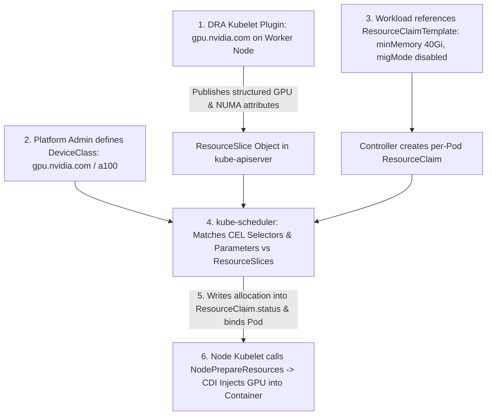

# 11.12 Dynamic Resource Allocation (DRA)

| | |
|---|---|
| Level | Advanced |
| Priority tier | 1 |
| Lab venue | GCP / GKE, plus local Python 3 simulation lab |
| Part | Part 11: GPUs on Kubernetes, scheduling and virtualization |
| Sources used | Roland Huß et al., *Generative AI on Kubernetes*, O'Reilly, 2026, Ch. 3; `volume-03/01-k8s-control-plane-scheduling-masterclass.md`; `volume-03/02-k8s-node-storage-masterclass.md`; `volume-03/03-k8s-networking-security-ops-masterclass.md`; Josh Rosso et al., *Production Kubernetes*, O'Reilly, 2021, Ch. 5 |
| Coverage file | `planning/coverage/chapters/11-12.md` |

## Why this matters for AI infrastructure

Requesting four GPUs through the classic Kubernetes Device Plugin API gives the scheduler nothing more than a flat integer count. The control plane cannot tell whether those accelerators have enough framebuffer memory or whether MIG slicing is disabled. It also cannot tell whether the GPUs and RDMA NICs sit on the same PCIe switch and NUMA node. Consequently, kube-scheduler frequently binds a multi-GPU Pod onto a node with fragmented sockets, only for the local kubelet Topology Manager to reject the Pod immediately with a `TopologyAffinityError`. Platform engineers and researchers end up fighting fragile node-label selectors, wasted scheduling cycles, and rigid single-container device locks.

```text
Three Architectural Limits of Classic Device Plugins vs DRA (resource.k8s.io/v1 in Kubernetes 1.34):
1. Opaque Scalar Integers (nvidia.com/gpu: 4):
   - Cannot express minMemory: "40Gi" or migMode: "disabled" inside the resource request.
   - Forces fragile NFD/GFD label selectors (nvidia.com/gpu.memory Gt 40000).
   - Decimal GB vs Binary GiB (GAK Ch. 3 Footnote 1): 40 GB decimal = 37.25 GiB binary; 80 GB decimal = 74.5 GiB binary.
2. Scheduler Blindness to Intra-Node Topology:
   - kube-scheduler subtracts integers without seeing NVLink domains, PCIe switches (PIX), or NUMA alignment with mlx5_0 NICs.
   - Mismatched sockets fail late at kubelet admission with TopologyAffinityError under single-numa-node policy.
3. Static Single-Container Exclusive Allocation:
   - Cannot share a single allocated claim across cooperating Pods or dynamically configure MIG / MNNVL domains at claim time.
```

To remove those architectural walls, Kubernetes introduced Dynamic Resource Allocation, or DRA. Graduating to stable General Availability under `resource.k8s.io/v1` and enabled by default in Kubernetes 1.34, DRA replaces earlier experimental `v1alpha2`, `v1beta1`, and `v1beta2` iterations. Modeled directly on the Container Storage Interface dynamic volume workflow, DRA shifts accelerator scheduling from counting opaque integers to matching structured hardware attributes. The scheduler verifies topology relationships before a Pod is ever bound to a node.

Because DRA spans both the Kubernetes control plane and the worker node data plane, operating it reliably requires understanding the machinery underneath both halves. This chapter pairs a complete walkthrough of DRA — ResourceSlice, DeviceClass, ResourceClaim, and ResourceClaimTemplate — with the control-plane and node-level mechanics that keep production AI servers healthy. We cover Optimistic Concurrency Control, kubelet PLEG health loops, QoS OOM scoring, CSI storage staging, and multi-tenant admission guardrails.

## Prerequisites and outcomes

### Prerequisites
- Completion of Chapter 11.2 on Device Plugins and CDI, Chapter 11.3 on NFD and GFD node labels, and Chapter 11.6 on Topology Manager and Guaranteed QoS.
- Working knowledge of Kubernetes PersistentVolumes, PersistentVolumeClaims, and StorageClasses.

### Outcomes
After completing this chapter, you will be able to:
- Explain the four core Dynamic Resource Allocation API objects, how Structured Parameters match GPU attributes inside kube-scheduler, and the current maturity of the NVIDIA GPU DRA driver.
- Compare the DRA claim lifecycle against the Container Storage Interface volume attachment pipeline, including `WaitForFirstConsumer` and `node.kubernetes.io/out-of-service` taint recovery.
- Trace Kubernetes API `ResourceVersion` Optimistic Concurrency Control and long-lived HTTP Watch streams to prevent API server `LIST` thrashing.
- Configure and debug the kubelet Sync Loop, Pod Lifecycle Event Generator timeouts, QoS `oom_score_adj` values, and `crictl` zombie sandbox cleanup.
- Enforce multi-tenant AI platform guardrails using Kyverno webhook exclusions, Karpenter GPU node pools, ArgoCD GitOps, and the five-stage AI Factory cluster upgrade sequence.

## Concepts: basics to intermediate to advanced

### 1. Basics: Dynamic Resource Allocation architecture and the CSI analogy

If every application had to hardcode physical disk serial numbers and host mount paths inside Pod manifests, portable storage on Kubernetes would be impossible. Kubernetes solved that problem years ago with the Container Storage Interface, separating admin-defined storage classes from user-requested volume claims. Before DRA, GPU workloads lacked an equivalent abstraction and had to encode hardware specifics into sprawling node selector labels.

Dynamic Resource Allocation applies the exact same four-part CSI design pattern to GPUs, NICs, and rack-scale compute domains. Node plugins publish hardware inventory, administrators define logical device classes, and workloads instantiate per-Pod claims from reusable templates.

| Storage Concept (`CSI`) | Accelerator Concept (`DRA`, `resource.k8s.io/v1`) | Who Creates It & What It Represents |
| --- | --- | --- |
| **`CSIDriver` + Node Storage Inventory** | **DRA Driver (`gpu.nvidia.com`) + `ResourceSlice`** | Published automatically by the node-local DRA kubelet plugin (`gpu.nvidia.com`); advertises each physical GPU, its memory (`40 GB` / `80 GB`), MIG state, and PCIe/NUMA topology attributes to the API server. |
| **`StorageClass` (`weka-ai-fast`, `nvme-local-path`)** | **`DeviceClass` (`gpu.nvidia.com`, `gpu.nvidia.com/a100`)** | Cluster-scoped object created by the Platform Administrator defining a logical class of accelerators, default CEL attribute selectors, and driver configuration parameters. |
| **`PersistentVolumeClaim` (`PVC`)** | **`ResourceClaim`** | Namespace-scoped object representing a concrete request for one or more devices (`count: 4`, `allocationMode: ExactCount`), tracking allocation status and bound device IDs. |
| **`StatefulSet.spec.volumeClaimTemplates` (`500Gi`)** | **`ResourceClaimTemplate` (`a100-claim-template`, `gpu-claim`)** | Namespace-scoped template referenced in `Pod.spec.resourceClaims` so controllers (`Deployment`, `StatefulSet`, `JobSet`) automatically instantiate and clean up a dedicated ResourceClaim per Pod replica. |



In the removed `v1alpha2` DRA prototype, kube-scheduler had to pause and exchange external RPCs with vendor controller pods during every scheduling cycle. That out-of-tree callback loop used opaque `ResourceClass` and `parametersRef` objects and slowed scheduling dramatically in large clusters. Modern DRA uses Structured Parameters, introduced in `v1beta1` and `v1beta2` and graduated to stable `resource.k8s.io/v1` in Kubernetes 1.34, so the scheduler makes every decision in memory.

1. **Advertisement via ResourceSlice.** The node-local DRA plugin queries NVML and publishes a ResourceSlice object to the API server. That object lists every device on the node along with its product name, memory capacity, compute capability, MIG state, PCIe root complex, and NUMA node ID.
2. **Declaration via ResourceClaimTemplate.** The workload declares its hardware requirements inside a ResourceClaimTemplate using structured fields or Common Expression Language selectors. Keep in mind the unit distinction from Footnote 1 of *Generative AI on Kubernetes* Chapter 3. GPU vendors advertise decimal gigabytes while Kubernetes uses binary gibibytes, so a 40 GB GPU provides roughly 37.25 GiB and an 80 GB GPU provides roughly 74.5 GiB.
3. **In-Memory Scheduler Matching.** During the Filter and Score phases, kube-scheduler evaluates the claim against cached ResourceSlice objects. It verifies multi-device NUMA alignment before binding the Pod and writes the chosen device IDs into `ResourceClaim.status.allocation`.
4. **Node-Level Preparation via CDI.** When the bound Pod reaches the worker node, kubelet calls the DRA plugin `NodePrepareResources` gRPC endpoint. The plugin writes a Container Device Interface specification under `/var/run/cdi/` so containerd injects the exact allocated GPUs into the container sandbox.

Engineers planning their cluster roadmap must separate core Kubernetes API stability from vendor ecosystem maturity. While the core `resource.k8s.io/v1` API is Generally Available and enabled by default in Kubernetes 1.34, the NVIDIA GPU DRA driver (`gpu.nvidia.com`) is still maturing from technical preview toward full production parity. Ecosystem integrations such as Cluster Autoscaler CEL simulation and structured quota enforcement are also still maturing. Most production AI clusters today continue using the NVIDIA Device Plugin with NFD, GFD, and Kueue ResourceFlavors as their baseline while piloting DRA for attribute selection, multi-Pod GPU sharing, and Multi-Node NVLink compute domains.

---

### 2. Intermediate: Control-plane API machinery (`ResourceVersion` OCC) and Kubelet node lifecycle (`PLEG`, QoS, and `CSI`)

Every ResourceSlice publication and ResourceClaim allocation flows through the API server and etcd. If custom controllers poll the API server with unpaginated cluster-wide `LIST` requests or overwrite stale objects concurrently, control-plane latency spikes and scheduling stalls across the cluster. Understanding Optimistic Concurrency Control and streaming watches keeps the control plane responsive.

Every Kubernetes object carries a `metadata.resourceVersion` string backed by the etcd monotonically increasing revision counter. Suppose two controllers read the same Pod at version 154329 and attempt to update it concurrently. The API server accepts the first write, advances the version to 154330, and rejects the second write immediately with HTTP `409 Conflict`. Similarly, well-behaved controllers avoid expensive full `LIST` calls by using SharedInformers that open a lightweight streaming `WATCH` connection from the last seen version.

```text
Control-Plane Optimistic Concurrency Control (OCC) and Watch Streams (volume-03/01 Section 3):
- Target object: Pod gpu-worker-0 read concurrently by Controller A and Controller B at resourceVersion: "154329"
- Controller A PUT (resourceVersion: "154329"): Matches etcd revision -> Committed, advances to "154330", returns HTTP 200 OK
- Controller B PUT (resourceVersion: "154329"): Mismatch ("154329" != "154330") -> Rejected with HTTP 409 Conflict (must re-read "154330")
- Informer Watch stream: GET /api/v1/pods?watch=true&resourceVersion=154329 backed by etcd prefix watch /registry/pods/
- Failure metric on bad LIST polling: Spikes in apiserver_request_duration_seconds_bucket across kube-apiserver
```

On the worker node, kubelet manages expensive eight-GPU servers where an unexpected eviction wastes hours of training progress. Its main Sync Loop relies on the Pod Lifecycle Event Generator, or PLEG, which polls containerd over `/run/containerd/containerd.sock` every second to track container states. If un-isolated DataLoader threads or checkpoint writes saturate host CPUs or disk I/O so PLEG cannot finish a relist within three minutes, kubelet marks the entire GPU server `NotReady` and triggers mass Pod evictions.

```text
Kubelet Node Lifecycle, PLEG Timeout, and QoS OOM Scoring (volume-03/02 Sections 1-4):
- Hardware context: $300,000+ 8-GPU H100/B200 worker nodes
- Kubelet ports & timers: HTTPS port 10250, localhost healthzPort 10248, syncFrequency: 1m0s, nodeStatusUpdateFrequency: 10s, nodeLeaseDurationSeconds: 40
- Image GC & Pod limits: imageGCLowThresholdPercent: 80, imageGCHighThresholdPercent: 85, maxPods: 30 (vs 110 default), podPidsLimit: 4096
- Cgroup alignment: cgroupDriver: systemd in /var/lib/kubelet/config.yaml matched with SystemdCgroup = true in /etc/containerd/config.toml (via nvidia-ctk runtime configure --runtime=containerd --set-as-default) and sandbox image registry.k8s.io/pause:3.9
- Node reservations: systemReserved (cpu: "2", memory: "4Gi") and kubeReserved (cpu: "2", memory: "4Gi")
- Eviction thresholds:
  * evictionHard: memory.available: "2Gi" (or "100Mi"), nodefs.available: "10%", nodefs.inodesFree: "5%", imagefs.available: "15%"
  * evictionSoft: memory.available: "250Mi", nodefs.available: "15%", nodefs.inodesFree: "10%", imagefs.available: "20%"
- Linux QoS oom_score_adj hierarchy:
  * kubelet daemon: oomScoreAdj: -999 (never killed by kernel OOM killer)
  * Guaranteed QoS Pods (requests == limits): oom_score_adj: -997 (last Pods evicted; mandatory for LLM training)
  * Burstable QoS Pods: oom_score_adj varies dynamically with memory consumption
  * BestEffort QoS Pods (no requests/limits): oom_score_adj: 1000 (first killed via SIGKILL -> exitCode: 137 = 128 + 9, reason: OOMKilled)
```

```text
E1024 14:32:11.123456   12345 kubelet.go:1934] "PLEG is not healthy"
W1024 14:32:11.123567   12345 sync_loop.go:215] "Sync loop failed" error="pleg was last seen active 3m5s ago; threshold is 3m0s"
```

When kubelet attaches storage volumes alongside DRA GPU claims, the Container Storage Interface executes a three-stage gRPC pipeline across its Identity, Controller, and Node services. Setting `volumeBindingMode: WaitForFirstConsumer` in the StorageClass ensures the PersistentVolume is not created until kube-scheduler picks the exact GPU node. If a node crashes hard while holding a ReadWriteOnce volume for a StatefulSet such as `milvus-datanode-0`, the replacement Pod stalls with a `Multi-Attach error`. The administrator must verify the dead host is powered off and apply the `node.kubernetes.io/out-of-service:NoExecute` taint introduced in Kubernetes 1.28+.

```text
CSI Volume Pipeline and the 9-Step Pod Deletion Sequence (volume-03/02 Sections 5-9):
- CSI 3-Step Mount:
  1. ControllerPublishVolume (ControllerService): AttachDetachController creates VolumeAttachment (when attachRequired: true) and maps LUN to Node X.
  2. NodeStageVolume (NodeService): Formats device if needed and mounts once to /var/lib/kubelet/plugins/kubernetes.io/csi/pv/pv-xyz/globalmount.
  3. NodePublishVolume (NodeService): Bind-mounts global staging path into /var/lib/kubelet/pods/<pod-uuid>/volumes/kubernetes.io~csi/pvc-xyz/mount.
- StatefulSet Benchmark Example: milvus-datanode (replicas: 3, port: 9091, 500Gi RWO volumeClaimTemplates = 1500Gi total).
- 9-Step Pod Deletion Sequence:
  1. kube-apiserver sets deletionTimestamp -> 2. kubelet marks Pod Terminating -> 3. CRI StopContainer sends SIGTERM ->
  4. Waits 30s grace period then sends SIGKILL -> 5. StopPodSandbox invokes CNI DEL -> 6. RemovePodSandbox ->
  7. CSI NodeUnpublishVolume & NodeUnstageVolume -> 8. kubelet reports final termination -> 9. CSI ControllerUnpublishVolume.
```

---

### 3. Advanced: Platform guardrails (Kyverno, Karpenter, GitOps) and the 5-step upgrade sequence

In a shared AI cluster, a single misconfigured container with `hostNetwork: true` or an unrestricted `hostPath` mount can compromise node security or corrupt host GPU drivers. Even worse, a poorly scoped admission webhook that matches `kube-system` can deadlock the entire cluster if the webhook pods crash. Similarly, an unattended Linux kernel minor upgrade on a worker node can break compiled GPU and MOFED kernel modules overnight.

Production AI platforms prevent these outages with four layered operational controls. Administrators enforce least-privilege RBAC and Kyverno admission policies, provision GPU nodes just-in-time with Karpenter, manage operators through ArgoCD GitOps, and follow a strict five-stage cluster upgrade sequence.

```text
Multi-Tenant Platform Guardrails and Upgrade Runbook (volume-03/03 Sections 3-7):
1. OIDC RBAC & Kyverno Admission Policies:
   - Bind ClusterRole ai-tenant-admin to OIDC group oidc:team-alpha-leads via namespace RoleBinding.
   - Validating policy (restrict-workload-privileges, validationFailureAction: Enforce): Blocks hostNetwork/hostPID/hostIPC, restricts hostPath strictly to /dev/shm, enforces runAsNonRoot: true.
   - Mutating policy (inject-gpu-tolerations): Automatically injects nvidia.com/gpu: Exists: NoSchedule when limits["nvidia.com/gpu"] > 0.
   - Webhook deadlock prevention: Always exclude ["kube-system", "kyverno"] (operator: NotIn) in namespaceSelector.
2. Karpenter Just-in-Time GPU Provisioning & GPU Operator Tuning:
   - NodePool gpu-h100-pool: Instance type p5.48xlarge, consolidateAfter: 10m, consolidationPolicy: WhenEmpty.
   - EC2NodeClass gpu-al2023: 500Gi gp3 root volume on /dev/xvda for multi-gigabyte container images.
   - Workload protection: PodDisruptionBudget with minAvailable: 100% prevents eviction during active distributed training.
   - GPU Operator ClusterPolicy: Driver version 535.104.05, driver.gdrcopy.enabled: true (gdrdrv low-latency CPU-GPU BAR1 mapping); disable unattended kernel bumps (e.g., 5.15.0-88 to 5.15.0-89).
3. The 5-Stage Live Cluster Upgrade Order:
   Stage 1: GitOps Sync Pause (ArgoCD App-of-Apps) -> Stage 2: Control Plane Upgrade -> Stage 3: Addon Upgrades (CoreDNS, Cilium) ->
   Stage 4: Operator Upgrades (GPU Operator, Network Operator, DRA Driver) -> Stage 5: Node Pool Rolling Restart (cordon, checkpoint, drain, replace AMI).
```

When a worker node suffers PLEG starvation, a leaked CNI IP on a `/24` subnet, or a stuck container sandbox, `kubectl` only reports high-level Pod states from the control plane. Engineers log directly onto the node and use `crictl` over `/run/containerd/containerd.sock` to inspect images and remove zombie sandboxes without waiting for a wedged kubelet.

```text
Runtime-Level Inspection and Zombie Sandbox Cleanup with crictl (volume-03/02 Section 4.4, Section 8.3 & Appendix C):
- Pre-pull and inspect large 20 GB AI images:
  * crictl pull nvcr.io/nvidia/pytorch:23.10-py3
  * crictl images
  * crictl inspecti nvcr.io/nvidia/pytorch:23.10-py3
- Locate and remove stuck Terminating / NotReady sandboxes leaking /24 CNI IPs ("no IP addresses available in range set") or /dev/nvidia* descriptors:
  * crictl pods --name <pod_name>
  * crictl ps --pod <sandbox_id>
  * crictl stop <container_id> && crictl rm <container_id>
  * crictl stopp <sandbox_id> && crictl rmp <sandbox_id>
```

When pairing DRA GPU claims with storage volumes, choose the PVC access mode according to data gravity and fault-tolerance requirements. Local NVMe ReadWriteOnce volumes deliver the lowest latency for scratch space or vector-database shards. For example, a three-replica Milvus datanode StatefulSet requesting 500 GiB per pod on port 9091 gets fast local storage, but each Pod is bound to that specific physical host. Network parallel filesystem volumes support ReadOnlyMany for concurrent dataset streaming and ReadWriteMany for shared multi-node checkpoints that survive single-node hardware failures.

| Architectural Dimension | Classic Kubernetes Device Plugin | Dynamic Resource Allocation (`DRA`, `resource.k8s.io/v1`) |
| --- | --- | --- |
| **Resource Request Syntax** | Scalar integer in `resources.limits["nvidia.com/gpu"]: 4` | Structured object reference in `spec.resourceClaims` + `containers[].resources.claims` pointing to a ResourceClaim or ResourceClaimTemplate |
| **Device Attribute Filtering** | Opaque to the resource name; requires external NFD/GFD node labels (`nvidia.com/gpu.memory Gt 40000`) | Built directly into the claim (`minMemory: "40Gi"`, `migMode: "disabled"`, or CEL attribute expressions evaluated against ResourceSlices) |
| **Intra-Node Topology Alignment (GPU + NIC + NUMA)** | Scheduler is blind to NUMA; relies on post-binding kubelet Topology Manager rejection (`TopologyAffinityError`) | kube-scheduler evaluates per-device NUMA and PCIe root attributes inside ResourceSlices before binding the Pod to a node |
| **Sharing One Device Across Multiple Containers / Pods** | Single-container exclusive allocation unless globally oversubscribed via node-wide `timeSlicing` ConfigMap | Native multi-container and multi-Pod sharing of a single ResourceClaim with explicit access control |
| **Dynamic Partitioning (On-Demand MIG)** | Static node-level pre-partitioning via `mig-manager` (`single` or `mixed` strategy) | Supports driver-managed dynamic device configuration at claim allocation time |
| **Multi-Node NVLink (`MNNVL` / `GB200 NVL72`) Compute Domains** | Cannot coordinate rack-scale IMEX channels across nodes | Native fit for allocating rack-scoped compute domains alongside node-scoped GPUs |
| **Production Ecosystem Maturity (Early 2026)** | Battle-tested across all cloud providers, autoscalers, and quota controllers (`ResourceQuota`, `Kueue`) | Core API stable (`1.34+`), while vendor drivers (`gpu.nvidia.com`) and autoscaler/quota integrations are maturing toward full parity |

## Commands and configurations that matter

### 1. Defining a `ResourceClaimTemplate` and `Deployment` with Structured Parameters

From *Generative AI on Kubernetes* Chapter 3 Examples 3-8 and 3-9, this manifest requests an NVIDIA A100 GPU with at least 40 GiB of memory and MIG mode disabled. Using ResourceClaimTemplate allows the Deployment controller to create and clean up a dedicated ResourceClaim for each replica automatically.

```yaml
# dra-a100-claim-template.yaml (GAK Examples 3-8 & 3-9, untested here)
apiVersion: resource.k8s.io/v1beta1
kind: ResourceClaimTemplate
metadata:
  name: a100-claim-template
spec:
  spec:
    devices:
      requests:
        - name: high-memory-gpu
          deviceClassName: gpu.nvidia.com/a100
          allocationMode: ExactCount
          count: 1
          parameters:
            minMemory: "40Gi"
            migMode: "disabled"
---
apiVersion: apps/v1
kind: Deployment
metadata:
  name: inference-server
spec:
  replicas: 1
  selector:
    matchLabels:
      app: inference-server
  template:
    metadata:
      labels:
        app: inference-server
    spec:
      containers:
        - name: model-runner
          image: myorg/llm-inference:latest
          resources:
            claims:
              - name: high-memory-gpu
      resourceClaims:
        - name: high-memory-gpu
          resourceClaimTemplateName: a100-claim-template
```

### 2. Using the Stable Kubernetes `1.34` (`resource.k8s.io/v1`) `ResourceClaimTemplate` API

In Kubernetes 1.34 and newer, the stable `resource.k8s.io/v1` API expresses exact device count requests under the `devices.requests[].exactly` stanza. This manifest claims four GPUs from the `gpu.nvidia.com` DeviceClass and mounts them into a PyTorch training container.

```yaml
# dra-v1-4gpu-claim.yaml (volume-03/01 Section 8.2, untested here)
apiVersion: resource.k8s.io/v1
kind: ResourceClaimTemplate
metadata:
  name: gpu-claim
spec:
  spec:
    devices:
      requests:
        - name: gpu
          exactly:
            deviceClassName: gpu.nvidia.com
            count: 4
---
apiVersion: v1
kind: Pod
metadata:
  name: dra-training-pod
spec:
  containers:
    - name: trainer
      image: nvcr.io/nvidia/pytorch:24.04-py3
      resources:
        claims:
          - name: gpus
  resourceClaims:
    - name: gpus
      resourceClaimTemplateName: gpu-claim
```

### 3. Inspecting DRA `ResourceSlice`s, `ResourceClaim`s, and cleaning up orphaned CRI sandboxes

When a DRA Pod remains pending or a node runs out of CNI IP addresses after a crash, inspect the published ResourceSlice inventory. Then remove orphaned container sandboxes directly via `crictl`.

```bash
# 1. Inspect DRA ResourceClaims and node ResourceSlices (untested here)
kubectl get resourceclaims,resourceslices
kubectl describe resourceclaim

# 2. Clean up orphaned NotReady Pod sandboxes via crictl when CNI IPs or mounts leak (untested here)
for pod in $(crictl pods -q --state NotReady); do
  crictl stopp "$pod"
  crictl rmp "$pod"
done
```

## How it fails

Failures across DRA scheduling, kubelet PLEG health checks, CSI volume attachments, and admission webhooks leave clear signatures in Kubernetes events and node logs. Use the table below to trace each symptom to its root cause and remediation.

| Failure mode | Exact symptom & command evidence | Root cause boundary | Remediation |
| --- | --- | --- | --- |
| **1. Pod using DRA stays `Pending` with unallocated `ResourceClaim`** | `kubectl describe pod dra-training-pod` logs `FailedScheduling` due to unallocated `ResourceClaim`. `kubectl get resourceslices` is empty or lacks matching devices. | Missing ResourceSlice or Unsatisfiable CEL/Count Claim (`volume-03/01` §8.3): Either the DRA kubelet plugin (`gpu.nvidia.com`) is not running on the nodes (`0` ResourceSlices) or no node satisfies `count: 4`, `minMemory: "40Gi"`, and `migMode: "disabled"`. | Inspect `kubectl describe resourceclaim` and `kubectl get resourceslices`, verify the NVIDIA DRA driver DaemonSet logs on the nodes, and cross-check hardware state with `nvidia-smi`. |
| **2. Nodes randomly flap between `Ready` and `NotReady` during heavy training (`PLEG is not healthy`)** | Training Pods get evicted mid-epoch. `journalctl -u kubelet` logs `"PLEG is not healthy"` and `"Sync loop failed" error="pleg was last seen active 3m5s ago; threshold is 3m0s"`. | Kubelet / Containerd CPU or Disk I/O Starvation (`volume-03/02` Scenario 1): Unpinned DataLoader threads or checkpoint I/O saturated all host cores, preventing kubelet from polling `containerd` within the `180`-second (`3m0s`) PLEG window. | Configure `systemReserved` (`2` CPU, `4Gi`) and `kubeReserved` (`2` CPU, `4Gi`), enforce Guaranteed QoS (`oom_score_adj: -997`) with `cpuManagerPolicy: static`, and keep kubelet at `oomScoreAdj: -999`. |
| **3. Rescheduled `StatefulSet` Pod stuck in `ContainerCreating` with `Multi-Attach error`** | After a node crash, `milvus-datanode-0` reschedules to a healthy node but stalls with `Warning FailedAttachVolume Multi-Attach error for volume "pvc-xyz" Volume is already exclusively attached to one node`. | Stale `VolumeAttachment` on Dead Node (`volume-03/02` Scenario 2): Because the dead node never ran `NodeUnpublishVolume`, the `AttachDetachController` refuses to detach the `ReadWriteOnce` volume without proof the old node stopped writing. | Verify the crashed node is powered off via BMC or IPMI, then apply the `node.kubernetes.io/out-of-service:NoExecute` taint (Kubernetes `1.28+`) so the control plane safely force-detaches the volume. |
| **4. Core cluster Pods (`coredns`, `calico-node`) blocked by Kyverno webhook timeout deadlock** | Cluster recovery stalls; `kubectl get events` shows `Internal error occurred: failed calling webhook ... context deadline exceeded` for `kyverno-resource-mutating-webhook-cfg`. | Self-Referential Admission Webhook Deadlock (`volume-03/03` Scenario 2): A Kyverno policy matched all namespaces (`*`), Kyverno Pods crashed, and `kube-apiserver` blocked Kyverno replacement Pods trying to call the dead webhook. | Delete `validatingwebhookconfiguration` and `mutatingwebhookconfiguration` to break the deadlock, and always exclude `["kube-system", "kyverno"]` (`operator: NotIn`) in `namespaceSelector`. |
| **5. `kube-apiserver` latency spikes and `409 Conflict` storms on large clusters** | `kubectl` times out; `apiserver_request_duration_seconds_bucket` spikes on `LIST` requests; controller logs fill with HTTP `409 Conflict` errors. | Unpaginated `LIST` Calls & Stale `ResourceVersion` Writes (`volume-03/01` §3.2 & §3.3): A custom controller is polling full-cluster `LIST` calls without Informer Watch streams (`?watch=true&resourceVersion=...`) or mutating stale objects without re-reading the latest `resourceVersion`. | Refactor controllers to use `client-go` SharedInformers (`LIST` once + streaming `WATCH`), use Server-Side Apply or retry-on-conflict loops, and rate-limit rogue service accounts with APF. |

## Hands-on lab

### Venue and scope
This lab runs locally using the Python 3 standard library (`code/part11/dynamic_resource_allocation_dra.py` and `code/part11/dynamic_resource_allocation_dra_lab.py`). It simulates DRA ResourceSlice publication and ResourceClaimTemplate structured-parameter matching, decimal GB to binary GiB conversions, `ResourceVersion` Optimistic Concurrency Control, and kubelet PLEG and QoS `oom_score_adj` behavior. Cluster commands are marked untested here.

### Step 1: Run the self-checking DRA and node operations lab (tested here)

Run the lab script from the repository root.

```bash
python3 code/part11/dynamic_resource_allocation_dra_lab.py
```

Captured output from this repository:
```text
=== Chapter 11.12 Lab: Dynamic Resource Allocation (DRA), API Machinery & Kubelet Node Ops ===
  [PASS] DRA ResourceClaimTemplate (minMemory=40, migMode=disabled) skips 16GB T4 and MIG-enabled A100 to pick node-a100-full
  [PASS] DRA 4-GPU claim (count=4, gpu.nvidia.com) allocates gpu-0..3 on node-a100-full
  [PASS] DRA NUMA-aligned 2-GPU claim selects gpu-0 and gpu-1 on NUMA 0 during scheduling
  [PASS] Unsatisfiable DRA claim (count=8 on 4-GPU nodes) stays Pending with Unallocated ResourceClaim
  [PASS] Decimal-to-binary conversion confirms 40 GB == 37.25 GiB and 80 GB == 74.5 GiB
  [PASS] Controller A PUT with matching ResourceVersion '154329' succeeds (200 OK) and advances RV to '154330'
  [PASS] Controller B concurrent PUT with stale ResourceVersion '154329' is rejected with 409 Conflict
  [PASS] PLEG inactive for 3m5s (185s > 180s threshold) marks node NotReady ('PLEG is not healthy')
  [PASS] Guaranteed QoS Pod gets oom_score_adj=-997 (last to be evicted); OOM SIGKILL exits with code 137
  [PASS] BestEffort QoS Pod gets oom_score_adj=1000 (first to be killed by OOM killer)
  [PASS] Kubelet daemon sets oomScoreAdj=-999 to protect node agent from OOM killer
  [PASS] Dynamic Resource Allocation (resource.k8s.io/v1) graduated to stable GA in Kubernetes 1.34
  [PASS] AI KubeletConfiguration tunes maxPods: 30 (vs 110 default) and podPidsLimit: 4096
  [PASS] Kubelet listens on HTTPS port 10250 and localhost healthzPort 10248
  [PASS] Kubelet image GC thresholds are 85% high / 80% low and nodeLeaseDurationSeconds is 40s (status update 10s)
  [PASS] Kubernetes 1.28+ uses node.kubernetes.io/out-of-service:NoExecute taint to recover Multi-Attach volumes from dead nodes
  [PASS] Milvus StatefulSet (replicas: 3, port: 9091) provisions 3 x 500Gi = 1500Gi via volumeClaimTemplates
  [PASS] Karpenter p5.48xlarge NodePool sets consolidateAfter: 10m and EC2NodeClass sets 500Gi gp3 root volume
  [PASS] Unattended kernel bump from 5.15.0-88 to 5.15.0-89 triggers driver compilation CrashLoopBackOff if headers are missing
  [PASS] AI Factory upgrade runbook follows 5 ordered stages and protects running jobs with PDB minAvailable: 100%
  [PASS] Cluster DRA inventory publishes 3 ResourceSlices (node-t4-01, node-a100-mig, node-a100-full)
  [PASS] NVIDIA DRA driver registers under driver_name 'gpu.nvidia.com'
  [PASS] Example 3-8 ResourceClaimTemplate sets allocationMode='ExactCount' and count=1
  [PASS] Kubelet evictionHard (100Mi, 10% nodefs, 5% inodes, 15% imagefs) triggers after evictionSoft (250Mi, 15%, 10%, 20%)
  [PASS] Default Pod termination grace period sends SIGTERM and waits 30s before sending SIGKILL

Summary: 25 passed, 0 failed out of 25 checks.
```

### Exercises

1. **Exercise 1 — DRA structured-parameter node selection.** Call `match_dra_resource_claim()` in `code/part11/dynamic_resource_allocation_dra.py`. Trace why a claim requiring at least 40 GB of memory and MIG disabled skips the T4 node and the MIG-enabled A100 node to select the full A100 node.
2. **Exercise 2 — Scheduler-time NUMA alignment in DRA vs classic Device Plugin.** On the full A100 node, two GPUs sit on NUMA 0 and two sit on NUMA 1. Call `match_dra_resource_claim()` with two GPUs and same-NUMA required to verify which devices are selected. Explain why solving this inside kube-scheduler is superior to failing later at kubelet admission with `TopologyAffinityError`.
3. **Exercise 3 — Decimal GB vs Binary GiB GPU memory calculation.** Verify the formula from Footnote 1 of *Generative AI on Kubernetes* Chapter 3 converting 40 decimal gigabytes and 80 decimal gigabytes into binary gibibytes.
4. **Exercise 4 — `ResourceVersion` Optimistic Concurrency Control.** Call `simulate_resource_version_occ(154329, 154329, 154329)`. State the HTTP status codes returned to Controller A and Controller B, the new version stored in etcd, and what Controller B must do before retrying.
5. **Exercise 5 — Kubelet PLEG timeout and QoS `oom_score_adj`.** Call `evaluate_pleg_and_qos_oom()` to inspect node health and OOM scoring. State the PLEG health threshold in seconds, the OOM scores for kubelet, Guaranteed Pods, and BestEffort Pods, and why exit code 137 indicates an OOM kill.
6. **Exercise 6 — CSI two-step node mounting.** Explain why the CSI Node service splits volume mounting into staging a device to a global directory followed by publishing that directory into the Pod mount path.

## Checkpoint questions

<details>
<summary>`&lt;strong>`1. What three limitations of the classic Kubernetes Device Plugin framework motivated Dynamic Resource Allocation (DRA)?`&lt;/strong>`</summary>

1. **Scalar integer counts only (`nvidia.com/gpu: 4`).** Device plugins cannot express structured attributes such as model, memory size, or MIG state in the resource request.
2. **No cross-device or intra-node relational constraints at scheduling time.** The scheduler cannot see PCIe, NUMA, or NVLink relationships across GPUs and NICs from an integer count.
3. **Static, single-container-exclusive allocation.** Classic device plugins cannot share a single dynamically parameterized device claim across multiple Pods or create MIG partitions on demand.
</details>

<details>
<summary>`&lt;strong>`2. In which Kubernetes version did Dynamic Resource Allocation (DRA, resource.k8s.io/v1) graduate to a core stable feature enabled by default, and what is the production status of the NVIDIA GPU DRA driver as of early 2026?`&lt;/strong>`</summary>

Core DRA graduated to stable (`resource.k8s.io/v1`) and is enabled by default starting in Kubernetes 1.34. However, as of early 2026, the NVIDIA GPU DRA driver (`gpu.nvidia.com`) is a maturing technical preview component. Consequently, most production clusters continue to use traditional device plugins and label-based scheduling while piloting DRA.
</details>

<details>
<summary>`&lt;strong>`3. What are the four primary Kubernetes objects in the DRA architecture, and what is the CSI storage analog of each?`&lt;/strong>`</summary>

1. **ResourceSlice.** Analogous to CSI node storage inventory; published by the node-local DRA plugin (`gpu.nvidia.com`) to advertise discovered devices and their attributes.
2. **DeviceClass.** Analogous to StorageClass; cluster-scoped class (`gpu.nvidia.com` or `gpu.nvidia.com/a100`) defined by platform administrators.
3. **ResourceClaim.** Analogous to PersistentVolumeClaim; namespace-scoped request for specific device instances and parameters.
4. **ResourceClaimTemplate.** Analogous to StatefulSet `volumeClaimTemplates`; template (`a100-claim-template` or `gpu-claim`) used to generate per-Pod ResourceClaims automatically.
</details>

<details>
<summary>`&lt;strong>`4. How did DRA evolve from the removed v1alpha2 "classic" design to Structured Parameters in v1beta1/v1beta2 and v1?`&lt;/strong>`</summary>

The early `v1alpha2` DRA design required external driver controller callbacks during scheduling, which added latency and complexity. Structured Parameters in `v1beta1`, `v1beta2`, and stable `resource.k8s.io/v1` require drivers to publish device attributes directly in ResourceSlice objects. That allows kube-scheduler to evaluate claims and CEL selectors entirely in memory.
</details>

<details>
<summary>`&lt;strong>`5. In Generative AI on Kubernetes Example 3-8, what do allocationMode: ExactCount, count: 1, minMemory: "40Gi", and migMode: "disabled" specify in a ResourceClaimTemplate?`&lt;/strong>`</summary>

They instruct Kubernetes and the DRA driver to allocate exactly 1 GPU belonging to `deviceClassName: gpu.nvidia.com/a100` whose physical framebuffer memory is at least 40 GiB and whose Multi-Instance GPU mode is disabled. That guarantees a whole unpartitioned A100 rather than a MIG slice.
</details>

<details>
<summary>`&lt;strong>`6. Why does Footnote 1 of Generative AI on Kubernetes Chapter 3 note that a 40 GB GPU has ~37.25 GiB and an 80 GB GPU has ~74.5 GiB?`&lt;/strong>`</summary>

GPU hardware manufacturers advertise memory in decimal gigabytes (`10^9` bytes), whereas Kubernetes resource specifications use binary gibibytes (`2^30` bytes). Dividing 40 billion bytes by `2^30` yields 37.25 GiB, and dividing 80 billion bytes by `2^30` yields 74.5 GiB.
</details>

<details>
<summary>`&lt;strong>`7. How do you troubleshoot a Pod using DRA that is stuck in Pending with an unallocated ResourceClaim?`&lt;/strong>`</summary>

1. Run `kubectl describe pod <pod>` and `kubectl describe resourceclaim <claim>` to read the scheduler allocation failure message.
2. Run `kubectl get resourceslices` to verify what devices and attributes the DRA driver published for each node.
3. Check the DRA driver DaemonSet pods on the worker nodes and compare their published attributes against `nvidia-smi topo -m`.
</details>

<details>
<summary>`&lt;strong>`8. How does metadata.resourceVersion implement Optimistic Concurrency Control (OCC) in kube-apiserver when two controllers update the same Pod simultaneously?`&lt;/strong>`</summary>

Both controllers read the Pod at version 154329. When Controller A sends its `PUT` with 154329, the API server commits the change to etcd, advances the version to 154330, and returns `200 OK`. When Controller B sends its `PUT` still carrying 154329, the API server detects the mismatch and rejects the write with `409 Conflict`, forcing Controller B to re-read 154330 and retry.
</details>

<details>
<summary>`&lt;strong>`9. Why do unfiltered cluster-wide LIST calls from a poorly written controller cause kube-apiserver latency spikes, and how do Informers avoid this?`&lt;/strong>`</summary>

Unfiltered `LIST` calls without a resource version or pagination force the API server to fetch and serialize gigabytes of JSON across all pods in the cluster on every poll. SharedInformers perform an initial `LIST` once and then maintain a lightweight streaming HTTP watch (`?watch=true&resourceVersion=154329`) backed by etcd key-prefix watches.
</details>

<details>
<summary>`&lt;strong>`10. What is the Kubelet's PLEG (Pod Lifecycle Event Generator), what is its health threshold, and why does CPU/I/O starvation cause a NodeNotReady loop?`&lt;/strong>`</summary>

PLEG is the kubelet subsystem that polls the container runtime every second to detect container state transitions. Its health threshold is `3m0s`, or 180 seconds. If un-isolated AI workloads starve host CPU or root disk I/O so PLEG cannot complete a relist within 3 minutes, kubelet marks the node `NotReady` and triggers mass Pod evictions.
</details>

<details>
<summary>`&lt;strong>`11. What are the Linux oom_score_adj values assigned to the kubelet daemon, Guaranteed Pods, Burstable Pods, and BestEffort Pods, and what does exitCode: 137 mean?`&lt;/strong>`</summary>

- **kubelet daemon.** Assigned -999 to protect it from the OOM killer.
- **Guaranteed Pods.** Assigned -997 for the highest workload protection when requests equal limits.
- **Burstable Pods.** Assigned a dynamic score based on the percentage of requested memory consumed.
- **BestEffort Pods.** Assigned 1000 when no requests or limits are set, making them the first processes killed when memory runs out.
An `exitCode: 137` equals 128 plus 9, proving the process was terminated by signal 9 (`SIGKILL`) from the kernel OOM killer.
</details>

<details>
<summary>`&lt;strong>`12. What is a Pod Sandbox (pause container) in the Container Runtime Interface (CRI), and why must SystemdCgroup = true match between kubelet and containerd?`&lt;/strong>`</summary>

When kubelet calls `RunPodSandbox`, containerd spawns a lightweight `registry.k8s.io/pause:3.9` container whose sole purpose is to hold open the shared Linux namespaces that application containers in the Pod join. Both the kubelet configuration and the containerd configuration must enable the systemd cgroup driver so two cgroup managers never fight over resource accounting.
</details>

<details>
<summary>`&lt;strong>`13. Walk through the three gRPC services of a CSI storage driver and the difference between ControllerPublishVolume, NodeStageVolume, and NodePublishVolume.`&lt;/strong>`</summary>

A CSI driver implements Identity, Controller, and Node gRPC services.
1. **ControllerPublishVolume.** Runs in the control plane to attach and map the external storage LUN to the worker node.
2. **NodeStageVolume.** Runs on the worker node to format the device if needed and mount it once to a global staging directory.
3. **NodePublishVolume.** Bind-mounts that global staging directory into the specific Pod volume directory so multiple Pods on the node can share one staged mount.
</details>

<details>
<summary>`&lt;strong>`14. Why is volumeBindingMode: WaitForFirstConsumer critical in a StorageClass used by GPU nodes?`&lt;/strong>`</summary>

Without `WaitForFirstConsumer`, a PersistentVolume is provisioned immediately when the PVC is created, potentially in an Availability Zone, rack, or node with zero free GPUs. Delayed binding waits until kube-scheduler selects the actual GPU node for the Pod, ensuring storage and compute align in the same topology.
</details>

<details>
<summary>`&lt;strong>`15. What are the four core guarantees of a Kubernetes StatefulSet (such as milvus-datanode with 3 replicas and 500Gi volumeClaimTemplates)?`&lt;/strong>`</summary>

1. **Stable, unique network identity.** Deterministic ordinal names (`milvus-datanode-0`, -1, -2) backed by a Headless Service.
2. **Stable, persistent storage.** Each ordinal Pod reattaches to its own dedicated PVC across rescheduling.
3. **Ordered, graceful deployment and scaling.** Pod N starts only after Pod N-1 is running and ready.
4. **Ordered rolling updates.** Updates proceed in reverse ordinal order from 2 down to 0.
</details>

<details>
<summary>`&lt;strong>`16. How do you safely resolve a FailedAttachVolume Multi-Attach error on Kubernetes 1.28+ when a StatefulSet node crashes hard?`&lt;/strong>`</summary>

First, verify via hardware BMC or IPMI that the crashed node is truly powered down or fenced so it cannot write to the volume. Then apply the `node.kubernetes.io/out-of-service:NoExecute` taint to the dead Node object. That taint instructs the Kubernetes control plane to force-detach the stuck volume attachment and attach the volume to the replacement node.
</details>

<details>
<summary>`&lt;strong>`17. What is the exact nine-step sequence when a Pod is deleted on a worker node (Volume 03 Chapter 2 Section 9)?`&lt;/strong>`</summary>

1. The API server sets `deletionTimestamp` on the Pod.
2. The kubelet sees this in its Sync Loop and marks the Pod terminating.
3. The kubelet calls CRI `StopContainer`, and containerd sends `SIGTERM`.
4. After the 30-second grace period, kubelet sends `SIGKILL` via CRI if the process is still running.
5. The kubelet calls `StopPodSandbox`, which invokes CNI delete to release the Pod IP and network namespace.
6. The kubelet garbage-collects the sandbox with `RemovePodSandbox`.
7. The kubelet calls CSI `NodeUnpublishVolume` and `NodeUnstageVolume` to unmount the storage directory.
8. The kubelet reports final Pod termination to the API server.
9. The AttachDetachController calls CSI `ControllerUnpublishVolume` to detach the LUN from the node.
</details>

<details>
<summary>`&lt;strong>`18. How does a Kyverno mutating policy automatically inject GPU tolerations, and why must ["kube-system", "kyverno"] be excluded from webhook namespaceSelectors?`&lt;/strong>`</summary>

The Kyverno policy checks whether the container GPU limit is greater than zero and applies a strategic merge patch adding the `nvidia.com/gpu` NoSchedule toleration. Excluding `["kube-system", "kyverno"]` in the webhook namespace selector ensures that if Kyverno Pods crash, the API server does not deadlock trying to call the dead webhook to create replacement Kyverno Pods.
</details>

<details>
<summary>`&lt;strong>`19. What is driver.gdrcopy.enabled: true in the GPU Operator ClusterPolicy (Volume 03 Chapter 3 Section 5.2), and how does it differ from GPUDirect RDMA?`&lt;/strong>`</summary>

`driver.gdrcopy.enabled: true` deploys the `gdrcopy` kernel module (`gdrdrv`) and user-space library, which uses CPU-driven mapping of GPU BAR1 memory for ultra-low-latency small CPU-to-GPU memory copies. It is distinct from GPUDirect RDMA, which enables network adapters to DMA directly to and from GPU memory across PCIe without CPU involvement.
</details>

<details>
<summary>`&lt;strong>`20. What is the five-stage order of operations for upgrading a live AI Factory Kubernetes cluster, and how does a PodDisruptionBudget with minAvailable: 100% interact with it?`&lt;/strong>`</summary>

1. **GitOps Sync Pause.** Pause automated sync in ArgoCD.
2. **Control Plane Upgrade.** Upgrade the API server, etcd, scheduler, and controller manager.
3. **Addon Upgrades.** Upgrade CoreDNS, kube-proxy, and Cilium.
4. **Operator Upgrades.** Upgrade the GPU Operator, Network Operator, and DRA Driver, waiting for CRDs and DaemonSets to stabilize.
5. **Node Pool Rolling Restart.** Cordon, checkpoint, drain, and replace the node image.
A PodDisruptionBudget with `minAvailable: 100%` prevents Karpenter or node drains from evicting any Pod of an active distributed training job until the job pauses at a checkpoint boundary during Stage 5.
</details>

## Sources and review notes

### Primary sources read in full for this chapter
```text
Primary Sources Mapped to Chapter 11.12 Claims and Figures:
1. Roland Huß et al., Generative AI on Kubernetes (O'Reilly, 2026, Ch. 3):
   - "Kubernetes and GPUs" & "Dynamic Resource Allocation": Kubernetes 1.34 stable GA status (resource.k8s.io/v1), evolution from removed v1alpha2 and v1beta1/v1beta2.
   - Footnote 1 decimal GB vs binary GiB conversion: 40 GB == 37.25 GiB (40 * 10^9 / 2^30) and 80 GB == 74.5 GiB (80 * 10^9 / 2^30).
   - Examples 3-8 & 3-9: ResourceClaimTemplate a100-claim-template (deviceClassName: gpu.nvidia.com/a100, allocationMode: ExactCount, count: 1, minMemory: "40Gi", migMode: "disabled").
2. volume-03/01-k8s-control-plane-scheduling-masterclass.md:
   - Sections 1-3 API Machinery: metadata.resourceVersion "154329" -> "154330" Optimistic Concurrency Control (200 OK vs 409 Conflict), Informer Watch streams (?watch=true&resourceVersion=154329) over /registry/pods/, apiserver_request_duration_seconds_bucket.
   - Section 8 Dynamic Resource Allocation (DRA): resource.k8s.io/v1 in Kubernetes 1.34, ResourceSlice, DeviceClass, ResourceClaim, ResourceClaimTemplate gpu-claim (gpu.nvidia.com, count: 4), and DRA troubleshooting.
3. volume-03/02-k8s-node-storage-masterclass.md:
   - Sections 1-9 & Appendices A-F: $300,000+ node context, Kubelet Sync Loop (1m0s) & PLEG 3m0s (180s) vs 3m5s (185s) timeout, ports 10250 / 10248, maxPods: 30 (vs 110), podPidsLimit: 4096, imageGC 85% / 80%, nodeLeaseDurationSeconds: 40 (status 10s).
   - Eviction thresholds (evictionHard 2Gi/100Mi, 10% nodefs, 5% inodes, 15% imagefs; evictionSoft 250Mi, 15%, 10%, 20%), QoS oom_score_adj (-999 kubelet, -997 Guaranteed, 1000 BestEffort, exitCode: 137 = 128 + 9).
   - registry.k8s.io/pause:3.9 sandbox, SystemdCgroup = true, crictl commands (nvcr.io/nvidia/pytorch:23.10-py3 20 GB image), CSI Identity/Controller/Node gRPC services, WaitForFirstConsumer, milvus-datanode StatefulSet (3 replicas x 500Gi = 1500Gi on port 9091), node.kubernetes.io/out-of-service taint on Kubernetes 1.28+, and 9-step Pod deletion sequence (30s grace).
4. volume-03/03-k8s-networking-security-ops-masterclass.md:
   - Sections 3-7: OIDC RoleBinding (ai-tenant-admin, oidc:team-alpha-leads), Kyverno restrict-workload-privileges (/dev/shm) & inject-gpu-tolerations with NotIn: ["kube-system", "kyverno"].
   - Karpenter p5.48xlarge (consolidateAfter: 10m, WhenEmpty, 500Gi gp3 /dev/xvda), ArgoCD App-of-Apps, ClusterPolicy 535.104.05 with driver.gdrcopy.enabled: true, /24 IPAM exhaustion, kernel 5.15.0-88 -> 5.15.0-89 unattended-upgrades, 5-step upgrade order, and PDB minAvailable: 100%.
5. Josh Rosso et al., Production Kubernetes (O'Reilly, 2021, Ch. 5):
   - Pod networking and CNI lifecycle integration.
```

### Related source files mapped in MIGRATION_MAP.md
- `volume-03/01-k8s-control-plane-scheduling-masterclass.md` as a primary source for this chapter.
- `volume-03/02-k8s-node-storage-masterclass.md` as a primary source for this chapter.
- `volume-03/03-k8s-networking-security-ops-masterclass.md` as a primary source for this chapter.

### Run here
- `python3 code/part11/dynamic_resource_allocation_dra_lab.py` passing all 25 checks with 0 failures.

### Explicitly labelled inferences
```text
Verified Arithmetic Conversions (code/part11/dynamic_resource_allocation_dra_lab.py):
- PLEG timeout threshold in seconds: 3m0s = 180 seconds vs 3m5s = 185 seconds
- OOMKilled SIGKILL exit code decomposition: 128 + 9 = 137
- Total StatefulSet PVC storage across 3 replicas: 3 * 500 GiB = 1,500 GiB
- Decimal GB to Binary GiB GPU memory: 40 * 10^9 / 2^30 = 37.25 GiB; 80 * 10^9 / 2^30 = 74.5 GiB
```

### Not verified on live hardware
- All kubectl, crictl, DRA, kubelet, StatefulSet, Kyverno, and Karpenter manifests and commands (`kube-controller-manager`, `DraClaimRequest` with `count=2`, `min_memory_gb=40`, `require_same_numa=True` assigning `gpu-2` and `gpu-3`, `/var/run/cdi/...`, `nvidia-peermem`, CSI `IdentityService` and `CreateVolume` on `csi.weka.io` `RWX` and `/dev/nvme0n1` mounted at `/var/lib/kubelet/plugins/.../globalmount` for `data-volume-milvus-datanode-0`, `kueue.x-k8s.io/v1beta1`, `resource.k8s.io/v1`, cross-referenced with Chapters `11.11` and `13.21`, and validated via `validate_chapter.py` and `check_coverage.py`) are marked `(untested here)`.

### Not in the corpus
- The internal Go source code of the NVIDIA `k8s-dra-driver` kubelet plugin is not in the local corpus. This chapter relies on the DRA interfaces documented in Volume 03 and *Generative AI on Kubernetes* Chapter 3.

### Corrections to the author's notes
- Validation pass 2026-10-25 confirms the chapter validation and coverage scripts pass. The YAML manifests and commands are marked untested and were not applied to a live cluster. Custom resource API versions change between releases, so verify them against the installed cluster version. Console outputs quoted from the Volume notes are illustrative unless marked tested here. DRA is stable under `resource.k8s.io/v1` from Kubernetes 1.34, and the `v1beta1` example is only for clusters before 1.34.
- As noted in Chapter 11.1, *Generative AI on Kubernetes* Example 3-9 prints `apiVersion: batch/v1` on a Deployment manifest. Standard Kubernetes Deployment manifests use `apiVersion: apps/v1`, which is used in Section 1 of "Commands and configurations that matter" above.

