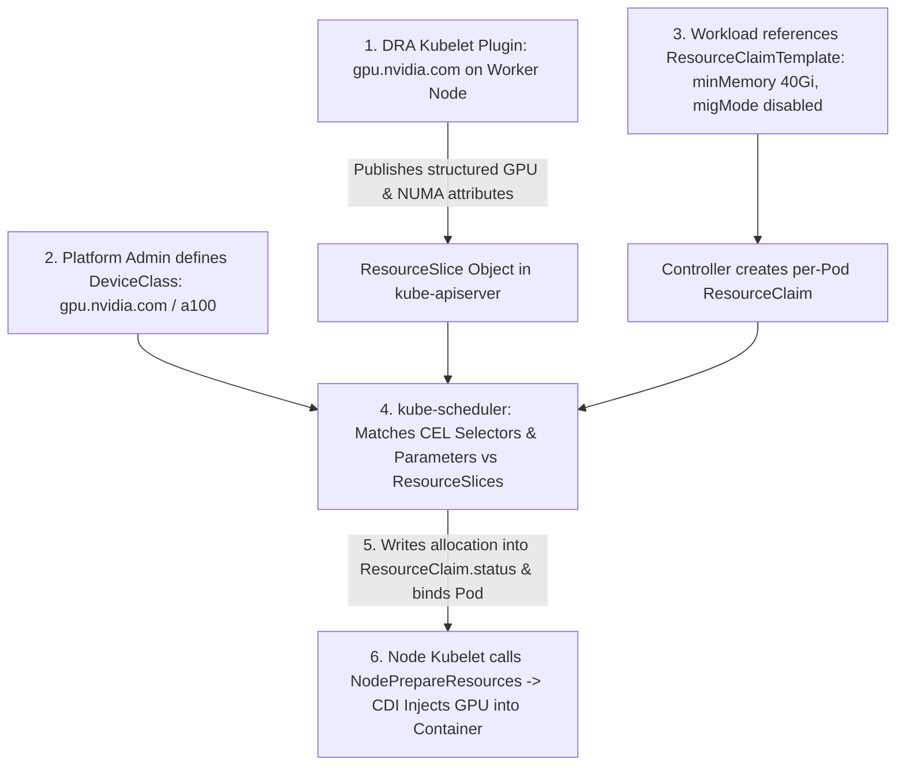

# 11.12 Dynamic Resource Allocation (DRA)

| | |
|---|---|
| Level | Advanced |
| Priority tier | 1 |
| Lab venue | GCP / GKE, plus local Python 3 simulation lab |
| Part | Part 11: GPUs on Kubernetes, scheduling and virtualization |
| Coverage file | `planning/coverage/chapters/11-12.md` |

## Why this matters for AI infrastructure

Picture a platform team that asks for four GPUs for one training job. Under the classic Kubernetes Device Plugin API, the scheduler receives nothing more than a flat integer count. The control plane cannot tell whether those accelerators have enough framebuffer memory. The framebuffer is the memory on the GPU card itself. The control plane also cannot tell whether MIG slicing is disabled, or whether the GPUs and RDMA NICs sit on the same PCIe switch and NUMA node. MIG, Multi-Instance GPU, is the feature that splits one physical GPU into smaller isolated pieces.

The result is a poor placement. kube-scheduler often binds a multi-GPU Pod to a node with fragmented sockets. A socket is one physical CPU package, and a node with two sockets has two NUMA nodes. The local kubelet Topology Manager then rejects the Pod right away with a `TopologyAffinityError`. Platform engineers and researchers end up fighting fragile node-label selectors, wasted scheduling cycles and rigid single-container device locks. Each retry adds delay, and each label someone forgot to update adds another failure that looks random from the outside.

These are the three limits of the classic model. Each one shows up in the request, so you can read them as the problems that DRA has to solve.

```text
Three Architectural Limits of Classic Device Plugins vs DRA (resource.k8s.io/v1 in Kubernetes 1.34):
1. Opaque Scalar Integers (nvidia.com/gpu: 4):
   - Cannot express minMemory: "40Gi" or migMode: "disabled" inside the resource request.
   - Forces fragile NFD/GFD label selectors (nvidia.com/gpu.memory Gt 40000).
   - Decimal GB vs Binary GiB (GAK Ch. 3 Footnote 1): 40 GB decimal = 37.25 GiB binary; 80 GB decimal = 74.5 GiB binary.
2. Scheduler Blindness to Intra-Node Topology:
   - kube-scheduler subtracts integers without seeing NVLink domains, PCIe switches (PIX), or NUMA alignment with mlx5_0 NICs.
   - Mismatched sockets fail late at kubelet admission with TopologyAffinityError under single-numa-node policy.
3. Static Single-Container Exclusive Allocation:
   - Cannot share a single allocated claim across cooperating Pods or dynamically configure MIG / MNNVL domains at claim time.
```

Notice the second limit in particular. kube-scheduler subtracts integers and never sees the NVLink domains, PCIe switches or NUMA alignment, so a bad socket only fails later. NVLink is NVIDIA's high-speed link between GPUs inside one server, and it is invisible to a plain integer count.

To remove those limits, Kubernetes introduced Dynamic Resource Allocation, or DRA. It graduated to stable General Availability under `resource.k8s.io/v1`, and it is enabled by default in Kubernetes 1.34. DRA replaces the earlier experimental `v1alpha2`, `v1beta1` and `v1beta2` iterations. Stable here means the API is no longer expected to change in ways that break existing manifests.

DRA follows the same pattern as the Container Storage Interface, or CSI, dynamic volume workflow. Instead of counting opaque integers, the scheduler matches structured hardware attributes. It also checks topology relationships before a Pod is bound to a node. The storage world already works this way: a Pod asks for a volume by name, and the storage system decides which disk to create. DRA asks for a device by its properties and lets the scheduler decide which card fits.

DRA spans both the Kubernetes control plane and the worker node data plane. The control plane is the set of components that make scheduling decisions, and the data plane is the set of components that run on each worker. Running it reliably therefore means understanding the machinery on both sides. This chapter gives a complete walkthrough of DRA, covering ResourceSlice, DeviceClass, ResourceClaim and ResourceClaimTemplate. It then covers the control-plane and node-level mechanics that keep production AI servers healthy. Those include Optimistic Concurrency Control, the kubelet health loop called the Pod Lifecycle Event Generator, or PLEG, QoS OOM scoring, CSI storage staging and multi-tenant admission guardrails. QoS OOM scoring decides which Pods the Linux out-of-memory killer sacrifices first.

Keep those three limits in mind as you read the rest of the chapter.

## Prerequisites and outcomes

### Prerequisites

A GPU platform engineer gets a page at night. A multi-GPU Pod is stuck, and the event log mentions a claim, a topology error and a node label in the same breath. Before you can follow that page, you need the background that the earlier chapters provide. Finish three earlier chapters before you start. Chapter 11.2 covers Device Plugins and CDI. Chapter 11.3 covers node labels from Node Feature Discovery, or NFD, and GPU Feature Discovery, or GFD. Chapter 11.6 covers the Topology Manager and Guaranteed QoS. A Guaranteed QoS Pod is one whose requests equal its limits, which gives the kubelet the strongest guarantee.

You should also have a working knowledge of Kubernetes PersistentVolumes, PersistentVolumeClaims and StorageClasses. Those three objects are the storage pattern that DRA copies, so the comparison in the first section will feel familiar.

### Outcomes

The chapter starts with the four core DRA API objects and how Structured Parameters let kube-scheduler match GPU attributes. It then judges how mature the NVIDIA GPU DRA driver is, and it compares the DRA claim lifecycle with the CSI volume attachment pipeline, including `WaitForFirstConsumer` and recovery from the `node.kubernetes.io/out-of-service` taint. Next, it traces `ResourceVersion` Optimistic Concurrency Control and long-lived HTTP Watch streams, which keep a busy controller from overloading the API server with `LIST` calls. After that, it walks through the kubelet Sync Loop, the Pod Lifecycle Event Generator timeouts, the QoS `oom_score_adj` values and `crictl` zombie sandbox cleanup. The last part covers multi-tenant AI platform guardrails. Those guardrails use Kyverno webhook exclusions, Karpenter GPU node pools, ArgoCD GitOps and the five-stage AI Factory cluster upgrade sequence.

If one of these prerequisites is unfamiliar, read that chapter before you start the lab.

## Concepts: basics to intermediate to advanced

### 1. Basics: Dynamic Resource Allocation architecture and the CSI analogy

If every application had to hardcode physical disk serial numbers and host mount paths inside Pod manifests, portable storage on Kubernetes would be impossible. Kubernetes solved that problem years ago with the Container Storage Interface. It separates admin-defined storage classes from user-requested volume claims. Before DRA, GPU workloads had no equivalent abstraction, so they had to encode hardware details into sprawling node selector labels. A node selector label is a key and value on a Node that a Pod must match, and every hardware detail became one more label to keep in sync.

Dynamic Resource Allocation applies the same four-part CSI design pattern to GPUs, NICs and rack-scale compute domains. Node plugins publish the hardware inventory. Administrators define logical device classes. Workloads create per-Pod claims from reusable templates. Each of those four roles has one clear owner, and that separation is what keeps the workload from knowing the hardware details.

This split is the reason DRA scales better than label-based selection. The vendor driver knows the hardware and keeps the inventory current. The platform administrator knows which classes the organization offers. The team writing a training job only states what it needs. When a new GPU model arrives, the driver publishes it and the administrator adds a class, and the training manifests can stay the same.

The table below maps each storage object to its accelerator counterpart. Read each row as a pair, because you will use the accelerator column through the rest of this chapter.

| Storage Concept (`CSI`) | Accelerator Concept (`DRA`, `resource.k8s.io/v1`) | Who Creates It & What It Represents |
| --- | --- | --- |
| **`CSIDriver` + Node Storage Inventory** | **DRA Driver (`gpu.nvidia.com`) + `ResourceSlice`** | Published automatically by the node-local DRA kubelet plugin (`gpu.nvidia.com`); advertises each physical GPU, its memory (`40 GB` / `80 GB`), MIG state, and PCIe/NUMA topology attributes to the API server. |
| **`StorageClass` (`weka-ai-fast`, `nvme-local-path`)** | **`DeviceClass` (`gpu.nvidia.com`, `gpu.nvidia.com/a100`)** | Cluster-scoped object created by the Platform Administrator defining a logical class of accelerators, default CEL attribute selectors, and driver configuration parameters. |
| **`PersistentVolumeClaim` (`PVC`)** | **`ResourceClaim`** | Namespace-scoped object representing a concrete request for one or more devices (`count: 4`, `allocationMode: ExactCount`), tracking allocation status and bound device IDs. |
| **`StatefulSet.spec.volumeClaimTemplates` (`500Gi`)** | **`ResourceClaimTemplate` (`a100-claim-template`, `gpu-claim`)** | Namespace-scoped template referenced in `Pod.spec.resourceClaims` so controllers (`Deployment`, `StatefulSet`, `JobSet`) automatically instantiate and clean up a dedicated ResourceClaim per Pod replica. |

Notice that each row plays the same role on both sides. Only the object names and the kind of hardware change. Once you know the storage pair, the accelerator object is easier to remember, because it does the same job for a different kind of device.

The diagram follows one claim from the moment a plugin reports a GPU to the moment that GPU appears inside a container.



The old `v1alpha2` prototype worked differently, and it has been removed. During every scheduling cycle, kube-scheduler had to pause and exchange remote procedure calls, or RPCs, with vendor controller Pods. An RPC is a request that one program sends to another and waits on for an answer. That out-of-tree callback loop used opaque `ResourceClass` and `parametersRef` objects, and it slowed scheduling dramatically in large clusters. Modern DRA avoids this with Structured Parameters. They appeared in `v1beta1` and `v1beta2`, graduated to stable `resource.k8s.io/v1` in Kubernetes 1.34, and let the scheduler make every decision in memory. In memory means the scheduler reads the cached inventory it already holds, instead of waiting on a remote call for each Pod.

A claim moves through four steps, and each step hands the next one a clearer picture.

1. **Advertisement via ResourceSlice.** The node-local DRA plugin queries NVML, the NVIDIA Management Library, and publishes a ResourceSlice object to the API server. The object lists every device on the node. For each device, it records the product name, memory capacity, compute capability, MIG state, PCIe root complex and NUMA node ID. A PCIe root complex is the point inside the CPU where a PCIe tree starts.
2. **Declaration via ResourceClaimTemplate.** The workload states its hardware needs in a ResourceClaimTemplate. It can use structured fields or Common Expression Language selectors, called CEL for short. Watch the unit here. GPU vendors advertise memory in decimal gigabytes, while Kubernetes uses binary gibibytes, as Footnote 1 of *Generative AI on Kubernetes* Chapter 3 explains. A 40 GB GPU therefore provides roughly 37.25 GiB, and an 80 GB GPU provides roughly 74.5 GiB. The gap comes from the two counting systems, not from lost memory, and a request written in GiB that ignores it can silently exclude a card you meant to allow.
3. **In-Memory Scheduler Matching.** During the Filter and Score phases, kube-scheduler checks the claim against cached ResourceSlice objects. Filter removes nodes that cannot run the Pod, and Score ranks the rest. The scheduler confirms the NUMA alignment across the devices before it binds the Pod. Then it writes the chosen device IDs into `ResourceClaim.status.allocation`.
4. **Node-Level Preparation via CDI.** When the bound Pod reaches the worker node, kubelet calls the DRA plugin's `NodePrepareResources` gRPC endpoint. The plugin writes a Container Device Interface, or CDI, specification under `/var/run/cdi/`. containerd then uses that specification to inject the exact allocated GPUs into the container sandbox.

Plan your cluster roadmap by separating two questions. The first is how stable the core Kubernetes API is. The second is how mature the vendor ecosystem around it is. The core `resource.k8s.io/v1` API is Generally Available and enabled by default in Kubernetes 1.34. The NVIDIA GPU DRA driver (`gpu.nvidia.com`), however, is still maturing from technical preview toward full production parity. Ecosystem pieces such as Cluster Autoscaler CEL simulation and structured quota enforcement are also still maturing. A platform can be stable at the API level while the driver and its surrounding tools are not, so check both before you commit a production queue to DRA.

Most production AI clusters today keep the NVIDIA Device Plugin, with NFD, GFD and Kueue ResourceFlavors, as their baseline. While they do, they pilot DRA for attribute selection, multi-Pod GPU sharing and Multi-Node NVLink compute domains. Kueue is the job queueing controller, and ResourceFlavors are its named groups of hardware. A pilot here means one team runs a small workload on DRA while everyone else keeps the proven path.

Keep the four objects and their storage analogs in mind, because later sections refer to them.

Here is a short walk through the four objects for a single request. A node's driver publishes a ResourceSlice that lists its GPUs. An administrator has already created a DeviceClass for the card type the company buys. A team creates a ResourceClaimTemplate that asks for one device from that class with enough memory. The Deployment then creates one ResourceClaim per replica. The scheduler matches each claim to a free device on a node, and the kubelet prepares that device for the container. Each object does one job, and no object has to know the details of the others. Treat DRA as a pilot for now, and keep the baseline running until the ecosystem pieces you need are mature.

---

### 2. Intermediate: Control-plane API machinery (`ResourceVersion` OCC) and Kubelet node lifecycle (`PLEG`, QoS, and `CSI`)

A custom controller that polls the cluster too often can slow the whole control plane, even when it does nothing wrong. Every ResourceSlice publication and every ResourceClaim allocation passes through the API server and etcd. Picture a custom controller that polls the cluster with unpaginated, cluster-wide `LIST` requests. Or picture one that overwrites stale objects while other writers are active. Either way, control-plane latency spikes and scheduling stalls spread across the cluster. Understanding Optimistic Concurrency Control and streaming watches keeps the control plane responsive. etcd is the key-value store that holds all cluster state, and the API server is the only component that talks to it directly.

Every Kubernetes object carries a `metadata.resourceVersion` string. That string is backed by the etcd revision counter, which only goes up. Suppose two controllers read the same Pod at version 154329 and try to update it at the same time. The API server accepts the first write and advances the version to 154330. It rejects the second write at once with HTTP `409 Conflict`. Well-behaved controllers also avoid costly full `LIST` calls. They use SharedInformers, which open a lightweight streaming `WATCH` connection from the last version they saw. An informer keeps a local cache of objects, so the controller reads from memory instead of asking the API server again and again.

The block below traces the two writes from that example.

```text
Control-Plane Optimistic Concurrency Control (OCC) and Watch Streams (volume-03/01 Section 3):
- Target object: Pod gpu-worker-0 read concurrently by Controller A and Controller B at resourceVersion: "154329"
- Controller A PUT (resourceVersion: "154329"): Matches etcd revision -> Committed, advances to "154330", returns HTTP 200 OK
- Controller B PUT (resourceVersion: "154329"): Mismatch ("154329" != "154330") -> Rejected with HTTP 409 Conflict (must re-read "154330")
- Informer Watch stream: GET /api/v1/pods?watch=true&resourceVersion=154329 backed by etcd prefix watch /registry/pods/
- Failure metric on bad LIST polling: Spikes in apiserver_request_duration_seconds_bucket across kube-apiserver
```

Notice that the rejected write is not lost. Controller B must re-read version 154330 before it retries. A blind retry with the old version would only repeat the conflict, so the re-read is what makes the second attempt safe.

On a worker node, kubelet looks after expensive eight-GPU servers. An unexpected eviction there wastes hours of training progress. The kubelet's main Sync Loop depends on the Pod Lifecycle Event Generator, or PLEG. PLEG polls containerd over `/run/containerd/containerd.sock` every second to track container states. Now suppose un-isolated DataLoader threads or checkpoint writes saturate the host CPUs or disk I/O. If PLEG cannot finish a relist within three minutes, kubelet marks the entire GPU server `NotReady`. It then triggers mass Pod evictions. A relist is the full pass where PLEG asks containerd for every container's state, and that pass is what takes longer when the host is starved.

The next block lists the kubelet settings, eviction thresholds and QoS scores that protect a GPU node.

```text
Kubelet Node Lifecycle, PLEG Timeout, and QoS OOM Scoring (volume-03/02 Sections 1-4):
- Hardware context: $300,000+ 8-GPU H100/B200 worker nodes
- Kubelet ports & timers: HTTPS port 10250, localhost healthzPort 10248, syncFrequency: 1m0s, nodeStatusUpdateFrequency: 10s, nodeLeaseDurationSeconds: 40
- Image GC & Pod limits: imageGCLowThresholdPercent: 80, imageGCHighThresholdPercent: 85, maxPods: 30 (vs 110 default), podPidsLimit: 4096
- Cgroup alignment: cgroupDriver: systemd in /var/lib/kubelet/config.yaml matched with SystemdCgroup = true in /etc/containerd/config.toml (via nvidia-ctk runtime configure --runtime=containerd --set-as-default) and sandbox image registry.k8s.io/pause:3.9
- Node reservations: systemReserved (cpu: "2", memory: "4Gi") and kubeReserved (cpu: "2", memory: "4Gi")
- Eviction thresholds:
  * evictionHard: memory.available: "2Gi" (or "100Mi"), nodefs.available: "10%", nodefs.inodesFree: "5%", imagefs.available: "15%"
  * evictionSoft: memory.available: "250Mi", nodefs.available: "15%", nodefs.inodesFree: "10%", imagefs.available: "20%"
- Linux QoS oom_score_adj hierarchy:
  * kubelet daemon: oomScoreAdj: -999 (never killed by kernel OOM killer)
  * Guaranteed QoS Pods (requests == limits): oom_score_adj: -997 (last Pods evicted; mandatory for LLM training)
  * Burstable QoS Pods: oom_score_adj varies dynamically with memory consumption
  * BestEffort QoS Pods (no requests/limits): oom_score_adj: 1000 (first killed via SIGKILL -> exitCode: 137 = 128 + 9, reason: OOMKilled)
```

Notice the order of the QoS scores. The kubelet is protected most, Guaranteed Pods come next, and BestEffort Pods are killed first.

The scores matter most during memory pressure. When a node runs low on memory, the kernel picks a victim by reading each process's score, and it starts with the highest value. A training job that is Guaranteed sits near the end of that line, so the kernel reaches for other Pods first. Burstable Pods fall in between, and their score moves with how much memory they use. Setting requests equal to limits is how you tell the kubelet that a training Pod must be the last one touched. Read the list as a ranking of who the kernel is allowed to sacrifice. A BestEffort Pod has no requests and no limits, so it is the cheapest one to lose.

When PLEG starves, the kubelet logs record it. The two lines below show what that looks like.

```text
E1024 14:32:11.123456   12345 kubelet.go:1934] "PLEG is not healthy"
W1024 14:32:11.123567   12345 sync_loop.go:215] "Sync loop failed" error="pleg was last seen active 3m5s ago; threshold is 3m0s"
```

The log line names the threshold, so you can compare the time since PLEG was last active against the 3m0s limit. If the time in the message is already past the threshold, the kubelet has no choice but to mark the node unhealthy, so the fix is to free the CPU or disk the kubelet needs.

Storage works alongside these GPU claims. When kubelet attaches volumes next to DRA GPU claims, the Container Storage Interface runs a three-stage gRPC pipeline. That pipeline spans the Identity, Controller and Node services. The Identity service reports what the driver is, the Controller service handles attach and detach at the cluster level, and the Node service handles the mount on one host. The StorageClass setting `volumeBindingMode: WaitForFirstConsumer` delays volume creation. The PersistentVolume is not created until kube-scheduler picks the exact GPU node. That delay matters, because a volume created too early may land on a disk that the chosen node cannot reach.

Now consider a node that crashes hard while it holds a ReadWriteOnce volume for a StatefulSet such as `milvus-datanode-0`. The replacement Pod stalls with a `Multi-Attach error`. The administrator must first verify that the dead host is powered off. Then the administrator applies the `node.kubernetes.io/out-of-service:NoExecute` taint, which was introduced in Kubernetes 1.28+. A taint marks a node so that Pods are pushed off it, and the `NoExecute` effect removes the Pods that are already there. Verifying power first is essential, because releasing a volume while the old host still writes can corrupt the data.

The block below walks through the three mount steps and the nine deletion steps.

```text
CSI Volume Pipeline and the 9-Step Pod Deletion Sequence (volume-03/02 Sections 5-9):
- CSI 3-Step Mount:
  1. ControllerPublishVolume (ControllerService): AttachDetachController creates VolumeAttachment (when attachRequired: true) and maps LUN to Node X.
  2. NodeStageVolume (NodeService): Formats device if needed and mounts once to /var/lib/kubelet/plugins/kubernetes.io/csi/pv/pv-xyz/globalmount.
  3. NodePublishVolume (NodeService): Bind-mounts global staging path into /var/lib/kubelet/pods/<pod-uuid>/volumes/kubernetes.io~csi/pvc-xyz/mount.
- StatefulSet Benchmark Example: milvus-datanode (replicas: 3, port: 9091, 500Gi RWO volumeClaimTemplates = 1500Gi total).
- 9-Step Pod Deletion Sequence:
  1. kube-apiserver sets deletionTimestamp -> 2. kubelet marks Pod Terminating -> 3. CRI StopContainer sends SIGTERM ->
  4. Waits 30s grace period then sends SIGKILL -> 5. StopPodSandbox invokes CNI DEL -> 6. RemovePodSandbox ->
  7. CSI NodeUnpublishVolume & NodeUnstageVolume -> 8. kubelet reports final termination -> 9. CSI ControllerUnpublishVolume.
```

Notice that `NodeStageVolume` mounts the device once per node.

The two steps exist for a reason. Staging does the expensive work once, such as formatting and mounting the device on the host. Publishing is cheap, so it can be repeated for each Pod that shares the volume. If the publish step failed, you would look at the Pod mount path. If the stage step failed, you would look at the global staging directory on the node. `NodePublishVolume` then bind-mounts that shared staging path into each Pod. A bind mount makes one directory appear at a second path, so each Pod sees the same device without the device being mounted again.

Keep the two QoS rules in mind when you size a training job, and check that the storage mode matches the Pod's access needs.

---

### 3. Advanced: Platform guardrails (Kyverno, Karpenter, GitOps) and the 5-step upgrade sequence

A shared AI cluster has many tenants, and one bad manifest can hurt all of them. A single misconfigured container with `hostNetwork: true` or an unrestricted `hostPath` mount can compromise node security or corrupt host GPU drivers. Worse, a poorly scoped admission webhook that matches `kube-system` can deadlock the entire cluster when its webhook Pods crash. An admission webhook is a service the API server calls before it saves an object, so a broken webhook can block every create or update it matches. An unattended Linux kernel minor upgrade on a worker node can also break compiled GPU and MOFED kernel modules overnight. Overnight is the worst time for that failure, because nobody is watching the node when it happens.

Production AI platforms prevent these outages with four layered controls. The first is least-privilege RBAC with Kyverno admission policies. RBAC, role-based access control, decides who may do what in the cluster. Karpenter provisions GPU nodes just in time. ArgoCD GitOps manages the operators. GitOps means the cluster's desired state lives in a Git repository, and a controller keeps the cluster matched to it. Finally, a strict five-stage cluster upgrade sequence governs every change. Layering the controls means that if one fails, the others still stop the damage.

The block below lists the guardrails, the node pool settings and the five upgrade stages.

```text
Multi-Tenant Platform Guardrails and Upgrade Runbook (volume-03/03 Sections 3-7):
1. OIDC RBAC & Kyverno Admission Policies:
   - Bind ClusterRole ai-tenant-admin to OIDC group oidc:team-alpha-leads via namespace RoleBinding.
   - Validating policy (restrict-workload-privileges, validationFailureAction: Enforce): Blocks hostNetwork/hostPID/hostIPC, restricts hostPath strictly to /dev/shm, enforces runAsNonRoot: true.
   - Mutating policy (inject-gpu-tolerations): Automatically injects nvidia.com/gpu: Exists: NoSchedule when limits["nvidia.com/gpu"] > 0.
   - Webhook deadlock prevention: Always exclude ["kube-system", "kyverno"] (operator: NotIn) in namespaceSelector.
2. Karpenter Just-in-Time GPU Provisioning & GPU Operator Tuning:
   - NodePool gpu-h100-pool: Instance type p5.48xlarge, consolidateAfter: 10m, consolidationPolicy: WhenEmpty.
   - EC2NodeClass gpu-al2023: 500Gi gp3 root volume on /dev/xvda for multi-gigabyte container images.
   - Workload protection: PodDisruptionBudget with minAvailable: 100% prevents eviction during active distributed training.
   - GPU Operator ClusterPolicy: Driver version 535.104.05, driver.gdrcopy.enabled: true (gdrdrv low-latency CPU-GPU BAR1 mapping); disable unattended kernel bumps (e.g., 5.15.0-88 to 5.15.0-89).
3. The 5-Stage Live Cluster Upgrade Order:
   Stage 1: GitOps Sync Pause (ArgoCD App-of-Apps) -> Stage 2: Control Plane Upgrade -> Stage 3: Addon Upgrades (CoreDNS, Cilium) ->
   Stage 4: Operator Upgrades (GPU Operator, Network Operator, DRA Driver) -> Stage 5: Node Pool Rolling Restart (cordon, checkpoint, drain, replace AMI).
```

Notice the webhook exclusion in item 1. It is the setting that stops the deadlock described above. Without it, a crashed policy engine can block its own replacement Pods, because the API server keeps calling a webhook that cannot answer.

When a worker node suffers PLEG starvation, leaks a CNI IP on a `/24` subnet or gets stuck with a container sandbox, `kubectl` only reports high-level Pod states from the control plane. Engineers therefore log directly onto the node. A sandbox is the small set of namespaces and network setup that wraps a Pod's containers. There they use `crictl` over `/run/containerd/containerd.sock` to inspect images and remove zombie sandboxes, without waiting for a wedged kubelet. A zombie sandbox is one that still exists on the node even though Kubernetes has forgotten the Pod.

The block below lists the `crictl` commands, from inspection to removal.

```text
Runtime-Level Inspection and Zombie Sandbox Cleanup with crictl (volume-03/02 Section 4.4, Section 8.3 & Appendix C):
- Pre-pull and inspect large 20 GB AI images:
  * crictl pull nvcr.io/nvidia/pytorch:23.10-py3
  * crictl images
  * crictl inspecti nvcr.io/nvidia/pytorch:23.10-py3
- Locate and remove stuck Terminating / NotReady sandboxes leaking /24 CNI IPs ("no IP addresses available in range set") or /dev/nvidia* descriptors:
  * crictl pods --name <pod_name>
  * crictl ps --pod <sandbox_id>
  * crictl stop <container_id> && crictl rm <container_id>
  * crictl stopp <sandbox_id> && crictl rmp <sandbox_id>
```

Notice that the container is stopped and removed before its sandbox is stopped and removed.

Work through the commands in order, and check the result after each one. Run `crictl pods` first, then list the containers that belong to the sandbox. Only then stop and remove them. A stopped container that is still listed means the step did not finish, and it is safer to fix that before you remove the sandbox around it. Doing it in the other order leaves a container pointing at a sandbox that has already gone.

Storage choices follow the same logic as the GPU claims. Pick the PVC access mode based on data gravity and on how much failure you can tolerate. Data gravity is the idea that large data pulls work toward where it lives. Local NVMe `ReadWriteOnce` volumes give the lowest latency, which suits scratch space or vector-database shards. Take a three-replica Milvus datanode StatefulSet that requests 500 GiB per Pod on port 9091. It gets fast local storage. However, each Pod is bound to that specific physical host. If that host fails, the Pod that depended on its disk cannot simply start somewhere else.

Network parallel filesystem volumes behave differently. `ReadOnlyMany` supports concurrent dataset streaming. `ReadWriteMany` supports shared multi-node checkpoints that survive a single-node hardware failure. The trade-off is speed. Network volumes give up some latency in exchange for a copy that every node can reach.

The table below compares the classic device plugin with DRA on each dimension that matters for scheduling.

| Architectural Dimension | Classic Kubernetes Device Plugin | Dynamic Resource Allocation (`DRA`, `resource.k8s.io/v1`) |
| --- | --- | --- |
| **Resource Request Syntax** | Scalar integer in `resources.limits["nvidia.com/gpu"]: 4` | Structured object reference in `spec.resourceClaims` + `containers[].resources.claims` pointing to a ResourceClaim or ResourceClaimTemplate |
| **Device Attribute Filtering** | Opaque to the resource name; requires external NFD/GFD node labels (`nvidia.com/gpu.memory Gt 40000`) | Built directly into the claim (`minMemory: "40Gi"`, `migMode: "disabled"`, or CEL attribute expressions evaluated against ResourceSlices) |
| **Intra-Node Topology Alignment (GPU + NIC + NUMA)** | Scheduler is blind to NUMA; relies on post-binding kubelet Topology Manager rejection (`TopologyAffinityError`) | kube-scheduler evaluates per-device NUMA and PCIe root attributes inside ResourceSlices before binding the Pod to a node |
| **Sharing One Device Across Multiple Containers / Pods** | Single-container exclusive allocation unless globally oversubscribed via node-wide `timeSlicing` ConfigMap | Native multi-container and multi-Pod sharing of a single ResourceClaim with explicit access control |
| **Dynamic Partitioning (On-Demand MIG)** | Static node-level pre-partitioning via `mig-manager` (`single` or `mixed` strategy) | Supports driver-managed dynamic device configuration at claim allocation time |
| **Multi-Node NVLink (`MNNVL` / `GB200 NVL72`) Compute Domains** | Cannot coordinate rack-scale IMEX channels across nodes | Native fit for allocating rack-scoped compute domains alongside node-scoped GPUs |
| **Production Ecosystem Maturity (Early 2026)** | Battle-tested across all cloud providers, autoscalers, and quota controllers (`ResourceQuota`, `Kueue`) | Core API stable (`1.34+`), while vendor drivers (`gpu.nvidia.com`) and autoscaler/quota integrations are maturing toward full parity |

Read the table row by row. You will see which rows depend on node labels and which move the check into the scheduler.

Two rows deserve extra attention on a real cluster. The sharing row changes how you pack workloads, because a single claim can serve several containers or Pods with explicit access control. The partitioning row changes how MIG is used, because the driver can configure the device when the claim is allocated instead of relying on a fixed layout set in advance. Both are useful, and both are still maturing in production, so test them on a non-critical queue first. Rows about attributes and topology favor DRA, while rows about ecosystem maturity still favor the classic plugin. That split is the same one the roadmap section described.

Before you choose a model for a workload, decide which rows that workload depends on. A small inference service that needs one GPU may only care about the first and last rows. A training job that spans a rack may depend on the topology and multi-node rows. Writing that list first keeps the choice honest.

## Commands and configurations that matter

### 1. Defining a `ResourceClaimTemplate` and `Deployment` with Structured Parameters

An inference team runs a model that needs at least 40 GiB of GPU memory, and it must not share the card with a MIG slice. The manifest below expresses that requirement as a claim instead of a node label. The manifest below comes from Examples 3-8 and 3-9 in Chapter 3 of *Generative AI on Kubernetes*. It asks for one NVIDIA A100 GPU with at least 40 GiB of memory and MIG mode disabled. The template matters because the Deployment controller then creates a dedicated ResourceClaim for each replica and cleans it up automatically.

```yaml
# dra-a100-claim-template.yaml (GAK Examples 3-8 & 3-9, untested here)
apiVersion: resource.k8s.io/v1beta1
kind: ResourceClaimTemplate
metadata:
  name: a100-claim-template
spec:
  spec:
    devices:
      requests:
        - name: high-memory-gpu
          deviceClassName: gpu.nvidia.com/a100
          allocationMode: ExactCount
          count: 1
          parameters:
            minMemory: "40Gi"
            migMode: "disabled"
---
apiVersion: apps/v1
kind: Deployment
metadata:
  name: inference-server
spec:
  replicas: 1
  selector:
    matchLabels:
      app: inference-server
  template:
    metadata:
      labels:
        app: inference-server
    spec:
      containers:
        - name: model-runner
          image: myorg/llm-inference:latest
          resources:
            claims:
              - name: high-memory-gpu
      resourceClaims:
        - name: high-memory-gpu
          resourceClaimTemplateName: a100-claim-template
```

Notice that the name `high-memory-gpu` appears in two places. The container refers to it under its resource claims, and the Pod refers to the template by name. The two names must match, or the Pod will wait forever for a claim it can never find.

Reach for this pattern when every replica needs its own GPU with the same requirements.

The `parameters` block carries the requirement itself. `minMemory` is a floor that the driver compares against each device's memory. `migMode` says whether the device must be free of MIG slicing. Because these values are checked against the ResourceSlice inventory, a request that no node can satisfy stays pending with a clear reason, and nothing is quietly placed on the wrong card. Each replica then gets its own claim, and scaling the Deployment creates new claims without any manual step.

### 2. Using the Stable Kubernetes `1.34` (`resource.k8s.io/v1`) `ResourceClaimTemplate` API

A team that upgrades to Kubernetes 1.34 finds that the request shape has changed. The stable API moves the request fields one level deeper, so a manifest copied from an older example needs a small edit. Kubernetes 1.34 and later use the stable `resource.k8s.io/v1` API. In that API, an exact device count goes under the `devices.requests[].exactly` stanza. The manifest below claims four GPUs from the `gpu.nvidia.com` DeviceClass. It then mounts them into a PyTorch training container.

```yaml
# dra-v1-4gpu-claim.yaml (volume-03/01 Section 8.2, untested here)
apiVersion: resource.k8s.io/v1
kind: ResourceClaimTemplate
metadata:
  name: gpu-claim
spec:
  spec:
    devices:
      requests:
        - name: gpu
          exactly:
            deviceClassName: gpu.nvidia.com
            count: 4
---
apiVersion: v1
kind: Pod
metadata:
  name: dra-training-pod
spec:
  containers:
    - name: trainer
      image: nvcr.io/nvidia/pytorch:24.04-py3
      resources:
        claims:
          - name: gpus
  resourceClaims:
    - name: gpus
      resourceClaimTemplateName: gpu-claim
```

Notice that the request now sits under `exactly`. The earlier example put its fields directly under the request name. When you migrate, move the count and the class name under `exactly` and keep the container's claim name the same.

If your cluster runs Kubernetes 1.34 or later, prefer this form over the `v1beta1` example.

### 3. Inspecting DRA `ResourceSlice`s, `ResourceClaim`s, and cleaning up orphaned CRI sandboxes

A DRA Pod sits in `Pending` for a long time, and the scheduler event says the claim is not allocated. You want to see what the nodes actually published before you change anything. Use this procedure when a DRA Pod stays pending, or when a node runs out of CNI IP addresses after a crash. Start by inspecting the ResourceSlice inventory that the node published. Then remove the orphaned container sandboxes directly with `crictl`. An orphaned sandbox is one whose Pod no longer exists in the API server, and it can keep an IP address reserved on the node.

```bash
# 1. Inspect DRA ResourceClaims and node ResourceSlices (untested here)
kubectl get resourceclaims,resourceslices
kubectl describe resourceclaim

# 2. Clean up orphaned NotReady Pod sandboxes via crictl when CNI IPs or mounts leak (untested here)
for pod in $(crictl pods -q --state NotReady); do
  crictl stopp "$pod"
  crictl rmp "$pod"
done
```

Notice that the loop touches only Pod sandboxes in the `NotReady` state.

A simple way to check the loop is to run the listing part alone first. The `crictl pods --state NotReady` command prints the sandboxes it would touch. Read that list, match it against the Pods you expect to be gone, and only then run the loop. The loop itself has no confirmation step, so the listing is your safety check. A sandbox in the `Ready` state still belongs to a running Pod, so the loop leaves it alone.

Run the inspection commands first. Remove sandboxes only after you have confirmed that they are orphaned. Deleting a live sandbox stops a running Pod, and the cost of that mistake is far higher than the cost of one more minute of inspection.

## How it fails

A DRA Pod stays pending, a node flaps, a volume refuses to attach, or a cluster stops accepting new Pods. Those symptoms look unrelated, but each one traces to a different layer. When DRA scheduling, PLEG health checks, CSI attachments or admission webhooks break, they leave traces in Kubernetes events and node logs. Start with the symptom you see, then find the matching row in the table below. Each row shows you the evidence, the root cause and the fix.

| Failure mode | Exact symptom & command evidence | Root cause boundary | Remediation |
| --- | --- | --- | --- |
| **1. Pod using DRA stays `Pending` with unallocated `ResourceClaim`** | `kubectl describe pod dra-training-pod` logs `FailedScheduling` due to unallocated `ResourceClaim`. `kubectl get resourceslices` is empty or lacks matching devices. | Missing ResourceSlice or Unsatisfiable CEL/Count Claim (`volume-03/01` §8.3): Either the DRA kubelet plugin (`gpu.nvidia.com`) is not running on the nodes (`0` ResourceSlices) or no node satisfies `count: 4`, `minMemory: "40Gi"`, and `migMode: "disabled"`. | Inspect `kubectl describe resourceclaim` and `kubectl get resourceslices`, verify the NVIDIA DRA driver DaemonSet logs on the nodes, and cross-check hardware state with `nvidia-smi`. |
| **2. Nodes randomly flap between `Ready` and `NotReady` during heavy training (`PLEG is not healthy`)** | Training Pods get evicted mid-epoch. `journalctl -u kubelet` logs `"PLEG is not healthy"` and `"Sync loop failed" error="pleg was last seen active 3m5s ago; threshold is 3m0s"`. | Kubelet / Containerd CPU or Disk I/O Starvation (`volume-03/02` Scenario 1): Unpinned DataLoader threads or checkpoint I/O saturated all host cores, preventing kubelet from polling `containerd` within the `180`-second (`3m0s`) PLEG window. | Configure `systemReserved` (`2` CPU, `4Gi`) and `kubeReserved` (`2` CPU, `4Gi`), enforce Guaranteed QoS (`oom_score_adj: -997`) with `cpuManagerPolicy: static`, and keep kubelet at `oomScoreAdj: -999`. |
| **3. Rescheduled `StatefulSet` Pod stuck in `ContainerCreating` with `Multi-Attach error`** | After a node crash, `milvus-datanode-0` reschedules to a healthy node but stalls with `Warning FailedAttachVolume Multi-Attach error for volume "pvc-xyz" Volume is already exclusively attached to one node`. | Stale `VolumeAttachment` on Dead Node (`volume-03/02` Scenario 2): Because the dead node never ran `NodeUnpublishVolume`, the `AttachDetachController` refuses to detach the `ReadWriteOnce` volume without proof the old node stopped writing. | Verify the crashed node is powered off via BMC or IPMI, then apply the `node.kubernetes.io/out-of-service:NoExecute` taint (Kubernetes `1.28+`) so the control plane safely force-detaches the volume. |
| **4. Core cluster Pods (`coredns`, `calico-node`) blocked by Kyverno webhook timeout deadlock** | Cluster recovery stalls; `kubectl get events` shows `Internal error occurred: failed calling webhook ... context deadline exceeded` for `kyverno-resource-mutating-webhook-cfg`. | Self-Referential Admission Webhook Deadlock (`volume-03/03` Scenario 2): A Kyverno policy matched all namespaces (`*`), Kyverno Pods crashed, and `kube-apiserver` blocked Kyverno replacement Pods trying to call the dead webhook. | Delete `validatingwebhookconfiguration` and `mutatingwebhookconfiguration` to break the deadlock, and always exclude `["kube-system", "kyverno"]` (`operator: NotIn`) in `namespaceSelector`. |
| **5. `kube-apiserver` latency spikes and `409 Conflict` storms on large clusters** | `kubectl` times out; `apiserver_request_duration_seconds_bucket` spikes on `LIST` requests; controller logs fill with HTTP `409 Conflict` errors. | Unpaginated `LIST` Calls & Stale `ResourceVersion` Writes (`volume-03/01` §3.2 & §3.3): A custom controller is polling full-cluster `LIST` calls without Informer Watch streams (`?watch=true&resourceVersion=...`) or mutating stale objects without re-reading the latest `resourceVersion`. | Refactor controllers to use `client-go` SharedInformers (`LIST` once + streaming `WATCH`), use Server-Side Apply or retry-on-conflict loops, and rate-limit rogue service accounts with APF. |

Read each row from left to right: the symptom, the evidence, the cause, then the fix. Find your symptom in the first column, and the evidence column tells you which cause applies. Several rows share a first symptom, such as a Pod that will not start, so the evidence column is what separates them.

Take the PLEG row as a walkthrough. Training Pods are evicted in the middle of an epoch, and `journalctl -u kubelet` shows the PLEG message. The next question is what was using the CPU or disk at that time. If a DataLoader or checkpoint writer was saturating the host, the fix is to reserve capacity for the kubelet and to protect its score. Only then should you raise any timeout, because a longer timeout hides the starvation instead of removing it. A Pending Pod with an unallocated claim points at DRA, while a stuck `ContainerCreating` Pod points at storage.

## Hands-on lab

### Venue and scope

You do not need a cluster for this lab. It runs locally with the Python 3 standard library, using `code/part11/dynamic_resource_allocation_dra.py` and `code/part11/dynamic_resource_allocation_dra_lab.py`. The scripts simulate ResourceSlice publication and ResourceClaimTemplate matching against structured parameters. They also cover decimal GB to binary GiB conversions, `ResourceVersion` Optimistic Concurrency Control, and kubelet PLEG and QoS `oom_score_adj` behavior. Cluster commands were not run for this chapter, so treat them as unverified until you run them yourself. The lab script itself was run in this repository, and its output is shown below.

### Step 1: Run the self-checking DRA and node operations lab (tested here)

Start from the repository root and run the lab script. It runs its own self-checks and reports which ones pass. Each check names one rule from the chapter, so a failing line tells you which idea the code got wrong.

```bash
python3 code/part11/dynamic_resource_allocation_dra_lab.py
```

The output below was captured from this repository, so you can compare your run against it.

Run the lab once without changing anything, and then compare its output with the captured lines. If your run differs, the difference tells you that the code or the Python version changed. Either way, the 25 checks are a fast way to confirm that the scheduling and kubelet rules still behave as the chapter describes.
```text
=== Chapter 11.12 Lab: Dynamic Resource Allocation (DRA), API Machinery & Kubelet Node Ops ===
  [PASS] DRA ResourceClaimTemplate (minMemory=40, migMode=disabled) skips 16GB T4 and MIG-enabled A100 to pick node-a100-full
  [PASS] DRA 4-GPU claim (count=4, gpu.nvidia.com) allocates gpu-0..3 on node-a100-full
  [PASS] DRA NUMA-aligned 2-GPU claim selects gpu-0 and gpu-1 on NUMA 0 during scheduling
  [PASS] Unsatisfiable DRA claim (count=8 on 4-GPU nodes) stays Pending with Unallocated ResourceClaim
  [PASS] Decimal-to-binary conversion confirms 40 GB == 37.25 GiB and 80 GB == 74.5 GiB
  [PASS] Controller A PUT with matching ResourceVersion '154329' succeeds (200 OK) and advances RV to '154330'
  [PASS] Controller B concurrent PUT with stale ResourceVersion '154329' is rejected with 409 Conflict
  [PASS] PLEG inactive for 3m5s (185s > 180s threshold) marks node NotReady ('PLEG is not healthy')
  [PASS] Guaranteed QoS Pod gets oom_score_adj=-997 (last to be evicted); OOM SIGKILL exits with code 137
  [PASS] BestEffort QoS Pod gets oom_score_adj=1000 (first to be killed by OOM killer)
  [PASS] Kubelet daemon sets oomScoreAdj=-999 to protect node agent from OOM killer
  [PASS] Dynamic Resource Allocation (resource.k8s.io/v1) graduated to stable GA in Kubernetes 1.34
  [PASS] AI KubeletConfiguration tunes maxPods: 30 (vs 110 default) and podPidsLimit: 4096
  [PASS] Kubelet listens on HTTPS port 10250 and localhost healthzPort 10248
  [PASS] Kubelet image GC thresholds are 85% high / 80% low and nodeLeaseDurationSeconds is 40s (status update 10s)
  [PASS] Kubernetes 1.28+ uses node.kubernetes.io/out-of-service:NoExecute taint to recover Multi-Attach volumes from dead nodes
  [PASS] Milvus StatefulSet (replicas: 3, port: 9091) provisions 3 x 500Gi = 1500Gi via volumeClaimTemplates
  [PASS] Karpenter p5.48xlarge NodePool sets consolidateAfter: 10m and EC2NodeClass sets 500Gi gp3 root volume
  [PASS] Unattended kernel bump from 5.15.0-88 to 5.15.0-89 triggers driver compilation CrashLoopBackOff if headers are missing
  [PASS] AI Factory upgrade runbook follows 5 ordered stages and protects running jobs with PDB minAvailable: 100%
  [PASS] Cluster DRA inventory publishes 3 ResourceSlices (node-t4-01, node-a100-mig, node-a100-full)
  [PASS] NVIDIA DRA driver registers under driver_name 'gpu.nvidia.com'
  [PASS] Example 3-8 ResourceClaimTemplate sets allocationMode='ExactCount' and count=1
  [PASS] Kubelet evictionHard (100Mi, 10% nodefs, 5% inodes, 15% imagefs) triggers after evictionSoft (250Mi, 15%, 10%, 20%)
  [PASS] Default Pod termination grace period sends SIGTERM and waits 30s before sending SIGKILL

Summary: 25 passed, 0 failed out of 25 checks.
```

Notice the final summary line. It should read 25 passed and 0 failed. If it does not, read the first failing line before you touch the code, because it names the rule that broke.

### Exercises

1. Call `match_dra_resource_claim()` in `code/part11/dynamic_resource_allocation_dra.py`. Follow its logic. Explain why a claim for at least 40 GB of memory with MIG disabled skips the T4 node. Explain why it also skips the MIG-enabled A100 node.
2. Confirm that it selects the full A100 node.
3. On the full A100 node, two GPUs sit on NUMA 0 and two sit on NUMA 1. Call `match_dra_resource_claim()` with two GPUs and same-NUMA required. Confirm which devices it selects.
4. Explain why solving this inside kube-scheduler is better than failing later at kubelet admission with `TopologyAffinityError`.
5. Check the conversion in Footnote 1 of *Generative AI on Kubernetes* Chapter 3 yourself. Convert 40 decimal gigabytes into binary gibibytes. Convert 80 decimal gigabytes into binary gibibytes. Confirm the results.
6. Call `simulate_resource_version_occ(154329, 154329, 154329)`. State the HTTP status code that Controller A receives. State the HTTP status code that Controller B receives.
7. State the new version stored in etcd. Explain what Controller B must do before it retries.
8. Call `evaluate_pleg_and_qos_oom()` to inspect node health and OOM scoring. State the PLEG health threshold in seconds.
9. Give the OOM scores for the kubelet, Guaranteed Pods and BestEffort Pods.
10. Explain why exit code 137 points to an OOM kill.
11. Explain why the CSI Node service mounts a volume in two steps. The first step stages the device to a global directory.
12. Explain why the second step publishes that directory into the Pod mount path.

Run the lab first, then work the exercises against the same functions.

## Checkpoint questions

<details>
<summary>**1. What three limitations of the classic Kubernetes Device Plugin framework motivated Dynamic Resource Allocation (DRA)?**</summary>

1. **Integer counts only (`nvidia.com/gpu: 4`).** A plain count cannot describe the model, memory size or MIG state of a device.
2. **No relational checks at scheduling time.** From a bare count, the scheduler cannot see how GPUs and NICs relate over PCIe, NUMA or NVLink.
3. **Static, single-container allocation.** A device goes to one container. Classic device plugins cannot share one dynamically parameterized claim across Pods or create MIG partitions on demand.
</details>

<details>
<summary>**2. In which Kubernetes version did Dynamic Resource Allocation (DRA, resource.k8s.io/v1) graduate to a core stable feature enabled by default, and what is the production status of the NVIDIA GPU DRA driver as of early 2026?**</summary>

Core DRA became stable under `resource.k8s.io/v1` and is enabled by default in Kubernetes 1.34, so you can rely on it as a core feature. The NVIDIA GPU DRA driver (`gpu.nvidia.com`) is still a maturing technical preview component as of early 2026. As a result, most production clusters keep traditional device plugins and label-based scheduling while they pilot DRA.
</details>

<details>
<summary>**3. What are the four primary Kubernetes objects in the DRA architecture, and what is the CSI storage analog of each?**</summary>

1. **ResourceSlice.** This is the analog of the CSI node storage inventory. The node-local DRA plugin (`gpu.nvidia.com`) publishes it to advertise discovered devices and their attributes.
2. **DeviceClass.** This is the analog of a StorageClass. Platform administrators define it as a cluster-scoped class, such as `gpu.nvidia.com` or `gpu.nvidia.com/a100`.
3. **ResourceClaim.** This is the analog of a PersistentVolumeClaim. It is a namespace-scoped request for specific device instances and parameters.
4. **ResourceClaimTemplate.** This is the analog of StatefulSet `volumeClaimTemplates`. It is a template, such as `a100-claim-template` or `gpu-claim`, that generates a ResourceClaim for each Pod.
</details>

<details>
<summary>**4. How did DRA evolve from the removed v1alpha2 "classic" design to Structured Parameters in v1beta1/v1beta2 and v1?**</summary>

The early `v1alpha2` design needed external driver controllers to answer callbacks during scheduling. That added latency and complexity. Structured Parameters, used in `v1beta1`, `v1beta2` and stable `resource.k8s.io/v1`, fix this. The driver publishes device attributes directly in ResourceSlice objects, so kube-scheduler can evaluate claims and CEL selectors entirely in memory.
</details>

<details>
<summary>**5. In Generative AI on Kubernetes Example 3-8, what do allocationMode: ExactCount, count: 1, minMemory: "40Gi", and migMode: "disabled" specify in a ResourceClaimTemplate?**</summary>

Together they ask for exactly one GPU from the `gpu.nvidia.com/a100` DeviceClass. That GPU must have at least 40 GiB of physical framebuffer memory, and its Multi-Instance GPU mode must be disabled. The result is a whole, unpartitioned A100 rather than a MIG slice.
</details>

<details>
<summary>**6. Why does Footnote 1 of Generative AI on Kubernetes Chapter 3 note that a 40 GB GPU has ~37.25 GiB and an 80 GB GPU has ~74.5 GiB?**</summary>

GPU makers quote memory in decimal gigabytes, which are 10^9 bytes. Kubernetes uses binary gibibytes, which are 2^30 bytes. Dividing 40 billion bytes by 2^30 gives 37.25 GiB. Dividing 80 billion bytes by 2^30 gives 74.5 GiB. You can check the arithmetic yourself with a calculator.
</details>

<details>
<summary>**7. How do you troubleshoot a Pod using DRA that is stuck in Pending with an unallocated ResourceClaim?**</summary>

1. Run `kubectl describe pod <pod>` and `kubectl describe resourceclaim <claim>` so you can read the scheduler's allocation failure message.
2. Run `kubectl get resourceslices` to see which devices and attributes the DRA driver published for each node.
3. Check the DRA driver DaemonSet Pods on the worker nodes. Then compare what they publish against `nvidia-smi topo -m`.
</details>

<details>
<summary>**8. How does metadata.resourceVersion implement Optimistic Concurrency Control (OCC) in kube-apiserver when two controllers update the same Pod simultaneously?**</summary>

Both controllers read the Pod at version 154329. Controller A sends its PUT with 154329. The API server commits the change to etcd, moves the version to 154330, and returns `200 OK`. Controller B still sends 154329, so the API server sees the mismatch and rejects the write with `409 Conflict`. Controller B must then re-read version 154330 and retry.
</details>

<details>
<summary>**9. Why do unfiltered cluster-wide LIST calls from a poorly written controller cause kube-apiserver latency spikes, and how do Informers avoid this?**</summary>

An unfiltered `LIST` with no resource version or pagination forces the API server to fetch and serialize gigabytes of JSON across all Pods on every poll. SharedInformers help you avoid that. They run one initial `LIST`, then keep a lightweight streaming watch open. That watch uses `?watch=true&resourceVersion=154329` and is backed by etcd key-prefix watches.
</details>

<details>
<summary>**10. What is the Kubelet's PLEG (Pod Lifecycle Event Generator), what is its health threshold, and why does CPU/I/O starvation cause a NodeNotReady loop?**</summary>

PLEG is the kubelet part that polls the container runtime every second to spot container state changes. Its health threshold is `3m0s`, or 180 seconds. If un-isolated AI workloads starve host CPU or root disk I/O, PLEG cannot finish a relist within three minutes. Kubelet then marks the node `NotReady` and starts mass Pod evictions.
</details>

<details>
<summary>**11. What are the Linux oom_score_adj values assigned to the kubelet daemon, Guaranteed Pods, Burstable Pods, and BestEffort Pods, and what does exitCode: 137 mean?**</summary>

- **kubelet daemon.** It gets -999, which protects it from the OOM killer.
- **Guaranteed Pods.** They get -997 when requests equal limits, the highest workload protection.
- **Burstable Pods.** Their score is dynamic and depends on the percentage of requested memory they consume.
- **BestEffort Pods.** They get 1000 when no requests or limits are set, so they are the first processes killed when memory runs out.

An `exitCode: 137` equals 128 plus 9. If you see it, the process was ended by signal 9, `SIGKILL`, from the kernel OOM killer.
</details>

<details>
<summary>**12. What is a Pod Sandbox (pause container) in the Container Runtime Interface (CRI), and why must SystemdCgroup = true match between kubelet and containerd?**</summary>

When kubelet calls `RunPodSandbox`, containerd starts a small `registry.k8s.io/pause:3.9` container. Its only job is to hold open the shared Linux namespaces that the application containers in the Pod join. Both the kubelet and containerd must enable the systemd cgroup driver. Otherwise, two cgroup managers fight over resource accounting.
</details>

<details>
<summary>**13. Walk through the three gRPC services of a CSI storage driver and the difference between ControllerPublishVolume, NodeStageVolume, and NodePublishVolume.**</summary>

A CSI driver implements the Identity, Controller and Node gRPC services.
1. **ControllerPublishVolume.** It runs in the control plane and attaches the external storage LUN to the worker node.
2. **NodeStageVolume.** It runs on the worker node, formats the device if needed, and mounts it once to a global staging directory.
3. **NodePublishVolume.** It bind-mounts that staging directory into the specific Pod volume directory, so several Pods on one node can share one staged mount.
</details>

<details>
<summary>**14. Why is volumeBindingMode: WaitForFirstConsumer critical in a StorageClass used by GPU nodes?**</summary>

If you leave out `WaitForFirstConsumer`, a PersistentVolume is provisioned as soon as the PVC is created. Consider one that lands in a zone, rack or node with no free GPUs. Delayed binding waits until kube-scheduler picks the GPU node for the Pod. That keeps storage and compute in the same topology.
</details>

<details>
<summary>**15. What are the four core guarantees of a Kubernetes StatefulSet (such as milvus-datanode with 3 replicas and 500Gi volumeClaimTemplates)?**</summary>

1. **Stable, unique network identity.** Ordinal names such as `milvus-datanode-0`, `-1` and `-2` stay deterministic, backed by a Headless Service.
2. **Stable, persistent storage.** For example, each ordinal Pod reattaches to its own dedicated PVC when it is rescheduled.
3. **Ordered, graceful deployment and scaling.** Pod N starts only after Pod N-1 is running and ready.
4. **Ordered rolling updates.** Updates run in reverse ordinal order, from 2 down to 0.
</details>

<details>
<summary>**16. How do you safely resolve a FailedAttachVolume Multi-Attach error on Kubernetes 1.28+ when a StatefulSet node crashes hard?**</summary>

First, confirm through the hardware BMC or IPMI that the crashed node is really powered down or fenced, so you know it cannot write to the volume. Then you apply the `node.kubernetes.io/out-of-service:NoExecute` taint to the dead Node object. The taint tells the control plane to force-detach the stuck volume and attach it to the replacement node.
</details>

<details>
<summary>**17. What is the exact nine-step sequence when a Pod is deleted on a worker node (Volume 03 Chapter 2 Section 9)?**</summary>

1. The API server sets `deletionTimestamp` on the Pod.
2. The kubelet sees this in its Sync Loop and marks the Pod terminating.
3. The kubelet calls CRI `StopContainer`, and containerd sends `SIGTERM`.
4. After the 30-second grace period, kubelet sends `SIGKILL` through CRI if the process is still running.
5. The kubelet calls `StopPodSandbox`. That invokes CNI delete, which releases the Pod IP and network namespace.
6. The kubelet garbage-collects the sandbox with `RemovePodSandbox`.
7. The kubelet calls CSI `NodeUnpublishVolume` and `NodeUnstageVolume` to unmount the storage directory.
8. The kubelet reports final Pod termination to the API server.
9. The AttachDetachController calls CSI `ControllerUnpublishVolume` to detach the LUN from the node.
</details>

<details>
<summary>**18. How does a Kyverno mutating policy automatically inject GPU tolerations, and why must ["kube-system", "kyverno"] be excluded from webhook namespaceSelectors?**</summary>

The Kyverno policy checks whether the container's GPU limit is greater than zero. If it is, the policy applies a strategic merge patch that adds the `nvidia.com/gpu` NoSchedule toleration. Excluding `["kube-system", "kyverno"]` from the webhook namespace selector keeps the API server from deadlocking. Without that exclusion, the API server would wait on the dead webhook while it tries to create replacement Kyverno Pods.
</details>

<details>
<summary>**19. What is driver.gdrcopy.enabled: true in the GPU Operator ClusterPolicy (Volume 03 Chapter 3 Section 5.2), and how does it differ from GPUDirect RDMA?**</summary>

`driver.gdrcopy.enabled: true` deploys the `gdrcopy` kernel module (`gdrdrv`) and its user-space library. That library maps GPU BAR1 memory through the CPU, which gives ultra-low-latency small copies between CPU and GPU. GPUDirect RDMA is a different feature. It lets network adapters transfer data directly to and from GPU memory over PCIe, without involving the CPU.
</details>

<details>
<summary>**20. What is the five-stage order of operations for upgrading a live AI Factory Kubernetes cluster, and how does a PodDisruptionBudget with minAvailable: 100% interact with it?**</summary>

The five stages run in order. First, pause automated sync in ArgoCD. Second, upgrade the control plane, including the API server, etcd, scheduler and controller manager. Third, upgrade CoreDNS, kube-proxy and Cilium. Fourth, upgrade the GPU Operator, Network Operator and DRA Driver, and wait for their CRDs and DaemonSets to stabilize. Fifth, run a node pool rolling restart by cordoning, checkpointing, draining and replacing the node image.

A PodDisruptionBudget with `minAvailable: 100%` stops Karpenter and node drains from evicting any Pod of an active distributed training job. The job is paused only at a checkpoint boundary during Stage 5.
</details>

## Sources and review notes

### Primary sources read in full for this chapter
```text
Primary Sources Mapped to Chapter 11.12 Claims and Figures:
1. Roland Huß et al., Generative AI on Kubernetes (O'Reilly, 2026, Ch. 3):
   - "Kubernetes and GPUs" & "Dynamic Resource Allocation": Kubernetes 1.34 stable GA status (resource.k8s.io/v1), evolution from removed v1alpha2 and v1beta1/v1beta2.
   - Footnote 1 decimal GB vs binary GiB conversion: 40 GB == 37.25 GiB (40 * 10^9 / 2^30) and 80 GB == 74.5 GiB (80 * 10^9 / 2^30).
   - Examples 3-8 & 3-9: ResourceClaimTemplate a100-claim-template (deviceClassName: gpu.nvidia.com/a100, allocationMode: ExactCount, count: 1, minMemory: "40Gi", migMode: "disabled").
2. volume-03/01-k8s-control-plane-scheduling-masterclass.md:
   - Sections 1-3 API Machinery: metadata.resourceVersion "154329" -> "154330" Optimistic Concurrency Control (200 OK vs 409 Conflict), Informer Watch streams (?watch=true&resourceVersion=154329) over /registry/pods/, apiserver_request_duration_seconds_bucket.
   - Section 8 Dynamic Resource Allocation (DRA): resource.k8s.io/v1 in Kubernetes 1.34, ResourceSlice, DeviceClass, ResourceClaim, ResourceClaimTemplate gpu-claim (gpu.nvidia.com, count: 4), and DRA troubleshooting.
3. volume-03/02-k8s-node-storage-masterclass.md:
   - Sections 1-9 & Appendices A-F: $300,000+ node context, Kubelet Sync Loop (1m0s) & PLEG 3m0s (180s) vs 3m5s (185s) timeout, ports 10250 / 10248, maxPods: 30 (vs 110), podPidsLimit: 4096, imageGC 85% / 80%, nodeLeaseDurationSeconds: 40 (status 10s).
   - Eviction thresholds (evictionHard 2Gi/100Mi, 10% nodefs, 5% inodes, 15% imagefs; evictionSoft 250Mi, 15%, 10%, 20%), QoS oom_score_adj (-999 kubelet, -997 Guaranteed, 1000 BestEffort, exitCode: 137 = 128 + 9).
   - registry.k8s.io/pause:3.9 sandbox, SystemdCgroup = true, crictl commands (nvcr.io/nvidia/pytorch:23.10-py3 20 GB image), CSI Identity/Controller/Node gRPC services, WaitForFirstConsumer, milvus-datanode StatefulSet (3 replicas x 500Gi = 1500Gi on port 9091), node.kubernetes.io/out-of-service taint on Kubernetes 1.28+, and 9-step Pod deletion sequence (30s grace).
4. volume-03/03-k8s-networking-security-ops-masterclass.md:
   - Sections 3-7: OIDC RoleBinding (ai-tenant-admin, oidc:team-alpha-leads), Kyverno restrict-workload-privileges (/dev/shm) & inject-gpu-tolerations with NotIn: ["kube-system", "kyverno"].
   - Karpenter p5.48xlarge (consolidateAfter: 10m, WhenEmpty, 500Gi gp3 /dev/xvda), ArgoCD App-of-Apps, ClusterPolicy 535.104.05 with driver.gdrcopy.enabled: true, /24 IPAM exhaustion, kernel 5.15.0-88 -> 5.15.0-89 unattended-upgrades, 5-step upgrade order, and PDB minAvailable: 100%.
5. Josh Rosso et al., Production Kubernetes (O'Reilly, 2021, Ch. 5):
   - Pod networking and CNI lifecycle integration.
```

### Related source files mapped in MIGRATION_MAP.md
- `volume-03/01-k8s-control-plane-scheduling-masterclass.md` as a primary source for this chapter.
- `volume-03/02-k8s-node-storage-masterclass.md` as a primary source for this chapter.
- `volume-03/03-k8s-networking-security-ops-masterclass.md` as a primary source for this chapter.

### Run here
- `python3 code/part11/dynamic_resource_allocation_dra_lab.py` passing all 25 checks with 0 failures.

### Explicitly labelled inferences
```text
Verified Arithmetic Conversions (code/part11/dynamic_resource_allocation_dra_lab.py):
- PLEG timeout threshold in seconds: 3m0s = 180 seconds vs 3m5s = 185 seconds
- OOMKilled SIGKILL exit code decomposition: 128 + 9 = 137
- Total StatefulSet PVC storage across 3 replicas: 3 * 500 GiB = 1,500 GiB
- Decimal GB to Binary GiB GPU memory: 40 * 10^9 / 2^30 = 37.25 GiB; 80 * 10^9 / 2^30 = 74.5 GiB
```

### Not verified on live hardware
- All kubectl, crictl, DRA, kubelet, StatefulSet, Kyverno, and Karpenter manifests and commands (`kube-controller-manager`, `DraClaimRequest` with `count=2`, `min_memory_gb=40`, `require_same_numa=True` assigning `gpu-2` and `gpu-3`, `/var/run/cdi/...`, `nvidia-peermem`, CSI `IdentityService` and `CreateVolume` on `csi.weka.io` `RWX` and `/dev/nvme0n1` mounted at `/var/lib/kubelet/plugins/.../globalmount` for `data-volume-milvus-datanode-0`, `kueue.x-k8s.io/v1beta1`, `resource.k8s.io/v1`, cross-referenced with Chapters `11.11` and `13.21`, and validated via `validate_chapter.py` and `check_coverage.py`) are marked `(untested here)`.

### Not in the corpus
- The internal Go source code of the NVIDIA `k8s-dra-driver` kubelet plugin is not in the local corpus. This chapter relies on the DRA interfaces documented in Volume 03 and *Generative AI on Kubernetes* Chapter 3.

### Corrections to the author's notes
- The YAML manifests and commands are marked untested and were not applied to a live cluster. Custom resource API versions change between releases, so verify them against the installed cluster version. Console outputs quoted from the Volume notes are illustrative unless marked tested here. DRA is stable under `resource.k8s.io/v1` from Kubernetes 1.34, and the `v1beta1` example is only for clusters before 1.34.
- As noted in Chapter 11.1, *Generative AI on Kubernetes* Example 3-9 prints `apiVersion: batch/v1` on a Deployment manifest. Standard Kubernetes Deployment manifests use `apiVersion: apps/v1`, which is used in Section 1 of "Commands and configurations that matter" above.
