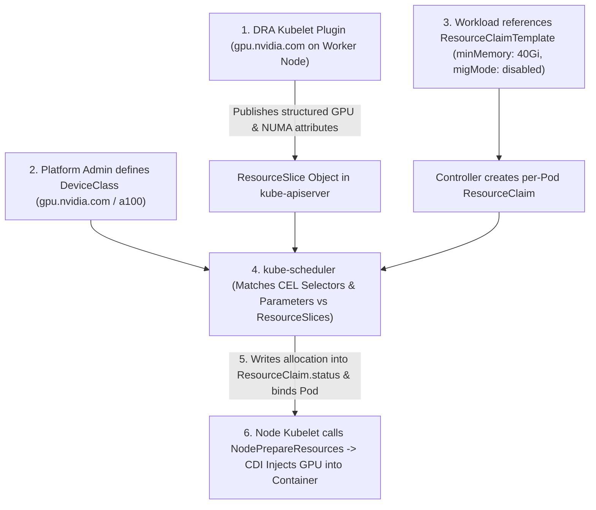

# 11.12 Dynamic Resource Allocation (DRA)

| | |
|---|---|
| Level | Advanced |
| Priority tier | 1 |
| Lab venue | GCP / GKE (plus local Python 3 simulation lab) |
| Part | Part 11: GPUs on Kubernetes, scheduling and virtualization |
| Sources used | Roland Huß et al., *Generative AI on Kubernetes* (O'Reilly, 2026, Ch. 3); `volume-03/01-k8s-control-plane-scheduling-masterclass.md`; `volume-03/02-k8s-node-storage-masterclass.md`; `volume-03/03-k8s-networking-security-ops-masterclass.md`; Josh Rosso et al., *Production Kubernetes* (O'Reilly, 2021, Ch. 5) |
| Coverage file | `planning/coverage/chapters/11-12.md` |

## Why this matters for AI infrastructure

Throughout Chapters 11.2 to 11.11, we saw the power—and the recurring limitations—of the classic **Kubernetes Device Plugin framework**:
1. **Opaque scalar integers (`nvidia.com/gpu: 4`):** The Device Plugin API can only report a flat integer count of a named resource to `kubelet`. It cannot express rich device attributes (such as `minMemory: "40Gi"`, where `40 GB` decimal is approximately `37.25 GiB` binary and `80 GB` decimal is approximately `74.5 GiB` binary, or `migMode: "disabled"`) inside the resource request itself—forcing platform engineers to bolt on sprawling NFD/GFD node-label selectors (`nvidia.com/gpu.memory Gt 40000`).
2. **No scheduler-level relational or multi-device constraints:** With traditional device plugins, `kube-scheduler` only subtracts integers; it has zero visibility into which GPUs share an NVLink domain or which GPU and SR-IOV RDMA NIC (`mlx5_0`) share a PCIe switch (`PIX`) or NUMA node. If a node has free GPUs and NICs on mismatched sockets, `kube-scheduler` still binds the Pod there, only for the `kubelet` Topology Manager (`single-numa-node`) to reject it after binding with `TopologyAffinityError`.
3. **Static, single-Pod-exclusive allocation:** Classic device plugins allocate devices exclusively to a single container at container creation time; they cannot cleanly share a single allocated device claim across multiple cooperating Pods or dynamically configure device parameters (such as on-demand MIG slices or Multi-Node NVLink `MNNVL` compute domains) at claim time.

To overcome these architectural walls, Kubernetes introduced **Dynamic Resource Allocation (`DRA`)**, which graduated to core stable General Availability (`resource.k8s.io/v1`) and is enabled by default starting in **Kubernetes `1.34`** (after evolving from `v1beta1` / `v1beta2` and replacing the removed `v1alpha2` "classic" DRA design). Modeled directly on the Kubernetes **Container Storage Interface (`CSI`)** dynamic volume provisioning pattern (`StorageClass -> PersistentVolumeClaim -> PersistentVolume`), DRA shifts accelerator scheduling from *"how many integers of `nvidia.com/gpu`"* to *"what structured device attributes and topology relationships does this workload claim?"*

Because DRA operates across both the **Kubernetes Control Plane** (`kube-apiserver` `ResourceVersion` optimistic concurrency control, `etcd`, and `kube-scheduler` evaluating `ResourceSlice` objects) and the **Worker Node Data Plane** (`kubelet` Sync Loop, `PLEG` health checks, `CRI` CDI injection, QoS `oom_score_adj`, and `CSI` storage pipelines), this chapter pairs a deep dive into **DRA (`ResourceSlice`, `DeviceClass`, `ResourceClaim`, and `ResourceClaimTemplate`)** with the complete control-plane and node-level operational mechanics (`volume-03/01`, `volume-03/02`, and `volume-03/03`) that underpin DRA in production AI factories.

## Prerequisites and outcomes

### Prerequisites
- Completion of Chapter 11.2 (Device Plugin and CDI), Chapter 11.3 (NFD/GFD labels), and Chapter 11.6 (Topology Manager and `Guaranteed` QoS).
- Working knowledge of Kubernetes PersistentVolumes (`PV`), PersistentVolumeClaims (`PVC`), and StorageClasses (`SC`).

### Outcomes
After completing this chapter, you will be able to:
- Explain the four core **Dynamic Resource Allocation (`DRA`)** API objects (`ResourceSlice`, `DeviceClass`, `ResourceClaim`, and `ResourceClaimTemplate` in `resource.k8s.io/v1` / `v1beta1`), how **Structured Parameters** and CEL selectors let `kube-scheduler` match GPU attributes (`minMemory: "40Gi"`, `migMode: "disabled"`, NUMA/PCIe alignment) during scheduling, and the current production maturity status of the NVIDIA GPU DRA driver (`gpu.nvidia.com`).
- Compare the DRA claim lifecycle against the **Container Storage Interface (`CSI`)** volume attachment pipeline (`IdentityService`, `ControllerService` `CreateVolume`/`ControllerPublishVolume`, and `NodeService` `NodeStageVolume`/`NodePublishVolume` with `WaitForFirstConsumer` and `node.kubernetes.io/out-of-service` taint recovery on Kubernetes `1.28+`).
- Trace Kubernetes API **`ResourceVersion` Optimistic Concurrency Control (`OCC`)** (`"154329"` -> `"154330"`, `200 OK` vs `409 Conflict`) and long-lived HTTP `Watch` streams (`?watch=true&resourceVersion=154329`) to prevent `kube-apiserver` LIST thrashing.
- Configure and debug the `kubelet` **Sync Loop**, **Pod Lifecycle Event Generator (`PLEG`, `3m0s` threshold)**, **QoS classes and `oom_score_adj`** (`kubelet: -999`, `Guaranteed: -997`, `Burstable: varies`, `BestEffort: 1000`, `OOMKilled` `exitCode: 137`), and `crictl` zombie sandbox cleanup (`crictl stopp` / `rmp`).
- Enforce multi-tenant AI platform guardrails using **Kyverno** (`restrict-workload-privileges` and `inject-gpu-tolerations` with `NotIn: ["kube-system", "kyverno"]` webhook exclusion), **Karpenter** (`p5.48xlarge`, `consolidateAfter: 10m`, `500Gi` `gp3`), **ArgoCD App-of-Apps**, and the **5-stage AI Factory cluster upgrade sequence**.

## Concepts: basics to intermediate to advanced

### 1. Basics: Dynamic Resource Allocation (`DRA`) architecture and the CSI analogy

Why did Kubernetes design DRA around `DeviceClass`, `ResourceClaim`, `ResourceClaimTemplate`, and `ResourceSlice`? Because Kubernetes had already solved dynamic, attribute-rich hardware provisioning once before—for **storage** (`volume-03/01` Section 8, `volume-03/02` Section 5, and *Generative AI on Kubernetes* Chapter 3, "Dynamic Resource Allocation"):

| Storage Concept (`CSI`) | Accelerator Concept (`DRA`, `resource.k8s.io/v1`) | Who Creates It & What It Represents |
|---|---|---|
| **`CSIDriver` + Node Storage Inventory** | **DRA Driver (`gpu.nvidia.com`) + `ResourceSlice`** | Published automatically by the node-local DRA kubelet plugin (`gpu.nvidia.com`); advertises each physical GPU, its memory (`40 GB` / `80 GB`), MIG state, and PCIe/NUMA topology attributes to the API server. |
| **`StorageClass` (`weka-ai-fast`, `nvme-local-path`)** | **`DeviceClass` (`gpu.nvidia.com`, `gpu.nvidia.com/a100`)** | Cluster-scoped object created by the **Platform Administrator** defining a logical class of accelerators, default CEL attribute selectors, and driver configuration parameters. |
| **`PersistentVolumeClaim` (`PVC`)** | **`ResourceClaim`** | Namespace-scoped object representing a concrete request for one or more devices (`count: 4`, `allocationMode: ExactCount`), tracking allocation status and bound device IDs. |
| **`StatefulSet.spec.volumeClaimTemplates` (`500Gi`)** | **`ResourceClaimTemplate` (`a100-claim-template`, `gpu-claim`)** | Namespace-scoped template referenced in `Pod.spec.resourceClaims` so controllers (`Deployment`, `StatefulSet`, `JobSet`) automatically instantiate and clean up a dedicated `ResourceClaim` per Pod replica. |



#### How Structured Parameters in Kubernetes `1.34` (`resource.k8s.io/v1`) work
In the earliest experimental DRA prototype (`v1alpha2` "classic" DRA, now removed), `kube-scheduler` had to pause and exchange external RPCs with vendor driver controllers using opaque `ResourceClass` and `parametersRef` objects during every scheduling cycle—which slowed down scheduling at scale.

Modern DRA (**Structured Parameters**, introduced in `v1beta1`/`v1beta2` and graduated to stable **`resource.k8s.io/v1` in Kubernetes `1.34`**) eliminates out-of-tree scheduler callbacks:
1. **Advertisement (`ResourceSlice`):** The node-local DRA plugin queries NVML and publishes a `ResourceSlice` object to `kube-apiserver` listing every device on the node along with structured attributes (product name, memory capacity, compute capability, MIG state, PCIe root complex, and NUMA node ID).
2. **Declaration (`ResourceClaimTemplate`):** The workload declares its hardware intent—not just a count, but required attributes (`minMemory: "40Gi"`, `migMode: "disabled"`, or Common Expression Language `CEL` selectors)—inside a `ResourceClaimTemplate`. (Remember Footnote 1 from *Generative AI on Kubernetes* Chapter 3: GPU vendors advertise decimal gigabytes `GB` base-10, while Kubernetes uses binary gibibytes `GiB` base-2, where **`40 GB` is approximately `37.25 GiB`** and **`80 GB` is approximately `74.5 GiB`**.)
3. **In-Memory Scheduler Matching:** During the `Filter` and `Score` phases, `kube-scheduler` reads the `ResourceSlice` objects already cached in memory, evaluates the `ResourceClaim`'s CEL selectors and multi-device alignment constraints (for example, ensuring `4` GPUs or a GPU + RDMA NIC VF sit on the same NUMA node *before* binding the Pod), and records the exact chosen device instances directly in `ResourceClaim.status.allocation`.
4. **Node-Level Preparation (`NodePrepareResources` + CDI):** When the bound Pod arrives at the node, `kubelet` calls the DRA plugin's `NodePrepareResources` gRPC endpoint, which generates the **Container Device Interface (`CDI`)** specification (`/var/run/cdi/...`) that `containerd` uses to inject the exact allocated GPU(s) into the container sandbox.

#### Production maturity of DRA (`GAK` Chapter 3 caveats)
As *Generative AI on Kubernetes* (Chapter 3, "Dynamic Resource Allocation") emphasizes, engineers must distinguish between **core Kubernetes API stability** and **vendor ecosystem maturity**:
- As of early 2026, the core Kubernetes DRA APIs (`resource.k8s.io/v1`) are **Generally Available (GA) and enabled by default since Kubernetes `1.34`**.
- However, the **NVIDIA GPU DRA driver (`gpu.nvidia.com`)** and surrounding ecosystem integrations (such as Cluster Autoscaler simulation of complex CEL claims, quota enforcement across structured parameters, and dynamic on-demand MIG slicing) are still maturing from technical preview toward full production parity. Consequently, most enterprise clusters today continue to use the **NVIDIA Device Plugin + NFD/GFD + Kueue `ResourceFlavor`s** as their primary production baseline while adopting DRA in canary pools for attribute-driven selection, multi-Pod GPU sharing, and Multi-Node NVLink (`MNNVL`, covered in Chapter 13.21) compute domains.

---

### 2. Intermediate: Control-plane API machinery (`ResourceVersion` OCC) and Kubelet node lifecycle (`PLEG`, QoS, and `CSI`)

Because DRA `ResourceSlice` and `ResourceClaim` objects are coordinated through `kube-apiserver` and executed by `kubelet` alongside `CRI` and `CSI`, operating DRA at scale requires mastering the underlying control-plane and node-agent mechanics (`volume-03/01` Section 3 and `volume-03/02` Sections 2–6).

#### 1. `ResourceVersion`, Optimistic Concurrency Control (`OCC`), and Watch streams (`volume-03/01` §3)
Every Kubernetes object—including `Pod`, `Node`, `ResourceClaim`, and `ResourceSlice`—carries a `metadata.resourceVersion` string (for example, `"154329"`, backed by `etcd`'s monotonically increasing revision counter).

What happens when two controllers (say, `kube-scheduler` and a custom operator) read `Pod` `gpu-worker-0` at `resourceVersion: "154329"` and both attempt to `PUT` an update simultaneously?
1. **Controller A** sends `PUT` with `resourceVersion: "154329"`. `kube-apiserver` verifies that `etcd` still holds `"154329"`, commits the write, increments `resourceVersion` to **`"154330"`**, and returns **`200 OK`**.
2. **Controller B** sends `PUT` still carrying `resourceVersion: "154329"`. `kube-apiserver` sees `"154329" != "154330"` and immediately rejects Controller B's write with HTTP **`409 Conflict`**. Controller B must re-read `"154330"` from its local Informer cache and retry.

Similarly, instead of polling `kube-apiserver` with expensive cluster-wide `LIST` calls (which force `kube-apiserver` to serialize gigabytes of JSON and spike `apiserver_request_duration_seconds_bucket`), well-behaved controllers use `client-go` **Informers** that open a streaming `GET /api/v1/pods?watch=true&resourceVersion=154329` connection backed by `etcd` prefix watches (`/registry/pods/`).

#### 2. The Kubelet Sync Loop, `PLEG` (`3m0s` timeout), and QoS `oom_score_adj` (`volume-03/02` §2–§3)
On each GPU worker node (`$300,000+` 8-GPU H100/B200 servers), the `kubelet` runs on HTTPS port `10250` (with localhost healthz on port `10248`, `nodeStatusUpdateFrequency: 10s`, `nodeLeaseDurationSeconds: 40`, and image garbage collection between `imageGCLowThresholdPercent: 80` and `imageGCHighThresholdPercent: 85`).

Its **Sync Loop** (`syncFrequency: 1m0s`) relies on the **Pod Lifecycle Event Generator (`PLEG`)**, which polls `containerd` (`/run/containerd/containerd.sock`) every second to detect container state changes:
- **The `NodeNotReady` PLEG Starvation Trap:** If an un-isolated AI training workload saturates all host CPUs or disk I/O, `kubelet` cannot complete its `PLEG` relist within the **`3m0s` (`180` seconds) threshold**. `journalctl -u kubelet` logs:
  ```text
  E1024 14:32:11.123456   12345 kubelet.go:1934] "PLEG is not healthy"
  W1024 14:32:11.123567   12345 sync_loop.go:215] "Sync loop failed" error="pleg was last seen active 3m5s ago; threshold is 3m0s"
  ```
  The node immediately transitions to **`NotReady`**, triggering pod evictions across a healthy GPU server.
- **How to prevent PLEG starvation and OOM kills:**
  1. Match `cgroupDriver: systemd` in `/var/lib/kubelet/config.yaml` with `SystemdCgroup = true` in `/etc/containerd/config.toml` (configured via `nvidia-ctk runtime configure --runtime=containerd --set-as-default`).
  2. Lower `maxPods: 30` on dedicated 8-GPU training nodes (with `podPidsLimit: 4096`), configure `systemReserved` (`cpu: "2"`, `memory: "4Gi"`) and `kubeReserved` (`cpu: "2"`, `memory: "4Gi"`), and set `evictionHard` (`memory.available: "2Gi"`, `nodefs.available: "10%"`, `nodefs.inodesFree: "5%"`, `imagefs.available: "15%"`).
  3. Understand Linux **`oom_score_adj`** across Kubernetes QoS classes (`volume-03/02` Section 3.2):
     - **`kubelet` daemon itself:** `oomScoreAdj: -999` (never killed by OOM killer).
     - **`Guaranteed` QoS Pods (`requests == limits` for CPU and memory):** **`oom_score_adj: -997`** (last Pods to be evicted; mandatory for LLM training Pods).
     - **`Burstable` QoS Pods:** `oom_score_adj` varies dynamically with memory usage relative to request.
     - **`BestEffort` QoS Pods (no requests/limits):** **`oom_score_adj: 1000`** (very first processes reaped by the kernel OOM killer with `SIGKILL` -> **`exitCode: 137`** = `128 + 9`).

#### 3. The CSI Volume Attachment Pipeline and `Multi-Attach Error` Recovery (`volume-03/02` §5–§8)
Compare how `kubelet` mounts a CSI volume alongside a DRA device claim:
1. **`ControllerPublishVolume` (Attach):** When a Pod with a PVC is scheduled to Node X (and `attachRequired: true`), the control-plane `AttachDetachController` creates a `VolumeAttachment` object, and the **CSI Controller** (`ControllerService`) maps the storage LUN/share to Node X. (Using `volumeBindingMode: WaitForFirstConsumer` in the `StorageClass` delays PV creation until the Pod's GPU node is chosen, guaranteeing zone/topology alignment.)
2. **`NodeStageVolume` (Global Mount):** `kubelet` calls the node-local **CSI Node DaemonSet** (`NodeService`) to format the device (if needed) and mount it once to a global staging path (`/var/lib/kubelet/plugins/kubernetes.io/csi/pv/pv-xyz/globalmount`).
3. **`NodePublishVolume` (Pod Bind Mount):** `kubelet` bind-mounts the global staging path into `/var/lib/kubelet/pods/<pod-uuid>/volumes/kubernetes.io~csi/pvc-xyz/mount`.
4. **The 9-Step Pod Deletion Sequence and `Multi-Attach error` Recovery:** When a Pod is deleted, `kubelet` sends `SIGTERM` via CRI (`StopContainer`), waits the `30s` grace period before `SIGKILL`, calls `StopPodSandbox` (which runs CNI `DEL`) and `RemovePodSandbox`, calls CSI `NodeUnpublishVolume` / `NodeUnstageVolume`, and finally the `AttachDetachController` calls `ControllerUnpublishVolume`. If a node crashes hard, `NodeUnpublishVolume` never runs, leaving a rescheduled StatefulSet Pod (such as `milvus-datanode-0` with its `500Gi` `ReadWriteOnce` PVC on port `9091`) stuck in `ContainerCreating` with `Multi-Attach error`. On **Kubernetes `1.28+`**, once you confirm the dead node is powered off, apply the **`node.kubernetes.io/out-of-service:NoExecute`** taint to safely force-detach its volumes.

---

### 3. Advanced: Platform guardrails (Kyverno, Karpenter, GitOps) and the 5-step upgrade sequence

As `volume-03/03-k8s-networking-security-ops-masterclass.md` (Sections 3–7) details, operating DRA and GPU Operators in a multi-tenant AI Factory requires four additional platform engineering controls:
1. **OIDC Group RBAC and Kyverno Admission Guardrails:** Bind tenant `ClusterRole`s (`ai-tenant-admin`) to OIDC groups (`oidc:team-alpha-leads`) via namespace-scoped `RoleBinding`s. Use **Kyverno** validating policies (`restrict-workload-privileges`, `validationFailureAction: Enforce`) to block `hostNetwork`/`hostPID`/`hostIPC`, restrict `hostPath` volumes strictly to `/dev/shm`, and enforce `runAsNonRoot: true`, paired with a mutating policy (`inject-gpu-tolerations`) that automatically adds `nvidia.com/gpu: Exists: NoSchedule` tolerations whenever `limits["nvidia.com/gpu"] > 0`. **Crucial safety rule:** Always exclude `["kube-system", "kyverno"]` (`operator: NotIn`) in the webhook's `namespaceSelector` so a crashed Kyverno Pod never deadlocks `kube-apiserver` when restarting itself.
2. **Just-in-Time GPU Node Provisioning with Karpenter:** Configure a Karpenter `NodePool` (`gpu-h100-pool`, `p5.48xlarge`, `consolidateAfter: 10m` with `consolidationPolicy: WhenEmpty`) and `EC2NodeClass` (`gpu-al2023`, `500Gi` `gp3` `/dev/xvda` root volume for large LLM images), while protecting active distributed training jobs from premature consolidation using a `PodDisruptionBudget` with **`minAvailable: 100%`**.
3. **The 5-Stage Live Cluster Upgrade Order (`volume-03/03` §7):**
   `1. GitOps Sync Pause (ArgoCD)` -> `2. Control Plane Upgrade` -> `3. Addon Upgrades (CoreDNS, Cilium)` -> `4. Operator Upgrades (GPU Operator, Network Operator, DRA Driver)` -> `5. Node Pool Rolling Restart (cordon, checkpoint, drain, replace AMI)`.

#### Mastering `crictl` for Runtime-Level Inspection and Zombie Sandbox Recovery (`volume-03/02` §4.4 & Appendix C)
When a GPU node suffers PLEG starvation, a wedged CSI mount, or a failed DRA `NodePrepareResources` call, `kubectl` commands against the control plane only show high-level Pod phases (`Pending`, `Running`, `Succeeded`, `Failed`, or `Unknown`). On the worker node itself, **`crictl`** communicates directly with `containerd` over `/run/containerd/containerd.sock`, bypassing `kubelet` completely:
- **Pre-pulling and inspecting multi-gigabyte AI images (`volume-03/02` Appendix C.1):** If a `20 GB` PyTorch image (`nvcr.io/nvidia/pytorch:23.10-py3`) times out during `kubelet` image pulls, run `crictl pull nvcr.io/nvidia/pytorch:23.10-py3`, list cached images with `crictl images`, and inspect image layer digests with `crictl inspecti nvcr.io/nvidia/pytorch:23.10-py3`.
- **Inspecting and cleaning up stuck `Terminating` or `NotReady` sandboxes (`volume-03/02` §8.3 & Appendix C.2):** If a race condition between `kubelet`, CNI, and `containerd` during Pod deletion leaves orphaned Pod sandboxes holding CNI IP addresses (`no IP addresses available in range set` on a `/24` node subnet) or holding open `/dev/nvidia*` character device descriptors, locate the sandbox ID with `crictl pods --name <pod_name>`, list its containers with `crictl ps --pod <sandbox_id>`, stop and remove the containers (`crictl stop <container_id> && crictl rm <container_id>`), and forcefully stop and remove the sandbox (`crictl stopp <sandbox_id> && crictl rmp <sandbox_id>`).

#### Local NVMe Storage (`ReadWriteOnce`) vs Shared Network Storage (`ReadOnlyMany` / `ReadWriteMany`) (`volume-03/02` §7)
When pairing DRA GPU claims with storage volumes, choose the Kubernetes PVC access mode and storage backend according to data gravity and fault-tolerance requirements:
- **`ReadWriteOnce` (`RWO`) on Local NVMe (`nvme-local-path`):** Delivers the highest IOPS and lowest latency for scratch space or vector-database shards (`milvus-datanode` `StatefulSet` requesting `500Gi` per replica on port `9091`), but creates strict **Data Gravity**—a Pod bound to a local PV cannot reschedule onto a different node if its host goes down for maintenance.
- **`ReadOnlyMany` (`ROX`) and `ReadWriteMany` (`RWX`) on Network Parallel Filesystems (`csi.weka.io`):** `ROX` (`mountOptions: ["ro"]`) allows hundreds of training Pods across nodes to stream immutable training datasets concurrently without risking accidental mutation, while `RWX` allows distributed ranks on any node to write and resume shared training checkpoints across node failures.

#### Side-by-Side Comparison: Classic Device Plugin vs Dynamic Resource Allocation (`DRA`)
To decide when a workload can stay on the traditional Device Plugin (`nvidia.com/gpu`) versus when it requires **Dynamic Resource Allocation (`DRA`)**, compare the two resource models across seven operational dimensions:

| Architectural Dimension | Classic Kubernetes Device Plugin | Dynamic Resource Allocation (`DRA`, `resource.k8s.io/v1`) |
|---|---|---|
| **Resource Request Syntax** | Scalar integer in `resources.limits["nvidia.com/gpu"]: 4` | Structured object reference in `spec.resourceClaims` + `containers[].resources.claims` pointing to a `ResourceClaim` or `ResourceClaimTemplate` |
| **Device Attribute Filtering** | Opaque to the resource name; requires external NFD/GFD node labels (`nvidia.com/gpu.memory Gt 40000`) | Built directly into the claim (`minMemory: "40Gi"`, `migMode: "disabled"`, or CEL attribute expressions evaluated against `ResourceSlice`s) |
| **Intra-Node Topology Alignment (GPU + NIC + NUMA)** | Scheduler is blind to NUMA; relies on post-binding `kubelet` Topology Manager rejection (`TopologyAffinityError`) | `kube-scheduler` evaluates per-device NUMA and PCIe root attributes inside `ResourceSlice`s *before* binding the Pod to a node |
| **Sharing One Device Across Multiple Containers / Pods** | Single-container exclusive allocation (unless globally oversubscribed via node-wide `timeSlicing` ConfigMap) | Native multi-container and multi-Pod sharing of a single `ResourceClaim` with explicit access control |
| **Dynamic Partitioning (On-Demand MIG)** | Static node-level pre-partitioning via `mig-manager` (`single` or `mixed` strategy) | Supports driver-managed dynamic device configuration at claim allocation time |
| **Multi-Node NVLink (`MNNVL` / `GB200 NVL72`) Compute Domains** | Cannot coordinate rack-scale IMEX channels across nodes | Native fit for allocating rack-scoped compute domains alongside node-scoped GPUs |
| **Production Ecosystem Maturity (Early 2026)** | Battle-tested across all cloud providers, autoscalers, and quota controllers (`ResourceQuota`, `Kueue`) | Core API stable (`1.34+`), while vendor drivers (`gpu.nvidia.com`) and autoscaler/quota integrations are maturing toward full parity |

## Commands and configurations that matter

### 1. Defining a `ResourceClaimTemplate` and `Deployment` with Structured Parameters (`GAK` Examples 3-8 & 3-9)

From *Generative AI on Kubernetes* (Chapter 3, Examples 3-8 and 3-9), here is how a workload requests an NVIDIA A100 GPU (`deviceClassName: gpu.nvidia.com/a100`) with at least `40Gi` of memory and MIG mode disabled:

```yaml
# dra-a100-claim-template.yaml (GAK Examples 3-8 & 3-9, untested here)
apiVersion: resource.k8s.io/v1beta1
kind: ResourceClaimTemplate
metadata:
  name: a100-claim-template
spec:
  spec:
    devices:
      requests:
        - name: high-memory-gpu
          deviceClassName: gpu.nvidia.com/a100
          allocationMode: ExactCount
          count: 1
          parameters:
            minMemory: "40Gi"
            migMode: "disabled"
---
apiVersion: apps/v1
kind: Deployment
metadata:
  name: inference-server
spec:
  replicas: 1
  selector:
    matchLabels:
      app: inference-server
  template:
    metadata:
      labels:
        app: inference-server
    spec:
      containers:
        - name: model-runner
          image: myorg/llm-inference:latest
          resources:
            claims:
              - name: high-memory-gpu
      resourceClaims:
        - name: high-memory-gpu
          resourceClaimTemplateName: a100-claim-template
```

### 2. Using the Stable Kubernetes `1.34` (`resource.k8s.io/v1`) `ResourceClaimTemplate` API (`volume-03/01` §8.2)

In Kubernetes `1.34+` (`resource.k8s.io/v1`), exact device count requests use the `exactly` stanza under `devices.requests`:

```yaml
# dra-v1-4gpu-claim.yaml (volume-03/01 Section 8.2, untested here)
apiVersion: resource.k8s.io/v1
kind: ResourceClaimTemplate
metadata:
  name: gpu-claim
spec:
  spec:
    devices:
      requests:
        - name: gpu
          exactly:
            deviceClassName: gpu.nvidia.com
            count: 4
---
apiVersion: v1
kind: Pod
metadata:
  name: dra-training-pod
spec:
  containers:
    - name: trainer
      image: nvcr.io/nvidia/pytorch:24.04-py3
      resources:
        claims:
          - name: gpus
  resourceClaims:
    - name: gpus
      resourceClaimTemplateName: gpu-claim
```

### 3. Inspecting DRA `ResourceSlice`s, `ResourceClaim`s, and cleaning up orphaned CRI sandboxes (`volume-03/01` §8.3 & `volume-03/02` §8.3)

```bash
# 1. Inspect DRA ResourceClaims and node ResourceSlices (untested here)
kubectl get resourceclaims,resourceslices
kubectl describe resourceclaim

# 2. Clean up orphaned NotReady Pod sandboxes via crictl when CNI IPs or mounts leak (untested here)
for pod in $(crictl pods -q --state NotReady); do
  crictl stopp "$pod"
  crictl rmp "$pod"
done
```

## How it fails

| Failure mode | Exact symptom & command evidence | Root cause boundary | Remediation |
|---|---|---|---|
| **1. Pod using DRA stays `Pending` with unallocated `ResourceClaim`** | `kubectl describe pod dra-training-pod` logs `FailedScheduling` due to unallocated `ResourceClaim`. `kubectl get resourceslices` is empty or lacks matching devices. | **Missing `ResourceSlice` or Unsatisfiable CEL/Count Claim (`volume-03/01` §8.3):** Either the DRA driver's kubelet plugin (`gpu.nvidia.com`) is not running on the nodes (so `0` `ResourceSlice` objects exist) or no single node satisfies `count: 4` / `minMemory: "40Gi"` / `migMode: "disabled"`. | Inspect `kubectl describe resourceclaim` and `kubectl get resourceslices`, verify the NVIDIA DRA driver DaemonSet logs on the nodes, and cross-check hardware state with `nvidia-smi`. |
| **2. Nodes randomly flap between `Ready` and `NotReady` during heavy training (`PLEG is not healthy`)** | Training Pods get evicted mid-epoch. `journalctl -u kubelet` logs: `"PLEG is not healthy"` and `"Sync loop failed" error="pleg was last seen active 3m5s ago; threshold is 3m0s"`. | **Kubelet / Containerd CPU or Disk I/O Starvation (`volume-03/02` Scenario 1):** Unpinned data-loader threads or checkpoint I/O saturated all host cores, preventing `kubelet` from polling `containerd` within the `180`-second (`3m0s`) PLEG window. | Configure `systemReserved` (`2` CPU, `4Gi`) and `kubeReserved` (`2` CPU, `4Gi`), enforce `Guaranteed` QoS (`oom_score_adj: -997`) with `cpuManagerPolicy: static`, and keep `kubelet` at `oomScoreAdj: -999`. |
| **3. Rescheduled `StatefulSet` Pod stuck in `ContainerCreating` with `Multi-Attach error`** | After a node crash, `milvus-datanode-0` reschedules to a healthy node but stalls with `Warning FailedAttachVolume Multi-Attach error for volume "pvc-xyz" Volume is already exclusively attached to one node`. | **Stale `VolumeAttachment` on Dead Node (`volume-03/02` Scenario 2):** Because the dead node never ran `NodeUnpublishVolume`, the `AttachDetachController` refuses to detach the `ReadWriteOnce` volume without proof the old node stopped writing. | Verify the crashed node is powered off via BMC/IPMI, then apply the **`node.kubernetes.io/out-of-service:NoExecute`** taint (Kubernetes `1.28+`) so the control plane safely force-detaches the volume. |
| **4. Core cluster Pods (`coredns`, `calico-node`) blocked by Kyverno webhook timeout deadlock** | Cluster recovery stalls; `kubectl get events` shows `Internal error occurred: failed calling webhook ... context deadline exceeded` for `kyverno-resource-mutating-webhook-cfg`. | **Self-Referential Admission Webhook Deadlock (`volume-03/03` Scenario 2):** A Kyverno policy matched all namespaces (`*`), Kyverno Pods crashed, and `kube-apiserver` blocked Kyverno's own replacement Pods trying to call the dead Kyverno webhook. | Delete `validatingwebhookconfiguration` / `mutatingwebhookconfiguration` to break the deadlock, and **always exclude `["kube-system", "kyverno"]`** (`operator: NotIn`) in `namespaceSelector`. |
| **5. `kube-apiserver` latency spikes and `409 Conflict` storms on large clusters** | `kubectl` times out; `apiserver_request_duration_seconds_bucket` spikes on `LIST` requests; controller logs fill with HTTP `409 Conflict` errors. | **Unpaginated `LIST` Calls & Stale `ResourceVersion` Writes (`volume-03/01` §3.2 & §3.3):** A custom controller is polling full-cluster `LIST`s without Informer `Watch` streams (`?watch=true&resourceVersion=...`) or mutating stale objects without re-reading the latest `resourceVersion`. | Refactor controllers to use `client-go` SharedInformers (`LIST` once + streaming `WATCH`), use Server-Side Apply or retry-on-conflict loops, and rate-limit rogue service accounts with APF. |

## Hands-on lab

### Venue and scope
This lab runs locally using Python 3 standard library (`code/part11/dynamic_resource_allocation_dra.py` and `code/part11/dynamic_resource_allocation_dra_lab.py`) to simulate DRA `ResourceSlice` publication and `ResourceClaimTemplate` structured-parameter matching (`minMemory: 40`, `migMode: disabled`, NUMA-aligned multi-GPU claims), decimal `GB` vs binary `GiB` conversions (`40 GB == 37.25 GiB`, `80 GB == 74.5 GiB`), `ResourceVersion` Optimistic Concurrency Control (`154329` -> `154330`, `200 OK` vs `409 Conflict`), and `kubelet` PLEG (`185s > 180s`) and QoS `oom_score_adj` (`-999`, `-997`, `1000`, `exitCode: 137`). Cluster commands are marked `(untested here)`.

### Step 1: Run the self-checking DRA and node operations lab (tested here)

Run the lab script from the repository root:

```bash
python3 code/part11/dynamic_resource_allocation_dra_lab.py
```

Captured output from this repository:
```text
=== Chapter 11.12 Lab: Dynamic Resource Allocation (DRA), API Machinery & Kubelet Node Ops ===
  [PASS] DRA ResourceClaimTemplate (minMemory=40, migMode=disabled) skips 16GB T4 and MIG-enabled A100 to pick node-a100-full
  [PASS] DRA 4-GPU claim (count=4, gpu.nvidia.com) allocates gpu-0..3 on node-a100-full
  [PASS] DRA NUMA-aligned 2-GPU claim selects gpu-0 and gpu-1 on NUMA 0 during scheduling
  [PASS] Unsatisfiable DRA claim (count=8 on 4-GPU nodes) stays Pending with Unallocated ResourceClaim
  [PASS] Decimal-to-binary conversion confirms 40 GB == 37.25 GiB and 80 GB == 74.5 GiB
  [PASS] Controller A PUT with matching ResourceVersion '154329' succeeds (200 OK) and advances RV to '154330'
  [PASS] Controller B concurrent PUT with stale ResourceVersion '154329' is rejected with 409 Conflict
  [PASS] PLEG inactive for 3m5s (185s > 180s threshold) marks node NotReady ('PLEG is not healthy')
  [PASS] Guaranteed QoS Pod gets oom_score_adj=-997 (last to be evicted); OOM SIGKILL exits with code 137
  [PASS] BestEffort QoS Pod gets oom_score_adj=1000 (first to be killed by OOM killer)
  [PASS] Kubelet daemon sets oomScoreAdj=-999 to protect node agent from OOM killer
  [PASS] Dynamic Resource Allocation (resource.k8s.io/v1) graduated to stable GA in Kubernetes 1.34
  [PASS] AI KubeletConfiguration tunes maxPods: 30 (vs 110 default) and podPidsLimit: 4096
  [PASS] Kubelet listens on HTTPS port 10250 and localhost healthzPort 10248
  [PASS] Kubelet image GC thresholds are 85% high / 80% low and nodeLeaseDurationSeconds is 40s (status update 10s)
  [PASS] Kubernetes 1.28+ uses node.kubernetes.io/out-of-service:NoExecute taint to recover Multi-Attach volumes from dead nodes
  [PASS] Milvus StatefulSet (replicas: 3, port: 9091) provisions 3 x 500Gi = 1500Gi via volumeClaimTemplates
  [PASS] Karpenter p5.48xlarge NodePool sets consolidateAfter: 10m and EC2NodeClass sets 500Gi gp3 root volume
  [PASS] Unattended kernel bump from 5.15.0-88 to 5.15.0-89 triggers driver compilation CrashLoopBackOff if headers are missing
  [PASS] AI Factory upgrade runbook follows 5 ordered stages and protects running jobs with PDB minAvailable: 100%
  [PASS] Cluster DRA inventory publishes 3 ResourceSlices (node-t4-01, node-a100-mig, node-a100-full)
  [PASS] NVIDIA DRA driver registers under driver_name 'gpu.nvidia.com'
  [PASS] Example 3-8 ResourceClaimTemplate sets allocationMode='ExactCount' and count=1
  [PASS] Kubelet evictionHard (100Mi, 10% nodefs, 5% inodes, 15% imagefs) triggers after evictionSoft (250Mi, 15%, 10%, 20%)
  [PASS] Default Pod termination grace period sends SIGTERM and waits 30s before sending SIGKILL

Summary: 25 passed, 0 failed out of 25 checks.
```

### Exercises

1. **Exercise 1 — DRA structured-parameter node selection:** Using `match_dra_resource_claim()` in `code/part11/dynamic_resource_allocation_dra.py`, trace why a `DraClaimRequest` with `min_memory_gb=40` and `required_mig_mode="disabled"` skips both `node-t4-01` (`16 GB`, `mig_mode="disabled"`) and `node-a100-mig` (`40 GB`, `mig_mode="enabled"`) and selects `node-a100-full`.
2. **Exercise 2 — Scheduler-time NUMA alignment in DRA vs classic Device Plugin:** On `node-a100-full`, `gpu-0` and `gpu-1` sit on `NUMA 0` while `gpu-2` and `gpu-3` sit on `NUMA 1`. Using `match_dra_resource_claim()` with `count=2` and `require_same_numa=True`, verify which devices are selected and explain why solving this during `kube-scheduler` evaluation of `ResourceSlice`s is superior to failing later at `kubelet` admission (`TopologyAffinityError`).
3. **Exercise 3 — Decimal `GB` vs Binary `GiB` GPU memory calculation:** Verify the exact formula from Footnote 1 of *Generative AI on Kubernetes* Chapter 3 converting `40` decimal gigabytes (`40 * 10^9` bytes) and `80` decimal gigabytes (`80 * 10^9` bytes) into binary gibibytes (`bytes / 2^30`).
4. **Exercise 4 — `ResourceVersion` Optimistic Concurrency Control (`OCC`):** Using `simulate_resource_version_occ(154329, 154329, 154329)`, state the HTTP status codes returned to Controller A and Controller B, the new `ResourceVersion` stored in `etcd`, and what Controller B must do before retrying.
5. **Exercise 5 — Kubelet PLEG timeout and QoS `oom_score_adj`:** Using `evaluate_pleg_and_qos_oom()`, state the PLEG health threshold in seconds (`3m0s`), the `oom_score_adj` values for `kubelet`, `Guaranteed` Pods, and `BestEffort` Pods, and why `exitCode: 137` indicates a `SIGKILL` (`OOMKilled`).
6. **Exercise 6 — CSI two-step node mounting (`NodeStageVolume` vs `NodePublishVolume`):** Explain why the CSI `NodeService` splits volume mounting into `NodeStageVolume` (mounting `/dev/nvme0n1` to a global staging directory) followed by `NodePublishVolume` (bind-mounting into the Pod directory).

## Checkpoint questions

<details>
<summary><strong>1. What three limitations of the classic Kubernetes Device Plugin framework motivated Dynamic Resource Allocation (DRA)?</strong></summary>

1. **Scalar integer counts only (`nvidia.com/gpu: 4`):** Device plugins cannot express structured attributes (model, memory size, MIG state) in the resource request.
2. **No cross-device or intra-node relational constraints at scheduling time:** The scheduler cannot see PCIe/NUMA/NVLink relationships across GPUs and NICs from an integer count.
3. **Static, single-container-exclusive allocation:** Classic device plugins cannot share a single dynamically parameterized device claim across multiple Pods or create MIG partitions just-in-time on demand.
</details>

<details>
<summary><strong>2. In which Kubernetes version did Dynamic Resource Allocation (DRA, resource.k8s.io/v1) graduate to a core stable feature enabled by default, and what is the production status of the NVIDIA GPU DRA driver as of early 2026?</strong></summary>

According to *Generative AI on Kubernetes* Chapter 3 and `volume-03/01` Section 8, core DRA graduated to stable (`resource.k8s.io/v1`) and is enabled by default starting in **Kubernetes `1.34`**. However, as of early 2026, the **NVIDIA GPU DRA driver (`gpu.nvidia.com`)** is marked as a technical preview / maturing ecosystem component, so most production clusters continue to use traditional device plugins + label-based scheduling while piloting DRA.
</details>

<details>
<summary><strong>3. What are the four primary Kubernetes objects in the DRA architecture, and what is the CSI storage analog of each?</strong></summary>

1. **`ResourceSlice`** (analogous to CSI node storage topology/capacity): Published by the node-local DRA plugin (`gpu.nvidia.com`) to advertise discovered devices and their attributes.
2. **`DeviceClass`** (analogous to `StorageClass`): Cluster-scoped class (`gpu.nvidia.com` or `gpu.nvidia.com/a100`) defined by platform admins.
3. **`ResourceClaim`** (analogous to `PersistentVolumeClaim` `PVC`): Namespace-scoped request for specific device instances and parameters.
4. **`ResourceClaimTemplate`** (analogous to `StatefulSet` `volumeClaimTemplates`): Template (`a100-claim-template` / `gpu-claim`) used to generate per-Pod `ResourceClaim`s automatically.
</details>

<details>
<summary><strong>4. How did DRA evolve from the removed v1alpha2 "classic" design to Structured Parameters in v1beta1/v1beta2 and v1?</strong></summary>

The early `v1alpha2` DRA design required external driver controller callbacks (`ResourceClass` and `parametersRef`) during scheduling, which added latency and complexity. **Structured Parameters** (`v1beta1`/`v1beta2` and stable `resource.k8s.io/v1` in Kubernetes `1.34`) require drivers to publish device attributes directly in **`ResourceSlice`** objects so `kube-scheduler` can evaluate claims and CEL selectors entirely in memory during the standard scheduling cycle.
</details>

<details>
<summary><strong>5. In Generative AI on Kubernetes Example 3-8, what do allocationMode: ExactCount, count: 1, minMemory: "40Gi", and migMode: "disabled" specify in a ResourceClaimTemplate?</strong></summary>

They instruct Kubernetes and the DRA driver to allocate **exactly `1` GPU** belonging to `deviceClassName: gpu.nvidia.com/a100` whose physical framebuffer memory is at least `40Gi` and whose Multi-Instance GPU (`MIG`) mode is `disabled` (guaranteeing a whole unpartitioned A100 rather than a MIG slice).
</details>

<details>
<summary><strong>6. Why does Footnote 1 of Generative AI on Kubernetes Chapter 3 note that a 40 GB GPU has ~37.25 GiB and an 80 GB GPU has ~74.5 GiB?</strong></summary>

GPU hardware manufacturers advertise memory in decimal gigabytes (**`GB`**, `10^9` bytes), whereas Kubernetes resource specifications often use binary gibibytes (**`GiB`**, `2^30` bytes). Converting `40 * 10^9 / 2^30` yields **`37.25 GiB`**, and `80 * 10^9 / 2^30` yields **`74.5 GiB`**.
</details>

<details>
<summary><strong>7. How do you troubleshoot a Pod using DRA that is stuck in Pending with an unallocated ResourceClaim?</strong></summary>

1. Run `kubectl describe pod <pod>` and `kubectl describe resourceclaim <claim>` to read the scheduler's allocation failure message.
2. Run `kubectl get resourceslices` to verify what devices and attributes the DRA driver actually published for each node.
3. Check the DRA driver DaemonSet pods on the worker nodes and compare their published attributes against `nvidia-smi topo -m`.
</details>

<details>
<summary><strong>8. How does metadata.resourceVersion implement Optimistic Concurrency Control (OCC) in kube-apiserver when two controllers update the same Pod simultaneously?</strong></summary>

Both controllers read `gpu-worker-0` at `resourceVersion: "154329"`. When Controller A sends its `PUT` with `"154329"`, `kube-apiserver` commits the change to `etcd`, advances the version to `"154330"`, and returns `200 OK`. When Controller B sends its `PUT` still carrying `"154329"`, `kube-apiserver` detects the mismatch (`"154329" != "154330"`) and rejects the write with **`409 Conflict`**, forcing Controller B to re-read `"154330"` and retry.
</details>

<details>
<summary><strong>9. Why do unfiltered cluster-wide LIST calls from a poorly written controller cause kube-apiserver latency spikes, and how do Informers avoid this?</strong></summary>

Unfiltered `LIST` calls without `resourceVersion` or pagination (`limit`/`continue`) force `kube-apiserver` to fetch and serialize gigabytes of JSON across all pods in the cluster on every poll. `client-go` **Informers** perform an initial `LIST` once and then maintain a lightweight streaming HTTP **`WATCH`** (`?watch=true&resourceVersion=154329`) backed by `etcd` key-prefix watches (`/registry/pods/`).
</details>

<details>
<summary><strong>10. What is the Kubelet's PLEG (Pod Lifecycle Event Generator), what is its health threshold, and why does CPU/I/O starvation cause a NodeNotReady loop?</strong></summary>

`PLEG` is the `kubelet` subsystem that polls the CRI runtime (`containerd`) every second to detect container state transitions. Its health threshold is **`3m0s` (`180` seconds)**. If un-isolated AI workloads starve the host CPU or root disk I/O so `PLEG` cannot complete a relist within `3m0s` (`pleg was last seen active 3m5s ago; threshold is 3m0s`), `kubelet` marks the node **`NotReady`**, triggering mass Pod evictions.
</details>

<details>
<summary><strong>11. What are the Linux oom_score_adj values assigned to the kubelet daemon, Guaranteed Pods, Burstable Pods, and BestEffort Pods, and what does exitCode: 137 mean?</strong></summary>

- **`kubelet` daemon:** `-999` (protected from the OOM killer).
- **`Guaranteed` Pods (`requests == limits`):** **`-997`** (highest workload protection; last to be evicted).
- **`Burstable` Pods:** Dynamic score based on percentage of requested memory consumed.
- **`BestEffort` Pods (no requests/limits):** **`1000`** (first processes killed when memory runs out).
`exitCode: 137` equals `128 + 9`, proving the process was terminated by signal `9` (`SIGKILL`), typically from the kernel OOM killer (`reason: OOMKilled`).
</details>

<details>
<summary><strong>12. What is a Pod Sandbox (pause container) in the Container Runtime Interface (CRI), and why must SystemdCgroup = true match between kubelet and containerd?</strong></summary>

When `kubelet` calls `RunPodSandbox`, `containerd` spawns a lightweight `registry.k8s.io/pause:3.9` container whose sole purpose is to hold open the shared Linux namespaces (`Network`, `IPC`, `UTS`) that all application containers in the Pod join. Both `/var/lib/kubelet/config.yaml` (`cgroupDriver: systemd`) and `/etc/containerd/config.toml` (`SystemdCgroup = true`) must use `systemd` so two cgroup managers never fight over resource accounting under heavy GPU load.
</details>

<details>
<summary><strong>13. Walk through the three gRPC services of a CSI storage driver and the difference between ControllerPublishVolume, NodeStageVolume, and NodePublishVolume.</strong></summary>

A CSI driver implements **`IdentityService`**, **`ControllerService`**, and **`NodeService`**:
1. **`ControllerPublishVolume` (`ControllerService`):** Runs in the control plane (`AttachDetachController` / `VolumeAttachment`) to attach/map the external storage LUN to the worker node.
2. **`NodeStageVolume` (`NodeService`):** Runs on the worker node to format the device (if needed) and mount it once to a **global staging directory** (`/var/lib/kubelet/plugins/.../globalmount`).
3. **`NodePublishVolume` (`NodeService`):** Bind-mounts (`mount --bind`) that global staging directory into the specific Pod's volume directory, allowing multiple Pods on the same node to share one staged mount.
</details>

<details>
<summary><strong>14. Why is volumeBindingMode: WaitForFirstConsumer critical in a StorageClass used by GPU nodes?</strong></summary>

Without `WaitForFirstConsumer`, a PersistentVolume (`PV`) is provisioned immediately when the `PVC` is created—potentially in an Availability Zone, rack, or node that has zero free GPUs. `WaitForFirstConsumer` delays PV creation until `kube-scheduler` selects the actual GPU node for the Pod, ensuring the storage volume is provisioned in the exact topology/node where the GPU Pod will run.
</details>

<details>
<summary><strong>15. What are the four core guarantees of a Kubernetes StatefulSet (such as milvus-datanode with 3 replicas and 500Gi volumeClaimTemplates)?</strong></summary>

1. **Stable, unique network identity:** Deterministic ordinal names (`milvus-datanode-0`, `-1`, `-2`) backed by a Headless Service (`clusterIP: None`).
2. **Stable, persistent storage:** Each ordinal Pod reattaches to its own dedicated PVC (`data-volume-milvus-datanode-0`) across rescheduling.
3. **Ordered, graceful deployment and scaling:** Pod `N` starts only after Pod `N-1` is `Running` and `Ready`.
4. **Ordered rolling updates:** Updates proceed in reverse ordinal order (`2 -> 1 -> 0`).
</details>

<details>
<summary><strong>16. How do you safely resolve a FailedAttachVolume Multi-Attach error on Kubernetes 1.28+ when a StatefulSet node crashes hard?</strong></summary>

First, verify via hardware BMC/IPMI that the crashed node is truly powered down or fenced (so it cannot write to the volume). Then apply the **`node.kubernetes.io/out-of-service:NoExecute`** taint to the dead `Node` object, which instructs the Kubernetes control plane to safely force-detach the stuck `VolumeAttachment` and attach the volume to the replacement node.
</details>

<details>
<summary><strong>17. What is the exact nine-step sequence when a Pod is deleted on a worker node (Volume 03 Chapter 2 Section 9)?</strong></summary>

1. `kube-apiserver` sets `deletionTimestamp` on the Pod.
2. `kubelet` sees this in its Sync Loop and marks the Pod `Terminating`.
3. `kubelet` calls CRI `StopContainer` (`containerd` sends `SIGTERM`).
4. After the grace period (`30s` default), `kubelet` sends `SIGKILL` via CRI if still running.
5. `kubelet` calls `StopPodSandbox`, which invokes CNI `DEL` to release the Pod IP and network namespace.
6. `kubelet` garbage-collects the sandbox with `RemovePodSandbox`.
7. `kubelet` calls CSI `NodeUnpublishVolume` (and `NodeUnstageVolume`) to unmount the storage directory.
8. `kubelet` reports final Pod termination to `kube-apiserver`.
9. `AttachDetachController` calls CSI `ControllerUnpublishVolume` to detach the LUN from the node.
</details>

<details>
<summary><strong>18. How does a Kyverno mutating policy automatically inject GPU tolerations, and why must ["kube-system", "kyverno"] be excluded from webhook namespaceSelectors?</strong></summary>

The Kyverno policy checks a precondition (`request.object.spec.containers[].resources.limits."nvidia.com/gpu" | length(@) > 0`) and applies a `patchStrategicMerge` adding `tolerations: [{key: "nvidia.com/gpu", operator: "Exists", effect: "NoSchedule"}]`. You must exclude `["kube-system", "kyverno"]` (`operator: NotIn`) in the webhook's `namespaceSelector` so that if Kyverno Pods crash, `kube-apiserver` does not deadlock trying to call the dead Kyverno webhook in order to create the replacement Kyverno Pods.
</details>

<details>
<summary><strong>19. What is driver.gdrcopy.enabled: true in the GPU Operator ClusterPolicy (Volume 03 Chapter 3 Section 5.2), and how does it differ from GPUDirect RDMA?</strong></summary>

`driver.gdrcopy.enabled: true` deploys the **`gdrcopy`** kernel module (`gdrdrv`) and library, which uses CPU-driven mapping of GPU BAR1 memory for ultra-low-latency small **CPU-to-GPU** memory copies. It is distinct from **GPUDirect RDMA** (`nvidia-peermem` / DMA-BUF), which enables network adapters (`mlx5`) to DMA directly to/from GPU memory across PCIe without CPU involvement.
</details>

<details>
<summary><strong>20. What is the five-stage order of operations for upgrading a live AI Factory Kubernetes cluster, and how does a PodDisruptionBudget with minAvailable: 100% interact with it?</strong></summary>

The five-stage upgrade sequence is:
1. **GitOps Sync Pause** (pause automated sync in ArgoCD).
2. **Control Plane Upgrade** (`kube-apiserver`, `etcd`, `kube-scheduler`, `kube-controller-manager`).
3. **Addon Upgrades** (`CoreDNS`, `kube-proxy`, `Cilium`).
4. **Operator Upgrades** (`GPU Operator`, `Network Operator`, `DRA Driver`—waiting for CRDs and DaemonSets to stabilize).
5. **Node Pool Rolling Restart** (cordon, checkpoint, drain, replace node image).
A `PodDisruptionBudget` with `minAvailable: 100%` prevents Karpenter or node drains from evicting any Pod of an active distributed training job while it is running, and must be lifted or completed at a checkpoint boundary during Stage 5.
</details>

## Sources and review notes

### Primary sources read in full for this chapter
- Book sources from the local TOON-RAG corpus:
  - Roland Huß et al., *Generative AI on Kubernetes* (O'Reilly, 2026), Chapter 3 (*Kubernetes and GPUs*, "Dynamic Resource Allocation", Kubernetes `1.34` GA status, Footnote 1 `40 GB == 37.25 GiB` and `80 GB == 74.5 GiB`, and Examples 3-8 & 3-9 `ResourceClaimTemplate` `a100-claim-template` `gpu.nvidia.com/a100` `minMemory: "40Gi"` `migMode: "disabled"`).
  - Josh Rosso et al., *Production Kubernetes* (O'Reilly, 2021), Chapter 5 (*Pod Networking*).
- Author's Volume 03 notes:
  - `volume-03/01-k8s-control-plane-scheduling-masterclass.md` (Sections 1–3 API Machinery, `ResourceVersion` `"154329"` -> `"154330"` Optimistic Concurrency Control `409 Conflict`, HTTP `Watch` streaming over `/registry/pods/`, and Section 8 "Dynamic Resource Allocation (DRA)" `resource.k8s.io/v1` in Kubernetes `1.34`, `ResourceSlice`, `DeviceClass`, `ResourceClaimTemplate` `gpu-claim` `gpu.nvidia.com` `count: 4`, and DRA troubleshooting).
  - `volume-03/02-k8s-node-storage-masterclass.md` (Sections 1–9 and Appendices A–F: `$300,000` node context, Kubelet Sync Loop & PLEG `3m0s` / `3m5s` timeout, `KubeletConfiguration` ports `10250`/`10248`, `maxPods: 30` vs `110`, `podPidsLimit: 4096`, `imageGC` `85%`/`80%`, `nodeLeaseDurationSeconds: 40`, `evictionHard`/`evictionSoft`, QoS `oom_score_adj` `-999`/`-997`/`1000` & `exitCode: 137`, `registry.k8s.io/pause:3.9` sandbox & `SystemdCgroup = true`, `crictl` commands, CSI `Identity`/`Controller`/`Node` gRPC services `ControllerPublishVolume`/`NodeStageVolume`/`NodePublishVolume`, `WaitForFirstConsumer`, `StatefulSet` `milvus-datanode` `3` replicas × `500Gi` on port `9091`, `Multi-Attach error` recovery via `node.kubernetes.io/out-of-service` taint on Kubernetes `1.28+`, and 9-step Pod deletion sequence).
  - `volume-03/03-k8s-networking-security-ops-masterclass.md` (Sections 3–7: OIDC `RoleBinding`, Kyverno `restrict-workload-privileges` `/dev/shm` & `inject-gpu-tolerations` with `NotIn: ["kube-system", "kyverno"]`, Karpenter `p5.48xlarge` `consolidateAfter: 10m` `500Gi` `gp3`, ArgoCD App-of-Apps, `gdrcopy`, `/24` IPAM exhaustion, `5.15.0-88` -> `5.15.0-89` unattended-upgrades, 5-step upgrade order, and `PDB` `minAvailable: 100%`).

### Related source files mapped in MIGRATION_MAP.md
- `volume-03/01-k8s-control-plane-scheduling-masterclass.md` (primary source for this chapter)
- `volume-03/02-k8s-node-storage-masterclass.md` (primary source for this chapter)
- `volume-03/03-k8s-networking-security-ops-masterclass.md` (primary source for this chapter)

### Run here
- `python3 code/part11/dynamic_resource_allocation_dra_lab.py` (`25 passed, 0 failed out of 25 checks`).

### Explicitly labelled inferences
- The PLEG timeout comparison in seconds (`3m0s = 180` seconds vs `3m5s = 185` seconds), the `OOMKilled` exit code decomposition (`128 + 9 = 137`), and the total `StatefulSet` PVC storage (`3 * 500 GiB = 1,500 GiB`) are exact arithmetic conversions verified by `code/part11/dynamic_resource_allocation_dra_lab.py`.

### Not verified on live hardware
- All `kubectl`, `crictl`, `ResourceClaimTemplate`, `KubeletConfiguration`, `StatefulSet`, `Kyverno`, and `Karpenter` manifests are marked `(untested here)`.

### Not in the corpus
- Internal Go source code of the NVIDIA `k8s-dra-driver` kubelet plugin; this chapter relies on the `resource.k8s.io/v1` and `v1beta1` interfaces documented in `volume-03/01` and *Generative AI on Kubernetes* Chapter 3.

### Corrections to the author's notes
- Validation pass 2026-10-25: `validate_chapter.py` and `check_coverage.py` pass. The YAML manifests and commands are marked untested and were not applied to a cluster. Custom resource API versions (for example `kueue.x-k8s.io/v1beta1`, `resource.k8s.io/v1`) change between releases, so check them against the version you install. Console outputs quoted from the Volume notes are illustrative unless the chapter says otherwise. DRA is stable (`resource.k8s.io/v1`) from Kubernetes `1.34`; the chapter shows both the older `v1beta1` and the `v1` forms, and the `v1beta1` example is only for clusters before `1.34`.
- As noted in Chapter 11.1, *Generative AI on Kubernetes* Example 3-9 prints `apiVersion: batch/v1` on a `kind: Deployment` manifest; standard Kubernetes `Deployment` manifests use `apiVersion: apps/v1`, which is used in Section 1 of "Commands and configurations that matter" above.
