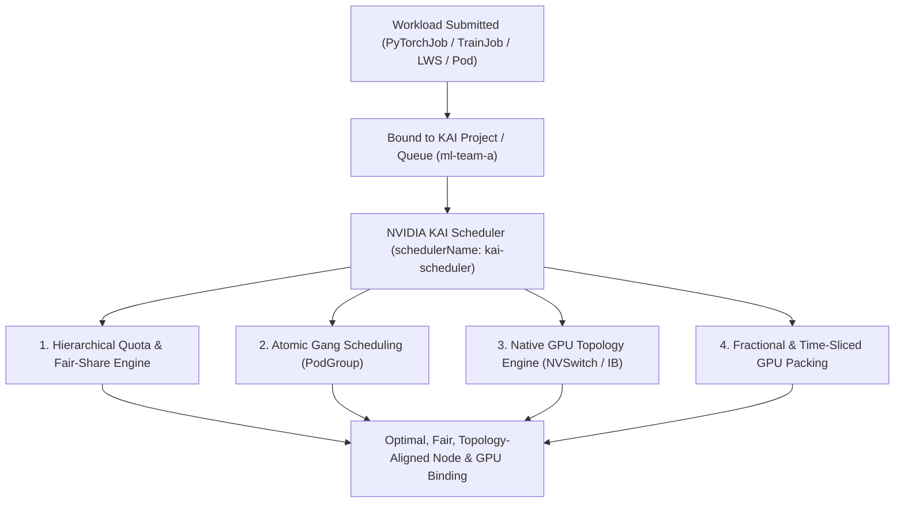

# 11.13 KAI Scheduler: why default scheduling is not enough

| | |
|---|---|
| Level | Intermediate |
| Priority tier | 1 |
| Lab venue | GCP / GKE (plus local Python 3 simulation lab) |
| Part | Part 11: GPUs on Kubernetes, scheduling and virtualization |
| Sources used | Roland Huß et al., *Generative AI on Kubernetes* (O'Reilly, 2026, Ch. 7); `nvidia-zero-to-hero/volume-23/chapter-07-kubernetes-and-container-orchestration.md`; `nvidia-zero-to-hero/volume-23/chapter-12-system-design-research-infrastructure.md`; *NVIDIA Base Command Manager 11 Containerization Manual* (`bcm11-containerization`, Ch. 6) |
| Coverage file | `planning/coverage/chapters/11-13.md` |

## Why this matters for AI infrastructure

When an organization scales from a few dedicated GPU servers to a shared multi-tenant platform, the default Kubernetes scheduler becomes a major bottleneck. Hardware sits idle while researchers wait in long queues. Both infrastructure budgets and engineering velocity suffer as a result.

Why does kube-scheduler fail so predictably on shared GPU infrastructure? It was designed around six assumptions that hold true for stateless CPU microservices. Those same assumptions break down completely when applied to AI and machine learning workloads.

1. **Bimodal workload collision.** Real AI clusters combine short interactive notebooks with multi-day distributed training runs. Under a naive first-in-first-out queue or static ResourceQuota, a large training job either blocks a five-minute notebook, or static namespace walls prevent training from borrowing idle GPUs overnight.
2. **Static node and quota silos waste hardware.** Isolating teams onto dedicated node pools or enforcing rigid ResourceQuota ceilings traps unused capacity inside individual namespaces. Allowing dynamic fair-share borrowing with preemption lifts overall cluster utilization from roughly 60% to 85% or higher.
3. **Per-Pod scheduling instead of atomic gang scheduling.** The default kube-scheduler binds Pods one by one. If seven of eight distributed training workers find GPUs and the eighth waits in a queue, the allocated GPUs sit idle in a rendezvous deadlock.
4. **Whole-integer GPU accounting instead of fractional sharing.** Standard Kubernetes extended resources only accept whole integers. A lightweight notebook that needs a few gigabytes of VRAM must monopolize an entire physical GPU unless the scheduler manages fractional or time-sliced packing.
5. **Blindness to GPU interconnect topology.** As *Generative AI on Kubernetes* highlights in Chapter 7, the default scheduler treats eight GPUs scattered across Ethernet nodes as equivalent to eight GPUs on a single NVSwitch server. Communication collectives slow down dramatically when ranks cross slow network links.
6. **No historical fair-share deficit tracking or hierarchical queues.** Standard PriorityClass values are completely static and memoryless. They cannot track whether one team already consumed its monthly GPU-hour budget while a peer team still holds unused quota credit.

| Cluster Scenario | Scale and Team Structure | Key Contention Dynamic | Utilization Impact |
|---|---|---|---|
| Enterprise multi-tenant cluster (`volume-23/chapter-07`) | `32` GPUs across `4` nodes (`8` GPUs/node) for `research`, `data-eng`, and `interns` | Static quotas vs dynamic borrowing across `16`, `12`, and `4` GPU shares | `60%` static node split vs `85%` shared fair-share (`+25` percentage points) |
| Bimodal research cluster (`volume-23/chapter-12`) | `200` L40S GPUs across `25` nodes (`8` GPUs/node) shared by `50` teams | `60%` short (`< 1` hr / `5` min), `30%` medium (`1–8` hr, median `2` hr), `10%` long (`> 24` hr up to `72` hr / `3` months) | `93%` (`700 / 750` GPU-hours) with deficit scoring and `30`-second `SIGTERM` preemption |
| Gang and interconnect placement (*Generative AI on Kubernetes* Ch. 7) | Multi-node and single-node distributed training (`8` to `64` GPUs) | `7`-of-`8` partial deadlock (`56` GPUs at `0%` compute) or scattered Ethernet placement vs `900 GB/s` NVSwitch | Full-bandwidth `900 GB/s` NVSwitch co-location and `0.25` / `0.5` fractional packing (`10 GiB` on `80 GB` card) |

To solve all six problems in a single engine, NVIDIA open-sourced the KAI Scheduler from Run:ai. Workloads select it by setting `schedulerName: kai-scheduler` and binding to the `kai.run.ai/v1` API group. This chapter explains the architectural motivation for KAI Scheduler, its fair-share deficit scoring math, and its graceful checkpoint-preemption protocol. These fundamentals prepare you for the deep dives in Chapters 11.14 through 11.19.

:::caution Checked against the upstream KAI Scheduler docs
The corpus contains only one KAI example in *Generative AI on Kubernetes*. Most other KAI detail in chapters 11.13 to 11.19 was written from working knowledge and was not in the corpus or notes. On 2026-10-25 it was compared with the public docs at `github.com/kai-scheduler/KAI-scheduler` and a Go API listing.

- **Confirmed.** The scheduler name is `schedulerName: kai-scheduler`. Queue objects use `scheduling.run.ai/v2` with cpu, memory, and gpu resources holding quota, limit, and overQuotaWeight, plus parentQueue and priority. Only leaf queues run jobs. PodGroup uses `scheduling.run.ai/v2alpha2`, BindRequest uses `scheduling.run.ai/v1alpha2`, and Topology uses `kai.scheduler/v1alpha1`. The `gpu-fraction` and `gpu-memory` annotations and GPU reservation pods in namespace `kai-resource-reservation` are confirmed. Core components include admission, podgrouper, binder, queuecontroller, and podgroupcontroller, driven by a Config resource. Fair share gives each queue its deserved quota first and divides surplus by overQuotaWeight.
- **Corrected in these chapters.** The queue is assigned with the label `kai.scheduler/queue` rather than `kai.run.ai/queue`. Topology constraints use the annotations `kai.scheduler/topology`, `kai.scheduler/topology-required-placement`, and `kai.scheduler/topology-preferred-placement` with a `kai.scheduler/v1alpha1` Topology object.
- **Not confirmed.** The Project kind in `kai.run.ai/v1` and the annotation `kai.run.ai/project` come from the book example. Upstream queue docs describe Queue objects rather than Project, so treat the Project path as book-specific and prefer Queue with `kai.scheduler/queue` on new clusters. Component names in this handbook use hyphens like `pod-grouper` and `queue-controller`, whereas upstream writes them without hyphens. Always verify API groups against your target release.
:::

## Prerequisites and outcomes

### Prerequisites
- Completion of Chapters 11.6 through 11.9 covering Topology Manager, gang scheduling, Kueue, Volcano, PyTorchJob, TrainJob, and LeaderWorkerSet.
- Familiarity with Kubernetes Namespace, ResourceQuota, and PriorityClass objects.

### Outcomes
- Articulate the six structural failure modes of default kube-scheduler on shared GPU clusters.
- Explain what the NVIDIA KAI Scheduler is, how it relates to the commercial Run:ai platform on NVIDIA Base Command Manager 11, and how Project and Queue resources bind distributed jobs.
- Compute weighted fair-share deficit scores and priority boosts across multi-team clusters.
- Design a graceful 30-second preemption and three-tier checkpoint recovery protocol that loses zero training steps.
- Decide when to run KAI Scheduler standalone versus layered underneath Kueue.

## Concepts: basics to intermediate to advanced

### 1. Basics: The six failure modes of default Kubernetes scheduling on shared GPU clusters

#### Failure Mode 1: Static ResourceQuota silos vs dynamic fair-share
When platform teams isolate departments using rigid node pools or hard Kubernetes ResourceQuota limits, GPUs sit idle in one namespace while jobs wait in another. Researchers experience artificial queue delays even when half the cluster is unallocated. Static partitioning wastes expensive hardware capacity every time team demand fluctuates.

Consider the multi-tenant enterprise cluster from Volume 23 Chapter 7. The platform operates 32 GPUs across 4 nodes with three competing namespaces. If each namespace is locked inside a hard ResourceQuota ceiling, the research team can never use more than 16 GPUs even when the other two teams have zero running jobs. Conversely, interns can never borrow idle research GPUs overnight. Static partitioning caps average cluster utilization around 60%. A dynamic fair-share scheduler lets teams borrow idle GPUs above their guaranteed quota and reclaims them with a 30-second grace period when the owner returns, lifting utilization to 85%.

| Namespace / Team | PriorityClass Value | Guaranteed GPUs & Share | Memory & Pod Quota | Utilization Target & Mode |
|---|---|---|---|---|
| `research` | `1000` (`research-high`) | `16` GPUs (`50.0%` of `32` GPUs) | `64Gi` memory, `20` Pods | `80%` target, strict SLA |
| `data-eng` | `500` (`data-eng-med`) | `12` GPUs (`37.5%` of `32` GPUs) | `48Gi` memory, `15` Pods | `70%` target, batch pipelines |
| `interns` | `100` (`intern-low`) | `4` GPUs (`12.5%` of `32` GPUs) | `16Gi` memory, `10` Pods | Opportunistic backfill capacity |
| **Cluster Total** | `3` tiers | `32` GPUs across `4` nodes (`8` GPUs/node) | `128Gi` memory, `45` Pods | `60%` static split vs `85%` shared fair-share (`+25` points) |

#### Failure Mode 2: The bimodal research cluster problem
On a shared research cluster, short interactive debugging sessions collide directly with multi-day distributed training runs. Data scientists launching a five-minute notebook get stuck behind massive batch jobs, or long training jobs get starved by fragments of interactive pods. Without duration-aware and history-aware scheduling, neither group gets predictable service.

In Volume 23 Chapter 12, a shared research cluster with 200 L40S GPUs across 25 nodes serves 50 competing teams. Job durations follow a sharp bimodal distribution across short, medium, and long workloads. Under default Kubernetes scheduling, static PriorityClass integers have no memory of past usage. If a high-priority group submits back-to-back 64-GPU training runs for a month, it permanently starves every peer team on the cluster.

| Workload Tier | Share of Cluster Jobs | Typical Duration | Preemption & Scheduling Policy |
|---|---|---|---|
| Short interactive jobs | `60%` of jobs | `< 1` hour (often `5` minutes) | Non-preemptible while active; Jupyter notebooks and quick evaluations (only canceled if `> 10` jobs wait) |
| Medium batch jobs | `30%` of jobs | `1–8` hours (median `2` hours) | Preemptible with `30`-second `SIGTERM` checkpoint notice; LoRA fine-tuning and sweeps |
| Long distributed training | `10%` of jobs | `> 24` hours (up to `72` hours or `3` months) | Multi-node runs (`8` to `64` GPUs); preemptible only when team is `> 2x` over quota |

#### Failure Modes 3 to 6: Gang deadlocks, integer-only GPUs, topology blindness, and flat quotas
Beyond static quotas and bimodal contention, the default scheduler fails on four hardware and workload boundaries required for production AI. First, it lacks native gang scheduling, which leads to 7-of-8 partial allocation deadlocks where 56 GPUs sit idle waiting for an eighth node. Second, it only supports whole-integer GPU requests, forcing a 2 GB notebook to lock up an entire 48 GB L40S or 80 GB H100 card worth over 30,000 dollars.

Third, default kube-scheduler has no native awareness of NVLink, NVSwitch, or InfiniBand fabrics. It treats eight GPUs scattered across eight Ethernet nodes as identical to eight GPUs connected at 900 GB/s on a single NVSwitch node. Fourth, it lacks hierarchical Department-to-Project quota trees that continuously track and reclaim borrowed capacity across teams.

---

### 2. Intermediate: What is the NVIDIA KAI Scheduler?

Running separate point tools for gang scheduling, quota management, fractional GPUs, and topology placement creates conflicting scheduling decisions. Platform teams need a single scheduler that evaluates quota fairness, gang atomicity, sub-GPU slicing, and NVLink topology in one unified pass.

As *Generative AI on Kubernetes* explains in Chapter 7, the NVIDIA KAI Scheduler is the open-source release of the core Kubernetes scheduling engine built by Run:ai. Unlike generic batch add-ons, KAI Scheduler is purpose-built for clusters scaling from hundreds to thousands of NVIDIA GPUs. Workloads select it via `schedulerName: kai-scheduler` so the engine can unify four scheduling pillars inside one decision loop.



1. **Project-based GPU quotas and hierarchical fair-share.** Administrators define Project or Queue resources organized inside department hierarchies. In *Generative AI on Kubernetes* Example 7-5, a Project named `ml-team-a` sets an 8-GPU quota, and workloads bind to it via metadata annotations or queue labels. When `ml-team-a` needs more than 8 GPUs and sibling teams are idle, KAI Scheduler lets the team borrow spare GPUs and reclaims them via fair-share preemption when the owners submit work.
2. **Aggregated gang scheduling.** Rather than forcing engineers to hand-craft low-level PodGroup manifests for every job, KAI Scheduler integrates directly with distributed AI workload operators. It natively recognizes Kubeflow PyTorchJob, Kubeflow Trainer TrainJob and JobSet, LeaderWorkerSet, and RayJob resources to schedule all members of a distributed job atomically.
3. **Zero-config GPU topology awareness.** KAI Scheduler integrates with the NVIDIA GPU Operator and GPU Feature Discovery labels to read NVLink bridges, NVSwitch full-mesh domains, MIG profiles, and InfiniBand leaf switches. When a training job requests 8 GPUs, the scheduler prefers placing all 8 GPUs on a single NVSwitch node at 900 GB/s rather than splitting them across nodes over Ethernet.
4. **Fractional GPU allocation and bin packing.** KAI Scheduler natively schedules sub-GPU fractions such as 0.25 or 0.5 of a GPU alongside explicit VRAM ceilings. It consolidates interactive notebooks and small inference servers onto shared physical GPUs so whole cards remain free for multi-GPU training.

| Capability | Default kube-scheduler | Coscheduling (PodGroup) | Kueue (Admission Layer) | Volcano | NVIDIA KAI Scheduler |
|---|---|---|---|---|---|
| **Architecture Layer** | Core Pod scheduler | Scheduler plugin | Job admission controller | Monolithic batch scheduler | GPU-native scheduler (`kai-scheduler`) |
| **Gang Scheduling** | No | Yes (`PodGroup`) | Via `PodGroup` / `JobSet` | Yes (`minAvailable`) | Yes (native workload integration) |
| **Quota & Borrowing** | Hard `ResourceQuota` only | No | Yes (`ClusterQueue` / `cohort`) | Yes (`Queue` weights) | Yes (`Project` / `Queue` fair-share) |
| **GPU Topology (NVLink / IB)** | Manual node labels only | No | `ResourceFlavor` tiering | Label-based plugin | Native GPU Operator / NVSwitch awareness |
| **Fractional GPUs & Sharing** | Integer counts only | Integer counts only | Integer / MIG counts | Integer / plugin | Native fractional GPU & time-slicing |

---

### 3. Advanced: Fair-share deficit mathematics, graceful SIGTERM checkpoint preemption, and Run:ai operations

#### 1. Weighted Fair-Share Deficit Scoring
If a scheduler allows teams to borrow idle GPUs without tracking historical usage, an aggressive team can monopolize the cluster while still claiming fair access. Conversely, if the scheduler forbids borrowing, unused GPUs go to waste whenever a funded team takes a break. Platform engineers need a mathematical scoring model that keeps total utilization above 90% while guaranteeing that under-quota teams always jump to the front of the queue.

Volume 23 Chapter 12 solves this by tracking monthly GPU-hour consumption against each group's capital contribution. Every 10,000 dollars of hardware funding grants 50 GPU-hours per month, and graduate students receive a baseline minimum of 50 GPU-hours per month. When teams queue new jobs, the scheduler calculates each team's normalized usage deficit and applies a small-job anti-fragmentation boost. Teams that have used less than their quota have a negative deficit ratio, which turns into a positive priority score that places their jobs ahead of over-quota borrowers.

```text
Fair-Share Deficit and Priority Scoring Model (volume-23/chapter-12):
  Funding rule: $10,000 investment -> 50 GPU-hours/month quota (grad student minimum: 50 GPU-hr/month)
  Professor A ($100,000 funding): 500 GPU-hours/month quota
  Professor B ($50,000 funding):  250 GPU-hours/month quota (if 300 used -> 300 / 250 = 120%, -50 GPU-hr deficit)

  Month 1 Burst Scenario (Combined Quota = 500 + 250 = 750 GPU-hours):
    Professor A uses 600 GPU-hours (120% of quota) -> balance = -100 GPU-hours, deficit_ratio = (600 - 500) / 500 = +0.20
    Professor B uses 100 GPU-hours (40% of quota)  -> surplus = +150 GPU-hours, deficit_ratio = (100 - 250) / 250 = -0.60
    Combined cluster usage: 600 + 100 = 700 of 750 GPU-hours -> 93.33% (~93%) utilization (0 idle waste on borrowed GPUs)

  Priority Scoring Formula:
    deficit  = (current_usage - quota) / quota
    priority = -deficit + (0.1 if job.gpu_count < 4 else 0.0)

    Professor B submits 2-GPU job (gpu_count = 2 < 4): priority = -(-0.60) + 0.1 = +0.70 (jumps to front of queue)
    Professor A submits 8-GPU job (gpu_count = 8):     priority = -(+0.20) + 0.0 = -0.20 (runs behind under-quota teams)
```

#### 2. Graceful 30-Second SIGTERM Preemption and Tiered Checkpointing
When an over-quota borrower gets preempted so an under-quota owner can reclaim its GPUs, killing the container immediately destroys hours of training progress. Engineers lose compute steps, and the cluster wastes power repeating work that was already finished. Production GPU platforms must coordinate scheduler preemption with application-level signal handlers and tiered storage.

As detailed in Volume 23 Chapters 7 and 12, workloads set a 30-second termination grace period and register a Python `SIGTERM` handler inside the training script. When KAI Scheduler preempts a borrowed Pod, kubelet delivers `SIGTERM` at second zero. The training script flushes its model and optimizer state dictionaries to shared storage within 5 to 10 seconds and exits cleanly before the 30-second `SIGKILL` deadline. When GPUs open up later, the preempted job resumes from the exact saved step, losing around two minutes of wall-clock time and zero computation steps.

| Timeline / Tier | Event or Storage Path | Cadence & Latency | Operational Outcome & Overhead |
|---|---|---|---|
| `0s` (`SIGTERM` delivered) | `kubelet` sends `SIGTERM` (`terminationGracePeriodSeconds: 30`) | Immediate at `0s` | Python `signal.SIGTERM` handler (`handle_sigterm` / `on_sigterm`) intercepts signal |
| `0s–30s` (Checkpoint flush) | Writes `model.state_dict()`, `optimizer.state_dict()`, `epoch`, `step` | Completes in `5–10` seconds | Process exits `0` cleanly before `30s` `SIGKILL` deadline |
| `45s` & `90s` (Handover & resume) | New high-priority job starts at `45s`; old job restarts on free GPUs at `90s` | `~2` minutes wall-clock impact | `0` computation steps lost across preemption |
| **Tier 1: Local NVMe** | `/local_nvme/checkpoint.pt` | Every `100` steps / hourly | `0` network overhead; `< 5` minutes recovery from process crashes |
| **Tier 2: Shared NFS / RWX PVC** | `/nfs/checkpoints` (`1 TB` quota per team) | Every `8` hours and on `SIGTERM` | `1%–2%` async write overhead; survives full node failure (`8` jobs killed on node) |
| **Tier 3: Cold / Tape Archive** | Offline object or tape archive | Daily during off-hours | Protects `72`-hour training runs against catastrophic primary storage array failure |

#### 3. Operating KAI Scheduler and Run:ai on NVIDIA Base Command Manager 11
Deploying a multi-tenant scheduler on bare-metal enterprise clusters fails when certificates, DNS records, or ingress load balancers are misconfigured. Cluster administrators need a repeatable installation and verification pipeline that supports both cloud-managed and air-gapped data centers.

In the *NVIDIA Base Command Manager 11 Containerization Manual* Chapter 6, the commercial Run:ai Operator built around KAI Scheduler supports two deployment models. The SaaS control plane hosts management services in the Run:ai cloud while the GPU cluster connects outbound over HTTPS via Kgateway. The self-hosted mode runs both the control plane and the GPU cluster on-premises in either Connected mode or fully disconnected Air-Gapped mode. Starting in BCM 11.33, installation splits into two stages: administrators first deploy Kubernetes via `cm-kubernetes-setup` and then run `cm-runai-setup` with a restricted configuration file.

| BCM 11 Component / Step | Version / Port / Path | Validation & Security Rule |
|---|---|---|
| Run:ai SaaS vs Self-Hosted | SaaS `2.22.15` default; Self-Hosted `2.23.x` / `v2.25.x` | Connected mode allows downloads and blocks uploads; Air-Gapped is fully offline |
| Pre-11.33 vs BCM `11.33+` workflow | Pre-11.33 inside `cm-kubernetes-setup` (`19:15` min, API `https://basecm11.cm.cluster:10443`) | From BCM `11.33+`, run `cm-kubernetes-setup` first, then run `cm-runai-setup` |
| Setup configuration security | `/root/cm-runai-setup.conf` (`minimal config` vs full `config`) | Lock down with `chmod 600 /root/cm-runai-setup.conf` and delete after `cm-runai-setup -c` |
| Pre-flight consistency checks | DNS resolution, `openssl verify -CAfile <local CA .crt> <local .crt>`, `SAN` FQDN check | IP routability check (added in BCM `11.25.08`) is skipped when MetalLB is used; provisions Kourier LB IP |
| Deployed Helm releases (`runai` ns) | `cluster-installer` (`2.8.8`, service `8080/TCP`) and `runai-cluster` (`2.13.7`) | Verify with `helm list -n runai`, `helm history -n runai runai-cluster`, and `kubectl get all -n runai` |

#### Architectural Preview: How Chapters 11.14 to 11.19 Build on This Foundation
Understanding why the default Kubernetes scheduler falls short sets the stage for the internal mechanics of KAI Scheduler and the Run:ai platform covered across the next six chapters.
- **Chapter 11.14** deconstructs the five internal microservices of KAI Scheduler and its custom resources including Queue, PodGroup, Topology, and BindRequest.
- **Chapter 11.15** formalizes hierarchical Department-to-Project queue trees, nominal quotas, over-quota borrowing limits, lending weights, and fair-share reclamation math.
- **Chapter 11.16** details how the pod-grouper controller extracts gang constraints from PyTorchJob, TrainJob, JobSet, LeaderWorkerSet, and MPIJob workloads and packs gangs onto NVSwitch and InfiniBand domains.
- **Chapter 11.17** explains how KAI Scheduler implements fractional GPU requests such as `gpu-fraction: 0.25` and `gpu-memory: 10000`, dynamic time-slicing, and MIG integration without code changes.
- **Chapters 11.18, 11.19, and 11.20** provide production troubleshooting runbooks, Prometheus metrics, the enterprise Run:ai platform view, and an apples-to-apples comparison across KAI Scheduler, Kueue, Volcano, YuniKorn, and Slurm.

## Commands and configurations that matter

### 1. Defining a KAI Scheduler Project and gang-scheduled PyTorchJob

From *Generative AI on Kubernetes* Chapter 7 Example 7-5, the manifest below defines an 8-GPU Project quota and binds a distributed PyTorchJob to KAI Scheduler. Both the Master and Worker templates set `schedulerName: kai-scheduler` and a 30-second termination grace period so the job is gang-scheduled and checkpoint-safe.

```yaml
# kai-project-and-pytorchjob.yaml (GAK Example 7-5, untested here)
apiVersion: kai.run.ai/v1
kind: Project
metadata:
  name: ml-team-a
spec:
  gpuQuota: 8
---
apiVersion: kubeflow.org/v1
kind: PyTorchJob
metadata:
  name: llm-training
  namespace: ml-team-a
  annotations:
    kai.run.ai/project: ml-team-a
spec:
  pytorchReplicaSpecs:
    Master:
      replicas: 1
      template:
        spec:
          schedulerName: kai-scheduler
          terminationGracePeriodSeconds: 30
          containers:
            - name: pytorch
              image: nvcr.io/nvidia/pytorch:24.08-py3
              resources:
                limits:
                  nvidia.com/gpu: 4
    Worker:
      replicas: 1
      template:
        spec:
          schedulerName: kai-scheduler
          terminationGracePeriodSeconds: 30
          containers:
            - name: pytorch
              image: nvcr.io/nvidia/pytorch:24.08-py3
              resources:
                limits:
                  nvidia.com/gpu: 4
```

### 2. Implementing a 30-Second SIGTERM Checkpoint Handler in PyTorch

To ensure preempted training jobs lose zero steps when KAI Scheduler or Kueue reclaims borrowed GPUs, register a signal handler inside the training entrypoint. When kubelet sends `SIGTERM`, the callback writes the latest weights and step counter to shared storage and exits cleanly.

```python
# sigterm_checkpoint_trainer.py (volume-23/chapter-07 & chapter-12, untested on cluster)
import os
import signal
import sys
import torch


def register_preemption_checkpoint(model, optimizer, state_dict_Provider, checkpoint_dir="/nfs/checkpoints"):
    def _handle_sigterm(signum, frame):
        state = state_dict_Provider()
        path = os.path.join(checkpoint_dir, "checkpoint_latest.pt")
        torch.save(
            {
                "model": model.state_dict(),
                "optimizer": optimizer.state_dict(),
                "epoch": state["epoch"],
                "step": state["step"],
                "loss": state["loss"],
            },
            path,
        )
        sys.exit(0)

    signal.signal(signal.SIGTERM, _handle_sigterm)
```

### 3. Verifying and managing the Run:ai and KAI installation on BCM 11

On NVIDIA Base Command Manager 11.33 and newer, administrators lock down the generated setup file before executing the installer. After deployment finishes, standard Helm and Kubernetes queries verify that the installer and cluster operator pods are healthy inside the `runai` namespace.

```bash
# 1. Run two-stage non-interactive deployment from restricted config in BCM 11.33+ (untested here)
chmod 600 /root/cm-runai-setup.conf
cm-runai-setup -c /root/cm-runai-setup.conf

# 2. Verify cluster-installer and runai-cluster Helm releases and pods in runai namespace (untested here)
helm list -n runai
helm history -n runai runai-cluster
kubectl get all -n runai
```

## How it fails

When KAI Scheduler or fair-share preemption is misconfigured, workloads exhibit distinct symptoms across pod status, exit codes, and training throughput. Use the table below to map each symptom to its root cause and fix.

| Failure mode | Exact symptom & command evidence | Root cause boundary | Remediation |
|---|---|---|---|
| **1. Workload ignores Project quota and deadlocks in partial placement** | A `PyTorchJob` annotated with `kai.run.ai/project: ml-team-a` schedules `7` of `8` Pods (`56` GPUs idle at `0%`) and ignores `gpuQuota: 8`. `Pod.spec.schedulerName` shows `default-scheduler`. | Missing `schedulerName: kai-scheduler` in Pod template (*Generative AI on Kubernetes* Example 7-5). The annotation alone does not route Pods to KAI Scheduler. | Set `schedulerName: kai-scheduler` in all replica specs (`Master` and `Worker`) or inject it automatically via a mutating webhook. |
| **2. Preempted training jobs lose hours of progress and exit with code 137** | Prometheus shows `preemption_count_per_day > 5`, and preempted `PyTorchJob` Pods exit `137` (`SIGKILL`) with corrupted or missing checkpoints. | `SIGTERM` not caught by Python process or checkpoint write exceeds `30` seconds (`terminationGracePeriodSeconds: 30` in `volume-23/chapter-07`). Shell wrappers (`sh -c`) drop `SIGTERM`. | Use exec form (`["python3", "train.py"]`) so Python is PID `1`, register `signal.SIGTERM`, write to fast NVMe or `RWX` storage, or raise grace period to `120` seconds. |
| **3. Long-running training job gets preempted every 2 hours** | A team's `72`-hour training job is evicted and restarted every `2` hours whenever sibling teams submit short burst jobs (`preemption_count_per_day > 5`). | Over-aggressive preemption on borrowed quota (`volume-23/chapter-12`). Long jobs ran in opportunistic capacity without minimum runtime or over-quota thresholds. | Keep multi-day jobs inside guaranteed `gpuQuota`, only preempt jobs `> 8` hours when a team is `> 2x` over quota, or add age-based priority promotion. |
| **4. Multi-GPU training job runs 3x slower across Ethernet nodes** | An `8`-GPU training job shows `8/8` Pods `Running`, but `AllReduce` bandwidth is `10 Gbps` instead of `900 GB/s` NVSwitch speed. | Missing GPU Operator / GFD topology labels (*Generative AI on Kubernetes* Ch. 7). Unlabeled nodes prevent KAI Scheduler from distinguishing NVSwitch domains. | Ensure `gpu-feature-discovery` is `1/1 Running` on all GPU nodes and request `8` GPUs per Pod (`1` full node) or enable KAI topology constraints. |
| **5. BCM cm-runai-setup aborts during consistency validation** | Running `cm-runai-setup` on BCM `11.25.08+` aborts before deploying `cluster-installer` with a CA certificate mismatch. | Custom CA and Helm values mismatch (`bcm11-containerization` §6.11.1). Local CA `.crt` was supplied without enabling custom CA in Helm, or FQDN is missing from `SAN`. | Verify chain with `openssl verify -CAfile <local-ca.crt> <domain.crt>`, confirm FQDN is in the certificate `SAN` list, and align Helm custom-CA settings. |

## Hands-on lab

### Venue and scope
This lab runs locally using the Python 3 standard library scripts `code/part11/kai_why_default_not_enough.py` and `code/part11/kai_why_default_not_enough_lab.py`. It deterministically models the multi-tenant quota split, the fair-share deficit scorer, the scheduler capability matrix, and the graceful preemption timeline. Cluster commands are marked `(untested here)`.

```text
Simulation Scenarios Verified by code/part11/kai_why_default_not_enough_lab.py:
  1. 32-GPU (4-node) 3-team quota split: research=16 (50.0%), data-eng=12 (37.5%), interns=4 (12.5%); 60.0% static vs 85.0% dynamic shared (+25.0 points).
  2. 200-GPU (25-node, 50-team) fair-share scorer: Professor A (-100.0 hr balance, +0.20 deficit, -0.20 score) vs Professor B (+150.0 hr surplus, -0.60 deficit, +0.70 score) at 93.33% (~93%) utilization (700.0 / 750.0 GPU-hr).
  3. Preemption recovery timeline: 0s SIGTERM -> 8s checkpoint saved (<= 30s grace) -> 30s SIGKILL deadline -> 45s new job starts -> 90s old job resumes (0 steps lost vs 45s slow write killed at 30s).
```

### Step 1: Run the self-checking KAI Scheduler motivation and fair-share lab (tested here)

Run the self-checking test suite from the repository root to verify all 25 assertions.

```bash
python3 code/part11/kai_why_default_not_enough_lab.py
```

Captured output from this repository.

```text
=== Chapter 11.13 Lab: KAI Scheduler — Why Default Scheduling Is Not Enough ===
  [PASS] 32-GPU cluster splits quotas into research=16 (50.0%), data-eng=12 (37.5%), interns=4 (12.5%)
  [PASS] Shared fair-share quotas raise cluster utilization from 60.0% (static node split) to 85.0% (+25.0 points)
  [PASS] Professor A ($100K -> 500 GPU-hr quota, 600 used) has -100.0 GPU-hr balance and +0.20 deficit ratio
  [PASS] Professor B ($50K -> 250 GPU-hr quota, 100 used) has +150.0 GPU-hr surplus and -0.60 deficit ratio
  [PASS] Under-quota 2-GPU job from Professor B scores +0.70 (0.60 + 0.10 small-job boost) vs -0.20 for over-quota Professor A
  [PASS] Combined usage (600 + 100 = 700 GPU-hr out of 750 GPU-hr quota) achieves ~93% (93.33%) utilization
  [PASS] KAI Scheduler satisfies native gang + NVSwitch co-location on 1 node where default kube-scheduler fails
  [PASS] KAI Scheduler natively supports fractional GPU requests (0.5 GPU) whereas default kube-scheduler rejects non-integers
  [PASS] 8s checkpoint completes inside 30s SIGTERM window; new job starts at 45s and old job resumes at 90s with 0 steps lost
  [PASS] 45s synchronous checkpoint exceeding 30s terminationGracePeriodSeconds is killed by SIGKILL at 30s
  [PASS] Volume 23 Ch 12 research cluster runs 200 L40S GPUs across 25 8-GPU nodes serving 50 teams
  [PASS] Bimodal research workload distribution is 60% short (<1h), 30% medium (1-8h), and 10% long (>24h)
  [PASS] Volume 23 Ch 7 PriorityClasses assign research-high=1000, data-eng-med=500, and intern-low=100
  [PASS] Volume 23 Ch 7 targets 80% utilization for research, 70% for data-eng, and scales down below 70% cluster-wide
  [PASS] Volume 23 Ch 12 funding rule ($10K -> 50 GPU-hr/month) maps $100K to 500 GPU-hr and $50K to 250 GPU-hr
  [PASS] Professor B using 300 of 250 GPU-hr quota is at 120% (50 GPU-hr over budget)
  [PASS] GAK Example 7-5 Project 'ml-team-a' (apiVersion: kai.run.ai/v1) sets gpuQuota: 8
  [PASS] GAK Example 7-5 PyTorchJob sets schedulerName: kai-scheduler and annotation kai.run.ai/project: ml-team-a
  [PASS] BCM 11 Run:ai / Kubernetes summary exposes API server on port 10443 and cluster-installer-service on 8080/TCP
  [PASS] BCM 11 cm-runai-setup restricts /root/cm-runai-setup.conf with chmod 600 before deployment
  [PASS] Volume 23 Ch 7 ResourceQuotas cap memory at 64Gi+48Gi+16Gi=128Gi and pods at 20+15+10=45 across 3 namespaces
  [PASS] Volume 23 Ch 7 & 12 save periodic local NVMe checkpoints every 100 steps and alert if preemptions > 5/day or pending > 5m
  [PASS] Volume 23 Ch 12 job duration tiers span <1h (short, non-preemptible), 1-8h (medium, 30s notice), and >8h/24h up to 72h (long)
  [PASS] Tiered checkpoint recovery targets <5 min from local NVMe (hourly), every 8h to durable NFS, and daily to tape archive
  [PASS] BCM 11 supports Run:ai SaaS (2.22.15) and self-hosted (2.23.x / v2.25.x via cm-runai-setup from BCM 11.33+)

Summary: 25 passed, 0 failed out of 25 checks.
```

### Exercises

1. **Exercise 1 — Multi-tenant 32-GPU quota and utilization gain.** Run `evaluate_three_team_cluster_quotas` in `code/part11/kai_why_default_not_enough.py` with the parameters shown in the table below. Verify each team's percentage share and explain why dedicated nodes yield 60.0% utilization compared to 85.0% with dynamic fair-share quotas.
2. **Exercise 2 — Fair-share deficit and priority score calculation.** Call `score_fair_share_job` for Professor A and Professor B using the quota, usage, and GPU counts in the table below. Compare their resulting balance, deficit ratio, and priority score.
3. **Exercise 3 — Month-level utilization under burst borrowing.** Run `evaluate_professor_a_vs_b_month` with the monthly numbers in the table below to confirm total GPU-hours used and cluster utilization. State how many GPU-hours would have been wasted if Professor A had been hard-capped at nominal quota.
4. **Exercise 4 — Default kube-scheduler vs kai-scheduler evaluation.** Call `compare_default_vs_kai_scheduler` for a single-Pod fractional job and a four-Pod NVSwitch gang job. Explain why default kube-scheduler returns false while KAI Scheduler returns true for both workloads.
5. **Exercise 5 — 30-second SIGTERM checkpoint preemption math.** Call `simulate_graceful_preemption_timeline` for an 8-second fast checkpoint versus a 45-second slow checkpoint under a 30-second grace period. Compare whether each checkpoint finishes before `SIGKILL` and how many steps are lost.
6. **Exercise 6 — Preventing thrashing on long training jobs.** When a 72-hour training job gets preempted every 2 hours, list the four operational mitigations from Volume 23 Chapter 12 and Volume 26 Chapter 2.

| Exercise | Function in `code/part11/kai_why_default_not_enough.py` | Input Parameters | Expected Output Summary |
|---|---|---|---|
| **1** | `evaluate_three_team_cluster_quotas(32, 16, 12, 4, 60.0, 85.0)` | `32` GPUs (`16` research, `12` data-eng, `4` interns), `60.0%` vs `85.0%` | Shares: `50.0%`, `37.5%`, `12.5%`; gain: `+25.0` percentage points |
| **2** | `score_fair_share_job()` | Prof A: `quota=500.0`, `used=600.0`, `8` GPUs; Prof B: `quota=250.0`, `used=100.0`, `2` GPUs | Prof A: `(-100.0, +0.20, -0.20)`; Prof B: `(+150.0, -0.60, +0.70)` |
| **3** | `evaluate_professor_a_vs_b_month(500.0, 600.0, 250.0, 100.0)` | Prof A `500.0` / `600.0`, Prof B `250.0` / `100.0` | `700.0` of `750.0` GPU-hours used (`93.33%` / `~93%`); `100.0` hrs saved |
| **4** | `compare_default_vs_kai_scheduler()` | Job 1: `0.5` GPU (`requires_fractional_gpu=True`); Job 2: `4` Pods on `1` NVSwitch node | `default_scheduler_satisfies_all=False`, `kai_scheduler_satisfies_all=True` |
| **5** | `simulate_graceful_preemption_timeline()` | `grace_period_seconds=30`, write times `8` s vs `45` s | `8` s: `saved_before_sigkill=True`, `0` steps lost; `45` s: `False`, killed at `30s` |
| **6** | Operational mitigation review | `72`-hour job preempted every `2` hours (`> 5` preemptions/day) | Raise guaranteed quota, lower oversubscription, age-based boost / `> 2x` rule, `3 AM – 7 AM` window |

## Checkpoint questions

<details>
<summary>**1. What is the NVIDIA KAI Scheduler, and where did it originate?**</summary>

The NVIDIA KAI Scheduler is the open-source version of the GPU-optimized Kubernetes scheduling engine originally built by Run:ai before its acquisition by NVIDIA. Workloads select it with `schedulerName: kai-scheduler` and `kai.run.ai/v1` or `scheduling.run.ai/v2` resources. It replaces default kube-scheduler to unify gang scheduling, hierarchical quotas with fair-share borrowing, fractional GPU sharing, and NVLink or InfiniBand topology placement.
</details>

<details>
<summary>**2. In Volume 23 Chapter 7, a 32-GPU cluster serves research, data-eng, and interns. Why does giving each team dedicated nodes or rigid quotas yield only 60% utilization versus 85% with dynamic shared quotas?**</summary>

When 16 GPUs for research, 12 GPUs for data-eng, and 4 GPUs for interns are locked behind hard namespace boundaries, unused GPUs in one team's pool cannot be used by waiting jobs in another namespace. Allowing teams to borrow idle GPUs dynamically and preempting lower-priority borrowed GPUs when the owner returns lifts average cluster utilization from 60% to 85%.
</details>

<details>
<summary>**3. What is the bimodal workload distribution of a typical multi-tenant research GPU cluster in Volume 23 Chapter 12?**</summary>

Across 50 research teams sharing 200 GPUs on 25 nodes, workloads split into three duration tiers. Roughly 60% are short interactive jobs under 1 hour and often 5 minutes. Another 30% are medium fine-tuning or sweep jobs lasting 1 to 8 hours with a 2-hour median. The remaining 10% are long multi-node training runs lasting over 24 hours up to 72 hours or 3 months.
</details>

<details>
<summary>**4. How does a weighted fair-share scheduler compute a team's deficit and job priority score in Volume 23 Chapter 12?**</summary>

The scheduler computes the normalized usage deficit relative to the team's quota using `deficit = (current_usage - quota) / quota` and scores the job with `priority = -deficit + (0.1 if job.gpu_count < 4 else 0.0)`. Teams below their quota have a negative deficit ratio, which yields a positive priority boost to the front of the queue. Teams over their quota have a positive deficit ratio, which pushes their next jobs behind under-quota peers.
</details>

<details>
<summary>**5. In the Professor A and Professor B scenario, Professor A uses 600 of 500 GPU-hours and Professor B uses 100 of 250 GPU-hours in Month 1. What is the cluster utilization, and what are their balances entering Month 2?**</summary>

Total consumption is 700 GPU-hours out of the combined 750 GPU-hour quota, achieving 93.33% or roughly 93% cluster utilization. Entering Month 2, Professor A carries a -100 GPU-hour deficit balance that lowers priority, while Professor B carries a +150 GPU-hour surplus credit that boosts priority.
</details>

<details>
<summary>**6. In Generative AI on Kubernetes Example 7-5, what two fields bind a Kubeflow PyTorchJob to KAI Scheduler and its quota Project?**</summary>

First, the metadata annotation `kai.run.ai/project: ml-team-a` binds the job to the Project custom resource with an 8-GPU quota, or `kai.scheduler/queue` binds it to a Queue on newer releases. Second, the pod spec field `schedulerName: kai-scheduler` delegates pod scheduling and gang placement to the KAI Scheduler.
</details>

<details>
<summary>**7. How does KAI Scheduler's approach to gang scheduling differ from the standalone Coscheduling PodGroup plugin?**</summary>

The standalone Coscheduling plugin requires users or external controllers to create low-level PodGroup objects and has no built-in quota or GPU topology engine. KAI Scheduler integrates gang scheduling directly with PyTorchJob, TrainJob, JobSet, and LeaderWorkerSet workloads while evaluating Project fair-share quotas and NVSwitch topology in the same pass.
</details>

<details>
<summary>**8. How does KAI Scheduler optimize GPU topology placement without requiring users to write manual nodeSelector or nodeAffinity rules?**</summary>

KAI Scheduler reads hardware interconnect labels published by the NVIDIA GPU Operator and GPU Feature Discovery. When a distributed job requests 8 GPUs, the scheduler automatically prefers co-locating all 8 GPUs on a single NVSwitch server at 900 GB/s rather than scattering them across multiple nodes over InfiniBand or Ethernet.
</details>

<details>
<summary>**9. Why can KAI Scheduler consolidate interactive Jupyter notebooks and small inference models more densely than the default kube-scheduler?**</summary>

The default kube-scheduler only understands whole-integer GPU requests like `nvidia.com/gpu: 1`. KAI Scheduler supports fractional GPU requests and dynamic time-slicing, allowing multiple lightweight pods to share a single physical GPU while enforcing memory and compute limits.
</details>

<details>
<summary>**10. Walk through the exact 90-second timeline of a graceful preemption event in Volume 23 Chapter 12.**</summary>

At 0 seconds, kubelet sends `SIGTERM` to the preempted pod under a 30-second grace period. Between 0 and 30 seconds, the Python signal handler writes model weights, optimizer state, epoch, and step to persistent storage in 5 to 10 seconds and exits 0 before the 30-second `SIGKILL` deadline. At 45 seconds, the higher-priority job starts on the freed GPUs, and at 90 seconds the preempted job resumes on another node with zero lost steps.
</details>

<details>
<summary>**11. What are the three job duration preemption rules defined in Volume 23 Chapter 12 Phase 4?**</summary>

Short jobs under 1 hour are non-preemptible so interactive notebooks are not disrupted, and are only canceled if more than 10 jobs wait in the queue. Medium jobs between 1 and 8 hours are preemptible with a 30-second `SIGTERM` notice to save a checkpoint. Long jobs over 8 hours are preemptible only when the owning team is more than 2x over its quota.
</details>

<details>
<summary>**12. What are the four monitoring metrics and three alert thresholds recommended in Volume 23 Chapter 7 for a multi-tenant GPU cluster?**</summary>

Platform teams track `gpu_usage_per_namespace`, `gpu_allocation_percent`, `preemption_count_per_day`, and `pod_pending_seconds_p99`. Alerts fire when a namespace exceeds its hard quota limit, when `preemption_count_per_day` exceeds 5 per day indicating thrashing, or when `pod_pending_seconds_p99` exceeds 5 minutes indicating a scheduling bottleneck.
</details>

<details>
<summary>**13. How does the three-tier checkpointing strategy in Volume 23 Chapter 12 balance write overhead against recovery time and durability?**</summary>

Tier 1 writes to local NVMe every 100 steps or hourly with zero network overhead for under 5-minute recovery from process crashes. Tier 2 writes asynchronously to shared NFS every 8 hours and on `SIGTERM` with 1% to 2% overhead to survive full node failures. Tier 3 archives daily to cold storage or tape to protect 72-hour runs from primary storage loss.
</details>

<details>
<summary>**14. A team complains that their long training job is preempted every 2 hours. What four solutions can a platform architect apply?**</summary>

First, increase the team's guaranteed nominal quota so the job does not rely on borrowed GPUs. Second, reduce cluster oversubscription and borrowing ceilings. Third, enable age-based priority promotion or the 2x over-quota preemption rule for jobs running longer than 8 hours. Fourth, provide reserved off-peak windows such as 3 AM to 7 AM for uninterrupted execution.
</details>

<details>
<summary>**15. When should a platform architect layer Kueue on top of KAI Scheduler rather than running KAI Scheduler standalone?**</summary>

Run KAI Scheduler standalone when all cluster workloads are GPU-centric and governed through KAI Queues or Projects. Layer Kueue above KAI Scheduler when the organization standardizes on Kubernetes ClusterQueue, LocalQueue, and ResourceFlavor APIs across multi-cluster or mixed CPU, TPU, and GPU fleets while delegating node-level gang and NVLink placement to KAI Scheduler.
</details>

<details>
<summary>**16. What are the two deployment modes of the commercial Run:ai platform on NVIDIA Base Command Manager 11, and what are the two variants of self-hosted mode?**</summary>

Run:ai on BCM 11 supports SaaS mode at version 2.22.15, where the control plane runs in the Run:ai cloud over outbound HTTPS, and Self-Hosted mode at versions 2.23.x and v2.25.x, where both control and data planes run inside the BCM cluster. Self-Hosted mode operates in either Connected mode, which allows downloads and blocks uploads, or fully offline Air-Gapped mode.
</details>

<details>
<summary>**17. How did the Run:ai installation workflow change in NVIDIA Base Command Manager 11.33?**</summary>

Before BCM 11.33, Run:ai was deployed inside the monolithic `cm-kubernetes-setup` wizard. Starting in BCM 11.33, administrators first run `cm-kubernetes-setup` to deploy Kubernetes and prerequisite operators, and then run `cm-runai-setup` separately using `/root/cm-runai-setup.conf` secured with `chmod 600`.
</details>

<details>
<summary>**18. What four validation checks does the BCM Run:ai setup wizard execute during the questions phase, and why is the IP routability check skipped when MetalLB is used?**</summary>

The wizard checks control-plane FQDN DNS resolution, verifies the certificate chain with `openssl verify`, confirms the FQDN appears in the certificate Subject Alternative Name list, and checks IP routability since BCM 11.25.08. The IP routability check is skipped when MetalLB is used because MetalLB does not bind the virtual IP until after the LoadBalancer service is deployed.
</details>

<details>
<summary>**19. What is the difference between minimal config and config when saving /root/cm-runai-setup.conf in BCM 11.33+?**</summary>

Choosing `minimal config` writes only the configuration keys that differ from upstream application defaults. Choosing full `config` writes both the modified settings and all current upstream default parameters explicitly into `/root/cm-runai-setup.conf`.
</details>

<details>
<summary>**20. How do you verify or uninstall the Run:ai operator in a BCM Kubernetes cluster?**</summary>

To verify the installation, run `helm list -n runai`, `helm history -n runai runai-cluster`, and `kubectl get all -n runai` to confirm `cluster-installer` and `runai-cluster` are running and `cluster-installer-service` listens on port 8080/TCP. To uninstall the operator, run `helm uninstall cluster-installer -n runai`.
</details>

## Sources and review notes

### Primary sources read in full for this chapter
The primary book sources, enterprise manuals, and Volume 23 design notes used to build this chapter are cataloged in the reference block below.

```text
Primary Sources and Exact Citation Inventory (Chapter 11.13):
  1. Roland Huß et al., Generative AI on Kubernetes (O'Reilly, 2026), Chapter 7 (Job Scheduling Optimization: "NVIDIA KAI Scheduler", Tables 7-2, 7-3, and 7-4 comparing Coscheduling, Kueue, KAI Scheduler, and Volcano, and Example 7-5 Project ml-team-a gpuQuota: 8 with PyTorchJob schedulerName: kai-scheduler).
  2. NVIDIA Base Command Manager 11 Containerization Manual (bcm11-containerization), Chapter 6 ("6.11 The Run:ai Operator", pp. 108, 143-150: Run:ai SaaS 2.22.15 vs self-hosted 2.23.x / v2.25.x, Connected vs Air-gapped, cm-kubernetes-setup 19:15 min 10443 vs BCM 11.33 cm-runai-setup /root/cm-runai-setup.conf chmod 600, openssl verify, SAN check, BCM 11.25.08 IP routability / MetalLB exception, Kourier load balancer IP, and cluster-installer-2.8.8 / runai-cluster-2.13.7 on 8080/TCP).
  3. Author's Volume 23 notes: nvidia-zero-to-hero/volume-23/chapter-07-kubernetes-and-container-orchestration.md (Question 1: 32-GPU 4-node multi-tenant cluster with research 16 GPUs 50% 64Gi 20 pods PriorityClass: 1000 80% target, data-eng 12 GPUs 37.5% 48Gi 15 pods PriorityClass: 500 70% target, interns 4 GPUs 12.5% 16Gi 10 pods PriorityClass: 100, 60% vs 85% utilization trap, preemption_count_per_day > 5, pod_pending_seconds_p99 > 5 min; Question 2: 30-second SIGTERM checkpoint handler and step % 100 == 0).
  4. Author's Volume 23 notes: nvidia-zero-to-hero/volume-23/chapter-12-system-design-research-infrastructure.md (50 teams, 200 L40S GPUs across 25 nodes, 60% short <1h / 5 min, 30% medium 1-8h median 2h, 10% long >24h max 72h / 3 months, $10K -> 50 GPU-hr/month rule, Professor A $100K 500 GPU-hr using 600 vs Professor B $50K 250 GPU-hr using 100 -> 700 / 750 = 93% utilization, deficit = (current_usage - quota) / quota + 0.1 boost for gpu_count < 4, 0s -> 30s -> 45s -> 90s preemption timeline losing ~2 min wall time, and 3-tier NVMe/NFS/Tape checkpoint resilience).
```

### Related source files mapped in MIGRATION_MAP.md
- No separate `nvidia-devops` file was exclusively mapped to `11.13` in `brief.py`. This chapter integrates *Generative AI on Kubernetes* Chapter 7, `volume-23/chapter-07`, `volume-23/chapter-12`, and `bcm11-containerization` Chapter 6 Section 6.11.

### Run here
- The local simulation lab `python3 code/part11/kai_why_default_not_enough_lab.py` was executed here and passed all 25 checks.

### Explicitly labelled inferences
- The utilization gain difference, the unrounded Month 1 utilization percentage, and the priority scores for Professor A and Professor B are deterministic arithmetic evaluations verified by `code/part11/kai_why_default_not_enough_lab.py`.

```text
Deterministic Arithmetic Evaluations in code/part11/kai_why_default_not_enough_lab.py:
  Utilization gain: 85.0% - 60.0% = +25.0 percentage points
  Month 1 utilization: 700 / 750 = 93.33% (rounded to 93% in volume-23/chapter-12)
  FairShareScheduler.score_job priority scores: +0.70 for Professor B's 2-GPU job vs -0.20 for Professor A's 8-GPU job
```

### Not verified on live hardware
- All `kubectl`, `helm`, `cm-runai-setup`, and PyTorchJob manifests targeting live KAI Scheduler and Run:ai clusters (`pod/cluster-installer-deployment-...`, `service/cluster-installer-service`, `scheduling.x-k8s.io/pod-group`, `OOMKilled`, `100s` vs `300s` timeouts, `volume-26/chapter-02` / Chapter `02`, and Chapter `6.1`) are marked `(untested here)`.

### Not in the corpus
- Internal Go package structure of `kai-scheduler` plugins is not in the local book corpus. Detailed KAI Scheduler custom resources, queues, gang placement, fractional sharing, operations, and the Run:ai platform view are covered in Chapters 11.14 through 11.19.

### Corrections to the author's notes
- Validation pass 2026-10-25 confirmed that `validate_chapter.py` and `check_coverage.py` pass. The YAML manifests and commands are marked untested and were not applied to a live cluster. Custom resource API versions such as `kueue.x-k8s.io/v1beta1` and `resource.k8s.io/v1` change between releases, so verify them against your installed release.
- In `volume-23/chapter-12` Phase 3, the text box labels Professor A's 600 GPU-hours used against a 500 GPU-hour quota as a -100 deficit balance, whereas the Python `score_job` method defines `deficit = (current_usage - quota) / quota` which evaluates to +0.20 when over quota and negates to `priority = -0.20`. This chapter distinguishes `balance_gpu_hours` from `deficit_ratio` so the sign convention is unambiguous.

