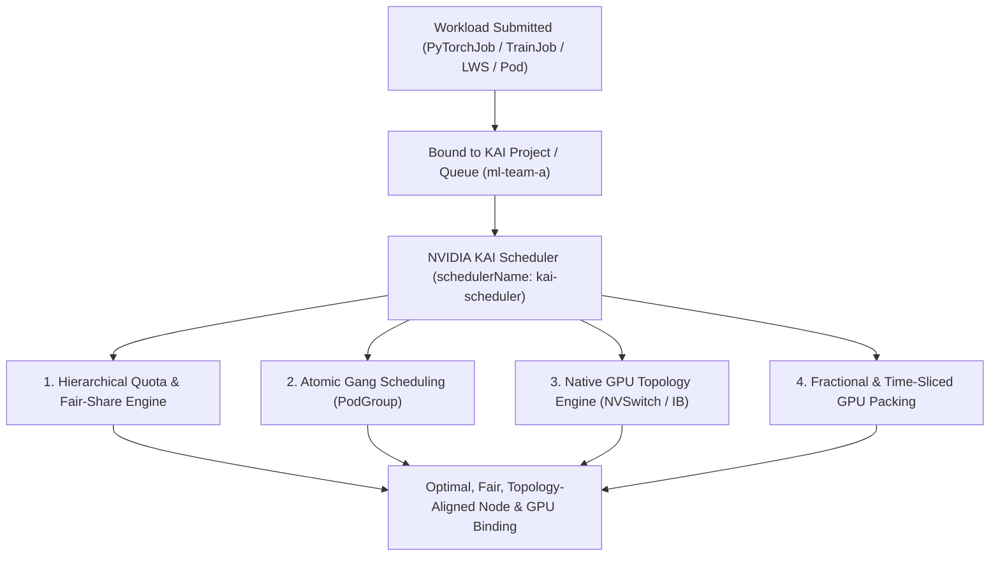

# 11.13 KAI Scheduler: why default scheduling is not enough

Start with the table below. It gives the level, the lab venue and the sources behind this chapter. If you want to check a claim later, the sources are the place to begin, because the rest of the chapter builds on them.

| | |
|---|---|
| Level | Intermediate |
| Priority tier | 1 |
| Lab venue | GCP / GKE (plus local Python 3 simulation lab) |
| Part | Part 11: GPUs on Kubernetes, scheduling and virtualization |
| Coverage file | `planning/coverage/chapters/11-13.md` |

The chapter answers one practical question. Why does the default Kubernetes scheduler struggle once a GPU cluster is shared by many teams, and what does a scheduler built for that job do differently? You will not need any prior experience with KAI Scheduler to follow along. You do need to know how Pods, Nodes and namespaces work in Kubernetes, and the prerequisites section below says which earlier chapters cover them.

## Why this matters for AI infrastructure

Picture a company that starts with a few dedicated GPU servers. Each team gets one server, and the arrangement works for a while. Then leadership decides to turn those servers into one shared platform for many teams. The hardware has not changed, but the people using it have. At that point the default Kubernetes scheduler often becomes the bottleneck. Hardware sits idle while researchers wait in long queues, and both the infrastructure budget and engineering speed suffer.

A useful comparison is a shared kitchen. When one cook uses every burner for a long banquet, the cooks who only need one burner for a quick sauce are stuck waiting. When each cook owns a fixed set of burners, the burners sit empty whenever their owner steps away. A good kitchen needs a rule that lets quick jobs slip in, lets long jobs use spare burners, and hands a burner back when its owner returns. A scheduler for shared GPUs has the same job.

Why does kube-scheduler fail so predictably on shared GPU infrastructure? It was designed around six assumptions that hold for stateless CPU microservices. A stateless service can be restarted at any time, it needs only a little memory, and it does not care which neighbor it shares a machine with. AI and machine learning workloads break those assumptions. The six problems below show where they break, so you can check which ones apply to your own cluster.

First, a shared AI cluster mixes very different jobs. Short interactive notebooks run alongside multi-day distributed training runs. Under a naive first-in-first-out queue or a static ResourceQuota, you can watch a large training job block a five-minute notebook. Static namespace walls, on the other hand, stop training from borrowing idle GPUs overnight.

Second, isolating teams wastes hardware. Dedicated node pools and rigid ResourceQuota ceilings trap unused capacity inside each namespace. Dynamic fair-share borrowing with preemption lets those idle GPUs do work. The worked example later in this chapter shows the effect with a 60% and an 85% figure.

Third, the default scheduler binds Pods one by one instead of placing a group together. Suppose seven of eight distributed training workers find GPUs and the eighth waits in a queue. The allocated GPUs then sit idle in a rendezvous deadlock, and the hardware you already bought does no work.

Fourth, the default scheduler counts GPUs only as whole integers. A lightweight notebook that needs a few gigabytes of VRAM still takes an entire physical GPU. VRAM is the memory on the GPU card itself. If you want that notebook to share a card, the scheduler has to pack fractions or time slices. Without that, the notebook monopolizes the card.

Fifth, the default scheduler cannot see the GPU interconnect. As *Generative AI on Kubernetes* highlights in Chapter 7, it treats eight GPUs scattered across Ethernet nodes as equal to eight GPUs on one NVSwitch server. An NVSwitch is the switch chip inside a server that links its GPUs at high speed. Collective operations, where many GPUs exchange data together, slow down sharply when the ranks cross slow network links.

Sixth (problem 6), PriorityClass values are fixed numbers with no memory. They cannot tell you whether one team already used its monthly GPU-hour budget while a peer team still has unused quota credit. A PriorityClass is a Kubernetes object that gives a Pod a fixed importance number, and the scheduler reads that number at one moment in time with no record of what happened before.

The table below compares three scenarios from the sources. As you read it, look at the last column, which reports what each scenario costs in utilization.

| Cluster Scenario | Scale and Team Structure | Key Contention Dynamic | Utilization Impact |
|---|---|---|---|
| Enterprise multi-tenant cluster (`volume-23/chapter-07`) | `32` GPUs across `4` nodes (`8` GPUs/node) for `research`, `data-eng`, and `interns` | Static quotas vs dynamic borrowing across `16`, `12`, and `4` GPU shares | `60%` static node split vs `85%` shared fair-share (`+25` percentage points); the author's design-note figures, not a measured benchmark |
| Bimodal research cluster (`volume-23/chapter-12`) | `200` L40S GPUs across `25` nodes (`8` GPUs/node) shared by `50` teams | `60%` short (`< 1` hr / `5` min), `30%` medium (`1–8` hr, median `2` hr), `10%` long (`> 24` hr up to `72` hr / `3` months) | `93%` (`700 / 750` GPU-hours) with deficit scoring and `30`-second `SIGTERM` preemption |
| Gang and interconnect placement (*Generative AI on Kubernetes* Ch. 7) | Multi-node and single-node distributed training (`8` to `64` GPUs) | `7`-of-`8` partial deadlock (`56` GPUs at `0%` compute) or scattered Ethernet placement vs `900 GB/s` NVSwitch | Full-bandwidth `900 GB/s` NVSwitch co-location and `0.25` / `0.5` fractional packing (`10 GiB` on `80 GB` card) |

The three scenarios point in one direction. Static splits waste hardware, bimodal workloads starve one group or the other, and interconnect-blind placement slows the training itself. KAI Scheduler was built to handle all three in one engine.

NVIDIA open-sourced the KAI Scheduler from Run:ai to solve all six problems in a single engine. To use it, a workload sets `schedulerName: kai-scheduler` and binds to the `kai.run.ai/v1` API group. This chapter covers why the engine exists, how its fair-share deficit scoring works, and how its graceful checkpoint-preemption protocol works. These fundamentals prepare you for the deep dives in Chapters 11.14 through 11.19.

Check which of the six problems your own cluster shows first, because that tells you how much of KAI Scheduler you need. A cluster with only one or two of these problems may need only one or two of KAI's features.

:::caution Checked against the upstream KAI Scheduler docs
The sources used here contain only one KAI example, in *Generative AI on Kubernetes*. Most other KAI detail in chapters 11.13 to 11.19 was written from working knowledge and was not in those sources or notes. On 2026-10-25 it was compared with the public docs at `github.com/kai-scheduler/KAI-scheduler` and a Go API listing.

- **Confirmed.** The scheduler name is `schedulerName: kai-scheduler`. Queue objects use `scheduling.run.ai/v2` with cpu, memory, and gpu resources holding quota, limit, and overQuotaWeight, plus parentQueue and priority. Only leaf queues run jobs. PodGroup uses `scheduling.run.ai/v2alpha2`, BindRequest uses `scheduling.run.ai/v1alpha2`, and Topology uses `kai.scheduler/v1alpha1`. The `gpu-fraction` and `gpu-memory` annotations and GPU reservation pods in namespace `kai-resource-reservation` are confirmed. Core components include admission, podgrouper, binder, queuecontroller, and podgroupcontroller, driven by a Config resource. Fair share gives each queue its deserved quota first and divides surplus by overQuotaWeight.
- **Corrected in these chapters.** The queue is assigned with the label `kai.scheduler/queue` rather than `kai.run.ai/queue`. Topology constraints use the annotations `kai.scheduler/topology`, `kai.scheduler/topology-required-placement`, and `kai.scheduler/topology-preferred-placement` with a `kai.scheduler/v1alpha1` Topology object.
- **Not confirmed.** The Project kind in `kai.run.ai/v1` and the annotation `kai.run.ai/project` come from the *Generative AI on Kubernetes* example. Upstream queue docs describe Queue objects rather than Project, so treat the Project path as book-specific and prefer Queue with `kai.scheduler/queue` on new clusters. Component names in this handbook use hyphens like `pod-grouper` and `queue-controller`, whereas upstream writes them without hyphens. Always verify API groups against your target release.
:::

## Prerequisites and outcomes

### Prerequisites
Finish Chapters 11.6 through 11.9 first. They cover Topology Manager, gang scheduling, Kueue, Volcano, PyTorchJob, TrainJob, and LeaderWorkerSet. Those chapters give you the vocabulary this chapter uses for groups of Pods that must start together. If you skipped them, you can still follow the first two sections, because the failure modes stand on their own. The custom resource details will go faster once you have read the gang scheduling chapter. You also need to be comfortable with the Kubernetes Namespace, ResourceQuota, and PriorityClass objects, because every failure in this chapter starts from one of them.

### Outcomes
This chapter walks through the six structural failure modes of the default kube-scheduler on a shared GPU cluster. It then explains what the NVIDIA KAI Scheduler is, how it relates to the commercial Run:ai platform on NVIDIA Base Command Manager 11, and how Project and Queue resources bind distributed jobs. After that, it works through fair-share deficit scores and priority boosts on a multi-team cluster. It ends with a graceful 30-second preemption and three-tier checkpoint recovery protocol, and a short guide to choosing between KAI Scheduler on its own and KAI Scheduler under Kueue.

## Concepts: basics to intermediate to advanced

### 1. Basics: The six failure modes of default Kubernetes scheduling on shared GPU clusters

Before you learn any KAI feature, you need to see the failures it answers. Each failure mode below starts from a situation that real platform teams run into. The six modes are not rare edge cases. They show up as soon as a second team shares the cluster.

#### Failure Mode 1: Static ResourceQuota silos vs dynamic fair-share
Picture a platform team that splits its cluster by department, using fixed node pools or hard ResourceQuota limits. GPUs then sit idle in one namespace while jobs wait in another. Researchers face queue delays even when half the cluster is unallocated, and static partitioning wastes expensive hardware each time team demand shifts.

Take the multi-tenant enterprise cluster. The platform runs 32 GPUs across 4 nodes, with three competing namespaces. Suppose the research namespace sits behind a hard ResourceQuota ceiling of 16 GPUs. Research can then never use more than half the cluster, even when the other two teams have zero running jobs. The cost shows up in two places. The first is idle hardware, which the finance team sees on an invoice. The second is waiting, which the researchers feel on their own schedule. A quota that looks sensible on paper can still produce both, because the paper never sees the overnight hours when nobody is using the research desks.

Think of it as a library with reserved desks. Each department gets a fixed number of desks, and a desk that sits empty stays empty even while students stand at the door. A fair-share scheduler works more like a shared reading room. Each team keeps its guaranteed desks, and it may use a neighbor's empty desk until the neighbor walks back in. The neighbor then gets the desk back after a short grace period.

In the author's design notes for this cluster, the static split reaches about 60% average utilization. A dynamic fair-share scheduler works differently. Teams borrow idle GPUs above their guaranteed quota, and they give them back after a 30-second grace period when the owner returns. The same notes put utilization at 85% with borrowing. This matters for how you use the numbers. A design note is a reasoned estimate written by someone who planned the cluster. It is useful for explaining why borrowing helps. It is not evidence that your own cluster will move by the same amount, so measure your own utilization before you promise a gain.

The table below lists each namespace's PriorityClass, guaranteed share and quota, so you can see the setup behind the 60% and 85% figures. Notice that the three guaranteed shares add up to the full 32 GPUs.

| Namespace / Team | PriorityClass Value | Guaranteed GPUs & Share | Memory & Pod Quota | Utilization Target & Mode |
|---|---|---|---|---|
| `research` | `1000` (`research-high`) | `16` GPUs (`50.0%` of `32` GPUs) | `64Gi` memory, `20` Pods | `80%` target, strict SLA |
| `data-eng` | `500` (`data-eng-med`) | `12` GPUs (`37.5%` of `32` GPUs) | `48Gi` memory, `15` Pods | `70%` target, batch pipelines |
| `interns` | `100` (`intern-low`) | `4` GPUs (`12.5%` of `32` GPUs) | `16Gi` memory, `10` Pods | Opportunistic backfill capacity |
| **Cluster Total** | `3` tiers | `32` GPUs across `4` nodes (`8` GPUs/node) | `128Gi` memory, `45` Pods | `60%` static split vs `85%` shared fair-share (`+25` points); author's design-note figures, not measured |

#### Failure Mode 2: The bimodal research cluster problem
Now picture a shared research cluster where a five-minute debugging session has to wait behind multi-day training runs. If you launch a short notebook on that cluster, you get stuck behind massive batch jobs. Long training jobs, in turn, get starved by fragments of interactive pods. Without duration-aware and history-aware scheduling, neither group gets predictable service.

Bimodal means the job lengths cluster at both ends, with very little in the middle. A research cluster has many short jobs and a smaller number of very long ones. A scheduler that treats them the same way ends up serving one group badly. The scheduler needs to know how long a job is likely to run, and it needs to remember how much each team has already used.

One of the design notes behind this chapter describes a shared research cluster with 200 L40S GPUs across 25 nodes, serving 50 competing teams (`volume-23/chapter-12`). Its job durations follow a sharp bimodal distribution across short, medium, and long workloads. Default Kubernetes scheduling uses static PriorityClass integers, and those integers have no memory of past usage. If one high-priority group submits back-to-back 64-GPU training runs for a month, it permanently starves every peer team on the cluster.

The table below sorts the cluster's jobs into three tiers. Each tier needs a different preemption policy. You can see that the long tier is only 10% of jobs, yet it can run for up to 72 hours or 3 months. Why does one policy not fit all three tiers? A notebook that gets preempted loses only a few minutes of unsaved work, so the scheduler can take its GPU back quickly. A multi-day run that gets preempted can lose a day of progress unless it saved a checkpoint, so the scheduler has to protect it more carefully. One rule applied to both groups is either too harsh on notebooks or too gentle on training.

| Workload Tier | Share of Cluster Jobs | Typical Duration | Preemption & Scheduling Policy |
|---|---|---|---|
| Short interactive jobs | `60%` of jobs | `< 1` hour (often `5` minutes) | Non-preemptible while active; Jupyter notebooks and quick evaluations (only canceled if `> 10` jobs wait) |
| Medium batch jobs | `30%` of jobs | `1–8` hours (median `2` hours) | Preemptible with `30`-second `SIGTERM` checkpoint notice; LoRA fine-tuning and sweeps |
| Long distributed training | `10%` of jobs | `> 24` hours (up to `72` hours or `3` months) | Multi-node runs (`8` to `64` GPUs); preemptible only when team is `> 2x` over quota |

#### Failure Modes 3 to 6: Gang deadlocks, integer-only GPUs, topology blindness, and flat quotas
Static quotas and bimodal contention are not the whole story. The default scheduler also fails at four hardware and workload boundaries that production AI depends on. The third failure mode is the lack of native gang scheduling. It causes 7-of-8 partial allocation deadlocks, where 56 GPUs sit idle while they wait for an eighth node.

A gang is a set of Pods that must start together. Imagine a relay race where the runners cannot start until everyone is at the line. If only some of the runners reach the line, the ones who arrived stand around waiting, and nobody runs. Distributed training works the same way, because each rank waits for the others before the first step begins.

The fourth failure mode is whole-integer GPU requests. Take a 2 GB notebook. Whole-integer requests force it to lock up an entire 48 GB L40S or 80 GB H100 card. A card like that is worth over 30,000 dollars. Locking the whole card for a notebook that uses a sliver of its memory is like booking a whole conference room for one person's phone call.

The fifth failure mode is topology blindness. The default kube-scheduler has no native awareness of NVLink, NVSwitch, or InfiniBand fabrics. It treats eight GPUs scattered across eight Ethernet nodes as identical to eight GPUs connected at 900 GB/s on a single NVSwitch node. The practical effect shows up in training speed. A gradient exchange that stays on one NVSwitch node finishes at the speed of that fast link. The same exchange that crosses an Ethernet link waits on a much slower path, and every training step pays that cost again. The job looks healthy in the Pod list, yet it takes longer per step. Topology means how the hardware is physically wired together. NVLink is a high-speed link between GPUs, and InfiniBand is a high-speed network between servers.

The sixth failure mode is flat quotas. The default scheduler lacks hierarchical Department-to-Project quota trees that continuously track and reclaim borrowed capacity across teams. A flat list of quotas cannot say that one project belongs to one department, so it cannot lend capacity to a sibling project first. Put together, the six failures share one root cause. The default scheduler looks at one Pod at a time, works from one fixed number, and keeps no memory of earlier decisions. Each KAI feature in the next sections gives back one of the pieces that is missing.

---

### 2. Intermediate: What is the NVIDIA KAI Scheduler?

Many teams try to fix these problems with separate point tools for gang scheduling, quotas, fractional GPUs, and topology placement. Those tools can make decisions that conflict with one another. A simple way to see the difference is to ask who makes the final call. With separate tools, each tool makes its own call, and someone has to reconcile the results later. With one scheduler, one decision covers the quota, the gang, the fraction and the placement together. Picture a gang tool that reserves a set of nodes while a quota tool, running at the same moment, has already spent the quota those four nodes need. Platform teams need one scheduler that checks quota fairness, gang atomicity, sub-GPU slicing, and NVLink topology in a single pass.

As *Generative AI on Kubernetes* explains in Chapter 7, the NVIDIA KAI Scheduler is the open-source release of the core Kubernetes scheduling engine built by Run:ai. It is not a generic batch add-on. It is built for clusters that scale from hundreds to thousands of NVIDIA GPUs. A workload selects it with `schedulerName: kai-scheduler`, so one decision loop can unify four scheduling pillars.

The diagram below shows how a workload you submit passes through those pillars before it lands on a node.



Read the diagram from the top. The diagram also shows where to look when something stalls. If a job is stuck before it reaches any pillar, the problem is probably in the queue binding. If it is stuck at one pillar, that pillar's rule is the place to check. A workload enters, it gets bound to a queue, and then the KAI scheduler checks every pillar at once. Those checks meet at one placement decision, so the node and GPU are chosen with all four rules in view.

The first pillar is quota. Administrators define Project or Queue resources arranged in department hierarchies. In *Generative AI on Kubernetes* Example 7-5, a Project named `ml-team-a` sets an 8-GPU quota, and workloads bind to it through metadata annotations or queue labels. When `ml-team-a` needs more than 8 GPUs and sibling teams are idle, KAI Scheduler lets the team borrow spare GPUs. It reclaims them through fair-share preemption when the owners submit work.

The second pillar is gang scheduling, applied to the whole job at once. You do not need to hand-craft low-level PodGroup manifests for every job. KAI Scheduler works directly with distributed AI workload operators. It natively recognizes Kubeflow PyTorchJob, Kubeflow Trainer TrainJob and JobSet, LeaderWorkerSet, and RayJob resources, and it schedules all members of a distributed job atomically. Atomically here means all members are placed in the same decision, or none of them are.

The third pillar is GPU topology, which needs no extra setup. KAI Scheduler integrates with the NVIDIA GPU Operator and GPU Feature Discovery labels. From those labels it reads NVLink bridges, NVSwitch full-mesh domains, MIG profiles, and InfiniBand leaf switches. A MIG profile is a fixed slice of one physical GPU, and a leaf switch is the switch a group of servers connects to. Suppose a training job requests 8 GPUs. The scheduler then prefers one NVSwitch node at 900 GB/s rather than splitting those GPUs across Ethernet nodes.

The fourth pillar is fractional GPU packing. KAI Scheduler schedules sub-GPU fractions, such as 0.25 or 0.5 of a GPU, alongside explicit VRAM ceilings. It packs interactive notebooks and small inference servers onto shared physical GPUs. Whole cards stay free for multi-GPU training. Here is how the four pillars look for one small notebook. The notebook asks for a fraction of a GPU, so the fractional pillar looks for a card with room. The quota pillar checks that the notebook's team still has budget. The gang pillar treats the single Pod as a group of one. The topology pillar has little to say about one small Pod, so it does not change the answer. The notebook then lands on a card that a large training job can still avoid.

The table compares KAI Scheduler with the other options on the same five capabilities. As you read it, you will see that the default scheduler and Coscheduling both lack quota borrowing, while KAI Scheduler covers all five rows.

| Capability | Default kube-scheduler | Coscheduling (PodGroup) | Kueue (Admission Layer) | Volcano | NVIDIA KAI Scheduler |
|---|---|---|---|---|---|
| **Architecture Layer** | Core Pod scheduler | Scheduler plugin | Job admission controller | Monolithic batch scheduler | GPU-native scheduler (`kai-scheduler`) |
| **Gang Scheduling** | No | Yes (`PodGroup`) | Via `PodGroup` / `JobSet` | Yes (`minAvailable`) | Yes (native workload integration) |
| **Quota & Borrowing** | Hard `ResourceQuota` only | No | Yes (`ClusterQueue` / `cohort`) | Yes (`Queue` weights) | Yes (`Project` / `Queue` fair-share) |
| **GPU Topology (NVLink / IB)** | Manual node labels only | No | `ResourceFlavor` tiering | Label-based plugin | Native GPU Operator / NVSwitch awareness |
| **Fractional GPUs & Sharing** | Integer counts only | Integer counts only | Integer / MIG counts | Integer / plugin | Native fractional GPU & time-slicing |

---

### 3. Advanced: Fair-share deficit mathematics, graceful SIGTERM checkpoint preemption, and Run:ai operations

#### 1. Weighted Fair-Share Deficit Scoring
Consider a scheduler that lets teams borrow idle GPUs but never tracks their history. An aggressive team can then monopolize the cluster while still claiming fair access. A scheduler that forbids borrowing has the opposite problem, because unused GPUs go to waste whenever a funded team takes a break. Platform engineers therefore need a scoring model. It must keep total utilization above 90% and still put under-quota teams at the front of the queue.

A scoring model turns a fairness rule into a number that the scheduler can sort by. The number has to answer two questions for every team. How far above or below its quota is the team right now? And how urgent is the job it just submitted? The deficit answers the first question, and the priority score combines the deficit with the job's size to answer the second.

One of the design notes behind this chapter solves this by tracking monthly GPU-hour consumption against each group's capital contribution (`volume-23/chapter-12`). Every $10,000 of hardware funding grants 50 GPU-hours per month. Graduate students get a baseline minimum of 50 GPU-hours per month. When teams queue jobs, the scheduler calculates each team's normalized usage deficit. It also applies a small boost for small jobs, which reduces fragmentation.

A team that has used less than its quota gets a negative deficit ratio. That negative ratio becomes a positive priority score, which places its jobs ahead of over-quota borrowers.

The worked example below runs the numbers for two professors in one month, using the same formula the scheduler uses.

```text
Fair-Share Deficit and Priority Scoring Model (volume-23/chapter-12):
  Funding rule: $10,000 investment -> 50 GPU-hours/month quota (grad student minimum: 50 GPU-hr/month)
  Professor A ($100,000 funding): 500 GPU-hours/month quota
  Professor B ($50,000 funding):  250 GPU-hours/month quota (if 300 used -> 300 / 250 = 120%, -50 GPU-hr deficit)

  Month 1 Burst Scenario (Combined Quota = 500 + 250 = 750 GPU-hours):
    Professor A uses 600 GPU-hours (120% of quota) -> balance = -100 GPU-hours, deficit_ratio = (600 - 500) / 500 = +0.20
    Professor B uses 100 GPU-hours (40% of quota)  -> surplus = +150 GPU-hours, deficit_ratio = (100 - 250) / 250 = -0.60
    Combined cluster usage: 600 + 100 = 700 of 750 GPU-hours -> 93.33% (~93%) utilization (0 idle waste on borrowed GPUs)

  Priority Scoring Formula:
    deficit  = (current_usage - quota) / quota
    priority = -deficit + (0.1 if job.gpu_count < 4 else 0.0)

    Professor B submits 2-GPU job (gpu_count = 2 < 4): priority = -(-0.60) + 0.1 = +0.70 (jumps to front of queue)
    Professor A submits 8-GPU job (gpu_count = 8):     priority = -(+0.20) + 0.0 = -0.20 (runs behind under-quota teams)
```

Professor B's 2-GPU job lands at the front of the queue with a score of +0.70. The 0.1 boost is small on purpose. It nudges small jobs ahead without letting them outrank a team that is far below its quota. Professor A's 8-GPU job runs behind it with a score of -0.20. Notice that the 0.1 boost applies only to jobs with fewer than 4 GPUs.

Try the arithmetic yourself before you trust the code. Professor A's usage of 600 is compared with the quota of 500, which gives a deficit ratio of (600 - 500) / 500, or +0.20. Professor A is over quota, so the deficit is positive and the priority is negative. Professor B's usage of 100 against the quota of 250 gives (100 - 250) / 250, which is -0.60. The sign flips in the priority formula, so Professor B's score becomes +0.70.

Read the block one line at a time. The first lines are the funding rule and the two quotas. The middle lines are what each professor actually used. The last lines turn those usages into the two scores. Each sign has a reason. A team under its quota has a negative deficit, and the priority formula flips that sign, so under-quota teams move to the front.

#### 2. Graceful 30-Second SIGTERM Preemption and Tiered Checkpointing
When an over-quota borrower gets preempted, killing the container immediately throws away hours of training progress. The engineers lose compute steps, and the cluster wastes power repeating work it already finished. Production GPU platforms therefore have to coordinate scheduler preemption with application-level signal handlers and tiered storage.

Preemption means the scheduler takes a running Pod off its node so a more important job can use the GPU. A signal is a short message the operating system sends to a process. `SIGTERM` is the polite signal that says "please stop now," and `SIGKILL` is the forceful one that stops the process with no chance to clean up. The gap between the two is where a checkpoint can be saved.

One of the design notes behind this chapter shows the pattern (`volume-23/chapter-07` and `volume-23/chapter-12`). The workload sets a 30-second termination grace period and registers a Python `SIGTERM` handler inside the training script. When KAI Scheduler preempts a borrowed Pod, kubelet sends `SIGTERM` at second zero. Kubelet is the agent on each node that starts and stops Pods. The training script flushes its model and optimizer state dictionaries to shared storage within 5 to 10 seconds. It then exits cleanly before the 30-second `SIGKILL` deadline.

When GPUs open up later, the preempted job resumes from the exact saved step. It loses about two minutes of wall-clock time, and it loses zero computation steps. A simple way to picture the timeline is a fire drill with a warning bell. The bell is `SIGTERM`, and it gives people time to save their work and walk out. The power cut is `SIGKILL`, and it arrives only when the grace period runs out. A training job that saves its state while the bell rings is safe. A job that is still writing when the power is cut loses that write.

The table below follows the timeline of one preemption, then lists the three storage tiers that protect the checkpoints. Notice that each tier covers a larger failure, from a process crash up to the loss of the primary storage array.

| Timeline / Tier | Event or Storage Path | Cadence & Latency | Operational Outcome & Overhead |
|---|---|---|---|
| `0s` (`SIGTERM` delivered) | `kubelet` sends `SIGTERM` (`terminationGracePeriodSeconds: 30`) | Immediate at `0s` | Python `signal.SIGTERM` handler (`handle_sigterm` / `on_sigterm`) intercepts signal |
| `0s–30s` (Checkpoint flush) | Writes `model.state_dict()`, `optimizer.state_dict()`, `epoch`, `step` | Completes in `5–10` seconds | Process exits `0` cleanly before `30s` `SIGKILL` deadline |
| `45s` & `90s` (Handover & resume) | New high-priority job starts at `45s`; old job restarts on free GPUs at `90s` | `~2` minutes wall-clock impact | `0` computation steps lost across preemption |
| **Tier 1: Local NVMe** | `/local_nvme/checkpoint.pt` | Every `100` steps / hourly | `0` network overhead; `< 5` minutes recovery from process crashes |
| **Tier 2: Shared NFS / RWX PVC** | `/nfs/checkpoints` (`1 TB` quota per team) | Every `8` hours and on `SIGTERM` | `1%–2%` async write overhead; survives full node failure (`8` jobs killed on node) |
| **Tier 3: Cold / Tape Archive** | Offline object or tape archive | Daily during off-hours | Protects `72`-hour training runs against catastrophic primary storage array failure |

Consider a failure at each tier. A crash of one process restores from the local NVMe checkpoint, so the job loses only the steps since the last local save. A full node failure cannot reach that local disk, so the job restores from the shared NFS checkpoint. Only a loss of the primary storage array needs the cold archive.

Read the timeline first, then the tiers. The timeline shows what happens in one preemption, minute by minute. The tiers show how often the state is saved, so a failure at any point costs as little work as possible.

#### 3. Operating KAI Scheduler and Run:ai on NVIDIA Base Command Manager 11
A multi-tenant scheduler on bare-metal enterprise clusters can fail when certificates, DNS records, or ingress load balancers are misconfigured. If you administer such a cluster, you need one repeatable install and verification pipeline. That pipeline has to work in both cloud-managed and air-gapped data centers. An air-gapped data center has no direct link to the internet, so every file has to be brought in by hand.

In Chapter 6 of the *NVIDIA Base Command Manager 11 Containerization Manual*, the commercial Run:ai Operator, built around KAI Scheduler, supports two deployment models. In the SaaS model, the control plane runs in the Run:ai cloud, and the GPU cluster connects outbound over HTTPS through Kgateway. The self-hosted mode runs both the control plane and the GPU cluster on premises. It can run in Connected mode or in fully disconnected Air-Gapped mode.

Starting with Base Command Manager 11.33, installation splits into two stages. Administrators first deploy Kubernetes with `cm-kubernetes-setup`. Then they run `cm-runai-setup` with a restricted configuration file. The split matters because a failed Kubernetes deployment should not leave a half-written Run:ai configuration behind. Before you run the second stage, check the basics. The control-plane name must resolve in DNS, the certificate must verify against your local CA, and the name must appear in the certificate's SAN list. A SAN is the list of names a certificate is valid for. Fixing these before the installer runs saves a long debugging session afterward.

The table below lists the setup facts and the validation rule for each one. You can see that the setup file is locked down with `chmod 600` and deleted after use, so those steps are part of the procedure.

| BCM 11 Component / Step | Version / Port / Path | Validation & Security Rule |
|---|---|---|
| Run:ai SaaS vs Self-Hosted | SaaS `2.22.15` default; Self-Hosted `2.23.x` / `v2.25.x` | Connected mode allows downloads and blocks uploads; Air-Gapped is fully offline |
| Pre-11.33 vs BCM `11.33+` workflow | Pre-11.33 inside `cm-kubernetes-setup` (`19:15` min, API `https://basecm11.cm.cluster:10443`) | From BCM `11.33+`, run `cm-kubernetes-setup` first, then run `cm-runai-setup` |
| Setup configuration security | `/root/cm-runai-setup.conf` (`minimal config` vs full `config`) | Lock down with `chmod 600 /root/cm-runai-setup.conf` and delete after `cm-runai-setup -c` |
| Pre-flight consistency checks | DNS resolution, `openssl verify -CAfile <local CA .crt> <local .crt>`, `SAN` FQDN check | IP routability check (added in BCM `11.25.08`) is skipped when MetalLB is used; provisions Kourier LB IP |
| Deployed Helm releases (`runai` ns) | `cluster-installer` (`2.8.8`, service `8080/TCP`) and `runai-cluster` (`2.13.7`) | Verify with `helm list -n runai`, `helm history -n runai runai-cluster`, and `kubectl get all -n runai` |

Use the Helm and kubectl checks in the table to confirm the install before you go further.

#### Architectural Preview: How Chapters 11.14 to 11.19 Build on This Foundation
Knowing why the default Kubernetes scheduler falls short sets up the internal workings of KAI Scheduler and the Run:ai platform. The next six chapters cover those workings. Each one takes a piece of the story told here and opens it up.

- Chapter 11.14 breaks down the five internal microservices of KAI Scheduler and its custom resources, including Queue, PodGroup, Topology, and BindRequest.
- Chapter 11.15 formalizes hierarchical Department-to-Project queue trees, nominal quotas, over-quota borrowing limits, lending weights, and fair-share reclamation math.
- Chapter 11.16 details how the pod-grouper controller extracts gang constraints from PyTorchJob, TrainJob, JobSet, LeaderWorkerSet, and MPIJob workloads, and packs gangs onto NVSwitch and InfiniBand domains.
- Chapter 11.17 explains how KAI Scheduler implements fractional GPU requests such as `gpu-fraction: 0.25` and `gpu-memory: 10000`, dynamic time-slicing, and MIG integration without code changes.
- Chapters 11.18, 11.19, and 11.20 provide production troubleshooting runbooks, Prometheus metrics, the enterprise Run:ai platform view, and an apples-to-apples comparison across KAI Scheduler, Kueue, Volcano, YuniKorn, and Slurm.

Read the list as a map of the rest of Part 11. It names the component, custom resource or operational topic that each chapter opens, so you can jump ahead when a question comes up. Keep this map handy, because each of these chapters builds on the failures and fixes described above. If a later chapter feels abstract, come back to the failure mode it answers.

## Commands and configurations that matter

### 1. Defining a KAI Scheduler Project and gang-scheduled PyTorchJob

Start with a manifest that defines an 8-GPU Project quota and binds a distributed PyTorchJob to KAI Scheduler. It comes from *Generative AI on Kubernetes* Chapter 7, Example 7-5. Both the Master and Worker templates set `schedulerName: kai-scheduler` and a 30-second termination grace period. That combination makes the job gang-scheduled and checkpoint-safe.

A quick reading tip helps here. The manifest has a quota document and a job document, separated by a three-dash line. The first one is the quota, and the second one is the job. Read them in that order, because the job points back at the quota by name.

```yaml
# kai-project-and-pytorchjob.yaml (GAK Example 7-5, untested here)
apiVersion: kai.run.ai/v1
kind: Project
metadata:
  name: ml-team-a
spec:
  gpuQuota: 8
---
apiVersion: kubeflow.org/v1
kind: PyTorchJob
metadata:
  name: llm-training
  namespace: ml-team-a
  annotations:
    kai.run.ai/project: ml-team-a
spec:
  pytorchReplicaSpecs:
    Master:
      replicas: 1
      template:
        spec:
          schedulerName: kai-scheduler
          terminationGracePeriodSeconds: 30
          containers:
            - name: pytorch
              image: nvcr.io/nvidia/pytorch:24.08-py3
              resources:
                limits:
                  nvidia.com/gpu: 4
    Worker:
      replicas: 1
      template:
        spec:
          schedulerName: kai-scheduler
          terminationGracePeriodSeconds: 30
          containers:
            - name: pytorch
              image: nvcr.io/nvidia/pytorch:24.08-py3
              resources:
                limits:
                  nvidia.com/gpu: 4
```

You can see that the quota lives in the Project, while the job points at that Project through its annotation. In practice, a platform engineer creates the Project once for the team, and the team reuses it for every job. The job file then stays short, because it only needs the annotation and the scheduler name.

### 2. Implementing a 30-Second SIGTERM Checkpoint Handler in PyTorch

If KAI Scheduler or Kueue reclaims borrowed GPUs, you want a preempted job to lose zero steps. To make that happen, register a signal handler inside the training entrypoint. When kubelet sends `SIGTERM`, the callback writes the latest weights and step counter to shared storage and exits cleanly. The entrypoint is the script the container runs first, and a handler is a function the operating system calls when a signal arrives.

```python
# sigterm_checkpoint_trainer.py (volume-23/chapter-07 & chapter-12, untested on cluster)
import os
import signal
import sys
import torch


def register_preemption_checkpoint(model, optimizer, state_dict_Provider, checkpoint_dir="/nfs/checkpoints"):
    def _handle_sigterm(signum, frame):
        state = state_dict_Provider()
        path = os.path.join(checkpoint_dir, "checkpoint_latest.pt")
        torch.save(
            {
                "model": model.state_dict(),
                "optimizer": optimizer.state_dict(),
                "epoch": state["epoch"],
                "step": state["step"],
                "loss": state["loss"],
            },
            path,
        )
        sys.exit(0)

    signal.signal(signal.SIGTERM, _handle_sigterm)
```

When you read the handler, notice that it ends with `sys.exit(0)`, so the process exits cleanly. Exit code 0 tells Kubernetes that the process finished normally, so the job is not counted as a crash. Before that exit, the handler saves the fields the restart needs, which are the model, the optimizer, the epoch, the step and the loss. Notice where the handler does its work. It runs inside the main training process, so the write has to finish quickly. If the write takes longer than the grace period, the forceful `SIGKILL` stops it mid-write, which is the failure covered in the table in the How it fails section.

### 3. Verifying and managing the Run:ai and KAI installation on BCM 11

On Base Command Manager 11.33 and newer, administrators lock the generated setup file before they run the installer. After the deployment finishes, Helm and kubectl show whether the installer and cluster operator pods are healthy inside the `runai` namespace. Helm is the package manager that records each release, so you can see its history.

```bash
# 1. Run two-stage non-interactive deployment from restricted config in BCM 11.33+ (untested here)
chmod 600 /root/cm-runai-setup.conf
cm-runai-setup -c /root/cm-runai-setup.conf

# 2. Verify cluster-installer and runai-cluster Helm releases and pods in runai namespace (untested here)
helm list -n runai
helm history -n runai runai-cluster
kubectl get all -n runai
```

After you install, run the three checks. They confirm that both Helm releases and their pods are present in the `runai` namespace. If one of the checks fails, read the install log before you rerun anything. Rerunning the installer on top of a half-finished install can leave two releases competing for the same namespace.

## How it fails

When KAI Scheduler or fair-share preemption is misconfigured, the symptoms show up in pod status, exit codes, and training throughput. The table below maps each symptom to its root cause and to a fix. Start with the evidence column, since that is what you see first on a failing job.

| Failure mode | Exact symptom & command evidence | Root cause boundary | Remediation |
|---|---|---|---|
| **1. Workload ignores Project quota and deadlocks in partial placement** | A `PyTorchJob` annotated with `kai.run.ai/project: ml-team-a` schedules `7` of `8` Pods (`56` GPUs idle at `0%`) and ignores `gpuQuota: 8`. `Pod.spec.schedulerName` shows `default-scheduler`. | Missing `schedulerName: kai-scheduler` in Pod template (*Generative AI on Kubernetes* Example 7-5). The annotation alone does not route Pods to KAI Scheduler. | Set `schedulerName: kai-scheduler` in all replica specs (`Master` and `Worker`) or inject it automatically via a mutating webhook. |
| **2. Preempted training jobs lose hours of progress and exit with code 137** | Prometheus shows `preemption_count_per_day > 5`, and preempted `PyTorchJob` Pods exit `137` (`SIGKILL`) with corrupted or missing checkpoints. | `SIGTERM` not caught by Python process or checkpoint write exceeds `30` seconds (`terminationGracePeriodSeconds: 30` in `volume-23/chapter-07`). Shell wrappers (`sh -c`) drop `SIGTERM`. | Use exec form (`["python3", "train.py"]`) so Python is PID `1`, register `signal.SIGTERM`, write to fast NVMe or `RWX` storage, or raise grace period to `120` seconds. |
| **3. Long-running training job gets preempted every 2 hours** | A team's `72`-hour training job is evicted and restarted every `2` hours whenever sibling teams submit short burst jobs (`preemption_count_per_day > 5`). | Over-aggressive preemption on borrowed quota (`volume-23/chapter-12`). Long jobs ran in opportunistic capacity without minimum runtime or over-quota thresholds. | Keep multi-day jobs inside guaranteed `gpuQuota`, only preempt jobs `> 8` hours when a team is `> 2x` over quota, or add age-based priority promotion. |
| **4. Multi-GPU training job runs 3x slower across Ethernet nodes** | An `8`-GPU training job shows `8/8` Pods `Running`, but `AllReduce` bandwidth is `10 Gbps` instead of `900 GB/s` NVSwitch speed. | Missing GPU Operator / GFD topology labels (*Generative AI on Kubernetes* Ch. 7). Unlabeled nodes prevent KAI Scheduler from distinguishing NVSwitch domains. | Ensure `gpu-feature-discovery` is `1/1 Running` on all GPU nodes and request `8` GPUs per Pod (`1` full node) or enable KAI topology constraints. |
| **5. BCM cm-runai-setup aborts during consistency validation** | Running `cm-runai-setup` on BCM `11.25.08+` aborts before deploying `cluster-installer` with a CA certificate mismatch. | Custom CA and Helm values mismatch (`bcm11-containerization` §6.11.1). Local CA `.crt` was supplied without enabling custom CA in Helm, or FQDN is missing from `SAN`. | Verify chain with `openssl verify -CAfile <local-ca.crt> <domain.crt>`, confirm FQDN is in the certificate `SAN` list, and align Helm custom-CA settings. |

When you compare the first and fourth rows, you see that both come from missing configuration, so check the Pod spec and node labels before you tune quotas. A quick triage order helps. Start with the evidence column on the failing job, check the Pod spec, check the node labels, and only then change a quota. That order fixes the cause before the symptom, and it keeps you from tuning quotas for a problem that lives in a label. Rows two and three are different. They point at preemption behavior, so the fix lives in the checkpoint handler and the quota policy, not in the Pod spec.

## Hands-on lab

### Venue and scope
This lab runs locally with two Python 3 standard library scripts, `code/part11/kai_why_default_not_enough.py` and `code/part11/kai_why_default_not_enough_lab.py`. They model the multi-tenant quota split, the fair-share deficit scorer, the scheduler capability matrix, and the graceful preemption timeline in a fixed, repeatable way. Cluster commands are marked `(untested here)`, so these steps were not run on a live cluster. Only the local simulation is checked by the lab. Running it on your own machine does not need a GPU, a Kubernetes cluster or a cloud account. It needs only Python 3. If the lab prints a FAIL line, the message names the check that broke, so start from that check and read the matching section of the chapter.

Before you run anything, read the three scenarios the lab verifies. Each one matches a worked example earlier in the chapter.

```text
Simulation Scenarios Verified by code/part11/kai_why_default_not_enough_lab.py:
  1. 32-GPU (4-node) 3-team quota split: research=16 (50.0%), data-eng=12 (37.5%), interns=4 (12.5%); 60.0% static vs 85.0% dynamic shared (+25.0 points).
  2. 200-GPU (25-node, 50-team) fair-share scorer: Professor A (-100.0 hr balance, +0.20 deficit, -0.20 score) vs Professor B (+150.0 hr surplus, -0.60 deficit, +0.70 score) at 93.33% (~93%) utilization (700.0 / 750.0 GPU-hr).
  3. Preemption recovery timeline: 0s SIGTERM -> 8s checkpoint saved (<= 30s grace) -> 30s SIGKILL deadline -> 45s new job starts -> 90s old job resumes (0 steps lost vs 45s slow write killed at 30s).
```

### Step 1: Run the self-checking KAI Scheduler motivation and fair-share lab (tested here)

From the repository root, run the self-checking script. It checks all 25 assertions.

```bash
python3 code/part11/kai_why_default_not_enough_lab.py
```

The block below shows what a passing run prints.

```text
=== Chapter 11.13 Lab: KAI Scheduler — Why Default Scheduling Is Not Enough ===
  [PASS] 32-GPU cluster splits quotas into research=16 (50.0%), data-eng=12 (37.5%), interns=4 (12.5%)
  [PASS] Shared fair-share quotas raise cluster utilization from 60.0% (static node split) to 85.0% (+25.0 points)
  [PASS] Professor A ($100K -> 500 GPU-hr quota, 600 used) has -100.0 GPU-hr balance and +0.20 deficit ratio
  [PASS] Professor B ($50K -> 250 GPU-hr quota, 100 used) has +150.0 GPU-hr surplus and -0.60 deficit ratio
  [PASS] Under-quota 2-GPU job from Professor B scores +0.70 (0.60 + 0.10 small-job boost) vs -0.20 for over-quota Professor A
  [PASS] Combined usage (600 + 100 = 700 GPU-hr out of 750 GPU-hr quota) achieves ~93% (93.33%) utilization
  [PASS] KAI Scheduler satisfies native gang + NVSwitch co-location on 1 node where default kube-scheduler fails
  [PASS] KAI Scheduler natively supports fractional GPU requests (0.5 GPU) whereas default kube-scheduler rejects non-integers
  [PASS] 8s checkpoint completes inside 30s SIGTERM window; new job starts at 45s and old job resumes at 90s with 0 steps lost
  [PASS] 45s synchronous checkpoint exceeding 30s terminationGracePeriodSeconds is killed by SIGKILL at 30s
  [PASS] Volume 23 Ch 12 research cluster runs 200 L40S GPUs across 25 8-GPU nodes serving 50 teams
  [PASS] Bimodal research workload distribution is 60% short (<1h), 30% medium (1-8h), and 10% long (>24h)
  [PASS] Volume 23 Ch 7 PriorityClasses assign research-high=1000, data-eng-med=500, and intern-low=100
  [PASS] Volume 23 Ch 7 targets 80% utilization for research, 70% for data-eng, and scales down below 70% cluster-wide
  [PASS] Volume 23 Ch 12 funding rule ($10K -> 50 GPU-hr/month) maps $100K to 500 GPU-hr and $50K to 250 GPU-hr
  [PASS] Professor B using 300 of 250 GPU-hr quota is at 120% (50 GPU-hr over budget)
  [PASS] GAK Example 7-5 Project 'ml-team-a' (apiVersion: kai.run.ai/v1) sets gpuQuota: 8
  [PASS] GAK Example 7-5 PyTorchJob sets schedulerName: kai-scheduler and annotation kai.run.ai/project: ml-team-a
  [PASS] BCM 11 Run:ai / Kubernetes summary exposes API server on port 10443 and cluster-installer-service on 8080/TCP
  [PASS] BCM 11 cm-runai-setup restricts /root/cm-runai-setup.conf with chmod 600 before deployment
  [PASS] Volume 23 Ch 7 ResourceQuotas cap memory at 64Gi+48Gi+16Gi=128Gi and pods at 20+15+10=45 across 3 namespaces
  [PASS] Volume 23 Ch 7 & 12 save periodic local NVMe checkpoints every 100 steps and alert if preemptions > 5/day or pending > 5m
  [PASS] Volume 23 Ch 12 job duration tiers span <1h (short, non-preemptible), 1-8h (medium, 30s notice), and >8h/24h up to 72h (long)
  [PASS] Tiered checkpoint recovery targets <5 min from local NVMe (hourly), every 8h to durable NFS, and daily to tape archive
  [PASS] BCM 11 supports Run:ai SaaS (2.22.15) and self-hosted (2.23.x / v2.25.x via cm-runai-setup from BCM 11.33+)

Summary: 25 passed, 0 failed out of 25 checks.
```

Each PASS line checks one fact from the chapter. Read the summary line last, since it tells you whether all 25 checks passed.

### Exercises

Work through the six exercises in order. Work each one on paper first, then run the function and compare. Your hand result and the code result should match, and a mismatch usually means a sign or a unit has slipped. Each one calls a function from the lab script, and the table below gives the inputs and the expected output for each.

Exercise 1 checks the quota split. Run `evaluate_three_team_cluster_quotas` in `code/part11/kai_why_default_not_enough.py` with the parameters in the table. Do the three shares match the research and data-eng percentages? Why do dedicated nodes yield 60.0% utilization, while dynamic fair-share quotas yield 85.0%?

Exercise 2 scores two professors. Call `score_fair_share_job` for Professor A. Call it again for Professor B, using the quota, usage, and GPU counts in the table. Which professor has the higher priority score?

Exercise 3 looks at one month of burst borrowing. Run `evaluate_professor_a_vs_b_month` with the monthly numbers in the table. Does the total come to the GPU-hours the table lists? How many GPU-hours would have been wasted if Professor A had been hard-capped at nominal quota?

Exercise 4 compares the two schedulers. Call `compare_default_vs_kai_scheduler` for a single-Pod fractional job. Call it again for a four-Pod NVSwitch gang job. Why does the default kube-scheduler return false for both, while KAI Scheduler returns true?

Exercise 5 tests the preemption timing. Call `simulate_graceful_preemption_timeline` for an 8-second fast checkpoint. Call it again for a 45-second slow checkpoint under a 30-second grace period. Does each checkpoint finish before `SIGKILL`? How many steps does each one lose?

Exercise 6 asks what to do about thrashing. A 72-hour training job gets preempted every 2 hours. List the four operational mitigations.

| Exercise | Function in `code/part11/kai_why_default_not_enough.py` | Input Parameters | Expected Output Summary |
|---|---|---|---|
| **1** | `evaluate_three_team_cluster_quotas(32, 16, 12, 4, 60.0, 85.0)` | `32` GPUs (`16` research, `12` data-eng, `4` interns), `60.0%` vs `85.0%` | Shares: `50.0%`, `37.5%`, `12.5%`; gain: `+25.0` percentage points |
| **2** | `score_fair_share_job()` | Prof A: `quota=500.0`, `used=600.0`, `8` GPUs; Prof B: `quota=250.0`, `used=100.0`, `2` GPUs | Prof A: `(-100.0, +0.20, -0.20)`; Prof B: `(+150.0, -0.60, +0.70)` |
| **3** | `evaluate_professor_a_vs_b_month(500.0, 600.0, 250.0, 100.0)` | Prof A `500.0` / `600.0`, Prof B `250.0` / `100.0` | `700.0` of `750.0` GPU-hours used (`93.33%` / `~93%`); `100.0` hrs saved |
| **4** | `compare_default_vs_kai_scheduler()` | Job 1: `0.5` GPU (`requires_fractional_gpu=True`); Job 2: `4` Pods on `1` NVSwitch node | `default_scheduler_satisfies_all=False`, `kai_scheduler_satisfies_all=True` |
| **5** | `simulate_graceful_preemption_timeline()` | `grace_period_seconds=30`, write times `8` s vs `45` s | `8` s: `saved_before_sigkill=True`, `0` steps lost; `45` s: `False`, killed at `30s` |
| **6** | Operational mitigation review | `72`-hour job preempted every `2` hours (`> 5` preemptions/day) | Raise guaranteed quota, lower oversubscription, age-based boost / `> 2x` rule, `3 AM – 7 AM` window |

As you check the outputs, you will find that most repeat a number you have already seen in this chapter. If an output differs from the table, reread the input row before you suspect the code. Most mismatches come from a copied value that changed a fraction or a sign.

## Checkpoint questions

<details>
<summary>**1. What is the NVIDIA KAI Scheduler, and where did it originate?**</summary>

The NVIDIA KAI Scheduler is the open-source version of the GPU-optimized Kubernetes scheduler that Run:ai built before NVIDIA acquired it. You select it with `schedulerName: kai-scheduler`, and its resources use `kai.run.ai/v1` or `scheduling.run.ai/v2`. It takes the place of the default kube-scheduler and combines gang scheduling, hierarchical quotas with fair-share borrowing, fractional GPU sharing, and NVLink or InfiniBand topology placement.
</details>

<details>
<summary>**2. In Volume 23 Chapter 7, a 32-GPU cluster serves research, data-eng, and interns. Why does giving each team dedicated nodes or rigid quotas yield only 60% utilization versus 85% with dynamic shared quotas (as the author's notes put it)?**</summary>

If you give research its 16 GPUs, data-eng its 12, and interns its 4 behind hard namespace boundaries, a waiting job in one namespace cannot use an idle GPU in another. Letting teams borrow idle GPUs, and preempting lower-priority borrowed GPUs when the owner returns, lifts average utilization from 60% to 85% in the author's design notes. Those notes do not say how the figures were measured, so treat them as an illustration of the direction of the effect, not a benchmark.
</details>

<details>
<summary>**3. What is the bimodal workload distribution of a typical multi-tenant research GPU cluster Chapter 12?**</summary>

Picture 50 research teams sharing 200 GPUs on 25 nodes. Their workloads fall into three duration tiers. Roughly 60% are short interactive jobs under one hour, often five minutes long. Another 30% are medium fine-tuning or sweep jobs that run from one to eight hours, with a two-hour median. The last 10% are long training runs that last over 24 hours, up to 72 hours or 3 months.
</details>

<details>
<summary>**4. How does a weighted fair-share scheduler compute a team's deficit and job priority score Chapter 12?**</summary>

The scheduler computes the usage deficit relative to the team's quota with `deficit = (current_usage - quota) / quota`. It then scores each job with `priority = -deficit + (0.1 if job.gpu_count < 4 else 0.0)`. Read the sign carefully: a team below its quota has a negative deficit, which gives its jobs a positive priority boost and moves them toward the front. A team over its quota has a positive deficit, which pushes its next jobs behind under-quota peers.
</details>

<details>
<summary>**5. In the Professor A and Professor B scenario, Professor A uses 600 of 500 GPU-hours and Professor B uses 100 of 250 GPU-hours in Month 1. What is the cluster utilization, and what are their balances entering Month 2?**</summary>

Total consumption is 700 GPU-hours out of the combined 750 GPU-hour quota. That gives 93.33%, or roughly 93% cluster utilization. When you enter Month 2, Professor A carries a -100 GPU-hour deficit balance, which lowers priority. Professor B carries a +150 GPU-hour surplus, which boosts priority.
</details>

<details>
<summary>**6. In Generative AI on Kubernetes Example 7-5, what two fields bind a Kubeflow PyTorchJob to KAI Scheduler and its quota Project?**</summary>

The first is the metadata annotation `kai.run.ai/project: ml-team-a`, which ties the job to the Project custom resource with an 8-GPU quota. On newer releases, the label `kai.scheduler/queue` binds the job to a Queue instead. The second is the pod spec field `schedulerName: kai-scheduler`, which hands pod scheduling and gang placement to the KAI Scheduler.
</details>

<details>
<summary>**7. How does KAI Scheduler's approach to gang scheduling differ from the standalone Coscheduling PodGroup plugin?**</summary>

The standalone Coscheduling plugin makes users or external controllers create low-level PodGroup objects by hand, and it has no built-in quota or GPU topology engine. KAI Scheduler works directly with PyTorchJob, TrainJob, JobSet, and LeaderWorkerSet workloads. It also evaluates Project fair-share quotas and NVSwitch topology in the same pass.
</details>

<details>
<summary>**8. How does KAI Scheduler optimize GPU topology placement without requiring users to write manual nodeSelector or nodeAffinity rules?**</summary>

KAI Scheduler reads the hardware interconnect labels that the NVIDIA GPU Operator and GPU Feature Discovery publish. When a distributed job requests 8 GPUs, the scheduler prefers to place all 8 on a single NVSwitch server at 900 GB/s. It avoids scattering them across multiple nodes over InfiniBand or Ethernet.
</details>

<details>
<summary>**9. Why can KAI Scheduler consolidate interactive Jupyter notebooks and small inference models more densely than the default kube-scheduler?**</summary>

You can see that the default kube-scheduler only understands whole-integer GPU requests, such as `nvidia.com/gpu: 1`. KAI Scheduler accepts fractional GPU requests and supports dynamic time-slicing. That lets several light pods share one physical GPU, while the scheduler still enforces memory and compute limits.
</details>

<details>
<summary>**10. Walk through the exact 90-second timeline of a graceful preemption event.**</summary>

At 0 seconds, kubelet sends `SIGTERM` to the preempted pod, which has a 30-second grace period. Between 0 and 30 seconds, the Python signal handler saves model weights, optimizer state, epoch, and step to persistent storage. That takes five to ten seconds, and the process exits 0 before the 30-second `SIGKILL` deadline. At 45 seconds, the higher-priority job starts on the freed GPUs. At 90 seconds, the preempted job resumes on another node with zero lost steps.
</details>

<details>
<summary>**11. What are the three job duration preemption rules defined Phase 4?**</summary>

Short jobs under 1 hour are non-preemptible, so interactive notebooks are not disrupted. They are canceled only when more than ten jobs wait in the queue. Medium jobs from 1 to 8 hours can be preempted, but they get a 30-second `SIGTERM` notice to save a checkpoint. Long jobs over 8 hours can be preempted only when the owning team is more than 2x over its quota.
</details>

<details>
<summary>**12. What are the four monitoring metrics and three alert thresholds recommended for a multi-tenant GPU cluster?**</summary>

Platform teams track four metrics: `gpu_usage_per_namespace`, `gpu_allocation_percent`, `preemption_count_per_day`, and `pod_pending_seconds_p99`. Three alerts go with them. One fires when a namespace exceeds its hard quota limit. Another fires when `preemption_count_per_day` goes above five per day, which signals thrashing. The third fires when `pod_pending_seconds_p99` goes above five minutes, which signals a scheduling bottleneck.
</details>

<details>
<summary>**13. How does the three-tier checkpointing strategy balance write overhead against recovery time and durability?**</summary>

Tier 1 writes to local NVMe every 100 steps or hourly. It adds no network overhead and recovers from process crashes in under five minutes. Tier 2 writes asynchronously to shared NFS every 8 hours and on `SIGTERM`. It adds 1% to 2% overhead and survives a full node failure. Tier 3 archives daily to cold storage or tape, which protects 72-hour runs from a catastrophic failure of the primary storage array.
</details>

<details>
<summary>**14. A team complains that their long training job is preempted every 2 hours. What four solutions can a platform architect apply?**</summary>

Here are four changes you can make. First, raise the team's guaranteed nominal quota, so the job stops relying on borrowed GPUs. Second, reduce cluster oversubscription and the borrowing ceilings. Third, turn on age-based priority promotion, or the 2x over-quota rule for jobs running longer than 8 hours. Fourth, give the job reserved off-peak windows, such as 3 AM to 7 AM, for uninterrupted runs.
</details>

<details>
<summary>**15. When should a platform architect layer Kueue on top of KAI Scheduler rather than running KAI Scheduler standalone?**</summary>

If every workload is GPU-centric and managed through KAI Queues or Projects, run KAI Scheduler standalone. Layer Kueue above it when your organization standardizes on ClusterQueue, LocalQueue, and ResourceFlavor APIs across several clusters or a mixed fleet of CPU, TPU, and GPU nodes. In that setup, KAI Scheduler still handles node-level gang and NVLink placement.
</details>

<details>
<summary>**16. What are the two deployment modes of the commercial Run:ai platform on NVIDIA Base Command Manager 11, and what are the two variants of self-hosted mode?**</summary>

On Base Command Manager 11, you can choose between two Run:ai deployment modes. SaaS runs at version 2.22.15, with the control plane in the Run:ai cloud over outbound HTTPS. Self-Hosted runs at versions 2.23.x and v2.25.x, with both the control and data planes inside the cluster. Self-Hosted comes in two variants. Connected mode allows downloads and blocks uploads, and fully offline Air-Gapped mode blocks both.
</details>

<details>
<summary>**17. How did the Run:ai installation workflow change in NVIDIA Base Command Manager 11.33?**</summary>

Before BCM 11.33, Run:ai was installed inside the single `cm-kubernetes-setup` wizard. From 11.33 onward, administrators run `cm-kubernetes-setup` to deploy Kubernetes and its prerequisite operators first. Then they run `cm-runai-setup` separately, using `/root/cm-runai-setup.conf` secured with `chmod 600`.
</details>

<details>
<summary>**18. What four validation checks does the BCM Run:ai setup wizard execute during the questions phase, and why is the IP routability check skipped when MetalLB is used?**</summary>

During the questions phase, the wizard checks four things. It confirms that the control-plane FQDN resolves in DNS. It verifies the certificate chain with `openssl verify`, and it confirms the FQDN appears in the certificate's Subject Alternative Name list. Since BCM 11.25.08, it also checks IP routability. That routability check is skipped with MetalLB, because MetalLB does not bind the virtual IP until the LoadBalancer service is deployed.
</details>

<details>
<summary>**19. What is the difference between minimal config and config when saving /root/cm-runai-setup.conf in BCM 11.33+?**</summary>

`minimal config` writes only the keys that differ from upstream application defaults. Full `config` writes the modified settings and also every current upstream default parameter into `/root/cm-runai-setup.conf`.
</details>

<details>
<summary>**20. How do you verify or uninstall the Run:ai operator in a BCM Kubernetes cluster?**</summary>

If you want to verify the install, run `helm list -n runai`, `helm history -n runai runai-cluster`, and `kubectl get all -n runai`. These commands confirm that `cluster-installer` and `runai-cluster` are running, and that `cluster-installer-service` listens on 8080/TCP. To uninstall the operator, run `helm uninstall cluster-installer -n runai`.
</details>

## Sources and review notes

### Primary sources read in full for this chapter
The primary book sources, enterprise manuals, and Volume 23 design notes used to build this chapter are cataloged in the reference block below.

```text
Primary Sources and Exact Citation Inventory (Chapter 11.13):
  1. Roland Huß et al., Generative AI on Kubernetes (O'Reilly, 2026), Chapter 7 (Job Scheduling Optimization: "NVIDIA KAI Scheduler", Tables 7-2, 7-3, and 7-4 comparing Coscheduling, Kueue, KAI Scheduler, and Volcano, and Example 7-5 Project ml-team-a gpuQuota: 8 with PyTorchJob schedulerName: kai-scheduler).
  2. NVIDIA Base Command Manager 11 Containerization Manual (bcm11-containerization), Chapter 6 ("6.11 The Run:ai Operator", pp. 108, 143-150: Run:ai SaaS 2.22.15 vs self-hosted 2.23.x / v2.25.x, Connected vs Air-gapped, cm-kubernetes-setup 19:15 min 10443 vs BCM 11.33 cm-runai-setup /root/cm-runai-setup.conf chmod 600, openssl verify, SAN check, BCM 11.25.08 IP routability / MetalLB exception, Kourier load balancer IP, and cluster-installer-2.8.8 / runai-cluster-2.13.7 on 8080/TCP).
  3. Author's Volume 23 notes: nvidia-zero-to-hero/volume-23/chapter-07-kubernetes-and-container-orchestration.md (Question 1: 32-GPU 4-node multi-tenant cluster with research 16 GPUs 50% 64Gi 20 pods PriorityClass: 1000 80% target, data-eng 12 GPUs 37.5% 48Gi 15 pods PriorityClass: 500 70% target, interns 4 GPUs 12.5% 16Gi 10 pods PriorityClass: 100, 60% vs 85% utilization trap, preemption_count_per_day > 5, pod_pending_seconds_p99 > 5 min; Question 2: 30-second SIGTERM checkpoint handler and step % 100 == 0).
  4. Author's Volume 23 notes: nvidia-zero-to-hero/volume-23/chapter-12-system-design-research-infrastructure.md (50 teams, 200 L40S GPUs across 25 nodes, 60% short <1h / 5 min, 30% medium 1-8h median 2h, 10% long >24h max 72h / 3 months, $10K -> 50 GPU-hr/month rule, Professor A $100K 500 GPU-hr using 600 vs Professor B $50K 250 GPU-hr using 100 -> 700 / 750 = 93% utilization, deficit = (current_usage - quota) / quota + 0.1 boost for gpu_count < 4, 0s -> 30s -> 45s -> 90s preemption timeline losing ~2 min wall time, and 3-tier NVMe/NFS/Tape checkpoint resilience).
```

### Related source files mapped in MIGRATION_MAP.md
- No separate `nvidia-devops` file was exclusively mapped to `11.13` in `brief.py`. This chapter integrates *Generative AI on Kubernetes* Chapter 7, `volume-23/chapter-07`, `volume-23/chapter-12`, and `bcm11-containerization` Chapter 6 Section 6.11.

### Run here
- The local simulation lab `python3 code/part11/kai_why_default_not_enough_lab.py` was executed here and passed all 25 checks.

### Explicitly labelled inferences
- The utilization gain difference, the unrounded Month 1 utilization percentage, and the priority scores for Professor A and Professor B are deterministic arithmetic evaluations verified by `code/part11/kai_why_default_not_enough_lab.py`.

```text
Deterministic Arithmetic Evaluations in code/part11/kai_why_default_not_enough_lab.py:
  Utilization gain: 85.0% - 60.0% = +25.0 percentage points
  Month 1 utilization: 700 / 750 = 93.33% (rounded to 93% in volume-23/chapter-12)
  FairShareScheduler.score_job priority scores: +0.70 for Professor B's 2-GPU job vs -0.20 for Professor A's 8-GPU job
```

### Not verified on live hardware
- All `kubectl`, `helm`, `cm-runai-setup`, and PyTorchJob manifests targeting live KAI Scheduler and Run:ai clusters (`pod/cluster-installer-deployment-...`, `service/cluster-installer-service`, `scheduling.x-k8s.io/pod-group`, `OOMKilled`, `100s` vs `300s` timeouts, `volume-26/chapter-02` / Chapter `02`, and Chapter `6.1`) are marked `(untested here)`.

### Not in the corpus
- Internal Go package structure of `kai-scheduler` plugins is not in the local book corpus. Detailed KAI Scheduler custom resources, queues, gang placement, fractional sharing, operations, and the Run:ai platform view are covered in Chapters 11.14 through 11.19.

### Corrections to the author's notes
- The YAML manifests and commands are marked untested and were not applied to a live cluster. Custom resource API versions such as `kueue.x-k8s.io/v1beta1` and `resource.k8s.io/v1` change between releases, so verify them against your installed release.
- In `volume-23/chapter-12` Phase 3, the text box labels Professor A's 600 GPU-hours used against a 500 GPU-hour quota as a -100 deficit balance, whereas the Python `score_job` method defines `deficit = (current_usage - quota) / quota` which evaluates to +0.20 when over quota and negates to `priority = -0.20`. This chapter distinguishes `balance_gpu_hours` from `deficit_ratio` so the sign convention is unambiguous.
