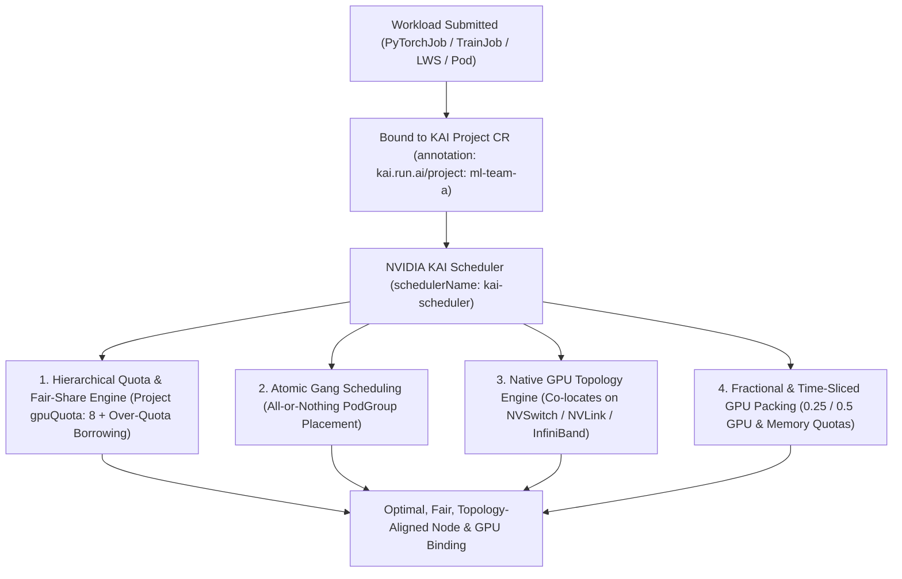

# 11.13 KAI Scheduler: why default scheduling is not enough

| | |
|---|---|
| Level | Intermediate |
| Priority tier | 1 |
| Lab venue | GCP / GKE (plus local Python 3 simulation lab) |
| Part | Part 11: GPUs on Kubernetes, scheduling and virtualization |
| Sources used | Roland Huß et al., *Generative AI on Kubernetes* (O'Reilly, 2026, Ch. 7); `nvidia-zero-to-hero/volume-23/chapter-07-kubernetes-and-container-orchestration.md`; `nvidia-zero-to-hero/volume-23/chapter-12-system-design-research-infrastructure.md`; *NVIDIA Base Command Manager 11 Containerization Manual* (`bcm11-containerization`, Ch. 6) |
| Coverage file | `planning/coverage/chapters/11-13.md` |

## Why this matters for AI infrastructure

When an organization scales from a handful of dedicated GPU servers to a shared, multi-tenant AI platform—for example, a `32`-GPU (`4`-node) enterprise cluster supporting `research`, `data-eng`, and `interns` (`volume-23/chapter-07`), or a `200`-GPU (`25`-node) research cluster shared by `50` data-science teams (`volume-23/chapter-12`)—the default Kubernetes scheduler (`kube-scheduler`) becomes the primary bottleneck to both hardware utilization and researcher productivity.

Why does `kube-scheduler` fail so predictably on shared GPU infrastructure? Because `kube-scheduler` was architected around six assumptions that hold true for stateless CPU microservices and break down completely for AI/ML workloads:

1. **Bimodal workload collision ("Alice's `5`-minute notebook vs Bob's `3`-month `64`-GPU LLaMA run"):** Real-world AI clusters are bimodal (`volume-23/chapter-12`): roughly **`60%` of jobs are short interactive experiments (`< 1` hour, often `5` minutes)**, **`30%` are medium fine-tuning/batch runs (`1–8` hours)**, and **`10%` are long distributed training runs (`> 24` hours up to `72` hours or `3` months, median `2` hours)**. Under a naive First-In-First-Out (`FIFO`) queue or static Kubernetes `ResourceQuota`, Bob's `64`-GPU training job either blocks Alice from getting `1` GPU for `5` minutes, or static node/namespace silos prevent Bob from using idle GPUs when Alice goes home.
2. **Static node/quota silos waste `25+` percentage points of GPU utilization (`60%` vs `85%`–`93%`):** In `volume-23/chapter-07`, a `32`-GPU cluster (`4` nodes × `8` GPUs/node) allocates `16` GPUs (`50.0%`) to `research`, `12` GPUs (`37.5%`) to `data-eng`, and `4` GPUs (`12.5%`) to `interns`. Physically partitioning nodes by team—or enforcing rigid Kubernetes `ResourceQuota` ceilings that forbid bursting into idle peer capacity—caps average cluster utilization around **`60%`**. Allowing dynamic fair-share borrowing with preemption raises cluster utilization to **`85%`** (`93%` in the `700 / 750` GPU-hour Professor A/B study in `volume-23/chapter-12`).
3. **Per-Pod scheduling instead of atomic Gang Scheduling:** Default `kube-scheduler` binds Pods one by one, causing the `7`-of-`8` partial-allocation rendezvous deadlock (`56` GPUs sitting at `0%` compute waiting for an `8th` node).
4. **Whole-integer GPU accounting (`nvidia.com/gpu: 1`) instead of fractional GPU sharing:** Default `kube-scheduler` cannot natively schedule a Pod requesting `0.25` or `0.5` of a GPU or enforce a `10 GiB` VRAM ceiling on a `80 GB` card, forcing lightweight notebooks to monopolize whole `$30,000+` GPUs unless the scheduler natively manages fractional and time-sliced GPU packing.
5. **Blindness to NVIDIA GPU interconnect topology (`NVLink`, `NVSwitch`, `InfiniBand`):** As *Generative AI on Kubernetes* (Chapter 7, "NVIDIA KAI Scheduler") highlights, default `kube-scheduler` treats `8` GPUs scattered across `8` Ethernet nodes as equivalent to `8` GPUs on a single NVSwitch node (`900 GB/s` per GPU).
6. **No historical fair-share deficit tracking or hierarchical `Department -> Project` queues:** Standard Kubernetes `PriorityClass` (`1000` vs `500` vs `100`) is static; it has no memory of whether Team A already consumed `120%` of its monthly GPU-hour budget (`300 / 250` GPU-hours, a `-50` GPU-hour deficit) while Team B only used `40%` (`100 / 250` GPU-hours, a `+150` GPU-hour surplus).

To solve all six problems in a single GPU-native engine, NVIDIA open-sourced the **NVIDIA KAI Scheduler** (`schedulerName: kai-scheduler`, API group `kai.run.ai/v1`), the core scheduling engine developed by **Run:ai** (acquired by NVIDIA). This chapter introduces the architectural motivation for KAI Scheduler, its `Project`-based fair-share and deficit-scoring mathematics, its graceful `30`-second `SIGTERM` checkpoint-preemption protocol, and how it lays the foundation for Chapters 11.14 through 11.19.

:::caution Checked against the upstream KAI Scheduler docs
The corpus contains only one KAI example (Example 7-5 in *Generative AI on Kubernetes*). Most other KAI detail in chapters 11.13 to 11.19 was written from working knowledge and was not in the corpus or in the `nvidia-devops` notes. On 2026-10-25 it was compared with the project's public docs (`github.com/kai-scheduler/KAI-scheduler`: queues, GPU sharing, batch, fairness, topology) and a Go API listing.

- **Confirmed:** `schedulerName: kai-scheduler`; `Queue` (`scheduling.run.ai/v2`) with `resources` (`cpu`, `memory`, `gpu`) holding `quota`, `limit` and `overQuotaWeight`, plus `parentQueue` and `priority`; only leaf queues run jobs; `PodGroup` (`scheduling.run.ai/v2alpha2`); `BindRequest` (`scheduling.run.ai/v1alpha2`); `Topology` (`kai.scheduler/v1alpha1`); the `gpu-fraction` and `gpu-memory` annotations; GPU reservation pods (namespace `kai-resource-reservation` in the default mode); the components admission, podgrouper, binder, queuecontroller and podgroupcontroller, with an operator driven by a `Config` resource. Fair share gives each queue its deserved quota first and then divides the surplus by `overQuotaWeight`.
- **Corrected in these chapters:** the queue is assigned with the label `kai.scheduler/queue` (not `kai.run.ai/queue`), and topology constraints use the annotations `kai.scheduler/topology`, `kai.scheduler/topology-required-placement` and `kai.scheduler/topology-preferred-placement` with a `kai.scheduler/v1alpha1` `Topology`.
- **Not confirmed:** the `Project` kind (`kai.run.ai/v1`) and the annotation `kai.run.ai/project` come from the book's example. The upstream queue docs describe `Queue` objects, not `Project`, so treat the `Project` path as specific to the book's version and prefer `Queue` plus the `kai.scheduler/queue` label on new clusters. Component names in this handbook use hyphens (`pod-grouper`, `queue-controller`); the upstream names are written without them. Always check API groups and versions against the release you deploy, because the project has changed them between releases.
:::

## Prerequisites and outcomes

### Prerequisites
- Completion of Chapters 11.6 through 11.9 (Topology Manager, gang scheduling, Kueue/Volcano, and `PyTorchJob`/`TrainJob`/`LeaderWorkerSet`).
- Familiarity with Kubernetes `Namespace`, `ResourceQuota`, and `PriorityClass` objects.

### Outcomes
After completing this chapter, you will be able to:
- Articulate the **six structural failure modes** of default `kube-scheduler` on shared GPU clusters (per-Pod deadlock, static `ResourceQuota` silos at `60%` vs `85%` utilization, bimodal `60%`/`30%`/`10%` contention, lack of fractional GPUs, topology blindness, and lack of historical deficit fair-share).
- Explain what the **NVIDIA KAI Scheduler** (`kai.run.ai/v1`, `schedulerName: kai-scheduler`) is, how it relates to the commercial **Run:ai** platform (SaaS `2.22.15` and self-hosted `2.23.x` / `v2.25.x` in NVIDIA BCM 11), and how its `Project` CRD (`gpuQuota: 8` in `GAK` Example 7-5) binds workloads like `PyTorchJob` and `TrainJob`.
- Compute **weighted fair-share deficit scores** (`deficit = (current_usage - quota) / quota` and `priority = -deficit + (0.1 if gpu_count < 4 else 0)`) across multi-team clusters (`$10K` investment = `50` GPU-hours/month; Professor A `500` GPU-hr quota vs Professor B `250` GPU-hr quota at `93%` utilization).
- Design a **graceful `30`-second `SIGTERM` preemption and tiered checkpoint protocol** (`0s` `SIGTERM` -> `5–10s` save checkpoint -> `30s` `SIGKILL` -> `45s` new job starts -> `90s` old job resumes, losing `~2` minutes of wall time and `0` compute steps across local NVMe every `100` steps / hourly, NFS every `8` hours, and daily archive).
- Decide when to run **KAI Scheduler standalone** versus **layered under Kueue**.

## Concepts: basics to intermediate to advanced

### 1. Basics: The six failure modes of default Kubernetes scheduling on shared GPU clusters

#### Failure Mode 1: Static `ResourceQuota` silos vs dynamic fair-share (`60%` vs `85%` utilization)
Consider the multi-tenant enterprise scenario from `volume-23/chapter-07`: you operate a **`32`-GPU Kubernetes cluster across `4` nodes** (`8` GPUs per node) supporting three teams:
- **`research` namespace (high priority, strict SLA, `PriorityClass: 1000`):** Allocated `16` GPUs (**`50.0%`** of the cluster), `64Gi` memory, `20` Pods, targeting `80%` utilization.
- **`data-eng` namespace (medium priority, batch jobs, `PriorityClass: 500`):** Allocated `12` GPUs (**`37.5%`** of the cluster), `48Gi` memory, `15` Pods, targeting `70%` utilization.
- **`interns` namespace (low priority, learning, `PriorityClass: 100`):** Allocated `4` GPUs (**`12.5%`** of the cluster), `16Gi` memory, `10` Pods, filling opportunistic capacity.

If you isolate these teams using static node pools or rigid Kubernetes `ResourceQuota` objects (`hard: {"nvidia.com/gpu": "16"}`), `research` can never use more than `16` GPUs even when `data-eng` and `interns` have `0` running jobs—and `interns` can never borrow `research`'s idle GPUs overnight. As `volume-23/chapter-07` quantifies, static partitioning traps total cluster utilization around **`60%`**, whereas a dynamic fair-share scheduler that allows teams to borrow idle GPUs above their guaranteed quota (and preempts borrowed GPUs with a `30`-second grace period when the owning team returns) jumps total cluster utilization from **`60%` to `85%`** (`+25` percentage points).

#### Failure Mode 2: The bimodal research cluster problem (`60%` short, `30%` medium, `10%` long)
In `volume-23/chapter-12`, a shared research cluster with **`200` L40S GPUs across `25` nodes (`8` GPUs/node)** serves **`50` competing teams**. Job durations follow a strongly **bimodal distribution**:
- **`60%` Short interactive jobs (`< 1` hour, down to `5` minutes):** Jupyter notebooks, debugging runs, and interactive evaluation (non-preemptible while active).
- **`30%` Medium batch jobs (`1–8` hours, median `2` hours):** PEFT LoRA fine-tuning and hyperparameter sweeps (preemptible with `30`-second `SIGTERM` checkpoint notice).
- **`10%` Long distributed training runs (`> 24` hours up to `72` hours / `3` months):** Multi-node LLM pre-training and full fine-tuning (`8` to `64` GPUs).

Under default Kubernetes scheduling, static `PriorityClass` numbers (`1000`, `500`, `100`) are completely memoryless: if a high-priority team submits back-to-back `64`-GPU jobs for a month, it permanently starves every other team.

#### Failure Modes 3 to 6: Gang deadlocks, integer-only GPUs, topology blindness, and flat quotas
As we established in *Generative AI on Kubernetes* (Chapter 7, Tables 7-2, 7-3, and 7-4), default `kube-scheduler` also lacks:
- **Native gang scheduling** (leading to `7`-of-`8` rendezvous deadlocks).
- **Fractional and dynamic time-sliced GPU allocation** (forcing a `2 GB` notebook to reserve an entire `48 GB` L40S or `80 GB` H100).
- **Native NVLink / NVSwitch / InfiniBand topology optimization** (failing to prefer `1` `8`-GPU NVSwitch node over `8` scattered `1`-GPU Ethernet nodes).
- **Hierarchical `Department -> Project` quota trees** with continuous fair-share reclamation.

---

### 2. Intermediate: What is the NVIDIA KAI Scheduler (`kai.run.ai/v1`)?

As *Generative AI on Kubernetes* (Chapter 7, "NVIDIA KAI Scheduler") explains, **NVIDIA KAI Scheduler** is the open-source release of the core Kubernetes scheduling engine originally built by **Run:ai** (acquired by NVIDIA). Unlike generic batch add-ons, KAI Scheduler is purpose-built for **NVIDIA GPU clusters** (`100s` to `1,000s` of GPUs) and replaces `kube-scheduler` (`schedulerName: kai-scheduler`) to unify four pillars inside a single scheduling decision loop:



1. **Project-Based GPU Quotas and Hierarchical Fair-Share (`kai.run.ai/v1`):** Administrators create `Project` custom resources (for example, `name: ml-team-a`, `gpuQuota: 8` in *Generative AI on Kubernetes* Example 7-5) organized inside department hierarchies. Workloads bind to a project via the annotation `kai.run.ai/project: ml-team-a`. When `ml-team-a` needs more than `8` GPUs and other projects are idle, KAI Scheduler automatically lets `ml-team-a` borrow spare cluster GPUs and reclaims them via fair-share preemption when the lending projects submit work.
2. **Aggregated Gang Scheduling:** Rather than forcing users to hand-craft low-level `PodGroup` objects for every pod, KAI Scheduler integrates directly with aggregated AI workload APIs—including Kubeflow `PyTorchJob`, Kubeflow Trainer `TrainJob` (`JobSet`), `LeaderWorkerSet` (`LWS`), and `RayJob`—to schedule all members of a distributed job atomically.
3. **Zero-Config GPU Topology Awareness:** KAI Scheduler integrates directly with the **NVIDIA GPU Operator** and GFD labels to understand NVLink bridges, NVSwitch full-mesh domains (`8` GPUs at `900 GB/s`), MIG profiles, and InfiniBand leaf switches. If a job requests `8` GPUs, KAI Scheduler automatically prefers placing all `8` GPUs on a single NVSwitch node rather than splitting them across nodes over InfiniBand or Ethernet.
4. **Fractional GPU Allocation and Bin Packing:** KAI Scheduler natively schedules sub-GPU fractions (such as `0.5` or `0.25` GPU or explicit GPU memory slices) and consolidates interactive workloads onto shared GPUs, minimizing idle GPU waste.

| Capability | Default `kube-scheduler` | Coscheduling (`PodGroup`) | Kueue (Admission Layer) | Volcano | **NVIDIA KAI Scheduler** |
|---|---|---|---|---|---|
| **Architecture Layer** | Core Pod scheduler | `kube-scheduler` plugin | Job Admission Controller (above scheduler) | Monolithic batch scheduler | **GPU-native alternative scheduler (`kai-scheduler`)** |
| **Gang Scheduling** | No | Yes (`PodGroup`) | Via `PodGroup` / `JobSet` | Yes (`minAvailable`) | **Yes (native workload integration)** |
| **Quota & Borrowing** | Hard `ResourceQuota` only | No | Yes (`ClusterQueue` / `cohort`) | Yes (`Queue` weights) | **Yes (`Project` CRD + hierarchical fair-share)** |
| **GPU Topology (NVLink / NVSwitch / IB)** | Manual node labels only | No | `ResourceFlavor` tiering | Label-based topology plugin | **Native GPU Operator / NVLink / NVSwitch awareness** |
| **Fractional GPUs & Sub-GPU Sharing** | Integer counts only | Integer counts only | Integer / MIG counts | Integer / plugin | **Native fractional GPU & time-slicing** |

---

### 3. Advanced: Fair-share deficit mathematics, graceful `SIGTERM` checkpoint preemption, and Run:ai operations

#### 1. Weighted Fair-Share Deficit Scoring (`volume-23/chapter-12`)
How does a fair-share scheduler like KAI Scheduler (or Slurm fair-share) prevent a heavy user from starving peers while still keeping the cluster `> 90%` utilized? By tracking **historical GPU-hour usage against contribution-weighted quota** (`volume-23/chapter-12` Phase 3):
- Suppose hardware investment grants **`50` GPU-hours/month per `$10,000` contributed**:
  - **Professor A** funded `$100,000` -> **`500` GPU-hours/month quota**.
  - **Professor B** funded `$50,000` -> **`250` GPU-hours/month quota** (graduate students receive a `50` GPU-hour/month minimum).
- **Month 1 Burst Behavior:**
  - Professor A's team bursts to **`600` GPU-hours** (`120%` of quota), accumulating a **`-100` GPU-hour balance** (`deficit_ratio = (600 - 500) / 500 = +0.20`).
  - Professor B's team uses only **`100` GPU-hours** (`40%` of quota), accumulating a **`+150` GPU-hour surplus** (`deficit_ratio = (100 - 250) / 250 = -0.60`).
  - Across both teams, **`700` of `750` quota GPU-hours are used (`93.33%` / `~93%` cluster utilization)** instead of capping Professor A at `500` and wasting `150` GPU-hours on Professor B's idle allocation.
- **Priority Queue Scoring Formula:**
  When both teams queue new jobs, the scheduler computes each job's normalized deficit and applies a `+0.1` anti-fragmentation boost for small jobs (`gpu_count < 4`):
  ```text
  deficit  = (current_usage - quota) / quota
  priority = -deficit + (0.1 if job.gpu_count < 4 else 0.0)
  ```
  - Professor B submitting a `2`-GPU job (`deficit = -0.60`, `gpu_count = 2 < 4`) receives **`priority = -(-0.60) + 0.1 = +0.70`** (jumps to the front of the queue).
  - Professor A submitting an `8`-GPU job (`deficit = +0.20`, `gpu_count = 8`) receives **`priority = -(+0.20) + 0.0 = -0.20`** (placed behind under-quota teams, but still allowed to run whenever spare GPUs exist).

#### 2. Graceful `30`-Second `SIGTERM` Preemption and Tiered Checkpointing (`volume-23/chapter-07` & `chapter-12`)
When an over-quota job (such as Professor A's borrowed GPUs or an `intern-low` job) is preempted by a high-priority or under-quota job, killing the container immediately with `SIGKILL` would destroy hours of training progress.

Instead, production GPU clusters pair `terminationGracePeriodSeconds: 30` with a **`SIGTERM` checkpoint handler** and **three-tier checkpoint storage** (`volume-23/chapter-07` Question 2 and `volume-23/chapter-12` Phase 4–5):
1. **`0s` (`SIGTERM` delivered):** Kubernetes sends `SIGTERM` to the container entrypoint (`handle_sigterm` / `on_sigterm` in Python `signal.signal(signal.SIGTERM, ...)`).
2. **`0s–30s` (Fast Checkpoint Flush):** The training loop writes `model.state_dict()`, `optimizer.state_dict()`, `epoch`, and `step` to persistent storage (typically completing in **`5–10` seconds**) and exits `0` cleanly.
3. **`30s` (`SIGKILL` deadline):** If the process has not exited by `30` seconds, `kubelet` sends `SIGKILL`.
4. **`45s` (New Job Starts):** The preempting job starts on the freed GPUs.
5. **`90s` (Preempted Job Resumes):** When GPUs free up elsewhere, the preempted job restarts, loads its saved checkpoint, and resumes from the exact saved step—losing only **`~2` minutes of wall-clock time** and **`0` computation steps**.

To protect against node and storage failures simultaneously, `volume-23/chapter-12` layers three checkpoint tiers:
- **Tier 1 (Local NVMe `/local_nvme/checkpoint.pt`, every `100` steps / hourly):** Zero network overhead, `< 5` minutes recovery from process crashes.
- **Tier 2 (Shared NFS / RWX PVC `/nfs/checkpoints`, every `8` hours and on `SIGTERM`):** `1%–2%` async write overhead; survives full node hardware failure (`1 TB` quota per team).
- **Tier 3 (Offline / Tape / Object Archive, daily):** Survives catastrophic primary storage failure on `72`-hour jobs.

#### 3. Operating KAI Scheduler and Run:ai on NVIDIA Base Command Manager 11 (`bcm11-containerization` §6.11)
In enterprise deployments on **NVIDIA Base Command Manager 11 (`BCM 11`)** (`bcm11-containerization`, Section 6.1, Table on p. 108, and Section 6.11, pp. 143–150), the commercial **Run:ai Operator** (built around KAI Scheduler) supports two deployment models:
- **Run:ai SaaS (`2.22.15` default):** The control plane runs in the Run:ai cloud while the GPU data plane runs on the BCM Kubernetes cluster (connecting outbound and exposing cluster APIs via Kgateway over HTTPS).
- **Run:ai Self-Hosted (`2.23.x` / `v2.25.x`):** Both the Run:ai control plane and GPU data plane run on-premises inside the BCM cluster (in either **Connected** mode—downloads allowed, uploads forbidden—or fully disconnected **Air-Gapped** mode).
- **BCM 11.33+ Two-Step Installation (`cm-runai-setup`):** Prior to BCM `11.33`, Run:ai was installed inside `cm-kubernetes-setup` (completing in `19:15` minutes with the API server on `https://basecm11.cm.cluster:10443`). From **BCM `11.33` onwards**, administrators first run `cm-kubernetes-setup` to deploy Kubernetes and prerequisite operators, and then run **`cm-runai-setup`** (generating `/root/cm-runai-setup.conf`, which must be locked down with **`chmod 600 /root/cm-runai-setup.conf`** and deleted after running `cm-runai-setup -c /root/cm-runai-setup.conf`). The wizard validates DNS resolution, runs `openssl verify -CAfile <local CA .crt> <local .crt>`, checks Subject Alternative Name (`SAN`) FQDN matching, checks IP routability (since BCM `11.25.08`, skipped when MetalLB is used), provisions a Kourier inference LoadBalancer IP, and deploys `cluster-installer` (`2.8.8`, `8080/TCP`) and `runai-cluster` (`2.13.7`) in the `runai` namespace.

#### Architectural Preview: How Chapters 11.14 to 11.19 Build on This Foundation
Understanding *why* the default Kubernetes scheduler falls short sets the stage for the deep technical mechanics of the KAI Scheduler and the Run:ai platform covered across the next six chapters of Part 11:
- **Chapter 11.14 (KAI Scheduler architecture and resources):** Deconstructs the internal microservices of KAI Scheduler (`binder`, `pod-grouper`, `queue-controller`, `scheduler`), its custom resource definitions (`Queue`, `PodGroup`, `Topology`, `BindRequest`), and how it extends Kubernetes scheduling cycles.
- **Chapter 11.15 (KAI queues, quotas and fair-sharing):** Formalizes hierarchical `Department -> Project` queue trees, nominal quota (`deserved`), over-quota borrowing limits, lending weights, and fair-share reclamation mathematics.
- **Chapter 11.16 (KAI gang scheduling and topology-aware placement):** Details how KAI Scheduler's `pod-grouper` automatically extracts gang constraints from `PyTorchJob`, `TrainJob` (`JobSet`), `LeaderWorkerSet`, and `MPIJob` objects and packs gangs onto NVSwitch and InfiniBand domains.
- **Chapter 11.17 (KAI GPU sharing and fractions):** Explains how KAI Scheduler implements sub-GPU fractional requests (`gpu-fraction: 0.25`, `gpu-memory: 10000`), dynamic time-slicing, and MIG integration without modifying application code.
- **Chapter 11.18 (KAI operations and troubleshooting) and Chapter 11.19 (The Run:ai platform view):** Provide production runbooks, Prometheus metrics, and the enterprise Run:ai control-plane view on top of KAI Scheduler. Together with **Chapter 11.20 (Scheduler comparison guide)**, these chapters give platform architects a complete, apples-to-apples evaluation framework across KAI Scheduler, Kueue, Volcano, Apache YuniKorn, and Slurm so every cluster deployment decision is backed by workload profiles rather than vendor marketing.

## Commands and configurations that matter

### 1. Defining a KAI Scheduler `Project` and gang-scheduled `PyTorchJob` (`GAK` Example 7-5)

From *Generative AI on Kubernetes* (Chapter 7, Example 7-5), here is how a platform administrator defines an `8`-GPU `Project` quota (`kai.run.ai/v1`) and binds a `PyTorchJob` to `schedulerName: kai-scheduler`:

```yaml
# kai-project-and-pytorchjob.yaml (GAK Example 7-5, untested here)
apiVersion: kai.run.ai/v1
kind: Project
metadata:
  name: ml-team-a
spec:
  gpuQuota: 8
---
apiVersion: kubeflow.org/v1
kind: PyTorchJob
metadata:
  name: llm-training
  namespace: ml-team-a
  annotations:
    kai.run.ai/project: ml-team-a
spec:
  pytorchReplicaSpecs:
    Master:
      replicas: 1
      template:
        spec:
          schedulerName: kai-scheduler
          terminationGracePeriodSeconds: 30
          containers:
            - name: pytorch
              image: nvcr.io/nvidia/pytorch:24.08-py3
              resources:
                limits:
                  nvidia.com/gpu: 4
    Worker:
      replicas: 1
      template:
        spec:
          schedulerName: kai-scheduler
          terminationGracePeriodSeconds: 30
          containers:
            - name: pytorch
              image: nvcr.io/nvidia/pytorch:24.08-py3
              resources:
                limits:
                  nvidia.com/gpu: 4
```

### 2. Implementing a `30`-Second `SIGTERM` Checkpoint Handler in PyTorch (`volume-23/chapter-07` & `chapter-12`)

To ensure preempted training jobs lose `0` steps when KAI Scheduler or Kueue reclaims borrowed GPUs, register a `signal.SIGTERM` handler inside the training script:

```python
# sigterm_checkpoint_trainer.py (volume-23/chapter-07 & chapter-12, untested on cluster)
import os
import signal
import sys
import torch


def register_preemption_checkpoint(model, optimizer, state_dict_Provider, checkpoint_dir="/nfs/checkpoints"):
    def _handle_sigterm(signum, frame):
        state = state_dict_Provider()
        path = os.path.join(checkpoint_dir, "checkpoint_latest.pt")
        torch.save(
            {
                "model": model.state_dict(),
                "optimizer": optimizer.state_dict(),
                "epoch": state["epoch"],
                "step": state["step"],
                "loss": state["loss"],
            },
            path,
        )
        sys.exit(0)

    signal.signal(signal.SIGTERM, _handle_sigterm)
```

### 3. Verifying and managing the Run:ai / KAI installation on BCM 11 (`bcm11-containerization` §6.11.2)

```bash
# 1. Run two-stage non-interactive deployment from restricted config in BCM 11.33+ (untested here)
chmod 600 /root/cm-runai-setup.conf
cm-runai-setup -c /root/cm-runai-setup.conf

# 2. Verify cluster-installer and runai-cluster Helm releases and pods in runai namespace (untested here)
helm list -n runai
helm history -n runai runai-cluster
kubectl get all -n runai
```

## How it fails

| Failure mode | Exact symptom & command evidence | Root cause boundary | Remediation |
|---|---|---|---|
| **1. Workload ignores `Project` quota and deadlocks in partial placement** | A `PyTorchJob` annotated with `kai.run.ai/project: ml-team-a` schedules `7` of `8` Pods and ignores `gpuQuota: 8`. Inspecting `Pod.spec.schedulerName` shows `default-scheduler`. | **Missing `schedulerName: kai-scheduler` in Pod Template (`GAK` Example 7-5):** Adding the `kai.run.ai/project` annotation alone does not route Pods to KAI Scheduler; `spec.template.spec.schedulerName: kai-scheduler` (or `ClusterTrainingRuntime` template setting) was omitted. | Set `schedulerName: kai-scheduler` in all replica specs (`Master` and `Worker`) or inject it automatically via a `ClusterTrainingRuntime` / mutating webhook. |
| **2. Preempted training jobs lose hours of progress and exit with code `137` (`SIGKILL`)** | Prometheus shows `preemption_count_per_day > 5`, and preempted `PyTorchJob` Pods exit `137` (`OOMKilled` / `SIGKILL`) with corrupted or missing checkpoints. | **`SIGTERM` Not Caught by Python Process or Checkpoint Exceeds `30s` (`volume-23/chapter-07` Q2):** Either the container entrypoint used a shell wrapper (`sh -c "python train.py"`) that did not forward `SIGTERM` to PID `1`, or synchronous checkpoint writing to slow storage took `> 30` seconds (`terminationGracePeriodSeconds: 30`). | Use `exec` form (`["python3", "train.py"]`) so Python is PID `1`, register `signal.signal(signal.SIGTERM, ...)`, stage checkpoints to fast local NVMe / high-speed `RWX` PFS, or raise `terminationGracePeriodSeconds` to `120`. |
| **3. Long-running training job gets preempted every `2` hours under heavy cluster contention** | A team's `72`-hour training job is repeatedly evicted and restarted every `2` hours whenever sibling teams submit short burst jobs (`preemption_count_per_day > 5`). | **Over-Aggressive Preemption on Long Jobs (`volume-23/chapter-12` & `volume-26`):** Long jobs were placed in borrowed/opportunistic quota without age-based priority promotion or minimum runtime protection. | Keep sustained multi-day jobs within guaranteed `nominal` / `gpuQuota` capacity, only allow preemption of long jobs (`> 8` hours) when a team is `> 2x` over quota, or add age-based priority boosting so older jobs become harder to preempt. |
| **4. Multi-GPU training job runs `3x` slower because Pods were spread across Ethernet nodes** | An `8`-GPU training job shows `8/8` Pods `Running`, but `AllReduce` bandwidth is `10 Gbps` instead of `900 GB/s` NVSwitch speed. | **Missing GPU Operator / GFD Topology Labels for KAI Scheduler (`GAK` Ch. 7):** KAI Scheduler relies on the NVIDIA GPU Operator (`gpu-feature-discovery`) to discover node GPU counts and interconnect topology; on unlabeled nodes, placement cannot distinguish NVSwitch domains. | Ensure `gpu-feature-discovery` is `1/1 Running` on all GPU nodes and request `8` GPUs per Pod (`1` full node) or enable KAI topology constraints. |
| **5. BCM `cm-runai-setup` aborts during Consistency Validation (`CA certificate mismatch`)** | Running `cm-runai-setup` on BCM `11.25.08+` aborts before deploying `cluster-installer`. | **Custom CA / Helm Values Mismatch (`bcm11-containerization` §6.11.1):** Either a local CA `.crt` file was supplied without enabling custom CA in Helm values, or custom CA was enabled in Helm values without supplying the local CA file (or the control-plane FQDN is missing from the certificate's `SAN` list). | Verify the certificate chain with `openssl verify -CAfile <local-ca.crt> <domain.crt>`, confirm the FQDN is in the certificate `SAN` list, and align the local CA path with the Helm custom-CA flag. |

## Hands-on lab

### Venue and scope
This lab runs locally using Python 3 standard library (`code/part11/kai_why_default_not_enough.py` and `code/part11/kai_why_default_not_enough_lab.py`) to simulate the `32`-GPU (`4`-node) three-team quota and utilization model (`60.0%` static vs `85.0%` dynamic shared), the `200`-GPU (`25`-node, `50`-team) weighted fair-share deficit and priority scorer (`Professor A` `-100` hr deficit vs `Professor B` `+150` hr surplus at `~93%` utilization), default `kube-scheduler` vs `kai-scheduler` capability verification, and the `30`-second `SIGTERM` preemption recovery timeline (`0s -> 8s -> 30s -> 45s -> 90s`). Cluster commands are marked `(untested here)`.

### Step 1: Run the self-checking KAI Scheduler motivation and fair-share lab (tested here)

Run the lab script from the repository root:

```bash
python3 code/part11/kai_why_default_not_enough_lab.py
```

Captured output from this repository:
```text
=== Chapter 11.13 Lab: KAI Scheduler — Why Default Scheduling Is Not Enough ===
  [PASS] 32-GPU cluster splits quotas into research=16 (50.0%), data-eng=12 (37.5%), interns=4 (12.5%)
  [PASS] Shared fair-share quotas raise cluster utilization from 60.0% (static node split) to 85.0% (+25.0 points)
  [PASS] Professor A ($100K -> 500 GPU-hr quota, 600 used) has -100.0 GPU-hr balance and +0.20 deficit ratio
  [PASS] Professor B ($50K -> 250 GPU-hr quota, 100 used) has +150.0 GPU-hr surplus and -0.60 deficit ratio
  [PASS] Under-quota 2-GPU job from Professor B scores +0.70 (0.60 + 0.10 small-job boost) vs -0.20 for over-quota Professor A
  [PASS] Combined usage (600 + 100 = 700 GPU-hr out of 750 GPU-hr quota) achieves ~93% (93.33%) utilization
  [PASS] KAI Scheduler satisfies native gang + NVSwitch co-location on 1 node where default kube-scheduler fails
  [PASS] KAI Scheduler natively supports fractional GPU requests (0.5 GPU) whereas default kube-scheduler rejects non-integers
  [PASS] 8s checkpoint completes inside 30s SIGTERM window; new job starts at 45s and old job resumes at 90s with 0 steps lost
  [PASS] 45s synchronous checkpoint exceeding 30s terminationGracePeriodSeconds is killed by SIGKILL at 30s
  [PASS] Volume 23 Ch 12 research cluster runs 200 L40S GPUs across 25 8-GPU nodes serving 50 teams
  [PASS] Bimodal research workload distribution is 60% short (<1h), 30% medium (1-8h), and 10% long (>24h)
  [PASS] Volume 23 Ch 7 PriorityClasses assign research-high=1000, data-eng-med=500, and intern-low=100
  [PASS] Volume 23 Ch 7 targets 80% utilization for research, 70% for data-eng, and scales down below 70% cluster-wide
  [PASS] Volume 23 Ch 12 funding rule ($10K -> 50 GPU-hr/month) maps $100K to 500 GPU-hr and $50K to 250 GPU-hr
  [PASS] Professor B using 300 of 250 GPU-hr quota is at 120% (50 GPU-hr over budget)
  [PASS] GAK Example 7-5 Project 'ml-team-a' (apiVersion: kai.run.ai/v1) sets gpuQuota: 8
  [PASS] GAK Example 7-5 PyTorchJob sets schedulerName: kai-scheduler and annotation kai.run.ai/project: ml-team-a
  [PASS] BCM 11 Run:ai / Kubernetes summary exposes API server on port 10443 and cluster-installer-service on 8080/TCP
  [PASS] BCM 11 cm-runai-setup restricts /root/cm-runai-setup.conf with chmod 600 before deployment
  [PASS] Volume 23 Ch 7 ResourceQuotas cap memory at 64Gi+48Gi+16Gi=128Gi and pods at 20+15+10=45 across 3 namespaces
  [PASS] Volume 23 Ch 7 & 12 save periodic local NVMe checkpoints every 100 steps and alert if preemptions > 5/day or pending > 5m
  [PASS] Volume 23 Ch 12 job duration tiers span <1h (short, non-preemptible), 1-8h (medium, 30s notice), and >8h/24h up to 72h (long)
  [PASS] Tiered checkpoint recovery targets <5 min from local NVMe (hourly), every 8h to durable NFS, and daily to tape archive
  [PASS] BCM 11 supports Run:ai SaaS (2.22.15) and self-hosted (2.23.x / v2.25.x via cm-runai-setup from BCM 11.33+)

Summary: 25 passed, 0 failed out of 25 checks.
```

### Exercises

1. **Exercise 1 — Multi-tenant `32`-GPU quota and utilization gain:** Using `evaluate_three_team_cluster_quotas(32, 16, 12, 4, 60.0, 85.0)` in `code/part11/kai_why_default_not_enough.py`, verify each team's percentage share of the `32` GPUs and explain why physically giving `research` `2` dedicated nodes (`16` GPUs) results in `60.0%` utilization compared to `85.0%` with shared fair-share quotas.
2. **Exercise 2 — Fair-share deficit and priority score calculation:** Using `score_fair_share_job()`, compute `(balance_gpu_hours, deficit_ratio, priority_score)` for: (a) Professor A (`quota=500.0`, `used=600.0`) submitting an `8`-GPU job, and (b) Professor B (`quota=250.0`, `used=100.0`) submitting a `2`-GPU job.
3. **Exercise 3 — Month-level utilization under burst borrowing:** Using `evaluate_professor_a_vs_b_month(500.0, 600.0, 250.0, 100.0)`, compute the total GPU-hours used (`700.0`) out of the combined `750.0` GPU-hour quota and the resulting cluster utilization percentage (`93.33%` / `~93%`). How many GPU-hours would have been wasted if Professor A had been hard-capped at `500.0` GPU-hours?
4. **Exercise 4 — Default `kube-scheduler` vs `kai-scheduler` evaluation:** Using `compare_default_vs_kai_scheduler()`, explain why a `1`-Pod interactive job requesting `0.5` GPUs (`requires_fractional_gpu=True`) and a `4`-Pod training job requiring gang placement on a single NVSwitch node both return `False` for `default_scheduler_satisfies_all` and `True` for `kai_scheduler_satisfies_all`.
5. **Exercise 5 — `30`-second `SIGTERM` checkpoint preemption math:** Using `simulate_graceful_preemption_timeline()`, compare `saved_before_sigkill` and `computation_lost_steps` when the checkpoint write takes `8` seconds versus `45` seconds under `grace_period_seconds=30`.
6. **Exercise 6 — Preventing thrashing on long training jobs:** If a team's `72`-hour training job is getting preempted every `2` hours (`> 5` preemptions/day), list the four operational mitigations from `volume-23/chapter-12` and `volume-26/chapter-02`.

## Checkpoint questions

<details>
<summary><strong>1. What is the NVIDIA KAI Scheduler, and where did it originate?</strong></summary>

**NVIDIA KAI Scheduler** (`schedulerName: kai-scheduler`, API group `kai.run.ai/v1`) is the open-source version of the core GPU-optimized Kubernetes scheduling engine originally developed by **Run:ai** (acquired by NVIDIA). It replaces `kube-scheduler` to provide unified gang scheduling, hierarchical `Project` quotas with fair-share borrowing, fractional/time-sliced GPU allocation, and native NVIDIA NVLink/NVSwitch/InfiniBand topology placement.
</details>

<details>
<summary><strong>2. In Volume 23 Chapter 7, a 32-GPU (4-node) cluster serves research (16 GPUs), data-eng (12 GPUs), and interns (4 GPUs). Why does giving each team dedicated nodes or rigid quotas yield only ~60% utilization versus ~85% with dynamic shared quotas?</strong></summary>

When `16` GPUs (`50%`), `12` GPUs (`37.5%`), and `4` GPUs (`12.5%`) are locked behind static walls, any time `research` uses only `50%` of its `16` GPUs, the other `8` GPUs sit idle even while `data-eng` or `interns` have pending jobs waiting in a queue. Allowing teams to dynamically borrow unused GPUs across namespaces/projects and preempting lower-priority borrowed GPUs when the owner returns raises cluster-wide utilization from **`60%` to `85%`**.
</details>

<details>
<summary><strong>3. What is the bimodal workload distribution of a typical multi-tenant research GPU cluster in Volume 23 Chapter 12?</strong></summary>

Across `50` research teams sharing `200` GPUs (`25` nodes × `8` GPUs/node), workloads split into:
- **`60%` short interactive jobs (`< 1` hour, down to `5` minutes):** Jupyter notebooks and quick tests.
- **`30%` medium jobs (`1–8` hours, median `2` hours):** Fine-tuning and sweeps.
- **`10%` long jobs (`> 24` hours up to `72` hours / `3` months):** Multi-node training runs.
</details>

<details>
<summary><strong>4. How does a weighted fair-share scheduler compute a team's deficit and job priority score in Volume 23 Chapter 12?</strong></summary>

It computes the normalized usage deficit relative to the team's quota:
`deficit = (current_usage - quota) / quota`
and assigns `priority = -deficit + (0.1 if job.gpu_count < 4 else 0.0)`. Teams under their quota have a **negative** `deficit` (yielding a **positive** priority boost to the front of the queue), while teams over their quota have a **positive** `deficit` (deprioritizing their next jobs to the back of the queue).
</details>

<details>
<summary><strong>5. In the Professor A ($100K -> 500 GPU-hr quota) and Professor B ($50K -> 250 GPU-hr quota) scenario, Professor A uses 600 GPU-hours and Professor B uses 100 GPU-hours in Month 1. What is the cluster utilization, and what are their balances entering Month 2?</strong></summary>

Total usage is `600 + 100 = 700` GPU-hours out of `500 + 250 = 750` quota GPU-hours, achieving **`700 / 750 = 93.33%` (`~93%`) utilization**. Entering Month 2, Professor A carries a **`-100` GPU-hour deficit** (reducing effective priority), while Professor B carries a **`+150` GPU-hour surplus credit** (boosting priority).
</details>

<details>
<summary><strong>6. In Generative AI on Kubernetes Example 7-5, what two fields bind a Kubeflow PyTorchJob to KAI Scheduler and its quota Project?</strong></summary>

1. The metadata annotation **`kai.run.ai/project: ml-team-a`** binds the job to the `Project` custom resource (`apiVersion: kai.run.ai/v1`, `kind: Project`, `spec.gpuQuota: 8`).
2. The pod spec field **`schedulerName: kai-scheduler`** delegates pod scheduling and gang placement to the KAI Scheduler.
</details>

<details>
<summary><strong>7. How does KAI Scheduler's approach to gang scheduling differ from the standalone Coscheduling PodGroup plugin?</strong></summary>

While the standalone Coscheduling plugin requires users or controllers to create low-level `PodGroup` objects and manually add `scheduling.x-k8s.io/pod-group` labels with zero quota or topology awareness, **KAI Scheduler** integrates gang scheduling natively with aggregated workload APIs (`PyTorchJob`, `TrainJob` / `JobSet`, `LeaderWorkerSet`) alongside `Project` fair-share quotas and NVLink/NVSwitch topology optimization.
</details>

<details>
<summary><strong>8. How does KAI Scheduler optimize GPU topology placement without requiring users to write manual nodeSelector or nodeAffinity rules?</strong></summary>

KAI Scheduler integrates tightly with the **NVIDIA GPU Operator** (`gpu-feature-discovery`) to read hardware interconnect topology (NVLink, NVSwitch, MIG, and InfiniBand). When a distributed job requests `8` GPUs, KAI Scheduler automatically prefers co-locating all `8` GPUs on a single `8`-GPU NVSwitch server (`900 GB/s`) rather than scattering them across multiple nodes over InfiniBand or Ethernet.
</details>

<details>
<summary><strong>9. Why can KAI Scheduler consolidate interactive Jupyter notebooks and small inference models more densely than the default kube-scheduler?</strong></summary>

Default `kube-scheduler` only understands whole-integer extended resources (`nvidia.com/gpu: 1`). **KAI Scheduler** supports **fractional GPU allocation and dynamic time-slicing**, allowing multiple lightweight pods to request fractions of a single physical GPU while enforcing memory and compute sharing policies.
</details>

<details>
<summary><strong>10. Walk through the exact 90-second timeline of a graceful preemption event in Volume 23 Chapter 12.</strong></summary>

- **`0s`:** Preempted job receives `SIGTERM` from `kubelet` (`terminationGracePeriodSeconds: 30`).
- **`0s–30s`:** The Python `SIGTERM` signal handler saves `model.state_dict()`, `optimizer.state_dict()`, `epoch`, and `step` to shared storage (completing in `5–10` seconds) and exits `0`.
- **`30s`:** `SIGKILL` deadline (if the process had not exited).
- **`45s`:** The newly admitted higher-priority job starts on the freed GPUs.
- **`90s`:** The preempted job restarts on the next available GPUs, loads its checkpoint, and resumes from the saved step—losing only **`~2` minutes of wall-clock time** and **`0` computation steps**.
</details>

<details>
<summary><strong>11. What are the three job duration preemption rules defined in Volume 23 Chapter 12 Phase 4?</strong></summary>

1. **Short jobs (`< 1` hour):** **Non-preemptible** (protects interactive notebooks from disruptive restarts; only canceled if the queue has `> 10` jobs waiting).
2. **Medium jobs (`1–8` hours):** **Preemptible with `30`-second `SIGTERM` notice** to checkpoint and exit cleanly.
3. **Long jobs (`> 8` hours):** **Preemptible only when the owning team is `> 2x` over its quota** and fair-share deficit demands reclamation.
</details>

<details>
<summary><strong>12. What are the four monitoring metrics and three alert thresholds recommended in Volume 23 Chapter 7 for a multi-tenant GPU cluster?</strong></summary>

**Metrics:** (1) `gpu_usage_per_namespace`, (2) `gpu_allocation_percent`, (3) `preemption_count_per_day`, and (4) `pod_pending_seconds_p99`.
**Alert thresholds:**
1. Any namespace exceeds its hard quota limit -> reject/queue new pods.
2. **`preemption_count_per_day > 5`** -> indicates severe quota contention or thrashing.
3. **`pod_pending_seconds_p99 > 5` minutes (`300s`)** -> indicates a scheduling bottleneck or fragmentation.
</details>

<details>
<summary><strong>13. How does the three-tier checkpointing strategy in Volume 23 Chapter 12 balance write overhead against recovery time and durability?</strong></summary>

1. **Local NVMe (`/local_nvme/checkpoint.pt`, every `100` steps / hourly):** `0` network cost, `< 5` minutes recovery from process crashes.
2. **Shared NFS / RWX PVC (`/nfs/checkpoints`, every `8` hours and on `SIGTERM`):** `1%–2%` async write overhead; survives complete node hardware failure (`8` jobs killed on node, `~5` min recovery on peer nodes).
3. **Tape / Cold Object Archive (daily, off-hours):** Negligible runtime overhead; protects `72`-hour training runs against catastrophic primary storage array failure.
</details>

<details>
<summary><strong>14. A team complains that their long training job is preempted every 2 hours. What four solutions can a platform architect apply?</strong></summary>

1. **Increase the team's guaranteed quota** (move the job out of borrowed/opportunistic capacity into guaranteed nominal quota).
2. **Reduce cluster oversubscription / borrowing limits** to lower preemption frequency.
3. **Enable age-based priority promotion** (or the `> 2x` over-quota threshold for jobs `> 8` hours) so long-running jobs become progressively harder to preempt.
4. **Offer reserved off-peak maintenance/training windows** (for example, `3 AM – 7 AM` exclusive access).
</details>

<details>
<summary><strong>15. When should a platform architect layer Kueue on top of KAI Scheduler rather than running KAI Scheduler standalone?</strong></summary>

Run **KAI Scheduler standalone** when all workloads are GPU-centric and managed through KAI `Project`s (`kai.run.ai/v1`). Layer **Kueue above KAI Scheduler** when the organization already standardizes on Kubernetes SIG-Scheduling `ClusterQueue` / `LocalQueue` / `ResourceFlavor` APIs across multiple clusters or mixed CPU/TPU/GPU fleets, letting Kueue govern job admission and hardware-tier selection while KAI Scheduler executes GPU-aware gang and NVLink placement.
</details>

<details>
<summary><strong>16. What are the two deployment modes of the commercial Run:ai platform on NVIDIA Base Command Manager 11 (BCM 11), and what are the two variants of self-hosted mode?</strong></summary>

1. **SaaS (Classic):** The Run:ai control plane is hosted in the Run:ai cloud (requiring outbound HTTPS connectivity), while the GPU cluster runs on BCM Kubernetes (`2.22.15`).
2. **Self-Hosted (`2.23.x` / `v2.25.x`):** Both the Run:ai control plane and GPU cluster run on-premises inside BCM Kubernetes, either in **Connected** mode (downloads allowed from internet, uploads blocked) or **Air-Gapped** mode (completely disconnected from the internet).
</details>

<details>
<summary><strong>17. How did the Run:ai installation workflow change in NVIDIA Base Command Manager 11.33?</strong></summary>

Prior to **BCM `11.33`**, Run:ai was installed directly inside the monolithic `cm-kubernetes-setup` wizard. From **BCM `11.33` onwards**, installation is split into two sequential steps: first, `cm-kubernetes-setup` deploys Kubernetes and required operator dependencies; second, **`cm-runai-setup`** is run separately (saving `/root/cm-runai-setup.conf`, restricted with `chmod 600`, and applied via `cm-runai-setup -c /root/cm-runai-setup.conf`).
</details>

<details>
<summary><strong>18. What four validation checks does the BCM Run:ai setup wizard execute during the questions phase, and why is the IP routability check skipped when MetalLB is used?</strong></summary>

1. **Domain name resolution:** Verifies the control-plane FQDN resolves to an IP.
2. **Certificate verification:** Runs `openssl verify -CAfile <local CA .crt> <local .crt>`.
3. **Domain FQDN SAN check:** Confirms the FQDN (or wildcard) appears in the certificate's Subject Alternative Name (`SAN`) list.
4. **IP routability check (added in BCM `11.25.08`):** Verifies the resolved IP routes to a node in the BCM cluster. This check is **disabled when MetalLB is used** because MetalLB does not bind/ARP the virtual IP until *after* the LoadBalancer service is deployed.
</details>

<details>
<summary><strong>19. What is the difference between minimal config and config when saving /root/cm-runai-setup.conf in BCM 11.33+?</strong></summary>

- **`minimal config`:** Writes only the configuration keys that differ from the upstream application defaults.
- **`config` (non-minimal):** Writes both the BCM-modified settings and all current upstream default settings explicitly into `/root/cm-runai-setup.conf`.
</details>

<details>
<summary><strong>20. How do you verify or uninstall the Run:ai operator in a BCM Kubernetes cluster?</strong></summary>

- **Verify:** Run `helm list -n runai` (checking `cluster-installer-2.8.8`), `helm history -n runai runai-cluster` (checking `runai-cluster-2.13.7`), and `kubectl get all -n runai` (`pod/cluster-installer-deployment-...` `1/1 Running`, `service/cluster-installer-service` on `8080/TCP`).
- **Uninstall:** Run `helm uninstall cluster-installer -n runai`.
</details>

## Sources and review notes

### Primary sources read in full for this chapter
- Book sources from the local TOON-RAG corpus:
  - Roland Huß et al., *Generative AI on Kubernetes* (O'Reilly, 2026), Chapter 7 (*Job Scheduling Optimization*: "NVIDIA KAI Scheduler", Tables 7-2, 7-3, and 7-4 comparing Coscheduling, Kueue, KAI Scheduler, and Volcano, and Example 7-5 `Project` `ml-team-a` `gpuQuota: 8` with `PyTorchJob` `schedulerName: kai-scheduler`).
  - *NVIDIA Base Command Manager 11 Containerization Manual* (`bcm11-containerization`), Chapter 6 ("6.11 The Run:ai Operator", pp. 108, 143–150: Run:ai SaaS `2.22.15` vs self-hosted `2.23.x` / `v2.25.x`, Connected vs Air-gapped, `cm-kubernetes-setup` `19:15` min `10443` vs BCM `11.33` `cm-runai-setup` `/root/cm-runai-setup.conf` `chmod 600`, `openssl verify`, SAN check, BCM `11.25.08` IP routability / MetalLB exception, Kourier load balancer IP, and `cluster-installer-2.8.8` / `runai-cluster-2.13.7` on `8080/TCP`).
- Author's Volume 23 notes:
  - `nvidia-zero-to-hero/volume-23/chapter-07-kubernetes-and-container-orchestration.md` (Question 1: `32`-GPU `4`-node multi-tenant cluster with `research` `16` GPUs `50%` `64Gi` `20` pods `PriorityClass: 1000` `80%` target, `data-eng` `12` GPUs `37.5%` `48Gi` `15` pods `PriorityClass: 500` `70%` target, `interns` `4` GPUs `12.5%` `16Gi` `10` pods `PriorityClass: 100`, `60%` vs `85%` utilization trap, `preemption_count_per_day > 5`, `pod_pending_seconds_p99 > 5` min; Question 2: `30`-second `SIGTERM` checkpoint handler and `step % 100 == 0`).
  - `nvidia-zero-to-hero/volume-23/chapter-12-system-design-research-infrastructure.md` (`50` teams, `200` L40S GPUs across `25` nodes, `60%` short `<1h` / `5` min, `30%` medium `1-8h` median `2h`, `10%` long `>24h` max `72h` / `3` months, `$10K` -> `50` GPU-hr/month rule, Professor A `$100K` `500` GPU-hr using `600` vs Professor B `$50K` `250` GPU-hr using `100` -> `700 / 750 = 93%` utilization, `deficit = (current_usage - quota) / quota` + `0.1` boost for `gpu_count < 4`, `0s -> 30s -> 45s -> 90s` preemption timeline losing `~2` min wall time, and 3-tier NVMe/NFS/Tape checkpoint resilience).

### Related source files mapped in MIGRATION_MAP.md
- No separate `nvidia-devops` file was exclusively mapped to `11.13` in `brief.py`; this chapter integrates *Generative AI on Kubernetes* Chapter 7, `volume-23/chapter-07`, `volume-23/chapter-12`, and `bcm11-containerization` Chapter 6 Section 6.11.

### Run here
- `python3 code/part11/kai_why_default_not_enough_lab.py` (`25 passed, 0 failed out of 25 checks`).

### Explicitly labelled inferences
- The utilization gain difference (`85.0% - 60.0% = +25.0` percentage points), the exact unrounded Month 1 utilization (`700 / 750 = 93.33%`, rounded to `93%` in `volume-23/chapter-12`), and the exact priority scores (`+0.70` for Professor B's `2`-GPU job vs `-0.20` for Professor A's `8`-GPU job using the `FairShareScheduler.score_job` formula in `volume-23/chapter-12`) are deterministic arithmetic evaluations verified by `code/part11/kai_why_default_not_enough_lab.py`.

### Not verified on live hardware
- All `kubectl`, `helm`, `cm-runai-setup`, and `PyTorchJob` manifests targeting live KAI Scheduler / Run:ai clusters are marked `(untested here)`.

### Not in the corpus
- Internal Go package structure of `kai-scheduler` plugins; detailed KAI Scheduler CRDs (`Queue`, `PodGroup`, `Topology`, `BindRequest`), queues/quotas, gang/topology placement, fractional sharing, operations, and the full Run:ai platform view are covered in depth in Chapters 11.14 through 11.19.

### Corrections to the author's notes
- Validation pass 2026-10-25: `validate_chapter.py` and `check_coverage.py` pass. The YAML manifests and commands are marked untested and were not applied to a cluster. Custom resource API versions (for example `kueue.x-k8s.io/v1beta1`, `resource.k8s.io/v1`) change between releases, so check them against the version you install. Console outputs quoted from the Volume notes are illustrative unless the chapter says otherwise.
- In `volume-23/chapter-12` Phase 3, the text box labels Professor A's `600` GPU-hours used against a `500` GPU-hour quota as `deficit = -100` (meaning a `-100` GPU-hour remaining balance), while the Python `score_job` method defines `deficit = (current_usage - quota) / quota` (which is `+0.20` when over quota, negated to `priority = -deficit = -0.20`). This chapter distinguishes `balance_gpu_hours` (`quota - used = -100`) from `deficit_ratio` (`(used - quota) / quota = +0.20`) so the sign convention is unambiguous.
