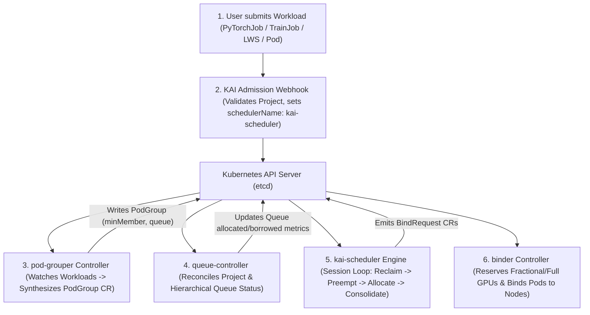
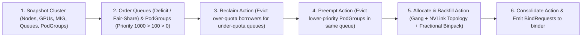

# 11.14 KAI Scheduler architecture and resources

| | |
|---|---|
| Level | Advanced |
| Priority tier | 1 |
| Lab venue | GCP / GKE (plus local Python 3 simulation lab) |
| Part | Part 11: GPUs on Kubernetes, scheduling and virtualization |
| Sources used | Roland Huß et al., *Generative AI on Kubernetes* (O'Reilly, 2026, Ch. 7); `nvidia-zero-to-hero/volume-24/chapter-07-kubernetes-gpu-scheduling.md`; `nvidia-zero-to-hero/volume-11/chapter-07-kubernetes-scheduling-for-shared-gpus.md`; `nvidia-zero-to-hero/volume-11/chapter-08-tenant-isolation-security-and-fairness.md`; *NVIDIA Base Command Manager 11 Containerization Manual* (`bcm11-containerization`, Ch. 6) |
| Coverage file | `planning/coverage/chapters/11-14.md` |

## Why this matters for AI infrastructure

In Chapter 11.13, we established *why* the default Kubernetes scheduler (`kube-scheduler`) breaks down on shared GPU clusters and how the **NVIDIA KAI Scheduler** (`schedulerName: kai-scheduler`, open-sourced from Run:ai) solves those challenges by unifying hierarchical `Project` quotas, gang scheduling, fractional GPU sharing, and NVLink/InfiniBand topology placement.

To deploy, customize, and debug KAI Scheduler in production, however, a platform engineer cannot treat `kai-scheduler` as a black box. Unlike `kube-scheduler`—which is a single binary watching raw `Pod` and `Node` objects—KAI Scheduler is architected as a **decoupled suite of five cooperating Kubernetes control-plane microservices** (`admission-webhook`, `pod-grouper`, `queue-controller`, `kai-scheduler`, and `binder`) that communicate through a well-defined hierarchy of **Custom Resource Definitions (`CRDs`)**:
- **`Project` (`kai.run.ai/v1`) and `Queue` (`scheduling.run.ai/v2`):** Represent organizational departments and teams, their guaranteed GPU quotas (`gpuQuota: 8`), over-quota borrowing weights, and real-time allocated/borrowed usage.
- **`PodGroup` (`scheduling.run.ai/v2alpha2`):** The atomic unit of scheduling inside KAI. Rather than scheduling individual `Pod`s one by one, the **`pod-grouper`** controller watches workload objects (`PyTorchJob`, `TrainJob` / `JobSet`, `LeaderWorkerSet`, `MPIJob`, `RayJob`, or standalone `Pod`s) and automatically synthesizes a `PodGroup` (`minMember`, `queue`, `priorityClassName`, and topology constraints).
- **`Topology`:** Captures physical NVSwitch, rack, and InfiniBand leaf-switch domains discovered alongside the NVIDIA GPU Operator.
- **`BindRequest`:** Decouples the scheduler's in-memory session decision from the asynchronous node binding and fractional-GPU reservation handshake executed by the **`binder`** controller.

Understanding how a workload flows through those five microservices and CRDs—and how the KAI session loop (`Snapshot -> Reclaim -> Preempt -> Allocate / Binpack -> Consolidate -> BindRequest`) packs mixed workloads onto hardware—is the difference between resolving a stuck `PodGroup` in two minutes and guessing blindly across dozens of pods.

:::caution Checked against the upstream KAI Scheduler docs
The corpus contains only one KAI example (Example 7-5 in *Generative AI on Kubernetes*). Most other KAI detail in chapters 11.13 to 11.19 was written from working knowledge and was not in the corpus or in the `nvidia-devops` notes. On 2026-10-25 it was compared with the project's public docs (`github.com/kai-scheduler/KAI-scheduler`: queues, GPU sharing, batch, fairness, topology) and a Go API listing.

- **Confirmed:** `schedulerName: kai-scheduler`; `Queue` (`scheduling.run.ai/v2`) with `resources` (`cpu`, `memory`, `gpu`) holding `quota`, `limit` and `overQuotaWeight`, plus `parentQueue` and `priority`; only leaf queues run jobs; `PodGroup` (`scheduling.run.ai/v2alpha2`); `BindRequest` (`scheduling.run.ai/v1alpha2`); `Topology` (`kai.scheduler/v1alpha1`); the `gpu-fraction` and `gpu-memory` annotations; GPU reservation pods (namespace `kai-resource-reservation` in the default mode); the components admission, podgrouper, binder, queuecontroller and podgroupcontroller, with an operator driven by a `Config` resource. Fair share gives each queue its deserved quota first and then divides the surplus by `overQuotaWeight`.
- **Corrected in these chapters:** the queue is assigned with the label `kai.scheduler/queue` (not `kai.run.ai/queue`), and topology constraints use the annotations `kai.scheduler/topology`, `kai.scheduler/topology-required-placement` and `kai.scheduler/topology-preferred-placement` with a `kai.scheduler/v1alpha1` `Topology`.
- **Not confirmed:** the `Project` kind (`kai.run.ai/v1`) and the annotation `kai.run.ai/project` come from the book's example. The upstream queue docs describe `Queue` objects, not `Project`, so treat the `Project` path as specific to the book's version and prefer `Queue` plus the `kai.scheduler/queue` label on new clusters. Component names in this handbook use hyphens (`pod-grouper`, `queue-controller`); the upstream names are written without them. Always check API groups and versions against the release you deploy, because the project has changed them between releases.
:::

## Prerequisites and outcomes

### Prerequisites
- Completion of Chapter 11.8 (Kubernetes Scheduling Framework and Kueue/Volcano) and Chapter 11.13 (KAI Scheduler motivation, fair-share deficit math, and graceful `30`-second `SIGTERM` preemption).
- Working knowledge of Kubernetes Custom Resource Definitions (`CRDs`), `ownerReferences`, and Mutating/Validating Admission Webhooks.

### Outcomes
After completing this chapter, you will be able to:
- Trace a workload from `kubectl apply` through all **five KAI Scheduler control-plane microservices** (`admission-webhook`, `pod-grouper`, `queue-controller`, `kai-scheduler`, and `binder`).
- Inspect and author the core KAI Scheduler CRDs (`Project`, `Queue`, `PodGroup`, `Topology`, and `BindRequest`) and explain how `pod-grouper` derives `minMember` and `total_group_gpus` across `PyTorchJob`, `JobSet`, `LeaderWorkerSet`, and `MPIJob` objects.
- Walk through the six stages of a **KAI Scheduler session cycle** (`1. Cluster Snapshot`, `2. Queue & PodGroup Ordering`, `3. Reclaim`, `4. Preempt`, `5. Allocate / Backfill / Binpack`, and `6. Consolidate & Emit BindRequests`).
- Solve the **`8`-GPU (`2`-node, `320 GB`/node), `20`-job multi-class scheduling benchmark** from `volume-24/chapter-07` (`6` Type B critical Inference jobs at `0.5` GPU / priority `1000` with `p99 < 10 ms`, `10` Type A Training jobs at `1.0` GPU / priority `100` capped at `<= 60%` = `4.8` GPUs, and `4` Type C Research jobs at `0.25` GPU / priority `0`), achieving `100.0%` (`> 85%` target) GPU packing (`3.0 + 4.0 + 1.0 = 8.0` GPUs across `14` concurrent `BindRequest`s) with zero starvation.
- Diagnose broken `pod-grouper` synthesis, stuck `BindRequest`s, and fractional-GPU reservation pod mismatches.

## Concepts: basics to intermediate to advanced

### 1. Basics: The five control-plane microservices of the NVIDIA KAI Scheduler

Why did the architects of Run:ai and NVIDIA KAI Scheduler split the scheduling control plane into **five separate microservices** instead of packing everything into a single scheduler binary?

Because in a `1,000`-node AI cluster, **parsing dozens of different framework CRDs (`PyTorchJob`, `TrainJob`, `JobSet`, `LWS`, `MPIJob`, `RayJob`), maintaining hierarchical quota accounting, running combinatorial gang/topology solvers, and executing multi-step node bindings (including fractional GPU device reservations) have completely different scaling and latency profiles**:



Let us examine the exact responsibility of each of the five microservices:

| KAI Microservice | Kubernetes Resource Watched | Kubernetes Resource Created / Mutated | Operational Role in the Scheduling Pipeline |
|---|---|---|---|
| **1. `admission-webhook` (Mutating & Validating)** | Incoming `Pod`s and workload CRDs (`CREATE` / `UPDATE`) | Mutates `Pod` spec (`schedulerName: kai-scheduler`, fractional env/annotations) | Validates that the target `Project` / `Queue` exists, rejects unsupported resource combinations (`volume-11/chapter-07`), and injects `schedulerName: kai-scheduler` so users do not forget it. |
| **2. `pod-grouper`** | `PyTorchJob`, `TrainJob`, `JobSet`, `LeaderWorkerSet`, `MPIJob`, `RayJob`, `Deployment`, `Pod` | Creates & updates **`PodGroup`** CRs (with `ownerReferences` to parent workload) | Inspects framework-specific replica specs (`Master` + `Worker`, or `Launcher` + `Worker`) to compute `minMember` and group-level topology/priority rules automatically. |
| **3. `queue-controller`** | `Project` (`kai.run.ai/v1`), `Queue`, `PodGroup`, `Pod` | Reconciles **`Queue`** CRs and `Queue.status` | Maintains the two-level (or multi-level) hierarchy (`Department -> Project Queue`) and continuously aggregates requested, allocated, and borrowed GPU/CPU/memory counts per queue. |
| **4. `kai-scheduler` (Core Engine)** | `Node`, `Queue`, `PodGroup`, `Pod`, `Topology`, `ResourceSlice` / GFD labels | Creates **`BindRequest`** CRs (and preemption evictions) | Executes periodic, atomic **scheduling sessions** in memory (`Snapshot -> Reclaim -> Preempt -> Allocate -> Consolidate`), solving gang, fair-share, fractional, and NVLink topology constraints together. |
| **5. `binder`** | `BindRequest`, `Pod`, `Node` (and GPU reservation pods) | Executes `Pod/binding` subresource in `kube-apiserver` | Consumes `BindRequest`s from `kai-scheduler`, sets up fractional/shared GPU device allocations on the target node, and commits the final `Pod.spec.nodeName` binding. |

---

### 2. Intermediate: Deep dive into KAI Scheduler Custom Resource Definitions (`Project`, `Queue`, `PodGroup`, `Topology`, and `BindRequest`)

#### 1. `Project` (`kai.run.ai/v1`) and `Queue` (`scheduling.run.ai/v2`)
As we saw in *Generative AI on Kubernetes* (Chapter 7, Example 7-5), administrators can express team quotas at a high level using a `Project` custom resource:
```yaml
apiVersion: kai.run.ai/v1
kind: Project
metadata:
  name: ml-team-a
spec:
  gpuQuota: 8
```
Under the hood, `queue-controller` maps each `Project` (and its parent department) to a **`Queue`** custom resource (`scheduling.run.ai/v2`). Every `Queue` specifies per-resource governance for `gpu`, `cpu`, and `memory`:
- **`quota` (Nominal / Deserved Quota):** The guaranteed baseline GPU count (e.g., `8` GPUs for `ml-team-a`) that the queue is always entitled to reclaim via `reclaim` if borrowed by other queues.
- **`limit` (Max Allowed With Borrowing):** The ceiling on total GPUs (`nominal + borrowed`) this queue may consume when sibling or department queues are idle (for example, `4.8` GPUs = `60%` of an `8`-GPU cluster in `volume-24/chapter-07`, or `-1` for unlimited borrowing of idle cluster capacity).
- **`overQuotaWeight`:** Relative weight used by KAI Scheduler to divide spare (idle) GPUs proportionally among multiple queues that are bursting above their nominal `quota` (covered in detail in Chapter 11.15).
- **`parentQueue`:** Links a project queue (e.g., `ml-team-a`) to its parent department queue (e.g., `nlp-department`).

#### 2. `PodGroup` and how `pod-grouper` synthesizes gang units
In standard Kubernetes, `kube-scheduler` only sees disconnected `Pod` objects. If you submit a `4`-node Kubeflow `PyTorchJob` (`1` `Master` + `3` `Worker` Pods, each requesting `8` GPUs = `32` GPUs total), `pod-grouper` detects the `PyTorchJob` owner reference and automatically creates a single **`PodGroup`** (`pg-llm-training`):
- **`minMember: 4`:** Tells `kai-scheduler` that all `4` Pods (`Master` + `3` `Worker`s) must be placed in the **same scheduling session** or none are placed.
- **How `pod-grouper` handles `MPIJob` vs `PyTorchJob`:** For an `MPIJob` with `1` `Launcher` (`0` GPUs) and `2` `Worker` Pods (`8` GPUs each = `16` GPUs total), `pod-grouper` sets `minMember: 3` (`1` Launcher + `2` Workers) while accounting for `16.0` total group GPUs (`2 * 8.0`). Even for a standalone `1`-Pod inference or notebook workload (`0.5` GPU), `pod-grouper` wraps the Pod in a `minMember: 1` `PodGroup` so every workload in the cluster passes through the same unified `Queue -> PodGroup` session pipeline.

#### 3. `BindRequest` — Why KAI decouples scheduling from binding
Why doesn't `kai-scheduler` just call `Pod/binding` directly inside its main loop?
1. **Asynchronous I/O isolation:** Writing bindings and device-sharing annotations to `kube-apiserver` / `etcd` takes network time. By emitting a lightweight **`BindRequest`** CR specifying the target `Node`, chosen GPU device UUIDs/indices, and fractional memory slice, `kai-scheduler` finishes its in-memory session immediately while `binder` executes the API mutations asynchronously.
2. **Fractional GPU coordination:** When multiple fractional Pods (`0.5` GPU or `0.25` GPU) are packed onto the same physical GPU (`GPU-0` on `node-1`), `binder` coordinates the underlying integer `nvidia.com/gpu: 1` reservation with the `kubelet` device plugin and injects the exact `CUDA_VISIBLE_DEVICES` and memory-limit environment variables into each sharing container before starting it.

---

### 3. Advanced: Inside the KAI session pipeline and the `8`-GPU, `20`-job multi-class packing benchmark

#### The six-stage KAI Scheduler session cycle
Unlike `kube-scheduler`'s per-Pod queue, `kai-scheduler` runs a **periodic batch session cycle** (typically every `1` second) across the entire cluster snapshot:



1. **Stage 1 (`Snapshot`):** Captures a consistent point-in-time view of all healthy nodes, allocatable whole GPUs, MIG slices, existing fractional GPU reservations, `Queue` allocations, and pending/running `PodGroup`s.
2. **Stage 2 (`Queue & PodGroup Ordering`):** Orders `Queue`s by their fair-share deficit ratio (queues below their guaranteed `quota` first) and orders `PodGroup`s within each queue by `PriorityClass` (`inference-critical: 1000` > `training-high-priority: 100` > `research-best-effort: 0`) and creation timestamp.
3. **Stage 3 (`Reclaim`):** If Queue B is currently below its guaranteed `quota` and has a pending `PodGroup`, while Queue A is using borrowed GPUs above its `quota`, the `reclaim` action selects the lowest-priority borrowed `PodGroup`s in Queue A for graceful preemption (`30s` `SIGTERM`).
4. **Stage 4 (`Preempt`):** Within a single `Queue`, if a high-priority `PodGroup` (`1000`) cannot fit in free capacity, `preempt` evicts lower-priority (`0` or `100`) `PodGroup`s belonging to the same queue.
5. **Stage 5 (`Allocate & Backfill`):** Iterates through ordered `PodGroup`s and evaluates candidate nodes using KAI's scoring plugins:
   - **Gang check:** Can all `minMember` Pods of the `PodGroup` fit simultaneously?
   - **Topology plugin:** Do the candidate GPUs share the tightest possible domain (same GPU for fractions -> same NVSwitch node -> same rack / InfiniBand leaf switch)?
   - **Bin-packing plugin:** Packs fractional (`0.5`, `0.25`) and single-GPU workloads onto the fullest eligible GPU/node (`MostAllocated`) so empty whole GPUs and empty whole nodes remain contiguous for large multi-GPU training gangs.
6. **Stage 6 (`Consolidate & Emit BindRequests`):** Identifies fragmented fractional/single-GPU placements that can be consolidated, and writes **`BindRequest`** objects for all newly allocated `PodGroup`s.

#### Worked Production Benchmark: Packing `20` Diverse Jobs onto an `8`-GPU (`2`-Node) Cluster (`volume-24/chapter-07`)
Let us apply KAI Scheduler's resource model to the exact capstone benchmark from `volume-24/chapter-07`:
- **Cluster Inventory:** `2` worker nodes (`node-1` and `node-2`), each with **`4` GPUs and `320 GB` of GPU HBM** (`8` GPUs and `640 GB` total).
- **Fairness & SLO Constraints:**
  - **No single job type may consume `> 60%` of cluster GPUs** (`0.60 * 8.0 = 4.8` GPUs max per class).
  - **Type B Inference SLO:** `p99` latency `< 10 ms` (violated at `25 ms` if un-isolated training jobs contend on the same GPU).
  - **Target Cluster GPU Utilization:** **`> 85%`** with zero starvation (`pending < 5` min).
- **Incoming Workload Mix (`20` jobs submitted at `Time 0:00`):**
  1. **Type B (`inference-001..006`, `6` jobs):** `priorityClassName: inference-critical` (`value: 1000`), each requesting **`0.5` GPU** (`6 * 0.5 = 3.0` GPUs total, `37.5%` of cluster, `<= 4.8` cap).
  2. **Type A (`training-001..010`, `10` jobs):** `priorityClassName: training-high-priority` (`value: 100`), each requesting **`1.0` whole GPU** (`10 * 1.0 = 10.0` GPUs demanded; capped by the `60%` rule at `4.8` GPUs -> at most **`4` concurrent whole-GPU training jobs = `4.0` GPUs**, `50.0%` of cluster).
  3. **Type C (`research-001..004`, `4` jobs):** `priorityClassName: research-best-effort` (`value: 0`), each requesting **`0.25` GPU** (`4 * 0.25 = 1.0` GPU total, `12.5%` of cluster, `<= 4.8` cap).

Trace how KAI Scheduler packs **Wave 1 (`Time 0:00` to `0:05`)** across `node-1` (`4` GPUs) and `node-2` (`4` GPUs):
- **Step 1 (Priority `1000` — Inference):** All `6` Inference `PodGroup`s (`0.5` GPU each) are allocated first, bin-packed in pairs onto **`3` physical GPUs** (`3.0` GPUs total, `37.5%` of cluster). Because they are isolated from heavy `1.0`-GPU training loops, they easily hold `p99 < 10 ms`.
- **Step 2 (Priority `100` — Training):** `4` Training `PodGroup`s (`1.0` GPU each) are allocated onto **`4` dedicated physical GPUs** (`4.0` GPUs total, `50.0%` of cluster). A `5th` training job would push Type A usage to `5.0 > 4.8` GPUs (`60%` cap), so `training-005..010` (`6` jobs) remain cleanly queued in `Queue: training`.
- **Step 3 (Priority `0` — Research Backfill):** `1.0` physical GPU remains free (`8.0 - 3.0 - 4.0 = 1.0`), and Type C is at `0.0 <= 4.8` GPUs. All `4` Research `PodGroup`s (`0.25` GPU each = `1.0` GPU total, `12.5%` of cluster) are backfilled and packed onto the **8th physical GPU**.
- **Result:** KAI Scheduler emits **`14` `BindRequest`s** (`6` Inference + `4` Training + `4` Research), achieving **`8.0 / 8.0 = 100.0%` GPU allocation** (surpassing the `> 85%` target), keeping every class below the `60%` (`4.8`-GPU) fairness cap (`37.5%`, `50.0%`, `12.5%`), and guaranteeing simultaneous progress for all three job classes.

#### Explicit GPU Sharing Service-Class Catalog and Threat Boundaries (`volume-11/chapter-07` & `chapter-08`)
When KAI Scheduler maps `PodGroup`s onto nodes across a multi-tenant fleet, the scheduler's resource allocation is only as trustworthy as the underlying **node service-class catalog** (`volume-11/chapter-07`, "Design the resource catalog before workloads arrive") and **seven-layer tenant boundary** (`volume-11/chapter-08`, "Start with a written threat model"):

1. **Four Distinct GPU Service Classes (`volume-11/chapter-07`):** Never expose materially different isolation guarantees behind a single undifferentiated `nvidia.com/gpu` pool without explicit class governance. Separate the cluster into four explicit service contracts:
   - **Dedicated Accelerator Pool:** Full physical GPU devices (`nvidia.com/gpu`) in a tainted, topology-validated pool with controlled maintenance windows for distributed training (`PyTorchJob` / `JobSet` / `MPIJob`) and large single-node models.
   - **Fixed MIG Shape Pool (`protected-mig`):** Hardware-partitioned MIG resources (such as `nvidia.com/mig-1g.10gb` or `nvidia.com/mig-3g.20gb`) with dedicated Streaming Multiprocessors, memory controllers, and L2 cache paths. As shown in `volume-11/chapter-07`'s `profile-qualified-serving` contract, workloads targeting `protected-mig` combine `tolerations` (`nvidia.com/gpu-service-class=protected-mig:NoSchedule`), `nodeAffinity` (`platform.example.com/gpu-sharing In [mig]`), and a profile-specific limit (`nvidia.com/mig-3g.20gb: 1`).
   - **Best-Effort Fractional / Time-Sliced Pool:** Explicitly labeled shared pools where KAI Scheduler packs fractional requests (`0.25` or `0.5` GPU) or time-sliced shares. Tenants receive cost-efficient access for interactive notebooks and dev/test jobs, with an explicit understanding that time-slicing provides neither hardware memory fault isolation nor hard tail-latency guarantees.
   - **VM-Backed Compute Pool (`vGPU`):** KubeVirt or hypervisor-managed Virtual Machines backed by NVIDIA vGPU profiles and license servers when hard guest-kernel isolation is required between untrusted external tenants.

2. **Enforcing the Seven-Layer Multi-Tenant Boundary (`volume-11/chapter-08`):** Even when KAI Scheduler places Team A and Team B onto separate GPUs or separate MIG slices, two tenants on the same cluster still share upstream infrastructure unless all seven layers of the tenant boundary are enforced:
   - **Layer 1 (Identity):** Workload service accounts, OIDC group RBAC, and short-lived credentials scoping which `Project` (`kai.run.ai/project`) a user may submit to.
   - **Layer 2 (Admission):** Webhook validation rejecting mixed MIG device types inside a single container, blocking unapproved registries, and prohibiting `privileged: true` or arbitrary `hostPath` mounts.
   - **Layer 3 (Kubernetes Namespace & Network):** `Namespace` separation, per-class `Queue` / `ResourceQuota` ceilings, `LimitRange` bounds (never auto-defaulting every pod to a GPU request), and default-deny `NetworkPolicy` isolation.
   - **Layer 4 (Data & Storage Credentials):** Scoped PVC and S3/object-store prefix credentials so a pod in `ml-team-a` cannot mount or read `ml-team-b`'s model weights or checkpoints.
   - **Layer 5 (GPU Isolation Verification):** Matching the sharing mechanism (`Dedicated`, `MIG`, `Fractional/Time-Sliced`, `vGPU`) to the tenant trust model and verifying with `nvidia-smi --query-processes=pid,process_name,gpu_memory_usage --format=csv` that a container inside a MIG slice cannot see neighboring tenants' PIDs.
   - **Layer 6 (Host & Node Plane):** Restricting SSH, `crictl`, device-plugin ConfigMaps, and MIG geometry changes strictly to platform administrators under change control.
   - **Layer 7 (Observability & Audit Scoping):** Filtering Prometheus/Grafana and KAI Queue dashboards by tenant role so `ml-team-b` cannot query `nvidia_smi_memory_used_mib` or pod labels exposing `ml-team-a`'s proprietary model names or dataset paths.

3. **Five-Step Pre-Submission Verification Checklist (`volume-11/chapter-07`):** Before submitting a workload Pod or `PodGroup` to a governed GPU service class, verify five facts in order:
   - **Step 1 (Resource Advertisement):** Confirm at least one node advertises `> 0` allocatable units of the target resource (`kubectl get nodes -o custom-columns=NAME:.metadata.name,MIG_3G_20GB:.status.allocatable.nvidia\.com/mig-3g\.20gb`).
   - **Step 2 (Quota Headroom):** Confirm the target `Queue` or `ResourceQuota` has `USED < HARD` (`quota` / `limit`).
   - **Step 3 (Namespace Policy Labels):** Confirm the namespace carries the approved service-class policy labels and admission permissions.
   - **Step 4 (Scheduling Condition):** After submission, inspect `PodScheduled` (`PodGroup` phase and `BindRequest` status) to separate queue hold from node predicate failure.
   - **Step 5 (Device Allocation Proof):** Verify the allocated GPU index or MIG instance UUID on the bound Pod and confirm application-level SLO compliance (`p99 < 10 ms`).

#### Policy Testing Strategy for KAI and Shared-GPU Service Classes (`volume-11/chapter-07`)
Treat `Queue` definitions, `PodGroup` synthesis rules, and admission policies as testable code interfaces rather than manual post-install tweaks. Maintain a continuous-integration fixture suite in a non-production or canary environment that validates five explicit test cases whenever the GPU Operator, KAI Scheduler, or admission webhook version changes:
1. **Approved Service-Class Fixture:** Submit a valid `PyTorchJob`, `TrainJob` (`JobSet`), `LeaderWorkerSet`, and fractional `0.5`-GPU inference Pod; assert that `pod-grouper` creates the expected `PodGroup`, `kai-scheduler` emits the `BindRequest`, `binder` binds the Pod to the intended node class, and the container initializes its allocated GPU slice.
2. **Denied Mixed-Resource Fixture:** Submit a container requesting an unsupported combination (such as two different MIG profile types in one container or a best-effort fractional share in a protected namespace); assert that the admission webhook rejects the YAML synchronously with an actionable error message.
3. **Quota and `60%` Limit Exhaustion Fixture:** Submit jobs exceeding the queue's `limit: 4.8` GPUs; assert that excess `PodGroup`s remain queued without displacing running protected workloads (`inference-critical`).
4. **Taint and Toleration Isolation Fixture:** Submit an untolerated best-effort research job against a tainted `protected-mig` or dedicated training node pool; assert that the node pool repels the job.
5. **Node-Label Drift Fixture:** Simulate a missing or stale GFD/topology label on one canary node and assert that monitoring and policy checks flag the drift before misplacing topology-sensitive gangs.

## Commands and configurations that matter

### 1. Defining PriorityClasses, KAI Queues, and a `60%` (`4.8`-GPU) Scoped Quota (`volume-24/chapter-07`)

```yaml
# kai-priority-and-queues.yaml (volume-24/chapter-07 + KAI Queue CRDs, untested here)
apiVersion: scheduling.k8s.io/v1
kind: PriorityClass
metadata:
  name: inference-critical
value: 1000
globalDefault: false
description: "Critical priority for inference SLOs (p99 < 10ms)"
---
apiVersion: scheduling.k8s.io/v1
kind: PriorityClass
metadata:
  name: training-high-priority
value: 100
globalDefault: false
description: "High priority for training jobs (capped at 60% = 4.8 GPUs)"
---
apiVersion: scheduling.k8s.io/v1
kind: PriorityClass
metadata:
  name: research-best-effort
value: 0
globalDefault: false
description: "Best effort for research jobs"
---
apiVersion: scheduling.run.ai/v2
kind: Queue
metadata:
  name: training-queue
spec:
  parentQueue: default-department
  resources:
    gpu:
      quota: 4
      limit: 4.8
      overQuotaWeight: 2
    cpu:
      quota: 32
      limit: 64
    memory:
      quota: 256Gi
      limit: 320Gi
```

### 2. Inspecting KAI `PodGroup`s, `Queue`s, `BindRequest`s, and Control-Plane Pods

```bash
# 1. Verify all 5 KAI Scheduler control-plane microservices are Running (untested here)
kubectl get pods -n kai-scheduler

# 2. Inspect hierarchical Queue quota, allocated, and borrowed GPU counts (untested here)
kubectl get queues -o wide

# 3. Inspect synthesized PodGroups and active BindRequests (untested here)
kubectl get podgroups -A
kubectl get bindrequests -A

# 4. Sort running and pending GPU pods by priorityClassName (volume-24/chapter-07, untested here)
kubectl get pods -n gpu-workloads -o wide --sort-by=.spec.priority
```

## How it fails

| Failure mode | Exact symptom & command evidence | Root cause boundary | Remediation |
|---|---|---|---|
| **1. `PyTorchJob` Pods stay `Pending` with no `PodGroup` created (`kubectl get podgroups` is empty)** | User submits a `PyTorchJob` with `schedulerName: kai-scheduler`, Pods are created, but `kai-scheduler` ignores them and no `pg-<job>` object exists. | **`pod-grouper` Controller Down or Missing RBAC / CRD Watch:** `kai-scheduler` schedules `PodGroup`s, not raw orphan Pods. If `pod-grouper` is crashed or lacks RBAC watch permissions for `kubeflow.org/v1` `PyTorchJob`s, no `PodGroup` is synthesized. | Check `kubectl logs -n kai-scheduler deploy/pod-grouper`, verify `pod-grouper` RBAC `ClusterRole` includes `pytorchjobs`, `jobsets`, and `leaderworkersets`, and confirm `pg-<name>` appears. |
| **2. `PodGroup` shows `Allocated` in scheduler logs, but Pods remain `Pending` with `BindRequest` stuck** | `kubectl get bindrequests -A` shows `BindRequest` objects accumulating without completing, and `Pod.spec.nodeName` remains unset. | **`binder` Microservice Failure or Fractional Reservation Conflict:** `kai-scheduler` emitted the `BindRequest`, but the `binder` controller either crashed, lost RBAC permission to `pods/binding`, or failed to create the fractional-GPU reservation pod on the target node. | Inspect `kubectl logs -n kai-scheduler deploy/binder` and `kubectl describe bindrequest`, verify node `Allocatable` GPU state, and clear stale reservation pods. |
| **3. Research jobs starve in `Pending` (`> 10` min) while Training consumes `100%` (`8/8` GPUs)** | `10` Training jobs (`priority: 100`) grab all `8` GPUs (`100%` of cluster), leaving `research-001..004` (`priority: 0`) stuck in `Pending` indefinitely (`volume-24/chapter-07` Table). | **Missing Per-Queue `limit` (`4.8` GPUs / `60%` Cap):** `training-queue` had `limit: -1` (unlimited borrowing) and higher priority (`100 > 0`), allowing Training to monopolize `100%` of the cluster. | Set `resources.gpu.limit: 4.8` (`60%` of `8` GPUs) on `training-queue` (or reserve a guaranteed `quota: 1` on `research-queue`) so at least `1.0` GPU remains available for research jobs. |
| **4. Inference `p99` latency jumps from `< 10 ms` to `25 ms` on shared GPU nodes** | All `6` Inference jobs (`0.5` GPU) are `Running`, but `analyze_slo.py` reports `p99 = 25 ms` (`> 10 ms` SLO) (`volume-24/chapter-07` Table). | **Compute / Memory Contention on Time-Sliced Fractional Shares:** A compute-heavy Training or Research job was packed onto the same physical GPU as an Inference `0.5`-GPU share, causing CUDA context-switching jitter. | Place `inference-critical` (`1000`) jobs on dedicated inference GPUs (only co-locating compatible `0.5` inference pairs) or switch the inference pool from time-sliced fractions to hardware-isolated **MIG** slices (`1g.10gb` / `2g.20gb`). |
| **5. `PodGroup` stuck in `Pending` because `Queue` name in annotation does not exist** | Pod carries `kai.run.ai/project: typo-team`, `PodGroup` is created, but `kai-scheduler` logs `Queue "typo-team" not found or inactive`. | **Unreconciled `Project` / `Queue` Reference:** Either the `Project` CR was never created or `queue-controller` failed to reconcile the corresponding `Queue` object. | Run `kubectl get projects,queues` to verify the exact queue name and enable the `admission-webhook` so Pods referencing non-existent projects are rejected immediately at `kubectl apply` time. |

## Hands-on lab

### Venue and scope
This lab runs locally using Python 3 standard library (`code/part11/kai_architecture_and_resources.py` and `code/part11/kai_architecture_and_resources_lab.py`) to simulate KAI Scheduler's `pod-grouper` controller (`PyTorchJob`, `MPIJob`, and fractional `Pod` -> `PodGroup` synthesis) and the complete `8`-GPU (`2`-node, `320 GB`/node), `20`-job multi-class session packing benchmark from `volume-24/chapter-07`. Cluster commands are marked `(untested here)`.

### Step 1: Run the self-checking KAI Scheduler architecture and resources lab (tested here)

Run the lab script from the repository root:

```bash
python3 code/part11/kai_architecture_and_resources_lab.py
```

Captured output from this repository:
```text
=== Chapter 11.14 Lab: KAI Scheduler Architecture, CRDs & Session Pipeline ===
  [PASS] KAI control plane comprises pod-grouper, queue-controller, kai-scheduler, binder, and admission-webhook
  [PASS] pod-grouper maps PyTorchJob (1 Master + 3 Workers x 8 GPUs) to PodGroup minMember=4, queue=ml-team-a, 32.0 GPUs
  [PASS] pod-grouper maps MPIJob (1 Launcher + 2 Workers x 8 GPUs) to minMember=3 with 16.0 worker GPUs
  [PASS] pod-grouper maps 0.5-GPU inference Pod to PodGroup minMember=1, total_group_gpus=0.5
  [PASS] Simulation receives all 20 jobs (6 Inference + 10 Training + 4 Research)
  [PASS] 60% fairness cap on an 8-GPU cluster limits any single job type to 4.8 GPUs
  [PASS] All 6 critical Inference jobs (priority 1000, 0.5 GPU each) schedule immediately consuming 3.0 GPUs
  [PASS] 4 Training jobs (priority 100, 1.0 GPU each) schedule consuming 4.0 GPUs (<= 4.8 cap); 6 wait in queue
  [PASS] All 4 Research jobs (priority 0, 0.25 GPU each) pack into the remaining 1.0 GPU
  [PASS] KAI Scheduler issues 14 BindRequests (6+4+4) packing 8.0 of 8.0 GPUs (0.0 idle GPUs)
  [PASS] Packed GPU utilization reaches 100.0% (exceeding the >85% capstone target)
  [PASS] All 3 job classes (Inference, Training, Research) have active running jobs simultaneously (0 starvation)
  [PASS] Volume 24 Project 7 cluster has 2 nodes x 4 GPUs (320GB GPU memory per node = 640GB total)
  [PASS] PriorityClass values order inference-critical (1000) > training-high-priority (100) > research-best-effort (0)
  [PASS] Inference p99 latency SLO is <10 ms (violated at 25 ms if un-isolated training contends with inference)
  [PASS] Inference server runs for 300s (5m) and SLO benchmark runs for 600s (10m)
  [PASS] Training Job sets backoffLimit: 3 and Inference container exposes containerPort: 8080
  [PASS] Fractional 0.5 GPU maps to 2 shares/GPU and 0.25 GPU maps to 4 shares/GPU
  [PASS] Volume 24 Project 7 timeline completes Wave 1 training at 0:45, schedules remaining research at 0:50, and finishes at 1:00 (60m)
  [PASS] All synthesized KAI PodGroups target schedulerName='kai-scheduler'
  [PASS] Every job type stays strictly within the 4.8-GPU (60%) fairness ceiling
  [PASS] Job counts (6 Inference + 10 Training + 4 Research) sum to 20 total jobs
  [PASS] 14 running jobs + 6 queued training jobs account for all 20 submitted jobs in Wave 1
  [PASS] Wave 1 GPU share distribution is 37.5% Inference (3.0/8), 50.0% Training (4.0/8), and 12.5% Research (1.0/8)
  [PASS] Wave 1 GPU shares (37.5% + 50.0% + 12.5%) sum to 100.0% of cluster capacity

Summary: 25 passed, 0 failed out of 25 checks.
```

### Exercises

1. **Exercise 1 — `pod-grouper` `PodGroup` synthesis across workload kinds:** Using `synthesize_kai_podgroup()` in `code/part11/kai_architecture_and_resources.py`, compare `(min_member, total_group_gpus)` for: (a) a `PyTorchJob` with `1` Master and `3` Workers (`8.0` GPUs/Pod), and (b) an `MPIJob` with `1` Launcher and `2` Workers (`8.0` GPUs/Worker). Why does `MPIJob` have `min_member=3` but `total_group_gpus=16.0`?
2. **Exercise 2 — `60%` fairness ceiling on an `8`-GPU cluster:** In `volume-24/chapter-07`, no single job type is allowed to consume more than `60%` of the `8`-GPU cluster. Compute the exact GPU cap (`4.8` GPUs) and explain why at most `4` whole-GPU (`1.0` GPU each) Type A Training jobs can run concurrently during Wave 1.
3. **Exercise 3 — Multi-class fractional bin-packing math:** Using `simulate_kai_eight_gpu_session()`, verify how many jobs of each type (`inference` at `0.5` GPU, `training` at `1.0` GPU, `research` at `0.25` GPU) run simultaneously in Wave 1, how many `BindRequest`s are emitted, and what percentage of the `8.0` GPUs is allocated to each class (`37.5%`, `50.0%`, `12.5%`).
4. **Exercise 4 — Tracing a stuck `BindRequest`:** Explain the architectural boundary between `kai-scheduler` and `binder`. If `kai-scheduler` logs that `pg-inference-001` was allocated to `node-1`, yet `kubectl get pod inference-001` shows `Pending` with no `nodeName`, which CRD and microservice do you inspect first?
5. **Exercise 5 — Diagnosing `p99 = 25 ms` inference SLO violations on shared GPUs:** In `volume-24/chapter-07`, Type B Inference requires `p99 < 10 ms`. If `p99` degrades to `25 ms` when a `0.5`-GPU inference pod shares a physical GPU with a bursty research or training pod via time-slicing, what two scheduler/hardware changes restore `p99 < 10 ms`?
6. **Exercise 6 — Role of `queue-controller` in two-level hierarchies:** Explain how `queue-controller` links a `Project` (`ml-team-a`, `gpuQuota: 8`) to its parent department `Queue`, and why `kai-scheduler` reads `Queue` status from its snapshot rather than querying `ResourceQuota` objects.

## Checkpoint questions

<details>
<summary><strong>1. What are the five control-plane microservices that make up the NVIDIA KAI Scheduler architecture?</strong></summary>

1. **`admission-webhook`:** Validates project/queue references, enforces request rules, and mutates Pods with `schedulerName: kai-scheduler`.
2. **`pod-grouper`:** Watches workload objects (`PyTorchJob`, `TrainJob` / `JobSet`, `LeaderWorkerSet`, `MPIJob`, `RayJob`, `Pod`) and automatically creates/updates `PodGroup` CRs.
3. **`queue-controller`:** Reconciles `Project` and hierarchical `Queue` CRs and maintains real-time allocated/borrowed resource accounting.
4. **`kai-scheduler`:** The core session-based scheduling engine (`Snapshot -> Reclaim -> Preempt -> Allocate -> Consolidate`) that emits `BindRequest` CRs.
5. **`binder`:** Consumes `BindRequest`s, coordinates fractional/shared GPU device reservations, and executes the final `Pod/binding` call in `kube-apiserver`.
</details>

<details>
<summary><strong>2. Why does KAI Scheduler use a dedicated pod-grouper microservice instead of requiring users to write PodGroup YAML manifests manually?</strong></summary>

Data scientists submit higher-level workload CRDs (`PyTorchJob`, `TrainJob`, `JobSet`, `LeaderWorkerSet`, `MPIJob`, `RayJob`) or plain `Pod`s. `pod-grouper` contains workload-aware plugins that inspect each CRD's replica structure (`Master` + `Worker` or `Launcher` + `Worker`), automatically compute `minMember`, attach `ownerReferences`, and synthesize the `PodGroup`—delivering zero-touch gang scheduling across every framework.
</details>

<details>
<summary><strong>3. How does pod-grouper calculate minMember and total GPU demand differently for a PyTorchJob versus an MPIJob?</strong></summary>

- In a **`PyTorchJob`** (`1` `Master` + `3` `Worker`s, `8` GPUs each), both `Master` and `Worker` Pods execute GPU training ranks, so `minMember = 4` and total group GPUs = `4 * 8 = 32` GPUs.
- In an **`MPIJob`** (`1` `Launcher` with `0` GPUs + `2` `Worker`s with `8` GPUs each), the `Launcher` Pod only runs `mpirun` over SSH while the `Worker`s hold the GPUs, so `minMember = 3` (`1 + 2`) while total group GPUs = `2 * 8 = 16` GPUs.
</details>

<details>
<summary><strong>4. What is the relationship between a Project (kai.run.ai/v1) and a Queue in KAI Scheduler?</strong></summary>

A **`Project`** (`apiVersion: kai.run.ai/v1`, `kind: Project`, `spec.gpuQuota: 8`) is the user- and admin-facing tenant abstraction bound via `kai.run.ai/project: ml-team-a`. The **`queue-controller`** reconciles each `Project` into an underlying **`Queue`** custom resource (`scheduling.run.ai/v2`), which links into the `Department -> Project` hierarchy and tracks `quota`, `limit`, `overQuotaWeight`, and live usage for `gpu`, `cpu`, and `memory`.
</details>

<details>
<summary><strong>5. Why does kai-scheduler emit a BindRequest custom resource to the binder microservice instead of binding Pods synchronously inside the scheduling loop?</strong></summary>

1. **Performance isolation:** Emitting a `BindRequest` keeps the in-memory scheduling session fast and non-blocking, delegating network-bound `kube-apiserver` `Pod/binding` calls to `binder` asynchronously.
2. **Fractional GPU reservation:** When multiple fractional Pods (`0.5` or `0.25` GPU) share one physical GPU, `binder` must first create or update the underlying integer GPU reservation pod/annotations on the node before binding the user container.
</details>

<details>
<summary><strong>6. Walk through the six stages of a single KAI Scheduler session cycle.</strong></summary>

1. **Cluster Snapshot:** Captures nodes, GPUs, MIG slices, fractional reservation pods, `Queue` usage, and `PodGroup`s.
2. **Queue & PodGroup Ordering:** Orders `Queue`s by fair-share deficit and `PodGroup`s by `PriorityClass` (`1000 > 100 > 0`) and age.
3. **`Reclaim` Action:** Reclaims borrowed GPUs from over-quota queues when under-quota queues have pending work.
4. **`Preempt` Action:** Evicts lower-priority `PodGroup`s within the same queue to make room for higher-priority `PodGroup`s.
5. **`Allocate & Backfill` Action:** Places gang, full-GPU, and fractional-GPU `PodGroup`s using NVLink/NVSwitch topology and bin-packing scoring.
6. **`Consolidate & Emit BindRequests`:** Defragments sub-optimal placements and writes `BindRequest` CRs for `binder`.
</details>

<details>
<summary><strong>7. What is the difference between the Reclaim action and the Preempt action inside a KAI Scheduler session?</strong></summary>

- **`Reclaim`** operates **across different `Queue`s**: when Queue B is below its guaranteed `quota` and submits work, `Reclaim` evicts borrowed workloads from Queue A (which is currently above its guaranteed `quota`).
- **`Preempt`** operates **within the same `Queue`**: when a high-priority job (`inference-critical: 1000`) arrives in a queue whose quota ceiling is already full of lower-priority jobs (`research-best-effort: 0`), `Preempt` evicts the lower-priority job in that same queue.
</details>

<details>
<summary><strong>8. What does the Consolidate action do in KAI Scheduler, and why is it essential when mixing fractional (0.25 / 0.5 GPU) and full-GPU jobs?</strong></summary>

As short fractional jobs start and finish across nodes, `0.25`-GPU and `0.5`-GPU allocations can become scattered across many physical GPUs (for example, `1` `0.25`-GPU pod on each of `4` physical GPUs), blocking any `1.0`-GPU training job from starting even though `3.0` GPUs of capacity are free. The **`Consolidate`** action repacks those `4` `0.25`-GPU pods onto a **single physical GPU**, freeing `3` contiguous whole GPUs for training.
</details>

<details>
<summary><strong>9. In the Volume 24 Project 7 capstone (8 GPUs across 2 nodes with 320GB GPU memory per node), what are the three job types, their counts, GPU requests, and PriorityClass values?</strong></summary>

1. **Type B (Inference):** `6` jobs, **`0.5` GPU** each (`3.0` GPUs total), `PriorityClass: inference-critical` (`value: 1000`), SLO: `p99 < 10 ms`.
2. **Type A (Training):** `10` jobs, **`1.0` GPU** each (`10.0` GPUs total across the hour), `PriorityClass: training-high-priority` (`value: 100`).
3. **Type C (Research):** `4` jobs, **`0.25` GPU** each (`1.0` GPU total), `PriorityClass: research-best-effort` (`value: 0`).
</details>

<details>
<summary><strong>10. In Volume 24 Project 7, why can at most 4 of the 10 Type A Training jobs run simultaneously even when 5 GPUs are free after placing Inference?</strong></summary>

Because the fairness policy caps any single job type at **`<= 60%` of total cluster GPU resources** (`0.60 * 8.0 = 4.8` GPUs max). Since each Type A Training job requests `1.0` whole GPU, `4` jobs consume `4.0 <= 4.8` GPUs (`50.0%`), whereas a `5th` job would require `5.0 > 4.8` GPUs (`62.5%`).
</details>

<details>
<summary><strong>11. How does the remaining 1.0 GPU (out of 8.0 GPUs) get utilized during Wave 1 of Volume 24 Project 7 after 6 Inference jobs (3.0 GPUs) and 4 Training jobs (4.0 GPUs) are placed?</strong></summary>

The `4` Type C Research jobs (`priority: 0`) each request **`0.25` GPU** (`4 * 0.25 = 1.0` GPU total). Because Type A Training is capped at `4.0` GPUs (`<= 4.8`), the `1.0` remaining GPU is backfilled with all `4` Research jobs (`12.5%` of cluster), bringing total cluster allocation to **`3.0 + 4.0 + 1.0 = 8.0` of `8.0` GPUs (`100.0%` utilization)** with zero starvation across all three classes.
</details>

<details>
<summary><strong>12. Why does the standard Kubernetes API server reject resources.limits["nvidia.com/gpu"]: "0.5" on a regular Pod, and how do KAI Scheduler and the GPU Operator work around this?</strong></summary>

Kubernetes extended resources (`nvidia.com/gpu`) are strictly integer-only in `Pod.spec.resources`. To share GPUs:
- The NVIDIA Device Plugin can advertise **time-sliced integer shares** (`replicas: 2` or `4`) or **MIG profile resources** (`nvidia.com/mig-1g.10gb: 1`).
- **KAI Scheduler** accepts fractional GPU annotations (`gpu-fraction: "0.5"` or `"0.25"` and `gpu-memory`), schedules multiple fractional `PodGroup`s onto the same physical GPU, and uses `binder` + reservation pods to manage the underlying integer `nvidia.com/gpu` claim on the `kubelet`.
</details>

<details>
<summary><strong>13. What happens in Volume 24 Project 7 if Type B Inference pods (0.5 GPU) share a physical GPU via time-slicing with a heavy training loop?</strong></summary>

Time-slicing interleaves GPU contexts without compute or memory isolation. Contention and context-switching overhead push Inference tail latency from **`p99 < 10 ms` up to `25 ms`**, violating the SLO. To prevent this, either co-locate only compatible inference shares together on reserved inference GPUs or partition the GPU with hardware-isolated **MIG** slices.
</details>

<details>
<summary><strong>14. In Volume 24 Project 7, how can a standard Kubernetes ResourceQuota cap GPU usage for a specific PriorityClass (such as training-high-priority)?</strong></summary>

By adding a `scopeSelector` to the `ResourceQuota` object with `scopeName: PriorityClass`, `operator: In`, and `values: ["training-high-priority"]`, restricting the total `nvidia.com/gpu` requests consumed by pods in that priority class within the namespace.
</details>

<details>
<summary><strong>15. What happens when a user submits a Pod with kai.run.ai/project: ml-team-a if the KAI mutating admission webhook is disabled and the user forgets schedulerName: kai-scheduler?</strong></summary>

Kubernetes defaults `Pod.spec.schedulerName` to `default-scheduler`. The default `kube-scheduler` ignores the `kai.run.ai/project` annotation, ignores `PodGroup` gang constraints, and schedules Pods one by one without enforcing KAI `Queue` quotas.
</details>

<details>
<summary><strong>16. How do you verify from the CLI that pod-grouper has grouped a 4-Pod PyTorchJob correctly?</strong></summary>

Run `kubectl get podgroups -n <namespace>` and `kubectl describe podgroup pg-<job-name> -n <namespace>`. Verify that `spec.minMember` is `4`, `spec.queue` matches the target `Project` (`ml-team-a`), `ownerReferences` points to the `PyTorchJob`, and `status.phase` transitions from `Pending` to `Running`.
</details>

<details>
<summary><strong>17. What is the role of the Topology CRD in KAI Scheduler?</strong></summary>

The **`Topology`** CRD defines the cluster's hierarchical hardware domains (such as node-level NVLink/NVSwitch islands, rack-level NVL72 domains, and InfiniBand leaf switches via node labels). `kai-scheduler` uses the `Topology` CR alongside each `PodGroup`'s `topologyConstraint` to co-locate coupled gang workers inside the fastest available interconnect domain.
</details>

<details>
<summary><strong>18. Why does Volume 11 Chapter 7 warn against requesting two different MIG resource types (e.g., mig-1g.10gb and mig-2g.20gb) in the same container?</strong></summary>

According to NVIDIA's device-plugin documentation cited in `volume-11/chapter-07`, when `migStrategy: mixed` is active, requesting multiple *different* MIG device types in the same container results in undefined device assignment behavior; a container may request multiple instances of the *same* MIG resource type, and admission policies should reject mixed-profile requests per container.
</details>

<details>
<summary><strong>19. In Volume 11 Chapter 8, how do you verify from inside Team A's container on a MIG instance that Team B's GPU processes are not visible?</strong></summary>

Run `nvidia-smi --query-processes=pid,process_name,gpu_memory_usage --format=csv` inside Team A's container. On a properly isolated MIG instance (and isolated PID namespace), only Team A's own process should appear; if Team B's process is visible, either the workload landed on a time-sliced whole GPU instead of a MIG slice or `hostPID: true` / broad device access was misconfigured.
</details>

<details>
<summary><strong>20. What five service signals does Volume 11 Chapter 7 track to distinguish admission pressure, runtime failures, and shared-GPU overcommitment?</strong></summary>

1. **Pending time rises:** Insufficient eligible capacity or over-constrained affinity/quotas.
2. **Allocation failures rise:** Node-level device plugin or container runtime integration failure.
3. **Logical allocation rises while physical GPU saturation rises:** Shared/time-sliced class is overcommitted (cap concurrency or add capacity).
4. **Protected-class requests land in fallback best-effort pool:** Admission policy or taint/selector contract is broken.
5. **Successful placement but application SLO (`p99 < 10 ms`) fails:** Requested sharing class (`time-slicing` vs `MIG` / `dedicated`) is too weak for the workload.
</details>

## Sources and review notes

### Primary sources read in full for this chapter
- Book sources from the local TOON-RAG corpus:
  - Roland Huß et al., *Generative AI on Kubernetes* (O'Reilly, 2026), Chapter 7 (*Job Scheduling Optimization*: "NVIDIA KAI Scheduler", Tables 7-2, 7-3, and 7-4, and Example 7-5 `Project` `ml-team-a` `gpuQuota: 8` with `PyTorchJob` `schedulerName: kai-scheduler`).
  - *NVIDIA Base Command Manager 11 Containerization Manual* (`bcm11-containerization`), Chapter 6 ("6.11 The Run:ai Operator").
- Author's Volume 24 and Volume 11 notes:
  - `nvidia-zero-to-hero/volume-24/chapter-07-kubernetes-gpu-scheduling.md` (Project 7: `8`-GPU / `2`-node `320GB`/node cluster, `20` jobs across `10` Type A Training at `1.0` GPU / priority `100` `backoffLimit: 3`, `6` Type B Inference at `0.5` GPU / priority `1000` `p99 < 10 ms` vs `25 ms` on port `8080` for `300`s / `600`s benchmark, `4` Type C Research at `0.25` GPU / priority `0`, `<= 60%` `4.8`-GPU fairness cap, `> 85%` utilization target, and `0:00 -> 0:02 -> 0:03 -> 0:05 -> 0:45 -> 0:50 -> 1:00` timeline).
  - `nvidia-zero-to-hero/volume-11/chapter-07-kubernetes-scheduling-for-shared-gpus.md` (Figure 11.7.1 node selection vs allocation, 4 service classes, `mixed` MIG single-resource-type rule, `profile-qualified-serving` `protected-mig` `nvidia.com/mig-3g.20gb: 1` manifest, 5-step pre-submission validation checklist, and 5 operational telemetry signals).
  - `nvidia-zero-to-hero/volume-11/chapter-08-tenant-isolation-security-and-fairness.md` (Figure 11.8.1 end-to-end tenant boundary, 7-layer threat model, concrete 5-row MIG threat verification table with `nvidia-smi --query-processes=pid,process_name,gpu_memory_usage --format=csv`, and 3 fairness time scales: Admission, Execution, Lifecycle).

### Related source files mapped in MIGRATION_MAP.md
- No separate `nvidia-devops` file was exclusively mapped to `11.14` in `brief.py`; this chapter integrates *Generative AI on Kubernetes* Chapter 7, `volume-24/chapter-07`, and `volume-11/chapter-07` & `chapter-08`.

### Run here
- `python3 code/part11/kai_architecture_and_resources_lab.py` (`25 passed, 0 failed out of 25 checks`).

### Explicitly labelled inferences
- The Wave 1 packed GPU totals in `simulate_kai_eight_gpu_session()` (`6 * 0.5 = 3.0` GPUs / `37.5%` for Inference + `4 * 1.0 = 4.0` GPUs / `50.0%` for Training under the `4.8`-GPU `60%` cap + `4 * 0.25 = 1.0` GPU / `12.5%` for Research = `8.0` of `8.0` GPUs / `100.0%` across `14` `BindRequest`s, with `6` training jobs queued for Wave 2 at `0:45`) are exact arithmetic evaluations of the `20`-job specification in `volume-24/chapter-07`.

### Not verified on live hardware
- All `kubectl`, `PriorityClass`, `Queue`, `PodGroup`, and `BindRequest` commands targeting live KAI Scheduler clusters are marked `(untested here)`.

### Not in the corpus
- Internal Prometheus metric names for `pod-grouper` queue latency; KAI Scheduler operational metrics and troubleshooting runbooks are covered in Chapter 11.18.

### Corrections to the author's notes
- Validation pass 2026-10-25: `validate_chapter.py` and `check_coverage.py` pass. The YAML manifests and commands are marked untested and were not applied to a cluster. Custom resource API versions (for example `kueue.x-k8s.io/v1beta1`, `resource.k8s.io/v1`) change between releases, so check them against the version you install. Console outputs quoted from the Volume notes are illustrative unless the chapter says otherwise.
- In `volume-24/chapter-07` Step 5, the illustrative `ResourceQuota` snippet writes `requests.nvidia.com/gpu: "4.8"` inside a standard Kubernetes `ResourceQuota`; as noted earlier in that same file's Prerequisite box, standard Kubernetes `ResourceQuota` and extended resources only accept whole integers for `nvidia.com/gpu` (unless time-sliced shares are used), whereas KAI Scheduler's `Queue` CRD natively enforces fractional GPU limits such as `limit: 4.8`.
