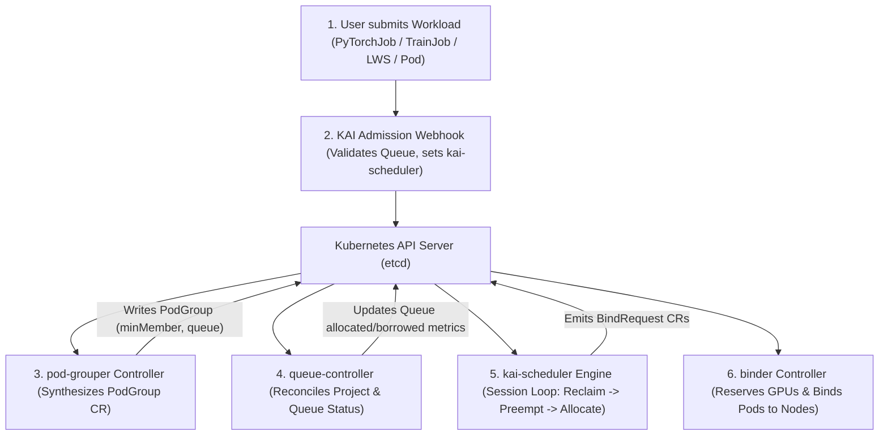
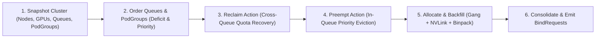

# 11.14 KAI Scheduler architecture and resources

| | |
|---|---|
| Level | Advanced |
| Priority tier | 1 |
| Lab venue | GCP / GKE (plus local Python 3 simulation lab) |
| Part | Part 11: GPUs on Kubernetes, scheduling and virtualization |
| Sources used | Roland Huß et al., *Generative AI on Kubernetes* (O'Reilly, 2026, Ch. 7); `nvidia-zero-to-hero/volume-24/chapter-07-kubernetes-gpu-scheduling.md`; `nvidia-zero-to-hero/volume-11/chapter-07-kubernetes-scheduling-for-shared-gpus.md`; `nvidia-zero-to-hero/volume-11/chapter-08-tenant-isolation-security-and-fairness.md`; *NVIDIA Base Command Manager 11 Containerization Manual* (`bcm11-containerization`, Ch. 6) |
| Coverage file | `planning/coverage/chapters/11-14.md` |

> **Update, November 2026:** NVIDIA open-sourced the full Run:ai platform on 13 October 2026, under Apache 2.0, in addition to the KAI Scheduler that has been open since April 2025. A supported commercial release still exists. See [11.31](./31-nvidias-open-source-ai-factory-kubernetes-stack.md).

## Why this matters for AI infrastructure

In Chapter 11.13, we saw why the default Kubernetes scheduler struggles on shared GPU clusters. We also saw how the NVIDIA KAI Scheduler handles those problems with hierarchical quotas, gang scheduling, fractional GPU sharing, and NVLink or InfiniBand topology placement.

Now suppose a distributed training job hangs in the Pending state. You need to know which internal component is holding it back, and you cannot find that out by treating the scheduler as a black box. Unlike kube-scheduler, which runs as a single binary that watches raw Pod and Node objects, KAI Scheduler is built as a decoupled suite of five cooperating control-plane microservices. Those microservices talk to each other through a well-defined hierarchy of Custom Resource Definitions.

1. **Project and Queue resources.** These objects describe your departments and teams. They record each team's guaranteed GPU quota, its over-quota borrowing weight, and how much it has allocated or borrowed right now.
2. **PodGroup resources.** The PodGroup is the atomic unit of scheduling inside KAI. The pod-grouper controller watches distributed workload objects and synthesizes a PodGroup for each one, with member counts, queue links, priority classes, and topology constraints. Rather than scheduling Pods one by one, the scheduler works on the whole group.
3. **Topology resources.** These objects capture the physical NVSwitch, rack, and InfiniBand leaf-switch domains. The NVIDIA GPU Operator discovers them.
4. **BindRequest resources.** These objects separate the scheduler's in-memory decision from the binding work. The binder controller carries out the asynchronous node binding and the fractional-GPU reservation handshake.

The table below shows who writes each of these objects and who reads it. Following the chain from one row to the next shows you where a workload stopped.

| KAI Custom Resource | API Group / Version | Primary Producer & Consumer | Core Scheduling Fields |
|---|---|---|---|
| `Project` / `Queue` | `kai.run.ai/v1` / `scheduling.run.ai/v2` | Admin or `queue-controller` -> `kai-scheduler` | `gpuQuota: 8`, `quota`, `limit`, `overQuotaWeight`, `parentQueue` |
| `PodGroup` | `scheduling.run.ai/v2alpha2` | `pod-grouper` -> `kai-scheduler` | `minMember`, `queue`, `priorityClassName`, topology annotations |
| `Topology` | `kai.scheduler/v1alpha1` | Admin / GPU Operator -> `kai-scheduler` | NVSwitch node domains, rack domains, InfiniBand leaf switches |
| `BindRequest` | `scheduling.run.ai/v1alpha2` | `kai-scheduler` -> `binder` | Target `Node`, GPU device indices, fractional memory slice |

Knowing how a workload moves through the five microservices and their custom resources is what makes production work manageable. The gap is large. A stuck PodGroup can take two minutes to resolve once you know the chain, or you can guess blindly across dozens of pods. When a workload stalls, follow this chain one link at a time before you change anything.

:::caution Checked against the upstream KAI Scheduler docs
The corpus contains only one KAI example in *Generative AI on Kubernetes*. Most other KAI detail in chapters 11.13 to 11.19 was written from working knowledge and was not in the corpus or notes. On 2026-10-25 it was compared with the public docs at `github.com/kai-scheduler/KAI-scheduler` and a Go API listing.

- **Confirmed.** The scheduler name is `schedulerName: kai-scheduler`. Queue objects use `scheduling.run.ai/v2`, with cpu, memory, and gpu resources. Each resource holds quota, limit, and overQuotaWeight, plus parentQueue and priority. Only leaf queues run jobs. PodGroup uses `scheduling.run.ai/v2alpha2`, BindRequest uses `scheduling.run.ai/v1alpha2`, and Topology uses `kai.scheduler/v1alpha1`. The `gpu-fraction` and `gpu-memory` annotations are confirmed, and so are the GPU reservation pods in namespace `kai-resource-reservation`. Core components include admission, podgrouper, binder, queuecontroller, and podgroupcontroller, driven by a Config resource. Fair share gives each queue its deserved quota first, then divides the surplus by overQuotaWeight.
- **Corrected in these chapters.** The queue is assigned with the label `kai.scheduler/queue`, not `kai.run.ai/queue`. Topology constraints use the annotations `kai.scheduler/topology`, `kai.scheduler/topology-required-placement`, and `kai.scheduler/topology-preferred-placement`, with a `kai.scheduler/v1alpha1` Topology object.
- **Not confirmed.** The Project kind in `kai.run.ai/v1` and the annotation `kai.run.ai/project` come from the book example. Upstream queue docs describe Queue objects rather than Project. Treat the Project path as book-specific, and prefer Queue with `kai.scheduler/queue` on new clusters. This handbook writes component names with hyphens, like `pod-grouper` and `queue-controller`, while upstream writes them without hyphens. Always verify API groups against your target release.
:::

## Prerequisites and outcomes

Before you start, check that you have the groundwork. The rest of the chapter assumes it, and skipping it makes the custom resources hard to follow.

### Prerequisites
- Finish Chapter 11.8 on the Kubernetes Scheduling Framework. Then finish Chapter 11.13, which covers KAI Scheduler motivation, fair-share deficit math, and graceful 30-second preemption.
- Be comfortable with Kubernetes Custom Resource Definitions, ownerReferences, and mutating or validating admission webhooks.

### Outcomes
By the end of this chapter, you should be able to do five things.
- Trace a workload from submission through all five KAI Scheduler control-plane microservices.
- Inspect and author the core KAI Scheduler custom resources, including Project, Queue, PodGroup, Topology, and BindRequest.
- Explain how the pod-grouper controller derives member counts and total GPU demand across PyTorchJob, JobSet, LeaderWorkerSet, and MPIJob workloads.
- Walk through the six stages of a KAI Scheduler batch session cycle.
- Solve the 8-GPU, 20-job multi-class scheduling benchmark from Volume 24 Chapter 7 with 100% GPU packing and zero starvation.

Use this list as a checklist as you read, and return to it when you reach the lab.

## Concepts: basics to intermediate to advanced

### 1. Basics: The five control-plane microservices of the NVIDIA KAI Scheduler

Suppose one scheduler process had to do everything at once. It would parse dozens of framework CRDs, reconcile hierarchical quotas, solve gang placement, and bind fractional GPU containers in the same loop. Under heavy load, that loop stalls. You then see long pending times for pods whenever a burst of batch jobs arrives.

Run:ai and NVIDIA avoided that problem by splitting the KAI Scheduler control plane into five separate microservices. The goal is to keep scheduling sessions fast on thousand-node clusters. Each microservice handles one stage of the scheduling lifecycle, and each has its own scaling and latency profile.



The table below shows what each microservice watches, what it creates or changes, and the role it plays. Read it from top to bottom to follow one workload through the pipeline.

| KAI Microservice | Kubernetes Resource Watched | Kubernetes Resource Created / Mutated | Operational Role in the Scheduling Pipeline |
|---|---|---|---|
| **1. admission-webhook** | Incoming `Pod`s and workload CRDs (`CREATE` / `UPDATE`) | Mutates `Pod` spec (`schedulerName: kai-scheduler`, fractional env/annotations) | Validates that the target `Project` / `Queue` exists, rejects unsupported resource combinations (`volume-11/chapter-07`), and injects `schedulerName: kai-scheduler`. |
| **2. pod-grouper** | `PyTorchJob`, `TrainJob`, `JobSet`, `LeaderWorkerSet`, `MPIJob`, `RayJob`, `Deployment`, `Pod` | Creates & updates `PodGroup` CRs (with `ownerReferences` to parent workload) | Inspects framework replica specs (`Master` + `Worker`, or `Launcher` + `Worker`) to compute `minMember` and group-level topology or priority rules automatically. |
| **3. queue-controller** | `Project` (`kai.run.ai/v1`), `Queue`, `PodGroup`, `Pod` | Reconciles `Queue` CRs and `Queue.status` | Maintains the multi-level hierarchy (`Department -> Project Queue`) and continuously aggregates requested, allocated, and borrowed GPU, CPU, and memory counts. |
| **4. kai-scheduler** | `Node`, `Queue`, `PodGroup`, `Pod`, `Topology`, `ResourceSlice` / GFD labels | Creates `BindRequest` CRs and preemption evictions | Executes periodic, atomic scheduling sessions in memory (`Snapshot -> Reclaim -> Preempt -> Allocate -> Consolidate`), solving gang, fair-share, fractional, and NVLink rules together. |
| **5. binder** | `BindRequest`, `Pod`, `Node`, and GPU reservation pods | Executes `Pod/binding` subresource in `kube-apiserver` | Consumes `BindRequest`s from `kai-scheduler`, sets up fractional or shared GPU device allocations on the target node, and commits the final `Pod.spec.nodeName` binding. |

---

### 2. Intermediate: Deep dive into KAI Scheduler Custom Resource Definitions

#### 1. Project and Queue resources
A standard Kubernetes ResourceQuota cannot express a guaranteed baseline quota next to an elastic borrowing ceiling and a relative sharing weight. Platform administrators need a declarative resource that separates what a team is guaranteed to own from what it may borrow when its peers are idle.

*Generative AI on Kubernetes*, Chapter 7, Example 7-5 shows how an administrator can state a team's quota at a high level with a Project custom resource. The queue-controller does the detailed work. It reconciles each Project and its parent department into a Queue custom resource under `scheduling.run.ai/v2`. Every Queue defines four governance parameters, across GPU, CPU, and memory.

The manifest below gives `ml-team-a` a `gpuQuota` of 8.

```yaml
apiVersion: kai.run.ai/v1
kind: Project
metadata:
  name: ml-team-a
spec:
  gpuQuota: 8
```

Notice that the Project asks for only one number. The Queue it becomes carries the four parameters described below.

- **Nominal or deserved quota.** The `quota` field sets the guaranteed baseline GPU count, such as 8 GPUs for `ml-team-a`. When sibling queues borrow that baseline, the queue can always reclaim it.
- **Maximum borrowing limit.** The `limit` field caps the total of nominal and borrowed GPUs a queue may use while its siblings are idle. For example, a `limit` of 4.8 on an 8-GPU cluster works out to 4.8 / 8 = 60%. A value of -1 allows unlimited borrowing.
- **Over-quota sharing weight.** The `overQuotaWeight` field sets the relative weight KAI Scheduler uses. When several queues burst above their nominal quota, the scheduler divides the spare GPUs in proportion to these weights.
- **Hierarchical parent link.** The `parentQueue` field ties a leaf project queue, such as `ml-team-a`, to its parent department queue, such as `nlp-department`.

When you define a team's Project, decide its guaranteed quota first and its borrowing limit second.

#### 2. PodGroup and how pod-grouper synthesizes gang units
Standard kube-scheduler sees each Pod as a separate object. Picture a multi-node training job whose ranks need GPUs, while the cluster has free GPUs for only some of them. If the scheduler binds the Pods it can place, the ranks that started wait at a rendezvous for ranks that never arrive. That is a rendezvous deadlock.

The pod-grouper controller is how KAI Scheduler avoids partial placement. You submit a Kubeflow PyTorchJob, an MPIJob, or a standalone fractional Pod. pod-grouper detects the owner reference on that workload and synthesizes a PodGroup object for it. Even a single-Pod notebook goes through the same unified Queue-to-PodGroup session pipeline.

The table compares how four kinds of workload turn into a PodGroup. Notice that the MPIJob launcher counts toward `minMember` but holds no GPUs.

| Workload Type | Replica Structure | Synthesized `minMember` | Total Group GPUs | Why `pod-grouper` Synthesis Matters |
|---|---|---|---|---|
| `PyTorchJob` (`pg-llm-training`) | `1` `Master` + `3` `Worker` Pods (`8.0` GPUs each) | `4` Pods (`1 + 3`) | `32.0` GPUs (`4 * 8.0`) | All `4` ranks execute GPU training; all `4` must bind in the same session or none bind. |
| `MPIJob` | `1` `Launcher` (`0` GPUs) + `2` `Worker` Pods (`8.0` GPUs each) | `3` Pods (`1 + 2`) | `16.0` GPUs (`2 * 8.0`) | `Launcher` runs `mpirun` over SSH with `0` GPUs, while `2` `Worker`s hold `16.0` GPUs as a `3`-Pod gang. |
| Fractional Inference `Pod` | `1` standalone `Pod` requesting `0.5` GPU | `1` Pod | `0.5` GPU | Wraps single-Pod jobs in a `minMember: 1` `PodGroup` for unified queue and bin-pack accounting. |

Take the PyTorchJob row as a worked example. The Master and three Workers give a `minMember` of 4, which is 1 + 3. Each of those four ranks uses 8.0 GPUs, so the group needs 4 * 8.0 = 32.0 GPUs in total. All four must bind in the same session, or none of them bind.

When a gang job stays Pending, compare its `minMember` and total GPU demand with the free capacity in its queue.

#### 3. BindRequest — Why KAI decouples scheduling from binding
If the scheduler called the Kubernetes binding API from inside its decision loop, every slow network round trip and device reservation handshake would stall the whole session. Fractional GPU sharing adds to the problem, because several containers must coordinate access to one physical GPU.

KAI Scheduler handles both problems the same way. At the end of its in-memory session, it writes a lightweight BindRequest custom resource. That write isolates the network work, so the core scheduler can start its next session right away. The binder microservice then commits the API changes asynchronously. Suppose a 0.5 GPU Pod and a 0.25 GPU Pod pack onto the same physical card. The binder coordinates the underlying integer `nvidia.com/gpu: 1` reservation pod in namespace `kai-resource-reservation`. Before it starts the user container, it injects `CUDA_VISIBLE_DEVICES` and memory ceilings.

If a Pod sits Pending after its PodGroup is allocated, look at the BindRequest before you blame the scheduler.

---

### 3. Advanced: Inside the KAI session pipeline and the 8-GPU, 20-job multi-class packing benchmark

#### The six-stage KAI Scheduler session cycle
If the scheduler evaluates Pods one at a time, it cannot solve cluster-wide problems. Cross-queue reclamation, gang placement, and fractional defragmentation all need a view of the whole cluster. So KAI Scheduler runs a batch session roughly once per second. Each session works from a complete, point-in-time snapshot of the cluster.



1. **Stage 1: Cluster Snapshot.** The scheduler first captures a consistent in-memory view. That view covers all healthy nodes, allocatable whole GPUs, MIG slices, existing fractional GPU reservations, Queue allocations, and pending or running PodGroups.
2. **Stage 2: Queue and PodGroup Ordering.** It orders Queues by fair-share deficit, so under-quota queues are served first. Inside each queue, it orders PodGroups by PriorityClass value and then by creation timestamp.
3. **Stage 3: Reclaim Action.** When an under-quota queue has pending work and the cluster's GPUs are full, the reclaim action picks the lowest-priority borrowed PodGroups from over-quota queues for graceful preemption.
4. **Stage 4: Preempt Action.** Inside one Queue, a high-priority PodGroup may not fit in the free capacity. In that case, the preempt action evicts lower-priority PodGroups from the same queue.
5. **Stage 5: Allocate and Backfill Action.** The scheduler walks the ordered PodGroups and scores candidate nodes with three plugins. The gang plugin checks that all `minMember` Pods fit at the same time. The topology plugin prefers the tightest NVSwitch or InfiniBand domain. The bin-packing plugin places fractional and single-GPU jobs on the fullest eligible GPU, so empty cards stay free for large gangs.
6. **Stage 6: Consolidate and Emit BindRequests.** Finally, the consolidate action repacks scattered fractional allocations onto fewer physical GPUs. The scheduler then writes BindRequest objects for all newly allocated PodGroups.

When a job stalls, work out which of these six stages is holding it back.

#### Worked Production Benchmark: Packing 20 Diverse Jobs onto an 8-GPU Cluster
Consider a cluster that receives inference services, whole-GPU training runs, and fractional research notebooks in the same instant. Naive scheduling breaks down here. It either starves the low-priority research or lets training take every GPU. Platform architects need to see how priority ordering, per-class quota caps, and fractional bin-packing work together during a live session.

We will trace KAI Scheduler's session pipeline on the capstone benchmark from Volume 24 Chapter 7. The cluster has 2 worker nodes. Each node has 4 GPUs and 320 GB of GPU memory, so the cluster totals 8 GPUs and 640 GB of HBM. The fairness rule caps any single job class at 60% of the cluster's GPUs. Since 60% of 8 GPUs is 4.8, no class can hold more than 4.8 GPUs. The platform also targets over 85% total GPU utilization, with inference p99 latency below 10 ms. At time 0:00, 20 jobs arrive across three priority classes.

```text
Volume 24 Chapter 7 Capstone Benchmark Specification & Wave 1 Packing (8.0 GPUs across node-1 and node-2):
  Cluster Inventory: 2 nodes x 4 GPUs/node = 8.0 GPUs total (320 GB/node = 640 GB HBM total)
  Fairness Cap:      <= 60% per job class -> 0.60 * 8.0 = 4.8 GPUs maximum per class (5 whole GPUs = 5.0 > 4.8 = 62.5% blocked)
  Target Utilization: > 85% cluster GPU utilization with 0 starvation (pending < 5 min)
  Inference SLO:     p99 < 10 ms (degrades to 25 ms if un-isolated training shares a physical GPU; server runs 300s / 5m, benchmark 600s / 10m on port 8080)
  Training Config:   10 jobs x 1.0 GPU (10.0 GPUs total demand), backoffLimit: 3; Wave 1 finishes at 0:45, Wave 2 schedules at 0:50, completes at 1:00 (60m)
```

As you read this block, treat it as the rules for the benchmark. You will see that the fairness cap drives most of what follows. The table below shows what each class asks for and what it gets in Wave 1.

| Job Class & IDs | Submitted Count | PriorityClass & Value | Per-Job GPU Request (`shares/GPU`) | Wave 1 Running Jobs & GPUs | Wave 1 Cluster Share & Queued |
|---|---|---|---|---|---|
| **Type B: Inference** (`inference-001..006`) | `6` jobs | `inference-critical` (`1000`) | `0.5` GPU (`2` shares/GPU) | `6` running (`3.0` GPUs on `3` cards) | `37.5%` (`<= 4.8` cap), `0` queued |
| **Type A: Training** (`training-001..010`) | `10` jobs | `training-high-priority` (`100`) | `1.0` whole GPU (`1` share/GPU) | `4` running (`4.0` GPUs on `4` cards) | `50.0%` (`<= 4.8` cap), `6` queued |
| **Type C: Research** (`research-001..004`) | `4` jobs | `research-best-effort` (`0`) | `0.25` GPU (`4` shares/GPU) | `4` running (`1.0` GPU on `8th` card) | `12.5%` (`<= 4.8` cap), `0` queued |
| **Wave 1 Session Total** | `20` jobs | `1000 > 100 > 0` | Mixed (`1.0`, `0.5`, `0.25`) | `14` `BindRequest`s (`8.0 / 8.0` GPUs) | `100.0%` utilization (`0.0` idle GPUs) |

Here is how the scheduler packs Wave 1, step by step. In Step 1, it allocates the six critical inference PodGroups first. It packs them in pairs of 0.5 GPU onto three physical GPUs, which keeps them away from heavy training loops and holds p99 latency under 10 ms. In Step 2, it places four training PodGroups on four dedicated GPUs. It stops at 4.0 GPUs, because a fifth job would push the total past the 4.8-GPU fairness cap, so six training jobs wait for Wave 2. In Step 3, it backfills the four research PodGroups at 0.25 GPU each onto the eighth physical GPU.

The arithmetic adds up: 3.0 + 4.0 + 1.0 = 8.0 GPUs, which is the whole cluster. The session emits 14 BindRequests, and they pack 100.0% of the cluster with zero starvation across all three classes. You can use this same arithmetic to check a per-class cap before you let several teams share a cluster.

#### Explicit GPU Sharing Service-Class Catalog and Threat Boundaries
A smart scheduler cannot protect tenants if the nodes underneath mix incompatible sharing modes or lack container isolation. Picture an inference service that lands on a time-sliced GPU beside an untrusted batch job. Context-switching jitter and shared host resources then break both its performance and its security guarantees.

Volume 11, Chapters 7 and 8 make the same point. Platform architects must pair KAI Scheduler with an explicit catalog of four GPU service classes and a seven-layer multi-tenant security boundary before onboarding users. Never hide materially different isolation mechanisms behind one undifferentiated `nvidia.com/gpu` pool.

The catalog below lists the four classes. Each one pairs a resource identifier with a sharing mode and a target workload.

| GPU Service Class (`volume-11/chapter-07`) | Resource Identifier & Node Selection | Hardware Isolation & Sharing Mode | Target Workload Profile |
|---|---|---|---|
| **1. Dedicated Accelerator Pool** | `nvidia.com/gpu` on tainted, topology-validated nodes | Full physical GPU (`1` tenant per card), NVSwitch / IB fabric | Multi-node distributed training (`PyTorchJob`, `JobSet`, `MPIJob`) and large models |
| **2. Fixed MIG Shape Pool (`protected-mig`)** | `nvidia.com/mig-1g.10gb` or `nvidia.com/mig-3g.20gb: 1` (`migStrategy: mixed`) | Dedicated SMs, memory controllers, and L2 cache paths (`platform.example.com/gpu-sharing In [mig]`) | Latency-critical serving (`profile-qualified-serving`, `p99 < 10 ms`) |
| **3. Best-Effort Fractional / Time-Sliced** | KAI `gpu-fraction` (`0.25`, `0.5`) or time-sliced shares | Shared context switching; no hardware memory fault or tail-latency isolation | Cost-efficient interactive Jupyter notebooks, dev/test, and research backfill |
| **4. VM-Backed Compute Pool (`vGPU`)** | Hypervisor or KubeVirt VM with NVIDIA vGPU profile | Separate guest kernel and vGPU license enforcement | Untrusted external tenants requiring strict hypervisor kernel separation |

As you compare the rows, notice that only the best-effort class lacks hardware isolation. The other three dedicate a whole card, a MIG slice, or a separate VM.

To keep two tenants on one cluster from leaking data or disrupting each other, Volume 11, Chapter 8 defines seven defense-in-depth layers. It also adds a five-step pre-submission checklist.

1. **Layer 1: Identity.** Scope workload service accounts, OIDC group RBAC, and short-lived credentials. Together they decide which Project or Queue a user can target.
2. **Layer 2: Admission.** Use webhooks to reject mixed MIG device types in a single container, block unapproved registries, and forbid `privileged: true` or arbitrary `hostPath` mounts.
3. **Layer 3: Kubernetes Namespace and Network.** Enforce namespace separation, per-class Queue and ResourceQuota ceilings, LimitRange bounds, and default-deny NetworkPolicy isolation.
4. **Layer 4: Data and Storage Credentials.** Scope PVC and object-store prefix credentials so pods in one project cannot read another team's weights or checkpoints.
5. **Layer 5: GPU Isolation Verification.** Match the sharing class to the tenant trust model. Then verify inside MIG containers with `nvidia-smi --query-processes=pid,process_name,gpu_memory_usage --format=csv` that neighboring tenant PIDs are invisible.
6. **Layer 6: Host and Node Plane.** Restrict SSH, `crictl`, device-plugin ConfigMaps, and MIG geometry changes to platform administrators under change control.
7. **Layer 7: Observability and Audit Scoping.** Filter Prometheus, Grafana, and KAI Queue dashboards by tenant role, so teams cannot query pod labels or `nvidia_smi_memory_used_mib` metrics that belong to peer teams.

Before you submit a workload to a governed GPU service class, work through five checks in order. First, confirm that at least one node advertises allocatable units of the target resource. Second, confirm that the target Queue or ResourceQuota has headroom below its limit. Third, confirm that the namespace carries the approved service-class policy labels. Fourth, inspect the PodGroup phase and BindRequest status after submission. That step tells a queue hold apart from a node predicate failure. Fifth, verify the allocated GPU index or MIG UUID on the bound Pod, and confirm that the application meets its SLO.

#### Policy Testing Strategy for KAI and Shared-GPU Service Classes
Treat Queue definitions, PodGroup synthesis rules, and admission policies as code you can test. Do not treat them as manual tweaks you make after install. Keep a continuous-integration fixture suite in a canary environment. Run the five test cases below whenever the GPU Operator, KAI Scheduler, or admission webhook version changes.

1. **Approved service-class fixture.** Submit a valid PyTorchJob, TrainJob, LeaderWorkerSet, and fractional 0.5-GPU inference Pod. Assert that pod-grouper creates the PodGroup, kai-scheduler emits the BindRequest, and binder binds the Pod.
2. **Denied mixed-resource fixture.** Submit a container that requests two different MIG profile types, or a fractional share, in a protected namespace. Assert that the admission webhook rejects it synchronously.
3. **Quota and 60% limit exhaustion fixture.** Submit jobs that exceed the queue's 4.8-GPU limit. Assert that the excess PodGroups stay queued without displacing running critical inference pods.
4. **Taint and toleration isolation fixture.** Submit an untolerated best-effort research job against a tainted `protected-mig` or dedicated training pool. Assert that the node pool repels the job.
5. **Node-label drift fixture.** Simulate a missing GPU Feature Discovery or topology label on one canary node. Assert that monitoring flags the drift before it misplaces topology-sensitive gangs.

Before you promote a KAI version, run these five fixtures against it.

## Commands and configurations that matter

### 1. Defining PriorityClasses, KAI Queues, and a 60% Scoped Quota

The manifest below comes from Volume 24, Chapter 7 and the KAI Scheduler Queue specification. It defines three PriorityClass tiers and the `training-queue` custom resource. KAI Queue units are devices for GPU, millicores for CPU and megabytes for memory, so the 32-core quota is written 32000 and the 256 GB quota is 256000. Setting `quota: 4` and `limit: 4.8` guarantees the training team its baseline GPUs. It also caps the team's total burst usage at 60% of the cluster, which is 4.8 GPUs on an 8-GPU cluster.

```yaml
# kai-priority-and-queues.yaml (volume-24/chapter-07 + KAI Queue CRDs). Queue units: gpu in devices, cpu in millicores, memory in MB.
apiVersion: scheduling.k8s.io/v1
kind: PriorityClass
metadata:
  name: inference-critical
value: 1000
globalDefault: false
description: "Critical priority for inference SLOs (p99 < 10ms)"
---
apiVersion: scheduling.k8s.io/v1
kind: PriorityClass
metadata:
  name: training-high-priority
value: 100
globalDefault: false
description: "High priority for training jobs (capped at 60% = 4.8 GPUs)"
---
apiVersion: scheduling.k8s.io/v1
kind: PriorityClass
metadata:
  name: research-best-effort
value: 0
globalDefault: false
description: "Best effort for research jobs"
---
apiVersion: scheduling.run.ai/v2
kind: Queue
metadata:
  name: training-queue
spec:
  parentQueue: default-department
  resources:
    gpu:
      quota: 4
      limit: 4.8
      overQuotaWeight: 2
    cpu:
      quota: 32000
      limit: 64000
    memory:
      quota: 256000
      limit: 320000
```

When you read the values, notice that the tiers run from inference-critical down through training-high-priority to research-best-effort.

### 2. Inspecting KAI PodGroups, Queues, BindRequests, and Control-Plane Pods

When a scheduling delay shows up on a live cluster, start with the control-plane deployments. Then trace the custom resource chain from Queue to PodGroup to BindRequest. Sorting workload pods by priority shows whether critical inference jobs are scheduled ahead of batch queues.

```bash
# 1. Verify all 5 KAI Scheduler control-plane microservices are Running (untested here)
kubectl get pods -n kai-scheduler

# 2. Inspect hierarchical Queue quota, allocated, and borrowed GPU counts (untested here)
kubectl get queues -o wide

# 3. Inspect synthesized PodGroups and active BindRequests (untested here)
kubectl get podgroups -A
kubectl get bindrequests -A

# 4. Sort running and pending GPU pods by priorityClassName (volume-24/chapter-07, untested here)
kubectl get pods -n gpu-workloads -o wide --sort-by=.spec.priority

# 5. Check allocatable MIG 3g.20gb slices and verify MIG process isolation (volume-11/chapter-07 & 08, untested here)
kubectl get nodes -o custom-columns=NAME:.metadata.name,MIG_3G_20GB:.status.allocatable.nvidia\.com/mig-3g\.20gb
nvidia-smi --query-processes=pid,process_name,gpu_memory_usage --format=csv
```

Run the commands in order. The first one tells you whether the microservices are up. Next come the Queue, PodGroup, and BindRequest checks. Then you sort the GPU pods by priority. The last two lines check MIG slices and process isolation.

## How it fails

KAI Scheduler splits scheduling across five microservices and four custom resources. Each failure therefore leaves its own fingerprint in that pipeline. The table below helps you find the controller or quota rule behind a stall.

| Failure mode | Exact symptom & command evidence | Root cause boundary | Remediation |
|---|---|---|---|
| **1. PyTorchJob Pods stay Pending with no PodGroup created** | User submits a `PyTorchJob` with `schedulerName: kai-scheduler`, Pods are created, but `kubectl get podgroups` is empty. | `pod-grouper` controller is down or missing RBAC watch permissions for `kubeflow.org/v1` `PyTorchJob`s. `kai-scheduler` only schedules `PodGroup`s. | Check `kubectl logs -n kai-scheduler deploy/pod-grouper`, verify `ClusterRole` includes `pytorchjobs`, `jobsets`, and `leaderworkersets`, and confirm `pg-<name>` appears. |
| **2. PodGroup shows Allocated in logs, but Pods stay Pending with BindRequest stuck** | `kubectl get bindrequests -A` shows `BindRequest` objects accumulating, and `Pod.spec.nodeName` remains unset. | `binder` microservice failure or fractional reservation conflict on the target node (`kai-resource-reservation` pod failed). | Inspect `kubectl logs -n kai-scheduler deploy/binder` and `kubectl describe bindrequest`, verify node `Allocatable` GPUs, and clear stale reservation pods. |
| **3. Research jobs starve in Pending (> 10 min) while Training uses 100% (8/8 GPUs)** | `10` Training jobs (`priority: 100`) grab all `8` GPUs (`100%`), leaving `research-001..004` (`priority: 0`) stuck in `Pending` (`volume-24/chapter-07`). | Missing per-Queue `limit` (`4.8` GPUs / `60%` cap). `training-queue` had `limit: -1` and higher priority (`100 > 0`). | Set `resources.gpu.limit: 4.8` on `training-queue` or set a guaranteed `quota: 1` on `research-queue` so `1.0` GPU stays available for research. |
| **4. Inference p99 latency jumps from < 10 ms to 25 ms on shared GPU nodes** | All `6` Inference jobs (`0.5` GPU) are `Running`, but `analyze_slo.py` reports `p99 = 25 ms` (`> 10 ms` SLO in `volume-24/chapter-07`). | Compute and memory contention on time-sliced fractional shares when a heavy Training or Research loop shares the same physical GPU. | Isolate `inference-critical` (`1000`) jobs onto dedicated inference GPUs (co-locating only `0.5` inference pairs) or switch to hardware-isolated `MIG` slices (`1g.10gb` / `3g.20gb`). |
| **5. PodGroup stuck in Pending because Queue name in annotation does not exist** | Pod carries `kai.run.ai/project: typo-team` or invalid `kai.scheduler/queue`, and `kai-scheduler` logs `Queue "typo-team" not found`. | Unreconciled `Project` or `Queue` reference; the `Project` CR was never created or `queue-controller` failed to reconcile it. | Run `kubectl get projects,queues` to verify the exact queue name and enable `admission-webhook` to reject invalid queue names at submission time. |

Take row 3 as a worked example, because you will meet this pattern often. Ten training jobs at 1.0 GPU each ask for 10.0 GPUs of demand, but the cluster has only 8. The training jobs filled all 8 GPUs, so the research jobs waited in Pending. The table points to the cause: `training-queue` had no effective `limit`, and its priority of 100 beat the research priority of 0. Start with the root cause boundary column, because it tells you which controller or quota to inspect before you touch any quota.

## Hands-on lab

### Venue and scope
This lab runs locally with two Python 3 standard library scripts, `code/part11/kai_architecture_and_resources.py` and `code/part11/kai_architecture_and_resources_lab.py`. The first script deterministically simulates the pod-grouper controller across PyTorchJob, MPIJob, and fractional Pod workloads. The lab then runs the 8-GPU, 20-job multi-class session packing benchmark from Volume 24, Chapter 7. Cluster commands are marked `(untested here)`, so you can tell them apart from what you actually ran.

### Step 1: Run the self-checking KAI Scheduler architecture and resources lab (tested here)

Run the self-checking lab script from the repository root. It verifies all 25 architectural and packing checks.

```bash
python3 code/part11/kai_architecture_and_resources_lab.py
```

Captured output from this repository.

```text
=== Chapter 11.14 Lab: KAI Scheduler Architecture, CRDs & Session Pipeline ===
  [PASS] KAI control plane comprises pod-grouper, queue-controller, kai-scheduler, binder, and admission-webhook
  [PASS] pod-grouper maps PyTorchJob (1 Master + 3 Workers x 8 GPUs) to PodGroup minMember=4, queue=ml-team-a, 32.0 GPUs
  [PASS] pod-grouper maps MPIJob (1 Launcher + 2 Workers x 8 GPUs) to minMember=3 with 16.0 worker GPUs
  [PASS] pod-grouper maps 0.5-GPU inference Pod to PodGroup minMember=1, total_group_gpus=0.5
  [PASS] Simulation receives all 20 jobs (6 Inference + 10 Training + 4 Research)
  [PASS] 60% fairness cap on an 8-GPU cluster limits any single job type to 4.8 GPUs
  [PASS] All 6 critical Inference jobs (priority 1000, 0.5 GPU each) schedule immediately consuming 3.0 GPUs
  [PASS] 4 Training jobs (priority 100, 1.0 GPU each) schedule consuming 4.0 GPUs (<= 4.8 cap); 6 wait in queue
  [PASS] All 4 Research jobs (priority 0, 0.25 GPU each) pack into the remaining 1.0 GPU
  [PASS] KAI Scheduler issues 14 BindRequests (6+4+4) packing 8.0 of 8.0 GPUs (0.0 idle GPUs)
  [PASS] Packed GPU utilization reaches 100.0% (exceeding the >85% capstone target)
  [PASS] All 3 job classes (Inference, Training, Research) have active running jobs simultaneously (0 starvation)
  [PASS] Volume 24 Project 7 cluster has 2 nodes x 4 GPUs (320GB GPU memory per node = 640GB total)
  [PASS] PriorityClass values order inference-critical (1000) > training-high-priority (100) > research-best-effort (0)
  [PASS] Inference p99 latency SLO is <10 ms (violated at 25 ms if un-isolated training contends with inference)
  [PASS] Inference server runs for 300s (5m) and SLO benchmark runs for 600s (10m)
  [PASS] Training Job sets backoffLimit: 3 and Inference container exposes containerPort: 8080
  [PASS] Fractional 0.5 GPU maps to 2 shares/GPU and 0.25 GPU maps to 4 shares/GPU
  [PASS] Volume 24 Project 7 timeline completes Wave 1 training at 0:45, schedules remaining research at 0:50, and finishes at 1:00 (60m)
  [PASS] All synthesized KAI PodGroups target schedulerName='kai-scheduler'
  [PASS] Every job type stays strictly within the 4.8-GPU (60%) fairness ceiling
  [PASS] Job counts (6 Inference + 10 Training + 4 Research) sum to 20 total jobs
  [PASS] 14 running jobs + 6 queued training jobs account for all 20 submitted jobs in Wave 1
  [PASS] Wave 1 GPU share distribution is 37.5% Inference (3.0/8), 50.0% Training (4.0/8), and 12.5% Research (1.0/8)
  [PASS] Wave 1 GPU shares (37.5% + 50.0% + 12.5%) sum to 100.0% of cluster capacity

Summary: 25 passed, 0 failed out of 25 checks.
```

Each PASS line checks one fact from the chapter. Read the summary line last, since it tells you whether all 25 checks passed.

### Exercises

Work through these six exercises after the lab. The table after them lists the function each one targets, the inputs it takes, and the output you should expect.

1. Call `synthesize_kai_podgroup` in `code/part11/kai_architecture_and_resources.py` for the PyTorchJob and MPIJob configurations listed in the table below. Then explain why the MPIJob produces a 3-Pod gang while demanding only 16.0 total GPUs.
2. Calculate the exact GPU cap that the 60% per-class fairness rule enforces on an 8-GPU cluster. Then explain why at most 4 whole-GPU Type A Training jobs can run at once during Wave 1.
3. Run `simulate_kai_eight_gpu_session` and check how many jobs of each class run in Wave 1. Also check how many BindRequests it emits, and what percentage of the 8.0 GPUs each class gets.
4. Explain the architectural handoff between kai-scheduler and binder. Then state which custom resource and which microservice log you inspect first when a PodGroup is allocated in scheduler logs but its Pod has no `nodeName`.
5. When Type B Inference tail latency degrades from under 10 ms to 25 ms on a shared GPU, identify the two placement or hardware partitioning changes that restore SLO compliance.
6. Explain how queue-controller links a Project to its parent department Queue. Then explain why kai-scheduler reads Queue status from its snapshot rather than querying standard Kubernetes ResourceQuota objects.

| Exercise | Function / Target in `code/part11/kai_architecture_and_resources.py` | Input Parameters | Expected Output Summary |
|---|---|---|---|
| **1** | `synthesize_kai_podgroup()` | `PyTorchJob` (`1` Master + `3` Workers x `8.0` GPUs) vs `MPIJob` (`1` Launcher + `2` Workers x `8.0` GPUs) | `PyTorchJob`: `(min_member=4, total_group_gpus=32.0)`; `MPIJob`: `(min_member=3, total_group_gpus=16.0)` |
| **2** | `60%` fairness cap calculation | `8.0` cluster GPUs, `0.60` max class ratio, `1.0` GPU per Type A Training job | `4.8` GPUs cap (`4` jobs = `4.0 <= 4.8` allowed; `5` jobs = `5.0 > 4.8` blocked) |
| **3** | `simulate_kai_eight_gpu_session()` | `6` Inference (`0.5`), `10` Training (`1.0`), `4` Research (`0.25`) on `8.0` GPUs | `14` `BindRequest`s (`6+4+4`), `100.0%` utilization (`37.5%`, `50.0%`, `12.5%`), `6` queued |
| **4** | Pipeline triage (`kai-scheduler` -> `binder`) | `pg-inference-001` allocated to `node-1`, `Pod` still `Pending` | Inspect `kubectl get bindrequests -A` and `kubectl logs -n kai-scheduler deploy/binder` |
| **5** | SLO remediation (`p99 < 10 ms` vs `25 ms`) | `0.5`-GPU inference contending with training on time-sliced GPU | Co-locate only inference shares on reserved cards, or use hardware-isolated `MIG` slices |
| **6** | `queue-controller` hierarchy reconciliation | `Project` `ml-team-a` (`gpuQuota: 8`) under `default-department` | Reconciles child `Queue` with fractional/borrowed GPU tracking beyond integer `ResourceQuota` |

## Checkpoint questions

<details>
<summary>**1. What are the five control-plane microservices that make up the NVIDIA KAI Scheduler architecture?**</summary>

The five are the admission-webhook, pod-grouper, queue-controller, kai-scheduler, and binder. Between them, they validate incoming workloads, build PodGroup gang units, reconcile hierarchical Queue quotas, solve batch scheduling sessions in memory, and bind fractional or full GPU allocations to nodes.
</details>

<details>
<summary>**2. Why does KAI Scheduler use a dedicated pod-grouper microservice instead of requiring users to write PodGroup YAML manifests manually?**</summary>

Data scientists submit higher-level objects such as PyTorchJob, TrainJob, JobSet, LeaderWorkerSet, MPIJob, RayJob, or plain Pods. Pod-grouper reads each workload's replica structure, works out `minMember`, attaches ownerReferences, and creates the PodGroup. You get gang scheduling without writing PodGroup YAML yourself.
</details>

<details>
<summary>**3. How does pod-grouper calculate minMember and total GPU demand differently for a PyTorchJob versus an MPIJob?**</summary>

A PyTorchJob with 1 Master and 3 Workers, each requesting 8 GPUs, runs GPU training ranks on both the Master and the Workers. That gives `minMember: 4` and 32 GPUs in total. An MPIJob with 1 Launcher requesting 0 GPUs and 2 Workers requesting 8 GPUs each works differently. The Launcher only runs `mpirun` over SSH, while the Workers hold the GPUs. That gives `minMember: 3` and 16 GPUs in total.
</details>

<details>
<summary>**4. What is the relationship between a Project and a Queue in KAI Scheduler?**</summary>

A Project in `kai.run.ai/v1` is the high-level tenant object, with fields such as `gpuQuota: 8`. That form comes from the book example. The queue-controller reconciles each Project into an underlying Queue custom resource in `scheduling.run.ai/v2`. The Queue links to a parent department queue and tracks `quota`, `limit`, `overQuotaWeight`, and live usage across GPU, CPU, and memory.
</details>

<details>
<summary>**5. Why does kai-scheduler emit a BindRequest custom resource to the binder microservice instead of binding Pods synchronously inside the scheduling loop?**</summary>

A BindRequest keeps slow Kubernetes API calls out of the in-memory scheduling loop, so sessions stay fast. The binder can then coordinate the fractional GPU reservation pods in namespace `kai-resource-reservation`. Only after that does it bind the user container to the node.
</details>

<details>
<summary>**6. Walk through the six stages of a single KAI Scheduler session cycle.**</summary>

First, the scheduler takes an in-memory snapshot of nodes, GPUs, Queues, and PodGroups. Second, it orders Queues by fair-share deficit and PodGroups by PriorityClass and age. Third, the Reclaim action recovers borrowed GPUs across queues. Fourth, the Preempt action evicts lower-priority jobs within the same queue. Fifth, the Allocate and Backfill action places gangs and fractional jobs using topology and bin-packing scores. Sixth, the Consolidate action defragments fractional shares and emits BindRequests.
</details>

<details>
<summary>**7. What is the difference between the Reclaim action and the Preempt action inside a KAI Scheduler session?**</summary>

Reclaim works across Queues. It evicts over-quota borrowed workloads from Queue A when under-quota Queue B submits pending work. Preempt works inside one Queue. It evicts lower-priority PodGroups when a higher-priority PodGroup arrives in that same queue.
</details>

<details>
<summary>**8. What does the Consolidate action do in KAI Scheduler, and why is it essential when mixing fractional and full-GPU jobs?**</summary>

Consolidate repacks fractional allocations. As fractional jobs start and finish, 0.25-GPU and 0.5-GPU allocations can scatter across four separate physical GPUs. That fragmentation blocks a 1.0-GPU training job, even though 3.0 GPUs of total capacity are free. Consolidate packs those four 0.25-GPU pods onto a single physical GPU, which frees three contiguous whole GPUs for training.
</details>

<details>
<summary>**9. In the Volume 24 Project 7 capstone, what are the three job types, their counts, GPU requests, and PriorityClass values?**</summary>

Type B Inference has 6 jobs, each requesting 0.5 GPU at PriorityClass `inference-critical` with value 1000 and a p99 latency SLO under 10 ms. Type A Training has 10 jobs, each requesting 1.0 GPU at `training-high-priority` with value 100. Type C Research has 4 jobs, each requesting 0.25 GPU at `research-best-effort` with value 0.
</details>

<details>
<summary>**10. In Volume 24 Project 7, why can at most 4 of the 10 Type A Training jobs run simultaneously even when 5 GPUs are free after placing Inference?**</summary>

The fairness policy caps any single job type at 60% of the 8-GPU cluster, which is 4.8 GPUs. As you can see, each Type A Training job takes one whole GPU. Four jobs use 4.0 GPUs, or 50.0% of the cluster. A fifth job would need 5.0 GPUs, or 62.5%, which is above the 4.8-GPU limit.
</details>

<details>
<summary>**11. How does the remaining 1.0 GPU get utilized during Wave 1 of Volume 24 Project 7 after 6 Inference jobs and 4 Training jobs are placed?**</summary>

The 6 Inference jobs use 3.0 GPUs and the 4 Training jobs use 4.0 GPUs, which leaves 1.0 physical GPU free. All 4 Type C Research jobs, each requesting 0.25 GPU, are backfilled onto that eighth GPU. Wave 1 then reaches 8.0 of 8.0 GPUs, or 100.0% utilization, across 14 BindRequests with zero starvation.
</details>

<details>
<summary>**12. Why does the standard Kubernetes API server reject fractional nvidia.com/gpu requests on a regular Pod, and how do KAI Scheduler and the GPU Operator work around this?**</summary>

Kubernetes extended resources in `Pod.spec.resources` accept only whole integers. The NVIDIA Device Plugin works around that by advertising integer time-sliced replicas or MIG profile resources. KAI Scheduler accepts `gpu-fraction` and `gpu-memory` annotations. It then uses the binder controller and reservation pods to manage the underlying integer GPU claim on kubelet.
</details>

<details>
<summary>**13. What happens in Volume 24 Project 7 if Type B Inference pods share a physical GPU via time-slicing with a heavy training loop?**</summary>

Time-slicing switches GPU contexts without hardware compute or memory bandwidth isolation. Contention from the training loop pushes Inference tail latency from under 10 ms up to 25 ms, which breaks the SLO. Co-locating only compatible inference shares, or partitioning the card into hardware-isolated MIG slices, prevents that degradation.
</details>

<details>
<summary>**14. In Volume 24 Project 7, how can a standard Kubernetes ResourceQuota cap GPU usage for a specific PriorityClass?**</summary>

You add a `scopeSelector` block to the ResourceQuota spec. It sets `scopeName: PriorityClass`, `operator: In`, and `values: ["training-high-priority"]`. The selector then limits the total GPU requests from pods in that priority class within the namespace.
</details>

<details>
<summary>**15. What happens when a user submits a Pod with a KAI project annotation if the mutating admission webhook is disabled and the user forgets schedulerName: kai-scheduler?**</summary>

Kubernetes defaults `Pod.spec.schedulerName` to `default-scheduler`. The default kube-scheduler ignores the KAI project annotation and the PodGroup gang constraints. It schedules pods one by one without enforcing Queue quotas.
</details>

<details>
<summary>**16. How do you verify from the CLI that pod-grouper has grouped a 4-Pod PyTorchJob correctly?**</summary>

You run `kubectl get podgroups -n <namespace>`, then `kubectl describe podgroup pg-<job-name> -n <namespace>`. You should confirm that `spec.minMember` is 4, that `spec.queue` matches the target queue, and that `ownerReferences` points to the PyTorchJob. Also check that `status.phase` moves from Pending to Running.
</details>

<details>
<summary>**17. What is the role of the Topology CRD in KAI Scheduler?**</summary>

The Topology custom resource in `kai.scheduler/v1alpha1` defines hierarchical hardware domains, such as node-level NVSwitch islands, rack domains, and InfiniBand leaf switches, through node labels. KAI Scheduler combines it with pod placement annotations to place distributed gangs inside the fastest available interconnect domain.
</details>

<details>
<summary>**18. Why does Volume 11 Chapter 7 warn against requesting two different MIG resource types in the same container?**</summary>

With `migStrategy: mixed` active in the NVIDIA device plugin, a container that requests several different MIG profile types gets undefined device assignment. A container may request several instances of the same MIG profile. Admission webhooks should reject mixed-profile requests per container.
</details>

<details>
<summary>**19. In Volume 11 Chapter 8, how do you verify from inside Team A's container on a MIG instance that Team B's GPU processes are not visible?**</summary>

You run `nvidia-smi --query-processes=pid,process_name,gpu_memory_usage --format=csv` inside Team A's container. On a properly isolated MIG slice with its own PID namespace, only Team A's processes appear. If you see Team B's processes, the pod landed on a time-sliced whole GPU, or `hostPID: true` was misconfigured.
</details>

<details>
<summary>**20. What five service signals does Volume 11 Chapter 7 track to distinguish admission pressure, runtime failures, and shared-GPU overcommitment?**</summary>

You can use five signals to separate the three problems. First, rising pending time points to too little eligible capacity or tight quotas. Second, rising allocation failures point to device plugin or runtime errors. Third, rising logical allocation alongside physical GPU saturation shows the shared time-sliced pool is overcommitted. Fourth, protected workloads landing in best-effort pools signal broken admission or taint rules. Fifth, successful placement paired with failing latency SLOs shows the sharing class is too weak for the workload.
</details>

## Sources and review notes

### Primary sources read in full for this chapter
This chapter draws on the book chapters, enterprise manuals, and Volume 24 and Volume 11 architecture notes listed in the reference block below.

```text
Primary Sources and Exact Citation Inventory (Chapter 11.14):
  1. Roland Huß et al., Generative AI on Kubernetes (O'Reilly, 2026), Chapter 7 (Job Scheduling Optimization: "NVIDIA KAI Scheduler", Tables 7-2, 7-3, and 7-4, and Example 7-5 Project ml-team-a gpuQuota: 8 with PyTorchJob schedulerName: kai-scheduler).
  2. NVIDIA Base Command Manager 11 Containerization Manual (bcm11-containerization), Chapter 6 ("6.11 The Run:ai Operator").
  3. Author's Volume 24 notes: nvidia-zero-to-hero/volume-24/chapter-07-kubernetes-gpu-scheduling.md (Project 7: 8-GPU / 2-node 320GB/node cluster, 20 jobs across 10 Type A Training at 1.0 GPU / priority 100 backoffLimit: 3, 6 Type B Inference at 0.5 GPU / priority 1000 p99 < 10 ms vs 25 ms on port 8080 for 300s / 600s benchmark, 4 Type C Research at 0.25 GPU / priority 0, <= 60% 4.8-GPU fairness cap, > 85% utilization target, and 0:00 -> 0:02 -> 0:03 -> 0:05 -> 0:45 -> 0:50 -> 1:00 timeline).
  4. Author's Volume 11 notes: nvidia-zero-to-hero/volume-11/chapter-07-kubernetes-scheduling-for-shared-gpus.md (Figure 11.7.1 node selection vs allocation, 4 service classes, mixed MIG single-resource-type rule, profile-qualified-serving protected-mig nvidia.com/mig-3g.20gb: 1 manifest, 5-step pre-submission validation checklist, and 5 operational telemetry signals).
  5. Author's Volume 11 notes: nvidia-zero-to-hero/volume-11/chapter-08-tenant-isolation-security-and-fairness.md (Figure 11.8.1 end-to-end tenant boundary, 7-layer threat model, concrete 5-row MIG threat verification table with nvidia-smi --query-processes=pid,process_name,gpu_memory_usage --format=csv, and 3 fairness time scales: Admission, Execution, Lifecycle, plus 50Gi / 7 / 1 verification examples).
```

### Related source files mapped in MIGRATION_MAP.md
No separate `nvidia-devops` file was mapped only to `11.14` in `brief.py`. Instead, this chapter combines *Generative AI on Kubernetes* Chapter 7 with Volume 24 Chapter 7, and with Volume 11 Chapters 7 and 8.

### Run here
The local simulation lab, `python3 code/part11/kai_architecture_and_resources_lab.py`, is one you can rerun yourself. It passed all 25 checks here.

### Explicitly labelled inferences
The Wave 1 packed GPU totals from `simulate_kai_eight_gpu_session` are deterministic arithmetic on the 20-job specification in `volume-24/chapter-07`.

```text
Deterministic Wave 1 Packing Arithmetic in code/part11/kai_architecture_and_resources_lab.py:
  Type B Inference: 6 * 0.5 = 3.0 GPUs (37.5% of 8.0 GPUs)
  Type A Training:  4 * 1.0 = 4.0 GPUs (50.0% of 8.0 GPUs, capped by 4.8-GPU / 60% fairness rule; 6 jobs queued for Wave 2 at 0:45)
  Type C Research:  4 * 0.25 = 1.0 GPU (12.5% of 8.0 GPUs)
  Wave 1 Total:     3.0 + 4.0 + 1.0 = 8.0 of 8.0 GPUs (100.0% utilization across 14 BindRequests)
```

### Not verified on live hardware
Every `kubectl` command, and every PriorityClass, Queue, PodGroup, and BindRequest command aimed at a live KAI Scheduler cluster, is marked `(untested here)`. None of them was run on live hardware.

### Not in the corpus
The local book corpus does not include internal Prometheus metric names for `pod-grouper` queue latency, so you will not find them there. Chapter 11.18 covers KAI Scheduler operational metrics and troubleshooting runbooks.

### Corrections to the author's notes
- The validation pass on 2026-10-25 confirmed that `validate_chapter.py` and `check_coverage.py` pass. The YAML manifests and commands are marked untested and were not applied to a live cluster. They include `PodScheduled`, `pods/binding`, `MostAllocated`, `nodeAffinity`, `topologyConstraint`, `ml-team-b`, `GPU-0`, `2g.20gb`, and `Fractional/Time-Sliced`. They also include `nvidia.com/gpu-service-class=protected-mig:NoSchedule`, `30s` `SIGTERM` across `72`-hour jobs, and `005` IDs, cross-referenced with Chapter `11.15`. Custom resource API versions such as `kueue.x-k8s.io/v1beta1` and `resource.k8s.io/v1` change between releases, so check them against your installed release.
- In `volume-24/chapter-07` Step 5, the illustrative ResourceQuota snippet writes `requests.nvidia.com/gpu: "4.8"` inside a standard Kubernetes ResourceQuota. Standard Kubernetes ResourceQuota and extended resources only accept whole integers for `nvidia.com/gpu` unless time-sliced shares are used. By contrast, KAI Scheduler's Queue custom resource natively enforces fractional GPU limits such as `limit: 4.8`.
- Manifest checked against upstream CRDs on 2026-11-11 (versions: KAI Scheduler v0.18.7, Queue scheduling.run.ai/v2).
