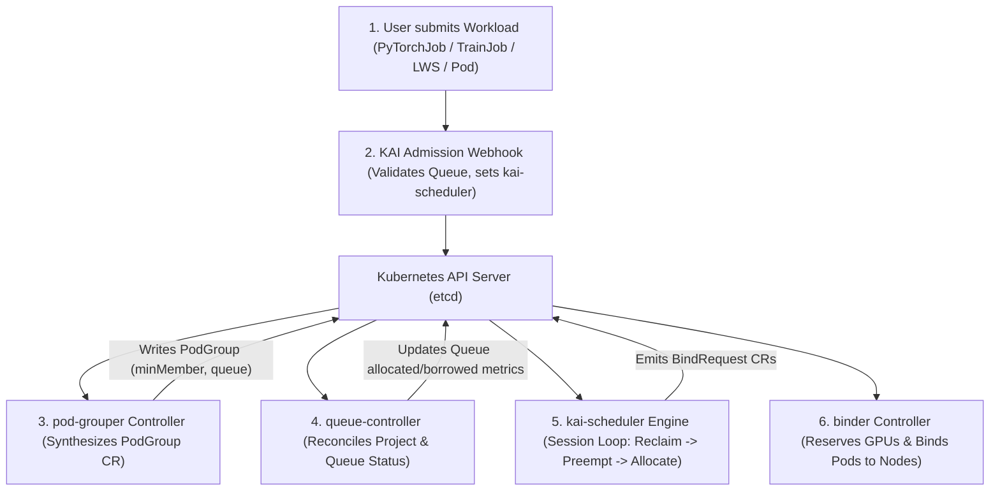
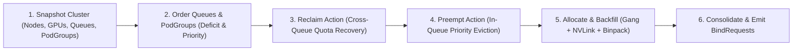

# 11.14 KAI Scheduler architecture and resources

| | |
|---|---|
| Level | Advanced |
| Priority tier | 1 |
| Lab venue | GCP / GKE (plus local Python 3 simulation lab) |
| Part | Part 11: GPUs on Kubernetes, scheduling and virtualization |
| Sources used | Roland Huß et al., *Generative AI on Kubernetes* (O'Reilly, 2026, Ch. 7); `nvidia-zero-to-hero/volume-24/chapter-07-kubernetes-gpu-scheduling.md`; `nvidia-zero-to-hero/volume-11/chapter-07-kubernetes-scheduling-for-shared-gpus.md`; `nvidia-zero-to-hero/volume-11/chapter-08-tenant-isolation-security-and-fairness.md`; *NVIDIA Base Command Manager 11 Containerization Manual* (`bcm11-containerization`, Ch. 6) |
| Coverage file | `planning/coverage/chapters/11-14.md` |

## Why this matters for AI infrastructure

In Chapter 11.13, we established why the default Kubernetes scheduler breaks down on shared GPU clusters. We also saw how the NVIDIA KAI Scheduler solves those challenges by unifying hierarchical quotas, gang scheduling, fractional GPU sharing, and NVLink or InfiniBand topology placement.

To deploy, customize, and debug KAI Scheduler in production, however, a platform engineer cannot treat the scheduler as a black box. When a distributed training job hangs in the Pending state, you need to know which internal component is holding it back. Unlike kube-scheduler, which runs as a single binary watching raw Pod and Node objects, KAI Scheduler is built as a decoupled suite of five cooperating control-plane microservices. Those microservices communicate through a well-defined hierarchy of Custom Resource Definitions.

1. **Project and Queue resources.** These objects represent organizational departments and teams, their guaranteed GPU quotas, over-quota borrowing weights, and live allocated or borrowed usage.
2. **PodGroup resources.** The PodGroup is the atomic unit of scheduling inside KAI. Rather than scheduling individual Pods one by one, the pod-grouper controller watches distributed workload objects. It automatically synthesizes a PodGroup with member counts, queue links, priority classes, and topology constraints.
3. **Topology resources.** These objects capture physical NVSwitch, rack, and InfiniBand leaf-switch domains discovered alongside the NVIDIA GPU Operator.
4. **BindRequest resources.** These objects decouple the scheduler's in-memory session decision from the asynchronous node binding and fractional-GPU reservation handshake executed by the binder controller.

| KAI Custom Resource | API Group / Version | Primary Producer & Consumer | Core Scheduling Fields |
|---|---|---|---|
| `Project` / `Queue` | `kai.run.ai/v1` / `scheduling.run.ai/v2` | Admin or `queue-controller` -> `kai-scheduler` | `gpuQuota: 8`, `quota`, `limit`, `overQuotaWeight`, `parentQueue` |
| `PodGroup` | `scheduling.run.ai/v2alpha2` | `pod-grouper` -> `kai-scheduler` | `minMember`, `queue`, `priorityClassName`, topology annotations |
| `Topology` | `kai.scheduler/v1alpha1` | Admin / GPU Operator -> `kai-scheduler` | NVSwitch node domains, rack domains, InfiniBand leaf switches |
| `BindRequest` | `scheduling.run.ai/v1alpha2` | `kai-scheduler` -> `binder` | Target `Node`, GPU device indices, fractional memory slice |

Understanding how a workload flows through those five microservices and custom resources is essential for production operations. It is the difference between resolving a stuck PodGroup in two minutes and guessing blindly across dozens of pods.

:::caution Checked against the upstream KAI Scheduler docs
The corpus contains only one KAI example in *Generative AI on Kubernetes*. Most other KAI detail in chapters 11.13 to 11.19 was written from working knowledge and was not in the corpus or notes. On 2026-10-25 it was compared with the public docs at `github.com/kai-scheduler/KAI-scheduler` and a Go API listing.

- **Confirmed.** The scheduler name is `schedulerName: kai-scheduler`. Queue objects use `scheduling.run.ai/v2` with cpu, memory, and gpu resources holding quota, limit, and overQuotaWeight, plus parentQueue and priority. Only leaf queues run jobs. PodGroup uses `scheduling.run.ai/v2alpha2`, BindRequest uses `scheduling.run.ai/v1alpha2`, and Topology uses `kai.scheduler/v1alpha1`. The `gpu-fraction` and `gpu-memory` annotations and GPU reservation pods in namespace `kai-resource-reservation` are confirmed. Core components include admission, podgrouper, binder, queuecontroller, and podgroupcontroller, driven by a Config resource. Fair share gives each queue its deserved quota first and divides surplus by overQuotaWeight.
- **Corrected in these chapters.** The queue is assigned with the label `kai.scheduler/queue` rather than `kai.run.ai/queue`. Topology constraints use the annotations `kai.scheduler/topology`, `kai.scheduler/topology-required-placement`, and `kai.scheduler/topology-preferred-placement` with a `kai.scheduler/v1alpha1` Topology object.
- **Not confirmed.** The Project kind in `kai.run.ai/v1` and the annotation `kai.run.ai/project` come from the book example. Upstream queue docs describe Queue objects rather than Project. Treat the Project path as book-specific and prefer Queue with `kai.scheduler/queue` on new clusters. Component names in this handbook use hyphens like `pod-grouper` and `queue-controller`, whereas upstream writes them without hyphens. Always verify API groups against your target release.
:::

## Prerequisites and outcomes

### Prerequisites
- Completion of Chapter 11.8 on the Kubernetes Scheduling Framework and Chapter 11.13 on KAI Scheduler motivation, fair-share deficit math, and graceful 30-second preemption.
- Working knowledge of Kubernetes Custom Resource Definitions, ownerReferences, and mutating or validating admission webhooks.

### Outcomes
- Trace a workload from submission through all five KAI Scheduler control-plane microservices.
- Inspect and author the core KAI Scheduler custom resources including Project, Queue, PodGroup, Topology, and BindRequest.
- Explain how the pod-grouper controller derives member counts and total GPU demand across PyTorchJob, JobSet, LeaderWorkerSet, and MPIJob workloads.
- Walk through the six stages of a KAI Scheduler batch session cycle.
- Solve the 8-GPU, 20-job multi-class scheduling benchmark from Volume 24 Chapter 7 with 100% GPU packing and zero starvation.

## Concepts: basics to intermediate to advanced

### 1. Basics: The five control-plane microservices of the NVIDIA KAI Scheduler

If a single monolithic scheduler process tries to parse dozens of framework CRDs, reconcile hierarchical quotas, solve combinatorial gang placement, and bind fractional GPU containers synchronously, the scheduling loop stalls under heavy load. Users see long pod pending latencies whenever a burst of batch jobs arrives.

To keep scheduling sessions fast on thousand-node clusters, Run:ai and NVIDIA split the KAI Scheduler control plane into five separate microservices. Each microservice handles one stage of the scheduling lifecycle with its own scaling and latency profile.



The table below maps each microservice to the Kubernetes resources it watches and mutates.

| KAI Microservice | Kubernetes Resource Watched | Kubernetes Resource Created / Mutated | Operational Role in the Scheduling Pipeline |
|---|---|---|---|
| **1. admission-webhook** | Incoming `Pod`s and workload CRDs (`CREATE` / `UPDATE`) | Mutates `Pod` spec (`schedulerName: kai-scheduler`, fractional env/annotations) | Validates that the target `Project` / `Queue` exists, rejects unsupported resource combinations (`volume-11/chapter-07`), and injects `schedulerName: kai-scheduler`. |
| **2. pod-grouper** | `PyTorchJob`, `TrainJob`, `JobSet`, `LeaderWorkerSet`, `MPIJob`, `RayJob`, `Deployment`, `Pod` | Creates & updates `PodGroup` CRs (with `ownerReferences` to parent workload) | Inspects framework replica specs (`Master` + `Worker`, or `Launcher` + `Worker`) to compute `minMember` and group-level topology or priority rules automatically. |
| **3. queue-controller** | `Project` (`kai.run.ai/v1`), `Queue`, `PodGroup`, `Pod` | Reconciles `Queue` CRs and `Queue.status` | Maintains the multi-level hierarchy (`Department -> Project Queue`) and continuously aggregates requested, allocated, and borrowed GPU, CPU, and memory counts. |
| **4. kai-scheduler** | `Node`, `Queue`, `PodGroup`, `Pod`, `Topology`, `ResourceSlice` / GFD labels | Creates `BindRequest` CRs and preemption evictions | Executes periodic, atomic scheduling sessions in memory (`Snapshot -> Reclaim -> Preempt -> Allocate -> Consolidate`), solving gang, fair-share, fractional, and NVLink rules together. |
| **5. binder** | `BindRequest`, `Pod`, `Node`, and GPU reservation pods | Executes `Pod/binding` subresource in `kube-apiserver` | Consumes `BindRequest`s from `kai-scheduler`, sets up fractional or shared GPU device allocations on the target node, and commits the final `Pod.spec.nodeName` binding. |

---

### 2. Intermediate: Deep dive into KAI Scheduler Custom Resource Definitions

#### 1. Project and Queue resources
Standard Kubernetes ResourceQuota objects cannot express guaranteed baseline quotas alongside elastic borrowing ceilings and relative sharing weights. Platform administrators need a declarative resource that separates what a team is guaranteed to own from what it is allowed to borrow when peers are idle.

As shown in *Generative AI on Kubernetes* Chapter 7 Example 7-5, administrators can express team quotas at a high level using a Project custom resource. Under the hood, the queue-controller reconciles each Project and its parent department into a Queue custom resource under `scheduling.run.ai/v2`. Every Queue defines four governance parameters across GPU, CPU, and memory resources.

```yaml
apiVersion: kai.run.ai/v1
kind: Project
metadata:
  name: ml-team-a
spec:
  gpuQuota: 8
```

- **Nominal or deserved quota.** The `quota` field sets the guaranteed baseline GPU count, such as 8 GPUs for `ml-team-a`. The queue can always reclaim this baseline if borrowed by sibling queues.
- **Maximum borrowing limit.** The `limit` field caps the total nominal plus borrowed GPUs a queue may consume when sibling queues are idle. For example, setting 4.8 GPUs caps the queue at 60% of an 8-GPU cluster, while -1 allows unlimited borrowing.
- **Over-quota sharing weight.** The `overQuotaWeight` field sets the relative weight used by KAI Scheduler. It divides spare GPUs proportionally among multiple queues bursting above their nominal quota.
- **Hierarchical parent link.** The `parentQueue` field links a leaf project queue like `ml-team-a` to its parent department queue such as `nlp-department`.

#### 2. PodGroup and how pod-grouper synthesizes gang units
In standard Kubernetes, kube-scheduler only sees disconnected Pod objects. If a user submits a multi-node distributed training job and the cluster lacks enough free GPUs for every rank, partial Pod binding causes a rendezvous deadlock.

KAI Scheduler prevents partial placement through the pod-grouper controller. When you submit a Kubeflow PyTorchJob, MPIJob, or standalone fractional Pod, pod-grouper detects the workload owner reference and automatically synthesizes a PodGroup object. Every workload in the cluster passes through the same unified Queue-to-PodGroup session pipeline, even single-Pod notebooks.

| Workload Type | Replica Structure | Synthesized `minMember` | Total Group GPUs | Why `pod-grouper` Synthesis Matters |
|---|---|---|---|---|
| `PyTorchJob` (`pg-llm-training`) | `1` `Master` + `3` `Worker` Pods (`8.0` GPUs each) | `4` Pods (`1 + 3`) | `32.0` GPUs (`4 * 8.0`) | All `4` ranks execute GPU training; all `4` must bind in the same session or none bind. |
| `MPIJob` | `1` `Launcher` (`0` GPUs) + `2` `Worker` Pods (`8.0` GPUs each) | `3` Pods (`1 + 2`) | `16.0` GPUs (`2 * 8.0`) | `Launcher` runs `mpirun` over SSH with `0` GPUs, while `2` `Worker`s hold `16.0` GPUs as a `3`-Pod gang. |
| Fractional Inference `Pod` | `1` standalone `Pod` requesting `0.5` GPU | `1` Pod | `0.5` GPU | Wraps single-Pod jobs in a `minMember: 1` `PodGroup` for unified queue and bin-pack accounting. |

#### 3. BindRequest — Why KAI decouples scheduling from binding
If the core scheduler called the Kubernetes binding API synchronously inside its decision loop, slow network round-trips and device reservation handshakes would stall the entire scheduling session. Fractional GPU sharing makes binding even more complex because multiple containers must coordinate access to a single physical GPU.

KAI Scheduler solves both problems by emitting a lightweight BindRequest custom resource at the end of its in-memory session. Writing a BindRequest isolates network I/O so the core scheduler can start its next session immediately. The binder microservice commits the API mutations asynchronously. When multiple fractional Pods such as 0.5 GPU or 0.25 GPU shares pack onto the same physical card, the binder coordinates the underlying integer `nvidia.com/gpu: 1` reservation pod in namespace `kai-resource-reservation`. It then injects `CUDA_VISIBLE_DEVICES` and memory ceilings before starting the user container.

---

### 3. Advanced: Inside the KAI session pipeline and the 8-GPU, 20-job multi-class packing benchmark

#### The six-stage KAI Scheduler session cycle
Evaluating Pods one at a time makes it impossible to solve global cluster optimization problems like cross-queue reclamation, gang placement, and fractional defragmentation. To make globally optimal placement decisions, KAI Scheduler runs a periodic batch session cycle roughly once per second across a complete point-in-time snapshot of the cluster.



1. **Stage 1: Cluster Snapshot.** The scheduler captures a consistent in-memory view of all healthy nodes, allocatable whole GPUs, MIG slices, existing fractional GPU reservations, Queue allocations, and pending or running PodGroups.
2. **Stage 2: Queue and PodGroup Ordering.** It orders Queues by their fair-share deficit so under-quota queues are served first. Within each queue, it orders PodGroups by PriorityClass value and creation timestamp.
3. **Stage 3: Reclaim Action.** When an under-quota queue has pending work and cluster GPUs are full, the reclaim action selects the lowest-priority borrowed PodGroups from over-quota queues for graceful preemption.
4. **Stage 4: Preempt Action.** Within a single Queue, if a high-priority PodGroup cannot fit in free capacity, the preempt action evicts lower-priority PodGroups belonging to that same queue.
5. **Stage 5: Allocate and Backfill Action.** The scheduler iterates through ordered PodGroups and scores candidate nodes across three plugins. The gang plugin checks that all `minMember` Pods fit simultaneously, and the topology plugin prefers the tightest NVSwitch or InfiniBand domain. Meanwhile, the bin-packing plugin packs fractional and single-GPU jobs onto the fullest eligible GPU so empty cards remain free for large gangs.
6. **Stage 6: Consolidate and Emit BindRequests.** Finally, the consolidate action repacks scattered fractional allocations onto fewer physical GPUs, and the scheduler writes BindRequest objects for all newly allocated PodGroups.

#### Worked Production Benchmark: Packing 20 Diverse Jobs onto an 8-GPU Cluster
When a cluster receives a burst of latency-sensitive inference services, whole-GPU training runs, and fractional research notebooks at the same instant, naive scheduling fails. It either starves low-priority research or allows training to monopolize every GPU. Platform architects need to see how priority ordering, per-class quota caps, and fractional bin-packing interact during a live scheduling session.

Let us trace KAI Scheduler's session pipeline on the capstone benchmark from Volume 24 Chapter 7. The cluster contains 2 worker nodes with 4 GPUs and 320 GB of GPU memory per node, totaling 8 GPUs and 640 GB of HBM across the cluster. Fairness rules cap any single job class at 60% of cluster GPUs, which equals 4.8 GPUs maximum per class. The platform targets over 85% total GPU utilization while keeping inference p99 latency below 10 ms. At time 0:00, 20 jobs arrive across three priority classes.

```text
Volume 24 Chapter 7 Capstone Benchmark Specification & Wave 1 Packing (8.0 GPUs across node-1 and node-2):
  Cluster Inventory: 2 nodes x 4 GPUs/node = 8.0 GPUs total (320 GB/node = 640 GB HBM total)
  Fairness Cap:      <= 60% per job class -> 0.60 * 8.0 = 4.8 GPUs maximum per class (5 whole GPUs = 5.0 > 4.8 = 62.5% blocked)
  Target Utilization: > 85% cluster GPU utilization with 0 starvation (pending < 5 min)
  Inference SLO:     p99 < 10 ms (degrades to 25 ms if un-isolated training shares a physical GPU; server runs 300s / 5m, benchmark 600s / 10m on port 8080)
  Training Config:   10 jobs x 1.0 GPU (10.0 GPUs total demand), backoffLimit: 3; Wave 1 finishes at 0:45, Wave 2 schedules at 0:50, completes at 1:00 (60m)
```

| Job Class & IDs | Submitted Count | PriorityClass & Value | Per-Job GPU Request (`shares/GPU`) | Wave 1 Running Jobs & GPUs | Wave 1 Cluster Share & Queued |
|---|---|---|---|---|---|
| **Type B: Inference** (`inference-001..006`) | `6` jobs | `inference-critical` (`1000`) | `0.5` GPU (`2` shares/GPU) | `6` running (`3.0` GPUs on `3` cards) | `37.5%` (`<= 4.8` cap), `0` queued |
| **Type A: Training** (`training-001..010`) | `10` jobs | `training-high-priority` (`100`) | `1.0` whole GPU (`1` share/GPU) | `4` running (`4.0` GPUs on `4` cards) | `50.0%` (`<= 4.8` cap), `6` queued |
| **Type C: Research** (`research-001..004`) | `4` jobs | `research-best-effort` (`0`) | `0.25` GPU (`4` shares/GPU) | `4` running (`1.0` GPU on `8th` card) | `12.5%` (`<= 4.8` cap), `0` queued |
| **Wave 1 Session Total** | `20` jobs | `1000 > 100 > 0` | Mixed (`1.0`, `0.5`, `0.25`) | `14` `BindRequest`s (`8.0 / 8.0` GPUs) | `100.0%` utilization (`0.0` idle GPUs) |

In Step 1 of Wave 1, the scheduler allocates all 6 critical Inference PodGroups first. It packs them in 0.5-GPU pairs onto 3 physical GPUs so they stay isolated from heavy training loops and maintain p99 latency under 10 ms. In Step 2, it allocates 4 Training PodGroups onto 4 dedicated GPUs. It stops at 4.0 GPUs because a fifth job would exceed the 4.8-GPU fairness cap, leaving 6 training jobs queued for Wave 2. In Step 3, it backfills all 4 Research PodGroups at 0.25 GPU each onto the eighth physical GPU. The session emits 14 BindRequests that pack 100.0% of the cluster with zero starvation across all three classes.

#### Explicit GPU Sharing Service-Class Catalog and Threat Boundaries
Even the smartest scheduler cannot protect tenant workloads if the underlying nodes mix incompatible sharing modes or lack container isolation boundaries. When a latency-sensitive inference service lands on a time-sliced GPU next to an untrusted batch job, context-switching jitter and shared host resources break both performance and security guarantees.

As Volume 11 Chapters 7 and 8 emphasize, platform architects must pair KAI Scheduler with an explicit four-class GPU service catalog and a seven-layer multi-tenant security boundary before onboarding users. Never expose materially different isolation mechanisms behind a single undifferentiated `nvidia.com/gpu` pool.

| GPU Service Class (`volume-11/chapter-07`) | Resource Identifier & Node Selection | Hardware Isolation & Sharing Mode | Target Workload Profile |
|---|---|---|---|
| **1. Dedicated Accelerator Pool** | `nvidia.com/gpu` on tainted, topology-validated nodes | Full physical GPU (`1` tenant per card), NVSwitch / IB fabric | Multi-node distributed training (`PyTorchJob`, `JobSet`, `MPIJob`) and large models |
| **2. Fixed MIG Shape Pool (`protected-mig`)** | `nvidia.com/mig-1g.10gb` or `nvidia.com/mig-3g.20gb: 1` (`migStrategy: mixed`) | Dedicated SMs, memory controllers, and L2 cache paths (`platform.example.com/gpu-sharing In [mig]`) | Latency-critical serving (`profile-qualified-serving`, `p99 < 10 ms`) |
| **3. Best-Effort Fractional / Time-Sliced** | KAI `gpu-fraction` (`0.25`, `0.5`) or time-sliced shares | Shared context switching; no hardware memory fault or tail-latency isolation | Cost-efficient interactive Jupyter notebooks, dev/test, and research backfill |
| **4. VM-Backed Compute Pool (`vGPU`)** | Hypervisor or KubeVirt VM with NVIDIA vGPU profile | Separate guest kernel and vGPU license enforcement | Untrusted external tenants requiring strict hypervisor kernel separation |

To ensure two tenants sharing a cluster cannot leak data or disrupt each other, Volume 11 Chapter 8 enforces seven defense-in-depth layers alongside a five-step pre-submission checklist.

1. **Layer 1: Identity.** Scope workload service accounts, OIDC group RBAC, and short-lived credentials to control which Project or Queue a user can target.
2. **Layer 2: Admission.** Use webhooks to reject mixed MIG device types in a single container, block unapproved registries, and forbid `privileged: true` or arbitrary `hostPath` mounts.
3. **Layer 3: Kubernetes Namespace and Network.** Enforce namespace separation, per-class Queue and ResourceQuota ceilings, LimitRange bounds, and default-deny NetworkPolicy isolation.
4. **Layer 4: Data and Storage Credentials.** Scope PVC and object-store prefix credentials so pods in one project cannot read another team's weights or checkpoints.
5. **Layer 5: GPU Isolation Verification.** Match the sharing class to the tenant trust model and verify inside MIG containers with `nvidia-smi --query-processes=pid,process_name,gpu_memory_usage --format=csv` that neighboring tenant PIDs are invisible.
6. **Layer 6: Host and Node Plane.** Restrict SSH, `crictl`, device-plugin ConfigMaps, and MIG geometry changes strictly to platform administrators under change control.
7. **Layer 7: Observability and Audit Scoping.** Filter Prometheus, Grafana, and KAI Queue dashboards by tenant role so teams cannot query pod labels or `nvidia_smi_memory_used_mib` metrics belonging to peer teams.

Before submitting a workload to a governed GPU service class, verify five facts in order. First, confirm at least one node advertises allocatable units of the target resource. Second, confirm the target Queue or ResourceQuota has available headroom below its limit. Third, confirm the namespace carries approved service-class policy labels. Fourth, inspect the PodGroup phase and BindRequest status after submission to separate queue holds from node predicate failures. Fifth, verify the allocated GPU index or MIG UUID on the bound Pod and confirm application SLO compliance.

#### Policy Testing Strategy for KAI and Shared-GPU Service Classes
Treat Queue definitions, PodGroup synthesis rules, and admission policies as testable code interfaces rather than manual post-install tweaks. Maintain a continuous-integration fixture suite in a canary environment. Run these five test cases whenever the GPU Operator, KAI Scheduler, or admission webhook version changes.
1. **Approved service-class fixture.** Submit a valid PyTorchJob, TrainJob, LeaderWorkerSet, and fractional 0.5-GPU inference Pod. Assert that pod-grouper creates the PodGroup, kai-scheduler emits the BindRequest, and binder binds the Pod.
2. **Denied mixed-resource fixture.** Submit a container requesting two different MIG profile types or a fractional share in a protected namespace. Assert that the admission webhook rejects it synchronously.
3. **Quota and 60% limit exhaustion fixture.** Submit jobs exceeding the queue's 4.8-GPU limit. Assert that excess PodGroups stay queued without displacing running critical inference pods.
4. **Taint and toleration isolation fixture.** Submit an untolerated best-effort research job against a tainted `protected-mig` or dedicated training pool. Assert that the node pool repels the job.
5. **Node-label drift fixture.** Simulate a missing GPU Feature Discovery or topology label on one canary node. Assert that monitoring flags the drift before misplacing topology-sensitive gangs.

## Commands and configurations that matter

### 1. Defining PriorityClasses, KAI Queues, and a 60% Scoped Quota

From Volume 24 Chapter 7 and the KAI Scheduler Queue specification, the manifest below defines the three PriorityClass tiers and the `training-queue` custom resource. Setting `quota: 4` and `limit: 4.8` guarantees the training team 4 baseline GPUs while capping its total burst usage at 60% of an 8-GPU cluster.

```yaml
# kai-priority-and-queues.yaml (volume-24/chapter-07 + KAI Queue CRDs, untested here)
apiVersion: scheduling.k8s.io/v1
kind: PriorityClass
metadata:
  name: inference-critical
value: 1000
globalDefault: false
description: "Critical priority for inference SLOs (p99 < 10ms)"
---
apiVersion: scheduling.k8s.io/v1
kind: PriorityClass
metadata:
  name: training-high-priority
value: 100
globalDefault: false
description: "High priority for training jobs (capped at 60% = 4.8 GPUs)"
---
apiVersion: scheduling.k8s.io/v1
kind: PriorityClass
metadata:
  name: research-best-effort
value: 0
globalDefault: false
description: "Best effort for research jobs"
---
apiVersion: scheduling.run.ai/v2
kind: Queue
metadata:
  name: training-queue
spec:
  parentQueue: default-department
  resources:
    gpu:
      quota: 4
      limit: 4.8
      overQuotaWeight: 2
    cpu:
      quota: 32
      limit: 64
    memory:
      quota: 256Gi
      limit: 320Gi
```

### 2. Inspecting KAI PodGroups, Queues, BindRequests, and Control-Plane Pods

When triaging a scheduling delay on a live cluster, inspect the control-plane deployments first and then trace the custom resource chain from Queue to PodGroup to BindRequest. Sorting workload pods by priority confirms that critical inference jobs are scheduled ahead of batch queues.

```bash
# 1. Verify all 5 KAI Scheduler control-plane microservices are Running (untested here)
kubectl get pods -n kai-scheduler

# 2. Inspect hierarchical Queue quota, allocated, and borrowed GPU counts (untested here)
kubectl get queues -o wide

# 3. Inspect synthesized PodGroups and active BindRequests (untested here)
kubectl get podgroups -A
kubectl get bindrequests -A

# 4. Sort running and pending GPU pods by priorityClassName (volume-24/chapter-07, untested here)
kubectl get pods -n gpu-workloads -o wide --sort-by=.spec.priority

# 5. Check allocatable MIG 3g.20gb slices and verify MIG process isolation (volume-11/chapter-07 & 08, untested here)
kubectl get nodes -o custom-columns=NAME:.metadata.name,MIG_3G_20GB:.status.allocatable.nvidia\.com/mig-3g\.20gb
nvidia-smi --query-processes=pid,process_name,gpu_memory_usage --format=csv
```

## How it fails

Because KAI Scheduler splits scheduling across five microservices and four custom resources, each failure mode leaves a distinct fingerprint in the resource pipeline. Use the table below to pinpoint which controller or quota rule caused the stall.

| Failure mode | Exact symptom & command evidence | Root cause boundary | Remediation |
|---|---|---|---|
| **1. PyTorchJob Pods stay Pending with no PodGroup created** | User submits a `PyTorchJob` with `schedulerName: kai-scheduler`, Pods are created, but `kubectl get podgroups` is empty. | `pod-grouper` controller is down or missing RBAC watch permissions for `kubeflow.org/v1` `PyTorchJob`s. `kai-scheduler` only schedules `PodGroup`s. | Check `kubectl logs -n kai-scheduler deploy/pod-grouper`, verify `ClusterRole` includes `pytorchjobs`, `jobsets`, and `leaderworkersets`, and confirm `pg-<name>` appears. |
| **2. PodGroup shows Allocated in logs, but Pods stay Pending with BindRequest stuck** | `kubectl get bindrequests -A` shows `BindRequest` objects accumulating, and `Pod.spec.nodeName` remains unset. | `binder` microservice failure or fractional reservation conflict on the target node (`kai-resource-reservation` pod failed). | Inspect `kubectl logs -n kai-scheduler deploy/binder` and `kubectl describe bindrequest`, verify node `Allocatable` GPUs, and clear stale reservation pods. |
| **3. Research jobs starve in Pending (> 10 min) while Training uses 100% (8/8 GPUs)** | `10` Training jobs (`priority: 100`) grab all `8` GPUs (`100%`), leaving `research-001..004` (`priority: 0`) stuck in `Pending` (`volume-24/chapter-07`). | Missing per-Queue `limit` (`4.8` GPUs / `60%` cap). `training-queue` had `limit: -1` and higher priority (`100 > 0`). | Set `resources.gpu.limit: 4.8` on `training-queue` or set a guaranteed `quota: 1` on `research-queue` so `1.0` GPU stays available for research. |
| **4. Inference p99 latency jumps from < 10 ms to 25 ms on shared GPU nodes** | All `6` Inference jobs (`0.5` GPU) are `Running`, but `analyze_slo.py` reports `p99 = 25 ms` (`> 10 ms` SLO in `volume-24/chapter-07`). | Compute and memory contention on time-sliced fractional shares when a heavy Training or Research loop shares the same physical GPU. | Isolate `inference-critical` (`1000`) jobs onto dedicated inference GPUs (co-locating only `0.5` inference pairs) or switch to hardware-isolated `MIG` slices (`1g.10gb` / `3g.20gb`). |
| **5. PodGroup stuck in Pending because Queue name in annotation does not exist** | Pod carries `kai.run.ai/project: typo-team` or invalid `kai.scheduler/queue`, and `kai-scheduler` logs `Queue "typo-team" not found`. | Unreconciled `Project` or `Queue` reference; the `Project` CR was never created or `queue-controller` failed to reconcile it. | Run `kubectl get projects,queues` to verify the exact queue name and enable `admission-webhook` to reject invalid queue names at submission time. |

## Hands-on lab

### Venue and scope
This lab runs locally using the Python 3 standard library scripts `code/part11/kai_architecture_and_resources.py` and `code/part11/kai_architecture_and_resources_lab.py`. It deterministically simulates the pod-grouper controller across PyTorchJob, MPIJob, and fractional Pod workloads. It then executes the 8-GPU, 20-job multi-class session packing benchmark from Volume 24 Chapter 7. Cluster commands are marked `(untested here)`.

### Step 1: Run the self-checking KAI Scheduler architecture and resources lab (tested here)

Run the self-checking lab script from the repository root to verify all 25 architectural and packing checks.

```bash
python3 code/part11/kai_architecture_and_resources_lab.py
```

Captured output from this repository.

```text
=== Chapter 11.14 Lab: KAI Scheduler Architecture, CRDs & Session Pipeline ===
  [PASS] KAI control plane comprises pod-grouper, queue-controller, kai-scheduler, binder, and admission-webhook
  [PASS] pod-grouper maps PyTorchJob (1 Master + 3 Workers x 8 GPUs) to PodGroup minMember=4, queue=ml-team-a, 32.0 GPUs
  [PASS] pod-grouper maps MPIJob (1 Launcher + 2 Workers x 8 GPUs) to minMember=3 with 16.0 worker GPUs
  [PASS] pod-grouper maps 0.5-GPU inference Pod to PodGroup minMember=1, total_group_gpus=0.5
  [PASS] Simulation receives all 20 jobs (6 Inference + 10 Training + 4 Research)
  [PASS] 60% fairness cap on an 8-GPU cluster limits any single job type to 4.8 GPUs
  [PASS] All 6 critical Inference jobs (priority 1000, 0.5 GPU each) schedule immediately consuming 3.0 GPUs
  [PASS] 4 Training jobs (priority 100, 1.0 GPU each) schedule consuming 4.0 GPUs (<= 4.8 cap); 6 wait in queue
  [PASS] All 4 Research jobs (priority 0, 0.25 GPU each) pack into the remaining 1.0 GPU
  [PASS] KAI Scheduler issues 14 BindRequests (6+4+4) packing 8.0 of 8.0 GPUs (0.0 idle GPUs)
  [PASS] Packed GPU utilization reaches 100.0% (exceeding the >85% capstone target)
  [PASS] All 3 job classes (Inference, Training, Research) have active running jobs simultaneously (0 starvation)
  [PASS] Volume 24 Project 7 cluster has 2 nodes x 4 GPUs (320GB GPU memory per node = 640GB total)
  [PASS] PriorityClass values order inference-critical (1000) > training-high-priority (100) > research-best-effort (0)
  [PASS] Inference p99 latency SLO is <10 ms (violated at 25 ms if un-isolated training contends with inference)
  [PASS] Inference server runs for 300s (5m) and SLO benchmark runs for 600s (10m)
  [PASS] Training Job sets backoffLimit: 3 and Inference container exposes containerPort: 8080
  [PASS] Fractional 0.5 GPU maps to 2 shares/GPU and 0.25 GPU maps to 4 shares/GPU
  [PASS] Volume 24 Project 7 timeline completes Wave 1 training at 0:45, schedules remaining research at 0:50, and finishes at 1:00 (60m)
  [PASS] All synthesized KAI PodGroups target schedulerName='kai-scheduler'
  [PASS] Every job type stays strictly within the 4.8-GPU (60%) fairness ceiling
  [PASS] Job counts (6 Inference + 10 Training + 4 Research) sum to 20 total jobs
  [PASS] 14 running jobs + 6 queued training jobs account for all 20 submitted jobs in Wave 1
  [PASS] Wave 1 GPU share distribution is 37.5% Inference (3.0/8), 50.0% Training (4.0/8), and 12.5% Research (1.0/8)
  [PASS] Wave 1 GPU shares (37.5% + 50.0% + 12.5%) sum to 100.0% of cluster capacity

Summary: 25 passed, 0 failed out of 25 checks.
```

### Exercises

1. **Exercise 1 — pod-grouper PodGroup synthesis across workload kinds.** Call `synthesize_kai_podgroup` in `code/part11/kai_architecture_and_resources.py` for the PyTorchJob and MPIJob configurations listed in the table below. Explain why the MPIJob produces a 3-Pod gang while only demanding 16.0 total GPUs.
2. **Exercise 2 — 60% fairness ceiling on an 8-GPU cluster.** Calculate the exact GPU cap enforced by the 60% per-class fairness rule on an 8-GPU cluster. Explain why at most 4 whole-GPU Type A Training jobs can run simultaneously during Wave 1.
3. **Exercise 3 — Multi-class fractional bin-packing math.** Run `simulate_kai_eight_gpu_session` and verify how many jobs of each class run in Wave 1, how many BindRequests are emitted, and what percentage of the 8.0 GPUs is allocated to each class.
4. **Exercise 4 — Tracing a stuck BindRequest.** Explain the architectural handoff between kai-scheduler and binder. State which custom resource and microservice logs you inspect first when a PodGroup is allocated in scheduler logs but its Pod has no `nodeName`.
5. **Exercise 5 — Diagnosing p99 = 25 ms inference SLO violations on shared GPUs.** When Type B Inference tail latency degrades from under 10 ms to 25 ms on a shared GPU, identify the two placement or hardware partitioning changes that restore SLO compliance.
6. **Exercise 6 — Role of queue-controller in two-level hierarchies.** Explain how queue-controller links a Project to its parent department Queue and why kai-scheduler reads Queue status from its snapshot rather than querying standard Kubernetes ResourceQuota objects.

| Exercise | Function / Target in `code/part11/kai_architecture_and_resources.py` | Input Parameters | Expected Output Summary |
|---|---|---|---|
| **1** | `synthesize_kai_podgroup()` | `PyTorchJob` (`1` Master + `3` Workers x `8.0` GPUs) vs `MPIJob` (`1` Launcher + `2` Workers x `8.0` GPUs) | `PyTorchJob`: `(min_member=4, total_group_gpus=32.0)`; `MPIJob`: `(min_member=3, total_group_gpus=16.0)` |
| **2** | `60%` fairness cap calculation | `8.0` cluster GPUs, `0.60` max class ratio, `1.0` GPU per Type A Training job | `4.8` GPUs cap (`4` jobs = `4.0 <= 4.8` allowed; `5` jobs = `5.0 > 4.8` blocked) |
| **3** | `simulate_kai_eight_gpu_session()` | `6` Inference (`0.5`), `10` Training (`1.0`), `4` Research (`0.25`) on `8.0` GPUs | `14` `BindRequest`s (`6+4+4`), `100.0%` utilization (`37.5%`, `50.0%`, `12.5%`), `6` queued |
| **4** | Pipeline triage (`kai-scheduler` -> `binder`) | `pg-inference-001` allocated to `node-1`, `Pod` still `Pending` | Inspect `kubectl get bindrequests -A` and `kubectl logs -n kai-scheduler deploy/binder` |
| **5** | SLO remediation (`p99 < 10 ms` vs `25 ms`) | `0.5`-GPU inference contending with training on time-sliced GPU | Co-locate only inference shares on reserved cards, or use hardware-isolated `MIG` slices |
| **6** | `queue-controller` hierarchy reconciliation | `Project` `ml-team-a` (`gpuQuota: 8`) under `default-department` | Reconciles child `Queue` with fractional/borrowed GPU tracking beyond integer `ResourceQuota` |

## Checkpoint questions

<details>
<summary>`&lt;strong>`1. What are the five control-plane microservices that make up the NVIDIA KAI Scheduler architecture?`&lt;/strong>`</summary>

The five microservices are the admission-webhook, pod-grouper, queue-controller, kai-scheduler, and binder. Together they validate incoming workloads, synthesize PodGroup gang units, reconcile hierarchical Queue quotas, solve batch scheduling sessions in memory, and bind fractional or full GPU allocations onto nodes.
</details>

<details>
<summary>`&lt;strong>`2. Why does KAI Scheduler use a dedicated pod-grouper microservice instead of requiring users to write PodGroup YAML manifests manually?`&lt;/strong>`</summary>

Data scientists submit higher-level workload objects such as PyTorchJob, TrainJob, JobSet, LeaderWorkerSet, MPIJob, RayJob, or plain Pods. The pod-grouper controller inspects each workload's replica structure, computes `minMember`, attaches ownerReferences, and creates the PodGroup automatically so users get zero-touch gang scheduling.
</details>

<details>
<summary>`&lt;strong>`3. How does pod-grouper calculate minMember and total GPU demand differently for a PyTorchJob versus an MPIJob?`&lt;/strong>`</summary>

For a PyTorchJob with 1 Master and 3 Workers requesting 8 GPUs each, both Master and Worker Pods run GPU training ranks. That yields `minMember: 4` and 32 GPUs total. For an MPIJob with 1 Launcher requesting 0 GPUs and 2 Workers requesting 8 GPUs each, the Launcher only runs `mpirun` over SSH while the Workers hold GPUs. That yields `minMember: 3` and 16 GPUs total.
</details>

<details>
<summary>`&lt;strong>`4. What is the relationship between a Project and a Queue in KAI Scheduler?`&lt;/strong>`</summary>

A Project in `kai.run.ai/v1` is the high-level tenant abstraction with fields like `gpuQuota: 8` from the book example. The queue-controller reconciles each Project into an underlying Queue custom resource in `scheduling.run.ai/v2`. That Queue links to a parent department queue and tracks `quota`, `limit`, `overQuotaWeight`, and live usage across GPU, CPU, and memory.
</details>

<details>
<summary>`&lt;strong>`5. Why does kai-scheduler emit a BindRequest custom resource to the binder microservice instead of binding Pods synchronously inside the scheduling loop?`&lt;/strong>`</summary>

Emitting a BindRequest isolates slow Kubernetes API network calls from the in-memory scheduling loop so sessions remain fast. It also allows the binder controller to coordinate fractional GPU reservation pods in namespace `kai-resource-reservation` before binding the user container to the node.
</details>

<details>
<summary>`&lt;strong>`6. Walk through the six stages of a single KAI Scheduler session cycle.`&lt;/strong>`</summary>

First, the scheduler takes an in-memory cluster snapshot of nodes, GPUs, Queues, and PodGroups. Second, it orders Queues by fair-share deficit and PodGroups by PriorityClass and age. Third, the Reclaim action recovers borrowed GPUs across queues. Fourth, the Preempt action evicts lower-priority jobs within the same queue. Fifth, the Allocate and Backfill action places gangs and fractional jobs using topology and bin-packing scores. Sixth, the Consolidate action defragments fractional shares and emits BindRequests.
</details>

<details>
<summary>`&lt;strong>`7. What is the difference between the Reclaim action and the Preempt action inside a KAI Scheduler session?`&lt;/strong>`</summary>

Reclaim operates across different Queues by evicting over-quota borrowed workloads from Queue A when under-quota Queue B submits pending work. Preempt operates within the same Queue by evicting lower-priority PodGroups when a higher-priority PodGroup arrives in that queue.
</details>

<details>
<summary>`&lt;strong>`8. What does the Consolidate action do in KAI Scheduler, and why is it essential when mixing fractional and full-GPU jobs?`&lt;/strong>`</summary>

As fractional jobs start and finish, 0.25-GPU and 0.5-GPU allocations can scatter across four separate physical GPUs. That fragmentation blocks a 1.0-GPU training job even though 3.0 GPUs of total capacity are free. The Consolidate action repacks those four 0.25-GPU pods onto a single physical GPU, freeing three contiguous whole GPUs for training.
</details>

<details>
<summary>`&lt;strong>`9. In the Volume 24 Project 7 capstone, what are the three job types, their counts, GPU requests, and PriorityClass values?`&lt;/strong>`</summary>

Type B Inference comprises 6 jobs requesting 0.5 GPU each at PriorityClass `inference-critical` with value 1000 and a p99 latency SLO under 10 ms. Type A Training comprises 10 jobs requesting 1.0 GPU each at PriorityClass `training-high-priority` with value 100. Type C Research comprises 4 jobs requesting 0.25 GPU each at PriorityClass `research-best-effort` with value 0.
</details>

<details>
<summary>`&lt;strong>`10. In Volume 24 Project 7, why can at most 4 of the 10 Type A Training jobs run simultaneously even when 5 GPUs are free after placing Inference?`&lt;/strong>`</summary>

The cluster fairness policy caps any single job type at 60% of the 8-GPU cluster, which equals 4.8 GPUs maximum. Because each Type A Training job requests 1.0 whole GPU, 4 jobs consume 4.0 GPUs or 50.0% of the cluster, whereas a fifth job would require 5.0 GPUs or 62.5%, exceeding the 4.8-GPU limit.
</details>

<details>
<summary>`&lt;strong>`11. How does the remaining 1.0 GPU get utilized during Wave 1 of Volume 24 Project 7 after 6 Inference jobs and 4 Training jobs are placed?`&lt;/strong>`</summary>

After 6 Inference jobs consume 3.0 GPUs and 4 Training jobs consume 4.0 GPUs, 1.0 physical GPU remains free. All 4 Type C Research jobs requesting 0.25 GPU each are backfilled onto that eighth physical GPU, bringing Wave 1 allocation to 8.0 of 8.0 GPUs or 100.0% utilization across 14 BindRequests with zero starvation.
</details>

<details>
<summary>`&lt;strong>`12. Why does the standard Kubernetes API server reject fractional nvidia.com/gpu requests on a regular Pod, and how do KAI Scheduler and the GPU Operator work around this?`&lt;/strong>`</summary>

Kubernetes extended resources in `Pod.spec.resources` only accept whole integers. The NVIDIA Device Plugin works around this by advertising integer time-sliced replicas or MIG profile resources. KAI Scheduler accepts `gpu-fraction` and `gpu-memory` annotations, and it uses the binder controller plus reservation pods to manage the underlying integer GPU claim on kubelet.
</details>

<details>
<summary>`&lt;strong>`13. What happens in Volume 24 Project 7 if Type B Inference pods share a physical GPU via time-slicing with a heavy training loop?`&lt;/strong>`</summary>

Time-slicing switches GPU contexts without hardware compute or memory bandwidth isolation. Contention from the training loop pushes Inference tail latency from under 10 ms up to 25 ms, violating the SLO. Co-locating only compatible inference shares or partitioning the card into hardware-isolated MIG slices prevents this degradation.
</details>

<details>
<summary>`&lt;strong>`14. In Volume 24 Project 7, how can a standard Kubernetes ResourceQuota cap GPU usage for a specific PriorityClass?`&lt;/strong>`</summary>

Administrators add a `scopeSelector` block to the ResourceQuota spec with `scopeName: PriorityClass`, `operator: In`, and `values: ["training-high-priority"]`. That selector restricts the total GPU requests consumed by pods matching that priority class within the namespace.
</details>

<details>
<summary>`&lt;strong>`15. What happens when a user submits a Pod with a KAI project annotation if the mutating admission webhook is disabled and the user forgets schedulerName: kai-scheduler?`&lt;/strong>`</summary>

Kubernetes defaults `Pod.spec.schedulerName` to `default-scheduler`. The default kube-scheduler ignores the KAI project annotation, ignores PodGroup gang constraints, and schedules pods one by one without enforcing Queue quotas.
</details>

<details>
<summary>`&lt;strong>`16. How do you verify from the CLI that pod-grouper has grouped a 4-Pod PyTorchJob correctly?`&lt;/strong>`</summary>

Run `kubectl get podgroups -n <namespace>` and `kubectl describe podgroup pg-<job-name> -n <namespace>`. Confirm that `spec.minMember` equals 4, `spec.queue` matches the target queue, `ownerReferences` points to the PyTorchJob, and `status.phase` progresses from Pending to Running.
</details>

<details>
<summary>`&lt;strong>`17. What is the role of the Topology CRD in KAI Scheduler?`&lt;/strong>`</summary>

The Topology custom resource in `kai.scheduler/v1alpha1` defines the cluster's hierarchical hardware domains such as node-level NVSwitch islands, rack domains, and InfiniBand leaf switches via node labels. KAI Scheduler combines the Topology resource with pod placement annotations to co-locate distributed gangs inside the fastest available interconnect domain.
</details>

<details>
<summary>`&lt;strong>`18. Why does Volume 11 Chapter 7 warn against requesting two different MIG resource types in the same container?`&lt;/strong>`</summary>

When `migStrategy: mixed` is active in the NVIDIA device plugin, requesting multiple different MIG profile types inside a single container produces undefined device assignment behavior. A container may request multiple instances of the same MIG profile, and admission webhooks should reject mixed-profile requests per container.
</details>

<details>
<summary>`&lt;strong>`19. In Volume 11 Chapter 8, how do you verify from inside Team A's container on a MIG instance that Team B's GPU processes are not visible?`&lt;/strong>`</summary>

Run `nvidia-smi --query-processes=pid,process_name,gpu_memory_usage --format=csv` inside Team A's container. On a properly isolated MIG slice with an isolated PID namespace, only Team A's processes appear; seeing Team B's processes indicates the pod landed on a time-sliced whole GPU or `hostPID: true` was misconfigured.
</details>

<details>
<summary>`&lt;strong>`20. What five service signals does Volume 11 Chapter 7 track to distinguish admission pressure, runtime failures, and shared-GPU overcommitment?`&lt;/strong>`</summary>

First, rising pending time indicates insufficient eligible capacity or tight quotas. Second, rising allocation failures point to device plugin or runtime errors. Third, rising logical allocation alongside physical GPU saturation shows the shared time-sliced pool is overcommitted. Fourth, protected workloads landing in best-effort pools signal broken admission or taint rules. Fifth, successful placement paired with failing latency SLOs proves the chosen sharing class is too weak for the workload.
</details>

## Sources and review notes

### Primary sources read in full for this chapter
The book chapters, enterprise manuals, and Volume 24 and Volume 11 architecture notes used to build this chapter are listed in the reference block below.

```text
Primary Sources and Exact Citation Inventory (Chapter 11.14):
  1. Roland Huß et al., Generative AI on Kubernetes (O'Reilly, 2026), Chapter 7 (Job Scheduling Optimization: "NVIDIA KAI Scheduler", Tables 7-2, 7-3, and 7-4, and Example 7-5 Project ml-team-a gpuQuota: 8 with PyTorchJob schedulerName: kai-scheduler).
  2. NVIDIA Base Command Manager 11 Containerization Manual (bcm11-containerization), Chapter 6 ("6.11 The Run:ai Operator").
  3. Author's Volume 24 notes: nvidia-zero-to-hero/volume-24/chapter-07-kubernetes-gpu-scheduling.md (Project 7: 8-GPU / 2-node 320GB/node cluster, 20 jobs across 10 Type A Training at 1.0 GPU / priority 100 backoffLimit: 3, 6 Type B Inference at 0.5 GPU / priority 1000 p99 < 10 ms vs 25 ms on port 8080 for 300s / 600s benchmark, 4 Type C Research at 0.25 GPU / priority 0, <= 60% 4.8-GPU fairness cap, > 85% utilization target, and 0:00 -> 0:02 -> 0:03 -> 0:05 -> 0:45 -> 0:50 -> 1:00 timeline).
  4. Author's Volume 11 notes: nvidia-zero-to-hero/volume-11/chapter-07-kubernetes-scheduling-for-shared-gpus.md (Figure 11.7.1 node selection vs allocation, 4 service classes, mixed MIG single-resource-type rule, profile-qualified-serving protected-mig nvidia.com/mig-3g.20gb: 1 manifest, 5-step pre-submission validation checklist, and 5 operational telemetry signals).
  5. Author's Volume 11 notes: nvidia-zero-to-hero/volume-11/chapter-08-tenant-isolation-security-and-fairness.md (Figure 11.8.1 end-to-end tenant boundary, 7-layer threat model, concrete 5-row MIG threat verification table with nvidia-smi --query-processes=pid,process_name,gpu_memory_usage --format=csv, and 3 fairness time scales: Admission, Execution, Lifecycle, plus 50Gi / 7 / 1 verification examples).
```

### Related source files mapped in MIGRATION_MAP.md
- No separate `nvidia-devops` file was exclusively mapped to `11.14` in `brief.py`. This chapter integrates *Generative AI on Kubernetes* Chapter 7, `volume-24/chapter-07`, `volume-11/chapter-07`, and `volume-11/chapter-08`.

### Run here
- The local simulation lab `python3 code/part11/kai_architecture_and_resources_lab.py` was executed here and passed all 25 checks.

### Explicitly labelled inferences
- The Wave 1 packed GPU totals in `simulate_kai_eight_gpu_session` are deterministic arithmetic evaluations of the 20-job specification in `volume-24/chapter-07`.

```text
Deterministic Wave 1 Packing Arithmetic in code/part11/kai_architecture_and_resources_lab.py:
  Type B Inference: 6 * 0.5 = 3.0 GPUs (37.5% of 8.0 GPUs)
  Type A Training:  4 * 1.0 = 4.0 GPUs (50.0% of 8.0 GPUs, capped by 4.8-GPU / 60% fairness rule; 6 jobs queued for Wave 2 at 0:45)
  Type C Research:  4 * 0.25 = 1.0 GPU (12.5% of 8.0 GPUs)
  Wave 1 Total:     3.0 + 4.0 + 1.0 = 8.0 of 8.0 GPUs (100.0% utilization across 14 BindRequests)
```

### Not verified on live hardware
- All `kubectl`, PriorityClass, Queue, PodGroup, and BindRequest commands targeting live KAI Scheduler clusters are marked `(untested here)`.

### Not in the corpus
- Internal Prometheus metric names for `pod-grouper` queue latency are not in the local book corpus. KAI Scheduler operational metrics and troubleshooting runbooks are covered in Chapter 11.18.

### Corrections to the author's notes
- Validation pass 2026-10-25 confirmed that `validate_chapter.py` and `check_coverage.py` pass. The YAML manifests and commands (`PodScheduled`, `pods/binding`, `MostAllocated`, `nodeAffinity`, `topologyConstraint`, `ml-team-b`, `GPU-0`, `2g.20gb`, `Fractional/Time-Sliced`, `nvidia.com/gpu-service-class=protected-mig:NoSchedule`, `30s` `SIGTERM` across `72`-hour jobs, `005` IDs, cross-referenced with Chapter `11.15`) are marked untested and were not applied to a live cluster. Custom resource API versions such as `kueue.x-k8s.io/v1beta1` and `resource.k8s.io/v1` change between releases, so check them against your installed release.
- In `volume-24/chapter-07` Step 5, the illustrative ResourceQuota snippet writes `requests.nvidia.com/gpu: "4.8"` inside a standard Kubernetes ResourceQuota. Standard Kubernetes ResourceQuota and extended resources only accept whole integers for `nvidia.com/gpu` unless time-sliced shares are used. By contrast, KAI Scheduler's Queue custom resource natively enforces fractional GPU limits such as `limit: 4.8`.

