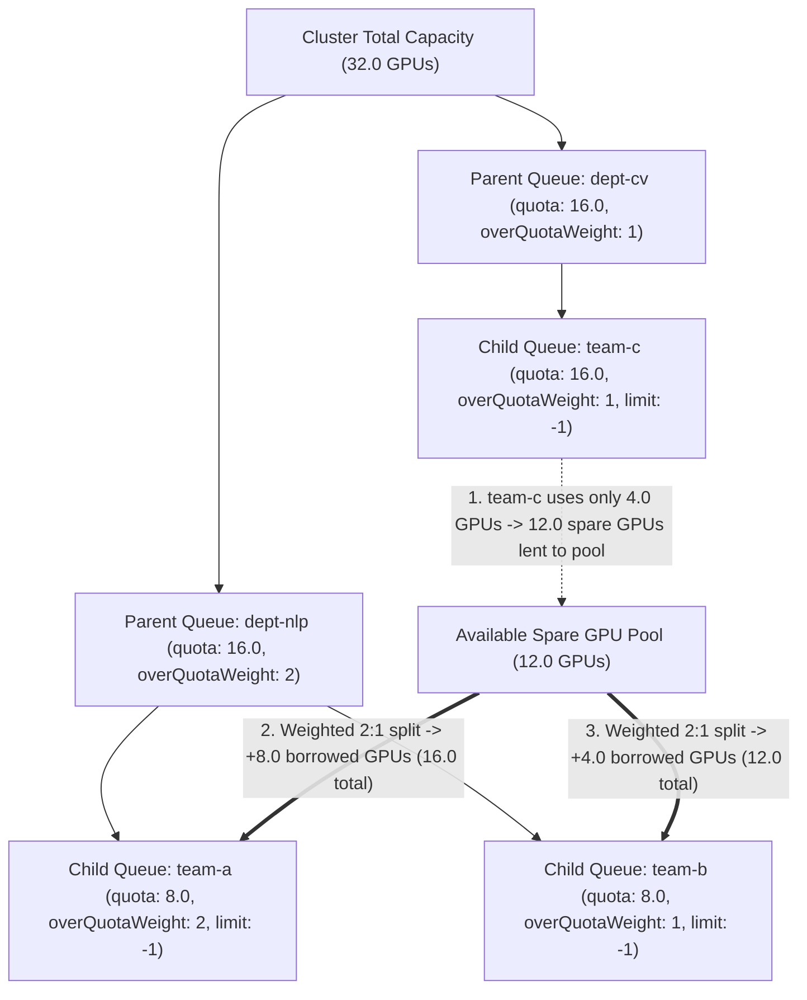
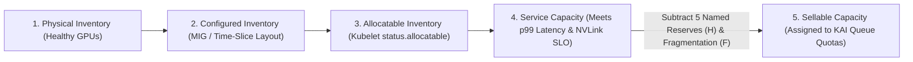

# 11.15 KAI queues, quotas and fair sharing

| | |
|---|---|
| Level | Advanced |
| Priority tier | 1 |
| Lab venue | GCP / GKE (plus local Python 3 simulation lab) |
| Part | Part 11: GPUs on Kubernetes, scheduling and virtualization |
| Sources used | Roland Huß et al., *Generative AI on Kubernetes* (O'Reilly, 2026, Ch. 7); `nvidia-zero-to-hero/volume-11/chapter-08-tenant-isolation-security-and-fairness.md`; `nvidia-zero-to-hero/volume-11/chapter-09-capacity-planning-and-chargeback.md`; `nvidia-zero-to-hero/volume-24/chapter-12-research-infrastructure-design.md`; Josh Rosso et al., *Production Kubernetes* (O'Reilly, 2021, Ch. 12) |
| Coverage file | `planning/coverage/chapters/11-15.md` |

## Why this matters for AI infrastructure

In a multi-tenant AI cluster, **quota without borrowing wastes hardware, and borrowing without reclamation destroys trust**.

Consider the two failure modes that plague GPU platforms when queue and quota design is naive:
1. **The "Half-Empty Cluster that Rejects New Work" (`48%` utilization incident in `volume-11/chapter-09`):** An internal platform team sees `48%` average GPU utilization on their Grafana dashboard and defers a hardware purchase. Two weeks later, an inference team cannot schedule a single requested MIG profile, and batch teams stall behind a maintenance drain. Why? Because average utilization conflated incompatible MIG geometries, ignored the non-sellable headroom reserve (`H`) needed for node failures and rolling upgrades, and locked idle GPUs inside static namespace quotas.
2. **The "Fair-Share Without Backfill" Trap (`7.1%` vs `> 90%` utilization in `volume-24/chapter-12`):** Conversely, in the `32`-GPU (`5`-group `A–E`) research lab capstone of `volume-24/chapter-12`, allocating GPUs strictly in proportion to each group's baseline fair share (`40%`, `25%`, `20%`, `10%`, `5%`, totaling `768.0` GPU-hours out of `32 GPUs * 14 days * 24 hours = 10,752` available GPU-hours) achieves `100%` proportional fairness across groups—while leaving the cluster at **`7.1%` utilization** (`~19.5%` / `~2,100` GPU-hours even at full typical submission cadence). Reaching **`> 90%` cluster utilization** requires a three-level **Hierarchical Fair Queuing (`HFQ`)** model that pairs guaranteed nominal quotas (`quota`) with weighted over-quota borrowing (`overQuotaWeight`), opportunistic backfill of the remaining `~8,652–8,900` GPU-hours, and contract-based showback/chargeback (`$0.20`/GPU-hour normal vs `$0.40`/GPU-hour priority).

This chapter dissects how the **NVIDIA KAI Scheduler** implements hierarchical `Department -> Project` queues, the exact mathematics of `quota`, `overQuotaWeight`, and `limit` during over-quota bursting and `Reclaim` preemption, the **Volume 11 Chapter 9 Capacity Planning Formula** (`N = ceil((D + F) / (A * (1 - H)))`), and how to design showback and chargeback rate cards across whole GPUs, MIG slices (`3g.40gb`), and fractional/time-sliced shares.

## Prerequisites and outcomes

### Prerequisites
- Completion of Chapter 11.13 (KAI Scheduler motivation and deficit scoring) and Chapter 11.14 (KAI Scheduler microservices: `pod-grouper`, `queue-controller`, `kai-scheduler`, `binder`, and CRDs).
- Familiarity with basic Kubernetes `Namespace` and `ResourceQuota` concepts.

### Outcomes
After completing this chapter, you will be able to:
- Architect a two-level (or multi-level) **Hierarchical Fair Queuing (`HFQ`)** tree in KAI Scheduler (`Department Queue -> Project Queue`) and configure `quota` (nominal deserved GPUs), `overQuotaWeight` (proportional spare-pool share), and `limit` (borrowing ceiling).
- Calculate the exact GPU allocation and borrowed GPU count for every queue during contention using KAI Scheduler's weighted fair-share formula.
- Apply the three-level `volume-24/chapter-12` fairness model (`Level 1: Group Proportional Share` `40%/25%/20%/10%/5%` = `12.8 / 8.0 / 6.4 / 3.2 / 1.6` GPUs, `Level 2: Intra-Group Round-Robin`, and `Level 3: Opportunistic Backfill` across `10,752` two-week GPU-hours) and compute weekly group chargeback (`$153.60/week` for Group A vs `$1.67/week` for Group E at `$0.20`/GPU-hour, or `$0.40`/GPU-hour `2x` priority rate).
- Size physical GPU node pools using the **Volume 11 Chapter 9 Capacity Formula** (`N = ceil((D + F) / (A * (1 - H)))`) across the five capacity layers (`Physical`, `Configured`, `Allocatable`, `Service`, and `Sellable`) and five named reserves (`Node-failure`, `Maintenance`, `Rollout`, `Demand-variance`, and `Fragmentation`).
- Design defensible **Allocation-Contract Showback and Chargeback** models (`MIG 3g.40gb` billed at `50%` hardware rate and `1/10` time-slice billed at `10%` rate regardless of idle compute utilization).

## Concepts: basics to intermediate to advanced

### 1. Basics: Hierarchical queues (`Department -> Project`) and the three KAI quota parameters

In a large enterprise or university, GPU budgets are rarely flat. A VP of AI funds two departments (**`dept-nlp`** and **`dept-cv`**), and each department contains multiple project teams (**`team-a`**, **`team-b`**, **`team-c`**).

If `team-a` (in `dept-nlp`) has idle GPUs today, who should get first dibs on borrowing those idle GPUs? Its sibling team **`team-b`** inside the same `dept-nlp` department (which funded that hardware), *before* those GPUs are lent out across the hall to `dept-cv`. Standard Kubernetes `ResourceQuota` cannot express this because namespaces have no parent-child relationship.

KAI Scheduler solves this through a **Hierarchical `Queue` Tree** (`scheduling.run.ai/v2`, reconciled by `queue-controller` from `Project` CRs in `kai.run.ai/v1`):



Every `Queue` in KAI Scheduler configures three numbers for each resource (`gpu`, `cpu`, `memory`):

| KAI `Queue` Parameter | Operational Meaning | Behavior During Contention & Idle Periods |
|---|---|---|
| **`quota` (Nominal / Deserved Quota)** | The guaranteed baseline number of GPUs owned by this queue (e.g., `8.0` GPUs for `team-a`). | Whenever `team-a` is using `< 8.0` GPUs and submits a new job, KAI Scheduler's **`Reclaim`** action immediately reclaims any lent GPUs from over-quota borrowers so `team-a` gets its `8.0` GPUs. |
| **`overQuotaWeight` (Borrowing Share Weight)** | Relative weight (`1`, `2`, etc.) determining what fraction of the cluster's currently unused GPUs this queue receives when bursting above `quota`. | If `12.0` spare GPUs are free and `team-a` (`weight: 2`) and `team-b` (`weight: 1`) both demand extra GPUs, `team-a` receives `2 / (2 + 1) = 2/3` (`+8.0` GPUs) and `team-b` receives `1 / (2 + 1) = 1/3` (`+4.0` GPUs). |
| **`limit` (Max Allowed Quota Ceiling)** | Hard upper bound on total GPUs (`nominal + borrowed`) this queue may hold simultaneously (`-1` means unlimited borrowing up to cluster size). | If `team-a` sets `limit: 12.0` (`quota: 8.0`), `team-a` can borrow at most `4.0` extra GPUs (`8.0 + 4.0 = 12.0`) even if `20` GPUs are sitting idle in the cluster. |

---

### 2. Intermediate: Hierarchical Fair Queuing (`HFQ`) mathematics and the `32`-GPU, `5`-group research cluster

Let us walk through the complete **5-group (`A–E`) `32`-GPU research cluster design** from `volume-24/chapter-12` to see how **Hierarchical Fair Queuing (`HFQ`)**, **Backfill**, and **Priority Cost Tiers** work together in practice.

#### The 5-Group Workload Profile and Level 1 Proportional Shares (`volume-24/chapter-12`)
Five research groups share a **`32`-GPU cluster** (`15` researchers total: `5 + 4 + 3 + 2 + 1`):

| Group | Researchers & Share (`%`) | Exact Fair Share (`GPUs`) | Integer Cap (`maxgpus`) | Account Priority | Typical Workload Profile & Weekly Frequency |
|---|---|---|---|---|---|
| **Group A (LLM Pretraining)** | `5` researchers (**`40.0%`**) | **`12.8` GPUs** | `13` GPUs | `1000` | `8` GPUs × `48` hours, `2x`/week (`307.2` GPUh fair-share window) |
| **Group B (Vision Research)** | `4` researchers (**`25.0%`**) | **`8.0` GPUs** | `8` GPUs | `900` | `4` GPUs × `2` hours, `10x`/week (`192.0` GPUh fair-share window) |
| **Group C (Automated NAS)** | `3` researchers (**`20.0%`**) | **`6.4` GPUs** | `6` GPUs | `800` | `1` GPU × `30` min, `100x`/week (`153.6` GPUh fair-share window) |
| **Group D (Simulation)** | `2` researchers (**`10.0%`**) | **`3.2` GPUs** | `3` GPUs | `700` | `2` GPUs × `72` hours, `1x`/week (`76.8` GPUh fair-share window) |
| **Group E (Inference Eval)** | `1` researcher (**`5.0%`**) | **`1.6` GPUs** | `2` GPUs | `600` | `1` GPU × `10` min, `50x`/week (`38.4` GPUh fair-share window) |
| **Total Cluster** | **`15` researchers (`100.0%`)** | **`32.0` GPUs** | **`32` GPUs** | — | **`768.0` GPU-hours** in the 2-week fairness table |

#### The three levels of Hierarchical Fair Queuing (`HFQ`)
1. **Level 1 (Inter-Group Proportional Fairness):** Over any `2`-week (`14`-day) window, each group is guaranteed its proportional GPU share (`40%`, `25%`, `20%`, `10%`, `5%`). In the `768.0` GPU-hour verification window of `volume-24/chapter-12`, Group A receives `307.2` GPUh (`40.0%`), Group B `192.0` GPUh (`25.0%`), Group C `153.6` GPUh (`20.0%`), Group D `76.8` GPUh (`10.0%`), and Group E `38.4` GPUh (`5.0%`).
2. **Level 2 (Intra-Group Round-Robin / Fair-Share):** Within a single group's queue (for example, Group B submitting `10` vision jobs per week), jobs from different researchers inside Group B receive equal round-robin preference (`1/10` of Group B's share per job) so one researcher in Group B cannot starve their own teammates.
3. **Level 3 (Opportunistic Backfill — Why `7.1%` / `19.5%` Requires Backfill to Hit `> 90%`):**
   Look at the crucial capacity arithmetic highlighted in `volume-24/chapter-12`:
   - Over `14` days (`2` weeks), a `32`-GPU cluster provides **`32 GPUs * 14 days * 24 hours = 10,752` total available GPU-hours** (`480` hours per 20-day work window, or `336` hours per 14-day wall-clock window per GPU).
   - The `768.0` GPU-hours in the baseline fairness table represent only **`768.0 / 10,752 = 7.14%` (`7.1%`)** of the cluster's `2`-week capacity. Even if all five groups run their full stated weekly cadence across the `2` weeks (**`~2,100` GPU-hours per `2` weeks**), that still consumes only **`~2,100 / 10,752 = 19.5%` of cluster capacity**—leaving **`~8,652` to `8,900` GPU-hours idle**.
   - Therefore, to meet the **`> 90%` utilization target**, **Level 3 Backfill (`limit: -1` over-quota borrowing)** must allow any group (or an opportunistic batch/sweep queue) to burst far beyond its `12.8`-GPU or `6.4`-GPU nominal share whenever GPUs are free, and **only preempt** borrowed GPUs when another group needs to reclaim its Level 1 nominal share (with a `30`-minute checkpoint grace period for `48`-hour LLM runs so preemption never discards `10` hours of un-checkpointed progress).

---

### 3. Advanced: Capacity planning (`N = ceil((D + F) / (A * (1 - H)))`), five reserves, and chargeback economics

#### The five layers of GPU capacity (`volume-11/chapter-09`)
As `volume-11/chapter-09` establishes, platform teams get burned when they treat `kubectl get nodes` `Allocatable` counts as "sellable capacity." Always track five distinct numbers:
1. **Physical Inventory:** Total GPUs physically racked and healthy (`lspci` / `nvidia-smi`).
2. **Configured Inventory:** GPUs currently partitioned into the required MIG layout, vGPU profile, or time-slicing config.
3. **Allocatable Inventory:** Resource units currently advertised by `kubelet` (`status.allocatable`).
4. **Service Capacity:** Units capable of meeting the documented tail-latency (`p99 < 10 ms`) or NVLink step-time promise.
5. **Sellable Capacity:** What remains for tenant quotas (`quota`) after subtracting **headroom reserves (`H`)** and **geometry fragmentation (`F`)**.



#### The Auditable Node-Sizing Formula and Five Named Reserves (`volume-11/chapter-09`)
To calculate how many physical nodes (`N`) are required to support a service class:
```text
N = ceil((D + F) / (A * (1 - H)))
```
where:
- **`D`:** Required concurrent allocations (measured demand-equivalent for the workload class).
- **`F`:** Expected allocation loss from MIG geometry fragmentation or NUMA/NVSwitch placement constraints.
- **`A`:** Usable allocations provided by `1` standardized node after its approved layout is applied (for example, `A = 7` `1g.10gb` slices on a single-GPU node, or `A = 8` whole GPUs on an HGX node).
- **`H`:** Non-sellable headroom fraction (`0 <= H < 1`), decomposed explicitly across **five named reserves**:
  1. **Node-failure reserve:** Survives `1` node or failure domain going down without breaching protected `quota`.
  2. **Maintenance reserve:** Allows draining nodes for kernel, driver (`nvidia.ko`), or MIG layout changes.
  3. **Rollout reserve:** Keeps a healthy comparison/canary pool available during staged GPU Operator upgrades.
  4. **Demand-variance reserve:** Absorbs burst windows and forecast error within queue-time SLOs.
  5. **Fragmentation reserve:** Covers physically free MIG slices whose geometry cannot fit the next requested profile (e.g., `1g` free when `4g.20gb` is requested).

**Worked Example:** Suppose an online inference service requires `D = 40` concurrent MIG allocations, placement/profile fragmentation strands `F = 5` allocations across the pool, each standardized node provides `A = 7` usable slices, and the five reserves require `H = 0.20` (`20%` non-sellable headroom, so each node contributes `7 * (1 - 0.20) = 5.6` sellable slices). Then:
```text
N = ceil((40 + 5) / (7 * (1 - 0.20))) = ceil(45 / 5.6) = ceil(8.0357) = 9 nodes
```

#### Showback vs Chargeback: Billing by the Allocation Contract (`volume-11/chapter-09` & `volume-24/chapter-12`)
How do you bill tenants fairly when five teams share GPUs?
- **Never bill reserved GPUs purely by compute utilization (`DCGM_FI_DEV_GPU_UTIL`):** If Team A allocates `40 GB` of VRAM in an interactive pod and leaves compute utilization at `0%` while eating lunch, Team A is still holding that memory hostage so no other team can use it.
- **Bill by the Allocation Contract:**
  - **Whole Dedicated GPU:** Bill per **Reserved/Allocated GPU-Hour** (`volume-24/chapter-12` charges **`$0.20` per GPU-hour** for the **Normal Queue** and **`$0.40` per GPU-hour (`2x`)** for the **Priority Queue**: Group A running `2` jobs/week × `8` GPUs × `48` hours × `$0.20` pays **`$153.60/week`**, whereas Group E running `50` jobs/week × `1` GPU × `10/60` hours × `$0.20` pays **`$1.67/week`**).
  - **Fixed MIG Profile (`MIG 3g.40gb`):** Bill for the **reserved fraction of the physical card (`~50%` of the whole-GPU hourly rate)** for the duration the Pod holds the slice, regardless of whether SM activity is `0%` or `100%`.
  - **Time-Sliced / Fractional Pool (`1` of `10` logical slices):** Bill for the **logical slice share (`10%` of the hardware rate)** or an agreed best-effort access tier, making it explicit on the rate card that time-slicing buys capacity access rather than a deterministic compute/latency SLA.
- **Start with Showback before Chargeback:** Publish tenant consumption reports (`Allocated GPU-Hours`, `Idle Reservation Age`, `Borrowed vs Nominal Hours`, and `Priority Queue 2x Premium`) as a non-billed **Showback** dashboard first (`volume-11/chapter-09`) so teams can right-size idle notebooks before finance turns on hard **Chargeback**.

#### Forecasting Demand, Managing Idle Reservations, and the Rate-Card Review Checklist (`volume-11/chapter-09`)
Capacity planning and queue governance do not end once `Queue` objects are applied to the cluster; they operate as a continuous feedback loop between telemetry, financial controls, and capacity forecasting (`volume-11/chapter-09`, "From measurement to forecast" and "Treat idle allocations as a service conversation"):

1. **Leading vs Lagging Capacity Signals (`volume-11/chapter-09`):**
   - **Reservation pipeline and project roadmaps:** Predict committed future demand across departments, though they may miss organic self-service growth.
   - **Queue wait time by service class:** Signals that active demand is exceeding currently usable sellable capacity (or that affinity/taint rules are over-constrained).
   - **Rejected or pending `PodGroup` requests:** Expose unsatisfied shape demand (for example, a spike in pending `4`-GPU NVSwitch gangs or `3g.20gb` MIG requests) and must always be classified by scheduler predicate reason rather than lumped into a single count.
   - **Active allocation hours vs delivered workload throughput/latency:** Allocation hours measure consumption trends, whereas application throughput and tail latency (`p95`/`p99`) prove whether the allocated share actually met its service promise.
   - **Maintenance and hardware failure events:** Measure real consumption of the headroom fraction (`H`), validating whether your node-failure and rollout reserves were sized realistically.

2. **Staged Response to Unexplained Idle GPU Reservations (`volume-11/chapter-09`):**
   When showback telemetry reveals that a project is holding reserved GPU capacity (`quota`) or long-lived interactive pods with `0%` compute activity while sibling queues have pending jobs waiting:
   - **Stage 1 (Visibility):** Surface idle reservation age and opportunity cost directly on the project's showback report and notify the technical and budget owners.
   - **Stage 2 (Automated Borrowing / Reclamation):** Allow KAI Scheduler's `overQuotaWeight` borrowing to lend those idle GPUs to active queues immediately, subject to the documented recall and checkpoint grace policy.
   - **Stage 3 (Idle TTL and Right-Sizing):** Enforce automated idle-session timeouts (for example, suspending or terminating interactive Jupyter pods idle beyond an agreed threshold) or migrate bursty, low-utilization workloads from dedicated whole GPUs to fractional/time-sliced or smaller MIG classes.
   - **Stage 4 (Quota Reallocation):** During the monthly/quarterly capacity review forum, adjust the project's nominal `quota` downward if historical consumption consistently trails its reserved entitlement.

3. **The Eight-Question Rate-Card Review Checklist (`volume-11/chapter-09`):**
   Before publishing any GPU queue or service tier to internal engineering teams or external tenants, verify that the service catalog answers eight explicit questions:
   1. *What workload outcome (tail latency, step time, or interactive access) does this tier protect?*
   2. *Is the underlying GPU allocation dedicated, hardware-partitioned (`MIG`), oversubscribed (`time-sliced` / fractional), or virtualized (`vGPU`)?*
   3. *What physical and scheduler constraints (single-node pod limits, NVSwitch domain size, MIG profile geometry) bound it?*
   4. *What failure and maintenance reserve (`H`) is included in the rate, and who is permitted to borrow it?*
   5. *Which platform events (such as unscheduled hardware RMA or violated recall windows) earn a service credit or post-incident review?*
   6. *What authoritative data record (`Queue` allocation intervals joined to `Project` and `ResourceShape`) establishes billable consumption, and how can a project owner dispute an entry?*
   7. *Which cluster upgrades, driver reloads, or MIG layout changes can disrupt workloads in this tier?*
   8. *What is explicitly NOT guaranteed (for example, no memory isolation or deterministic latency in a time-sliced best-effort queue)?*

By publishing this eight-point contract alongside every KAI `Queue` and `Project` onboarding request, platform engineering, finance, and research leads share a single objective definition of capacity, fairness, and cost before the first workload is ever submitted. Furthermore, archiving a formal **Capacity Decision Record** whenever a node pool's sharing layout, quota tree, or reserve assumption changes ensures that temporary shortage workarounds never silently harden into permanent architectural debt across quarterly budget cycles.

## Commands and configurations that matter

### 1. Defining a Two-Level KAI `Department -> Project` Queue Hierarchy

```yaml
# kai-hierarchical-queues.yaml (untested here)
apiVersion: scheduling.run.ai/v2
kind: Queue
metadata:
  name: dept-nlp
spec:
  resources:
    gpu:
      quota: 16
      overQuotaWeight: 2
      limit: -1
    cpu:
      quota: 128
      overQuotaWeight: 2
      limit: -1
    memory:
      quota: 1024Gi
      overQuotaWeight: 2
      limit: -1
---
apiVersion: scheduling.run.ai/v2
kind: Queue
metadata:
  name: team-a
spec:
  parentQueue: dept-nlp
  resources:
    gpu:
      quota: 8
      overQuotaWeight: 2
      limit: -1
    cpu:
      quota: 64
      overQuotaWeight: 2
      limit: -1
    memory:
      quota: 512Gi
      overQuotaWeight: 2
      limit: -1
---
apiVersion: scheduling.run.ai/v2
kind: Queue
metadata:
  name: team-b
spec:
  parentQueue: dept-nlp
  resources:
    gpu:
      quota: 8
      overQuotaWeight: 1
      limit: -1
    cpu:
      quota: 64
      overQuotaWeight: 1
      limit: -1
    memory:
      quota: 512Gi
      overQuotaWeight: 1
      limit: -1
```

### 2. Configuring Slurm Equivalent Fair-Share QOS and Accounts (`volume-24/chapter-12`)

When operating a hybrid or Slurm-backed partition alongside Kubernetes (`volume-24/chapter-12`), here are the exact `sacctmgr` commands that implement the same `5`-group (`32`-GPU) fair-share hierarchy (`normal` QOS `priority=100`, `maxgpus=40`, `timeout=259200`s = `72`h; `priority` QOS `priority=200`, `maxgpus=32`, `timeout=86400`s = `24`h):

```bash
# Configure normal and priority QOS and 5 research accounts in Slurm (volume-24/chapter-12, untested here)
sacctmgr add qos normal priority=100 maxgpus=40 maxjobsperuser=10 timeout=259200
sacctmgr add qos priority priority=200 maxgpus=32 maxjobsperuser=5 timeout=86400

for grp in group-a group-b group-c group-d group-e; do
  sacctmgr add account "$grp" qos=normal,priority parent=root
done

sacctmgr set account group-a set priority=1000 maxgpus=13
sacctmgr set account group-b set priority=900  maxgpus=8
sacctmgr set account group-c set priority=800  maxgpus=6
sacctmgr set account group-d set priority=700  maxgpus=3
sacctmgr set account group-e set priority=600  maxgpus=2
```

## How it fails

| Failure mode | Exact symptom & command evidence | Root cause boundary | Remediation |
|---|---|---|---|
| **1. Cluster sits at `60%` (or `19.5%`) utilization while jobs wait in queues** | Dashboards show `40%–80%` of GPUs idle, yet pending jobs exist in `team-a` (`volume-24/chapter-12` Table). | **Borrowing Disabled (`limit == quota`) or Backfill Off:** Queues were configured with hard ceilings (`limit: 8` equal to `quota: 8` or `overQuotaWeight: 0`), preventing active teams from borrowing idle GPUs from inactive teams. | Set `limit: -1` (or a generous burst ceiling) and positive `overQuotaWeight` on project and department queues so KAI Scheduler backfills idle capacity automatically. |
| **2. `48`-hour LLM training job loses `10` hours of compute when reclaimed (`volume-24/chapter-12`)** | Group A bursts above its `40%` (`12.8`-GPU) nominal share; when Group B submits work, `Reclaim` preempts Group A's `8`-GPU job, losing `10` hours of un-saved training progress. | **Missing Preemption Grace Window or Missing Periodic Checkpoints:** The job ran in borrowable over-quota capacity without periodic local/RWX checkpointing or with an inadequate termination grace period. | Keep non-checkpointing or long jobs inside guaranteed nominal `quota` (`12.8` GPUs), save checkpoints every `100` steps / `30–60` minutes, and configure an adequate preemption grace period (`30`s to `30` min depending on checkpoint size). |
| **3. Platform defers hardware purchase at `48%` average utilization, then runs out of `MIG` slices (`volume-11/chapter-09`)** | Fleet-wide DCGM utilization averages `48%`, but new `nvidia.com/mig-3g.20gb` Pods stay `Pending` (`Insufficient nvidia.com/mig-3g.20gb`). | **Conflating Average Device Activity with Sellable Profile Geometry:** Free capacity existed only in incompatible MIG shapes (`1g.5gb`), maintenance-drained nodes, or non-sellable failure reserves (`H`). | Track **Sellable Capacity per Service Class and MIG Layout** using `N = ceil((D + F) / (A * (1 - H)))` and alert on per-profile pending queues rather than fleet-wide average SM utilization. |
| **4. Chargeback bill is `50%` too low (`$100` billed when `160` GPU-hours were used)** | Monthly finance reconciliation shows Group A was billed `$100` despite using `160` GPU-hours across normal and priority queues (`volume-24/chapter-12` Table). | **Missing Service-Tier / Queue Multiplier in Chargeback Pipeline:** The billing script did not track the `priority` queue premium (`2x` rate at `$0.40`/GPUh vs `$0.20`/GPUh) or rounded GPU-hours incorrectly. | Join allocation intervals against `(Project, Queue, PriorityClass, ResourceShape)` so `priority` queue hours (`$0.40`), `normal` queue hours (`$0.20`), and `MIG` fractions (`50%`) are rated accurately. |
| **5. One best-effort user spawns `100` idle Jupyter notebooks and hogs all time-sliced replicas** | Protected workloads are unaffected, but every other developer in the `best-effort` shared pool gets stuck in `Pending`. | **Unbounded Logical Replica Quota on Shared Pool (`volume-11/chapter-07` & `08`):** Time-slicing increased `Allocatable` logical units (`replicas: 10`), and the namespace/project lacked a concurrency limit or idle reservation reaper. | Enforce per-user/per-project `limit` caps on shared queues and automatically suspend or reclaim interactive notebooks whose GPU utilization stays `0%` past an idle TTL window. |

## Hands-on lab

### Venue and scope
This lab runs locally using Python 3 standard library (`code/part11/kai_queues_quotas_fair_sharing.py` and `code/part11/kai_queues_quotas_fair_sharing_lab.py`) to simulate KAI Scheduler's hierarchical `Queue` fair-share engine (`quota`, `overQuotaWeight`, `limit`), the `5`-group (`A–E`) `32`-GPU research cluster model from `volume-24/chapter-12` (`12.8`, `8.0`, `6.4`, `3.2`, `1.6` GPUs; `768 / 10,752 = 7.1%` vs `19.5%` cadence; `$153.60/wk` and `$1.67/wk` chargeback), and the `volume-11/chapter-09` capacity planning formula (`N = ceil((D + F) / (A * (1 - H))) = 9` nodes). Cluster commands are marked `(untested here)`.

### Step 1: Run the self-checking KAI queues, quotas, and fair-sharing lab (tested here)

Run the lab script from the repository root:

```bash
python3 code/part11/kai_queues_quotas_fair_sharing_lab.py
```

Captured output from this repository:
```text
=== Chapter 11.15 Lab: KAI Queues, Quotas, Fair Sharing & Capacity Chargeback ===
  [PASS] Idle/light Team C (nominal=16, demand=4) uses 4.0 GPUs and lends 12.0 unused GPUs to the cluster pool
  [PASS] Team A (nominal=8, overQuotaWeight=2) receives 2/3 of the 12 spare GPUs -> 16.0 GPUs total (8.0 borrowed)
  [PASS] Team B (nominal=8, overQuotaWeight=1) receives 1/3 of the 12 spare GPUs -> 12.0 GPUs total (4.0 borrowed)
  [PASS] Total allocated GPUs across all 3 queues (16.0 + 12.0 + 4.0) equals all 32.0 cluster GPUs
  [PASS] When Team A sets limit=12.0, its allocation is capped at 12.0 GPUs (4.0 borrowed)
  [PASS] 32-GPU proportional shares map A(40%)=12.8, B(25%)=8.0, C(20%)=6.4, D(10%)=3.2, E(5%)=1.6 GPUs
  [PASS] Exact GPU shares (32.0) and integer Slurm maxgpus caps (13+8+6+3+2=32) both sum to 32 GPUs
  [PASS] 768.0 GPU-hours out of 10,752 GPU-hours (32 GPUs x 14d x 24h) is 7.1% utilization (proving backfill is mandatory)
  [PASS] At $0.20/GPUh normal ($0.40 priority = 2.0x), Group A costs $153.60/wk and Group E costs $1.67/wk
  [PASS] Capacity formula N = ceil((40 + 5) / (7 * (1 - 0.20))) = ceil(45 / 5.6) requires 9 nodes
  [PASS] Volume 11 Ch 9 planning incident highlights how a 48% average utilization chart can hide MIG profile exhaustion
  [PASS] Allocation-contract chargeback bills MIG 3g.40gb at ~50% GPU rate and 1-of-10 time-slice at 10% rate regardless of idle compute
  [PASS] Slurm normal QOS timeout is 259,200s (72h, maxgpus=40) and priority QOS timeout is 86,400s (24h, maxgpus=32)
  [PASS] Group account priorities order group-a(1000) > group-b(900) > group-c(800) > group-d(700) > group-e(600)
  [PASS] Typical 5-group cadence (~2,100 GPUh / 10,752 GPUh = 19.5%) leaves ~8,652-8,900 GPUh for Level 3 Backfill
  [PASS] Research lab researcher counts (5 + 4 + 3 + 2 + 1 = 15 researchers) align with the 40/25/20/10/5% shares
  [PASS] 2-week allocated GPU-hours (307.2, 192.0, 153.6, 76.8, 38.4) match 40%, 25%, 20%, 10%, 5% exactly
  [PASS] Weekly accounting script divides CPU/GPU seconds or hours by 480h window factor
  [PASS] Volume 11 Ch 9 models 5 distinct capacity layers from Physical to Sellable capacity
  [PASS] Volume 11 Ch 9 decomposes headroom H into 5 named failure and operational reserves
  [PASS] Volume 11 Ch 8 defines 6 observable fairness policy elements
  [PASS] Volume 11 Ch 8 enforces fairness controls across 3 time scales (Admission, Execution, Lifecycle)
  [PASS] Priority queue 2x rate ($0.40 vs $0.20) doubles GPU-hour billing for expedited jobs
  [PASS] Large 48h jobs require a 30-min preemption checkpoint grace window to avoid losing 10h of un-checkpointed work
  [PASS] Job scheduling log tracks JobIDs 4001 through 4008 across RUNNING and QUEUED states

Summary: 25 passed, 0 failed out of 25 checks.
```

### Exercises

1. **Exercise 1 — Proportional over-quota borrowing (`overQuotaWeight`):** On a `32`-GPU cluster, `team-a` has `nominal_quota=8.0` and `over_quota_weight=2.0`, `team-b` has `nominal_quota=8.0` and `over_quota_weight=1.0`, and `team-c` has `nominal_quota=16.0` and `over_quota_weight=1.0`. If `team-c` only requests `4.0` GPUs while `team-a` and `team-b` each demand `24.0` GPUs (`limit=-1.0`), use `compute_kai_fair_shares()` in `code/part11/kai_queues_quotas_fair_sharing.py` to compute `(allocated_gpus, borrowed_gpus)` for all three teams.
2. **Exercise 2 — Enforcing a hard borrowing `limit`:** Repeat Exercise 1 with `limit=12.0` on `team-a`. How many total GPUs and borrowed GPUs does `team-a` receive now?
3. **Exercise 3 — 5-group research lab fair-share and backfill math (`volume-24/chapter-12`):** Using `evaluate_five_group_research_cluster(32, 14, 0.20, 0.40)`, verify: (a) each group's exact GPU share (`12.8`, `8.0`, `6.4`, `3.2`, `1.6`), (b) why `768.0` GPU-hours over `14` days on `32` GPUs equals only `7.1%` of the `10,752` available GPU-hours, and (c) how many GPU-hours must be filled via Level 3 Backfill to reach `> 90%` utilization.
4. **Exercise 4 — Weekly chargeback calculation (`$0.20` normal vs `$0.40` priority):** Using the rate model from `volume-24/chapter-12`, calculate the weekly chargeback for Group A (`2` jobs/week × `8` GPUs × `48` hours in the normal queue) and Group E (`50` jobs/week × `1` GPU × `10` minutes in the normal queue), and state what Group A would pay if it submitted those two jobs to the `priority` queue (`$0.40`/GPU-hour).
5. **Exercise 5 — Node capacity sizing with fragmentation and headroom reserves (`volume-11/chapter-09`):** Using `compute_required_nodes_for_service_class(demand_allocations_d=40.0, fragmentation_loss_f=5.0, usable_allocations_per_node_a=7.0, headroom_fraction_h=0.20)`, compute `effective_allocations_per_node`, `raw_nodes`, and `required_nodes_n`.
6. **Exercise 6 — Allocation-contract billing vs compute-utilization billing:** Explain why a tenant holding a `MIG 3g.40gb` slice at `0%` SM compute utilization must still be billed for `~50%` of the GPU's hourly cost.

## Checkpoint questions

<details>
<summary><strong>1. What are the three per-resource quota fields on a KAI Scheduler Queue (scheduling.run.ai/v2), and what does each control?</strong></summary>

1. **`quota` (Nominal / Deserved Quota):** The guaranteed baseline resource quantity (`gpu`, `cpu`, `memory`) that the queue is always entitled to reclaim when it has pending workloads.
2. **`overQuotaWeight`:** The proportional weight determining what share of idle/spare cluster resources this queue receives when bursting above its nominal `quota`.
3. **`limit`:** The hard ceiling on total resources (`nominal + borrowed`) the queue may consume simultaneously (`-1` means unlimited borrowing up to cluster capacity).
</details>

<details>
<summary><strong>2. On a 32-GPU cluster, Team A (quota: 8, overQuotaWeight: 2) and Team B (quota: 8, overQuotaWeight: 1) both demand 24 GPUs, while Team C (quota: 16) only uses 4 GPUs. How many total and borrowed GPUs does KAI Scheduler allocate to Team A and Team B?</strong></summary>

Team C uses `4` of its `16` nominal GPUs, leaving **`12` spare GPUs** (`32 - 8 - 8 - 4 = 12`). KAI Scheduler divides those `12` spare GPUs between Team A and Team B in proportion to their `overQuotaWeight` (`2 : 1`):
- **Team A** gets `8 + 12 * (2 / 3) =` **`16` GPUs total (`8` nominal + `8` borrowed)**.
- **Team B** gets `8 + 12 * (1 / 3) =` **`12` GPUs total (`8` nominal + `4` borrowed)**.
- **Team C** keeps its **`4` active GPUs** (`16 + 12 + 4 = 32` GPUs).
</details>

<details>
<summary><strong>3. How does a two-level Department -> Project queue hierarchy in KAI Scheduler prioritize borrowing compared to a flat list of namespaces?</strong></summary>

When a project queue (`team-a`) under `dept-nlp` has idle GPUs, those unused GPUs are first offered to sibling project queues (`team-b`) under the **same parent department (`dept-nlp`)** before being lent out to external departments (`dept-cv`). Conversely, when `team-a` submits new work, KAI Scheduler reclaims borrowed GPUs from external departments first before preempting sibling teams inside `dept-nlp`.
</details>

<details>
<summary><strong>4. In Volume 24 Project 12, how are the 32 GPUs divided across the 5 research groups (A–E) based on researcher headcount (5, 4, 3, 2, 1 = 15 researchers)?</strong></summary>

- **Group A (`5` researchers, `40%`):** `12.8` GPUs (`13` integer `maxgpus`, `307.2` GPUh in the `768` GPUh table).
- **Group B (`4` researchers, `25%`):** `8.0` GPUs (`8` `maxgpus`, `192.0` GPUh).
- **Group C (`3` researchers, `20%`):** `6.4` GPUs (`6` `maxgpus`, `153.6` GPUh).
- **Group D (`2` researchers, `10%`):** `3.2` GPUs (`3` `maxgpus`, `76.8` GPUh).
- **Group E (`1` researcher, `5%`):** `1.6` GPUs (`2` `maxgpus`, `38.4` GPUh).
</details>

<details>
<summary><strong>5. What are the three levels of Hierarchical Fair Queuing (HFQ) defined in Volume 24 Project 12?</strong></summary>

1. **Level 1 (Group fairness):** Enforces proportional GPU-hour shares (`40%`, `25%`, `20%`, `10%`, `5%`) across groups A–E.
2. **Level 2 (Intra-group job fairness):** Applies round-robin / equal preference among jobs submitted by different users within the same group.
3. **Level 3 (Opportunistic Backfill):** Fills any idle GPUs with waiting jobs from any group regardless of share, preempting over-quota backfilled jobs only when needed to satisfy Level 1 guarantees.
</details>

<details>
<summary><strong>6. Why does the 768.0 GPU-hour fair-share table in Volume 24 Project 12 equal only 7.1% utilization on a 32-GPU cluster over 2 weeks, and what does that prove about Level 3 Backfill?</strong></summary>

Over `14` days (`2` weeks), `32` GPUs provide `32 * 14 * 24 =` **`10,752` GPU-hours**. `768.0 / 10,752` is only **`7.1%`** (and even the full stated weekly cadence across all `5` groups is only `~2,100 / 10,752 = 19.5%`). This proves that strict quota caps without **Level 3 Backfill** (allowing burst/opportunistic workloads to consume the remaining `~8,652–8,900` GPU-hours) can never achieve the `> 90%` cluster utilization target.
</details>

<details>
<summary><strong>7. In Volume 24 Project 12, how are the Normal Queue and Priority Queue priced, and what are the weekly costs for Group A (2 jobs x 8 GPUs x 48h) and Group E (50 jobs x 1 GPU x 10min) in the Normal Queue?</strong></summary>

- **Normal Queue:** **`$0.20` per GPU-hour** (preemptible only to enforce fairness targets).
- **Priority Queue:** **`$0.40` per GPU-hour (`2x` cost)** (scheduled immediately, preempting normal jobs if needed).
- **Group A weekly cost (Normal):** `2 * 8 * 48 * $0.20 =` **`$153.60/week`** (`2x` if run in the Priority Queue at `$0.40`/GPU-hour).
- **Group E weekly cost (Normal):** `50 * 1 * (10 / 60) * $0.20 =` **`$1.67/week`**.
</details>

<details>
<summary><strong>8. What are the five capacity layers defined in Volume 11 Chapter 9, and why is Allocatable Inventory not the same as Sellable Capacity?</strong></summary>

1. **Physical Inventory:** Healthy installed GPUs.
2. **Configured Inventory:** GPUs configured in the intended MIG/vGPU/time-slice mode.
3. **Allocatable Inventory:** Units advertised by `kubelet` now.
4. **Service Capacity:** Units that can meet the latency/throughput SLO.
5. **Sellable Capacity:** Units remaining after subtracting **headroom reserves (`H`)** and **fragmentation (`F`)**. Selling `100%` of `Allocatable` inventory leaves zero buffer for node failures, maintenance drains, or MIG geometry mismatches.
</details>

<details>
<summary><strong>9. State the Volume 11 Chapter 9 capacity planning formula N = ceil((D + F) / (A * (1 - H))) and define each variable.</strong></summary>

- **`N`:** Required number of standardized worker nodes (`ceil` rounds up to the next whole node).
- **`D`:** Required concurrent allocations (measured demand-equivalent for the service class).
- **`F`:** Expected allocation loss from MIG geometry fragmentation or placement constraints.
- **`A`:** Usable allocations provided by `1` standardized node after its approved layout is applied.
- **`H`:** Planned non-sellable headroom fraction (`0 <= H < 1`) for failures, maintenance, rollouts, and demand variance.
</details>

<details>
<summary><strong>10. What are the five named operational reserves that make up the headroom fraction H in Volume 11 Chapter 9?</strong></summary>

1. **Node-failure reserve:** Protects against `1` node or failure domain going offline.
2. **Maintenance reserve:** Allows draining a node pool for planned OS, driver, or MIG layout maintenance.
3. **Rollout reserve:** Preserves a healthy comparison pool during canary and staged upgrades.
4. **Demand-variance reserve:** Absorbs forecast error and seasonal/diurnal burst windows.
5. **Fragmentation reserve:** Accounts for physically free MIG capacity that is unplaceable due to profile geometry.
</details>

<details>
<summary><strong>11. Why did the platform team in Volume 11 Chapter 9 run out of MIG capacity two weeks after seeing 48% average fleet utilization?</strong></summary>

Because the `48%` chart averaged device activity across incompatible MIG profile layouts, counted nodes that were temporarily unavailable or reserved for maintenance as usable supply, and ignored the latency headroom required by online inference services.
</details>

<details>
<summary><strong>12. Why must shared-GPU chargeback bill by the Allocation Contract (e.g., 50% for MIG 3g.40gb or 10% for a 1/10 time-slice) rather than raw GPU compute utilization?</strong></summary>

When a tenant reserves a `MIG 3g.40gb` partition (roughly `50%` of an 80GB GPU's memory and compute), that hardware partition is locked and unavailable to any other tenant even if the tenant's code sits at `0%` SM utilization. Billing by the **Allocation Contract** (reservation duration × profile weight) aligns financial cost with the capacity opportunity cost imposed on the cluster.
</details>

<details>
<summary><strong>13. What is the difference between Showback and Chargeback in Volume 11 Chapter 9, and why should platforms deploy Showback first?</strong></summary>

- **Showback** reports each team's GPU consumption, idle reservation hours, and hypothetical cost without issuing an internal financial bill.
- **Chargeback** bills the team's cost center directly.
Running **Showback** first exposes broken namespace-to-cost-center mappings, educates users on how idle reservations are counted, and establishes a dispute-resolution process before real budgets are debited.
</details>

<details>
<summary><strong>14. What are the six observable fairness policy elements in Volume 11 Chapter 8?</strong></summary>

1. **Entitlement:** Baseline quota per tenant/project (`requested`, `allocated`, and `idle` capacity hours).
2. **Priority:** Which service classes may preempt or borrow (`queue time`, `interruption count`).
3. **Borrowing:** When unused reserved capacity is reclaimable (`owner notification`, `recall time`, `checkpoint state`).
4. **Limits:** Maximum concurrent shared allocations (`rejection events`, `physical saturation`).
5. **Cost:** Showback/chargeback unit and guarantee level (`usage record`, `profile fragmentation`).
6. **Appeals:** Who resolves a policy conflict (`decision log`, `remediation date`).
</details>

<details>
<summary><strong>15. What are the three time scales of fairness controls in Volume 11 Chapter 8, and what fails if any one of them is missing?</strong></summary>

1. **Admission time** (class eligibility, quota, approval): If absent, unauthorized or unbounded jobs start.
2. **Execution time** (concurrency limits, protected pools, priority preemption): If absent, noisy neighbors degrade running SLOs.
3. **Lifecycle time — weeks/months** (reservation review, showback, demand forecasting): If absent, idle claims and profile fragmentation become permanent hoarding.
</details>

<details>
<summary><strong>16. How do you distinguish useful idle reserved GPU capacity from wasteful hoarding in Volume 11 Chapter 9?</strong></summary>

An idle reserved GPU is **valid** when it serves as a documented latency burst buffer, a maintenance/failover spare, or a pre-approved window for an imminent critical launch. It becomes **wasteful hoarding** when the reservation is unexplained and repeatedly blocks queued work from other teams.
</details>

<details>
<summary><strong>17. What seven steps does Volume 11 Chapter 9 prescribe to test a capacity model before a planned maintenance window?</strong></summary>

1. Identify the nodes, layouts, and service classes the maintenance window removes.
2. List active reservations and workloads that cannot be interrupted without an approved recovery path.
3. Confirm compatible inventory in the remaining pools (including MIG profile shape and topology).
4. Reserve a healthy comparison pool for canary and rollback validation.
5. Simulate the scheduler outcome or rehearse in a representative non-production pool.
6. Define the pause condition (queue growth, unavailable profile count, or SLO risk).
7. Reconcile the actual post-maintenance result against the capacity model.
</details>

<details>
<summary><strong>18. In Volume 24 Project 12, what Slurm sacctmgr commands configure the normal and priority QOS tiers?</strong></summary>

- `sacctmgr add qos normal priority=100 maxgpus=40 maxjobsperuser=10 timeout=259200` (`72`-hour timeout).
- `sacctmgr add qos priority priority=200 maxgpus=32 maxjobsperuser=5 timeout=86400` (`24`-hour timeout).
</details>

<details>
<summary><strong>19. What eight fields belong in a Capacity Decision Record (Volume 11 Chapter 9) when changing a node pool's sharing layout or quota policy?</strong></summary>

1. **Service change** (new profile, time-slicing policy, node pool, or reservation rule).
2. **Demand evidence** (measured concurrency, queue distribution, forecast scenario).
3. **Compatibility** (validated hardware and software matrix).
4. **Capacity model** (available allocations `A`, reserve `H`, fragmentation `F`, failure domain).
5. **Tenant impact** (which projects gain, lose, or change service behavior).
6. **Alternatives** (keep current catalog, change sharing mode, add hardware, defer demand).
7. **Acceptance** (placement, workload, observability, and rollback checks).
8. **Review date** (when forecast and rate assumptions must be revisited).
</details>

<details>
<summary><strong>20. How does Kueue's ClusterQueue cohort borrowing (nominalQuota + borrowingLimit) compare to KAI Scheduler's Queue (quota + overQuotaWeight + limit)?</strong></summary>

Both enable multi-tenant GPU borrowing and reclamation:
- **Kueue** groups peer `ClusterQueue`s into a flat or hierarchical `cohort` with `nominalQuota` and `borrowingLimit` at the **Job admission layer**.
- **KAI Scheduler** embeds `quota`, `overQuotaWeight`, and `limit` directly inside a **`Department -> Project` `Queue` tree inside the scheduler itself**, continuously recomputing weighted fair shares (`overQuotaWeight`) and executing `Reclaim`, `Preempt`, fractional GPU packing, and NVLink topology placement in a single session loop.
</details>

## Sources and review notes

### Primary sources read in full for this chapter
- Book sources from the local TOON-RAG corpus:
  - Roland Huß et al., *Generative AI on Kubernetes* (O'Reilly, 2026), Chapter 7 (*Job Scheduling Optimization*: "Quota Management and Multitenancy: GPU as a Service", Table 7-4 comparing Kueue, KAI Scheduler, and Volcano, and Examples 7-5 & 7-9).
  - Josh Rosso et al., *Production Kubernetes* (O'Reilly, 2021), Chapter 12 (*Multitenancy*).
- Author's Volume 11 and Volume 24 notes:
  - `nvidia-zero-to-hero/volume-11/chapter-09-capacity-planning-and-chargeback.md` (`MIG 3g.40gb` `50%` vs `1/10` time-slice `10%` primer, `48%` utilization planning incident, Figure 11.9.1 capacity constraint chain, 5 capacity layers table, `N = ceil((D + F) / (A * (1 - H)))` formula, 5 named reserves table, Figure 11.9.2 MIG fragmentation flowchart, showback vs chargeback billable units table, 7-step maintenance capacity test, and 8-field Capacity Decision Record).
  - `nvidia-zero-to-hero/volume-11/chapter-08-tenant-isolation-security-and-fairness.md` (6 fairness policy elements table and 3 fairness time scales: Admission, Execution, Lifecycle).
  - `nvidia-zero-to-hero/volume-24/chapter-12-research-infrastructure-design.md` (`5` groups `A–E` on a `32`-GPU cluster: `40%/25%/20%/10%/5%` = `12.8 / 8.0 / 6.4 / 3.2 / 1.6` GPUs, `13/8/6/3/2` integer `maxgpus`, `1000/900/800/700/600` priorities, 3-level HFQ with Backfill, `$0.20` normal vs `$0.40` priority `2x` rate, `$153.60/week` Group A & `$1.67/week` Group E, `768.0 / 10,752 = 7.1%` vs `~2,100` GPUh `19.5%` needing `~8,900` GPUh backfill, and `sacctmgr` QOS `259200`s / `86400`s commands).

### Related source files mapped in MIGRATION_MAP.md
- No separate `nvidia-devops` file was exclusively mapped to `11.15` in `brief.py`; this chapter integrates *Generative AI on Kubernetes* Chapter 7, `volume-11/chapter-08`, `volume-11/chapter-09`, and `volume-24/chapter-12`.

### Run here
- `python3 code/part11/kai_queues_quotas_fair_sharing_lab.py` (`25 passed, 0 failed out of 25 checks`).

### Explicitly labelled inferences
- The 3-queue weighted over-quota borrowing example in `compute_kai_fair_shares()` (`12.0` spare GPUs split `2:1` between `team-a` and `team-b` -> `+8.0` and `+4.0` borrowed GPUs, totaling `16.0 + 12.0 + 4.0 = 32.0` GPUs) and the worked evaluation of `N = ceil((40 + 5) / (7 * (1 - 0.20))) = ceil(45 / 5.6) = 9` nodes are concrete numerical instantiations of the KAI `overQuotaWeight` rule and the `volume-11/chapter-09` capacity formula verified by `code/part11/kai_queues_quotas_fair_sharing_lab.py`.

### Not verified on live hardware
- All `kubectl`, `Queue`, and `sacctmgr` commands are marked `(untested here)`.

### Not in the corpus
- Integration with external ERP/SAP financial invoicing systems; this chapter covers Kubernetes/Slurm showback and chargeback attribution records.

### Corrections to the author's notes
- KAI Scheduler check 2026-10-25: this chapter's KAI details were compared with the upstream docs; see the note at the top of Chapter 11.14 for what was confirmed, corrected (`kai.scheduler/queue` label, `kai.scheduler/topology*` annotations, `Topology` group `kai.scheduler/v1alpha1`) and not confirmed (the book's `Project` kind). In Chapter 11.17 the example now requests `gpu-fraction` only; the upstream docs list `gpu-fraction` and `gpu-memory` as alternative ways to ask for a share.
- Validation pass 2026-10-25: `validate_chapter.py` and `check_coverage.py` pass. The YAML manifests and commands are marked untested and were not applied to a cluster. Custom resource API versions (for example `kueue.x-k8s.io/v1beta1`, `resource.k8s.io/v1`) change between releases, so check them against the version you install. Console outputs quoted from the Volume notes are illustrative unless the chapter says otherwise.
- As `volume-24/chapter-12` explicitly notes in its own fairness verification critique, the `768.0` GPU-hour table represents `7.1%` of `10,752` two-week GPU-hours (`~19.5%` at typical group submission cadence), demonstrating why Level 3 Backfill is mandatory to achieve `> 90%` cluster utilization.
