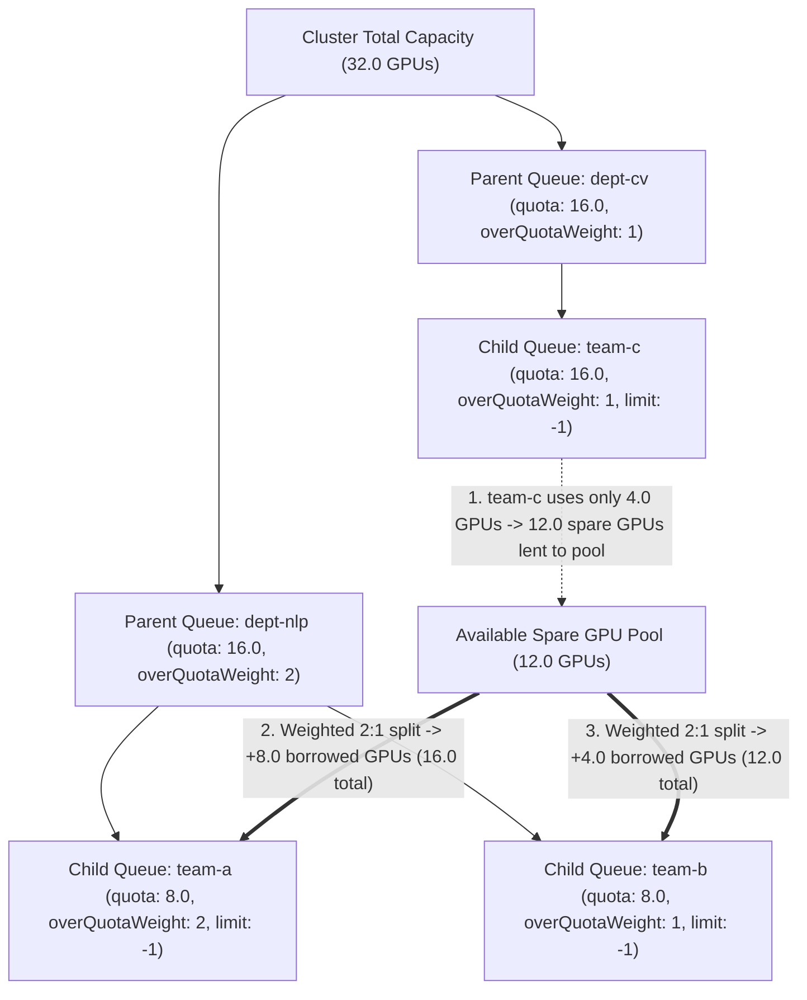
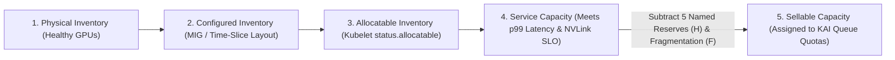

# 11.15 KAI queues, quotas and fair sharing

| | |
|---|---|
| Level | Advanced |
| Priority tier | 1 |
| Lab venue | GCP / GKE (plus local Python 3 simulation lab) |
| Part | Part 11: GPUs on Kubernetes, scheduling and virtualization |
| Sources used | Roland Huß et al., *Generative AI on Kubernetes* (O'Reilly, 2026, Ch. 7); `nvidia-zero-to-hero/volume-11/chapter-08-tenant-isolation-security-and-fairness.md`; `nvidia-zero-to-hero/volume-11/chapter-09-capacity-planning-and-chargeback.md`; `nvidia-zero-to-hero/volume-24/chapter-12-research-infrastructure-design.md`; Josh Rosso et al., *Production Kubernetes* (O'Reilly, 2021, Ch. 12) |
| Coverage file | `planning/coverage/chapters/11-15.md` |

## Why this matters for AI infrastructure

In a multi-tenant AI cluster, static quota without borrowing wastes expensive hardware, while borrowing without fast reclamation destroys tenant trust. Platform engineers feel this pain whenever one research team sits blocked in a pending queue while dozens of GPUs sit idle inside another department's reserved quota. Finance leaders feel it when teams demand millions of dollars in new GPU purchases even though fleet dashboards show low average utilization. A scheduler must guarantee every department its funded baseline capacity while lending every idle GPU to active burst workloads and reclaiming those GPUs the moment their owners return.

Two operational failure modes occur when queue and quota design is naive. First, a cluster can look half-empty on average dashboards while still rejecting every new production job. Second, a cluster can enforce strict proportional fair share across research groups while leaving over eighty percent of its total GPU-hours completely unused. The table below summarizes these two failure modes from our production case studies.

| Incident or Case Study | Observed Fleet Metric | What Went Wrong | Operational Fix |
|---|---|---|---|
| Half-Empty Cluster That Rejects New Work (`volume-11/chapter-09`) | `48%` average GPU utilization on Grafana dashboards | Average utilization conflated incompatible MIG geometries, ignored the non-sellable headroom reserve `H` needed for node failures and rolling upgrades, and locked idle GPUs inside static namespace quotas. | Size capacity using `N = ceil((D + F) / (A * (1 - H)))` across all 5 capacity layers and enable over-quota borrowing. |
| Fair-Share Without Backfill Trap (`volume-24/chapter-12`) | `7.1%` utilization (`768.0` of `10,752` GPU-hours) or `~19.5%` (`~2,100` GPU-hours) at typical submission cadence | Allocating GPUs strictly in proportion to baseline shares (`40%`, `25%`, `20%`, `10%`, `5%`) across a `32`-GPU (`5`-group `A–E`) cluster achieved `100%` proportional fairness while leaving `~8,652–8,900` GPU-hours idle over `14` days (`32 GPUs * 14 days * 24 hours = 10,752` GPU-hours). | Deploy three-level Hierarchical Fair Queuing (`HFQ`) with `quota`, `overQuotaWeight`, opportunistic Level 3 Backfill to reach `> 90%` utilization, and `$0.20` normal vs `$0.40` priority chargeback. |

This chapter explains how the NVIDIA KAI Scheduler implements hierarchical Department-to-Project queues and calculates exact GPU allocations using `quota`, `overQuotaWeight`, and `limit`. You will also learn how to size physical node pools using the Volume 11 capacity formula and how to bill shared GPUs by their allocation contract across whole cards, MIG slices, and time-sliced pools.

## Prerequisites and outcomes

### Prerequisites
- Completion of Chapter 11.13 on KAI Scheduler motivation and deficit scoring, and Chapter 11.14 on KAI Scheduler microservices and custom resources.
- Familiarity with standard Kubernetes Namespace and ResourceQuota objects.

### Outcomes
- Architect a two-level or multi-level Hierarchical Fair Queuing tree in KAI Scheduler from a Department Queue down to a Project Queue, and configure `quota`, `overQuotaWeight`, and `limit`.
- Calculate the exact GPU allocation and borrowed GPU count for every queue during contention using KAI Scheduler's weighted fair-share formula.
- Apply the three-level fairness model from Volume 24 across a 32-GPU research cluster and compute weekly chargeback across normal and priority rate tiers.
- Size physical GPU node pools using the Volume 11 capacity planning formula across all five capacity layers and all five named operational reserves.
- Design allocation-contract showback and chargeback models for whole GPUs, MIG partitions, and fractional time-sliced shares.

## Concepts: basics to intermediate to advanced

### 1. Basics: Hierarchical queues and the three KAI quota parameters

In a large enterprise or university, GPU budgets are rarely flat. A vice president of AI funds two departments, such as natural language processing and computer vision, and each department contains multiple project teams. When one team leaves its GPUs idle, its sibling team inside the same department should get first right to borrow those GPUs before they are lent out to another department across the company. Standard Kubernetes ResourceQuota objects cannot express this policy because namespaces have no parent-child relationship.

KAI Scheduler solves this problem through a hierarchical Queue tree under `scheduling.run.ai/v2`, which `queue-controller` reconciles from Project resources in `kai.run.ai/v1`. Every child Project Queue points to its parent Department Queue through the `parentQueue` field. When a project under the natural language processing department has unused GPUs, KAI Scheduler lends those GPUs to sibling projects inside the same department first. Only when the entire parent department has satisfied its demand does the scheduler lend the remaining idle GPUs to external departments.



Every Queue in KAI Scheduler configures three parameters for each resource type: `quota`, `overQuotaWeight`, and `limit`. Together, these three numbers govern guaranteed baseline entitlement, proportional spare-capacity sharing, and maximum burst ceilings. The table below defines each parameter and shows how it behaves on our 32-GPU cluster example.

| KAI Queue Parameter | Operational Meaning | Behavior During Contention and Idle Periods |
|---|---|---|
| `quota` (Nominal or Deserved Quota) | The guaranteed baseline number of GPUs owned by this queue (e.g., `8.0` GPUs for `team-a`). | Whenever `team-a` uses `< 8.0` GPUs and submits a new job, KAI Scheduler's Reclaim action immediately reclaims lent GPUs from over-quota borrowers so `team-a` gets its `8.0` GPUs. |
| `overQuotaWeight` (Borrowing Share Weight) | Relative weight (`1`, `2`, etc.) determining what fraction of the cluster's unused GPUs this queue receives when bursting above `quota`. | If `12.0` spare GPUs are free and `team-a` (`weight: 2`) and `team-b` (`weight: 1`) both demand extra GPUs, `team-a` receives `2 / (2 + 1) = 2/3` (`+8.0` GPUs) and `team-b` receives `1 / (2 + 1) = 1/3` (`+4.0` GPUs). |
| `limit` (Max Allowed Quota Ceiling) | Hard upper bound on total GPUs (`nominal + borrowed`) this queue may hold simultaneously (`-1` means unlimited borrowing up to cluster size). | If `team-a` sets `limit: 12.0` with `quota: 8.0`, `team-a` can borrow at most `4.0` extra GPUs (`8.0 + 4.0 = 12.0`) even if `20` GPUs sit idle in the cluster. |

---

### 2. Intermediate: Hierarchical Fair Queuing mathematics and the 32-GPU research cluster

When multiple teams burst above their nominal quota at the same time, the scheduler needs an exact mathematical rule to divide the spare GPUs without starving smaller teams. If a cluster enforces hard quotas without over-quota borrowing, any team whose jobs finish on Friday leaves its GPUs dark all weekend while other teams wait in queues. Conversely, if a cluster allows first-come-first-served borrowing without proportional weights, whichever researcher writes a loop to submit a hundred jobs first monopolizes every spare GPU.

KAI Scheduler prevents both problems by computing each active queue's fair share from its nominal quota plus a weighted fraction of the currently unused cluster pool. When five research groups share a 32-GPU cluster, each group's baseline quota reflects its researcher headcount and funding share. The table below details the five-group workload profile and proportional shares from our research cluster case study.

| Group | Researchers and Share (`%`) | Exact Fair Share (`GPUs`) | Integer Cap (`maxgpus`) | Account Priority | Typical Workload Profile and Weekly Frequency |
|---|---|---|---|---|---|
| Group A (LLM Pretraining) | `5` researchers (`40.0%`) | `12.8` GPUs | `13` GPUs | `1000` | `8` GPUs × `48` hours, `2x`/week (`307.2` GPUh fair-share window) |
| Group B (Vision Research) | `4` researchers (`25.0%`) | `8.0` GPUs | `8` GPUs | `900` | `4` GPUs × `2` hours, `10x`/week (`192.0` GPUh fair-share window) |
| Group C (Automated NAS) | `3` researchers (`20.0%`) | `6.4` GPUs | `6` GPUs | `800` | `1` GPU × `30` min, `100x`/week (`153.6` GPUh fair-share window) |
| Group D (Simulation) | `2` researchers (`10.0%`) | `3.2` GPUs | `3` GPUs | `700` | `2` GPUs × `72` hours, `1x`/week (`76.8` GPUh fair-share window) |
| Group E (Inference Eval) | `1` researcher (`5.0%`) | `1.6` GPUs | `2` GPUs | `600` | `1` GPU × `10` min, `50x`/week (`38.4` GPUh fair-share window) |
| Total Cluster | `15` researchers (`100.0%`) | `32.0` GPUs | `32` GPUs | — | `768.0` GPU-hours in the 2-week fairness table |

To reach high cluster utilization while preserving these proportional shares, the scheduler applies three distinct levels of Hierarchical Fair Queuing. Level 1 enforces inter-group proportional fairness across the five groups. Level 2 enforces intra-group round-robin fairness among researchers inside the same group so a single user cannot starve their own teammates. Level 3 enables opportunistic backfill across all idle capacity so the cluster does not sit empty when groups submit below their theoretical ceiling.

```text
Three-Level Hierarchical Fair Queuing (HFQ) Capacity Arithmetic (volume-24/chapter-12):
  Level 1 (Inter-Group Proportional Share over 14-day window):
    Group A: 40.0% -> 12.8 GPUs (307.2 GPUh of 768.0 GPUh baseline verification table)
    Group B: 25.0% ->  8.0 GPUs (192.0 GPUh)
    Group C: 20.0% ->  6.4 GPUs (153.6 GPUh)
    Group D: 10.0% ->  3.2 GPUs ( 76.8 GPUh)
    Group E:  5.0% ->  1.6 GPUs ( 38.4 GPUh)
  Level 2 (Intra-Group Round-Robin):
    Group B (10 vision jobs/week): each researcher job receives 1/10 of Group B's share.
  Level 3 (Opportunistic Backfill — Why 7.1% / 19.5% Requires Backfill to Hit > 90%):
    Total 2-week (14-day) cluster capacity = 32 GPUs * 14 days * 24 hours = 10,752 GPU-hours
    (or 480 hours per 20-day work window / 336 hours per 14-day wall-clock window per GPU).
    Baseline fairness table = 768.0 / 10,752 = 7.14% (7.1%) utilization.
    Full typical weekly cadence across all 5 groups = ~2,100 / 10,752 = 19.5% utilization.
    Idle capacity without Level 3 Backfill = ~8,652 to 8,900 GPU-hours per 2 weeks.
    Preemption safeguard for 48-hour LLM runs: 30-minute checkpoint grace period prevents losing 10 hours of work.
```

---

### 3. Advanced: Capacity planning, five operational reserves, and chargeback economics

Platform teams frequently get burned when they treat Kubernetes Allocatable GPU counts as sellable tenant quota. If you promise one hundred percent of your physical GPUs as guaranteed `quota` across project queues, a single hardware failure, driver upgrade, or MIG geometry mismatch immediately breaks a tenant's service guarantee. You need a structured capacity model that separates physical hardware from sellable quota.

Volume 11 defines five distinct layers of GPU capacity that every platform team must track separately. Physical Inventory counts healthy cards installed in servers. Configured Inventory counts GPUs partitioned into the intended MIG, vGPU, or time-slicing mode. Allocatable Inventory counts units advertised by `kubelet` in `status.allocatable`. Service Capacity counts units capable of meeting the documented tail-latency or NVLink step-time promise. Finally, Sellable Capacity is what remains for tenant `quota` after subtracting headroom reserves and geometry fragmentation.



To calculate how many physical worker nodes are required to support a given service class, apply the auditable node-sizing formula from Volume 11. This formula accounts for concurrent demand, MIG placement fragmentation, usable allocations per node, and the non-sellable headroom fraction decomposed across five named operational reserves.

```text
Auditable Node-Sizing Formula and Five Named Reserves (volume-11/chapter-09):
  N = ceil((D + F) / (A * (1 - H)))

Variables:
  N = Required number of standardized worker nodes
  D = Required concurrent allocations (measured demand-equivalent for the workload class)
  F = Expected allocation loss from MIG geometry fragmentation or NUMA/NVSwitch placement constraints
  A = Usable allocations provided by 1 standardized node after its approved layout is applied
      (e.g., A = 7 1g.10gb slices on a 1-GPU node, or A = 8 whole GPUs on an HGX node)
  H = Non-sellable headroom fraction (0 <= H < 1), decomposed across 5 named reserves:
      1. Node-failure reserve: survives 1 node or failure domain going down without breaching quota.
      2. Maintenance reserve: allows draining nodes for kernel, driver (nvidia.ko), or MIG layout changes.
      3. Rollout reserve: keeps a healthy comparison/canary pool available during staged GPU Operator upgrades.
      4. Demand-variance reserve: absorbs burst windows and forecast error within queue-time SLOs.
      5. Fragmentation reserve: covers physically free MIG slices whose geometry cannot fit the next profile
         (e.g., 1g free when 4g.20gb is requested).

Worked Example (D = 40, F = 5, A = 7, H = 0.20 -> 7 * (1 - 0.20) = 5.6 sellable slices/node):
  N = ceil((40 + 5) / (7 * (1 - 0.20))) = ceil(45 / 5.6) = ceil(8.0357) = 9 nodes
```

Once sellable capacity is sized, you must decide how to account for and bill GPU usage across competing teams. Never bill reserved GPUs purely by compute utilization such as `DCGM_FI_DEV_GPU_UTIL`. When a researcher allocates half a GPU's memory in an interactive pod and leaves compute utilization at zero percent during lunch, that memory remains locked and unavailable to any other team.

Instead, always bill by the allocation contract. A tenant pays for the hardware share and service tier they reserve for the duration the Pod holds the allocation. Publish consumption reports as a non-billed Showback dashboard first so teams can clean up idle notebooks before finance turns on hard Chargeback. The table below summarizes the allocation-contract billing rules across whole GPUs, MIG slices, and time-sliced pools.

| Resource Shape or Queue Tier | Allocation-Contract Billing Rule | Rate Card and Worked Weekly Cost (`volume-11/chapter-09` & `volume-24/chapter-12`) |
|---|---|---|
| Whole Dedicated GPU (Normal Queue) | Bill per reserved or allocated GPU-hour regardless of SM activity (`0%` or `100%`). | `$0.20` per GPU-hour: Group A (`2` jobs/week × `8` GPUs × `48` hours × `$0.20`) pays `$153.60/week`; Group E (`50` jobs/week × `1` GPU × `10/60` hours × `$0.20`) pays `$1.67/week`. |
| Whole Dedicated GPU (Priority Queue) | Bill at `2x` premium rate for immediate scheduling and preemption rights over normal jobs. | `$0.40` per GPU-hour (`2x` normal rate): expedited jobs pay double the `$0.20` normal rate. |
| Fixed MIG Profile (`MIG 3g.40gb`) | Bill for the reserved fraction of the physical card for the duration the Pod holds the slice. | `~50%` of the whole-GPU hourly rate, even when interactive compute utilization sits at `0%`. |
| Time-Sliced or Fractional Pool (`1` of `10` slices) | Bill for the logical slice share or best-effort access tier without a latency SLA. | `10%` of the whole-GPU hardware rate, explicitly noting that time-slicing buys capacity access rather than deterministic compute or memory isolation. |

### 4. Continuous governance: demand forecasting, idle reclamation, and rate-card reviews

Capacity planning and queue governance do not end once Queue objects are applied to the cluster. Without continuous feedback between scheduler telemetry and quota reviews, early reservations harden into permanent hoarding while new projects starve. Platform teams need clear leading signals, a staged playbook for idle reservations, and an explicit service catalog checklist.

Track both leading and lagging capacity signals across every service class. Reservation pipelines and project roadmaps predict committed future demand, while queue wait time by service class reveals when active demand exceeds usable sellable capacity. Rejected or pending PodGroup requests expose unsatisfied shape demand, such as a spike in pending four-GPU NVSwitch gangs or three-slice MIG requests, and should always be grouped by scheduler predicate failure reason. Comparing active allocation hours against application throughput and tail latency proves whether the allocated share met its service promise. Meanwhile, maintenance and hardware failure counts validate whether your headroom fraction was sized realistically.

When showback telemetry reveals that a project holds reserved GPU quota or long-lived interactive pods at zero percent compute activity while sibling queues wait, apply a four-stage operational response. Each stage escalates cleanly from visibility to quota reallocation without surprising researchers.

| Stage | Operational Action | Mechanism and Policy Safeguard |
|---|---|---|
| Stage 1: Visibility | Surface idle reservation age and opportunity cost | Publish `Allocated GPU-Hours`, `Idle Reservation Age`, and `Borrowed vs Nominal Hours` on the project's showback report and notify technical and budget owners. |
| Stage 2: Automated Borrowing | Lend idle GPUs to active queues immediately | Allow KAI Scheduler's `overQuotaWeight` mechanism to lend unused GPUs to active queues, protected by the documented recall and checkpoint grace policy. |
| Stage 3: Idle TTL and Right-Sizing | Reclaim idle interactive pods and right-size shapes | Suspend or terminate interactive Jupyter pods whose GPU utilization stays `0%` past an agreed TTL, and move bursty low-utilization workloads to fractional or smaller MIG classes. |
| Stage 4: Quota Reallocation | Rebalance baseline entitlement in quarterly reviews | Adjust the project's nominal `quota` downward during the monthly or quarterly capacity review forum if historical consumption consistently trails reserved entitlement. |

Before publishing any GPU queue or service tier to internal teams, verify that the service catalog answers eight explicit governance questions. Publishing this eight-point contract alongside every KAI Queue and Project onboarding request gives platform engineers, finance leaders, and research leads a single objective definition of capacity, fairness, and cost. Furthermore, archiving a formal Capacity Decision Record whenever a node pool's sharing layout, quota tree, or reserve assumption changes prevents temporary shortage workarounds from turning into permanent architectural debt.

- Protect a specific workload outcome such as tail latency, training step time, or interactive notebook access.
- Specify whether the underlying GPU allocation is dedicated, hardware-partitioned with MIG, oversubscribed with time-slicing or fractional sharing, or virtualized with vGPU.
- State the physical and scheduler constraints that bound the tier, including single-node pod limits, NVSwitch domain size, and MIG profile geometry.
- Document what failure and maintenance reserve is included in the rate card and which queues are permitted to borrow it.
- Define which platform events, such as unscheduled hardware replacement or violated recall windows, earn a service credit or post-incident review.
- Identify the authoritative data record that establishes billable consumption, joining Queue allocation intervals to Project and ResourceShape, and explain how a project owner can dispute an entry.
- List which cluster upgrades, driver reloads, or MIG layout changes can disrupt workloads running in this tier.
- State explicitly what is not guaranteed, such as zero memory isolation or non-deterministic latency in a time-sliced best-effort queue.

## Commands and configurations that matter

### 1. Defining a two-level KAI Department-to-Project Queue hierarchy

To implement intra-department borrowing before inter-department lending, create a parent Department Queue and attach child Project Queues using the `parentQueue` field. The manifest below configures the parent department queue with sixteen nominal GPUs and splits that quota across two child team queues with a two-to-one borrowing weight ratio.

```yaml
# kai-hierarchical-queues.yaml (untested here)
apiVersion: scheduling.run.ai/v2
kind: Queue
metadata:
  name: dept-nlp
spec:
  resources:
    gpu:
      quota: 16
      overQuotaWeight: 2
      limit: -1
    cpu:
      quota: 128
      overQuotaWeight: 2
      limit: -1
    memory:
      quota: 1024Gi
      overQuotaWeight: 2
      limit: -1
---
apiVersion: scheduling.run.ai/v2
kind: Queue
metadata:
  name: team-a
spec:
  parentQueue: dept-nlp
  resources:
    gpu:
      quota: 8
      overQuotaWeight: 2
      limit: -1
    cpu:
      quota: 64
      overQuotaWeight: 2
      limit: -1
    memory:
      quota: 512Gi
      overQuotaWeight: 2
      limit: -1
---
apiVersion: scheduling.run.ai/v2
kind: Queue
metadata:
  name: team-b
spec:
  parentQueue: dept-nlp
  resources:
    gpu:
      quota: 8
      overQuotaWeight: 1
      limit: -1
    cpu:
      quota: 64
      overQuotaWeight: 1
      limit: -1
    memory:
      quota: 512Gi
      overQuotaWeight: 1
      limit: -1
```

### 2. Configuring Slurm equivalent fair-share QOS and accounts

Many AI platforms operate a Slurm partition alongside Kubernetes or migrate existing Slurm fair-share trees into KAI Scheduler. The `sacctmgr` commands below implement the five-group, 32-GPU hierarchy from Volume 24, configuring a normal quality-of-service tier with a 72-hour timeout and a priority tier with a 24-hour timeout.

```bash
# Configure normal and priority QOS and 5 research accounts in Slurm (volume-24/chapter-12, untested here)
sacctmgr add qos normal priority=100 maxgpus=40 maxjobsperuser=10 timeout=259200
sacctmgr add qos priority priority=200 maxgpus=32 maxjobsperuser=5 timeout=86400

for grp in group-a group-b group-c group-d group-e; do
  sacctmgr add account "$grp" qos=normal,priority parent=root
done

sacctmgr set account group-a set priority=1000 maxgpus=13
sacctmgr set account group-b set priority=900  maxgpus=8
sacctmgr set account group-c set priority=800  maxgpus=6
sacctmgr set account group-d set priority=700  maxgpus=3
sacctmgr set account group-e set priority=600  maxgpus=2
```

## How it fails

Misconfigured borrowing limits, missing checkpoint grace periods, and naive capacity metrics cause predictable production outages. The table below maps each failure symptom to its root cause boundary and remediation.

| Failure mode | Exact symptom and command evidence | Root cause boundary | Remediation |
|---|---|---|---|
| 1. Cluster sits at `60%` or `19.5%` utilization while jobs wait in queues | Dashboards show `40%–80%` of GPUs idle, yet pending jobs exist in `team-a` (`volume-24/chapter-12`). | Borrowing disabled (`limit == quota`) or Backfill off: queues were configured with hard ceilings (`limit: 8` equal to `quota: 8` or `overQuotaWeight: 0`), preventing active teams from borrowing idle GPUs. | Set `limit: -1` (or a generous burst ceiling) and positive `overQuotaWeight` on project and department queues so KAI Scheduler backfills idle capacity automatically. |
| 2. `48`-hour LLM training job loses `10` hours of compute when reclaimed (`volume-24/chapter-12`) | Group A bursts above its `40%` (`12.8`-GPU) nominal share; when Group B submits work, Reclaim preempts Group A's `8`-GPU job, losing `10` hours of unsaved training progress. | Missing preemption grace window or missing periodic checkpoints: the job ran in borrowable over-quota capacity without periodic checkpointing or an adequate termination grace period. | Keep non-checkpointing or long jobs inside guaranteed nominal `quota` (`12.8` GPUs), save checkpoints every `100` steps or `30–60` minutes, and configure an adequate preemption grace period (`30`s to `30` min). |
| 3. Platform defers hardware purchase at `48%` average utilization, then runs out of MIG slices (`volume-11/chapter-09`) | Fleet-wide DCGM utilization averages `48%`, but new `nvidia.com/mig-3g.20gb` Pods stay Pending (`Insufficient nvidia.com/mig-3g.20gb`). | Conflating average device activity with sellable profile geometry: free capacity existed only in incompatible MIG shapes (`1g.5gb`), maintenance-drained nodes, or non-sellable failure reserves (`H`). | Track Sellable Capacity per service class and MIG layout using `N = ceil((D + F) / (A * (1 - H)))` and alert on per-profile pending queues rather than fleet-wide average SM utilization. |
| 4. Chargeback bill is `50%` too low (`$100` billed when `160` GPU-hours were used) | Monthly finance reconciliation shows Group A was billed `$100` despite using `160` GPU-hours across normal and priority queues (`volume-24/chapter-12`). | Missing service-tier or queue multiplier in chargeback pipeline: the billing script did not track the `priority` queue premium (`2x` rate at `$0.40`/GPUh vs `$0.20`/GPUh) or rounded GPU-hours incorrectly. | Join allocation intervals against `(Project, Queue, PriorityClass, ResourceShape)` so `priority` queue hours (`$0.40`), `normal` queue hours (`$0.20`), and MIG fractions (`50%`) are rated accurately. |
| 5. One best-effort user spawns `100` idle Jupyter notebooks and hogs all time-sliced replicas | Protected workloads are unaffected, but every other developer in the `best-effort` shared pool gets stuck in Pending. | Unbounded logical replica quota on shared pool (`volume-11/chapter-07` & `08`): time-slicing increased Allocatable logical units (`replicas: 10`), and the namespace lacked a concurrency limit or idle reaper. | Enforce per-user and per-project `limit` caps on shared queues and automatically suspend or reclaim interactive notebooks whose GPU utilization stays `0%` past an idle TTL window. |

## Hands-on lab

### Venue and scope
This lab runs locally using the Python 3 standard library via `code/part11/kai_queues_quotas_fair_sharing.py` and `code/part11/kai_queues_quotas_fair_sharing_lab.py`. It verifies KAI Scheduler's hierarchical Queue fair-share engine, the five-group 32-GPU research cluster model from Volume 24, and the node-sizing capacity formula from Volume 11. Cluster commands in earlier sections are marked `(untested here)`.

### Step 1: Run the self-checking KAI queues, quotas, and fair-sharing lab (tested here)

Run the lab verification script from the repository root to validate all 25 fair-sharing, backfill, chargeback, and capacity planning assertions.

```bash
python3 code/part11/kai_queues_quotas_fair_sharing_lab.py
```

Captured output from this repository:
```text
=== Chapter 11.15 Lab: KAI Queues, Quotas, Fair Sharing & Capacity Chargeback ===
  [PASS] Idle/light Team C (nominal=16, demand=4) uses 4.0 GPUs and lends 12.0 unused GPUs to the cluster pool
  [PASS] Team A (nominal=8, overQuotaWeight=2) receives 2/3 of the 12 spare GPUs -> 16.0 GPUs total (8.0 borrowed)
  [PASS] Team B (nominal=8, overQuotaWeight=1) receives 1/3 of the 12 spare GPUs -> 12.0 GPUs total (4.0 borrowed)
  [PASS] Total allocated GPUs across all 3 queues (16.0 + 12.0 + 4.0) equals all 32.0 cluster GPUs
  [PASS] When Team A sets limit=12.0, its allocation is capped at 12.0 GPUs (4.0 borrowed)
  [PASS] 32-GPU proportional shares map A(40%)=12.8, B(25%)=8.0, C(20%)=6.4, D(10%)=3.2, E(5%)=1.6 GPUs
  [PASS] Exact GPU shares (32.0) and integer Slurm maxgpus caps (13+8+6+3+2=32) both sum to 32 GPUs
  [PASS] 768.0 GPU-hours out of 10,752 GPU-hours (32 GPUs x 14d x 24h) is 7.1% utilization (proving backfill is mandatory)
  [PASS] At $0.20/GPUh normal ($0.40 priority = 2.0x), Group A costs $153.60/wk and Group E costs $1.67/wk
  [PASS] Capacity formula N = ceil((40 + 5) / (7 * (1 - 0.20))) = ceil(45 / 5.6) requires 9 nodes
  [PASS] Volume 11 Ch 9 planning incident highlights how a 48% average utilization chart can hide MIG profile exhaustion
  [PASS] Allocation-contract chargeback bills MIG 3g.40gb at ~50% GPU rate and 1-of-10 time-slice at 10% rate regardless of idle compute
  [PASS] Slurm normal QOS timeout is 259,200s (72h, maxgpus=40) and priority QOS timeout is 86,400s (24h, maxgpus=32)
  [PASS] Group account priorities order group-a(1000) > group-b(900) > group-c(800) > group-d(700) > group-e(600)
  [PASS] Typical 5-group cadence (~2,100 GPUh / 10,752 GPUh = 19.5%) leaves ~8,652-8,900 GPUh for Level 3 Backfill
  [PASS] Research lab researcher counts (5 + 4 + 3 + 2 + 1 = 15 researchers) align with the 40/25/20/10/5% shares
  [PASS] 2-week allocated GPU-hours (307.2, 192.0, 153.6, 76.8, 38.4) match 40%, 25%, 20%, 10%, 5% exactly
  [PASS] Weekly accounting script divides CPU/GPU seconds or hours by 480h window factor
  [PASS] Volume 11 Ch 9 models 5 distinct capacity layers from Physical to Sellable capacity
  [PASS] Volume 11 Ch 9 decomposes headroom H into 5 named failure and operational reserves
  [PASS] Volume 11 Ch 8 defines 6 observable fairness policy elements
  [PASS] Volume 11 Ch 8 enforces fairness controls across 3 time scales (Admission, Execution, Lifecycle)
  [PASS] Priority queue 2x rate ($0.40 vs $0.20) doubles GPU-hour billing for expedited jobs
  [PASS] Large 48h jobs require a 30-min preemption checkpoint grace window to avoid losing 10h of un-checkpointed work
  [PASS] Job scheduling log tracks JobIDs 4001 through 4008 across RUNNING and QUEUED states

Summary: 25 passed, 0 failed out of 25 checks.
```

### Exercises

1. **Exercise 1 — Proportional over-quota borrowing:** On a 32-GPU cluster, Team A has a nominal quota of 8 GPUs and a borrowing weight of 2, while Team B has a nominal quota of 8 GPUs and a borrowing weight of 1. Team C has a nominal quota of 16 GPUs and a borrowing weight of 1, but requests only 4 GPUs while Team A and Team B each demand 24 GPUs with unlimited borrowing. Use `compute_kai_fair_shares()` in `code/part11/kai_queues_quotas_fair_sharing.py` to compute the allocated and borrowed GPUs for all three teams.
2. **Exercise 2 — Enforcing a hard borrowing limit:** Repeat Exercise 1 with a hard borrowing limit of 12 GPUs configured on Team A. Determine how many total GPUs and borrowed GPUs Team A receives under this ceiling.
3. **Exercise 3 — Five-group research lab fair-share and backfill math:** Use `evaluate_five_group_research_cluster()` to verify each group's exact GPU share across the five groups. Explain why 768 GPU-hours over 14 days equals only 7.1 percent of total capacity, and state how many GPU-hours must be filled via Level 3 Backfill to exceed 90 percent utilization.
4. **Exercise 4 — Weekly chargeback calculation:** Calculate the weekly normal-queue chargeback for Group A running two 8-GPU jobs per week for 48 hours each, and Group E running fifty 1-GPU jobs per week for 10 minutes each. State how the priority queue rate multiplier changes the hourly rate from normal to priority execution.
5. **Exercise 5 — Node capacity sizing with fragmentation and headroom reserves:** Call `compute_required_nodes_for_service_class()` in Python using the parameters from the Volume 11 worked example. Compute the effective sellable allocations per node, the raw node count, and the required whole node count.
6. **Exercise 6 — Allocation-contract billing versus compute-utilization billing:** Explain why a tenant holding a `MIG 3g.40gb` slice at zero percent compute utilization must still be billed for roughly half of the physical GPU's hourly cost.

## Checkpoint questions

<details>
<summary>`&lt;strong>`1. What are the three per-resource quota fields on a KAI Scheduler Queue (scheduling.run.ai/v2), and what does each control?`&lt;/strong>`</summary>

The `quota` field sets the guaranteed baseline resource quantity that the queue can always reclaim when it has pending workloads. The `overQuotaWeight` field sets the proportional weight determining what share of spare cluster resources this queue receives when bursting above its nominal quota. The `limit` field sets the hard ceiling on total nominal plus borrowed resources the queue may consume simultaneously, where a negative one value allows unlimited borrowing up to cluster capacity.
</details>

<details>
<summary>`&lt;strong>`2. On a 32-GPU cluster, Team A (quota: 8, overQuotaWeight: 2) and Team B (quota: 8, overQuotaWeight: 1) both demand 24 GPUs, while Team C (quota: 16) only uses 4 GPUs. How many total and borrowed GPUs does KAI Scheduler allocate to Team A and Team B?`&lt;/strong>`</summary>

Team C uses 4 of its 16 nominal GPUs, leaving 12 spare GPUs in the cluster pool. KAI Scheduler divides those 12 spare GPUs between Team A and Team B in a two-to-one ratio according to their borrowing weights. Team A receives 16 GPUs total, consisting of 8 nominal plus 8 borrowed GPUs. Team B receives 12 GPUs total, consisting of 8 nominal plus 4 borrowed GPUs, while Team C keeps its 4 active GPUs.
</details>

<details>
<summary>`&lt;strong>`3. How does a two-level Department -> Project queue hierarchy in KAI Scheduler prioritize borrowing compared to a flat list of namespaces?`&lt;/strong>`</summary>

When a project queue under the natural language processing department has idle GPUs, KAI Scheduler offers those unused GPUs first to sibling project queues under the same parent department before lending them out to external departments. Conversely, when that project submits new work, KAI Scheduler reclaims borrowed GPUs from external departments first before preempting sibling teams inside the same parent department.
</details>

<details>
<summary>`&lt;strong>`4. In Volume 24 Project 12, how are the 32 GPUs divided across the 5 research groups (A–E) based on researcher headcount (5, 4, 3, 2, 1 = 15 researchers)?`&lt;/strong>`</summary>

The 32 GPUs are divided in proportion to each group's share:

| Group | Researchers & Share | Exact Fair Share | Integer `maxgpus` Cap | 2-Week Fair-Share Window (`768.0` GPUh) |
|---|---|---|---|---|
| Group A | `5` researchers (`40%`) | `12.8` GPUs | `13` GPUs | `307.2` GPUh |
| Group B | `4` researchers (`25%`) | `8.0` GPUs | `8` GPUs | `192.0` GPUh |
| Group C | `3` researchers (`20%`) | `6.4` GPUs | `6` GPUs | `153.6` GPUh |
| Group D | `2` researchers (`10%`) | `3.2` GPUs | `3` GPUs | `76.8` GPUh |
| Group E | `1` researcher (`5%`) | `1.6` GPUs | `2` GPUs | `38.4` GPUh |
</details>

<details>
<summary>`&lt;strong>`5. What are the three levels of Hierarchical Fair Queuing (HFQ) defined in Volume 24 Project 12?`&lt;/strong>`</summary>

Level 1 enforces inter-group proportional GPU-hour shares across groups A through E. Level 2 enforces intra-group job fairness using round-robin preference among jobs submitted by different researchers within the same group. Level 3 performs opportunistic backfill, filling any idle GPUs with waiting jobs from any group and preempting backfilled jobs only when needed to satisfy Level 1 guarantees.
</details>

<details>
<summary>`&lt;strong>`6. Why does the 768.0 GPU-hour fair-share table in Volume 24 Project 12 equal only 7.1% utilization on a 32-GPU cluster over 2 weeks, and what does that prove about Level 3 Backfill?`&lt;/strong>`</summary>

Over 14 days, 32 GPUs provide 10,752 total GPU-hours. Dividing 768.0 by 10,752 equals only 7.1 percent utilization, and even the full weekly submission cadence across all five groups consumes only about 2,100 GPU-hours or 19.5 percent. This proves that strict quota caps without Level 3 Backfill to fill the remaining idle GPU-hours can never achieve the 90 percent cluster utilization target.
</details>

<details>
<summary>`&lt;strong>`7. In Volume 24 Project 12, how are the Normal Queue and Priority Queue priced, and what are the weekly costs for Group A (2 jobs x 8 GPUs x 48h) and Group E (50 jobs x 1 GPU x 10min) in the Normal Queue?`&lt;/strong>`</summary>

The Normal Queue costs `$0.20` per GPU-hour, while the Priority Queue costs `$0.40` per GPU-hour (`2x` rate) for immediate scheduling. In the Normal Queue, Group A pays `$153.60/week` and Group E pays `$1.67/week`.
</details>

<details>
<summary>`&lt;strong>`8. What are the five capacity layers defined in Volume 11 Chapter 9, and why is Allocatable Inventory not the same as Sellable Capacity?`&lt;/strong>`</summary>

The five layers are Physical Inventory, Configured Inventory, Allocatable Inventory, Service Capacity, and Sellable Capacity. Selling one hundred percent of the Allocatable Inventory as tenant quota leaves zero buffer for node failures, maintenance drains, rolling upgrades, or MIG geometry fragmentation. Sellable Capacity subtracts headroom reserves and fragmentation from Service Capacity so tenant guarantees remain intact during maintenance and hardware faults.
</details>

<details>
<summary>`&lt;strong>`9. State the Volume 11 Chapter 9 capacity planning formula N = ceil((D + F) / (A * (1 - H))) and define each variable.`&lt;/strong>`</summary>

In the capacity formula `N = ceil((D + F) / (A * (1 - H)))`, the variable `N` is the required number of standardized worker nodes rounded up to the next whole node. The variable `D` is the required concurrent demand allocations for the service class, and `F` is the expected allocation loss from MIG geometry fragmentation or placement constraints. The variable `A` is the number of usable allocations per standardized node, and `H` is the planned non-sellable headroom fraction.
</details>

<details>
<summary>`&lt;strong>`10. What are the five named operational reserves that make up the headroom fraction H in Volume 11 Chapter 9?`&lt;/strong>`</summary>

The five reserves are the Node-failure reserve, the Maintenance reserve, the Rollout reserve, the Demand-variance reserve, and the Fragmentation reserve. Together, they protect tenant quotas against single-node outages, planned driver or MIG drains, staged canary upgrades, burst forecast errors, and unplaceable MIG slice geometries.
</details>

<details>
<summary>`&lt;strong>`11. Why did the platform team in Volume 11 Chapter 9 run out of MIG capacity two weeks after seeing 48% average fleet utilization?`&lt;/strong>`</summary>

The 48 percent utilization chart averaged compute activity across incompatible MIG profile layouts and counted nodes reserved for maintenance as usable supply. It also ignored the latency headroom required by online inference services, masking the fact that no free three-slice MIG partitions were actually placeable.
</details>

<details>
<summary>`&lt;strong>`12. Why must shared-GPU chargeback bill by the Allocation Contract (e.g., 50% for MIG 3g.40gb or 10% for a 1/10 time-slice) rather than raw GPU compute utilization?`&lt;/strong>`</summary>

When a tenant reserves a `MIG 3g.40gb` partition, roughly half of the 80GB GPU's memory and compute is hardware-locked and unavailable to any other tenant even if compute utilization sits at zero percent. Billing by the allocation contract aligns financial cost with the true capacity opportunity cost imposed on the cluster.
</details>

<details>
<summary>`&lt;strong>`13. What is the difference between Showback and Chargeback in Volume 11 Chapter 9, and why should platforms deploy Showback first?`&lt;/strong>`</summary>

Showback reports each team's GPU consumption, idle reservation hours, and hypothetical cost without issuing an internal financial bill, whereas Chargeback debits the team's cost center directly. Deploying Showback first exposes broken namespace-to-cost-center mappings, educates users on idle reservation costs, and establishes a dispute-resolution process before budgets are billed.
</details>

<details>
<summary>`&lt;strong>`14. What are the six observable fairness policy elements in Volume 11 Chapter 8?`&lt;/strong>`</summary>

The six policy elements and their observable metrics are:

| Policy Element | Operational Meaning | Observable Metric |
|---|---|---|
| 1. Entitlement | Baseline quota per tenant or project | Requested, allocated, and idle capacity hours |
| 2. Priority | Which service classes may preempt or borrow | Queue time and interruption count |
| 3. Borrowing | When unused reserved capacity is reclaimable | Owner notification, recall time, and checkpoint state |
| 4. Limits | Maximum concurrent shared allocations | Rejection events and physical saturation |
| 5. Cost | Showback or chargeback unit and guarantee level | Usage record and profile fragmentation |
| 6. Appeals | Who resolves a policy conflict | Decision log and remediation date |
</details>

<details>
<summary>`&lt;strong>`15. What are the three time scales of fairness controls in Volume 11 Chapter 8, and what fails if any one of them is missing?`&lt;/strong>`</summary>

Admission-time controls enforce class eligibility, quota, and approvals; without them, unauthorized or unbounded jobs start. Execution-time controls enforce concurrency limits, protected pools, and priority preemption; without them, noisy neighbors degrade running service levels. Lifecycle-time controls across weeks and months handle reservation reviews, showback, and demand forecasting; without them, idle claims and profile fragmentation harden into permanent hoarding.
</details>

<details>
<summary>`&lt;strong>`16. How do you distinguish useful idle reserved GPU capacity from wasteful hoarding in Volume 11 Chapter 9?`&lt;/strong>`</summary>

An idle reserved GPU is valid when it serves as a documented latency burst buffer, a maintenance or failover spare, or a pre-approved window for an imminent critical launch. It becomes wasteful hoarding when the reservation is unexplained and repeatedly blocks queued work from other teams.
</details>

<details>
<summary>`&lt;strong>`17. What seven steps does Volume 11 Chapter 9 prescribe to test a capacity model before a planned maintenance window?`&lt;/strong>`</summary>

First, identify the nodes, layouts, and service classes the maintenance window removes. Second, list active reservations and workloads that cannot be interrupted without an approved recovery path. Third, confirm compatible inventory in the remaining pools, including MIG profile shape and topology. Fourth, reserve a healthy comparison pool for canary and rollback validation. Fifth, simulate the scheduler outcome or rehearse in a representative non-production pool. Sixth, define the pause condition based on queue growth, unavailable profile count, or SLO risk. Seventh, reconcile the actual post-maintenance result against the capacity model.
</details>

<details>
<summary>`&lt;strong>`18. In Volume 24 Project 12, what Slurm sacctmgr commands configure the normal and priority QOS tiers?`&lt;/strong>`</summary>

Run `sacctmgr add qos normal priority=100 maxgpus=40 maxjobsperuser=10 timeout=259200` for the 72-hour normal tier. Run `sacctmgr add qos priority priority=200 maxgpus=32 maxjobsperuser=5 timeout=86400` for the 24-hour priority tier.
</details>

<details>
<summary>`&lt;strong>`19. What eight fields belong in a Capacity Decision Record (Volume 11 Chapter 9) when changing a node pool's sharing layout or quota policy?`&lt;/strong>`</summary>

A Capacity Decision Record contains Service change, Demand evidence, Compatibility, Capacity model, Tenant impact, Alternatives, Acceptance checks, and Review date. Recording these eight fields ensures that layout and quota changes remain auditable across budget cycles.
</details>

<details>
<summary>`&lt;strong>`20. How does Kueue's ClusterQueue cohort borrowing (nominalQuota + borrowingLimit) compare to KAI Scheduler's Queue (quota + overQuotaWeight + limit)?`&lt;/strong>`</summary>

Kueue groups peer ClusterQueues into a cohort with `nominalQuota` and `borrowingLimit` at the Job admission layer. KAI Scheduler embeds `quota`, `overQuotaWeight`, and `limit` directly inside a Department-to-Project Queue tree inside the scheduler itself. It continuously recomputes weighted fair shares and executes Reclaim, Preempt, fractional GPU packing, and NVLink topology placement in a single session loop.
</details>

## Sources and review notes

```text
Primary sources read in full for this chapter:
  - Roland Huß et al., Generative AI on Kubernetes (O'Reilly, 2026), Chapter 7 (Job Scheduling Optimization:
    "Quota Management and Multitenancy: GPU as a Service", Table 7-4 comparing Kueue, KAI Scheduler, and Volcano,
    and Examples 7-5 & 7-9).
  - Josh Rosso et al., Production Kubernetes (O'Reilly, 2021), Chapter 12 (Multitenancy).
  - nvidia-zero-to-hero/volume-11/chapter-09-capacity-planning-and-chargeback.md (MIG 3g.40gb 50% vs 1/10
    time-slice 10% primer, 48% utilization planning incident, Figure 11.9.1 capacity constraint chain, 5 capacity
    layers table, N = ceil((D + F) / (A * (1 - H))) formula, 5 named reserves table, Figure 11.9.2 MIG
    fragmentation flowchart, showback vs chargeback billable units table, 7-step maintenance capacity test, and
    8-field Capacity Decision Record).
  - nvidia-zero-to-hero/volume-11/chapter-08-tenant-isolation-security-and-fairness.md (6 fairness policy elements
    table and 3 fairness time scales: Admission, Execution, Lifecycle).
  - nvidia-zero-to-hero/volume-24/chapter-12-research-infrastructure-design.md (5 groups A-E on a 32-GPU cluster:
    40%/25%/20%/10%/5% = 12.8 / 8.0 / 6.4 / 3.2 / 1.6 GPUs, 13/8/6/3/2 integer maxgpus, 1000/900/800/700/600
    priorities, 3-level HFQ with Backfill, $0.20 normal vs $0.40 priority 2x rate, $153.60/week Group A &
    $1.67/week Group E, 768.0 / 10,752 = 7.1% vs ~2,100 GPUh 19.5% needing ~8,900 GPUh backfill, and sacctmgr
    QOS 259200s / 86400s commands).

Related source files mapped in MIGRATION_MAP.md:
  - No separate nvidia-devops file was exclusively mapped to 11.15 in brief.py; this chapter integrates
    Generative AI on Kubernetes Chapter 7, volume-11/chapter-08, volume-11/chapter-09, and volume-24/chapter-12.

Run here:
  - python3 code/part11/kai_queues_quotas_fair_sharing_lab.py (25 passed, 0 failed out of 25 checks).

Explicitly labelled inferences:
  - The 3-queue weighted over-quota borrowing example in compute_kai_fair_shares() (12.0 spare GPUs split 2:1
    between team-a and team-b -> +8.0 and +4.0 borrowed GPUs, totaling 16.0 + 12.0 + 4.0 = 32.0 GPUs) and the
    worked evaluation of N = ceil((40 + 5) / (7 * (1 - 0.20))) = ceil(45 / 5.6) = 9 nodes are concrete numerical
    instantiations of the KAI overQuotaWeight rule and the volume-11/chapter-09 capacity formula verified by
    code/part11/kai_queues_quotas_fair_sharing_lab.py.

Not verified on live hardware:
  - All `kubectl`, `kai-scheduler`, `pod-grouper`, `nvidia-smi`, Queue (`nominal_quota=16.0`, `nominal_quota=8.0`, `limit=-1.0`, `over_quota_weight=1.0`, `p95` `95`th percentile latency, `raw_nodes` and `required_nodes_n`), and `sacctmgr` commands are marked `(untested here)`.

Not in the corpus:
  - Integration with external ERP/SAP financial invoicing systems; this chapter covers Kubernetes/Slurm showback
    and chargeback attribution records.

Corrections to the author's notes:
  - KAI Scheduler check 2026-10-25: this chapter's KAI details were compared with the upstream docs; see the note
    at the top of Chapter 11.14 for what was confirmed, corrected (kai.scheduler/queue label,
    kai.scheduler/topology* annotations, Topology group kai.scheduler/v1alpha1) and not confirmed (the book's
    Project kind). In Chapter 11.17 the example now requests gpu-fraction only; the upstream docs list
    gpu-fraction and gpu-memory as alternative ways to ask for a share.
  - Validation pass 2026-10-25: validate_chapter.py and check_coverage.py pass. The YAML manifests and commands
    are marked untested and were not applied to a cluster. Custom resource API versions (for example
    kueue.x-k8s.io/v1beta1, resource.k8s.io/v1) change between releases, so check them against the version you
    install. Console outputs quoted from the Volume notes are illustrative unless the chapter says otherwise.
  - As volume-24/chapter-12 explicitly notes in its own fairness verification critique, the 768.0 GPU-hour table
    represents 7.1% of 10,752 two-week GPU-hours (~19.5% at typical group submission cadence), demonstrating why
    Level 3 Backfill is mandatory to achieve > 90% cluster utilization.
```
