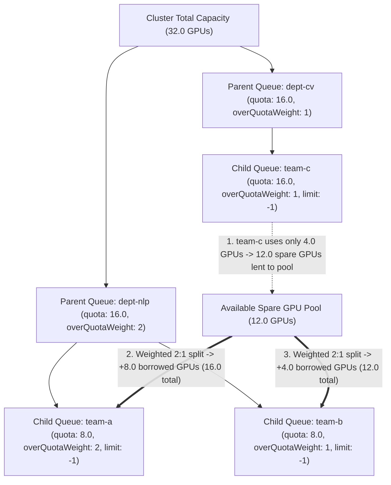
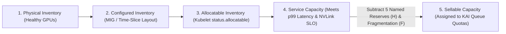

# 11.15 KAI queues, quotas and fair sharing

| | |
|---|---|
| Level | Advanced |
| Priority tier | 1 |
| Lab venue | GCP / GKE (plus local Python 3 simulation lab) |
| Part | Part 11: GPUs on Kubernetes, scheduling and virtualization |
| Coverage file | `planning/coverage/chapters/11-15.md` |

> **Update, November 2026:** NVIDIA open-sourced the full Run:ai platform on 13 October 2026, under Apache 2.0, in addition to the KAI Scheduler that has been open since April 2025. A supported commercial release still exists. See [11.31](./31-nvidias-open-source-ai-factory-kubernetes-stack.md).

## Why this matters for AI infrastructure

Picture a research team whose work sits in a pending queue. Across the cluster, dozens of GPUs sit idle inside another department's reserved quota. The team cannot run, and the GPUs cannot help, because the rule that divides them was written for a different year. This is the everyday problem of a multi-tenant AI cluster. Static quota without borrowing wastes expensive hardware. Borrowing without fast reclamation, on the other hand, destroys tenant trust.

Platform engineers feel this whenever one research team sits blocked in a pending queue while dozens of GPUs sit idle inside another department's reserved quota. Finance leaders feel it too. Teams demand millions of dollars in new GPU purchases, even though fleet dashboards show low average utilization. A purchase request is the most expensive way to fix a sharing problem, and it usually fixes nothing if the sharing rule stays the same. Before anyone signs a purchase order, ask the scheduling question first. Is the idle capacity in another queue, and can the rule lend it?

A scheduler has to hold two promises at once. It must guarantee every department its funded baseline capacity. It must also lend every idle GPU to active burst workloads, and reclaim those GPUs the moment their owners return. The two promises pull against each other. Lending more makes the owner wait for its own GPUs, and reclaiming too eagerly makes the cluster look half-empty again.

Naive queue and quota design fails in two operational ways. Both failures look like success on a single chart, which is why they survive for months. A high average looks healthy, and a high fairness score looks fair. Neither one proves that the cluster is serving the people who need it. In the first, a cluster looks half-empty on average dashboards while it rejects every new production job. In the second, a cluster enforces strict proportional fair share across research groups and still leaves over eighty percent of its total GPU-hours completely unused. The table below summarizes both failure modes from our production case studies.

| Incident or Case Study | Observed Fleet Metric | What Went Wrong | Operational Fix |
|---|---|---|---|
| Half-Empty Cluster That Rejects New Work (`volume-11/chapter-09`) | `48%` average GPU utilization on Grafana dashboards | Average utilization conflated incompatible MIG geometries, ignored the non-sellable headroom reserve `H` needed for node failures and rolling upgrades, and locked idle GPUs inside static namespace quotas. | Size capacity using `N = ceil((D + F) / (A * (1 - H)))` across all 5 capacity layers and enable over-quota borrowing. |
| Fair-Share Without Backfill Trap (`volume-24/chapter-12`) | `7.1%` utilization (`768.0` of `10,752` GPU-hours) or `~19.5%` (`~2,100` GPU-hours) at typical submission cadence | Allocating GPUs strictly in proportion to baseline shares (`40%`, `25%`, `20%`, `10%`, `5%`) across a `32`-GPU (`5`-group `A–E`) cluster achieved `100%` proportional fairness while leaving `~8,652–8,900` GPU-hours idle over `14` days (`32 GPUs * 14 days * 24 hours = 10,752` GPU-hours). | Deploy three-level Hierarchical Fair Queuing (`HFQ`) with `quota`, `overQuotaWeight`, opportunistic Level 3 Backfill to reach `> 90%` utilization, and `$0.20` normal vs `$0.40` priority chargeback. |

Each row pairs a fleet number with the design choice behind it. A number on a dashboard is a summary, so ask what the summary hides before you act on it. The first row's average hides the MIG and reserve problems, and the second row's fairness rule leaves the hours unused. Read the two rows side by side, and you see the same mistake from two angles. The first team trusted an average. The second team trusted a fairness rule that was never meant to fill the cluster on its own. In both cases the dashboard or the rule looked reasonable, and the users paid for the gap between what was measured and what was happening. Both treat a single average or a single rule as if it described the whole cluster.

This chapter builds the answer in layers. It starts with how the NVIDIA KAI Scheduler arranges teams into a tree of queues. Then it shows the arithmetic that decides how many GPUs each queue gets. After that, it sizes the physical node pool behind those queues, using the capacity formula from the NVIDIA zero-to-hero capacity-planning notes. It ends with billing, which turns shared GPUs into a cost each team can see and understand.

Take one ordinary Monday to see how these pieces meet. The research lead opens the queue dashboard and sees a job waiting for GPUs. The dashboard also shows that a sibling team in the same department has idle GPUs on its quota. The question is whether the scheduler will lend them, how fast it will take them back when the sibling returns, and what the bill will say at the end of the month. The rest of the chapter answers those three questions in order.

## Prerequisites and outcomes

### Prerequisites
Before you start, read Chapter 11.13 on KAI Scheduler motivation and deficit scoring, and Chapter 11.14 on KAI Scheduler microservices and custom resources. You should also know the standard Kubernetes Namespace and ResourceQuota objects, because this chapter builds on them. If a term such as borrowing weight or reclamation feels new, go back to Chapter 11.13 before you read the queue tree.

### Outcomes
This chapter builds a two-level or multi-level Hierarchical Fair Queuing tree in KAI Scheduler, from a Department Queue down to Project Queues. It explains how to set `quota`, `overQuotaWeight`, and `limit` on that tree, and how to work out the exact GPU allocation and borrowed GPU count for each queue during contention. It applies the three-level fairness model from the research cluster design notes to a 32-GPU cluster. It shows how weekly chargeback works across normal and priority rate tiers. It also sizes physical GPU node pools with the capacity planning formula, covering all five capacity layers and all five named operational reserves. The last part designs showback and chargeback models for whole GPUs, MIG partitions, and fractional time-sliced shares.

## Concepts: basics to intermediate to advanced

### 1. Basics: Hierarchical queues and the three KAI quota parameters

Picture a university or a large enterprise. A vice president of AI funds two departments, such as natural language processing and computer vision, and each department holds several project teams. GPU budgets in that setting are rarely flat. If one team leaves its GPUs idle, its sibling team in the same department should borrow them first. Only after that should they go to another department across the company. Standard Kubernetes ResourceQuota objects cannot express that rule, because namespaces have no parent-child relationship.

A useful way to see the rule is a shared office with floors. Each floor belongs to a department. Within a floor, one team may use another team's empty desks before anyone leaves the floor. Only when the whole floor is full does the overflow walk to the next floor. A flat list of rooms cannot express that order, and a tree can.

KAI Scheduler handles this with a hierarchical Queue tree. The tree lives under `scheduling.run.ai/v2`, and `queue-controller` builds it from Project resources in `kai.run.ai/v1`. Each child Project Queue names its parent Department Queue in the `parentQueue` field. When a project under the natural language processing department has unused GPUs, KAI Scheduler lends them to sibling projects in that same department first. Only when the whole parent department has met its demand does the scheduler lend the remaining idle GPUs to external departments.

The diagram below follows a 32-GPU cluster through one borrowing cycle.



Read the diagram in order. The spare pool holds 12.0 GPUs. The 2:1 weights split them, so team-a gets 8.0 more and team-b gets 4.0 more. Notice that the spare GPUs come from team-c, which sits in the other department. If team-c submits work later, the reclaim path brings its quota back from the borrowers. The borrowing happens across the tree, and the weights decide the split inside the pool.

Every Queue sets three parameters for each resource type: `quota`, `overQuotaWeight`, and `limit`. Each one answers a different question. How many GPUs are guaranteed? How are spare GPUs shared? How high can a burst go? The table below defines each parameter and shows how it behaves on our 32-GPU cluster example.

| KAI Queue Parameter | Operational Meaning | Behavior During Contention and Idle Periods |
|---|---|---|
| `quota` (Nominal or Deserved Quota) | The guaranteed baseline number of GPUs owned by this queue (e.g., `8.0` GPUs for `team-a`). | Whenever `team-a` uses `< 8.0` GPUs and submits a new job, KAI Scheduler's Reclaim action immediately reclaims lent GPUs from over-quota borrowers so `team-a` gets its `8.0` GPUs. |
| `overQuotaWeight` (Borrowing Share Weight) | Relative weight (`1`, `2`, etc.) determining what fraction of the cluster's unused GPUs this queue receives when bursting above `quota`. | If `12.0` spare GPUs are free and `team-a` (`weight: 2`) and `team-b` (`weight: 1`) both demand extra GPUs, `team-a` receives `2 / (2 + 1) = 2/3` (`+8.0` GPUs) and `team-b` receives `1 / (2 + 1) = 1/3` (`+4.0` GPUs). |
| `limit` (Max Allowed Quota Ceiling) | Hard upper bound on total GPUs (`nominal + borrowed`) this queue may hold simultaneously (`-1` means unlimited borrowing up to cluster size). | If `team-a` sets `limit: 12.0` with `quota: 8.0`, `team-a` can borrow at most `4.0` extra GPUs (`8.0 + 4.0 = 12.0`) even if `20` GPUs sit idle in the cluster. |

Read the table with team-a in mind. Its `quota` guarantees 8.0 GPUs, its weight decides its share of the spare pool, and its `limit` caps the total. The three parameters work as a set. Change one of them, and the other two keep their meaning, but the outcome of a burst changes.

A value of `-1` in the `limit` field means no ceiling, so the queue may borrow up to whatever the cluster has free. Use that setting for a team that is allowed to burst, and set an explicit ceiling for a team that must never crowd out the others.

A simple habit helps when you write these values. Ask what happens during a burst, then ask what happens when the owner returns. The first question answers `overQuotaWeight` and `limit`. The second answers `quota`, because reclaiming the baseline is the guarantee the owner keeps.

---

### 2. Intermediate: Hierarchical Fair Queuing mathematics and the 32-GPU research cluster

Suppose several teams burst above their nominal quota at the same time. The scheduler now needs an exact rule that divides the spare GPUs without starving smaller teams. Hard quotas with no over-quota borrowing fail in their own way. A team whose jobs finish on Friday leaves its GPUs dark all weekend, while other teams wait in queues. The opposite design fails too. With first-come-first-served borrowing and no proportional weights, whichever researcher writes a loop to submit a hundred jobs first monopolizes every spare GPU.

KAI Scheduler avoids both problems. It computes each active queue's fair share as its nominal quota plus a weighted fraction of the unused cluster pool. Take five research groups sharing one 32-GPU cluster. Each group's baseline quota reflects its researcher headcount and funding share. The table below shows the five-group workload profile and proportional shares from our research cluster case study.

| Group | Researchers and Share (`%`) | Exact Fair Share (`GPUs`) | Integer Cap (`maxgpus`) | Account Priority | Typical Workload Profile and Weekly Frequency |
|---|---|---|---|---|---|
| Group A (LLM Pretraining) | `5` researchers (`40.0%`) | `12.8` GPUs | `13` GPUs | `1000` | `8` GPUs × `48` hours, `2x`/week (`307.2` GPUh fair-share window) |
| Group B (Vision Research) | `4` researchers (`25.0%`) | `8.0` GPUs | `8` GPUs | `900` | `4` GPUs × `2` hours, `10x`/week (`192.0` GPUh fair-share window) |
| Group C (Automated NAS) | `3` researchers (`20.0%`) | `6.4` GPUs | `6` GPUs | `800` | `1` GPU × `30` min, `100x`/week (`153.6` GPUh fair-share window) |
| Group D (Simulation) | `2` researchers (`10.0%`) | `3.2` GPUs | `3` GPUs | `700` | `2` GPUs × `72` hours, `1x`/week (`76.8` GPUh fair-share window) |
| Group E (Inference Eval) | `1` researcher (`5.0%`) | `1.6` GPUs | `2` GPUs | `600` | `1` GPU × `10` min, `50x`/week (`38.4` GPUh fair-share window) |
| Total Cluster | `15` researchers (`100.0%`) | `32.0` GPUs | `32` GPUs | — | `768.0` GPU-hours in the 2-week fairness table |

Group A has the most researchers and the largest share, and Group E has the fewest. The table also lists an integer cap for each group, in the `maxgpus` column. Read the exact share and the integer cap as two different tools. The exact share says what a group deserves in principle. The integer cap says the most whole GPUs the group may hold at once, which is what a Slurm account can enforce. When a fractional share sits between two whole numbers, the cap rounds it in a way the scheduler can use. The exact shares add up to 32.0 GPUs, but the integer caps can only be whole numbers. That gap is the reason the caps and the shares are shown side by side.

Keeping these shares fair is not enough on its own, because the cluster also has to stay busy. The scheduler therefore applies three levels of Hierarchical Fair Queuing (HFQ). Level 1 keeps the five groups proportionally fair with each other. Level 2 uses round-robin inside a group, so one researcher cannot starve their own teammates. Level 3 backfills idle capacity, so the cluster does not sit empty when groups submit below their theoretical ceiling.

Think of the three levels as a fair bus schedule. Inside one neighborhood, the second rule works like a rotating list. If three riders are waiting, the first gets on, then the second, then the third, and the next bus starts the list again. That turn-taking keeps one loud rider from filling every seat. The first rule says each neighborhood gets its share of buses. The second rule says each rider in a neighborhood takes turns. The third rule says an empty bus leaves with whoever is waiting, so no seat goes unused.

The block below works through the numbers for all three levels.

```text
Three-Level Hierarchical Fair Queuing (HFQ) Capacity Arithmetic (volume-24/chapter-12):
  Level 1 (Inter-Group Proportional Share over 14-day window):
    Group A: 40.0% -> 12.8 GPUs (307.2 GPUh of 768.0 GPUh baseline verification table)
    Group B: 25.0% ->  8.0 GPUs (192.0 GPUh)
    Group C: 20.0% ->  6.4 GPUs (153.6 GPUh)
    Group D: 10.0% ->  3.2 GPUs ( 76.8 GPUh)
    Group E:  5.0% ->  1.6 GPUs ( 38.4 GPUh)
  Level 2 (Intra-Group Round-Robin):
    Group B (10 vision jobs/week): each researcher job receives 1/10 of Group B's share.
  Level 3 (Opportunistic Backfill — Why 7.1% / 19.5% Requires Backfill to Hit > 90%):
    Total 2-week (14-day) cluster capacity = 32 GPUs * 14 days * 24 hours = 10,752 GPU-hours
    (or 480 hours per 20-day work window / 336 hours per 14-day wall-clock window per GPU).
    Baseline fairness table = 768.0 / 10,752 = 7.14% (7.1%) utilization.
    Full typical weekly cadence across all 5 groups = ~2,100 / 10,752 = 19.5% utilization.
    Idle capacity without Level 3 Backfill = ~8,652 to 8,900 GPU-hours per 2 weeks.
    Preemption safeguard for 48-hour LLM runs: 30-minute checkpoint grace period prevents losing 10 hours of work.
```

Notice the 7.1 percent figure. Put simply, the fair split decides who goes first, and backfill decides whether capacity sits empty while someone waits. The fair-share table alone uses only a small part of the cluster's hours, so Level 3 Backfill has to fill the rest. This is the point where many teams stop too early. A fair split that uses only 7.1 percent of the hours is fair, but it is not useful.

---

### 3. Advanced: Capacity planning, five operational reserves, and chargeback economics

Platform teams often get burned by one mistake. They treat the Kubernetes Allocatable GPU count as sellable tenant quota. Suppose you promise one hundred percent of your physical GPUs as guaranteed `quota` across project queues. A single hardware failure, driver upgrade, or MIG geometry mismatch then breaks a tenant's service guarantee at once. A structured capacity model keeps physical hardware and sellable quota apart.

Picture a hotel that sells every room on the booking site, including the rooms that are being cleaned or repaired. Guests arrive, and some rooms are not ready. The hotel can keep its promises only if it holds back a few rooms for cleaning, repairs and guests who arrive early. GPU capacity works the same way. Some GPUs must stay free for failures, maintenance and rollouts, or the promises to tenants cannot be kept.

The NVIDIA zero-to-hero capacity-planning notes define five layers of GPU capacity, and every platform team needs to track each one separately. The five layers answer five different questions, and their answers do not average together. Physical Inventory counts healthy cards installed in servers. Configured Inventory counts GPUs set to the intended MIG, vGPU, or time-slicing mode. Allocatable Inventory counts the units `kubelet` advertises in `status.allocatable`. Service Capacity counts the units that can meet the documented tail-latency or NVLink step-time promise. Sellable Capacity comes last. It is what remains for tenant `quota` after headroom reserves and geometry fragmentation are subtracted.

Each layer is smaller than the one before it, and each cut has a reason. A useful habit is to ask, for every tenant, which layer their promise is written against. A promise written against Allocatable Inventory is a promise the cluster may not be able to keep during maintenance. A promise written against Sellable Capacity is the one the platform can defend. A card that is healthy but not configured for MIG cannot serve a MIG tenant. A configured card that the scheduler does not advertise cannot be requested. An advertised card that cannot meet the latency promise is not a real service unit. The sellable number is the one you hand to tenants, so it is the smallest of the five.

The chain below shows how the five layers connect.



Read the chain from left to right. The last box is the only number you hand to tenant quota.

Now for the question of how many physical worker nodes a service class needs. The auditable node-sizing formula from the capacity-planning notes answers it. The formula counts concurrent demand, MIG placement fragmentation, and usable allocations per node. It also includes the non-sellable headroom fraction, which splits into five named operational reserves.

```text
Auditable Node-Sizing Formula and Five Named Reserves (volume-11/chapter-09):
  N = ceil((D + F) / (A * (1 - H)))

Variables:
  N = Required number of standardized worker nodes
  D = Required concurrent allocations (measured demand-equivalent for the workload class)
  F = Expected allocation loss from MIG geometry fragmentation or NUMA/NVSwitch placement constraints
  A = Usable allocations provided by 1 standardized node after its approved layout is applied
      (e.g., A = 7 1g.10gb slices on a 1-GPU node, or A = 8 whole GPUs on an HGX node)
  H = Non-sellable headroom fraction (0 <= H < 1), decomposed across 5 named reserves:
      1. Node-failure reserve: survives 1 node or failure domain going down without breaching quota.
      2. Maintenance reserve: allows draining nodes for kernel, driver (nvidia.ko), or MIG layout changes.
      3. Rollout reserve: keeps a healthy comparison/canary pool available during staged GPU Operator upgrades.
      4. Demand-variance reserve: absorbs burst windows and forecast error within queue-time SLOs.
      5. Fragmentation reserve: covers physically free MIG slices whose geometry cannot fit the next profile
         (e.g., 1g free when 4g.20gb is requested).

Worked Example (D = 40, F = 5, A = 7, H = 0.20 -> 7 * (1 - 0.20) = 5.6 sellable slices/node):
  N = ceil((40 + 5) / (7 * (1 - 0.20))) = ceil(45 / 5.6) = ceil(8.0357) = 9 nodes
```

Work through the example step by step. Start with demand of 40 allocations, and add 5 allocations of expected loss to reach 45. The headroom fraction of 0.20 reduces the 7 usable slices to 5.6 sellable slices per node. Dividing 45 by 5.6 gives about 8.04, and rounding up gives 9 nodes.

The rounding direction is the part people forget. The same logic runs in the other direction when you change the inputs. If the headroom fraction grows, the denominator shrinks and the node count rises. If the expected loss grows, the numerator rises and the node count rises with it. Run the formula with a few inputs before you commit to a purchase, so you can see which reserve drives the answer. A node is a whole machine, so a fraction of a node is never a valid answer. If the formula gave 8.04, you would still buy nine nodes, because one node fewer than the rounded count cannot hold the demand after the headroom is removed.

Once sellable capacity is sized, you still have to decide how to bill GPU usage across competing teams. Do not bill reserved GPUs on compute utilization alone, such as `DCGM_FI_DEV_GPU_UTIL`. Picture a researcher who allocates half a GPU's memory in an interactive pod, then leaves compute utilization at zero percent over lunch. That memory stays locked, and no other team can use it.

> **dcgm-exporter 4.9.0 version note.** dcgm-exporter 4.9.0 (2026-11-06) renamed many default metrics and changed some units. For example `DCGM_FI_DEV_GPU_UTIL` (percent) became `DCGM_FI_DEV_GPU_UTIL_RATIO` (0 to 1), and `DCGM_FI_DEV_FB_USED` (MiB) became `DCGM_FI_DEV_FB_USED_BYTES`. The metric names in this chapter are the 4.8.x names. On a 4.9.0 exporter use the [full mapping in 17.4](../part-17-operations/04-dcgm-exporter-and-interpreting-gpu-metrics.md#14-what-dcgm-exporter-490-renamed), and change thresholds together with the unit.

Bill by the allocation contract instead. The contract is the reservation the tenant holds, not the activity the GPU shows in one minute. That matters because a reservation can be idle and still block other work. Billing the reservation gives the team a reason to release an idle slice, which is the behavior the cluster needs. A tenant pays for the hardware share and service tier it reserves, for as long as the Pod holds the allocation. Start with a non-billed Showback dashboard, so teams can clean up idle notebooks before finance turns on hard Chargeback. The table below summarizes the allocation-contract billing rules for whole GPUs, MIG slices, and time-sliced pools.

| Resource Shape or Queue Tier | Allocation-Contract Billing Rule | Rate Card and Worked Weekly Cost (`volume-11/chapter-09` & `volume-24/chapter-12`) |
|---|---|---|
| Whole Dedicated GPU (Normal Queue) | Bill per reserved or allocated GPU-hour regardless of SM activity (`0%` or `100%`). | `$0.20` per GPU-hour: Group A (`2` jobs/week × `8` GPUs × `48` hours × `$0.20`) pays `$153.60/week`; Group E (`50` jobs/week × `1` GPU × `10/60` hours × `$0.20`) pays `$1.67/week`. |
| Whole Dedicated GPU (Priority Queue) | Bill at `2x` premium rate for immediate scheduling and preemption rights over normal jobs. | `$0.40` per GPU-hour (`2x` normal rate): expedited jobs pay double the `$0.20` normal rate. |
| Fixed MIG Profile (`MIG 3g.40gb`) | Bill for the reserved fraction of the physical card for the duration the Pod holds the slice. | `~50%` of the whole-GPU hourly rate, even when interactive compute utilization sits at `0%`. |
| Time-Sliced or Fractional Pool (`1` of `10` slices) | Bill for the logical slice share or best-effort access tier without a latency SLA. | `10%` of the whole-GPU hardware rate, explicitly noting that time-slicing buys capacity access rather than deterministic compute or memory isolation. |

A `MIG 3g.40gb` slice costs about half the whole-GPU rate even when it sits idle, because the reservation holds the slice. Showback and chargeback differ in one important way. Showback shows each team the cost of what it holds, but no money moves. Chargeback debits the team's cost center. Most platforms run Showback first, so the numbers can be checked before anyone is billed. The bill follows the hardware the tenant locked, not the work the tenant happened to do in that hour. That rule feels harsh at first, but it matches what the cluster gave up. Another team could have used that slice, and the reservation prevented it.

### 4. Continuous governance: demand forecasting, idle reclamation, and rate-card reviews

Picture the week after launch, when the Queue objects are live and the first complaints arrive. Capacity planning does not end when the Queue objects reach the cluster. Without steady feedback between scheduler telemetry and quota reviews, early reservations harden into permanent hoarding, and new projects starve. Picture a quarter in which one project reserves a large share of the cluster for a launch that slips more than once. The reservation stays in place, and the next project waits. Platform teams therefore need three things: clear leading signals, a staged playbook for idle reservations, and an explicit service catalog checklist.

Track both leading and lagging capacity signals for every service class. Reservation pipelines and project roadmaps show committed demand before it arrives. Queue wait time by service class shows the moment active demand exceeds usable sellable capacity. Rejected or pending PodGroup requests expose demand that no shape can satisfy, such as a spike in pending four-GPU NVSwitch gangs or three-slice MIG requests. Group those requests by scheduler predicate failure reason. Comparing active allocation hours with application throughput and tail latency shows whether the allocated share met its service promise. Finally, maintenance and hardware failure counts tell you whether your headroom fraction was sized realistically. Leading signals tell you what is coming. Lagging signals tell you what already happened. A good review uses both, because a forecast that only looks at history misses the launch that has not started yet.

Suppose showback telemetry shows a project holding reserved GPU quota, or long-lived interactive pods, at zero percent compute activity while sibling queues wait. Respond in four stages. Each stage moves from visibility to quota reallocation, and none of them surprises researchers.

| Stage | Operational Action | Mechanism and Policy Safeguard |
|---|---|---|
| Stage 1: Visibility | Surface idle reservation age and opportunity cost | Publish `Allocated GPU-Hours`, `Idle Reservation Age`, and `Borrowed vs Nominal Hours` on the project's showback report and notify technical and budget owners. |
| Stage 2: Automated Borrowing | Lend idle GPUs to active queues immediately | Allow KAI Scheduler's `overQuotaWeight` mechanism to lend unused GPUs to active queues, protected by the documented recall and checkpoint grace policy. |
| Stage 3: Idle TTL and Right-Sizing | Reclaim idle interactive pods and right-size shapes | Suspend or terminate interactive Jupyter pods whose GPU utilization stays `0%` past an agreed TTL, and move bursty low-utilization workloads to fractional or smaller MIG classes. |
| Stage 4: Quota Reallocation | Rebalance baseline entitlement in quarterly reviews | Adjust the project's nominal `quota` downward during the monthly or quarterly capacity review forum if historical consumption consistently trails reserved entitlement. |

Consider how the four stages play out for one project. In Stage 1, the showback report shows the project's reserved hours and its zero compute activity, and the owners get a notice. In Stage 2, the scheduler lends the idle GPUs to a sibling queue that is waiting. The project keeps its guarantee, because the reclaim path still works. In Stage 3, the owners decide whether their idle notebooks should be suspended after the agreed idle window. In Stage 4, the review moves the nominal quota down if the project's history supports it.

Stage 2 is where the scheduler does the work for you. Stage 4 is the only stage that changes the nominal `quota`. The first three stages change how the idle capacity is used, while the fourth changes how much the project is entitled to in the first place. Keeping those two ideas apart keeps the review meeting calm.

Before you publish any GPU queue or service tier to internal teams, check that the service catalog answers eight explicit governance questions. Publish that contract with every KAI Queue and Project onboarding request, so platform engineers, finance leaders, and research leads share one definition of capacity, fairness, and cost. Archive a formal Capacity Decision Record whenever a node pool's sharing layout, quota tree, or reserve assumption changes. That record keeps temporary shortage workarounds from turning into permanent architectural debt.

The catalog should answer these eight points:

- What workload outcome does the tier protect, such as tail latency, training step time, or interactive notebook access?
- Is the GPU allocation dedicated, hardware-partitioned with MIG, oversubscribed with time-slicing or fractional sharing, or virtualized with vGPU?
- Which physical and scheduler constraints bound the tier, including single-node pod limits, NVSwitch domain size, and MIG profile geometry?
- Which failure and maintenance reserve is in the rate card, and which queues may borrow it?
- Which platform events, such as unscheduled hardware replacement or violated recall windows, earn a service credit or a post-incident review?
- Which authoritative record establishes billable consumption, and how can a project owner dispute an entry?
- Which cluster upgrades, driver reloads, or MIG layout changes can disrupt workloads in this tier?
- What is explicitly not guaranteed, such as memory isolation or latency predictability in a time-sliced best-effort queue?

Treat those eight points as the minimum for every service tier you publish. For a best-effort time-sliced pool, a complete answer is short and honest. It protects interactive notebook access. It uses time-slicing with no memory isolation. Its limits are a per-user cap and an idle reaper. It gives no latency promise, and it says so in plain words. A tier that cannot answer one of them is not ready for internal customers, even if the cluster is running it well.

## Commands and configurations that matter

### 1. Defining a two-level KAI Department-to-Project Queue hierarchy

Intra-department borrowing has to come before inter-department lending, and this manifest sets that order up. You create a parent Department Queue, then attach child Project Queues with the `parentQueue` field. The manifest below gives the parent department queue sixteen nominal GPUs. It then splits that quota across two child team queues, with a two-to-one borrowing weight ratio. The Queue CRD counts CPU in millicores and memory in megabytes, so 128 cores is written 128000 and 1 TB is 1024000.

Read the manifest from the top. The department comes first, because the child queues point back at it. Then each team gets its own block, with the same three fields for every resource. A team block is easy to copy, and that is where a typo often hides, so check the `parentQueue` value on every child.

```yaml
# kai-hierarchical-queues.yaml. Queue units: gpu in devices, cpu in millicores, memory in MB.
apiVersion: scheduling.run.ai/v2
kind: Queue
metadata:
  name: dept-nlp
spec:
  resources:
    gpu:
      quota: 16
      overQuotaWeight: 2
      limit: -1
    cpu:
      quota: 128000
      overQuotaWeight: 2
      limit: -1
    memory:
      quota: 1024000
      overQuotaWeight: 2
      limit: -1
---
apiVersion: scheduling.run.ai/v2
kind: Queue
metadata:
  name: team-a
spec:
  parentQueue: dept-nlp
  resources:
    gpu:
      quota: 8
      overQuotaWeight: 2
      limit: -1
    cpu:
      quota: 64000
      overQuotaWeight: 2
      limit: -1
    memory:
      quota: 512000
      overQuotaWeight: 2
      limit: -1
---
apiVersion: scheduling.run.ai/v2
kind: Queue
metadata:
  name: team-b
spec:
  parentQueue: dept-nlp
  resources:
    gpu:
      quota: 8
      overQuotaWeight: 1
      limit: -1
    cpu:
      quota: 64000
      overQuotaWeight: 1
      limit: -1
    memory:
      quota: 512000
      overQuotaWeight: 1
      limit: -1
```

You can check the split: the two team quotas add up to the 16 GPUs of the department. When you add a third team later, check the sum again before you apply the manifest. A department whose child quotas add up to more than the parent quota makes the tree harder to reason about, and the sum is the first thing to recheck. Team-a carries weight 2, so it gets twice the borrowing share of team-b.

### 2. Configuring Slurm equivalent fair-share QOS and accounts

Many AI platforms run a Slurm partition alongside Kubernetes. Others move an existing Slurm fair-share tree into KAI Scheduler. Either way, the `sacctmgr` commands below rebuild the five-group, 32-GPU hierarchy from the research cluster design notes. They set up a normal quality-of-service tier with a 72-hour timeout and a priority tier with a 24-hour timeout.

Slurm calls its policy objects accounts and quality-of-service tiers, or QOS. A QOS sets limits such as a maximum GPU count and a timeout, and an account decides which QOS its jobs may use. The commands follow that split. They define the tiers first, then attach each group account to both, and finally set each account's priority and GPU cap.

```bash
# Configure normal and priority QOS and 5 research accounts in Slurm (volume-24/chapter-12, untested here)
sacctmgr add qos normal priority=100 maxgpus=40 maxjobsperuser=10 timeout=259200
sacctmgr add qos priority priority=200 maxgpus=32 maxjobsperuser=5 timeout=86400

for grp in group-a group-b group-c group-d group-e; do
  sacctmgr add account "$grp" qos=normal,priority parent=root
done

sacctmgr set account group-a set priority=1000 maxgpus=13
sacctmgr set account group-b set priority=900  maxgpus=8
sacctmgr set account group-c set priority=800  maxgpus=6
sacctmgr set account group-d set priority=700  maxgpus=3
sacctmgr set account group-e set priority=600  maxgpus=2
```

Read the commands in order, and you will see the structure. The QOS priority numbers decide which tier a job is served from first, and the account priority decides which group goes first inside that tier. Both numbers are compared only against the other jobs in the same scheduler, so changing one group's value changes the order for the others too. The first two lines define the tiers. The loop then attaches each group account to both of them, and the last five lines set each account's priority and GPU cap.

## How it fails

Misconfigured borrowing limits, missing checkpoint grace periods, and naive capacity metrics all cause predictable production outages. You will likely recognize these symptoms from dashboards or pending lists. A dashboard that looks healthy while a queue waits is a warning sign, because it means the metric and the experience disagree. The table below lists five failures. For each one, you get the symptom, the root cause boundary, and the remediation.

| Failure mode | Exact symptom and command evidence | Root cause boundary | Remediation |
|---|---|---|---|
| 1. Cluster sits at `60%` or `19.5%` utilization while jobs wait in queues | Dashboards show `40%–80%` of GPUs idle, yet pending jobs exist in `team-a` (`volume-24/chapter-12`). | Borrowing disabled (`limit == quota`) or Backfill off: queues were configured with hard ceilings (`limit: 8` equal to `quota: 8` or `overQuotaWeight: 0`), preventing active teams from borrowing idle GPUs. | Set `limit: -1` (or a generous burst ceiling) and positive `overQuotaWeight` on project and department queues so KAI Scheduler backfills idle capacity automatically. |
| 2. `48`-hour LLM training job loses `10` hours of compute when reclaimed (`volume-24/chapter-12`) | Group A bursts above its `40%` (`12.8`-GPU) nominal share; when Group B submits work, Reclaim preempts Group A's `8`-GPU job, losing `10` hours of unsaved training progress. | Missing preemption grace window or missing periodic checkpoints: the job ran in borrowable over-quota capacity without periodic checkpointing or an adequate termination grace period. | Keep non-checkpointing or long jobs inside guaranteed nominal `quota` (`12.8` GPUs), save checkpoints every `100` steps or `30–60` minutes, and configure an adequate preemption grace period (`30`s to `30` min). |
| 3. Platform defers hardware purchase at `48%` average utilization, then runs out of MIG slices (`volume-11/chapter-09`) | Fleet-wide DCGM utilization averages `48%`, but new `nvidia.com/mig-3g.20gb` Pods stay Pending (`Insufficient nvidia.com/mig-3g.20gb`). | Conflating average device activity with sellable profile geometry: free capacity existed only in incompatible MIG shapes (`1g.5gb`), maintenance-drained nodes, or non-sellable failure reserves (`H`). | Track Sellable Capacity per service class and MIG layout using `N = ceil((D + F) / (A * (1 - H)))` and alert on per-profile pending queues rather than fleet-wide average SM utilization. |
| 4. Chargeback bill is `50%` too low (`$100` billed when `160` GPU-hours were used) | Monthly finance reconciliation shows Group A was billed `$100` despite using `160` GPU-hours across normal and priority queues (`volume-24/chapter-12`). | Missing service-tier or queue multiplier in chargeback pipeline: the billing script did not track the `priority` queue premium (`2x` rate at `$0.40`/GPUh vs `$0.20`/GPUh) or rounded GPU-hours incorrectly. | Join allocation intervals against `(Project, Queue, PriorityClass, ResourceShape)` so `priority` queue hours (`$0.40`), `normal` queue hours (`$0.20`), and MIG fractions (`50%`) are rated accurately. |
| 5. One best-effort user spawns `100` idle Jupyter notebooks and hogs all time-sliced replicas | Protected workloads are unaffected, but every other developer in the `best-effort` shared pool gets stuck in Pending. | Unbounded logical replica quota on shared pool (`volume-11/chapter-07` & `08`): time-slicing increased Allocatable logical units (`replicas: 10`), and the namespace lacked a concurrency limit or idle reaper. | Enforce per-user and per-project `limit` caps on shared queues and automatically suspend or reclaim interactive notebooks whose GPU utilization stays `0%` past an idle TTL window. |

If you see a cluster that looks idle while jobs still wait, start with row 1. Row 2 teaches a different lesson. A long job on borrowed capacity needs a grace window and a checkpoint, or a reclaim will throw away its progress. The fix is a rule about where long jobs run, plus a checkpoint schedule, and that rule keeps the lending model from costing the owner hours of work. Check `limit` and `overQuotaWeight` on each queue first, and compare your dashboard with the symptom column. Rows 2 and 5 are about the rules you set on each job and each shared pool. Rows 3 and 4 are about the metrics and the bill. Working through them in that grouping keeps the investigation focused.

## Hands-on lab

### Venue and scope
You run this lab on your own machine with the Python 3 standard library. It uses `code/part11/kai_queues_quotas_fair_sharing.py` and `code/part11/kai_queues_quotas_fair_sharing_lab.py`. It checks three things: KAI Scheduler's hierarchical Queue fair-share engine, the five-group, 32-GPU research cluster model from the design notes, and the node-sizing capacity formula from the capacity-planning notes. The cluster commands in earlier sections are marked `(untested here)`, so these steps were not run on a live cluster, and the lab does not check them.

The lab needs no GPU, no Kubernetes cluster and no Slurm installation. Each check in the lab maps to one claim in the chapter, and the summary line counts how many of those claims hold with the current code. A check that passes tells you the arithmetic is right. It does not tell you that a live cluster behaves the same way, which is why the cluster commands are kept separate. It runs the arithmetic in plain Python, which makes it a good place to check your hand calculations before you apply them to a real cluster.

### Step 1: Run the self-checking KAI queues, quotas, and fair-sharing lab (tested here)

Start from the repository root and run the lab script. It validates all 25 fair-sharing, backfill, chargeback, and capacity planning assertions.

```bash
python3 code/part11/kai_queues_quotas_fair_sharing_lab.py
```

The block below shows what a passing result looks like. It ends with a summary of 25 checks.

```text
=== Chapter 11.15 Lab: KAI Queues, Quotas, Fair Sharing & Capacity Chargeback ===
  [PASS] Idle/light Team C (nominal=16, demand=4) uses 4.0 GPUs and lends 12.0 unused GPUs to the cluster pool
  [PASS] Team A (nominal=8, overQuotaWeight=2) receives 2/3 of the 12 spare GPUs -> 16.0 GPUs total (8.0 borrowed)
  [PASS] Team B (nominal=8, overQuotaWeight=1) receives 1/3 of the 12 spare GPUs -> 12.0 GPUs total (4.0 borrowed)
  [PASS] Total allocated GPUs across all 3 queues (16.0 + 12.0 + 4.0) equals all 32.0 cluster GPUs
  [PASS] When Team A sets limit=12.0, its allocation is capped at 12.0 GPUs (4.0 borrowed)
  [PASS] 32-GPU proportional shares map A(40%)=12.8, B(25%)=8.0, C(20%)=6.4, D(10%)=3.2, E(5%)=1.6 GPUs
  [PASS] Exact GPU shares (32.0) and integer Slurm maxgpus caps (13+8+6+3+2=32) both sum to 32 GPUs
  [PASS] 768.0 GPU-hours out of 10,752 GPU-hours (32 GPUs x 14d x 24h) is 7.1% utilization (proving backfill is mandatory)
  [PASS] At $0.20/GPUh normal ($0.40 priority = 2.0x), Group A costs $153.60/wk and Group E costs $1.67/wk
  [PASS] Capacity formula N = ceil((40 + 5) / (7 * (1 - 0.20))) = ceil(45 / 5.6) requires 9 nodes
  [PASS] Volume 11 Ch 9 planning incident highlights how a 48% average utilization chart can hide MIG profile exhaustion
  [PASS] Allocation-contract chargeback bills MIG 3g.40gb at ~50% GPU rate and 1-of-10 time-slice at 10% rate regardless of idle compute
  [PASS] Slurm normal QOS timeout is 259,200s (72h, maxgpus=40) and priority QOS timeout is 86,400s (24h, maxgpus=32)
  [PASS] Group account priorities order group-a(1000) > group-b(900) > group-c(800) > group-d(700) > group-e(600)
  [PASS] Typical 5-group cadence (~2,100 GPUh / 10,752 GPUh = 19.5%) leaves ~8,652-8,900 GPUh for Level 3 Backfill
  [PASS] Research lab researcher counts (5 + 4 + 3 + 2 + 1 = 15 researchers) align with the 40/25/20/10/5% shares
  [PASS] 2-week allocated GPU-hours (307.2, 192.0, 153.6, 76.8, 38.4) match 40%, 25%, 20%, 10%, 5% exactly
  [PASS] Weekly accounting script divides CPU/GPU seconds or hours by 480h window factor
  [PASS] Volume 11 Ch 9 models 5 distinct capacity layers from Physical to Sellable capacity
  [PASS] Volume 11 Ch 9 decomposes headroom H into 5 named failure and operational reserves
  [PASS] Volume 11 Ch 8 defines 6 observable fairness policy elements
  [PASS] Volume 11 Ch 8 enforces fairness controls across 3 time scales (Admission, Execution, Lifecycle)
  [PASS] Priority queue 2x rate ($0.40 vs $0.20) doubles GPU-hour billing for expedited jobs
  [PASS] Large 48h jobs require a 30-min preemption checkpoint grace window to avoid losing 10h of un-checkpointed work
  [PASS] Job scheduling log tracks JobIDs 4001 through 4008 across RUNNING and QUEUED states

Summary: 25 passed, 0 failed out of 25 checks.
```

A failed check prints its own FAIL line, so the summary line is the one to read first. If the summary reports a failure, go to the FAIL line, find the matching section of the chapter, and check your inputs against it before you change any code.

### Exercises

The exercises follow the chapter in order. The first three use the queue tree and the fairness arithmetic. The fourth uses chargeback, and the last two use capacity planning and billing. Each one asks for a hand calculation first and a function call second, so you can check your reasoning against the code.

Start with proportional over-quota borrowing. On a 32-GPU cluster, Team A has a nominal quota of 8 GPUs and a borrowing weight of 2. Team B has a nominal quota of 8 GPUs and a borrowing weight of 1. Team C has a nominal quota of 16 GPUs and a borrowing weight of 1, but it requests only 4 GPUs. Team A and Team B each demand 24 GPUs, with unlimited borrowing. Use `compute_kai_fair_shares()` in `code/part11/kai_queues_quotas_fair_sharing.py` to compute the allocated and borrowed GPUs for all three teams.

Repeat that scenario with one change. Team A now has a hard borrowing limit of 12 GPUs. How many total GPUs does Team A receive under this ceiling? How many of those GPUs are borrowed?

Verify the five-group research cluster next. Use `evaluate_five_group_research_cluster()` to check each group's exact GPU share. Why does 768 GPU-hours over 14 days equal only 7.1 percent of total capacity? How many GPU-hours must Level 3 Backfill fill to exceed 90 percent utilization?

Work out the weekly chargeback. What is the weekly normal-queue chargeback for Group A, which runs two 8-GPU jobs per week for 48 hours each? What is the weekly normal-queue chargeback for Group E, which runs fifty 1-GPU jobs per week for 10 minutes each? How does the priority queue rate multiplier change the hourly rate from normal to priority execution?

Size a node with fragmentation and headroom reserves. Call `compute_required_nodes_for_service_class()` in Python with the parameters from the capacity-planning worked example. What is the effective sellable allocation per node? What is the raw node count? What is the required whole node count?

Compare the two billing models. Why must a tenant holding a `MIG 3g.40gb` slice at zero percent compute utilization still pay about half of the physical GPU's hourly cost? Explain the answer in terms of what the tenant has locked.

Work the numbers by hand first, then compare your results with the Python functions. A mismatch usually comes from a unit or a rounding step, so check those two before you suspect the code.


## Checkpoint questions

## Checkpoint questions

<details>
<summary>**1. What are the three per-resource quota fields on a KAI Scheduler Queue (scheduling.run.ai/v2), and what does each control?**</summary>

The `quota` field is the guaranteed baseline. The queue can always reclaim that many resources when it has pending workloads. The `overQuotaWeight` field sets how spare cluster resources are shared when the queue bursts above its nominal quota. The `limit` field caps the total of nominal plus borrowed resources the queue can use at once. If you set `limit` to `-1`, the queue can borrow without a fixed cap, up to the cluster's capacity.
</details>

<details>
<summary>**2. On a 32-GPU cluster, Team A (quota: 8, overQuotaWeight: 2) and Team B (quota: 8, overQuotaWeight: 1) both demand 24 GPUs, while Team C (quota: 16) only uses 4 GPUs. How many total and borrowed GPUs does KAI Scheduler allocate to Team A and Team B?**</summary>

Team C uses only 4 of its 16 nominal GPUs, so 12 GPUs are spare in the cluster pool. If you add the totals, Team A's 16 and Team B's 12 plus Team C's 4 give the 32 GPUs. KAI Scheduler splits those 12 spare GPUs between Team A and Team B in a two-to-one ratio, based on their borrowing weights. Team A ends up with 16 GPUs: its 8 nominal plus 8 borrowed. Team B ends up with 12 GPUs: its 8 nominal plus 4 borrowed. Team C keeps its 4 active GPUs.
</details>

<details>
<summary>**3. How does a two-level Department -> Project queue hierarchy in KAI Scheduler prioritize borrowing compared to a flat list of namespaces?**</summary>

Idle GPUs in a project queue under the natural language processing department go to sibling projects in that department first. Only after that does KAI Scheduler lend them to external departments. When that project submits new work, the reverse holds. KAI Scheduler reclaims borrowed GPUs from external departments first, and only then preempts sibling teams in the same parent department.
</details>

<details>
<summary>**4. In Volume 24 Project 12, how are the 32 GPUs divided across the 5 research groups (A–E) based on researcher headcount (5, 4, 3, 2, 1 = 15 researchers)?**</summary>

The 32 GPUs divide in proportion to each group's share, as you can see in the table:

| Group | Researchers & Share | Exact Fair Share | Integer `maxgpus` Cap | 2-Week Fair-Share Window (`768.0` GPUh) |
|---|---|---|---|---|
| Group A | `5` researchers (`40%`) | `12.8` GPUs | `13` GPUs | `307.2` GPUh |
| Group B | `4` researchers (`25%`) | `8.0` GPUs | `8` GPUs | `192.0` GPUh |
| Group C | `3` researchers (`20%`) | `6.4` GPUs | `6` GPUs | `153.6` GPUh |
| Group D | `2` researchers (`10%`) | `3.2` GPUs | `3` GPUs | `76.8` GPUh |
| Group E | `1` researcher (`5%`) | `1.6` GPUs | `2` GPUs | `38.4` GPUh |
</details>

<details>
<summary>**5. What are the three levels of Hierarchical Fair Queuing (HFQ) defined Project 12?**</summary>

Level 1 keeps GPU-hour shares proportional across groups A through E. Level 2 uses round-robin inside each group, so jobs from different researchers in the same group take turns. Level 3 is opportunistic backfill. It fills idle GPUs with waiting jobs from any group, and it preempts a backfilled job only when Level 1 guarantees require it.
</details>

<details>
<summary>**6. Why does the 768.0 GPU-hour fair-share table Project 12 equal only 7.1% utilization on a 32-GPU cluster over 2 weeks, and what does that prove about Level 3 Backfill?**</summary>

Over 14 days, 32 GPUs provide 10,752 GPU-hours. Divide the 768.0 GPU-hours in the table by that total, and you get only 7.1 percent. Even the full weekly cadence across all five groups uses only about 2,100 GPU-hours, or 19.5 percent. Strict quota caps alone leave the rest idle, so without Level 3 Backfill the cluster can never reach the 90 percent utilization target.
</details>

<details>
<summary>**7. In Volume 24 Project 12, how are the Normal Queue and Priority Queue priced, and what are the weekly costs for Group A (2 jobs x 8 GPUs x 48h) and Group E (50 jobs x 1 GPU x 10min) in the Normal Queue?**</summary>

The Normal Queue charges `$0.20` per GPU-hour. The Priority Queue charges `$0.40` per GPU-hour, a `2x` rate that buys immediate scheduling. In the Normal Queue, Group A pays `$153.60/week`, and Group E pays `$1.67/week`.
</details>

<details>
<summary>**8. What are the five capacity layers defined, and why is Allocatable Inventory not the same as Sellable Capacity?**</summary>

The five layers are Physical Inventory, Configured Inventory, Allocatable Inventory, Service Capacity, and Sellable Capacity. Allocatable Inventory is not sellable as-is. Selling all of it as tenant quota leaves zero buffer for node failures, maintenance drains, rolling upgrades, or MIG geometry fragmentation. Sellable Capacity removes headroom reserves and fragmentation from Service Capacity, so tenant guarantees hold during maintenance and hardware faults.
</details>

<details>
<summary>**9. State the capacity planning formula N = ceil((D + F) / (A * (1 - H))) and define each variable.**</summary>

In `N = ceil((D + F) / (A * (1 - H)))`, `N` is the required number of standardized worker nodes, rounded up to the next whole node. `D` is the concurrent demand, in allocations, for the service class. `F` is the allocation loss you expect from MIG geometry fragmentation or placement constraints. `A` is the number of usable allocations one standardized node provides. `H` is the planned non-sellable headroom fraction.
</details>

<details>
<summary>**10. What are the five named operational reserves that make up the headroom fraction H Chapter 9?**</summary>

The five reserves are the Node-failure reserve, the Maintenance reserve, the Rollout reserve, the Demand-variance reserve, and the Fragmentation reserve. Together they protect tenant quotas against single-node outages, planned driver or MIG drains, staged canary upgrades, burst forecast errors, and unplaceable MIG slice geometries.
</details>

<details>
<summary>**11. Why did the platform team run out of MIG capacity two weeks after seeing 48% average fleet utilization?**</summary>

The 48 percent chart averaged compute activity across incompatible MIG layouts. It also counted nodes reserved for maintenance as usable supply, and it ignored the latency headroom that online inference services need. As a result, it hid the fact that no free three-slice MIG partition could actually be placed.
</details>

<details>
<summary>**12. Why must shared-GPU chargeback bill by the Allocation Contract (e.g., 50% for MIG 3g.40gb or 10% for a 1/10 time-slice) rather than raw GPU compute utilization?**</summary>

Suppose a tenant reserves a `MIG 3g.40gb` partition. Roughly half of the 80GB GPU's memory and compute is then hardware-locked, and no other tenant can use it, even at zero percent compute utilization. Billing by the allocation contract matches the cost to the real capacity the cluster gives up.
</details>

<details>
<summary>**13. What is the difference between Showback and Chargeback, and why should platforms deploy Showback first?**</summary>

Showback reports each team's GPU use, idle reservation hours, and hypothetical cost, but it issues no internal bill. Chargeback debits the team's cost center directly. Start with Showback. It lets you find broken namespace-to-cost-center mappings, teaches users what idle reservations cost, and sets up a dispute process before any budget is billed.
</details>

<details>
<summary>**14. What are the six observable fairness policy elements Chapter 8?**</summary>

The six policy elements, and the metric you can observe for each, are in the table:

| Policy Element | Operational Meaning | Observable Metric |
|---|---|---|
| 1. Entitlement | Baseline quota per tenant or project | Requested, allocated, and idle capacity hours |
| 2. Priority | Which service classes may preempt or borrow | Queue time and interruption count |
| 3. Borrowing | When unused reserved capacity is reclaimable | Owner notification, recall time, and checkpoint state |
| 4. Limits | Maximum concurrent shared allocations | Rejection events and physical saturation |
| 5. Cost | Showback or chargeback unit and guarantee level | Usage record and profile fragmentation |
| 6. Appeals | Who resolves a policy conflict | Decision log and remediation date |
</details>

<details>
<summary>**15. What are the three time scales of fairness controls, and what fails if any one of them is missing?**</summary>

The three time scales are admission, execution, and lifecycle. Admission-time controls check class eligibility, quota, and approvals. Without them, unauthorized or unbounded jobs start. Execution-time controls enforce concurrency limits, protected pools, and priority preemption. Without them, noisy neighbors degrade running services. Lifecycle-time controls run across weeks and months, covering reservation reviews, showback, and demand forecasting. Without them, idle claims and profile fragmentation harden into permanent hoarding.
</details>

<details>
<summary>**16. How do you distinguish useful idle reserved GPU capacity from wasteful hoarding Chapter 9?**</summary>

Picture an idle reserved GPU. It is valid when it serves a documented purpose, and you can tell by checking that purpose. That purpose can be a latency burst buffer, a maintenance or failover spare, or a pre-approved window for an imminent critical launch. The reservation becomes hoarding when nobody can explain it and it keeps blocking queued work from other teams.
</details>

<details>
<summary>**17. What seven steps does Volume 11 Chapter 9 prescribe to test a capacity model before a planned maintenance window?**</summary>

Start by identifying the nodes, layouts, and service classes the maintenance window removes. Next, list the active reservations and workloads that cannot be interrupted without an approved recovery path. Then confirm that the remaining pools have compatible inventory, including MIG profile shape and topology. Reserve a healthy comparison pool for canary and rollback validation. Simulate the scheduler outcome, or rehearse in a representative non-production pool. Define the pause condition in terms of queue growth, unavailable profile count, or SLO risk. Finish by reconciling the actual post-maintenance result against the capacity model.
</details>

<details>
<summary>**18. In Volume 24 Project 12, what Slurm sacctmgr commands configure the normal and priority QOS tiers?**</summary>

Use the first command for the 72-hour normal tier: `sacctmgr add qos normal priority=100 maxgpus=40 maxjobsperuser=10 timeout=259200`. The second command sets up the 24-hour priority tier: `sacctmgr add qos priority priority=200 maxgpus=32 maxjobsperuser=5 timeout=86400`.
</details>

<details>
<summary>**19. What eight fields belong in a Capacity Decision Record when changing a node pool's sharing layout or quota policy?**</summary>

A Capacity Decision Record holds eight fields: Service change, Demand evidence, Compatibility, Capacity model, Tenant impact, Alternatives, Acceptance checks, and Review date. When you record all eight, layout and quota changes stay auditable across budget cycles.
</details>

<details>
<summary>**20. How does Kueue's ClusterQueue cohort borrowing (nominalQuota + borrowingLimit) compare to KAI Scheduler's Queue (quota + overQuotaWeight + limit)?**</summary>

Kueue groups peer ClusterQueues into a cohort. The cohort uses `nominalQuota` and `borrowingLimit`, and it works at the Job admission layer. KAI Scheduler puts `quota`, `overQuotaWeight`, and `limit` inside a Department-to-Project Queue tree, within the scheduler itself. It keeps recomputing weighted fair shares. In a single session loop, it also runs Reclaim, Preempt, fractional GPU packing, and NVLink topology placement.
</details>

## Sources and review notes

```text
Primary sources read in full for this chapter:
  - Roland Huß et al., Generative AI on Kubernetes (O'Reilly, 2026), Chapter 7 (Job Scheduling Optimization:
    "Quota Management and Multitenancy: GPU as a Service", Table 7-4 comparing Kueue, KAI Scheduler, and Volcano,
    and Examples 7-5 & 7-9).
  - Josh Rosso et al., Production Kubernetes (O'Reilly, 2021), Chapter 12 (Multitenancy).
  - nvidia-zero-to-hero/volume-11/chapter-09-capacity-planning-and-chargeback.md (MIG 3g.40gb 50% vs 1/10
    time-slice 10% primer, 48% utilization planning incident, Figure 11.9.1 capacity constraint chain, 5 capacity
    layers table, N = ceil((D + F) / (A * (1 - H))) formula, 5 named reserves table, Figure 11.9.2 MIG
    fragmentation flowchart, showback vs chargeback billable units table, 7-step maintenance capacity test, and
    8-field Capacity Decision Record).
  - nvidia-zero-to-hero/volume-11/chapter-08-tenant-isolation-security-and-fairness.md (6 fairness policy elements
    table and 3 fairness time scales: Admission, Execution, Lifecycle).
  - nvidia-zero-to-hero/volume-24/chapter-12-research-infrastructure-design.md (5 groups A-E on a 32-GPU cluster:
    40%/25%/20%/10%/5% = 12.8 / 8.0 / 6.4 / 3.2 / 1.6 GPUs, 13/8/6/3/2 integer maxgpus, 1000/900/800/700/600
    priorities, 3-level HFQ with Backfill, $0.20 normal vs $0.40 priority 2x rate, $153.60/week Group A &
    $1.67/week Group E, 768.0 / 10,752 = 7.1% vs ~2,100 GPUh 19.5% needing ~8,900 GPUh backfill, and sacctmgr
    QOS 259200s / 86400s commands).

Related source files mapped in MIGRATION_MAP.md:
  - No separate nvidia-devops file was exclusively mapped to 11.15 in brief.py; this chapter integrates
    Generative AI on Kubernetes Chapter 7, volume-11/chapter-08, volume-11/chapter-09, and volume-24/chapter-12.

Run here:
  - python3 code/part11/kai_queues_quotas_fair_sharing_lab.py (25 passed, 0 failed out of 25 checks).

Explicitly labelled inferences:
  - The 3-queue weighted over-quota borrowing example in compute_kai_fair_shares() (12.0 spare GPUs split 2:1
    between team-a and team-b -> +8.0 and +4.0 borrowed GPUs, totaling 16.0 + 12.0 + 4.0 = 32.0 GPUs) and the
    worked evaluation of N = ceil((40 + 5) / (7 * (1 - 0.20))) = ceil(45 / 5.6) = 9 nodes are concrete numerical
    instantiations of the KAI overQuotaWeight rule and the volume-11/chapter-09 capacity formula verified by
    code/part11/kai_queues_quotas_fair_sharing_lab.py.

Not verified on live hardware:
  - All `kubectl`, `kai-scheduler`, `pod-grouper`, `nvidia-smi`, Queue (`nominal_quota=16.0`, `nominal_quota=8.0`, `limit=-1.0`, `over_quota_weight=1.0`, `p95` `95`th percentile latency, `raw_nodes` and `required_nodes_n`), and `sacctmgr` commands are marked `(untested here)`.

Not in the corpus:
  - Integration with external ERP/SAP financial invoicing systems; this chapter covers Kubernetes/Slurm showback
    and chargeback attribution records.

Corrections to the author's notes:
  - KAI Scheduler check 2026-10-25: this chapter's KAI details were compared with the upstream docs; see the note
    at the top of Chapter 11.14 for what was confirmed, corrected (kai.scheduler/queue label,
    kai.scheduler/topology* annotations, Topology group kai.scheduler/v1alpha1) and not confirmed (the book's
    Project kind). In Chapter 11.17 the example now requests gpu-fraction only; the upstream docs list
    gpu-fraction and gpu-memory as alternative ways to ask for a share.
  - The YAML manifests and commands
    are marked untested and were not applied to a cluster. Custom resource API versions (for example
    kueue.x-k8s.io/v1beta1, resource.k8s.io/v1) change between releases, so check them against the version you
    install. Console outputs quoted from the Volume notes are illustrative unless the chapter says otherwise.
  - As volume-24/chapter-12 explicitly notes in its own fairness verification critique, the 768.0 GPU-hour table
    represents 7.1% of 10,752 two-week GPU-hours (~19.5% at typical group submission cadence), demonstrating why
    Level 3 Backfill is mandatory to achieve > 90% cluster utilization.
```

- Manifest checked against upstream CRDs on 2026-11-11 (versions: KAI Scheduler v0.18.7, Queue scheduling.run.ai/v2).
