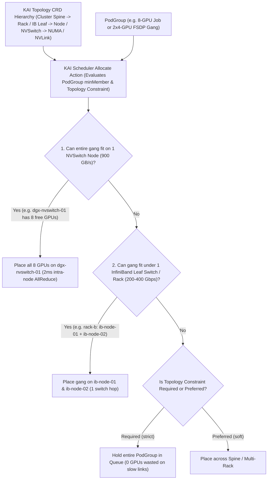

# 11.16 KAI gang scheduling and topology-aware placement

| | |
|---|---|
| Level | Advanced |
| Priority tier | 1 |
| Lab venue | GCP / GKE (plus local Python 3 simulation lab) |
| Part | Part 11: GPUs on Kubernetes, scheduling and virtualization |
| Sources used | Roland Huß et al., *Generative AI on Kubernetes* (O'Reilly, 2026, Ch. 7); Chris Fregly, *AI Systems Performance Engineering* (O'Reilly, 2025, Ch. 19) |
| Coverage file | `planning/coverage/chapters/11-16.md` |

## Why this matters for AI infrastructure

Picture a training job that needs eight worker Pods. Each Pod holds one or more GPUs, and the Pods must talk to each other constantly to share gradients and activations. If the scheduler starts only some of them, the job cannot make progress, and the GPUs that were already allocated to it sit unused. Two scheduler behaviors decide whether that happens, and a healthy AI cluster needs both of them.

The first behavior is gang scheduling. A gang is a group of Pods that belong to one job and must start together or not at all. The second behavior is topology-aware placement. Topology is the physical wiring of the cluster, meaning which GPUs share a server, which servers share a switch, and how many hops a message crosses on its way between them. Gang scheduling controls when the Pods of a distributed job start. Topology-aware placement controls where those Pods land in that physical hierarchy. Solving only one half leaves your AI cluster broken.

Suppose a scheduler without gang scheduling places seven of the eight worker Pods. The job then waits at the PyTorch rendezvous barrier, which is the checkpoint where every worker has to check in before training can begin. The seventh Pod never arrives, so the job deadlocks, and every GPU already allocated to it sits at zero percent compute. Now suppose a gang scheduler that lacks topology awareness starts all eight Pods at once. It may scatter them across separate servers linked by slow Ethernet or by multi-hop spine switches, when it could have packed them onto a single NVSwitch server. Every gradient exchange then crosses the slow path, and the job runs far below what the hardware can do.

Placement can fail even on one machine. On a single four-GPU dual-socket H100 server, a naive two-GPU placement that crosses the inter-socket link slows down both peer GPU collectives and network RDMA transfers. A collective is a group operation such as an all-reduce, where every GPU takes part in one exchange. RDMA, or remote direct memory access, lets one machine read or write another machine's memory without going through the operating system kernel on each step. A degraded single NVLink lane is harder to spot. It can silently cut peer bandwidth by a quarter while the static topology matrix still looks healthy.

The block below sets out these failure cases side by side, with the numbers the chapter uses for each one.

```text
Why Gang Scheduling and Topology Placement Must Work Together:
  1. Cluster-Level Placement Failure (GAK Ch. 7 & volume-24/chapter-10):
     - No Gang Scheduling: 7 of 8 worker Pods placed -> deadlocks at rendezvous, wasting 56 GPUs (0% compute).
     - No Topology Awareness: 8 GPUs scattered across Ethernet (10-100 Gbps) or InfiniBand spine switches
       (20-40 ms multi-hop AllReduce) instead of 1 NVSwitch server (900 GB/s per GPU, ~2 ms intra-node AllReduce).
  2. Host-Level Placement Failure on a 4-GPU H100 Server (volume-02/labs/lab-04, 81,559 MiB per GPU):
     - Naive {GPU1, GPU2, NIC1} selection crosses the inter-socket SYS boundary (NUMA distance 21 vs 10 local)
       for both GPU-to-GPU peer transfers and GPU-to-NIC RDMA transfers.
     - Optimal {GPU0, GPU1, NIC0} on NUMA 0 (CPUs 0-15, 257,698 MB RAM) keeps GPU peer traffic on a 4-lane
       NVLink bridge (NV4) and GPU-to-NIC traffic on a local PCIe switch (PIX to ConnectX-6 Dx [15b3:101d]
       at 0000:18:00.0).
  3. Silent Sub-Link Degradation (nvidia-smi nvlink --status):
     - Link 2 reporting 0.000 GB/s out of 4 x 26.562 GB/s = 106.248 GB/s cuts peer bandwidth by 25% (79.686 GB/s)
       even while nvidia-smi topo -m still prints NV4.
```

The third case is the one to watch. The topology matrix still prints NV4 there, so a check that reads only the static matrix will miss the lost bandwidth. That is why the rest of the chapter pairs the static view with live health checks.

This chapter shows how the NVIDIA KAI Scheduler combines atomic PodGroup gang scheduling with multi-level topology constraints. Those constraints run from a NUMA island up to an InfiniBand spine switch. A NUMA island is a group of CPUs, memory and devices that sit close together on one socket. You will see how distributed parallelism strategies map onto those topology tiers. The chapter then walks through a verified host placement plan, and it checks cluster-wide training throughput and topology hop counts.

## Prerequisites and outcomes

Before you start, check that the earlier material this chapter depends on is familiar. The outcomes below are the skills the chapter builds, and they are written as a plain summary of the work ahead.

### Prerequisites

Start with Chapter 11.6, which covers `nvidia-smi topo -m` and the Topology Manager in kubelet. If the Topology Manager is new to you, that chapter gives the vocabulary this one reuses. Then read Chapter 11.7, which covers PyTorch rendezvous and gang scheduling, because the gang idea in this chapter builds directly on it.

Chapters 11.14 and 11.15 cover the KAI Scheduler `pod-grouper`, PodGroup, and Queue fair sharing, so read those first as well. You also need a working knowledge of the four distributed parallelism strategies: Data Parallelism, Fully Sharded Data Parallelism, Tensor Parallelism, and Pipeline Parallelism. Each strategy splits the model or the batch in a different way, and that split decides how much data moves between GPUs.

### Outcomes

This chapter walks through how each parallelism strategy maps to the KAI Scheduler Topology domain it needs, and how to write the Topology custom resource and the workload annotations that request a domain. It then applies sub-group topology constraints to LeaderWorkerSet and JobSet workloads. The host work follows the eight-step placement plan, which uses `nvidia-smi`, Linux sysfs `numa_node` files, `lspci -Dnn`, `numactl --hardware`, and `nvidia-smi nvlink --status`. The chapter ends with the Training Cluster Throughput and Topology sanity check for a 50-billion-parameter LLM, and with the trade-offs of node consolidation.

## Concepts: basics to intermediate to advanced

### 1. Basics: How parallelism strategies dictate gang and topology requirements

Picture an engineer who runs Tensor Parallelism across slow inter-node Ethernet. Every forward and backward pass through a layer stalls while it waits for activation transfers, and the expensive GPUs sit idle. The engineer sees low utilization on every card, even though the hardware is fine. The lesson is that a scheduler cannot apply one generic placement rule to every multi-GPU job. Different parallelism strategies move very different amounts of data, at different frequencies, and each one tolerates latency in its own way.

The scheduler therefore has to know which collectives run inside every transformer layer and which ones run only once at the end of a training step. A transformer layer is one repeated block of the model, and a model may have dozens of them. A collective that runs in every layer multiplies its latency by that count, so a small delay per call adds up quickly.

As Chapter 7 of *Generative AI on Kubernetes* explains, Tensor Parallelism needs the tightest locality, either inside one NVSwitch node or inside an NVL72 rack, because it synchronizes activations in every layer. Fully Sharded Data Parallelism gathers parameters before every layer. It therefore needs NVSwitch nodes grouped under a single InfiniBand or RoCEv2 leaf switch, with GPUDirect RDMA. Data Parallelism and Pipeline Parallelism are more forgiving. They can spread across leaf switches, as long as communication stays below twenty percent of total step time.

The table below maps each parallelism strategy to its collective pattern and to the KAI Scheduler topology tier it requires.

| Parallelism Strategy | What Is Sharded or Replicated | Collective Operation and Frequency | Required Interconnect Topology Tier |
|---|---|---|---|
| 1. Tensor Parallelism (`TP`) | Splits weight matrices within every individual transformer layer across `2`, `4`, or `8` GPUs | Synchronous `AllGather` / `ReduceScatter` (or `AllReduce`) of activations on every forward and backward layer | Strict intra-node NVLink / NVSwitch (`600–900 GB/s` to `1.8 TB/s`) or intra-rack `GB200 NVL72` (`130 TB/s`). Impractical over standard Ethernet. |
| 2. Fully Sharded Data Parallelism (`FSDP` / `ZeRO-3`) | Shards model parameters, gradients, and optimizer states across all GPUs | Just-in-time `AllGather` of parameter shards before every layer + `ReduceScatter` of gradients after backward pass | Co-locate shard groups on NVSwitch nodes within the same InfiniBand (`200–400 Gbps`) or RoCEv2 leaf switch with GPUDirect RDMA (`40%–60%` latency reduction). |
| 3. Data Parallelism (`DDP`) | Replicates full model on each GPU; splits training batch across workers | Synchronous `AllReduce` of gradients once per training step (e.g., `900 GB` gradients in `~50 ms` ring `AllReduce` alongside `100 ms` compute = `150 ms < 300 ms` step time) | InfiniBand or RoCEv2 (`100–400 Gbps`) for `8+` nodes; standard `100 Gbps` Ethernet suffices for `2–8` nodes when communication is `< 15%` (`< 20%–25%` ceiling) of step time. |
| 4. Pipeline Parallelism (`PP`) | Assigns consecutive blocks of transformer layers to different GPUs or nodes | Point-to-point `Send/Recv` of intermediate activations only at stage boundaries | Co-locate adjacent pipeline stages on the same node or adjacent nodes under the same leaf switch (`log2(12) = 3.6` hops on `12` `8`-GPU nodes vs `25` `4`-GPU nodes). |
| 5. Hybrid Parallelism (`TP + PP + DP/FSDP`) | Combines intra-node `TP`, inter-node `PP`, and cross-replica `DP`/`FSDP` | Hierarchical collectives: microsecond `TP` per layer + `PP` stage handoffs + step-level `DP` `AllReduce` | Two-level topology constraint in KAI Scheduler: require each `TP` sub-group inside `1` NVSwitch node, and prefer or require all `PP`/`DP` nodes inside `1` InfiniBand leaf switch. |

Read the table from the top. Tensor Parallelism needs the tightest locality because its collective runs in every layer, while Pipeline Parallelism only sends data at stage boundaries. The middle rows fall between those two extremes. Decide the parallelism strategy first, because it sets which topology tier the job needs. Once that tier is known, the placement rules in the next section follow from it.

Here is a picture of what the middle rows mean. Imagine a model too large for one GPU's memory, split across several GPUs inside a single server. Every layer needs its partial results combined before the next layer can start. That combining step is the all-gather or reduce-scatter in the table. If those GPUs sit on one NVSwitch node, the combine runs at NVSwitch speed. If they sit on two servers across Ethernet, every layer waits on the slower path, and that wait repeats in every layer of the model.

---

### 2. Intermediate: How KAI Scheduler integrates gang scheduling with hierarchical Topology

A basic gang scheduler without topology support launches all of the Pods together, but it may place them on random nodes across the data center. Launching together is only half of the job. Where the Pods land decides how fast they talk. The Kubernetes Coscheduling plugin has no native topology awareness. It forces you to maintain fragile node labels and pod affinity rules by hand, and every new hardware class means another round of label edits. Kueue selects hardware tiers at admission time through ResourceFlavor objects. However, it hands the actual pod-to-node placement to the downstream scheduler.

NVIDIA KAI Scheduler solves this problem by building GPU topology optimization into its gang-scheduling session loop. A session is one pass of the scheduler over the pending work, where it decides what can run now. Suppose a training job asks for eight GPUs. The cluster has one idle eight-GPU NVSwitch node and eight free GPUs scattered across Ethernet nodes. KAI Scheduler places the entire gang on the single NVSwitch server, so all eight GPUs communicate over NVSwitch instead of crossing the network fabric.

The flowchart shows the decision order KAI Scheduler follows for a PodGroup.



Notice how the flowchart tries the tightest domain first and only widens the search when it has to.

Here is the same decision told as a short story. A team submits an eight-GPU job on a Monday morning. The first check finds no free NVSwitch node with eight GPUs. The second check looks for a rack with enough free GPUs on two Ethernet-linked nodes under one leaf switch. If the job marked that constraint as required and the rack is full, the job waits in the queue. If the job marked it as preferred, the scheduler places it across the spine, and the team accepts a slower run so that the job starts sooner. A required constraint can hold the whole gang in the queue, while a preferred constraint falls back to a wider domain. The first question is always whether the whole gang fits on one NVSwitch node. Only when the answer is no does the scheduler look at a leaf switch, and only when that answer is also no does it decide what to do based on the constraint type.

Platform administrators define a Topology custom resource under `kai.scheduler/v1alpha1`. A custom resource is an object type that the cluster learns from a definition, and this one describes the physical data center tree. The Topology lists the ordered node labels for each level of that tree. Workloads then point at that tree with required or preferred placement annotations. A hard required constraint keeps the entire PodGroup queued, even when GPUs sit free across the cluster. That protects training jobs from running three to five times slower over multi-hop links.

| Topology Mechanism | Label or Annotation Key | Operational Behavior in KAI Scheduler |
|---|---|---|
| Level 1: Zone or Spine | `topology.kubernetes.io/zone` | Outermost failure and spine-switch boundary for multi-rack jobs. |
| Level 2: Rack or IB Leaf Switch | `nvidia.com/rack` or `nvidia.com/ib-leaf-switch` | Co-locates multi-node FSDP and DDP gangs under a single `200–400 Gbps` InfiniBand leaf switch. |
| Level 3: Node or NVSwitch Domain | `kubernetes.io/hostname` or `nvlink-domain` | Packs `8`-GPU Tensor-Parallel gangs onto a single `900 GB/s` NVSwitch server or `GB200 NVL72` rack domain. |
| Level 4: NUMA or PCIe Island | `numa-node` | Aligns `2`-GPU jobs with local CPU cores, RAM, and PCIe switch (`PIX`) ConnectX NICs via GFD and `kubelet` Topology Manager. |
| Hard Topology Requirement | `kai.scheduler/topology-required-placement` | Holds the entire PodGroup in the queue if the gang cannot fit inside a single instance of the specified domain (`3–5x` slowdown prevented). |
| Soft Topology Preference | `kai.scheduler/topology-preferred-placement` | Packs the gang into the tightest domain when available, but falls back to a wider domain so the job starts sooner. |

The two annotations use the same tree but behave in opposite ways.

To see the difference in practice, imagine two jobs submitted in the same minute. Both ask for the same rack. The required job waits quietly in the queue until a full rack frees up, and nothing about it runs in the meantime. The preferred job starts on whatever GPUs are free, even if they are spread over several racks. Both behaviors are correct. Which one you want depends on whether a slow start or a slow run is the bigger cost for that team. One waits for the tight domain, and the other accepts a wider one. Decide which constraints must be hard before you label the nodes, because a hard constraint can hold a job in the queue. A useful habit is to start with preferred constraints on a new cluster, watch how long jobs wait, and only then promote the critical ones to required.

---

### 3. Advanced: Host placement plans and cluster-scale throughput math

Even the best cluster-level topology labels fail when a server's internal PCIe, NUMA, or NVLink paths are wired differently than expected. PCIe is the bus that connects GPUs, NICs and CPUs inside one server. They can also degrade silently in production. Before you trust a scheduler's node labels, build a verified hardware baseline for each server class. This section works through the eight-step host verification plan.

The reason to work through the plan in full is that each step catches a different kind of surprise. A wrong NUMA number points to a BIOS setting. A missing NVLink lane points to a physical part. A wrong NIC position points to a cabling mistake. Skipping any one of them leaves a gap that only shows up under a real training load. It then works through the cluster-scale throughput sanity check.

Take a four-GPU NVIDIA H100 dual-socket server with two Mellanox ConnectX-6 Dx NICs. Its four GPUs do not form one all-to-all NVSwitch mesh. They form two isolated two-GPU NVLink islands, one on each CPU socket. The table below records the hardware inventory collected from `nvidia-smi`, Linux sysfs `numa_node` files, and `numactl --hardware`. Sysfs is the kernel's file tree for devices, so reading a `numa_node` file tells you which NUMA node a device is attached to.

| Device or Resource | Stable Identifier and PCI BDF | Sysfs `numa_node` | `numactl --hardware` CPUs and RAM | `nvidia-smi topo -m` Peer and NIC Links | Assigned Placement Group |
|---|---|---|---|---|---|
| `GPU 0` (`H100 80GB HBM3`, `81,559 MiB`) | `0000:1b:00.0` (`GPU-3a1f9e02-...`) | `0` | NUMA 0: CPUs `0–15`, `257,698 MB` RAM (distance `10` local, `21` remote) | `NV4` to `GPU 1`; `PIX` to `NIC 0`; `SYS` to `GPU 2, 3, NIC 1` | Rank Group A (NUMA 0) |
| `GPU 1` (`H100 80GB HBM3`, `81,559 MiB`) | `0000:3d:00.0` (`GPU-7b2e0c14-...`) | `0` | NUMA 0: CPUs `0–15`, `257,698 MB` RAM | `NV4` to `GPU 0`; `SYS` to `GPU 2, 3` | Rank Group A (NUMA 0) |
| `NIC 0` (`ConnectX-6 Dx`) | `0000:18:00.0` (`[15b3:101d]`) | `0` | NUMA 0: CPUs `0–15` | `PIX` to `GPU 0` | Rank Group A (NUMA 0) |
| `GPU 2` (`H100 80GB HBM3`, `81,559 MiB`) | `0000:9a:00.0` (`GPU-91c4d5a8-...`) | `1` | NUMA 1: CPUs `16–31`, `258,043 MB` RAM (distance `10` local, `21` remote) | `NV4` to `GPU 3`; `PIX` to `NIC 1`; `SYS` to `GPU 0, 1, NIC 0` | Rank Group B (NUMA 1) |
| `GPU 3` (`H100 80GB HBM3`, `81,559 MiB`) | `0000:c3:00.0` (`GPU-c85f3d21-...`) | `1` | NUMA 1: CPUs `16–31`, `258,043 MB` RAM | `NV4` to `GPU 2`; `SYS` to `GPU 0, 1` | Rank Group B (NUMA 1) |
| `NIC 1` (`ConnectX-6 Dx`) | `0000:9d:00.0` (`[15b3:101d]`) | `1` | NUMA 1: CPUs `16–31` | `PIX` to `GPU 2` | Rank Group B (NUMA 1) |

Notice how the NUMA column splits the server in two.

When you commission a new server of this class, build a table like this one before you label the node. Fill in each row from the command output rather than from the vendor sheet, because a vendor sheet describes the design and not the wiring that was actually installed. The mismatch between the two is exactly what the host plan is designed to catch. GPUs 0 and 1 and NIC 0 sit on NUMA 0, while GPUs 2 and 3 and NIC 1 sit on NUMA 1.

If you are new to these tools, the NUMA column is the one to read first. It answers the question of which CPU socket a device hangs off, and that answer decides which CPU cores and memory the device should be paired with. Each group forms its own placement group, so a job that stays inside one group keeps its traffic off the inter-socket link.

This baseline teaches two operational lessons. The first is about placement. A two-GPU distributed training Pod on the first island runs its peer collectives over the four-lane NVLink bridge. It reaches RDMA over a local PCIe switch on NUMA 0. A naive scheduler that spreads GPUs across both sockets pushes both GPU peer traffic and GPU-to-NIC traffic over the inter-socket link, which runs at NUMA distance 21.

The second lesson is about health. Even when `nvidia-smi topo -m` shows an NVLink bridge for the first GPU pair, one of the four physical NVLink lanes can degrade after commissioning. Running `nvidia-smi nvlink --status` reveals sub-link bandwidth drops that static node labels miss. Chapter 19 of *AI Systems Performance Engineering* adds one more technique. When one path in a collective shows transient congestion, periodically calling `ncclCommInitRank` with a permuted rank order gives you alternating rings. That rank permutation keeps a single slow path from bottlenecking every collective.

The block below shows the sub-link check on GPU 0. Read the lane bandwidths first, then the impact math, so you can see how a single dead lane changes the total.

```text
Silent NVLink Sub-Link Degradation Check (volume-02/labs/lab-04, Section 14):
  $ nvidia-smi nvlink --status
  GPU 0: NVIDIA H100 80GB HBM3
       Link 0: 26.562 GB/s
       Link 1: 26.562 GB/s
       Link 2: 0.000 GB/s
       Link 3: 26.562 GB/s

Bandwidth Impact:
  Healthy 4-lane NV4 unidirectional bandwidth = 4 * 26.562 GB/s = 106.248 GB/s
  Active bandwidth with Link 2 at 0.000 GB/s  = 3 * 26.562 GB/s =  79.686 GB/s (75.0% healthy, 25% loss)
```

Link 2 at zero turns a healthy four-lane pair into a three-lane pair. That is the 25 percent loss you should watch for in the status output. The link count alone does not tell the whole story. The lanes you can see at full speed are the ones carrying traffic, so a drop from four to three is a real cut in peer bandwidth even though the link is still listed as NV4.

At cluster scale, node density and hardware budget decide whether a training target can be reached at all. Picture a stakeholder who wants to train a 50-billion-parameter LLM at one hundred trillion tokens per year, under a five-million-dollar budget. Before you write a single YAML manifest, a senior infrastructure architect runs a three-step sanity check. The three steps cover FLOPs, interconnect hop counts, and checkpoint storage bandwidth. A FLOP is one floating-point operation, and a FLOPs budget tells you how much arithmetic the hardware can do in a given time.

The first step asks you to work out the FLOPs per token and compare them with the GPUs that fit inside the hardware budget. The second asks you to compare four-GPU nodes with eight-GPU NVSwitch nodes, to minimize binary-tree communication hops and keep step latency under the three-hundred-millisecond target. The third asks you to stage checkpoints to local NVMe drives in one second, so synchronous saves never stall the GPUs. A binary-tree hop count matters because each hop adds latency to every collective that climbs the tree. The block below shows the exact equations and numbers you will need.

```text
Cluster-Scale Throughput, Node Density, and Checkpoint Sanity Check:
  Stated Stakeholder Target:
    Model = 50B parameters | batch_size = 256 | seq_length = 2048 -> 524,288 tokens/step (< 300 ms/step)
    Target throughput = 100 trillion (10^14) tokens/year | All-in budget = $5M (CapEx + 3yr OpEx)

  Step 1 — FLOPs, BOM, and the 4.4x Budget Shortfall:
    Compute per token = 2 * 50B = 100 GFLOP/token (10^11 FLOPs/token)
    Annual compute for 100T tokens = 10^14 * 10^11 = 10^25 FLOPs/year
    1 H100 peak FP8 = 1,400 TFLOPS -> 4.42 * 10^19 FLOPs per 31,557,600-second Julian year
      (which would imply ~226,244 theoretical peak GPU-years under that raw formula).
    1 H100 sustained = ~1,000 TFLOPS = 3.6 * 10^18 FLOPs/hour (3.6 EFLOP/hour)
    Tokens/hour per H100 = 3.6 * 10^18 / 10^11 = 36M tokens/hour/GPU
    Hardware BOM ($40K/H100 SXM5):
      - 100 GPUs = $5.375M CapEx ($4.0M GPUs + $0.75M for 25 nodes + $0.25M IB switch + $0.25M for 25 HCAs
        + $0.125M for 25 * 1TB NVMe) -> exceeds $5M budget.
      - 90 GPUs + HDR100 IB switch ($0.15M) = $4.875M CapEx ($3.6M GPUs; or 80 GPUs at $4.375M CapEx
        once $1.8M 3-year OpEx is included).
    Achievable throughput on 90 H100s at 80% availability (24 * 365 * 0.80):
      90 * 36M = 3.24B tokens/hour -> 3.24B * 24 * 365 * 0.80 = 22.7 trillion tokens/year
    Shortfall analysis: 100T / 22.7T = 4.4x shortfall -> requires 90 * (100 / 22.7) ~= 396 H100 GPUs (~$16M GPU CapEx).

  Step 2 — Node Density & Topology Hop Math (25 x 4-GPU Nodes vs 12 x 8-GPU Nodes):
    Option B (25 nodes x 4 GPUs/node):
      Intra-node 4-GPU AllReduce = ~2 ms over NVLink (25 GB/s per link); inter-node AllReduce across 25 nodes
      over shared InfiniBand HDR = 20-40 ms (~50 ms total optimized ring AllReduce for 900 GB gradients + 100 ms
      compute = 150 ms < 300 ms step target; naive unoptimized 24-round ring estimate is 108 ms).
    Option C (12 nodes x 8 GPUs/node):
      Consolidating onto 8-GPU NVSwitch nodes cuts inter-node binary tree hops to log2(12) ~= 3.6 hops,
      halves inter-node IB congestion, and packs 8-GPU tensor-parallel gangs inside 1 node.

  Step 3 — Fast Local NVMe + Async S3 Checkpointing (600 GB in ~1s):
    50B model checkpoint = 200 GB weights + 400 GB optimizer state = 600 GB total.
    Saved every 100 steps (~30 seconds) to 1 TB local NVMe in ~1 second; flushed asynchronously to S3
    in the background (~50 minutes over 200 Mbps, or every 15 minutes using incremental checkpoints).
```

Step 1 shows the budget gap, Step 2 shows the topology trade-off, and Step 3 shows the checkpoint math.

Two budget terms come up in Step 1. Capital expenditure, often shortened to CapEx, is the money spent up front on hardware. Operating expenditure, or OpEx, is the money spent over time on running the cluster. A plan that fits the CapEx line can still fail once three years of OpEx are added, so the check counts both. Step 1 is the check that tells you whether the target is physically achievable on the budget. If Step 1 fails, no amount of topology tuning in Step 2 can rescue the plan, so run the budget check first.

### 4. Sub-group topology rules and post-commissioning drift detection

A JobSet running three-dimensional parallel training, or a LeaderWorkerSet running multi-node sharded LLM inference, cannot be handled well by one flat topology constraint. A JobSet groups several related Kubernetes Jobs into one unit, and a LeaderWorkerSet groups one leader Pod with its worker Pods. Suppose you apply one constraint to the whole job. If it is too weak, Tensor-Parallel shards can spill across nodes over Ethernet. If it is too strict, a single-node rule asks sixty-four GPUs to fit inside one eight-GPU server.

KAI Scheduler handles this with two-level hierarchical gang topology constraints across PodGroup sub-groups. At the sub-group level, every eight-GPU Tensor-Parallel worker Pod, or four-node LeaderWorkerSet replica group, needs `kubernetes.io/hostname` locality. That keeps per-layer activation exchanges inside the NVSwitch fabric. At the parent gang level, the PodGroup sets `kai.scheduler/topology-preferred-placement` for the InfiniBand leaf switch and `kai.scheduler/topology-required-placement` for the availability zone. Together, the two levels pack the entire multi-node gang onto the minimum number of InfiniBand leaf switches. The inner rule protects the fast traffic, and the outer rule keeps the whole job close enough to avoid the slow spine.

Put plainly, the inner rule says that the chatty traffic must stay on the fast wires. The outer rule says that the whole job must stay near itself, even when it cannot fit on one node. Together they give the scheduler a clear order of preference, from the tightest domain outward.

Physical wiring rarely changes on its own, but the effective topology path can still degrade silently in production.

Think of the drift check as a second opinion. The node label is a statement made once, at commissioning. The drift check asks whether that statement is still true, using live data, every time the node is maintained. A firmware update, a riser card replacement, an optical transceiver failure, or a single-lane NVLink drop can cut bandwidth without changing a node label. The label still says the node is a good NVSwitch node, so the scheduler keeps sending it work. So run an automated topology drift check on every GPU worker node. It compares five live signals against the node's commissioned baseline, which is stored in Git. If any check fails after maintenance, withhold the node's topology service-class label and apply a maintenance taint until the hardware is repaired.

Here is how the check plays out on a typical Friday. Suppose a worker node receives a firmware update late in the afternoon, and the node comes back up looking normal. The scheduler still sees it as a good NVSwitch node. On Monday, a training job that normally finishes overnight takes much longer than usual. The drift check, run as part of the post-maintenance routine, would have flagged the missing NVLink lane before the job was placed on that node. Without the check, nobody learns about the lane until the slow run has already cost the team a weekend of GPU time.

| Drift Check Signal | Verification Command | Failure Threshold and Automated Action |
|---|---|---|
| 1. Stable UUID-to-PCI BDF Map | `nvidia-smi --query-gpu=index,uuid,pci.bus_id --format=csv` | Alert and taint node if any GPU `UUID` disappears or shifts to a different PCIe bus address after maintenance. |
| 2. PCIe Link Width and Speed | `sudo lspci -vv \| grep -E 'LnkCap:\|LnkSta:'` | Alert if a GPU or ConnectX HCA negotiates fewer lanes (`x8` vs `x16`) or drops from PCIe Gen5 (`32GT/s`) or Gen4 (`16GT/s`) while in active `P0` state. |
| 3. Per-Lane NVLink Bandwidth | `nvidia-smi nvlink --status` | Cordon node if any NVLink lane drops to `0.000 GB/s` (such as `Link 2: 0.000 GB/s` reducing a `4`-lane `106.248 GB/s` `NV4` pair to `79.686 GB/s`). |
| 4. Sysfs NUMA Association | `cat /sys/bus/pci/devices/<bdf>/numa_node` | Alert if a BIOS update resets `numa_node` to `-1` or swaps socket associations relative to `numactl --hardware`. |
| 5. Pre-Flight Collective Bandwidth | `all_reduce_perf` (`nccl-tests`) and `ib_write_bw` | Gate node re-admission on passing both intra-node NVLink and inter-node GPUDirect RDMA bandwidth thresholds. |

Each row pairs one command with one threshold. Think of the threshold as the line between a normal drift and a repair ticket. Setting the line too tight floods the on-call engineer with false alarms. Setting it too loose lets a dead lane run for weeks without anyone noticing. The first signal catches GPUs that have moved, and the third catches a dead NVLink lane. The fifth signal is the most expensive, because it runs real traffic, so it belongs at re-admission rather than on every check. Build this check into the routine for every worker node, so a silent drop is caught before a training run slows down.

## Commands and configurations that matter

Run these commands whenever you commission a worker node or finish hardware maintenance on one. They build a verified baseline of GPU, NIC, and NUMA placement, so you have something concrete to compare against later. Think of the output as a photograph of the server on the day it was healthy. Every later check is measured against that photograph.

### 1. Inspecting host GPU, NUMA, PCIe, and NVLink sub-link topology

```bash
# 1. Build stable GPU UUID-to-PCI bus ID inventory
nvidia-smi --query-gpu=index,name,uuid,pci.bus_id,memory.total --format=csv

# 2. Print full GPU and NIC topology matrix
nvidia-smi topo -m

# 3. Cross-check Linux sysfs NUMA node for every GPU and ConnectX NIC
for bdf in $(nvidia-smi --query-gpu=pci.bus_id --format=csv,noheader | sed 's/^00000000:/0000:/'); do
  printf "%s NUMA=" "$bdf"
  cat "/sys/bus/pci/devices/$bdf/numa_node"
done
lspci -Dnn | grep -iE 'ethernet|infiniband|network'
cat /sys/bus/pci/devices/0000:18:00.0/numa_node
cat /sys/bus/pci/devices/0000:9d:00.0/numa_node

# 4. Inspect CPU/RAM NUMA layout and verify PCIe link speed and NVLink sub-link bandwidth
numactl --hardware
sudo lspci -s "0000:1b:00.0" -vv | grep -E 'LnkCap:|LnkSta:'
nvidia-smi nvlink --status
```

The first two commands give you the GPU inventory and the topology matrix. The matrix shows how each pair of GPUs and each NIC connects. The sysfs loop then confirms each GPU and NIC's NUMA node independently, so you are not relying on one tool alone. Check that the results agree with what `numactl --hardware` reports.

You are looking for the same socket split from two directions. The GPU and NIC numbers from sysfs should line up with the CPU and memory ranges from numactl. If two sources disagree, stop and find out which one is wrong before you label the node.

### 2. Defining KAI Scheduler Topology and workload placement profiles

Next, define the topology and attach a job to it.

Before you apply anything, read the manifest as a plan. The Topology is the map, and the job is a traveler asking for a route through that map. You apply the file with kubectl, then check that the PodGroup appears and that the scheduler places the gang where you expected. The manifest below creates a three-level `ai-factory-topology` resource under `kai.scheduler/v1alpha1`. It then attaches a four-node PyTorchJob to the team queue. The job must keep all of its pods in the same availability zone, and it prefers to sit under a single InfiniBand leaf switch.

```yaml
# kai-topology-and-workload-constraints.yaml
apiVersion: kai.scheduler/v1alpha1
kind: Topology
metadata:
  name: ai-factory-topology
spec:
  levels:
    - nodeLabel: topology.kubernetes.io/zone
    - nodeLabel: nvidia.com/ib-leaf-switch
    - nodeLabel: kubernetes.io/hostname
---
apiVersion: kubeflow.org/v1
kind: PyTorchJob
metadata:
  name: fsdp-llama-50b
  namespace: ml-team-a
  labels:
    kai.scheduler/queue: ml-team-a
  annotations:
    kai.scheduler/topology: ai-factory-topology
    kai.scheduler/topology-preferred-placement: nvidia.com/ib-leaf-switch
    kai.scheduler/topology-required-placement: topology.kubernetes.io/zone
spec:
  pytorchReplicaSpecs:
    Master:
      replicas: 1
      template:
        spec:
          schedulerName: kai-scheduler
          containers:
            - name: pytorch
              image: nvcr.io/nvidia/pytorch:24.08-py3
              resources:
                limits:
                  nvidia.com/gpu: 8
    Worker:
      replicas: 3
      template:
        spec:
          schedulerName: kai-scheduler
          containers:
            - name: pytorch
              image: nvcr.io/nvidia/pytorch:24.08-py3
              resources:
                limits:
                  nvidia.com/gpu: 8
```

Notice the two annotations. The zone is a required placement, so the job cannot leave it. The leaf switch is only a preference, so the scheduler will fall back if it has to. Read the manifest from the top.

When you read a placement manifest for the first time, follow the names. The Topology gives each level a name and a label. The job then refers to those same levels by name in its annotations. If a name in the job does not match a level in the Topology, the placement rule has nothing to attach to, so check the spelling first. The Topology defines the tree, and the PyTorchJob points at that tree and states how strict each level should be.

## How it fails

Four problems quietly slow down or stop distributed training runs. A silent NVLink lane drop cuts bandwidth without any error. Node fragmentation leaves free GPUs that no job can use. PCIe re-enumeration renumbers devices after a repair. Uncapped power spikes can trip a rack's breaker. Each one looks like a different problem at first, which is why the table below pairs every failure mode with its command evidence, its root cause, and its fix.

Each one looks like a different problem at first, which is why the table below pairs every failure mode with its command evidence, its root cause, and its fix. Picture the usual page for this chapter. A run that finished on time last week now misses its deadline, and the job itself reports no error. The dashboard shows GPUs busy, so nobody suspects the interconnect. The table helps you move from that vague slowdown to one specific cause.

| Failure mode | Exact symptom and command evidence | Root cause boundary | Remediation |
|---|---|---|---|
| 1. Preferred `NV4` GPU pair runs `25%` slower while `nvidia-smi topo -m` still shows `NV4` | `2`-GPU job on `GPU 0` and `GPU 1` shows `NV4` in `nvidia-smi topo -m`, but step time regresses. `nvidia-smi nvlink --status` shows `Link 0, 1, 3: 26.562 GB/s` and `Link 2: 0.000 GB/s`. | Partial NVLink sub-link degradation (`75.0%` bandwidth): one of the `4` bonded NVLink lanes trained down to `0.000 GB/s` (`79.686 / 106.248 GB/s`) after initial topology discovery. | Monitor `nvidia-smi nvlink --status` and DCGM NVLink error counters continuously; cordon the node for GPU reset or replacement when any lane drops to `0.000 GB/s`. |
| 2. `8`-GPU job stays Pending even though `8` free GPUs exist across `4` nodes (`2` free GPUs/node) | Cluster has `8` idle GPUs (`2` per node across `4` nodes), yet an `8`-GPU job with `topology-required-placement: kubernetes.io/hostname` stays Pending. | Hard single-node topology or fragmentation constraint (*Generative AI on Kubernetes* Ch. 7): the workload required all `8` GPUs on a single NVSwitch node (`hostname`), and existing `2`-GPU jobs fragmented all `4` nodes. | Enable KAI Scheduler's Consolidate action (or Kubernetes Descheduler `HighNodeUtilization` + `MostAllocated` bin packing) to pack the `2`-GPU jobs onto fewer nodes and free a full `8`-GPU NVSwitch node. |
| 3. Topology matrix and GPU indices change after a server firmware or riser repair (`Lab 04` §14) | After hardware maintenance, a pinned placement policy routes `GPU 0` + `GPU 1` onto a slow `SYS` path. | PCIe bus enumeration or slot drift: moving risers or updating BIOS renumbered logical GPU indices (`0..3`), invalidating index-based pinning. | Key all topology inventories and CDI or DRA mappings by GPU `UUID` (`GPU-3a1f9e02-...`) and PCI BDF (`0000:1b:00.0`), and re-run the `Lab 04` verification before returning a repaired node to service. |
| 4. `90`-GPU H100 cluster delivers `15T` tokens/year instead of `22.7T` (`80 ms` vs `50 ms` `AllReduce`) | Training throughput drops `34%` below the `22.7T` achievable baseline; NCCL profiling shows inter-node `AllReduce` taking `80 ms` instead of `50 ms`. | InfiniBand link speed downshift or cross-leaf placement: either `ibnetdiscover` / `perfquery` shows IB links negotiated below `200 Gbps` HDR, or the gang was scattered across spine switches. | Verify `ibnetdiscover` link speeds, reseat degraded IB cables, and configure KAI `kai.scheduler/topology-preferred-placement: nvidia.com/ib-leaf-switch`. |
| 5. `8`-GPU node trips rack breaker at `15 kW` (above `10 kW` rack budget) during synchronous `AllReduce` + GEMM peaks | Nodes unexpectedly power off under peak FP8 tensor-core load. `ipmitool dcmi power reading` shows `15 kW` vs `10 kW` rack power budget. | Uncapped peak GPU power draw: all `8` GPUs hit maximum TDP simultaneously during dense GEMM steps. | Apply an `85%` power cap (`nvidia-smi -pl` via GPU Operator or DCGM policy, reducing `15 kW` to `~12 kW` with minimal throughput loss) or tune micro-batch sizes. |

Read each row from left to right.

Power caps deserve a short word of explanation. A power cap limits how much electrical power each GPU may draw. A lower cap means each GPU runs a little slower, but the whole node stays inside the rack budget. For a job that runs for days, a small slowdown is usually better than a node that shuts down in the middle of a step. The symptom tells you what to look for, the root cause boundary tells you where the problem lives, and the remediation tells you what to change. If a 2-GPU job slows down while its topology still shows `NV4`, start with the first row. Each row is a case you can check against the output of a command, so you never have to guess which failure you are seeing.

## Hands-on lab

### Venue and scope

This lab runs on your own machine with the Python 3 standard library.

A simulation is a check of the logic, not a check of the hardware. The lab can prove that the placement rules pick the right domain for a given cluster description. It cannot prove that your real switch wiring matches that description. Treat a passing lab as evidence that the reasoning is sound, and treat the commissioning commands as the evidence about the machine. It uses `code/part11/kai_gang_and_topology.py` and `code/part11/kai_gang_and_topology_lab.py`. The code simulates the multi-level gang and topology placement engine in KAI Scheduler. It also runs the four-GPU H100 placement and sub-link health verifier, and the 50-billion-parameter LLM throughput calculator. The commands in the earlier sections were not run on live hardware, because this lab does not run them against a live cluster or host. The simulation checks the logic, and a real node still needs its own commissioning run.

### Step 1: Run the self-checking KAI gang scheduling and topology lab

Run the verification script from the repository root.

Make sure you are in the root of the repository before you start, because the script paths are written relative to that folder. Running it from a sub-folder is the most common reason for a missing-file error on a first attempt. It checks all 25 topology placement, sub-link degradation, and cluster throughput assertions in one pass.

Read the output the way you would read a test report. Every PASS line names the claim it checks, so the line itself tells you what the result means. Each assertion is one claim from the chapter, so a failure points you to the section that made the claim.

```bash
python3 code/part11/kai_gang_and_topology_lab.py
```

The output below is what the script printed in this repository. Each line is one check, and the last line gives the total.

```text
=== Chapter 11.16 Lab: KAI Gang Scheduling & Topology-Aware Placement ===
  [PASS] KAI places 8-GPU Tensor-Parallel job on single_node_nvswitch (dgx-nvswitch-01, 900 GB/s)
  [PASS] KAI co-locates 2x4-GPU FSDP gang on same InfiniBand leaf switch rack (rack-b: ib-node-01, ib-node-02)
  [PASS] KAI places 2-GPU latency-sensitive job inside single_numa_island (NUMA 0 on ib-node-01)
  [PASS] When 16-GPU gang cannot fit in rack-b (8 GPUs free), KAI holds entire gang in queue (0 pods placed)
  [PASS] Lab 04 {GPU0, GPU1, NIC0} on NUMA 0 achieves optimal NV4 peer path and PIX NIC path
  [PASS] Naive {GPU1, GPU2, NIC1} placement crosses NUMA 0<->1 (SYS path for both GPU peer and GPU-to-NIC)
  [PASS] nvidia-smi nvlink --status with Link 2 at 0.000 GB/s (3 x 26.562 GB/s active) drops NV4 bandwidth to 75.0%
  [PASS] 50B model (batch 256 x seq 2048) processes 524,288 tokens/step at 100.0 GFLOP/token
  [PASS] At 1000 TFLOPS achieved (1400 peak), 1 H100 delivers 3.6 EFLOP/hr = 36.0M tokens/hr
  [PASS] 90 H100s deliver 3.24B tokens/hr and 22.7T tokens/yr at 80% availability
  [PASS] 22.7T vs 100T target is a 4.4x shortfall requiring ~396 H100 GPUs (~$16M GPU CapEx vs $5M budget)
  [PASS] Lab 04 H100 reports 81,559 MiB VRAM and numactl reports 257,698 MB (NUMA 0) and 258,043 MB (NUMA 1)
  [PASS] numactl --hardware reports local NUMA distance 10 vs cross-socket NUMA distance 21
  [PASS] Lab 04 lspci identifies Mellanox ConnectX-6 Dx with PCI ID [15b3:101d] on 0000:18:00.0 and 0000:9d:00.0
  [PASS] Consolidating 100 GPUs onto 12 8-GPU nodes reduces binary tree inter-node hops to log2(12) ~= 3.6
  [PASS] Project 10 step latency is 100ms compute + 50ms ring AllReduce = 150ms (< 300ms target)
  [PASS] 50B model checkpoint is 200 GB weights + 400 GB optimizer state = 600 GB (written in ~1s to 1TB local NVMe)
  [PASS] 1 Julian year contains 31,557,600 seconds (4.42e19 peak FP8 FLOPs per H100-year at 1400 TFLOPS)
  [PASS] 10^25 FLOPs divided by 4.42e19 FLOPs/GPU-year equals ~226,244 theoretical peak GPU-years
  [PASS] Initial 100-H100 BOM sums to $5.375M ($4.0M GPUs + $0.75M nodes + $0.25M switch + $0.25M HCAs + $0.125M NVMe)
  [PASS] 90-H100 + HDR100 BOM reduces hardware CapEx to $4.875M (or $4.375M at 80 GPUs)
  [PASS] Optimized multi-rail ring AllReduce cuts naive 108ms inter-node transfer down to ~50ms
  [PASS] When 8-GPU node power hits 15 kW (above 10 kW rack budget), an 85% power cap limits draw
  [PASS] Lab 04 Step 8 defines 3 distinct placement_profiles (single_gpu_inference, multi_gpu_training, distributed_training)
  [PASS] 4 NVLink lanes at 26.562 GB/s provide 106.248 GB/s unidirectional (79.686 GB/s when 1 lane drops to 0.000 GB/s)

Summary: 25 passed, 0 failed out of 25 checks.
```

If your run ends with the same summary, the placement and throughput checks agree with the reference values in this chapter.

A run that ends with a different summary is still useful. The failing line names the exact assertion that disagrees, and that line points you back to the section where the reference value was set. A run with any failure means the code and the text have drifted apart, so fix that before you rely on either one.

### Exercises

Work through the six exercises below. The first two use the placement functions in the lab code, and the rest work with the bandwidth, throughput and checkpoint numbers from the earlier sections.

1. Your team wants to see the placement rules in action. Call `select_kai_gang_topology_placement()` in `code/part11/kai_gang_and_topology.py` for a single-Pod 8-GPU job that needs one NVSwitch node. Which nodes and domain does it pick? Then try a two-Pod 8-GPU job that needs one InfiniBand rack with the NVSwitch server excluded. Which nodes and domain does it pick now? Last, run a four-Pod 16-GPU job when the rack has only 8 GPUs free. Does the gang start, or does it stay in the queue?
2. Compare two host choices with `verify_lab04_host_placement_and_nvlink()`. Start with the first NUMA island. What are its GPU peer path and GPU-to-NIC path? Does the optimality boolean come back true? Then try a cross-socket selection with the same function. Does its GPU peer path cross the inter-socket link?
3. Suppose `nvidia-smi nvlink --status` shows three active lanes at full speed and one lane at zero bandwidth on the first GPU. What is the expected four-lane unidirectional bandwidth? What is the actual active bandwidth? What is the health percentage?
4. Call `evaluate_50b_training_cluster_design()`. How many tokens does each step process, and how many millions of tokens per hour does one GPU deliver? What trillion tokens per year do 90 H100 GPUs reach at 80 percent availability? What is the shortfall ratio against the 100-trillion request, and how many GPUs would close the gap?
5. Compare the inter-node binary tree hop count of a 12-node 8-GPU cluster with a 25-node 4-GPU cluster. Which one has fewer hops? Then state the step-time breakdown between compute and ring collective communication. How does that step time compare with the 300-millisecond target?
6. A 50-billion-parameter checkpoint has 200 GB of weights and 400 GB of optimizer state, and it is saved every 100 steps. How long does the synchronous write to a 1 TB local NVMe drive take? How long does a background upload to S3 over a 200 Mbps link take?

## Checkpoint questions

<details>
<summary>**1. Why is gang scheduling without topology awareness insufficient for distributed LLM training?**</summary>

Gang scheduling only makes sure every Pod in a job starts at the same time. It says nothing about where those Pods land. Without topology awareness, the scheduler can scatter them across nodes or racks linked by slow Ethernet or multi-hop spine switches. Placing the whole gang on one NVSwitch node or one InfiniBand leaf switch avoids that bottleneck, which keeps step time from growing by an order of magnitude.
</details>

<details>
<summary>**2. Compare the network bandwidth and latency sensitivities of Data Parallelism (DDP), Tensor Parallelism (TP), Fully Sharded Data Parallelism (FSDP), and Pipeline Parallelism (PP).**</summary>

Tensor Parallelism is the most sensitive. It runs synchronous collectives on activations inside every layer, so it needs intra-node NVLink or NVSwitch. FSDP is also very sensitive, because it gathers parameters and scatters gradients just in time at every layer. That requires NVSwitch inside the node, plus InfiniBand or RoCEv2 with GPUDirect RDMA between nodes. Data Parallelism is bandwidth-sensitive only once per step, during gradient synchronization. Pipeline Parallelism has the lowest bandwidth demand, since it sends point-to-point activations only at stage boundaries.
</details>

<details>
<summary>**3. How does KAI Scheduler's topology awareness differ from Kueue's ResourceFlavor approach and the Coscheduling plugin?**</summary>

The Coscheduling PodGroup plugin has no native topology awareness, so it depends on manual node labels and pod affinity rules. Kueue picks hardware tiers when a job is admitted, through ResourceFlavor objects, and leaves pod placement to the scheduler underneath. NVIDIA KAI Scheduler builds native GPU topology optimization into its gang-scheduling session loop. It reads NVLink, NVSwitch, MIG, and InfiniBand domains, and uses them to co-locate gangs automatically.
</details>

<details>
<summary>**4. In KAI Scheduler, what is the trade-off between setting a topology constraint as required (kai.scheduler/topology-required-placement) versus preferred (kai.scheduler/topology-preferred-placement)?**</summary>

A required constraint guarantees that the gang never runs on a degraded interconnect path. The price is that the entire PodGroup waits in the queue, even when scattered GPUs are free. Consider a fragmented cluster: the wait grows longer, but collective step time and cross-switch congestion stay protected. A preferred constraint places the gang in the tightest domain when one is available. It falls back to a wider domain when needed, so the job starts sooner.
</details>

<details>
<summary>**5. On a 4-GPU H100 server, what are the two natural hardware topology groups, and what three Linux/NVIDIA data sources confirm them?**</summary>

On this server, the GPUs and NICs split into two natural groups, shown in the table below.

| Topology Group | NUMA Node, CPUs, and RAM | GPUs and PCI BDFs (`NV4` Peer Link) | Local ConnectX-6 Dx NIC (`[15b3:101d]`, `PIX` Link) |
|---|---|---|---|
| Group A | NUMA 0: CPUs `0–15`, `257,698 MB` RAM | `GPU 0` (`0000:1b:00.0`) + `GPU 1` (`0000:3d:00.0`) | `NIC 0` (`0000:18:00.0`) |
| Group B | NUMA 1: CPUs `16–31`, `258,043 MB` RAM | `GPU 2` (`0000:9a:00.0`) + `GPU 3` (`0000:c3:00.0`) | `NIC 1` (`0000:9d:00.0`) |

You can confirm the groups with three sources: `nvidia-smi topo -m`, the Linux sysfs `numa_node` file for each GPU and NIC, and `numactl --hardware`.
</details>

<details>
<summary>**6. In the host placement plan, what happens if a 2-GPU + 1-NIC distributed training job is placed on (GPU 1, GPU 2, NIC 1) instead of (GPU 0, GPU 1, NIC 0)?**</summary>

GPU 1 sits on NUMA 0, while GPU 2 and NIC 1 sit on NUMA 1. Because no NVLink bridge joins those two GPUs, every peer transfer between them crosses the inter-socket link. Every cross-socket RDMA transfer does the same. Both paths run at NUMA distance 21 instead of local distance 10.
</details>

<details>
<summary>**7. Why is checking nvidia-smi topo -m once at node commissioning not sufficient to guarantee that an NV4 GPU pair remains healthy in production?**</summary>

Suppose one of the four NVLink lanes in a pair drops to zero bandwidth while the other three run normally. The topology matrix only shows the logical link class, so the pair still looks healthy there. Running `nvidia-smi nvlink --status` reveals the failed lane. That one lane cuts peer bandwidth by 25 percent, even though `nvidia-smi topo -m` still prints NV4.
</details>

<details>
<summary>**8. What are the three workload placement profiles defined in Step 7 and Step 8 of the host placement plan?**</summary>

The three placement profiles are listed in the table below, with the rules each one requires and prefers.

| Placement Profile | Required and Preferred Topology Rules |
|---|---|
| `single_gpu_inference` | `require_same_numa_cpu: true`, `require_peer_group: false`, `prefer_local_nic: true` |
| `multi_gpu_training` (single-node) | `require_same_peer_group: true`, `require_balanced_gpu_count: true`, `require_local_cpu_memory: true` |
| `distributed_training` (multi-node) | `require_same_peer_group: true`, `require_local_high_speed_nic: true`, `require_rank_device_mapping: true` |
</details>

<details>
<summary>**9. Why should topology inventories and placement policies track GPU UUIDs and PCI bus addresses rather than only logical GPU indices (0, 1, 2, 3)?**</summary>

Track the UUID and PCI bus address because logical indices can change. A BIOS update, a PCIe riser replacement, or a kernel re-enumeration can renumber them. A GPU's hardware UUID does not change, and its PCI BDF address maps directly onto Linux sysfs NUMA and PCIe root-complex topology.
</details>

<details>
<summary>**10. A stakeholder asks for 100 trillion tokens/year of training throughput on a 50B-parameter LLM with a $5M all-in budget. Walk through the per-GPU throughput math that proves a 4.4x shortfall.**</summary>

A 50-billion-parameter model requires 100 GFLOP per token. One H100 sustaining 1,000 TFLOPS processes 36 million tokens per hour. A 5-million-dollar budget buys 90 H100 GPUs. That comes to 4.875 million dollars in hardware CapEx. Counting three-year OpEx instead, the same budget covers 80 GPUs. At 80 percent availability, 90 H100s produce 3.24 billion tokens per hour, or 22.7 trillion tokens per year. That is a 4.4x shortfall against the 100-trillion target, and closing it would take about 396 H100 GPUs.
</details>

<details>
<summary>**11. In Step 2 of the cluster sanity check, compare Option B (25 nodes x 4 GPUs/node) and Option C (12 nodes x 8 GPUs/node) for a ~100-GPU cluster.**</summary>

In Option B, you have 25 four-GPU nodes. Intra-node collectives take about 2 milliseconds over NVLink. Inter-node communication across the 25 nodes over InfiniBand HDR takes 20 to 40 milliseconds. Option C uses 12 eight-GPU nodes. Consolidating onto eight-GPU NVSwitch servers reduces binary-tree inter-node hops to 3.6. It also cuts switch port count and congestion in half, and it keeps eight-GPU tensor-parallel groups inside one node.
</details>

<details>
<summary>**12. In Step 4 of the cluster sanity check, how do compute time and ring AllReduce time combine to meet the under-300ms step-time requirement for the 50B model (batch 256)?**</summary>

You can add up the step this way. Forward and backward compute at 1,000 TFLOPS takes 100 milliseconds per step. Optimized multi-node ring collective communication of 900 GB of gradients takes about 50 milliseconds. The total step time is 150 milliseconds, which stays well below the 300-millisecond target.
</details>

<details>
<summary>**13. How does Phase 3 of the cluster sanity check size and stage a 600 GB checkpoint (200 GB weights + 400 GB optimizer state) every 100 steps (~30 seconds) without stalling training?**</summary>

Each node writes the 600 GB checkpoint to its 1 TB local NVMe drive. That synchronous write takes about 1 second, so training resumes right away. A background process then uploads the checkpoint to remote S3 storage. A full dump over 200 Mbps takes about 50 minutes, or about 15 minutes with incremental diffs.
</details>

<details>
<summary>**14. How can a scheduler or runtime smooth out a single slow link or straggler path across repeated collective operations according to AI Systems Performance Engineering Chapter 19?**</summary>

Use alternating rings, or periodically re-initialize the communicator with a permuted rank order through `ncclCommInitRank`. Permuting the rank order keeps any single physical link or GPU from sitting on the critical bottleneck path of every consecutive collective.
</details>

<details>
<summary>**15. When an 8-GPU node's power draw spikes to 15 kW under peak synchronous FP8 load—exceeding a 10 kW rack power budget—what immediate operational control can you apply?**</summary>

Watch node power with `ipmitool dcmi power reading`, Redfish, and DCGM telemetry. Then apply an 85 percent GPU power cap with `nvidia-smi -pl` through a GPU Operator policy. You can also reduce the micro-batch size to keep node power inside the rack breaker envelope.
</details>

<details>
<summary>**16. How do you check negotiated PCIe link speed and width for a specific GPU (e.g., 0000:31:00.0) on a Linux worker node?**</summary>

Run `sudo lspci -s "0000:31:00.0" -vv | grep -E 'LnkCap:|LnkSta:'` on the worker node. Then compare the negotiated link speed and width with the link capability. They should match once the GPU is in its active performance state.
</details>

<details>
<summary>**17. What does a value of -1 in /sys/bus/pci/devices/PCI_BDF/numa_node mean on a Linux GPU server, and how does it affect topology-aware scheduling?**</summary>

A `numa_node` value of -1, which is negative one, means the server's ACPI BIOS tables or hypervisor did not expose a specific NUMA node for that device to the Linux kernel. Until you fix the BIOS or add an override through a topology map, `numactl` and the kubelet Topology Manager cannot tell which socket that PCIe device belongs to.
</details>

<details>
<summary>**18. If achieved cluster throughput drops from 22.7T tokens/year down to 15T tokens/year and inter-node AllReduce rises from 50ms to 80ms, what two diagnostic tools do you run first?**</summary>

First, you inspect `perfquery` counters and NCCL debug traces. Check for InfiniBand port congestion, and confirm whether NCCL chose Ring or Tree collectives. Second, run `ibnetdiscover` and `ibstat`. Confirm that every InfiniBand link negotiated full 200 Gbps HDR speed, and that no degraded cable forced traffic onto multi-hop paths.
</details>

<details>
<summary>**19. How does KAI Scheduler's Consolidate action interact with topology-aware gang scheduling when a cluster is partially loaded with 1-GPU and 2-GPU jobs?**</summary>

When you spread single-GPU and two-GPU jobs across nodes, no single server has 8 free GPUs for a single-node NVSwitch PodGroup. The Consolidate action, a bin-packing action, packs the smaller jobs onto partly filled nodes. That keeps whole eight-GPU NVSwitch nodes contiguous for incoming eight-GPU gangs.
</details>

<details>
<summary>**20. When layering Kueue above KAI Scheduler for a multi-node training job, which component selects the InfiniBand hardware tier and which component co-locates the gang onto the same InfiniBand leaf switch?**</summary>

Kueue selects the hardware tier at admission time. It matches the job's ClusterQueue against the InfiniBand ResourceFlavor and injects the tier node labels. Once Kueue unsuspends the job, KAI Scheduler performs the atomic gang placement. It uses its Topology tree to pack the gang's pods onto the minimum number of NVSwitch nodes under a single InfiniBand leaf switch.
</details>

## Sources and review notes

```text
Primary sources read in full for this chapter:
  - Roland Huß et al., Generative AI on Kubernetes (O'Reilly, 2026), Chapter 7 (Job Scheduling Optimization:
    "Topology-Aware Scheduling", "Communication Patterns in Distributed Training", Table 7-3 comparing
    Coscheduling, Kueue, KAI Scheduler, and Volcano, and "Making the right choice" layering Kueue + KAI Scheduler).
  - Chris Fregly, AI Systems Performance Engineering (O'Reilly, 2025), Chapter 19 (ncclCommInitRank rank
    permutation / alternating rings).
  - nvidia-zero-to-hero/volume-02/labs/lab-04-build-a-topology-aware-gpu-placement-plan.md (Figure 2.L4.1 naive
    {GPU1, GPU2, NIC1} vs topology-aware {GPU0, GPU1, NIC0}, 4-GPU H100 81559 MiB inventory
    0000:1b:00.0/3d:00.0/9a:00.0/c3:00.0, ConnectX-6 Dx [15b3:101d] 0000:18:00.0/9d:00.0, numactl --hardware
    257698 MB / 258043 MB distances 10/21, LnkCap/LnkSta, 3 placement profiles YAML, and nvidia-smi nvlink --status
    26.562 GB/s vs 0.000 GB/s degraded lane).
  - nvidia-zero-to-hero/volume-24/chapter-10-training-cluster-design.md (50B model, 100T tokens/yr,
    256 * 2048 = 524,288 tokens/step, 100 GFLOP/token, 10^25 FLOPs/yr, 31,557,600 s/yr, 4.42 * 10^19 FLOPs/GPU-yr,
    226,244 theoretical GPU-yrs, 1,400 TFLOPS peak / 1,000 TFLOPS achieved -> 3.6 EFLOP/hr = 36M tokens/hr/GPU,
    90 H100s -> 3.24B tokens/hr -> 22.7T tokens/yr at 80% availability = 4.4x shortfall needing ~396 GPUs / ~$16M,
    Option B 25x4 vs Option C 12x8 log2(12)=3.6 hops, $5.375M vs $4.875M / $4.375M BOM, 100ms + 50ms = 150ms step
    time, 600 GB checkpoint 200 GB + 400 GB, and 15 kW vs 10 kW 85% power cap).

Related source files mapped in MIGRATION_MAP.md:
  - No separate nvidia-devops file was exclusively mapped to 11.16 in brief.py; this chapter integrates
    Generative AI on Kubernetes Chapter 7, volume-02/labs/lab-04-build-a-topology-aware-gpu-placement-plan.md,
    and volume-24/chapter-10-training-cluster-design.md.

Run here:
  - python3 code/part11/kai_gang_and_topology_lab.py (25 passed, 0 failed out of 25 checks).

Explicitly labelled inferences:
  - The unidirectional NVLink sums (4 * 26.562 GB/s = 106.248 GB/s healthy vs 3 * 26.562 GB/s = 79.686 GB/s when
    Link 2 is 0.000 GB/s, giving 79.686 / 106.248 = 75.0% active bandwidth) are exact products of the per-lane
    26.562 GB/s figures in volume-02/labs/lab-04 Section 14 verified by code/part11/kai_gang_and_topology_lab.py.

Not verified on live hardware:
  - All `nvidia-smi`, `lspci`, `numactl`, `ibnetdiscover`, `ipmitool`, and `kubectl` commands (`LWS` LeaderWorkerSet, `TP=8`, `64`-GPU jobs, `NCCL_DEBUG=INFO`, `topologyConstraint`, `nodeLabels` for `single-numa`, `single-node-nvswitch`, and `same-rack-ib`, `gpu-nvlink-infiniband` vs `gpu-standard-ethernet`, and `tokens_per_step`, `tokens_millions_per_hr_per_gpu`, `achievable_trillion_per_yr`, cross-referenced with Chapter `11.8`) are marked `(untested here)`.

Not in the corpus:
  - Proprietary NVSwitch fabric manager (nv-fabricmanager) internal routing-table binary formats; fabric manager
    operations are covered in Part 9 and Part 10 where applicable.

Corrections to the author's notes:
  - KAI Scheduler check 2026-10-25: this chapter's KAI details were compared with the upstream docs; see the note
    at the top of Chapter 11.14 for what was confirmed, corrected (kai.scheduler/queue label,
    kai.scheduler/topology* annotations, Topology group kai.scheduler/v1alpha1) and not confirmed (the book's
    Project kind). In Chapter 11.17 the example now requests gpu-fraction only; the upstream docs list
    gpu-fraction and gpu-memory as alternative ways to ask for a share.
  - The YAML manifests and commands
    are marked untested and were not applied to a cluster. Custom resource API versions (for example
    kueue.x-k8s.io/v1beta1, resource.k8s.io/v1) change between releases, so check them against the version you
    install. Console outputs quoted from the Volume notes are illustrative unless the chapter says otherwise.
  - Earlier author note: required; all Lab 04 topology matrices and Project 10 throughput and BOM calculations
    (including the explicit 22.7T vs 100T 4.4x shortfall analysis) match the cited sources verbatim.
```
