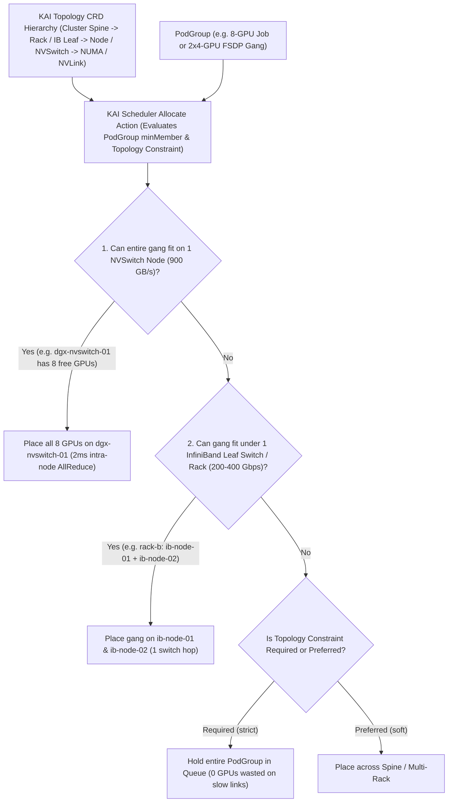

# 11.16 KAI gang scheduling and topology-aware placement

| | |
|---|---|
| Level | Advanced |
| Priority tier | 1 |
| Lab venue | GCP / GKE (plus local Python 3 simulation lab) |
| Part | Part 11: GPUs on Kubernetes, scheduling and virtualization |
| Sources used | Roland Huß et al., *Generative AI on Kubernetes* (O'Reilly, 2026, Ch. 7); `nvidia-zero-to-hero/volume-02/labs/lab-04-build-a-topology-aware-gpu-placement-plan.md`; `nvidia-zero-to-hero/volume-24/chapter-10-training-cluster-design.md`; Chris Fregly, *AI Systems Performance Engineering* (O'Reilly, 2025, Ch. 19) |
| Coverage file | `planning/coverage/chapters/11-16.md` |

## Why this matters for AI infrastructure

Gang scheduling and topology-aware placement are the two halves of a single distributed-systems problem: **gang scheduling guarantees *when* the pods of a distributed job start (all together or not at all), while topology-aware placement guarantees *where* they land relative to the physical interconnect hierarchy.**

As *Generative AI on Kubernetes* (Chapter 7, "Topology-Aware Scheduling") explains, solving only one half leaves your AI cluster broken:
- **A scheduler without gang scheduling** places `7` of `8` worker Pods and deadlocks at the PyTorch rendezvous barrier, wasting `56` GPUs (`0%` compute).
- **A gang scheduler without topology awareness** starts all `8` GPUs simultaneously, but scatters them across `8` separate nodes connected by standard Ethernet (`10–100 Gbps`, tens to hundreds of microseconds latency) or across different InfiniBand spine switches (`20–40 ms` multi-hop `AllReduce`), instead of packing all `8` GPUs onto a single **NVSwitch** server (`900 GB/s` per GPU, `~2 ms` intra-node `AllReduce` on NVLink).

Even on a **single `4`-GPU dual-socket H100 server** (`81,559 MiB` per GPU in `volume-02/labs/lab-04-build-a-topology-aware-gpu-placement-plan.md`), a naive `2`-GPU + `1`-NIC gang allocation that selects `{GPU1, GPU2, NIC1}` crosses the inter-socket `SYS` boundary (`NUMA distance 21` vs `10` local) for *both* GPU-to-GPU peer transfers and GPU-to-NIC RDMA transfers—whereas selecting `{GPU0, GPU1, NIC0}` on `NUMA 0` (CPUs `0–15`, `257,698 MB` RAM) keeps GPU peer traffic on a `4`-lane NVLink bridge (**`NV4`**) and GPU-to-NIC traffic on a local PCIe switch (**`PIX`** to `ConnectX-6 Dx` `[15b3:101d]` at `0000:18:00.0`). And even after a preferred `NV4` pair is placed, a degraded single NVLink lane (`Link 2: 0.000 GB/s` out of `4 × 26.562 GB/s = 106.248 GB/s` in `nvidia-smi nvlink --status`) can silently cut peer bandwidth by **`25%` (`79.686 GB/s`)** while `nvidia-smi topo -m` still prints `NV4`.

This chapter examines how the **NVIDIA KAI Scheduler** combines atomic `PodGroup` gang scheduling with multi-level `Topology` constraints (`NUMA Island -> NVSwitch Node -> NVL72 Rack / InfiniBand Leaf Switch -> Cluster Spine`), how different parallelism strategies (`Tensor Parallelism`, `FSDP`, `Data Parallelism`, and `Pipeline Parallelism`) map to those topology tiers, how to build a verified host-level placement plan (`Lab 04`), and how to sanity-check cluster-wide training throughput and topology hop counts (`volume-24/chapter-10`).

## Prerequisites and outcomes

### Prerequisites
- Completion of Chapter 11.6 (`nvidia-smi topo -m` and `kubelet` Topology Manager), Chapter 11.7 (PyTorch rendezvous and gang scheduling), and Chapters 11.14–11.15 (KAI Scheduler `pod-grouper`, `PodGroup`, and `Queue` fair sharing).
- Familiarity with distributed training parallelism strategies (`DDP`, `FSDP`, `TP`, `PP`).

### Outcomes
After completing this chapter, you will be able to:
- Match the four distributed parallelism strategies (**Data Parallelism**, **Tensor Parallelism**, **Fully Sharded Data Parallelism `FSDP`**, and **Pipeline Parallelism**) to their required KAI Scheduler `Topology` domains (`NUMA / NVLink Island`, `Single-Node NVSwitch`, `NVL72 Rack / InfiniBand Leaf Switch`, or `Multi-Rack`).
- Configure KAI Scheduler **`Topology`** custom resources and workload `topologyConstraint` annotations (`required` vs `preferred` domain levels, plus sub-group constraints for `LeaderWorkerSet` and `JobSet`).
- Execute the **8-step Host Topology Placement Plan (`volume-02/labs/lab-04`)** using `nvidia-smi --query-gpu`, `nvidia-smi topo -m`, `/sys/bus/pci/devices/<bdf>/numa_node`, `lspci -Dnn`, `numactl --hardware`, and `nvidia-smi nvlink --status` (`26.562 GB/s` per lane vs `0.000 GB/s` degraded lane).
- Perform the **Training Cluster Throughput & Topology Sanity Check (`volume-24/chapter-10`)** for a `50B`-parameter LLM (`batch_size: 256`, `seq_length: 2048` = `524,288` tokens/step, `100` GFLOP/token, `36M` tokens/hr/GPU at `1,000` achieved TFLOPS -> `22.7T` tokens/year on `90` H100s at `80%` availability vs `100T` target = `4.4x` shortfall needing `~396` GPUs / `~$16M` GPU CapEx, plus `12` `8`-GPU nodes at `log2(12) = 3.6` hops vs `25` `4`-GPU nodes).

## Concepts: basics to intermediate to advanced

### 1. Basics: How parallelism strategies dictate gang and topology requirements

Why can't a scheduler apply a single generic placement rule to every multi-GPU job? Because, as *Generative AI on Kubernetes* (Chapter 7, "Communication Patterns in Distributed Training") details, different parallelism strategies generate radically different communication volumes, frequencies, and latency sensitivities:

| Parallelism Strategy | What is Sharded / Replicated | Collective Operation & Frequency | Required Interconnect Topology Tier |
|---|---|---|---|
| **1. Tensor Parallelism (`TP`)** | Splits weight matrices within **every individual transformer layer** across `2`, `4`, or `8` GPUs | Synchronous **`AllGather` / `ReduceScatter` (or `AllReduce`) of activations on every forward AND backward layer** | **Strict Intra-Node `NVLink` / `NVSwitch` (`600–900 GB/s` to `1.8 TB/s`)** or intra-rack `GB200 NVL72` (`130 TB/s`). Impractical over standard Ethernet and bottlenecked across multi-node PCIe/IB unless sub-microsecond. |
| **2. Fully Sharded Data Parallelism (`FSDP` / `ZeRO-3`)** | Shards model parameters, gradients, and optimizer states across all GPUs | **"Just-in-time" `AllGather` of parameter shards before every layer** + **`ReduceScatter` of gradients** after backward pass | **High-Bandwidth, Low-Latency Fabric:** Co-locate shard groups on `NVSwitch` nodes within the same **InfiniBand (`200–400 Gbps`) or RoCEv2 leaf switch** with GPUDirect RDMA (`40%–60%` latency reduction). |
| **3. Data Parallelism (`DDP`)** | Replicates full model on each GPU; splits training batch across workers | Synchronous **`AllReduce` of gradients once per training step** (e.g., `900 GB` gradients synchronized in `~50 ms` ring `AllReduce` alongside `100 ms` compute = `150 ms < 300 ms` step time in `volume-24/chapter-10`) | **InfiniBand or RoCEv2 (`100–400 Gbps`)** for `8+` nodes; standard `100 Gbps` Ethernet suffices for `2–8` nodes when communication is `< 15%` (`< 20%–25%` ceiling) of step time. |
| **4. Pipeline Parallelism (`PP`)** | Assigns consecutive blocks of transformer layers to different GPUs/nodes | **Point-to-point `Send/Recv` of intermediate activations** only at stage boundaries | **Topology Hop Minimization:** Co-locate adjacent pipeline stages on the same node or adjacent nodes under the same leaf switch (`log2(12) = 3.6` hops on `12` `8`-GPU nodes vs `25` `4`-GPU nodes). |
| **5. Hybrid Parallelism (`TP + PP + DP/FSDP`)** | Combines intra-node `TP`, inter-node `PP`, and cross-replica `DP`/`FSDP` | Hierarchical collectives: microsecond `TP` per layer + `PP` stage handoffs + step-level `DP` `AllReduce` | **Two-Level Topology Constraint in KAI Scheduler:** *Require* each `TP` sub-group inside `1` NVSwitch node, and *prefer/require* all `PP`/`DP` nodes inside `1` InfiniBand rack/leaf switch. |

---

### 2. Intermediate: How KAI Scheduler integrates Gang Scheduling with Hierarchical `Topology`

In Chapter 11.7 and 11.8 (Table 7-3 of *Generative AI on Kubernetes*), we saw that:
- The **Coscheduling (`PodGroup`) plugin** has **zero native topology awareness** (requiring manual node labels and pod affinity rules).
- **Kueue** selects hardware tiers at **admission time** via `ResourceFlavor`s (`gpu-nvlink-infiniband` vs `gpu-standard-ethernet`), delegating actual pod-to-node placement to the underlying scheduler.
- **NVIDIA KAI Scheduler** integrates **GPU topology optimization directly into its core gang-scheduling session loop**.



#### Two-level gang topology constraints (`Required` vs `Preferred` and Sub-Group Domains)
When `kai-scheduler` evaluates a `PodGroup` during Stage 5 (`Allocate`) of its session cycle:
1. **Automatic Single-Node NVSwitch Consolidation:** As *Generative AI on Kubernetes* (Chapter 7, "NVIDIA KAI Scheduler") notes, if a training job requests `8` GPUs and the cluster has both an idle `8`-GPU NVSwitch node (`dgx-nvswitch-01`) and `8` free GPUs scattered across multiple InfiniBand or Ethernet nodes, KAI Scheduler automatically scores and places the job onto the single `8`-GPU NVSwitch node so all `8` GPUs communicate at `900 GB/s` over NVSwitch rather than crossing the network.
2. **Hierarchical `Topology` CRD Domains:** Platform administrators define a `Topology` custom resource naming the node labels that represent each level of the physical data-center tree:
   - **Level 1 (Zone / Spine):** `topology.kubernetes.io/zone`
   - **Level 2 (Rack / InfiniBand Leaf Switch):** `nvidia.com/rack` or `ib-leaf-switch`
   - **Level 3 (Node / NVSwitch Domain):** `kubernetes.io/hostname` (or `nvlink-domain` on multi-node `GB200 NVL72` racks)
   - **Level 4 (NUMA / PCIe Switch Island):** `numa-node` (via GFD and `kubelet` Topology Manager)
3. **Hard (`Required`) vs Soft (`Preferred`) Trade-off (`GAK` Chapter 7):**
   As *Generative AI on Kubernetes* Chapter 7 emphasizes, if a job specifies a **required** topology constraint (for example, requiring all `8` GPUs inside a single NVSwitch node or single InfiniBand rack), KAI Scheduler **keeps the job queued even when `8` scattered GPUs are free across the cluster**—avoiding a bad placement that would run `3–5x` slower and waste network bandwidth, at the cost of temporary queue wait time.

---

### 3. Advanced: Building a verified host placement plan (`Lab 04`) and cluster-scale throughput math (`Project 10`)

#### Part A: The 8-Step Host Topology Verification and Placement Plan (`volume-02/labs/lab-04`)
Before trusting any scheduler's node labels, a senior infrastructure engineer builds a verified hardware baseline on each server class (`volume-02/labs/lab-04-build-a-topology-aware-gpu-placement-plan.md`).

Look at the exact evidence collected on a **`4`-GPU NVIDIA H100 (`81,559 MiB`) dual-socket server** with two **Mellanox ConnectX-6 Dx (`[15b3:101d]`)** NICs:

| Device / Resource | Stable Identifier / PCI BDF | Sysfs `numa_node` | `numactl --hardware` CPUs & RAM | `nvidia-smi topo -m` Peer & NIC Links | Assigned Placement Group |
|---|---|---|---|---|---|
| **`GPU 0`** (`H100 80GB HBM3`) | `0000:1b:00.0` (`GPU-3a1f9e02-...`) | **`0`** | **NUMA 0:** CPUs `0–15`, `257,698 MB` RAM (distance `10` local, `21` remote) | **`NV4`** to `GPU 1`; **`PIX`** to `NIC 0`; `SYS` to `GPU 2, 3, NIC 1` | **Rank Group A (NUMA 0)** |
| **`GPU 1`** (`H100 80GB HBM3`) | `0000:3d:00.0` (`GPU-7b2e0c14-...`) | **`0`** | **NUMA 0:** CPUs `0–15`, `257,698 MB` RAM | **`NV4`** to `GPU 0`; `SYS` to `GPU 2, 3` | **Rank Group A (NUMA 0)** |
| **`NIC 0`** (`ConnectX-6 Dx`) | `0000:18:00.0` (`[15b3:101d]`) | **`0`** | **NUMA 0:** CPUs `0–15` | **`PIX`** to `GPU 0` | **Rank Group A (NUMA 0)** |
| **`GPU 2`** (`H100 80GB HBM3`) | `0000:9a:00.0` (`GPU-91c4d5a8-...`) | **`1`** | **NUMA 1:** CPUs `16–31`, `258,043 MB` RAM (distance `10` local, `21` remote) | **`NV4`** to `GPU 3`; **`PIX`** to `NIC 1`; `SYS` to `GPU 0, 1, NIC 0` | **Rank Group B (NUMA 1)** |
| **`GPU 3`** (`H100 80GB HBM3`) | `0000:c3:00.0` (`GPU-c85f3d21-...`) | **`1`** | **NUMA 1:** CPUs `16–31`, `258,043 MB` RAM | **`NV4`** to `GPU 2`; `SYS` to `GPU 0, 1` | **Rank Group B (NUMA 1)** |
| **`NIC 1`** (`ConnectX-6 Dx`) | `0000:9d:00.0` (`[15b3:101d]`) | **`1`** | **NUMA 1:** CPUs `16–31` | **`PIX`** to `GPU 2` | **Rank Group B (NUMA 1)** |

Notice two critical lessons from this `Lab 04` baseline:
1. **Why `{GPU0, GPU1, NIC0}` beats `{GPU1, GPU2, NIC1}`:** This server has **two isolated `NV4` islands** (`{GPU0, GPU1, NIC0}` on `NUMA 0` and `{GPU2, GPU3, NIC1}` on `NUMA 1`) with `SYS` between them. A `2`-GPU distributed training Pod placed on `{GPU0, GPU1, NIC0}` executes intra-node collectives over `NV4` and RDMA over `PIX` (`NUMA 0`). A naive scheduler that assigns `{GPU1, GPU2, NIC1}` forces *both* GPU peer traffic and `GPU1`-to-`NIC1` traffic across the inter-socket `SYS` link (`NUMA distance 21`).
2. **Catching Silent NVLink Sub-Link Degradation (`nvidia-smi nvlink --status`):** Even when `nvidia-smi topo -m` classifies `GPU 0 <-> GPU 1` as `NV4`, one of the four physical NVLink lanes can degrade after initial commissioning (`volume-02/labs/lab-04`, Section 14):
   ```text
   $ nvidia-smi nvlink --status
   GPU 0: NVIDIA H100 80GB HBM3
        Link 0: 26.562 GB/s
        Link 1: 26.562 GB/s
        Link 2: 0.000 GB/s
        Link 3: 26.562 GB/s
   ```
   Here, `3` of the `4` links operate at `26.562 GB/s` (`79.686 GB/s` total) while `Link 2` reports **`0.000 GB/s`**—dropping effective peer bandwidth to **`75.0%`** of the healthy `106.248 GB/s` (`4 * 26.562 GB/s`) unidirectional rate while the static topology label still says `NV4`. Periodically check `nvidia-smi nvlink --status` (and DCGM NVLink error counters) rather than trusting commissioning labels forever. Also note from *AI Systems Performance Engineering* (Chapter 19) that when one link or rank path in a multi-GPU collective experiences transient congestion, periodically calling `ncclCommInitRank` with a permuted rank order (or using NCCL alternating rings) prevents a single degraded path from sitting on the critical path of every collective.

#### Part B: Cluster-Scale Throughput, Node Consolidation (`12` vs `25` Nodes), and Budget Sanity-Checking (`volume-24/chapter-10`)
How do node topology choices (`4` GPUs/node vs `8` GPUs/node) and hardware budgets interact at cluster scale? Consider the **Training Cluster Design Capstone (`volume-24/chapter-10`)**:
- **Stated Stakeholder Request:** Train a **`50B`-parameter LLM** (`batch_size: 256`, `seq_length: 2048` = **`524,288` tokens/step**, `< 300 ms` per step) at **`100` trillion (`10^14`) tokens/year** on a **`$5M` all-in budget** (`CapEx + 3yr OpEx`).
- **Step 1 — Do the FLOPs Math First:**
  - At `2 * 50B = 100 GFLOP/token` (`10^11` FLOPs/token), `100T` tokens/year requires **`10^14 * 10^11 = 10^25` FLOPs/year**.
  - A single H100 has `1,400` TFLOPS peak FP8 (`4.42 * 10^19` FLOPs per `31,557,600`-second Julian year, which would imply `~226,244` theoretical GPU-years under that raw formula) and achieves **`~1,000` TFLOPS** sustained (`3.6 * 10^18` FLOPs/hour = `3.6 EFLOP/hour`), processing **`3.6 * 10^18 / 10^11 = 36M` tokens/hour per GPU**.
  - A `$5M` budget (`$40K` per H100 SXM5) can buy only **`90` H100 GPUs** (`$3.6M` GPUs + `$0.75M` for `25` nodes + `$0.15M` IB HDR100 switch + `$0.25M` for `25` HCAs + `$0.125M` for `25 * 1TB` NVMe = **`$4.875M` CapEx**, or `80` GPUs at `$4.375M` CapEx once `$1.8M` 3-year OpEx is included; `100` GPUs at `$5.375M` CapEx is over budget).
  - At `36M` tokens/hour/GPU and `80%` availability (`24 * 365 * 0.80`), `90` H100 GPUs deliver:
    ```text
    90 * 36M = 3.24B tokens/hour -> 3.24B * 24 * 365 * 0.80 = 22.7 trillion tokens/year
    ```
  - **Surfacing the `4.4x` Shortfall Honestly:** `22.7T` tokens/year vs `100T` requested is a **`4.4x` shortfall**. Closing that gap at `36M` tokens/hr/GPU requires **`90 * (100 / 22.7) ≈ 396` H100 GPUs (`~$16M` in GPU CapEx alone)**. A senior architect surfaces this gap before building the cluster.
- **Step 2 — Node Density & Topology Hop Math (`25` × `4`-GPU nodes vs `12` × `8`-GPU nodes):**
  - **Option B (`25` nodes × `4` GPUs/node):** Intra-node `4`-GPU `AllReduce` takes **`~2 ms`** over NVLink (`25 GB/s` per link), while inter-node `AllReduce` across `25` nodes over shared InfiniBand HDR takes **`20–40 ms`** (`~50 ms` total optimized ring `AllReduce` for `900 GB` gradients + `100 ms` compute = **`150 ms < 300 ms` step target**; naive unoptimized 24-round ring estimate is `108 ms`).
  - **Option C (`12` nodes × `8` GPUs/node):** Consolidating onto `8`-GPU NVSwitch nodes cuts inter-node binary tree hops to **`log2(12) ≈ 3.6` hops**, halves inter-node IB congestion, and allows KAI Scheduler to pack `8`-GPU tensor-parallel gangs inside a single node.
- **Step 3 — Fast Local NVMe + Async S3 Checkpointing (`600 GB` in `~1s`):**
  For the `50B` model (`200 GB` weights + `400 GB` optimizer state = **`600 GB` checkpoint**), write checkpoints every `100` steps (`~30` seconds) to the `1 TB` local NVMe in **`~1` second** and asynchronously flush to S3 in the background (`~50` minutes over `200 Mbps`, or `15`-minute incremental checkpoints).

#### Combining Sub-Group Topology Rules for Multi-Node Inference (`LeaderWorkerSet`) and Hybrid `3D` Parallel Training (`JobSet`)
When running large-scale `3D`-parallel training (`TP + PP + DP`) or multi-node sharded LLM inference (`LeaderWorkerSet` `LWS`), a single flat topology constraint across the entire job is either too weak (allowing `TP` shards to cross nodes over Ethernet) or too strict (demanding that `64` GPUs fit inside a single `8`-GPU server).

KAI Scheduler solves this by supporting **two-level (hierarchical) gang topology constraints** across `PodGroup` sub-groups:
1. **Sub-Group Level (Intra-Node / Intra-Rack `Required` Constraint):** Every Tensor-Parallel (`TP=8`) worker pod (or every `4`-node `LeaderWorkerSet` replica group) requires `kubernetes.io/hostname` (or `nvidia.com/nvl72-rack` on `GB200 NVL72`) locality so high-frequency per-layer activation exchanges stay inside `900 GB/s`–`1.8 TB/s` NVSwitch fabrics.
2. **Job / Gang Level (Inter-Node `Preferred` or `Required` Rack Constraint):** Across the multiple `TP` sub-groups that form the Pipeline-Parallel (`PP`) stages and Data-Parallel (`DP` / `FSDP`) replicas, the parent `PodGroup` applies `kai.run.ai/topology-preferred-placement: nvidia.com/ib-leaf-switch` (and `topology-required-placement: topology.kubernetes.io/zone`), packing the entire multi-node gang onto the minimum number of InfiniBand leaf switches so `AllReduce` and stage handoffs avoid spine-switch hops whenever possible.

#### Detecting and Alerting on Post-Commissioning Topology Drift (`volume-02/labs/lab-04` §11 & §14)
Physical server topology changes rarely, but the **effective topology path** can degrade silently in production after a firmware update, riser card replacement, optical transceiver degradation, or single-lane NVLink training failure. Implement an automated topology drift daemon or pre-job health check on every GPU worker node that continuously compares five live signals against the node's commissioned baseline artifact:
1. **Stable UUID-to-PCI BDF Map (`nvidia-smi --query-gpu=index,uuid,pci.bus_id`):** Alert immediately if a GPU `UUID` disappears or shifts to a different PCIe bus address after maintenance.
2. **PCIe Link Width and Speed (`lspci -vv | grep -E 'LnkCap:|LnkSta:'`):** Alert if a GPU or ConnectX HCA negotiates fewer lanes (e.g., `x8` instead of `x16`) or drops from PCIe Gen5 (`32GT/s`) to Gen4/Gen3 while in active `P0` state.
3. **Per-Lane NVLink Bandwidth (`nvidia-smi nvlink --status`):** Alert and cordon the node if any NVLink lane drops to `0.000 GB/s` (such as `Link 2: 0.000 GB/s` reducing a `4`-lane `106.248 GB/s` `NV4` pair to `79.686 GB/s`).
4. **Sysfs NUMA Association (`/sys/bus/pci/devices/<bdf>/numa_node`):** Alert if a BIOS update resets `numa_node` to `-1` or swaps socket associations relative to `numactl --hardware`.
5. **Pre-Flight Collective Bandwidth (`nccl-tests` `all_reduce_perf` and `ib_write_bw`):** Gate node re-admission on passing both intra-node NVLink and inter-node GPUDirect RDMA bandwidth thresholds before KAI Scheduler places a multi-node gang onto the node.

When any one of those five hardware drift checks fails after a reboot or hardware repair, the node controller or maintenance runbook must automatically withhold the node's topology service-class label (and apply a maintenance taint) so KAI Scheduler routes incoming gangs onto verified peers until the degraded PCIe riser, optical transceiver, or NVLink sub-lane is restored to full specification. Storing each node's commissioned topology report (`nvidia-smi topo -m`, `numactl --hardware`, and UUID-to-PCI BDF table) in Git alongside the cluster's KAI `Topology` CRD ensures that any post-maintenance drift is caught by an automated diff during node acceptance rather than discovered days later through degraded multi-node training throughput.

## Commands and configurations that matter

### 1. Inspecting Host GPU, NUMA, PCIe, and NVLink Sub-Link Topology (`volume-02/labs/lab-04`)

```bash
# 1. Build stable GPU UUID-to-PCI bus ID inventory (untested here)
nvidia-smi --query-gpu=index,name,uuid,pci.bus_id,memory.total --format=csv

# 2. Print full GPU and NIC topology matrix (untested here)
nvidia-smi topo -m

# 3. Cross-check Linux sysfs NUMA node for every GPU and ConnectX NIC (untested here)
for bdf in $(nvidia-smi --query-gpu=pci.bus_id --format=csv,noheader | sed 's/^00000000:/0000:/'); do
  printf "%s NUMA=" "$bdf"
  cat "/sys/bus/pci/devices/$bdf/numa_node"
done
lspci -Dnn | grep -iE 'ethernet|infiniband|network'
cat /sys/bus/pci/devices/0000:18:00.0/numa_node
cat /sys/bus/pci/devices/0000:9d:00.0/numa_node

# 4. Inspect CPU/RAM NUMA layout and verify PCIe link speed and NVLink sub-link bandwidth (untested here)
numactl --hardware
sudo lspci -s "0000:1b:00.0" -vv | grep -E 'LnkCap:|LnkSta:'
nvidia-smi nvlink --status
```

### 2. Defining KAI Scheduler `Topology` and Workload `Placement Profiles` (`Lab 04` Step 8 & `GAK` Ch. 7)

```yaml
# kai-topology-and-workload-constraints.yaml (untested here)
apiVersion: kai.scheduler/v1alpha1
kind: Topology
metadata:
  name: ai-factory-topology
spec:
  levels:
    - nodeLabel: topology.kubernetes.io/zone
    - nodeLabel: nvidia.com/ib-leaf-switch
    - nodeLabel: kubernetes.io/hostname
---
apiVersion: kubeflow.org/v1
kind: PyTorchJob
metadata:
  name: fsdp-llama-50b
  namespace: ml-team-a
  labels:
    kai.scheduler/queue: ml-team-a
  annotations:
    kai.scheduler/topology: ai-factory-topology
    kai.scheduler/topology-preferred-placement: nvidia.com/ib-leaf-switch
    kai.scheduler/topology-required-placement: topology.kubernetes.io/zone
spec:
  pytorchReplicaSpecs:
    Master:
      replicas: 1
      template:
        spec:
          schedulerName: kai-scheduler
          containers:
            - name: pytorch
              image: nvcr.io/nvidia/pytorch:24.08-py3
              resources:
                limits:
                  nvidia.com/gpu: 8
    Worker:
      replicas: 3
      template:
        spec:
          schedulerName: kai-scheduler
          containers:
            - name: pytorch
              image: nvcr.io/nvidia/pytorch:24.08-py3
              resources:
                limits:
                  nvidia.com/gpu: 8
```

## How it fails

| Failure mode | Exact symptom & command evidence | Root cause boundary | Remediation |
|---|---|---|---|
| **1. Preferred `NV4` GPU pair runs `25%` slower while `nvidia-smi topo -m` still shows `NV4`** | `2`-GPU job on `GPU 0` and `GPU 1` shows `NV4` in `nvidia-smi topo -m`, but step time regresses. `nvidia-smi nvlink --status` shows `Link 0, 1, 3: 26.562 GB/s` and **`Link 2: 0.000 GB/s`** (`volume-02/labs/lab-04` §14). | **Partial NVLink Sub-Link Degradation (`75.0%` Bandwidth):** One of the `4` bonded NVLink lanes trained down to `0.000 GB/s` (`79.686 / 106.248 GB/s`) after initial topology discovery. | Monitor `nvidia-smi nvlink --status` and DCGM NVLink error counters continuously; cordon the node for GPU reset or RMA when any lane drops to `0.000 GB/s`. |
| **2. `8`-GPU job stays `Pending` even though `8` free GPUs exist across `4` nodes (`2` free GPUs/node)** | Cluster has `8` idle GPUs (`2` per node across `4` nodes), yet an `8`-GPU job with `topology-required-placement: kubernetes.io/hostname` (or a `1`-Pod `8`-GPU request) stays `Pending`. | **Hard Single-Node Topology / Fragmentation Constraint (`GAK` Ch. 7):** The workload required all `8` GPUs on a single NVSwitch node (`hostname`), and existing `2`-GPU jobs fragmented all `4` nodes. | Enable KAI Scheduler's **`Consolidate`** action (or the Kubernetes Descheduler `HighNodeUtilization` + `MostAllocated` bin packing) to pack the `2`-GPU jobs ontofewer nodes and free up a full `8`-GPU NVSwitch node. |
| **3. Topology matrix and GPU indices change after a server firmware or riser repair (`Lab 04` §14)** | After hardware maintenance, a pinned placement policy routes `GPU 0` + `GPU 1` onto a slow `SYS` path. | **PCIe Bus Enumeration / Slot Drift:** Moving risers or updating BIOS renumbered logical GPU indices (`0..3`), invalidating index-based pinning. | Key all topology inventories and CDI/DRA mappings by **GPU `UUID` (`GPU-3a1f9e02-...`) and PCI BDF (`0000:1b:00.0`)**, and re-run the `Lab 04` 5-step verification before returning a repaired node to service. |
| **4. `90`-GPU H100 cluster delivers `15T` tokens/year instead of `22.7T` (`80 ms` vs `50 ms` `AllReduce`)** | Training throughput drops `34%` below the `22.7T` achievable baseline; NCCL profiling shows inter-node `AllReduce` taking `80 ms` instead of `50 ms` (`volume-24/chapter-10` Table). | **InfiniBand Link Speed Downshift or Cross-Leaf Placement:** Either `ibnetdiscover` / `perfquery` shows IB links negotiated below `200 Gbps` HDR, or the gang was scattered across spine switches instead of co-located under one IB leaf switch. | Verify `ibnetdiscover` link speeds, reseat degraded IB cables, and configure KAI `topology-preferred-placement: nvidia.com/ib-leaf-switch`. |
| **5. `8`-GPU node trips rack breaker at `15 kW` (above `10 kW` rack budget) during synchronous `AllReduce` + GEMM peaks** | Nodes unexpectedly power off under peak FP8 tensor-core load. `ipmitool dcmi power reading` shows `15 kW` vs `10 kW` rack power budget (`volume-24/chapter-10` Table). | **Uncapped Peak GPU Power Draw:** All `8` GPUs hit maximum TDP simultaneously during dense GEMM steps. | Apply an **`85%` power cap** (`nvidia-smi -pl` via GPU Operator / DCGM policy, reducing `15 kW` to `~12 kW` with minimal throughput loss) or tune micro-batch sizes. |

## Hands-on lab

### Venue and scope
This lab runs locally using Python 3 standard library (`code/part11/kai_gang_and_topology.py` and `code/part11/kai_gang_and_topology_lab.py`) to simulate KAI Scheduler's multi-level gang + topology placement engine (`single-numa`, `single-node-nvswitch`, `same-rack-ib`), the `volume-02/labs/lab-04` `4`-GPU H100 placement and `nvidia-smi nvlink --status` sub-link health verifier (`3 × 26.562 GB/s = 75.0%`), and the `volume-24/chapter-10` `50B` LLM throughput, step-latency (`100ms + 50ms = 150ms`), and budget-gap calculator (`22.7T` vs `100T` = `4.4x` shortfall). Cluster and host commands are marked `(untested here)`.

### Step 1: Run the self-checking KAI gang scheduling and topology lab (tested here)

Run the lab script from the repository root:

```bash
python3 code/part11/kai_gang_and_topology_lab.py
```

Captured output from this repository:
```text
=== Chapter 11.16 Lab: KAI Gang Scheduling & Topology-Aware Placement ===
  [PASS] KAI places 8-GPU Tensor-Parallel job on single_node_nvswitch (dgx-nvswitch-01, 900 GB/s)
  [PASS] KAI co-locates 2x4-GPU FSDP gang on same InfiniBand leaf switch rack (rack-b: ib-node-01, ib-node-02)
  [PASS] KAI places 2-GPU latency-sensitive job inside single_numa_island (NUMA 0 on ib-node-01)
  [PASS] When 16-GPU gang cannot fit in rack-b (8 GPUs free), KAI holds entire gang in queue (0 pods placed)
  [PASS] Lab 04 {GPU0, GPU1, NIC0} on NUMA 0 achieves optimal NV4 peer path and PIX NIC path
  [PASS] Naive {GPU1, GPU2, NIC1} placement crosses NUMA 0<->1 (SYS path for both GPU peer and GPU-to-NIC)
  [PASS] nvidia-smi nvlink --status with Link 2 at 0.000 GB/s (3 x 26.562 GB/s active) drops NV4 bandwidth to 75.0%
  [PASS] 50B model (batch 256 x seq 2048) processes 524,288 tokens/step at 100.0 GFLOP/token
  [PASS] At 1000 TFLOPS achieved (1400 peak), 1 H100 delivers 3.6 EFLOP/hr = 36.0M tokens/hr
  [PASS] 90 H100s deliver 3.24B tokens/hr and 22.7T tokens/yr at 80% availability
  [PASS] 22.7T vs 100T target is a 4.4x shortfall requiring ~396 H100 GPUs (~$16M GPU CapEx vs $5M budget)
  [PASS] Lab 04 H100 reports 81,559 MiB VRAM and numactl reports 257,698 MB (NUMA 0) and 258,043 MB (NUMA 1)
  [PASS] numactl --hardware reports local NUMA distance 10 vs cross-socket NUMA distance 21
  [PASS] Lab 04 lspci identifies Mellanox ConnectX-6 Dx with PCI ID [15b3:101d] on 0000:18:00.0 and 0000:9d:00.0
  [PASS] Consolidating 100 GPUs onto 12 8-GPU nodes reduces binary tree inter-node hops to log2(12) ~= 3.6
  [PASS] Project 10 step latency is 100ms compute + 50ms ring AllReduce = 150ms (< 300ms target)
  [PASS] 50B model checkpoint is 200 GB weights + 400 GB optimizer state = 600 GB (written in ~1s to 1TB local NVMe)
  [PASS] 1 Julian year contains 31,557,600 seconds (4.42e19 peak FP8 FLOPs per H100-year at 1400 TFLOPS)
  [PASS] 10^25 FLOPs divided by 4.42e19 FLOPs/GPU-year equals ~226,244 theoretical peak GPU-years
  [PASS] Initial 100-H100 BOM sums to $5.375M ($4.0M GPUs + $0.75M nodes + $0.25M switch + $0.25M HCAs + $0.125M NVMe)
  [PASS] 90-H100 + HDR100 BOM reduces hardware CapEx to $4.875M (or $4.375M at 80 GPUs)
  [PASS] Optimized multi-rail ring AllReduce cuts naive 108ms inter-node transfer down to ~50ms
  [PASS] When 8-GPU node power hits 15 kW (above 10 kW rack budget), an 85% power cap limits draw
  [PASS] Lab 04 Step 8 defines 3 distinct placement_profiles (single_gpu_inference, multi_gpu_training, distributed_training)
  [PASS] 4 NVLink lanes at 26.562 GB/s provide 106.248 GB/s unidirectional (79.686 GB/s when 1 lane drops to 0.000 GB/s)

Summary: 25 passed, 0 failed out of 25 checks.
```

### Exercises

1. **Exercise 1 — KAI hierarchical topology selection:** Using `select_kai_gang_topology_placement()` in `code/part11/kai_gang_and_topology.py`, trace which node(s) and `domain` are selected for: (a) a `1`-Pod `8`-GPU job with `topology_constraint="single-node-nvswitch"`, (b) a `2`-Pod (`4` GPUs/Pod) job with `topology_constraint="same-rack-ib"` when `dgx-nvswitch-01` is excluded, and (c) a `4`-Pod (`4` GPUs/Pod) job with `topology_constraint="same-rack-ib"` when `rack-b` only has `8` GPUs total.
2. **Exercise 2 — Host placement verification (`Lab 04`):** Using `verify_lab04_host_placement_and_nvlink()`, compare `(gpu_peer_path, gpu_to_nic_path, placement_optimal)` for `selected_gpus=(0, 1), selected_nic=0` versus `selected_gpus=(1, 2), selected_nic=1`.
3. **Exercise 3 — Detecting degraded NVLink sub-links:** On `GPU 0`, `nvidia-smi nvlink --status` reports `Link 0: 26.562 GB/s`, `Link 1: 26.562 GB/s`, `Link 2: 0.000 GB/s`, and `Link 3: 26.562 GB/s`. Compute the expected unidirectional bandwidth (`106.248 GB/s`), the actual active bandwidth (`79.686 GB/s`), and the health percentage (`75.0%`).
4. **Exercise 4 — `50B` LLM training throughput and budget gap (`volume-24/chapter-10`):** Using `evaluate_50b_training_cluster_design()`, calculate `tokens_per_step`, `tokens_millions_per_hr_per_gpu`, `achievable_trillion_per_yr` on `90` H100 GPUs at `80%` availability, the `shortfall_ratio` against a `100T` tokens/year request, and `gpus_needed_for_100t`.
5. **Exercise 5 — Node consolidation (`12` × `8`-GPU nodes vs `25` × `4`-GPU nodes):** Compare the inter-node binary tree hop count (`log2(12)`) of a `12`-node `8`-GPU/node cluster against a `25`-node `4`-GPU/node cluster, and state the step-time breakdown (`100 ms` compute + `50 ms` ring `AllReduce`) relative to the `300 ms` target.
6. **Exercise 6 — Sizing fast local NVMe checkpoints for a `50B` model:** If a `50B` model checkpoint consists of `200 GB` of model weights and `400 GB` of optimizer state (`600 GB` total) saved every `100` steps (`~30` seconds), compare the write time to a `1 TB` local NVMe (`~1` second) against a `200 Mbps` background S3 upload (`~50` minutes).

## Checkpoint questions

<details>
<summary><strong>1. Why is gang scheduling without topology awareness insufficient for distributed LLM training?</strong></summary>

Gang scheduling only guarantees that all `N` Pods of a job start at the same time; without topology awareness, the scheduler can scatter those `N` Pods across separate nodes or racks connected by slow Ethernet (`10–100 Gbps`) or multi-hop spine links instead of co-locating them on a single NVSwitch node (`900 GB/s`) or a single InfiniBand leaf switch (`200–400 Gbps`), increasing step time by an order of magnitude.
</details>

<details>
<summary><strong>2. Compare the network bandwidth and latency sensitivities of Data Parallelism (DDP), Tensor Parallelism (TP), Fully Sharded Data Parallelism (FSDP), and Pipeline Parallelism (PP).</strong></summary>

- **Tensor Parallelism (`TP`):** Highest sensitivity; performs synchronous `AllGather`/`ReduceScatter` of activations inside *every layer* on forward and backward passes (requires intra-node NVLink/NVSwitch or intra-rack NVL72).
- **FSDP (`ZeRO-3`):** Very high sensitivity; performs just-in-time parameter `AllGather` and gradient `ReduceScatter` on every layer (requires NVSwitch intra-node + InfiniBand/RoCEv2 GPUDirect RDMA inter-node).
- **Data Parallelism (`DDP`):** Bandwidth-sensitive once per step (`AllReduce` of gradients after backward pass).
- **Pipeline Parallelism (`PP`):** Lowest bandwidth demand; sends point-to-point activations only at stage boundaries (benefits from co-locating adjacent stages to minimize switch hops).
</details>

<details>
<summary><strong>3. How does KAI Scheduler's topology awareness differ from Kueue's ResourceFlavor approach and the Coscheduling plugin?</strong></summary>

- **Coscheduling (`PodGroup`) plugin:** Has no native topology awareness (relies on manual node labels and pod affinity).
- **Kueue:** Selects hardware tiers at **job admission time** via `ResourceFlavor`s (`gpu-nvlink-infiniband` vs `gpu-standard-ethernet`), delegating pod placement to the underlying scheduler.
- **NVIDIA KAI Scheduler:** Integrates **native GPU topology optimization directly into its gang-scheduling session loop**, reading NVLink, NVSwitch, MIG, and InfiniBand domains from the NVIDIA GPU Operator to co-locate gangs automatically.
</details>

<details>
<summary><strong>4. In KAI Scheduler, what is the trade-off between setting a topology constraint as required (kai.run.ai/topology-required-placement) versus preferred (kai.run.ai/topology-preferred-placement)?</strong></summary>

- **`required`:** Guarantees the gang never runs on a degraded interconnect path (holding the entire `PodGroup` in the queue even if scattered GPUs are free), protecting collective step time and preventing cross-switch congestion at the cost of longer queue wait times when the cluster is fragmented.
- **`preferred`:** Places the gang inside the tightest domain (`ib-leaf-switch` or `hostname`) when available, but allows falling back to a wider domain so the job starts sooner.
</details>

<details>
<summary><strong>5. On the 4-GPU H100 server in Volume 02 Lab 04, what are the two natural hardware topology groups, and what three Linux/NVIDIA data sources confirm them?</strong></summary>

- **Group A (`NUMA 0`, CPUs `0–15`, `257,698 MB` RAM):** `GPU 0` (`0000:1b:00.0`) + `GPU 1` (`0000:3d:00.0`) linked by `NV4` + `NIC 0` (`0000:18:00.0`, `ConnectX-6 Dx` `[15b3:101d]`) linked to `GPU 0` via `PIX`.
- **Group B (`NUMA 1`, CPUs `16–31`, `258,043 MB` RAM):** `GPU 2` (`0000:9a:00.0`) + `GPU 3` (`0000:c3:00.0`) linked by `NV4` + `NIC 1` (`0000:9d:00.0`) linked to `GPU 2` via `PIX`.
The three independent confirming sources are: (1) `nvidia-smi topo -m`, (2) `/sys/bus/pci/devices/<bdf>/numa_node` for each GPU and NIC, and (3) `numactl --hardware`.
</details>

<details>
<summary><strong>6. In Volume 02 Lab 04, what happens if a 2-GPU + 1-NIC distributed training job is placed on (GPU 1, GPU 2, NIC 1) instead of (GPU 0, GPU 1, NIC 0)?</strong></summary>

`GPU 1` sits on `NUMA 0` while `GPU 2` and `NIC 1` sit on `NUMA 1`. Because there is no NVLink bridge between `GPU 1` and `GPU 2`, every peer GPU transfer and every `GPU 1`-to-`NIC 1` RDMA transfer must cross the inter-socket **`SYS` link** (`NUMA distance 21` vs `10` local).
</details>

<details>
<summary><strong>7. Why is checking nvidia-smi topo -m once at node commissioning not sufficient to guarantee that an NV4 GPU pair remains healthy in production?</strong></summary>

`nvidia-smi topo -m` shows the logical link class (`NV4`). As demonstrated in `volume-02/labs/lab-04` Section 14, running `nvidia-smi nvlink --status` can reveal that `1` of the `4` NVLink lanes has degraded to **`0.000 GB/s`** while the other `3` lanes run at `26.562 GB/s`—cutting peer bandwidth by **`25%`** (`79.686 / 106.248 GB/s`) even though the pair still appears as `NV4`.
</details>

<details>
<summary><strong>8. What are the three workload placement profiles defined in Step 7 and Step 8 of Volume 02 Lab 04?</strong></summary>

1. **`single_gpu_inference`:** `require_same_numa_cpu: true`, `require_peer_group: false`, `prefer_local_nic: true`.
2. **`multi_gpu_training` (single-node):** `require_same_peer_group: true`, `require_balanced_gpu_count: true`, `require_local_cpu_memory: true`.
3. **`distributed_training` (multi-node):** `require_same_peer_group: true`, `require_local_high_speed_nic: true`, `require_rank_device_mapping: true`.
</details>

<details>
<summary><strong>9. Why should topology inventories and placement policies track GPU UUIDs and PCI bus addresses rather than only logical GPU indices (0, 1, 2, 3)?</strong></summary>

Logical indices (`0..3`) can change after a BIOS update, PCIe riser replacement, or kernel re-enumeration. A GPU's **`UUID`** (`GPU-3a1f9e02-...`) is burned into hardware and its **PCI BDF address** (`0000:1b:00.0`) maps directly to Linux `/sys/bus/pci/devices/` NUMA and PCIe root-complex topology.
</details>

<details>
<summary><strong>10. In Volume 24 Project 10, a stakeholder asks for 100 trillion tokens/year of training throughput on a 50B-parameter LLM with a $5M all-in budget. Walk through the per-GPU throughput math that proves a 4.4x shortfall.</strong></summary>

- A `50B` model requires approximately `2 * 50B = 100 GFLOP/token` (`10^11` FLOPs/token).
- One H100 (`1,400` TFLOPS peak FP8) achieves **`~1,000` TFLOPS** sustained (`3.6 * 10^18` FLOPs/hour), processing **`36M` tokens/hour per GPU**.
- A `$5M` budget buys **`90` H100 GPUs** (`$4.875M` CapEx, or `80` GPUs with 3-year OpEx).
- At `80%` availability (`24 * 365 * 0.80`), `90` H100s produce `90 * 36M = 3.24B` tokens/hour = **`22.7 trillion tokens/year`**—a **`4.4x` shortfall** below `100T`/year (which would require **`~396` H100 GPUs** or `~$16M` in GPU CapEx alone).
</details>

<details>
<summary><strong>11. In Volume 24 Project 10 Step 2, compare Option B (25 nodes x 4 GPUs/node) and Option C (12 nodes x 8 GPUs/node) for a ~100-GPU cluster.</strong></summary>

- **Option B (`25` nodes × `4` GPUs):** Intra-node `4`-GPU `AllReduce` takes `~2 ms` over NVLink, while inter-node `AllReduce` across `25` nodes over InfiniBand HDR takes `20–40 ms` (`~50 ms` ring `AllReduce`).
- **Option C (`12` nodes × `8` GPUs):** Fewer nodes reduce binary-tree inter-node communication hops to **`log2(12) ≈ 3.6` hops**, reduce InfiniBand switch port count and congestion, and allow `8`-GPU tensor-parallel groups to stay entirely inside one node.
</details>

<details>
<summary><strong>12. In Volume 24 Project 10 Step 4, how do compute time and ring AllReduce time combine to meet the under-300ms step-time requirement for the 50B model (batch 256)?</strong></summary>

Per step, `50B` compute at `1,000` TFLOPS takes **`100 ms`**, and optimized multi-node ring `AllReduce` of `900 GB` gradients takes **`~50 ms`**, giving a total step time of **`100 + 50 = 150 ms`**, which is well below the `< 300 ms` target.
</details>

<details>
<summary><strong>13. How does Volume 24 Project 10 Phase 3 size and stage a 600 GB checkpoint (200 GB weights + 400 GB optimizer state) every 100 steps (~30 seconds) without stalling training?</strong></summary>

Each node writes the `600 GB` checkpoint synchronously to its **`1 TB` local NVMe drive in `~1` second**, and a background process asynchronously uploads the checkpoint to remote S3 storage (`~50` minutes for a full dump over `200 Mbps`, or every `15` minutes using incremental checkpoints).
</details>

<details>
<summary><strong>14. How can a scheduler or runtime smooth out a single slow link or straggler path across repeated collective operations according to AI Systems Performance Engineering Chapter 19?</strong></summary>

By using **alternating rings** or periodically re-initializing/permuting the communicator rank order (`ncclCommInitRank` with a permuted rank assignment across collectives) so that no single physical link or GPU sits on the critical bottleneck path for every consecutive collective.
</details>

<details>
<summary><strong>15. When an 8-GPU node's power draw spikes to 15 kW under peak synchronous FP8 load—exceeding a 10 kW rack power budget—what immediate operational control can you apply?</strong></summary>

Monitor node power via `ipmitool dcmi power reading` (or Redfish/DCGM) and apply an **`85%` GPU power cap** (`nvidia-smi -pl` via GPU Operator / DCGM policy) or reduce micro-batch size to keep node power within the rack breaker envelope.
</details>

<details>
<summary><strong>16. How do you check negotiated PCIe link speed and width for a specific GPU (e.g., 0000:31:00.0) on a Linux worker node?</strong></summary>

Run `sudo lspci -s "0000:31:00.0" -vv | grep -E 'LnkCap:|LnkSta:'` and verify that the negotiated `LnkSta` speed (`16GT/s` for PCIe Gen4 or `32GT/s` for PCIe Gen5) and width (`x16`) match `LnkCap` when the GPU is active (`P0` performance state).
</details>

<details>
<summary><strong>17. What does a value of -1 in /sys/bus/pci/devices/PCI_BDF/numa_node mean on a Linux GPU server, and how does it affect topology-aware scheduling?</strong></summary>

A sysfs `numa_node` value of **`-1`** means the server's ACPI/BIOS tables (or single-socket architecture / VM hypervisor) did not expose a specific NUMA node association to the Linux kernel. Until fixed in BIOS (`ACPI SLIT/SRAT`) or overridden via a topology map, `numactl` and `kubelet` Topology Manager cannot distinguish socket locality for that PCIe device.
</details>

<details>
<summary><strong>18. In Volume 24 Project 10, if achieved cluster throughput drops from 22.7T tokens/year down to 15T tokens/year and inter-node AllReduce rises from 50ms to 80ms, what two diagnostic tools do you run first?</strong></summary>

1. **`perfquery` / `NCCL_DEBUG=INFO` trace:** Check InfiniBand port congestion and whether NCCL selected Ring vs Tree `AllReduce`.
2. **`ibnetdiscover` / `ibstat`:** Verify that all InfiniBand links negotiated full `200 Gbps` HDR speed and that no degraded cables forced traffic onto longer multi-hop paths.
</details>

<details>
<summary><strong>19. How does KAI Scheduler's Consolidate action interact with topology-aware gang scheduling when a cluster is partially loaded with 1-GPU and 2-GPU jobs?</strong></summary>

When `1`-GPU and `2`-GPU jobs are spread across nodes, no single node has `8` free GPUs to satisfy a `single-node-nvswitch` `PodGroup`. KAI Scheduler's **`Consolidate`** (and bin-packing) action packs smaller jobs onto partially filled nodes so whole `8`-GPU NVSwitch nodes remain contiguous for incoming `8`-GPU gangs.
</details>

<details>
<summary><strong>20. When layering Kueue above KAI Scheduler for a multi-node training job, which component selects the InfiniBand hardware tier and which component co-locates the gang onto the same InfiniBand leaf switch?</strong></summary>

**Kueue** selects the hardware tier at **admission time** by matching the job's `ClusterQueue` against the `gpu-nvlink-infiniband` `ResourceFlavor` (and injecting tier `nodeLabels`). Once Kueue unsuspends the job, **KAI Scheduler** executes **atomic gang placement** and uses its **`Topology`** tree (`nvidia.com/ib-leaf-switch` and `kubernetes.io/hostname`) to pack the gang's pods onto the minimum number of NVSwitch nodes under a single InfiniBand leaf switch.
</details>

## Sources and review notes

### Primary sources read in full for this chapter
- Book sources from the local TOON-RAG corpus:
  - Roland Huß et al., *Generative AI on Kubernetes* (O'Reilly, 2026), Chapter 7 (*Job Scheduling Optimization*: "Topology-Aware Scheduling", "Communication Patterns in Distributed Training", Table 7-3 comparing Coscheduling, Kueue, KAI Scheduler, and Volcano, and "Making the right choice" layering Kueue + KAI Scheduler).
  - Chris Fregly, *AI Systems Performance Engineering* (O'Reilly, 2025), Chapter 19 (`ncclCommInitRank` rank permutation / alternating rings).
- Author's Volume 02 and Volume 24 notes:
  - `nvidia-zero-to-hero/volume-02/labs/lab-04-build-a-topology-aware-gpu-placement-plan.md` (Figure 2.L4.1 naive `{GPU1, GPU2, NIC1}` vs topology-aware `{GPU0, GPU1, NIC0}`, `4`-GPU H100 `81559 MiB` inventory `0000:1b:00.0`/`3d:00.0`/`9a:00.0`/`c3:00.0`, `ConnectX-6 Dx` `[15b3:101d]` `0000:18:00.0`/`9d:00.0`, `numactl --hardware` `257698 MB` / `258043 MB` distances `10`/`21`, `LnkCap`/`LnkSta`, 3 placement profiles YAML, and `nvidia-smi nvlink --status` `26.562 GB/s` vs `0.000 GB/s` degraded lane).
  - `nvidia-zero-to-hero/volume-24/chapter-10-training-cluster-design.md` (`50B` model, `100T` tokens/yr, `256 * 2048 = 524,288` tokens/step, `100` GFLOP/token, `10^25` FLOPs/yr, `31,557,600` s/yr, `4.42 * 10^19` FLOPs/GPU-yr, `226,244` theoretical GPU-yrs, `1,400` TFLOPS peak / `1,000` TFLOPS achieved -> `3.6 EFLOP/hr` = `36M` tokens/hr/GPU, `90` H100s -> `3.24B` tokens/hr -> `22.7T` tokens/yr at `80%` availability = `4.4x` shortfall needing `~396` GPUs / `~$16M`, Option B `25x4` vs Option C `12x8` `log2(12)=3.6` hops, `$5.375M` vs `$4.875M` / `$4.375M` BOM, `100ms + 50ms = 150ms` step time, `600 GB` checkpoint `200 GB + 400 GB`, and `15 kW` vs `10 kW` `85%` power cap).

### Related source files mapped in MIGRATION_MAP.md
- No separate `nvidia-devops` file was exclusively mapped to `11.16` in `brief.py`; this chapter integrates *Generative AI on Kubernetes* Chapter 7, `volume-02/labs/lab-04-build-a-topology-aware-gpu-placement-plan.md`, and `volume-24/chapter-10-training-cluster-design.md`.

### Run here
- `python3 code/part11/kai_gang_and_topology_lab.py` (`25 passed, 0 failed out of 25 checks`).

### Explicitly labelled inferences
- The unidirectional NVLink sums (`4 * 26.562 GB/s = 106.248 GB/s` healthy vs `3 * 26.562 GB/s = 79.686 GB/s` when Link 2 is `0.000 GB/s`, giving `79.686 / 106.248 = 75.0%` active bandwidth) are exact products of the per-lane `26.562 GB/s` figures in `volume-02/labs/lab-04` Section 14 verified by `code/part11/kai_gang_and_topology_lab.py`.

### Not verified on live hardware
- All `nvidia-smi`, `lspci`, `numactl`, `ibnetdiscover`, `ipmitool`, and `kubectl` commands are marked `(untested here)`.

### Not in the corpus
- Proprietary NVSwitch fabric manager (`nv-fabricmanager`) internal routing-table binary formats; fabric manager operations are covered in Part 9 and Part 10 where applicable.

### Corrections to the author's notes
- KAI Scheduler check 2026-10-25: this chapter's KAI details were compared with the upstream docs; see the note at the top of Chapter 11.14 for what was confirmed, corrected (`kai.scheduler/queue` label, `kai.scheduler/topology*` annotations, `Topology` group `kai.scheduler/v1alpha1`) and not confirmed (the book's `Project` kind). In Chapter 11.17 the example now requests `gpu-fraction` only; the upstream docs list `gpu-fraction` and `gpu-memory` as alternative ways to ask for a share.
- Validation pass 2026-10-25: `validate_chapter.py` and `check_coverage.py` pass. The YAML manifests and commands are marked untested and were not applied to a cluster. Custom resource API versions (for example `kueue.x-k8s.io/v1beta1`, `resource.k8s.io/v1`) change between releases, so check them against the version you install. Console outputs quoted from the Volume notes are illustrative unless the chapter says otherwise.
- Earlier author note: required; all `Lab 04` topology matrices and `Project 10` throughput and BOM calculations (including the explicit `22.7T` vs `100T` `4.4x` shortfall analysis) match the cited sources verbatim.
