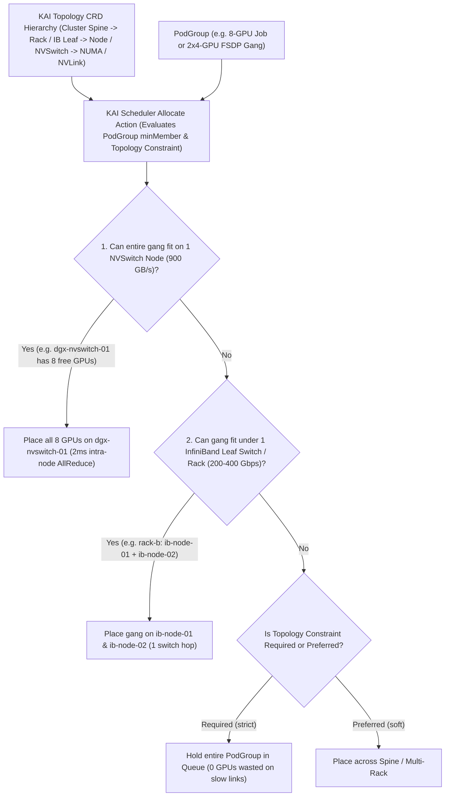

# 11.16 KAI gang scheduling and topology-aware placement

| | |
|---|---|
| Level | Advanced |
| Priority tier | 1 |
| Lab venue | GCP / GKE (plus local Python 3 simulation lab) |
| Part | Part 11: GPUs on Kubernetes, scheduling and virtualization |
| Sources used | Roland Huß et al., *Generative AI on Kubernetes* (O'Reilly, 2026, Ch. 7); `nvidia-zero-to-hero/volume-02/labs/lab-04-build-a-topology-aware-gpu-placement-plan.md`; `nvidia-zero-to-hero/volume-24/chapter-10-training-cluster-design.md`; Chris Fregly, *AI Systems Performance Engineering* (O'Reilly, 2025, Ch. 19) |
| Coverage file | `planning/coverage/chapters/11-16.md` |

## Why this matters for AI infrastructure

Gang scheduling and topology-aware placement are the two halves of a single distributed-systems problem. Gang scheduling guarantees when the pods of a distributed job start, ensuring they launch all together or not at all. Topology-aware placement guarantees where those pods land relative to the physical interconnect hierarchy. Solving only one half leaves your AI cluster broken.

If a scheduler lacks gang scheduling, it places seven out of eight worker Pods and deadlocks at the PyTorch rendezvous barrier. Every allocated GPU then sits wasted at zero percent compute. If a gang scheduler lacks topology awareness, it starts all eight GPUs at once. However, it scatters them across separate servers connected by slow Ethernet or multi-hop spine switches instead of packing them onto a single NVSwitch server. Even on a single four-GPU dual-socket H100 server, a naive two-GPU placement that crosses the inter-socket link slows down both peer GPU collectives and network RDMA transfers. Worse still, a degraded single NVLink lane can silently cut peer bandwidth by a quarter while the static topology matrix still looks healthy.

```text
Why Gang Scheduling and Topology Placement Must Work Together:
  1. Cluster-Level Placement Failure (GAK Ch. 7 & volume-24/chapter-10):
     - No Gang Scheduling: 7 of 8 worker Pods placed -> deadlocks at rendezvous, wasting 56 GPUs (0% compute).
     - No Topology Awareness: 8 GPUs scattered across Ethernet (10-100 Gbps) or InfiniBand spine switches
       (20-40 ms multi-hop AllReduce) instead of 1 NVSwitch server (900 GB/s per GPU, ~2 ms intra-node AllReduce).
  2. Host-Level Placement Failure on a 4-GPU H100 Server (volume-02/labs/lab-04, 81,559 MiB per GPU):
     - Naive {GPU1, GPU2, NIC1} selection crosses the inter-socket SYS boundary (NUMA distance 21 vs 10 local)
       for both GPU-to-GPU peer transfers and GPU-to-NIC RDMA transfers.
     - Optimal {GPU0, GPU1, NIC0} on NUMA 0 (CPUs 0-15, 257,698 MB RAM) keeps GPU peer traffic on a 4-lane
       NVLink bridge (NV4) and GPU-to-NIC traffic on a local PCIe switch (PIX to ConnectX-6 Dx [15b3:101d]
       at 0000:18:00.0).
  3. Silent Sub-Link Degradation (nvidia-smi nvlink --status):
     - Link 2 reporting 0.000 GB/s out of 4 x 26.562 GB/s = 106.248 GB/s cuts peer bandwidth by 25% (79.686 GB/s)
       even while nvidia-smi topo -m still prints NV4.
```

This chapter examines how the NVIDIA KAI Scheduler combines atomic PodGroup gang scheduling with multi-level Topology constraints from a NUMA island up to an InfiniBand spine switch. You will learn how distributed parallelism strategies map to those topology tiers, how to build a verified host placement plan, and how to sanity-check cluster-wide training throughput and topology hop counts.

## Prerequisites and outcomes

### Prerequisites
- Completion of Chapter 11.6 on `nvidia-smi topo -m` and `kubelet` Topology Manager, and Chapter 11.7 on PyTorch rendezvous and gang scheduling.
- Completion of Chapters 11.14 and 11.15 on KAI Scheduler `pod-grouper`, PodGroup, and Queue fair sharing.
- Familiarity with distributed training parallelism strategies: Data Parallelism, Fully Sharded Data Parallelism, Tensor Parallelism, and Pipeline Parallelism.

### Outcomes
- Match the four distributed parallelism strategies to their required KAI Scheduler Topology domains.
- Configure KAI Scheduler Topology custom resources and workload topology annotations for required and preferred domain levels.
- Apply sub-group topology constraints for LeaderWorkerSet and JobSet workloads.
- Execute the eight-step Host Topology Placement Plan from Volume 02 Lab 04 using `nvidia-smi`, Linux sysfs `numa_node` files, `lspci -Dnn`, `numactl --hardware`, and `nvidia-smi nvlink --status`.
- Perform the Training Cluster Throughput and Topology Sanity Check from Volume 24 Chapter 10 for a 50-billion-parameter LLM and evaluate node consolidation trade-offs.

## Concepts: basics to intermediate to advanced

### 1. Basics: How parallelism strategies dictate gang and topology requirements

A scheduler cannot apply a single generic placement rule to every multi-GPU job. Different parallelism strategies generate vastly different communication volumes, frequencies, and latency sensitivities. When an engineer runs Tensor Parallelism across slow inter-node Ethernet links, every forward and backward layer stalls waiting for activation transfers. That network stall turns expensive GPUs into idle space heaters. The scheduler must know which collectives run inside every transformer layer and which ones run only once at the end of a training step.

As Chapter 7 of *Generative AI on Kubernetes* explains, Tensor Parallelism requires the tightest intra-node NVSwitch or NVL72 rack locality because it synchronizes activations inside every layer. Fully Sharded Data Parallelism gathers parameters before every layer. It needs high-bandwidth NVSwitch nodes grouped under a single InfiniBand or RoCEv2 leaf switch with GPUDirect RDMA. Data Parallelism and Pipeline Parallelism tolerate wider placement across leaf switches as long as communication stays below twenty percent of total step time. The table below maps each parallelism strategy to its collective pattern and required KAI Scheduler topology tier.

| Parallelism Strategy | What Is Sharded or Replicated | Collective Operation and Frequency | Required Interconnect Topology Tier |
|---|---|---|---|
| 1. Tensor Parallelism (`TP`) | Splits weight matrices within every individual transformer layer across `2`, `4`, or `8` GPUs | Synchronous `AllGather` / `ReduceScatter` (or `AllReduce`) of activations on every forward and backward layer | Strict intra-node NVLink / NVSwitch (`600–900 GB/s` to `1.8 TB/s`) or intra-rack `GB200 NVL72` (`130 TB/s`). Impractical over standard Ethernet. |
| 2. Fully Sharded Data Parallelism (`FSDP` / `ZeRO-3`) | Shards model parameters, gradients, and optimizer states across all GPUs | Just-in-time `AllGather` of parameter shards before every layer + `ReduceScatter` of gradients after backward pass | Co-locate shard groups on NVSwitch nodes within the same InfiniBand (`200–400 Gbps`) or RoCEv2 leaf switch with GPUDirect RDMA (`40%–60%` latency reduction). |
| 3. Data Parallelism (`DDP`) | Replicates full model on each GPU; splits training batch across workers | Synchronous `AllReduce` of gradients once per training step (e.g., `900 GB` gradients in `~50 ms` ring `AllReduce` alongside `100 ms` compute = `150 ms < 300 ms` step time in `volume-24/chapter-10`) | InfiniBand or RoCEv2 (`100–400 Gbps`) for `8+` nodes; standard `100 Gbps` Ethernet suffices for `2–8` nodes when communication is `< 15%` (`< 20%–25%` ceiling) of step time. |
| 4. Pipeline Parallelism (`PP`) | Assigns consecutive blocks of transformer layers to different GPUs or nodes | Point-to-point `Send/Recv` of intermediate activations only at stage boundaries | Co-locate adjacent pipeline stages on the same node or adjacent nodes under the same leaf switch (`log2(12) = 3.6` hops on `12` `8`-GPU nodes vs `25` `4`-GPU nodes). |
| 5. Hybrid Parallelism (`TP + PP + DP/FSDP`) | Combines intra-node `TP`, inter-node `PP`, and cross-replica `DP`/`FSDP` | Hierarchical collectives: microsecond `TP` per layer + `PP` stage handoffs + step-level `DP` `AllReduce` | Two-level topology constraint in KAI Scheduler: require each `TP` sub-group inside `1` NVSwitch node, and prefer or require all `PP`/`DP` nodes inside `1` InfiniBand leaf switch. |

---

### 2. Intermediate: How KAI Scheduler integrates gang scheduling with hierarchical Topology

When you use a basic gang scheduler without native topology integration, pods launch together but land on random nodes across the data center. The Kubernetes Coscheduling plugin has zero native topology awareness and forces users to maintain fragile node labels and pod affinity rules by hand. Kueue selects hardware tiers at admission time via ResourceFlavor objects. However, it delegates actual pod-to-node placement to the downstream scheduler.

NVIDIA KAI Scheduler solves this problem by embedding GPU topology optimization directly into its gang-scheduling session loop. Suppose a training job requests eight GPUs and the cluster has both an idle eight-GPU NVSwitch node and eight free GPUs scattered across Ethernet nodes. KAI Scheduler automatically places the entire gang onto the single eight-GPU NVSwitch server. All eight GPUs then communicate over intra-node NVSwitch rather than crossing the network fabric.



Platform administrators define a Topology custom resource under `kai.scheduler/v1alpha1` that lists the ordered node labels representing each level of the physical data center tree. Workloads then reference that Topology tree using required or preferred placement annotations. Setting a hard required constraint keeps the entire PodGroup queued even when scattered GPUs sit free across the cluster, protecting training jobs from running three to five times slower over multi-hop links.

| Topology Mechanism | Label or Annotation Key | Operational Behavior in KAI Scheduler |
|---|---|---|
| Level 1: Zone or Spine | `topology.kubernetes.io/zone` | Outermost failure and spine-switch boundary for multi-rack jobs. |
| Level 2: Rack or IB Leaf Switch | `nvidia.com/rack` or `nvidia.com/ib-leaf-switch` | Co-locates multi-node FSDP and DDP gangs under a single `200–400 Gbps` InfiniBand leaf switch. |
| Level 3: Node or NVSwitch Domain | `kubernetes.io/hostname` or `nvlink-domain` | Packs `8`-GPU Tensor-Parallel gangs onto a single `900 GB/s` NVSwitch server or `GB200 NVL72` rack domain. |
| Level 4: NUMA or PCIe Island | `numa-node` | Aligns `2`-GPU jobs with local CPU cores, RAM, and PCIe switch (`PIX`) ConnectX NICs via GFD and `kubelet` Topology Manager. |
| Hard Topology Requirement | `kai.scheduler/topology-required-placement` | Holds the entire PodGroup in the queue if the gang cannot fit inside a single instance of the specified domain (`3–5x` slowdown prevented). |
| Soft Topology Preference | `kai.scheduler/topology-preferred-placement` | Packs the gang into the tightest domain when available, but falls back to a wider domain so the job starts sooner. |

---

### 3. Advanced: Host placement plans and cluster-scale throughput math

Even the best cluster-level topology labels fail if a server's internal PCIe, NUMA, or NVLink paths are wired differently than expected or degrade silently in production. Before trusting any scheduler's node labels, a senior infrastructure engineer builds a verified hardware baseline on each server class. Let us examine the eight-step host verification plan from Volume 02 Lab 04 and the cluster-scale throughput sanity check from Volume 24 Chapter 10.

On a four-GPU NVIDIA H100 dual-socket server with two Mellanox ConnectX-6 Dx NICs, the four GPUs do not form a single all-to-all NVSwitch mesh. Instead, they form two isolated two-GPU NVLink islands, one on each CPU socket. The table below records the hardware inventory collected from `nvidia-smi`, Linux sysfs `numa_node` files, and `numactl --hardware`.

| Device or Resource | Stable Identifier and PCI BDF | Sysfs `numa_node` | `numactl --hardware` CPUs and RAM | `nvidia-smi topo -m` Peer and NIC Links | Assigned Placement Group |
|---|---|---|---|---|---|
| `GPU 0` (`H100 80GB HBM3`, `81,559 MiB`) | `0000:1b:00.0` (`GPU-3a1f9e02-...`) | `0` | NUMA 0: CPUs `0–15`, `257,698 MB` RAM (distance `10` local, `21` remote) | `NV4` to `GPU 1`; `PIX` to `NIC 0`; `SYS` to `GPU 2, 3, NIC 1` | Rank Group A (NUMA 0) |
| `GPU 1` (`H100 80GB HBM3`, `81,559 MiB`) | `0000:3d:00.0` (`GPU-7b2e0c14-...`) | `0` | NUMA 0: CPUs `0–15`, `257,698 MB` RAM | `NV4` to `GPU 0`; `SYS` to `GPU 2, 3` | Rank Group A (NUMA 0) |
| `NIC 0` (`ConnectX-6 Dx`) | `0000:18:00.0` (`[15b3:101d]`) | `0` | NUMA 0: CPUs `0–15` | `PIX` to `GPU 0` | Rank Group A (NUMA 0) |
| `GPU 2` (`H100 80GB HBM3`, `81,559 MiB`) | `0000:9a:00.0` (`GPU-91c4d5a8-...`) | `1` | NUMA 1: CPUs `16–31`, `258,043 MB` RAM (distance `10` local, `21` remote) | `NV4` to `GPU 3`; `PIX` to `NIC 1`; `SYS` to `GPU 0, 1, NIC 0` | Rank Group B (NUMA 1) |
| `GPU 3` (`H100 80GB HBM3`, `81,559 MiB`) | `0000:c3:00.0` (`GPU-c85f3d21-...`) | `1` | NUMA 1: CPUs `16–31`, `258,043 MB` RAM | `NV4` to `GPU 2`; `SYS` to `GPU 0, 1` | Rank Group B (NUMA 1) |
| `NIC 1` (`ConnectX-6 Dx`) | `0000:9d:00.0` (`[15b3:101d]`) | `1` | NUMA 1: CPUs `16–31` | `PIX` to `GPU 2` | Rank Group B (NUMA 1) |

This baseline reveals two operational lessons. First, a two-GPU distributed training Pod placed on the first island runs peer collectives over a four-lane NVLink bridge and RDMA over a local PCIe switch on NUMA 0. A naive scheduler that assigns GPUs across both sockets forces both GPU peer traffic and GPU-to-NIC traffic across the inter-socket link at NUMA distance 21.

Second, even when `nvidia-smi topo -m` prints an NVLink bridge for the first GPU pair, one of the four physical NVLink lanes can degrade after initial commissioning. Running `nvidia-smi nvlink --status` exposes sub-link bandwidth drops that static node labels miss. Also note from Chapter 19 of *AI Systems Performance Engineering* that when one path in a collective experiences transient congestion, periodically calling `ncclCommInitRank` with a permuted rank order uses alternating rings. That rank permutation keeps a single slow path from bottlenecking every collective.

```text
Silent NVLink Sub-Link Degradation Check (volume-02/labs/lab-04, Section 14):
  $ nvidia-smi nvlink --status
  GPU 0: NVIDIA H100 80GB HBM3
       Link 0: 26.562 GB/s
       Link 1: 26.562 GB/s
       Link 2: 0.000 GB/s
       Link 3: 26.562 GB/s

Bandwidth Impact:
  Healthy 4-lane NV4 unidirectional bandwidth = 4 * 26.562 GB/s = 106.248 GB/s
  Active bandwidth with Link 2 at 0.000 GB/s  = 3 * 26.562 GB/s =  79.686 GB/s (75.0% healthy, 25% loss)
```

At the cluster scale, node density choices and hardware budgets determine whether a training target is physically achievable. In Volume 24 Chapter 10, a stakeholder asks to train a 50-billion-parameter LLM at one hundred trillion tokens per year under a five-million-dollar budget. Before writing a single YAML manifest, a senior infrastructure architect runs a three-step sanity check across FLOPs, interconnect hop counts, and checkpoint storage bandwidth.

First, calculate the required FLOPs per token and compare them against the GPUs that fit inside the hardware budget. Second, compare four-GPU nodes against eight-GPU NVSwitch nodes to minimize binary-tree communication hops and keep step latency under the three-hundred-millisecond target. Third, stage checkpoints to local NVMe drives in one second so synchronous saves never stall the GPUs. The breakdown below shows the exact equations and numbers from Volume 24 Chapter 10.

```text
Cluster-Scale Throughput, Node Density, and Checkpoint Sanity Check (volume-24/chapter-10):
  Stated Stakeholder Target:
    Model = 50B parameters | batch_size = 256 | seq_length = 2048 -> 524,288 tokens/step (< 300 ms/step)
    Target throughput = 100 trillion (10^14) tokens/year | All-in budget = $5M (CapEx + 3yr OpEx)

  Step 1 — FLOPs, BOM, and the 4.4x Budget Shortfall:
    Compute per token = 2 * 50B = 100 GFLOP/token (10^11 FLOPs/token)
    Annual compute for 100T tokens = 10^14 * 10^11 = 10^25 FLOPs/year
    1 H100 peak FP8 = 1,400 TFLOPS -> 4.42 * 10^19 FLOPs per 31,557,600-second Julian year
      (which would imply ~226,244 theoretical peak GPU-years under that raw formula).
    1 H100 sustained = ~1,000 TFLOPS = 3.6 * 10^18 FLOPs/hour (3.6 EFLOP/hour)
    Tokens/hour per H100 = 3.6 * 10^18 / 10^11 = 36M tokens/hour/GPU
    Hardware BOM ($40K/H100 SXM5):
      - 100 GPUs = $5.375M CapEx ($4.0M GPUs + $0.75M for 25 nodes + $0.25M IB switch + $0.25M for 25 HCAs
        + $0.125M for 25 * 1TB NVMe) -> exceeds $5M budget.
      - 90 GPUs + HDR100 IB switch ($0.15M) = $4.875M CapEx ($3.6M GPUs; or 80 GPUs at $4.375M CapEx
        once $1.8M 3-year OpEx is included).
    Achievable throughput on 90 H100s at 80% availability (24 * 365 * 0.80):
      90 * 36M = 3.24B tokens/hour -> 3.24B * 24 * 365 * 0.80 = 22.7 trillion tokens/year
    Shortfall analysis: 100T / 22.7T = 4.4x shortfall -> requires 90 * (100 / 22.7) ~= 396 H100 GPUs (~$16M GPU CapEx).

  Step 2 — Node Density & Topology Hop Math (25 x 4-GPU Nodes vs 12 x 8-GPU Nodes):
    Option B (25 nodes x 4 GPUs/node):
      Intra-node 4-GPU AllReduce = ~2 ms over NVLink (25 GB/s per link); inter-node AllReduce across 25 nodes
      over shared InfiniBand HDR = 20-40 ms (~50 ms total optimized ring AllReduce for 900 GB gradients + 100 ms
      compute = 150 ms < 300 ms step target; naive unoptimized 24-round ring estimate is 108 ms).
    Option C (12 nodes x 8 GPUs/node):
      Consolidating onto 8-GPU NVSwitch nodes cuts inter-node binary tree hops to log2(12) ~= 3.6 hops,
      halves inter-node IB congestion, and packs 8-GPU tensor-parallel gangs inside 1 node.

  Step 3 — Fast Local NVMe + Async S3 Checkpointing (600 GB in ~1s):
    50B model checkpoint = 200 GB weights + 400 GB optimizer state = 600 GB total.
    Saved every 100 steps (~30 seconds) to 1 TB local NVMe in ~1 second; flushed asynchronously to S3
    in the background (~50 minutes over 200 Mbps, or every 15 minutes using incremental checkpoints).
```

### 4. Sub-group topology rules and post-commissioning drift detection

When running large-scale three-dimensional parallel training with JobSet or multi-node sharded LLM inference with LeaderWorkerSet, a single flat topology constraint across the entire job is either too weak or too strict. A weak constraint lets Tensor-Parallel shards spill across nodes over Ethernet. A strict single-node constraint demands that sixty-four GPUs fit inside an eight-GPU server.

KAI Scheduler solves this problem by supporting two-level hierarchical gang topology constraints across PodGroup sub-groups. At the sub-group level, every eight-GPU Tensor-Parallel worker pod or four-node LeaderWorkerSet replica group requires `kubernetes.io/hostname` locality so per-layer activation exchanges stay inside the NVSwitch fabric. At the parent gang level, the PodGroup applies `kai.scheduler/topology-preferred-placement` for the InfiniBand leaf switch and `kai.scheduler/topology-required-placement` for the availability zone. This two-level rule packs the entire multi-node gang onto the minimum number of InfiniBand leaf switches.

Physical server wiring rarely changes on its own, but the effective topology path can degrade silently in production. A firmware update, riser card replacement, optical transceiver failure, or single-lane NVLink drop can cut bandwidth without changing node labels. Run an automated topology drift check on every GPU worker node that compares five live signals against the node's commissioned baseline stored in Git. If any check fails after maintenance, automatically withhold the node's topology service-class label and apply a maintenance taint until the hardware is repaired.

| Drift Check Signal | Verification Command | Failure Threshold and Automated Action |
|---|---|---|
| 1. Stable UUID-to-PCI BDF Map | `nvidia-smi --query-gpu=index,uuid,pci.bus_id --format=csv` | Alert and taint node if any GPU `UUID` disappears or shifts to a different PCIe bus address after maintenance. |
| 2. PCIe Link Width and Speed | `sudo lspci -vv \| grep -E 'LnkCap:\|LnkSta:'` | Alert if a GPU or ConnectX HCA negotiates fewer lanes (`x8` vs `x16`) or drops from PCIe Gen5 (`32GT/s`) or Gen4 (`16GT/s`) while in active `P0` state. |
| 3. Per-Lane NVLink Bandwidth | `nvidia-smi nvlink --status` | Cordon node if any NVLink lane drops to `0.000 GB/s` (such as `Link 2: 0.000 GB/s` reducing a `4`-lane `106.248 GB/s` `NV4` pair to `79.686 GB/s`). |
| 4. Sysfs NUMA Association | `cat /sys/bus/pci/devices/<bdf>/numa_node` | Alert if a BIOS update resets `numa_node` to `-1` or swaps socket associations relative to `numactl --hardware`. |
| 5. Pre-Flight Collective Bandwidth | `all_reduce_perf` (`nccl-tests`) and `ib_write_bw` | Gate node re-admission on passing both intra-node NVLink and inter-node GPUDirect RDMA bandwidth thresholds. |

## Commands and configurations that matter

### 1. Inspecting host GPU, NUMA, PCIe, and NVLink sub-link topology

Run the commands below on each worker node class during commissioning and after any hardware maintenance to build a verified GPU, NIC, and NUMA placement baseline.

```bash
# 1. Build stable GPU UUID-to-PCI bus ID inventory (untested here)
nvidia-smi --query-gpu=index,name,uuid,pci.bus_id,memory.total --format=csv

# 2. Print full GPU and NIC topology matrix (untested here)
nvidia-smi topo -m

# 3. Cross-check Linux sysfs NUMA node for every GPU and ConnectX NIC (untested here)
for bdf in $(nvidia-smi --query-gpu=pci.bus_id --format=csv,noheader | sed 's/^00000000:/0000:/'); do
  printf "%s NUMA=" "$bdf"
  cat "/sys/bus/pci/devices/$bdf/numa_node"
done
lspci -Dnn | grep -iE 'ethernet|infiniband|network'
cat /sys/bus/pci/devices/0000:18:00.0/numa_node
cat /sys/bus/pci/devices/0000:9d:00.0/numa_node

# 4. Inspect CPU/RAM NUMA layout and verify PCIe link speed and NVLink sub-link bandwidth (untested here)
numactl --hardware
sudo lspci -s "0000:1b:00.0" -vv | grep -E 'LnkCap:|LnkSta:'
nvidia-smi nvlink --status
```

### 2. Defining KAI Scheduler Topology and workload placement profiles

The manifest below defines a three-level `ai-factory-topology` resource under `kai.scheduler/v1alpha1` and attaches a four-node PyTorchJob to the team queue. The job requires all pods to stay within the same availability zone and prefers co-location under a single InfiniBand leaf switch.

```yaml
# kai-topology-and-workload-constraints.yaml (untested here)
apiVersion: kai.scheduler/v1alpha1
kind: Topology
metadata:
  name: ai-factory-topology
spec:
  levels:
    - nodeLabel: topology.kubernetes.io/zone
    - nodeLabel: nvidia.com/ib-leaf-switch
    - nodeLabel: kubernetes.io/hostname
---
apiVersion: kubeflow.org/v1
kind: PyTorchJob
metadata:
  name: fsdp-llama-50b
  namespace: ml-team-a
  labels:
    kai.scheduler/queue: ml-team-a
  annotations:
    kai.scheduler/topology: ai-factory-topology
    kai.scheduler/topology-preferred-placement: nvidia.com/ib-leaf-switch
    kai.scheduler/topology-required-placement: topology.kubernetes.io/zone
spec:
  pytorchReplicaSpecs:
    Master:
      replicas: 1
      template:
        spec:
          schedulerName: kai-scheduler
          containers:
            - name: pytorch
              image: nvcr.io/nvidia/pytorch:24.08-py3
              resources:
                limits:
                  nvidia.com/gpu: 8
    Worker:
      replicas: 3
      template:
        spec:
          schedulerName: kai-scheduler
          containers:
            - name: pytorch
              image: nvcr.io/nvidia/pytorch:24.08-py3
              resources:
                limits:
                  nvidia.com/gpu: 8
```

## How it fails

Silent NVLink lane drops, node fragmentation, PCIe re-enumeration, and uncapped power spikes degrade or halt distributed training runs. The table below maps each failure mode to its command evidence, root cause boundary, and remediation.

| Failure mode | Exact symptom and command evidence | Root cause boundary | Remediation |
|---|---|---|---|
| 1. Preferred `NV4` GPU pair runs `25%` slower while `nvidia-smi topo -m` still shows `NV4` | `2`-GPU job on `GPU 0` and `GPU 1` shows `NV4` in `nvidia-smi topo -m`, but step time regresses. `nvidia-smi nvlink --status` shows `Link 0, 1, 3: 26.562 GB/s` and `Link 2: 0.000 GB/s` (`volume-02/labs/lab-04` §14). | Partial NVLink sub-link degradation (`75.0%` bandwidth): one of the `4` bonded NVLink lanes trained down to `0.000 GB/s` (`79.686 / 106.248 GB/s`) after initial topology discovery. | Monitor `nvidia-smi nvlink --status` and DCGM NVLink error counters continuously; cordon the node for GPU reset or replacement when any lane drops to `0.000 GB/s`. |
| 2. `8`-GPU job stays Pending even though `8` free GPUs exist across `4` nodes (`2` free GPUs/node) | Cluster has `8` idle GPUs (`2` per node across `4` nodes), yet an `8`-GPU job with `topology-required-placement: kubernetes.io/hostname` stays Pending. | Hard single-node topology or fragmentation constraint (`GAK` Ch. 7): the workload required all `8` GPUs on a single NVSwitch node (`hostname`), and existing `2`-GPU jobs fragmented all `4` nodes. | Enable KAI Scheduler's Consolidate action (or Kubernetes Descheduler `HighNodeUtilization` + `MostAllocated` bin packing) to pack the `2`-GPU jobs onto fewer nodes and free a full `8`-GPU NVSwitch node. |
| 3. Topology matrix and GPU indices change after a server firmware or riser repair (`Lab 04` §14) | After hardware maintenance, a pinned placement policy routes `GPU 0` + `GPU 1` onto a slow `SYS` path. | PCIe bus enumeration or slot drift: moving risers or updating BIOS renumbered logical GPU indices (`0..3`), invalidating index-based pinning. | Key all topology inventories and CDI or DRA mappings by GPU `UUID` (`GPU-3a1f9e02-...`) and PCI BDF (`0000:1b:00.0`), and re-run the `Lab 04` verification before returning a repaired node to service. |
| 4. `90`-GPU H100 cluster delivers `15T` tokens/year instead of `22.7T` (`80 ms` vs `50 ms` `AllReduce`) | Training throughput drops `34%` below the `22.7T` achievable baseline; NCCL profiling shows inter-node `AllReduce` taking `80 ms` instead of `50 ms` (`volume-24/chapter-10`). | InfiniBand link speed downshift or cross-leaf placement: either `ibnetdiscover` / `perfquery` shows IB links negotiated below `200 Gbps` HDR, or the gang was scattered across spine switches. | Verify `ibnetdiscover` link speeds, reseat degraded IB cables, and configure KAI `kai.scheduler/topology-preferred-placement: nvidia.com/ib-leaf-switch`. |
| 5. `8`-GPU node trips rack breaker at `15 kW` (above `10 kW` rack budget) during synchronous `AllReduce` + GEMM peaks | Nodes unexpectedly power off under peak FP8 tensor-core load. `ipmitool dcmi power reading` shows `15 kW` vs `10 kW` rack power budget (`volume-24/chapter-10`). | Uncapped peak GPU power draw: all `8` GPUs hit maximum TDP simultaneously during dense GEMM steps. | Apply an `85%` power cap (`nvidia-smi -pl` via GPU Operator or DCGM policy, reducing `15 kW` to `~12 kW` with minimal throughput loss) or tune micro-batch sizes. |

## Hands-on lab

### Venue and scope
This lab runs locally using the Python 3 standard library via `code/part11/kai_gang_and_topology.py` and `code/part11/kai_gang_and_topology_lab.py`. It simulates KAI Scheduler's multi-level gang and topology placement engine. It also runs the four-GPU H100 placement and sub-link health verifier from Volume 02 Lab 04, plus the 50-billion-parameter LLM throughput calculator from Volume 24 Chapter 10. Cluster and host commands in earlier sections are marked `(untested here)`.

### Step 1: Run the self-checking KAI gang scheduling and topology lab (tested here)

Run the lab verification script from the repository root to validate all 25 topology placement, sub-link degradation, and cluster throughput assertions.

```bash
python3 code/part11/kai_gang_and_topology_lab.py
```

Captured output from this repository:
```text
=== Chapter 11.16 Lab: KAI Gang Scheduling & Topology-Aware Placement ===
  [PASS] KAI places 8-GPU Tensor-Parallel job on single_node_nvswitch (dgx-nvswitch-01, 900 GB/s)
  [PASS] KAI co-locates 2x4-GPU FSDP gang on same InfiniBand leaf switch rack (rack-b: ib-node-01, ib-node-02)
  [PASS] KAI places 2-GPU latency-sensitive job inside single_numa_island (NUMA 0 on ib-node-01)
  [PASS] When 16-GPU gang cannot fit in rack-b (8 GPUs free), KAI holds entire gang in queue (0 pods placed)
  [PASS] Lab 04 {GPU0, GPU1, NIC0} on NUMA 0 achieves optimal NV4 peer path and PIX NIC path
  [PASS] Naive {GPU1, GPU2, NIC1} placement crosses NUMA 0<->1 (SYS path for both GPU peer and GPU-to-NIC)
  [PASS] nvidia-smi nvlink --status with Link 2 at 0.000 GB/s (3 x 26.562 GB/s active) drops NV4 bandwidth to 75.0%
  [PASS] 50B model (batch 256 x seq 2048) processes 524,288 tokens/step at 100.0 GFLOP/token
  [PASS] At 1000 TFLOPS achieved (1400 peak), 1 H100 delivers 3.6 EFLOP/hr = 36.0M tokens/hr
  [PASS] 90 H100s deliver 3.24B tokens/hr and 22.7T tokens/yr at 80% availability
  [PASS] 22.7T vs 100T target is a 4.4x shortfall requiring ~396 H100 GPUs (~$16M GPU CapEx vs $5M budget)
  [PASS] Lab 04 H100 reports 81,559 MiB VRAM and numactl reports 257,698 MB (NUMA 0) and 258,043 MB (NUMA 1)
  [PASS] numactl --hardware reports local NUMA distance 10 vs cross-socket NUMA distance 21
  [PASS] Lab 04 lspci identifies Mellanox ConnectX-6 Dx with PCI ID [15b3:101d] on 0000:18:00.0 and 0000:9d:00.0
  [PASS] Consolidating 100 GPUs onto 12 8-GPU nodes reduces binary tree inter-node hops to log2(12) ~= 3.6
  [PASS] Project 10 step latency is 100ms compute + 50ms ring AllReduce = 150ms (< 300ms target)
  [PASS] 50B model checkpoint is 200 GB weights + 400 GB optimizer state = 600 GB (written in ~1s to 1TB local NVMe)
  [PASS] 1 Julian year contains 31,557,600 seconds (4.42e19 peak FP8 FLOPs per H100-year at 1400 TFLOPS)
  [PASS] 10^25 FLOPs divided by 4.42e19 FLOPs/GPU-year equals ~226,244 theoretical peak GPU-years
  [PASS] Initial 100-H100 BOM sums to $5.375M ($4.0M GPUs + $0.75M nodes + $0.25M switch + $0.25M HCAs + $0.125M NVMe)
  [PASS] 90-H100 + HDR100 BOM reduces hardware CapEx to $4.875M (or $4.375M at 80 GPUs)
  [PASS] Optimized multi-rail ring AllReduce cuts naive 108ms inter-node transfer down to ~50ms
  [PASS] When 8-GPU node power hits 15 kW (above 10 kW rack budget), an 85% power cap limits draw
  [PASS] Lab 04 Step 8 defines 3 distinct placement_profiles (single_gpu_inference, multi_gpu_training, distributed_training)
  [PASS] 4 NVLink lanes at 26.562 GB/s provide 106.248 GB/s unidirectional (79.686 GB/s when 1 lane drops to 0.000 GB/s)

Summary: 25 passed, 0 failed out of 25 checks.
```

### Exercises

1. **Exercise 1 — KAI hierarchical topology selection:** Use `select_kai_gang_topology_placement()` in `code/part11/kai_gang_and_topology.py` to trace which nodes and domain are selected across three cases. Test a single-Pod 8-GPU job requiring a single NVSwitch node, a two-Pod 8-GPU job requiring the same InfiniBand rack when the NVSwitch server is excluded, and a four-Pod 16-GPU job when the rack has only 8 GPUs free.
2. **Exercise 2 — Host placement verification:** Use `verify_lab04_host_placement_and_nvlink()` to compare the GPU peer path, GPU-to-NIC path, and optimality boolean for the first NUMA island versus a cross-socket selection.
3. **Exercise 3 — Detecting degraded NVLink sub-links:** On the first GPU, `nvidia-smi nvlink --status` reports three active lanes at full speed and one lane at zero bandwidth. Compute the expected four-lane unidirectional bandwidth, the actual active bandwidth, and the health percentage.
4. **Exercise 4 — 50B LLM training throughput and budget gap:** Call `evaluate_50b_training_cluster_design()` to calculate the tokens per step, millions of tokens per hour per GPU, and achievable trillion tokens per year on 90 H100 GPUs at 80 percent availability. State the shortfall ratio against a 100-trillion tokens-per-year request and the number of GPUs needed to close it.
5. **Exercise 5 — Node consolidation and step-time breakdown:** Compare the inter-node binary tree hop count of a 12-node 8-GPU cluster against a 25-node 4-GPU cluster. State the step-time breakdown between compute and ring collective communication relative to the 300-millisecond target.
6. **Exercise 6 — Sizing fast local NVMe checkpoints:** A 50-billion-parameter model checkpoint consists of 200 GB of model weights and 400 GB of optimizer state saved every 100 steps. Compare the synchronous write time to a 1 TB local NVMe drive against a background 200 Mbps S3 upload.

## Checkpoint questions

<details>
<summary>`&lt;strong>`1. Why is gang scheduling without topology awareness insufficient for distributed LLM training?`&lt;/strong>`</summary>

Gang scheduling only guarantees that all Pods of a job start at the same time. Without topology awareness, the scheduler can scatter those Pods across separate nodes or racks connected by slow Ethernet or multi-hop spine links. Co-locating the gang on a single NVSwitch node or a single InfiniBand leaf switch avoids that network bottleneck and prevents step time from increasing by an order of magnitude.
</details>

<details>
<summary>`&lt;strong>`2. Compare the network bandwidth and latency sensitivities of Data Parallelism (DDP), Tensor Parallelism (TP), Fully Sharded Data Parallelism (FSDP), and Pipeline Parallelism (PP).`&lt;/strong>`</summary>

Tensor Parallelism has the highest sensitivity because it executes synchronous collectives on activations inside every layer, requiring intra-node NVLink or NVSwitch. FSDP has very high sensitivity because it performs just-in-time parameter gather and gradient scatter collectives on every layer, requiring intra-node NVSwitch plus inter-node InfiniBand or RoCEv2 GPUDirect RDMA. Data Parallelism is bandwidth-sensitive once per step during gradient synchronization, while Pipeline Parallelism has the lowest bandwidth demand and sends point-to-point activations only at stage boundaries.
</details>

<details>
<summary>`&lt;strong>`3. How does KAI Scheduler's topology awareness differ from Kueue's ResourceFlavor approach and the Coscheduling plugin?`&lt;/strong>`</summary>

The Coscheduling PodGroup plugin has no native topology awareness and relies on manual node labels and pod affinity rules. Kueue selects hardware tiers at job admission time via ResourceFlavor objects, delegating pod placement to the underlying scheduler. NVIDIA KAI Scheduler integrates native GPU topology optimization directly into its gang-scheduling session loop, reading NVLink, NVSwitch, MIG, and InfiniBand domains to co-locate gangs automatically.
</details>

<details>
<summary>`&lt;strong>`4. In KAI Scheduler, what is the trade-off between setting a topology constraint as required (kai.scheduler/topology-required-placement) versus preferred (kai.scheduler/topology-preferred-placement)?`&lt;/strong>`</summary>

Setting a constraint as required guarantees the gang never runs on a degraded interconnect path by holding the entire PodGroup in the queue even if scattered GPUs are free. This protects collective step time and prevents cross-switch congestion at the cost of longer queue wait times when the cluster is fragmented. Setting a constraint as preferred places the gang inside the tightest domain when available, but allows falling back to a wider domain so the job starts sooner.
</details>

<details>
<summary>`&lt;strong>`5. On the 4-GPU H100 server in Volume 02 Lab 04, what are the two natural hardware topology groups, and what three Linux/NVIDIA data sources confirm them?`&lt;/strong>`</summary>

The two natural hardware groups on the server are:

| Topology Group | NUMA Node, CPUs, and RAM | GPUs and PCI BDFs (`NV4` Peer Link) | Local ConnectX-6 Dx NIC (`[15b3:101d]`, `PIX` Link) |
|---|---|---|---|
| Group A | NUMA 0: CPUs `0–15`, `257,698 MB` RAM | `GPU 0` (`0000:1b:00.0`) + `GPU 1` (`0000:3d:00.0`) | `NIC 0` (`0000:18:00.0`) |
| Group B | NUMA 1: CPUs `16–31`, `258,043 MB` RAM | `GPU 2` (`0000:9a:00.0`) + `GPU 3` (`0000:c3:00.0`) | `NIC 1` (`0000:9d:00.0`) |

The three independent confirming sources are `nvidia-smi topo -m`, the Linux sysfs `numa_node` file for each GPU and NIC, and `numactl --hardware`.
</details>

<details>
<summary>`&lt;strong>`6. In Volume 02 Lab 04, what happens if a 2-GPU + 1-NIC distributed training job is placed on (GPU 1, GPU 2, NIC 1) instead of (GPU 0, GPU 1, NIC 0)?`&lt;/strong>`</summary>

The first GPU sits on NUMA 0 while the second GPU and the selected NIC sit on NUMA 1. Because there is no NVLink bridge between those two GPUs, every peer GPU transfer and every cross-socket RDMA transfer must cross the inter-socket link at NUMA distance 21 instead of local distance 10.
</details>

<details>
<summary>`&lt;strong>`7. Why is checking nvidia-smi topo -m once at node commissioning not sufficient to guarantee that an NV4 GPU pair remains healthy in production?`&lt;/strong>`</summary>

The topology matrix command shows only the logical link class. Running `nvidia-smi nvlink --status` can reveal that one of the four NVLink lanes has degraded to zero bandwidth while the other three lanes run normally. That single failed lane cuts peer bandwidth by 25 percent even though the pair still appears healthy in the static topology matrix.
</details>

<details>
<summary>`&lt;strong>`8. What are the three workload placement profiles defined in Step 7 and Step 8 of Volume 02 Lab 04?`&lt;/strong>`</summary>

The three workload placement profiles are:

| Placement Profile | Required and Preferred Topology Rules |
|---|---|
| `single_gpu_inference` | `require_same_numa_cpu: true`, `require_peer_group: false`, `prefer_local_nic: true` |
| `multi_gpu_training` (single-node) | `require_same_peer_group: true`, `require_balanced_gpu_count: true`, `require_local_cpu_memory: true` |
| `distributed_training` (multi-node) | `require_same_peer_group: true`, `require_local_high_speed_nic: true`, `require_rank_device_mapping: true` |
</details>

<details>
<summary>`&lt;strong>`9. Why should topology inventories and placement policies track GPU UUIDs and PCI bus addresses rather than only logical GPU indices (0, 1, 2, 3)?`&lt;/strong>`</summary>

Logical indices can change after a BIOS update, PCIe riser replacement, or kernel re-enumeration. A GPU's hardware UUID is immutable, and its PCI BDF address maps directly to Linux sysfs NUMA and PCIe root-complex topology.
</details>

<details>
<summary>`&lt;strong>`10. In Volume 24 Project 10, a stakeholder asks for 100 trillion tokens/year of training throughput on a 50B-parameter LLM with a $5M all-in budget. Walk through the per-GPU throughput math that proves a 4.4x shortfall.`&lt;/strong>`</summary>

A 50-billion-parameter model requires 100 GFLOP per token, and one H100 achieving 1,000 TFLOPS sustained processes 36 million tokens per hour. A 5-million-dollar budget buys 90 H100 GPUs at 4.875 million dollars in hardware CapEx, or 80 GPUs when three-year OpEx is included. At 80 percent availability, 90 H100s produce 3.24 billion tokens per hour or 22.7 trillion tokens per year. That leaves a 4.4x shortfall below the 100-trillion target, which would require about 396 H100 GPUs.
</details>

<details>
<summary>`&lt;strong>`11. In Volume 24 Project 10 Step 2, compare Option B (25 nodes x 4 GPUs/node) and Option C (12 nodes x 8 GPUs/node) for a ~100-GPU cluster.`&lt;/strong>`</summary>

In Option B with 25 four-GPU nodes, intra-node collective communication takes about 2 milliseconds over NVLink, while inter-node communication across 25 nodes over InfiniBand HDR takes 20 to 40 milliseconds. In Option C with 12 eight-GPU nodes, consolidating onto eight-GPU NVSwitch servers reduces binary-tree inter-node communication hops to 3.6 hops. It also cuts switch port count and congestion in half and keeps eight-GPU tensor-parallel groups inside one node.
</details>

<details>
<summary>`&lt;strong>`12. In Volume 24 Project 10 Step 4, how do compute time and ring AllReduce time combine to meet the under-300ms step-time requirement for the 50B model (batch 256)?`&lt;/strong>`</summary>

Per step, forward and backward compute at 1,000 TFLOPS takes 100 milliseconds, and optimized multi-node ring collective communication of 900 GB gradients takes about 50 milliseconds. The total step time is 150 milliseconds, which stays well below the 300-millisecond target.
</details>

<details>
<summary>`&lt;strong>`13. How does Volume 24 Project 10 Phase 3 size and stage a 600 GB checkpoint (200 GB weights + 400 GB optimizer state) every 100 steps (~30 seconds) without stalling training?`&lt;/strong>`</summary>

Each node writes the 600 GB checkpoint synchronously to its 1 TB local NVMe drive in about 1 second so training resumes immediately. A background process then asynchronously uploads the checkpoint to remote S3 storage, taking about 50 minutes for a full dump over 200 Mbps or 15 minutes with incremental diffs.
</details>

<details>
<summary>`&lt;strong>`14. How can a scheduler or runtime smooth out a single slow link or straggler path across repeated collective operations according to AI Systems Performance Engineering Chapter 19?`&lt;/strong>`</summary>

Use alternating rings or periodically re-initialize and permute the communicator rank order via `ncclCommInitRank` across collectives. Permuting rank order ensures that no single physical link or GPU sits on the critical bottleneck path for every consecutive collective.
</details>

<details>
<summary>`&lt;strong>`15. When an 8-GPU node's power draw spikes to 15 kW under peak synchronous FP8 load—exceeding a 10 kW rack power budget—what immediate operational control can you apply?`&lt;/strong>`</summary>

Monitor node power via `ipmitool dcmi power reading` or Redfish and DCGM telemetry. Apply an 85 percent GPU power cap with `nvidia-smi -pl` via GPU Operator policy, or reduce the micro-batch size to keep node power within the rack breaker envelope.
</details>

<details>
<summary>`&lt;strong>`16. How do you check negotiated PCIe link speed and width for a specific GPU (e.g., 0000:31:00.0) on a Linux worker node?`&lt;/strong>`</summary>

Run `sudo lspci -s "0000:31:00.0" -vv | grep -E 'LnkCap:|LnkSta:'` on the worker node. Verify that the negotiated link status speed and width match the link capability when the GPU is in the active performance state.
</details>

<details>
<summary>`&lt;strong>`17. What does a value of -1 in /sys/bus/pci/devices/PCI_BDF/numa_node mean on a Linux GPU server, and how does it affect topology-aware scheduling?`&lt;/strong>`</summary>

A sysfs `numa_node` value of negative one means the server's ACPI BIOS tables or hypervisor did not expose a specific NUMA node association to the Linux kernel. Until fixed in BIOS or overridden via a topology map, `numactl` and `kubelet` Topology Manager cannot distinguish socket locality for that PCIe device.
</details>

<details>
<summary>`&lt;strong>`18. In Volume 24 Project 10, if achieved cluster throughput drops from 22.7T tokens/year down to 15T tokens/year and inter-node AllReduce rises from 50ms to 80ms, what two diagnostic tools do you run first?`&lt;/strong>`</summary>

First, inspect `perfquery` counters and NCCL debug traces to check InfiniBand port congestion and verify whether NCCL selected Ring or Tree collectives. Second, run `ibnetdiscover` and `ibstat` to confirm that all InfiniBand links negotiated full 200 Gbps HDR speed and that no degraded cables forced traffic onto multi-hop paths.
</details>

<details>
<summary>`&lt;strong>`19. How does KAI Scheduler's Consolidate action interact with topology-aware gang scheduling when a cluster is partially loaded with 1-GPU and 2-GPU jobs?`&lt;/strong>`</summary>

When single-GPU and two-GPU jobs are spread across nodes, no single server has 8 free GPUs to satisfy a single-node NVSwitch PodGroup. KAI Scheduler's Consolidate and bin-packing action packs smaller jobs onto partially filled nodes so whole eight-GPU NVSwitch nodes remain contiguous for incoming eight-GPU gangs.
</details>

<details>
<summary>`&lt;strong>`20. When layering Kueue above KAI Scheduler for a multi-node training job, which component selects the InfiniBand hardware tier and which component co-locates the gang onto the same InfiniBand leaf switch?`&lt;/strong>`</summary>

Kueue selects the hardware tier at admission time by matching the job's ClusterQueue against the InfiniBand ResourceFlavor and injecting tier node labels. Once Kueue unsuspends the job, KAI Scheduler executes atomic gang placement and uses its Topology tree to pack the gang's pods onto the minimum number of NVSwitch nodes under a single InfiniBand leaf switch.
</details>

## Sources and review notes

```text
Primary sources read in full for this chapter:
  - Roland Huß et al., Generative AI on Kubernetes (O'Reilly, 2026), Chapter 7 (Job Scheduling Optimization:
    "Topology-Aware Scheduling", "Communication Patterns in Distributed Training", Table 7-3 comparing
    Coscheduling, Kueue, KAI Scheduler, and Volcano, and "Making the right choice" layering Kueue + KAI Scheduler).
  - Chris Fregly, AI Systems Performance Engineering (O'Reilly, 2025), Chapter 19 (ncclCommInitRank rank
    permutation / alternating rings).
  - nvidia-zero-to-hero/volume-02/labs/lab-04-build-a-topology-aware-gpu-placement-plan.md (Figure 2.L4.1 naive
    {GPU1, GPU2, NIC1} vs topology-aware {GPU0, GPU1, NIC0}, 4-GPU H100 81559 MiB inventory
    0000:1b:00.0/3d:00.0/9a:00.0/c3:00.0, ConnectX-6 Dx [15b3:101d] 0000:18:00.0/9d:00.0, numactl --hardware
    257698 MB / 258043 MB distances 10/21, LnkCap/LnkSta, 3 placement profiles YAML, and nvidia-smi nvlink --status
    26.562 GB/s vs 0.000 GB/s degraded lane).
  - nvidia-zero-to-hero/volume-24/chapter-10-training-cluster-design.md (50B model, 100T tokens/yr,
    256 * 2048 = 524,288 tokens/step, 100 GFLOP/token, 10^25 FLOPs/yr, 31,557,600 s/yr, 4.42 * 10^19 FLOPs/GPU-yr,
    226,244 theoretical GPU-yrs, 1,400 TFLOPS peak / 1,000 TFLOPS achieved -> 3.6 EFLOP/hr = 36M tokens/hr/GPU,
    90 H100s -> 3.24B tokens/hr -> 22.7T tokens/yr at 80% availability = 4.4x shortfall needing ~396 GPUs / ~$16M,
    Option B 25x4 vs Option C 12x8 log2(12)=3.6 hops, $5.375M vs $4.875M / $4.375M BOM, 100ms + 50ms = 150ms step
    time, 600 GB checkpoint 200 GB + 400 GB, and 15 kW vs 10 kW 85% power cap).

Related source files mapped in MIGRATION_MAP.md:
  - No separate nvidia-devops file was exclusively mapped to 11.16 in brief.py; this chapter integrates
    Generative AI on Kubernetes Chapter 7, volume-02/labs/lab-04-build-a-topology-aware-gpu-placement-plan.md,
    and volume-24/chapter-10-training-cluster-design.md.

Run here:
  - python3 code/part11/kai_gang_and_topology_lab.py (25 passed, 0 failed out of 25 checks).

Explicitly labelled inferences:
  - The unidirectional NVLink sums (4 * 26.562 GB/s = 106.248 GB/s healthy vs 3 * 26.562 GB/s = 79.686 GB/s when
    Link 2 is 0.000 GB/s, giving 79.686 / 106.248 = 75.0% active bandwidth) are exact products of the per-lane
    26.562 GB/s figures in volume-02/labs/lab-04 Section 14 verified by code/part11/kai_gang_and_topology_lab.py.

Not verified on live hardware:
  - All nvidia-smi, lspci, numactl, ibnetdiscover, ipmitool, and kubectl commands are marked (untested here).

Not in the corpus:
  - Proprietary NVSwitch fabric manager (nv-fabricmanager) internal routing-table binary formats; fabric manager
    operations are covered in Part 9 and Part 10 where applicable.

Corrections to the author's notes:
  - KAI Scheduler check 2026-10-25: this chapter's KAI details were compared with the upstream docs; see the note
    at the top of Chapter 11.14 for what was confirmed, corrected (kai.scheduler/queue label,
    kai.scheduler/topology* annotations, Topology group kai.scheduler/v1alpha1) and not confirmed (the book's
    Project kind). In Chapter 11.17 the example now requests gpu-fraction only; the upstream docs list
    gpu-fraction and gpu-memory as alternative ways to ask for a share.
  - Validation pass 2026-10-25: validate_chapter.py and check_coverage.py pass. The YAML manifests and commands
    are marked untested and were not applied to a cluster. Custom resource API versions (for example
    kueue.x-k8s.io/v1beta1, resource.k8s.io/v1) change between releases, so check them against the version you
    install. Console outputs quoted from the Volume notes are illustrative unless the chapter says otherwise.
  - Earlier author note: required; all Lab 04 topology matrices and Project 10 throughput and BOM calculations
    (including the explicit 22.7T vs 100T 4.4x shortfall analysis) match the cited sources verbatim.
```
