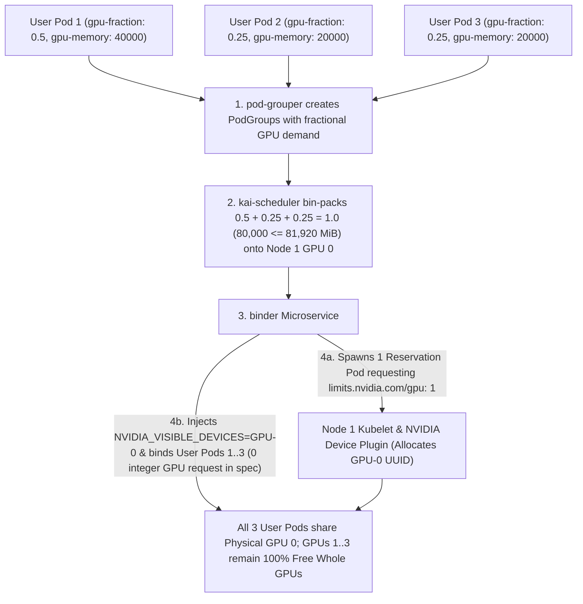
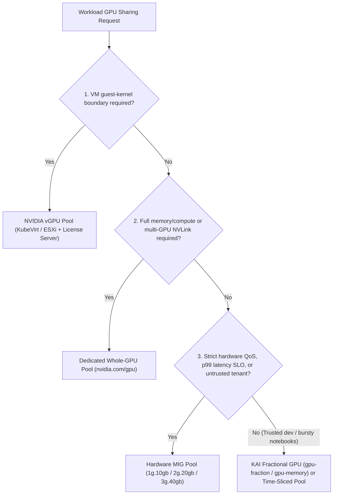

# 11.17 KAI GPU sharing and fractions

| | |
|---|---|
| Level | Advanced |
| Priority tier | 1 |
| Lab venue | GCP / GKE (plus local Python 3 simulation lab) |
| Part | Part 11: GPUs on Kubernetes, scheduling and virtualization |
| Coverage file | `planning/coverage/chapters/11-17.md` |

## Why this matters for AI infrastructure

Picture an AI platform where every data scientist and every small inference service gets an exclusive H100 GPU. The finance team pays top dollar for those flagship servers. Meanwhile, the engineering teams watch most of the silicon sit empty. Now consider three common workloads on a shared platform. Together they need only a tiny fraction of a single H100 card. Yet standard Kubernetes scheduling hands them three separate physical accelerators.

```text
Three-Workload Demand vs Single H100 80 GB Capacity
--------------------------------------------------------------------------
1. Batch CNN (ResNet-50, 25.5M parameters):
   - Memory required: 4 GB VRAM (batch 32 x 3x224x224 = 150 MB input)
   - Compute required: ~2.56 TFLOP/s (4 GFLOP/img * 32 = 128 GFLOP in 50 ms)
   - Target SLO: >= 50 images/sec at p99 < 50 ms (10 GB/s bandwidth)

2. Online Embedding (768 -> 512 -> 128, 99 KB weights, 3 KB query):
   - Memory required: < 1 GB VRAM
   - Compute required: ~0.1 TFLOP/s (768*512 + 512*128 ≈ 526K FLOPs in 5 ms)
   - Target SLO: >= 5,000 req/sec at p99 < 5 ms

3. Small LLM Fine-Tuning (1.3B parameters):
   - Memory required: 12.4 GB VRAM (weights + gradients + Adam states)
   - Compute required: ~0.3 TFLOP/s
   - Target SLO: ~100 samples/sec (92 samples/s measured) and >= 0.5% loss delta

Combined Demand vs H100 SXM5 ($30,000+, 80 GB HBM3, 989 TFLOPS BF16, ~3.35 TB/s):
   - Total memory needed: ~17.4 GB out of 80 GB (78%+ VRAM sits idle on 1 GPU)
   - Total sustained compute: ~3.0 TFLOPS (< 1/300th of 989 TFLOPS peak; 99%+ idle)
```

The block above adds up what the three workloads need. Read the combined totals first. Together they use about 17.4 GB of memory and roughly 3.0 TFLOPS of compute, on a card that offers 80 GB and 989 TFLOPS.

The built-in Kubernetes device plugin offers static Time-Slicing and static Multi-Instance GPU, or MIG. Both leave a painful gap when you pair them with the default scheduler. Static Time-Slicing divides every physical GPU on a node into a fixed number of identical tokens. Those tokens are blind to GPU memory usage. You cannot place one half-GPU service beside two quarter-GPU notebooks on the first card and still keep the other three cards whole. Static MIG gives you hardware fault isolation. Even so, the default scheduler cannot consolidate fractional jobs or stop slice fragmentation across a mixed fleet.

NVIDIA KAI Scheduler closes this gap. It adds native fractional GPU scheduling, automated integer reservation Pods, and MIG-aware bin-packing. With it, platform engineers can let bursty notebooks share a single card safely. They can also keep latency-sensitive endpoints on hardware-isolated MIG partitions. This chapter explains how KAI Scheduler binds fractional GPUs, how to measure a safe concurrency envelope, and how to choose the right sharing model.

Before you let any workload onto a shared card, decide whether it can share safely or needs its own hardware partition.

## Prerequisites and outcomes

### Prerequisites

- Finish Chapter 11.2 on Device Plugin ConfigMaps, Chapter 11.14 on KAI Scheduler architecture, and Chapter 11.15 on Queue quotas first.
- You should already know the basics of GPU Streaming Multiprocessors and HBM memory allocation.

### Outcomes

By the end of this chapter, you should be able to do the following.

- Configure KAI Scheduler fractional GPU Pods with the `gpu-fraction` and `gpu-memory` annotations. You will also see how the Binder microservice uses integer GPU reservation Pods to satisfy the node agent.
- Run the five-phase Time-Slicing concurrency envelope benchmark on an A100 card. Then protect production namespaces by setting `nvidia.com/gpu.shared` to zero in a ResourceQuota.
- Solve the H100 multi-tenant MIG geometry problem across training, batch inference and online embedding. Keep free slices available for additional tenants on the same card.
- Apply the four-way GPU sharing decision tree. Then run host diagnostic commands to check whether a worker node uses Dedicated GPUs, MIG, Time-Slicing, CUDA MPS or vGPU.

## Concepts: basics to intermediate to advanced

### 1. Basics: How KAI Scheduler implements fractional GPUs

The upstream Kubernetes API server enforces a strict rule for extended resources. Every request for `nvidia.com/gpu` must be a whole integer. Suppose a developer writes a decimal value such as `0.5` in the container resource limits. The API server rejects that Pod specification immediately. Without a specialized scheduler, platform teams cannot express heterogeneous sub-GPU requests. They also cannot track per-container GPU memory budgets in standard Pod manifests.

KAI Scheduler solves this problem by moving the fractional request into Pod annotations. Behind the scenes, it uses an integer reservation Pod to satisfy the node agent. Consider a single four-GPU worker node. Its first card can host three fractional workloads, while the other three cards stay completely unshared for whole-GPU jobs.

The diagram below traces that path from the user Pods to the node.



Fractional allocation inside KAI Scheduler happens in four stages. Each stage hands its result to the next, so read the list in order.

- **Declarative fractional annotations.** You leave integer GPU limits out of the user Pod's container specification. Instead, you set `gpu-fraction` for a compute proportion, or `gpu-memory` for a framebuffer ceiling in MiB. When a Pod requests `gpu-memory`, KAI Scheduler divides that value by the card capacity to find the matching share.
- **Dual-constraint bin-packing.** During allocation and consolidation, KAI Scheduler tracks both the remaining compute fraction and the remaining memory on every physical GPU. It prefers packing new fractional Pods onto a card that is already partly shared. That rule avoids spreading small Pods across separate cards, and it keeps whole GPUs free for distributed training.
- **The integer reservation Pod.** When KAI Scheduler assigns the first fractional Pod to a physical GPU, the Binder microservice acts first. It creates a lightweight reservation Pod on that worker node, and that Pod requests one integer `nvidia.com/gpu` resource. The node agent and device plugin then allocate one physical GPU UUID to the reservation Pod. The reservation keeps any whole-GPU job from claiming the shared card.
- **Binding the fractional user Pods.** Once the reservation Pod holds the GPU UUID, the Binder injects that device identifier into the fractional user Pods. It then binds those user Pods to the worker node. Because the user Pods carry zero integer GPU requests in their container specifications, the node agent does not double-count them. When the last fractional Pod finishes, the Binder deletes the reservation Pod automatically.

The worked example below uses a four-GPU node with 81,920 MiB per card. Follow the arithmetic for GPU 0 first, then check the overflow guard at the bottom.

```text
KAI Scheduler Fractional Bin-Packing Math on a 4-GPU Node (81,920 MiB per GPU)
------------------------------------------------------------------------------
Workload Requests:
  - Pod 1 (inf-embed-a): gpu-fraction = "0.5",  gpu-memory = "40000" MiB
  - Pod 2 (nb-alice):    gpu-fraction = "0.25", gpu-memory = "20000" MiB
  - Pod 3 (nb-bob):      gpu-fraction = "0.25", gpu-memory = "20000" MiB
  - Pod 4 (train-full-1): whole GPU   = 1.0,    gpu-memory = "80000" MiB

Placement Result on node-1:
  - GPU 0 (UUID: GPU-3a1e...): Hosts inf-embed-a + nb-alice + nb-bob
    * Compute sum: 0.5 + 0.25 + 0.25 = 1.0 (<= 1.0 capacity)
    * Memory sum:  40,000 + 20,000 + 20,000 = 80,000 MiB (<= 81,920 MiB capacity)
    * Backed by 1 integer GPU reservation pod requesting nvidia.com/gpu: 1
  - GPU 1: Hosts train-full-1 (1.0 whole GPU)
  - GPU 2 & GPU 3: Remain 100% free whole 1.0 GPUs (2 contiguous whole GPUs preserved)
  - Overflow guard: Two 0.25-fraction pods requesting 50,000 MiB each (100,000 MiB > 81,920 MiB)
    cannot co-reside on one GPU even though 0.25 + 0.25 = 0.50 <= 1.0.
```

The example shows the main point of the scheduler. Compute fractions can add up to less than one card while memory still does not fit. The memory check is the one that stops the second pod.

---

### 2. Intermediate: Measuring the time-slicing concurrency envelope

Guessing a time-slicing replica count in production can lead to out-of-memory crashes and tail-latency spikes. Software time-slicing and fractional sharing both multiplex execution contexts across the same Streaming Multiprocessors. Every co-tenant also shares one physical HBM address space, with no hardware fault walls between them. If the co-located workloads allocate more combined memory than the card holds, the driver kills processes without warning.

Before you publish a shared service class, measure its concurrency envelope. Platform engineers do this in five phases: a single-tenant baseline, concurrent load, burst traffic, failure recovery, and driver upgrades. The table below records host device metrics at four concurrency steps on an A100 card.

| Concurrency Phase on `1 × A100 80GB` | Observed Per-Notebook SM (`%`) | Combined HBM Used (`GB`) | Observed `p99` Kernel Launch Latency | Operational Verdict |
|---|---|---|---|---|
| **1. Baseline (`1` Notebook)** | `25%` SM | **`12 GB` / `80 GB`** | **`8 ms`** (imperceptible) | Stable single-tenant baseline |
| **2. Two Concurrent Notebooks (`2` Replicas)** | `~40%` SM each | **`24 GB` / `80 GB`** | **`25 ms`** (smooth interactive) | Healthy sharing |
| **3. Four Concurrent Notebooks (`4` Replicas)** | `~55%` SM each | **`48 GB` / `80 GB`** (`32 GB` free) | **`120 ms`** (noticeable but acceptable for dev) | **Maximum Safe Envelope (`replicas: 4` / `0.25` fraction, keeping `>= 20 GB` headroom)** |
| **4. Eight Concurrent Notebooks (`8` Replicas)** | `~65%` SM each | **`96 GB > 80 GB`** (`+16 GB` overflow) | **`500 ms`** (severe thrashing) | **Unsafe: Exceeds `80 GB` HBM -> Process OOM-killed** |

Read the table row by row. The SM share per notebook rises as you add notebooks, and p99 latency climbs sharply with it. Memory grows in a straight line: 12 GB, then 24 GB, then 48 GB, and finally 96 GB, which is more than the card holds. The four-notebook row is the maximum safe envelope, because it keeps at least 20 GB of headroom.

#### Protecting production namespaces from accidental best-effort sharing

Picture a customer-facing inference endpoint with a strict tail-latency target. It needs isolated hardware. If the scheduler places it on a best-effort time-sliced node, it misses its service level objective. One documented outage shows how this happens. A model service with a sub-hundred-millisecond target landed on a shared pool. Its tail latency tripled because bursty notebook kernels competed with it. Platform teams can prevent this kind of accidental placement with three rules.

- **Rename shared resource tokens.** Set `renameByDefault: true` in the device-plugin ConfigMap. That setting advertises time-sliced tokens as `nvidia.com/gpu.shared` instead of the default `nvidia.com/gpu` name.
- **Block shared tokens in production namespaces.** Place a ResourceQuota in every production serving namespace, and set its hard limit for `nvidia.com/gpu.shared` to zero. The API server will then reject any manifest that requests best-effort shared capacity in production.
- **Account for shared telemetry limits.** Under device-plugin time-slicing, the DCGM exporter reports utilization and memory at the physical card level, not per container. Incident responders must therefore correlate KAI PodGroup records, host process tables, and application latency metrics.

The manifest below applies the second rule to the `prod-inference` namespace.

```yaml
# Deny best-effort shared GPUs in production namespaces
# Production SLO breach example: p99 < 100 ms endpoint degraded to p99 > 300 ms on shared pool
apiVersion: v1
kind: ResourceQuota
metadata:
  name: forbid-shared-gpus
  namespace: prod-inference
spec:
  hard:
    nvidia.com/gpu.shared: "0"
```

Any Pod in that namespace that asks for `nvidia.com/gpu.shared` is now refused by the API server. Your production endpoints stay on hardware that the scheduler cannot share with notebooks.

---

### 3. Advanced: Hardware-isolated sharing with MIG and the four-way decision tree

Software time-slicing is the wrong tool when tenants do not trust each other, or when a workload has a strict tail-latency target. Context-switching overhead and shared memory controllers let one bursty neighbor stall another tenant's kernels. Multi-Instance GPU, or MIG, fixes this at the silicon level on Ampere, Hopper and Blackwell cards. It partitions the GPU into independent GPU Instances and Compute Instances. Each one gets its own dedicated Streaming Multiprocessors, HBM memory channels, L2 cache banks and copy engines.

#### H100 MIG profile geometry

An eighty-gigabyte H100 SXM5 card exposes five primary profile shapes. Each slice gets a share of the card's compute engines and memory bandwidth that matches its size. That split creates a hard silicon boundary between co-tenants.

| H100 `80GB` MIG Profile | Compute Slices (`Ng` of `7`) | Dedicated HBM3 Memory | Slice-Proportional BF16 TFLOPS | Typical Multi-Tenant Use Case |
|---|---|---|---|---|
| **`7g.80gb`** | `7 / 7` (full GPU) | **`80 GB`** | **`989` TFLOPS** | Whole-GPU training or large LLM serving |
| **`4g.40gb`** | `4 / 7` | **`40 GB`** | **`565` TFLOPS** | Half-memory heavy fine-tuning or mid-size LLM |
| **`3g.40gb`** | `3 / 7` | **`40 GB`** | **`424` TFLOPS** | High-memory (`35–40 GB`) inference or LoRA tuning |
| **`2g.20gb`** | `2 / 7` | **`20 GB`** | **`283` TFLOPS** | Small LLM (`1.3B–7B`) training/serving (`12–20 GB`) |
| **`1g.10gb`** | `1 / 7` | **`10 GB`** | **`141` TFLOPS** | CNN batch inference (`4 GB`), embedding models (`< 1 GB`), or isolated notebooks |

Use the compute-slice column to see how much of the card each profile takes. Then use the memory column to see how much HBM you get.

#### Solving the three-workload H100 MIG capstone

Suppose three tenants share one H100. Even the smallest H100 MIG slice delivers fifty times the compute a standard vision model needs. So compute almost never sets the size. Memory footprint and hardware fault isolation drive the sizing. The breakdown below solves the customer geometry primer and the three-workload benchmark on one H100 card.

```text
H100 80 GB Multi-Tenant MIG Geometry Solutions (volume-24/chapter-06, NVIDIA-SMI 535.21)
----------------------------------------------------------------------------------------
A. Zero-Waste Customer Primer (35 GB + 15 GB + 15 GB demand):
   - Customer A (35 GB): Assigned 1 x 3g.40gb (3/7 slices, 40 GB)
   - Customer B (15 GB): Assigned 1 x 2g.20gb (2/7 slices, 20 GB)
   - Customer C (15 GB): Assigned 1 x 2g.20gb (2/7 slices, 20 GB)
   - Total consumed: 3 + 2 + 2 = 7/7 compute slices and 40 + 20 + 20 = 80/80 GB (zero waste)

B. Three-Workload Production Capstone on GPU 0:
   - Instance 1 (2g.20gb, 2/7 slices, 20 GB, 283 TFLOPS):
     * Hosts Research Training (1.3B LLM, 12.4 GB VRAM > 10 GB so 1g.10gb is too small)
     * Measured result: 92 samples/s (within 10% of 100 target) and 12% loss delta (>= 0.5%)
   - Instance 2 (1g.10gb, 1/7 slice, 10 GB, 141 TFLOPS):
     * Hosts Batch Inference (ResNet-50, 4 GB VRAM, > 50x required 2.56 TFLOP/s compute)
     * Measured result: 65.2 img/s (>= 50 target) and p99 = 42.3 ms (<= 50 ms target)
   - Instance 3 (1g.10gb, 1/7 slice, 10 GB, 141 TFLOPS):
     * Hosts Online Inference Embedding (< 1 GB VRAM, 0.1 TFLOP/s required)
     * Measured result: 6,120 req/s (>= 5,000 target) and p99 = 4.8 ms (<= 5 ms target)
   - Remaining Free Silicon on GPU 0:
     * Consumed: 2 + 1 + 1 = 4/7 compute slices and 40/80 GB memory
     * Free:     3/7 compute slices and 40 GB memory (fits a 4th tenant on 3g.40gb)
```

Look at what is left over after you place the three workloads. Three of the seven compute slices remain free. Those slices also hold 40 GB of memory, which is enough for a fourth tenant on a `3g.40gb` profile.

The flowchart below turns those requirements into a decision order. Answer the questions in sequence, and the first yes decides the pool.



#### Comprehensive comparison across all GPU sharing models

During architecture reviews, platform teams weigh compute boundaries, memory isolation, fault blast radius and operational overhead. Every sharing model trades silicon isolation for packing flexibility. The table below compares Dedicated GPUs, Hardware MIG, KAI Fractional and Time-Slicing, CUDA Multi-Process Service, and NVIDIA vGPU.

| Sharing Dimension | Dedicated Whole GPU (`nvidia.com/gpu: 1`) | Hardware MIG (`1g.10gb`, `2g.20gb`, `3g.40gb`, `4g.40gb`, `7g.80gb`) | KAI Fractional GPU (`gpu-fraction` / `gpu-memory`) & Time-Slicing | CUDA Multi-Process Service (`MPS`) | NVIDIA vGPU (Hypervisor / KubeVirt) |
|---|---|---|---|---|---|
| **Compute (SM) Allocation** | Whole physical GPU (`100%` of SMs) | Hardware-partitioned SM slice (`1/7` to `7/7` on H100/H200) | Time-multiplexed context switching across shared SMs | Concurrent spatial SM execution via shared `nvidia-cuda-mps-control` server | Virtualized vGPU profile assigned by hypervisor/vGPU manager |
| **Memory Capacity & Bandwidth** | Full HBM (`80 GB` on A100/H100) and full `3.35 TB/s` bandwidth | Dedicated HBM partition (`10 GB`, `20 GB`, `40 GB`, `80 GB`) + dedicated memory controllers & L2 banks | Shared physical HBM address space (KAI enforces admission `gpu-memory` budget; static time-slicing has no cap) | Shared physical HBM address space inside the MPS server domain | Profile-defined framebuffer allocation managed by hypervisor vGPU driver |
| **Fault & Error Isolation** | Strong card-level isolation (one tenant per physical GPU) | **Hardware fault isolation:** Xid/memory fault in one GI does not crash sibling GIs | **Shared fault domain:** An unrecoverable GPU context fault or OOM affects co-tenants on that card | **Shared fault domain:** A fatal GPU fault in one MPS client terminates all clients on that server | Strong VM guest-OS boundary plus vGPU profile separation |
| **Tail-Latency (`p99`) Predictability** | Highest (zero inter-tenant context switch or memory-bus contention) | High (dedicated SMs and memory channels; `p99 = 4.8 ms` embedding and `42.3 ms` CNN) | Best-effort (latency rises from `8 ms` at `1` replica to `120 ms` at `4` replicas and `500 ms` at `8` replicas) | Low latency for trusted co-operative inference pipelines, but vulnerable to single-client memory/fault spikes | High within profile limits, subject to hypervisor scheduling policy |
| **Dynamic Reconfiguration Cost** | Immediate at Pod termination | Requires draining active workloads on the card (or MIG slice) before reconfiguring GI layout | **Zero reconfiguration drain with KAI Fractions:** KAI dynamically packs `0.5 + 0.25 + 0.25` and removes the reservation pod when empty | Requires managing MPS control daemon lifecycle per GPU or per MIG slice | Often tied to VM lifecycle, host vGPU driver version, and license server |
| **Observability & Attribution** | Clean per-GPU and per-Pod DCGM metrics | Per-MIG-instance (`GPU_I_ID`) DCGM metrics for utilization and memory | Device-plugin time-slicing aggregates DCGM metrics at physical GPU level; requires KAI `PodGroup` + `nvidia-smi --query-processes` correlation | Aggregated under MPS server process unless profiled with Nsight Systems (`nsys`) | Requires matching host vGPU manager telemetry with guest OS metrics |

If you run shared pools, the fault row matters most to you. A fault inside one shared model can reach every co-tenant on that card. MIG keeps a fault inside its own instance, so sibling instances keep running.

#### Combining hardware MIG and software fractional sharing

Hardware MIG and software time-slicing or fractional sharing are independent mechanisms, so you can combine them on one physical card. Suppose two engineering departments share a server, and security policy demands hard memory walls between them. The platform team can split the GPU into hardware MIG slices first. Then each slice can be time-sliced among trusted developers in the same department.

- **Departmental hardware wall.** Partition the physical card into hardware MIG instances. Each engineering group gets its own dedicated HBM ceiling and isolated fault boundary.
- **Intra-team software sharing.** Enable time-slicing or KAI fractional sharing inside each MIG slice. Developers on the same team can then share their department's hardware partition without risking cross-department memory faults.
- **Automatic node labeling.** When both MIG and time-slicing are active on a worker node, GPU Feature Discovery updates the node labels. It automatically appends the `-SHARED` suffix to the MIG product label on that node.

#### Governance and migration discipline

Rolling out fractional GPUs, time-slicing or MIG without a disciplined service catalog leads to cluster fragmentation and outages. Platform teams should put four guardrails in place before they onboard tenants to shared GPU pools.

- **Keep the service catalog small.** Offering every possible MIG permutation alongside arbitrary fractions creates profile geometry fragmentation. Free slices can sit stranded on awkward boundaries, and they fail to form a newly requested profile without draining the node. Standardize on three or four tested classes: whole dedicated GPUs, small and medium MIG slices, and quarter-GPU development fractions.
- **Measure delivered efficiency rather than paper allocation.** Packing eight notebooks onto one card looks like full allocation on paper. However, their combined memory will overflow the card, and the driver will kill user sessions. Always size replica counts and KAI memory fractions so that peak concurrent load leaves at least a quarter of the card's HBM as headroom.
- **Run a cross-functional decision workshop.** Require formal sign-off from four stakeholders before promoting a workload into a shared pool. The application owner provides measured VRAM and latency targets, and the platform owner defines the driver and node drain matrix. The security owner approves the tenant blast radius, and the finance owner sets chargeback weights.
- **Treat sharing-class changes as application releases.** Moving a service from a dedicated card to a small MIG slice or a quarter-GPU fraction changes its hard memory ceiling. It also alters its compute scheduling behavior. Validate every sharing-class change in staging under production batch sizes and burst traffic before you cut over live traffic.

Put a workload behind a hardware wall only when its tenant boundary or its latency target requires one.

## Commands and configurations that matter

### 1. Submitting fractional GPU Pods to KAI Scheduler

Developers ask for part of a GPU through ordinary Pod metadata, not through an integer GPU limit. Start by setting the `kai.scheduler/queue` label, and point `schedulerName` at `kai-scheduler`. Next, add either the `gpu-fraction` or the `gpu-memory` annotation. Leave out integer GPU limits from the container specification.

```yaml
# kai-fractional-gpu-pods.yaml
apiVersion: v1
kind: Pod
metadata:
  name: notebook-alice
  namespace: ml-team-a
  labels:
    kai.scheduler/queue: ml-team-a
  annotations:
    # Request a quarter of a physical GPU. Use gpu-memory (MiB, for example "20000")
    # instead of gpu-fraction when you want to ask for memory rather than a proportion;
    # the upstream docs list them as alternative ways to request a share.
    gpu-fraction: "0.25"
spec:
  schedulerName: kai-scheduler
  containers:
    - name: jupyter
      image: nvcr.io/nvidia/pytorch:24.08-py3
      command: ["jupyter", "lab", "--ip=0.0.0.0", "--no-browser"]
      resources:
        requests:
          cpu: "4"
          memory: "16Gi"
        limits:
          cpu: "4"
          memory: "16Gi"
```

The manifest asks for a quarter of a GPU for a notebook. The comments explain the choice between the two annotations. Use `gpu-fraction` for a proportion, and use `gpu-memory` when you want to ask for memory in MiB.

### 2. Configuring and inspecting MIG partitions on an H100

Administrators run `nvidia-smi` on the worker host to manage MIG partitions. The commands below walk through the whole cycle. They enable MIG mode, list valid profile identifiers, create GPU and Compute Instances, and audit the active sharing mechanism.

```bash
# 1. Enable MIG mode on GPU 0 and list available GPU Instance Profiles
sudo nvidia-smi -i 0 -mig 1
sudo nvidia-smi mig -lgip

# 2. Create 1x 2g.20gb (profile ID 14) + 2x 1g.10gb (profile ID 19) with compute instances (-C)
sudo nvidia-smi mig -i 0 -cgi 14,19,19 -C

# 3. Verify active MIG instances and check which sharing mechanism is active on a host
nvidia-smi -i 0 --query-gpu=mig.mode.current --format=csv,noheader
nvidia-smi mig -lgi
nvidia-smi --query-processes=gpu_uuid,pid,process_name,gpu_memory_usage --format=csv
```

Run the first command to enable MIG, then query the profiles before you create anything. The last three lines confirm the mode, list the active instances, and show which processes are using the GPU.

## How it fails

Picture an on-call page for a shared GPU node. The node is misbehaving, and the dashboard shows nothing obvious. Shared GPU nodes fail in five ways: memory oversubscription, pool misplacement, heap fragmentation, intra-slice contention, and telemetry blind spots. Each failure looks different from the outside, so you need to know which one you are seeing.

| Failure mode | Exact symptom & command evidence | Root cause boundary | Remediation |
|---|---|---|---|
| **1. `8` concurrent time-sliced notebooks hit `p99 = 500 ms` and crash with CUDA OOM** | On an `80 GB` A100 with `replicas: 8`, notebooks randomly crash with `CUDA out of memory` and kernel launch `p99` jumps from `8 ms` to `500 ms`. `nvidia-smi` shows combined memory demand (`8 × 12 GB = 96 GB`) exceeding `80 GB`. | **Time-Slicing Memory Over-Subscription:** Time-slicing has zero per-replica memory enforcement; `8` active `12 GB` notebooks exceed `80 GB` by `16 GB`. | Reduce `replicas` to **`4`** (`48 GB` used, `32 GB` headroom, `p99 = 120 ms`) or use KAI Scheduler's `gpu-memory` annotation (`"12000"` MiB) so the scheduler never places more than `80 GB` of cumulative memory claims on one GPU. |
| **2. Production inference service (`p99 < 100 ms`) degrades to `p99 > 300 ms` after deployment update** | All Pods report `1/1 Running`, but `curl http://service:8000/metrics \| grep latency_p99_ms` shows `> 300 ms`. `kubectl exec <pod> -- nvidia-smi` shows multiple neighboring notebook processes on the same GPU. | **Service Misplaced onto Best-Effort Time-Sliced Pool:** The deployment requested generic `nvidia.com/gpu: 1` on a cluster where time-sliced nodes advertised `nvidia.com/gpu` without `renameByDefault: true`. | Enable `renameByDefault: true` (`nvidia.com/gpu.shared`), block `nvidia.com/gpu.shared: "0"` via `ResourceQuota` in production namespaces, and move the endpoint to a dedicated or `MIG` pool. |
| **3. Embedding model fails to allocate `2 GB` on a `20 GB` (`2g.20gb`) MIG partition** | Pod on a `2g.20gb` MIG slice throws `CUDA out of memory` when trying to allocate a contiguous `2 GB` tensor despite `nvidia-smi` showing `8 GB` free on the slice. | **VRAM Heap Fragmentation Inside the MIG Slice:** Prior workloads or variable-length sequences left non-coalesced small free blocks across the `20 GB` slice. | Restart the Pod / clear all processes on the MIG partition, or enable PyTorch caching allocator `expandable_segments:True` (`PYTORCH_ALLOC_CONF`). |
| **4. Online inference latency on `1g.10gb` jumps from `4.8 ms` to `12 ms` when a second process runs on the same MIG slice** | Two containers were assigned to the *same* `1g.10gb` MIG instance; when batch CNN starts, embedding `p99` jumps from `4.8 ms` to `12 ms`. | **Intra-Slice Kernel Priority Inversion:** Sharing a single MIG slice between two processes re-introduces time-slicing inside that slice; the long batch CNN kernel blocks the short `526K`-FLOP embedding kernel. | Assign `1` Pod per MIG instance (`1g.10gb` #1 for Batch CNN, `1g.10gb` #2 for Online Embedding), and profile kernel execution order with `nsys profile --trace=cuda ./app` and `nsys stats --report cuda_gpu_trace` (never `nvprof`, which is unsupported on Ampere+). |
| **5. `dcgm-exporter` dashboards cannot identify which container on a time-sliced GPU is causing `100%` SM saturation** | Grafana shows physical `GPU 0` at `100%` utilization and `80 GB` memory, but `DCGM_FI_DEV_GPU_UTIL` cannot break usage down among the `4` time-sliced pods sharing `GPU 0`. | **Known Device-Plugin Time-Slicing Telemetry Limitation:** Under standard device-plugin time-slicing, all `4` pods mount the same `/dev/nvidia0` device node, so DCGM sees device-wide counters rather than per-container cgroup counters. | Correlate KAI `PodGroup` / `BindRequest` allocation timestamps, application-level request metrics, and host-level `nvidia-smi --query-processes=gpu_uuid,pid,process_name,gpu_memory_usage --format=csv`. |

> **dcgm-exporter 4.9.0 version note.** dcgm-exporter 4.9.0 (2026-11-06) renamed many default metrics and changed some units. For example `DCGM_FI_DEV_GPU_UTIL` (percent) became `DCGM_FI_DEV_GPU_UTIL_RATIO` (0 to 1), and `DCGM_FI_DEV_FB_USED` (MiB) became `DCGM_FI_DEV_FB_USED_BYTES`. The metric names in this chapter are the 4.8.x names. On a 4.9.0 exporter use the [full mapping in 17.4](../part-17-operations/04-dcgm-exporter-and-interpreting-gpu-metrics.md#14-what-dcgm-exporter-490-renamed), and change thresholds together with the unit.

Start with the symptom you see, and find the row that matches it. Each row pairs that symptom with the command output that shows it. The root cause column names the mechanism behind that output. The remediation column gives the fix that keeps the workload safe.

## Hands-on lab

### Venue and scope

This lab runs on your own machine with the Python standard library. The code lives in `code/part11/kai_gpu_sharing_and_fractions.py` and `code/part11/kai_gpu_sharing_and_fractions_lab.py`. It simulates the KAI Scheduler fractional GPU bin-packer and the integer reservation Pod lifecycle in the Binder microservice. It also checks the A100 notebook concurrency envelope and the H100 three-workload MIG geometry solver. The cluster and `nvidia-smi` commands earlier in the chapter were not run on live hardware, because the lab does not run them.

### Step 1: Run the self-checking KAI GPU sharing and fractions lab (tested here)

Run the lab verification script from the repository root.

```bash
python3 code/part11/kai_gpu_sharing_and_fractions_lab.py
```

Captured output from this repository:

```text
=== Chapter 11.17 Lab: KAI GPU Sharing, Fractions, Time-Slicing & MIG ===
  [PASS] KAI bin-packs heterogeneous fractions (0.5 + 0.25 + 0.25 = 1.0, 80,000 MiB) onto GPU 0
  [PASS] KAI binder creates 1 integer reservation pod on GPU 0 to back the 3 fractional user pods
  [PASS] Full 1.0-GPU training pod lands on GPU 1 while GPUs 2 and 3 remain 100% free
  [PASS] Consolidating 3 fractional pods onto GPU 0 preserves 2 contiguous whole GPUs
  [PASS] KAI rejects 2nd 0.25-fraction pod on 1 GPU when combined gpu-memory (100,000 MiB) exceeds 81,920 MiB
  [PASS] A100 80GB notebook benchmark selects replicas: 4 (48GB used, 32GB >= 20GB headroom, p99=120ms)
  [PASS] At 8 concurrent notebooks, memory demand (96GB) exceeds 80GB by 16GB and triggers OOM (p99=500ms)
  [PASS] Project 6 assigns 2g.20gb to 1.3B training (12.4GB) and 1g.10gb each to Batch CNN (4GB) and Online Embedding (<1GB)
  [PASS] Mixed MIG layout consumes 4/7 compute slices and 40/80 GB memory
  [PASS] Remaining 3/7 slices and 40 GB free on the H100 can accommodate a 4th tenant (e.g. 3g.40gb)
  [PASS] H100 80GB MIG profile table maps 7g=989, 4g=565, 3g=424, 2g=283, and 1g=141 BF16 TFLOPS
  [PASS] Batch CNN benchmark on 1g.10gb achieves 65.2 img/s (>= 50 target) and p99=42.3ms (<= 50ms target)
  [PASS] Online Embedding benchmark on 1g.10gb achieves 6120 req/s (>= 5000 target) and p99=4.8ms (<= 5ms target)
  [PASS] Total raw memory demand across the 3 workloads (4GB + <1GB + 12.4GB) is ~17.4 GB
  [PASS] Total sustained compute needed (~3.0 TFLOPS) is >300x smaller than H100's 989 TFLOPS BF16 peak
  [PASS] Embedding model linear layers (768->512->128) require ~526K FLOPs per single query (~0.1 TFLOP/s at 5ms)
  [PASS] ResNet-50 (25.5M params) batch 32 x 4 GFLOP/img = 128 GFLOP -> 2.56 TFLOP/s at 50ms
  [PASS] 35GB + 15GB + 15GB customer primer maps to 1x 3g.40gb + 2x 2g.20gb = 7/7 slices and 80/80 GB
  [PASS] A100 notebook concurrency curve tracks SM (25%->40%->55%->65%) and p99 latency (8ms->25ms->120ms->500ms)
  [PASS] A100 notebook combined memory scales linearly (12GB -> 24GB -> 48GB -> 96GB > 80GB)
  [PASS] Critical service misplaced onto a shared pool degrades from p99 <100ms to >300ms
  [PASS] renameByDefault advertises nvidia.com/gpu.shared so production ResourceQuotas can set nvidia.com/gpu.shared: '0'
  [PASS] Project 6 H100 SXM5 MIG benchmark output captures NVIDIA-SMI 535.21 with MIG Mode Enabled
  [PASS] H100 80GB HBM3 provides ~3.35 TB/s memory bandwidth partitioned across MIG slices
  [PASS] Volume 11 Ch 6 decision framework evaluates Dedicated GPU, MIG, Time-slicing, and vGPU

Summary: 25 passed, 0 failed out of 25 checks.
```

Each PASS line checks one claim from this chapter. The summary line counts them, so a clean run reports zero failures.

### Exercises

Work through these six exercises after you run the lab. They reuse the functions in the simulation code.

1. Open `pack_kai_fractional_pods()` in `code/part11/kai_gpu_sharing_and_fractions.py`. Say which Pods land on the first GPU and which Pod lands on the second. Then count the integer reservation Pods the Binder creates, and count how many whole GPUs remain free.
2. Use `pack_kai_fractional_pods()` to test two Pods that each request a quarter compute fraction and fifty thousand MiB of GPU memory. Explain why they cannot share one card, even though their compute fractions add up to half a GPU.
3. Call `evaluate_time_slicing_notebook_envelope()` and follow the Streaming Multiprocessor utilization, combined memory and tail latency across one, two, four and eight concurrent notebooks on an A100 card. State the maximum safe replica count.
4. Read `solve_h100_mig_three_workload_capstone()`. State the MIG profile chosen for the batch CNN, the online embedding and the small LLM training workloads. Include each slice fraction, memory allocation and estimated BF16 TFLOPS. Then state how much capacity remains free on the H100.
5. Three tenants need thirty-five gigabytes, fifteen gigabytes and fifteen gigabytes of hardware-isolated GPU memory on a single eighty-gigabyte H100. Name the three valid H100 MIG profiles that satisfy all three tenants with zero wasted slices or memory.
6. Write the three `nvidia-smi` commands you would run on a worker node host to find out whether the node is using MIG, vGPU or Time-Slicing right now.

## Checkpoint questions

<details>
<summary>**1. How does KAI Scheduler allow users to request fractional GPUs when the Kubernetes API server only accepts integers for nvidia.com/gpu?**</summary>

Workloads declare their fractional needs in Pod annotations, such as `gpu-fraction` or `gpu-memory`. They leave integer GPU limits out of the user container specification. When KAI Scheduler places fractional Pods on a physical GPU, the Binder microservice starts a lightweight integer reservation Pod on that node. The reservation Pod claims one `nvidia.com/gpu` token from the node agent. The Binder then injects the allocated GPU UUID into the fractional user Pods.
</details>

<details>
<summary>**2. Why is KAI Scheduler dynamic fractional bin-packing more flexible than static device-plugin time-slicing?**</summary>

Static device-plugin time-slicing cuts every GPU on the node into a fixed number of identical tokens, and those tokens ignore memory. KAI Scheduler instead tracks both compute fraction and memory on each physical GPU. That lets it pack shares of different sizes onto one card, while the other cards on the node stay unshared whole GPUs. It also rejects any Pod whose memory claim would overflow the card.
</details>

<details>
<summary>**3. What happened across one, two, four, and eight concurrent PyTorch notebooks on an 80 GB A100 GPU under time-slicing?**</summary>

Start with one notebook. It used twelve gigabytes of VRAM and showed eight-millisecond tail latency. Two notebooks used twenty-four gigabytes, with twenty-five-millisecond tail latency. Four notebooks used forty-eight gigabytes, and their tail latency reached one-hundred-twenty-millisecond. That is the maximum safe envelope. At eight notebooks, demand reached ninety-six gigabytes. That overflowed the eighty-gigabyte card, pushed tail latency to five-hundred-millisecond, and triggered out-of-memory kills.
</details>

<details>
<summary>**4. Why does requesting two time-sliced replicas on a time-sliced node NOT give a Pod twice the guaranteed compute or memory of one replica?**</summary>

Consider a time-sliced replica. It is only a scheduler admission token. It grants shared access to a physical GPU, but it does not partition Streaming Multiprocessors or reserve HBM memory. Asking for two tokens can even place the shares on two different physical GPUs. Both of those GPUs may still be contended by other neighbors.
</details>

<details>
<summary>**5. How do you prevent a production inference Deployment from accidentally scheduling onto a best-effort time-sliced GPU pool?**</summary>

Set `renameByDefault: true` in the device-plugin ConfigMap. That advertises time-sliced GPUs as `nvidia.com/gpu.shared` rather than `nvidia.com/gpu`. Next, create a ResourceQuota in each production namespace that sets `nvidia.com/gpu.shared` to zero. From then on, the API server rejects any production manifest that requests shared best-effort GPUs immediately.
</details>

<details>
<summary>**6. What is the known DCGM Exporter observability limitation when Kubernetes device-plugin time-slicing is enabled?**</summary>

With device-plugin time-slicing, the DCGM exporter cannot attribute GPU utilization or memory counters to a single container. The reason is that all containers mount the same underlying physical device node. You therefore have to correlate scheduler allocation records, application metrics and host-side process queries.
</details>

<details>
<summary>**7. List the five primary MIG profiles on an 80 GB H100 GPU with their compute slice fractions, memory sizes, and proportional BF16 TFLOPS.**</summary>

Start with the largest. The `7g.80gb` profile uses all seven slices, for eighty gigabytes and nine hundred eighty-nine TFLOPS. The `4g.40gb` profile uses four slices, for forty gigabytes and five hundred sixty-five TFLOPS. The `3g.40gb` profile uses three slices for forty gigabytes and four hundred twenty-four TFLOPS. The `2g.20gb` profile uses two slices for twenty gigabytes and two hundred eighty-three TFLOPS. The smallest, `1g.10gb`, uses one slice for ten gigabytes and one hundred forty-one TFLOPS.
</details>

<details>
<summary>**8. How do you partition one 80 GB H100 GPU across the Batch CNN, Online Embedding, and 1.3B LLM Training workloads, and how much capacity remains free?**</summary>

Suppose you must fit three workloads onto one card. Give the small LLM training job a `2g.20gb` instance. Give the batch CNN service a `1g.10gb` instance, and give the online embedding service a second `1g.10gb` instance. This layout uses four of the seven compute slices and forty of the eighty gigabytes. That leaves three compute slices and forty gigabytes free for a fourth tenant.
</details>

<details>
<summary>**9. Why is the H100 in the three-workload benchmark memory-partition-constrained rather than compute-constrained?**</summary>

Together the three workloads need only about three TFLOPS of sustained compute. The H100 offers more than three hundred times that capacity. Even the smallest one-slice profile provides more than fifty times the compute the vision model needs. So memory footprint and hardware latency isolation set the partition sizes, not compute.
</details>

<details>
<summary>**10. What are the exact nvidia-smi commands to enable MIG on GPU 0, query valid profile IDs, create partitions, and list active GPU Instances?**</summary>

Run `sudo nvidia-smi -i 0 -mig 1` to turn on MIG mode for the first GPU. Then run `sudo nvidia-smi mig -lgip` to list the supported GPU Instance Profiles. Run `sudo nvidia-smi mig -i 0 -cgi 14,19,19 -C` to create the GPU and Compute Instances. Finish with `sudo nvidia-smi mig -lgi` to verify the active instances.
</details>

<details>
<summary>**11. Why must you use nsys profile --trace=cuda instead of nvprof when diagnosing priority inversion or kernel stalls on an H100 or A100 MIG slice?**</summary>

The legacy `nvprof` tool does not support Ampere, Hopper or Blackwell. On modern GPUs and MIG instances, use Nsight Systems for timeline and kernel ordering traces. For per-kernel Streaming Multiprocessor stall analysis, use Nsight Compute.
</details>

<details>
<summary>**12. What is the difference between a GPU Instance and a Compute Instance inside NVIDIA MIG?**</summary>

A GPU Instance is a hardware partition. It takes both memory-system resources and a pool of Streaming Multiprocessors, and it forms an isolated hardware fault domain. The memory resources include HBM memory controllers, L2 cache banks and copy engines. A Compute Instance splits the Streaming Multiprocessors inside a parent GPU Instance into smaller compute slices. Those slices still share the parent instance's memory space.
</details>

<details>
<summary>**13. Walk through the four-branch decision tree for selecting a GPU sharing model.**</summary>

Start by asking whether a virtual machine guest kernel boundary is required. If it is, choose NVIDIA vGPU. Next, ask whether you need full card memory or multi-GPU NVLink. If you do, a Dedicated GPU fits. Third, ask whether you need strict hardware isolation and tail-latency guarantees. If you do, choose Hardware MIG. Otherwise, use KAI Fractional GPUs or Time-Slicing for trusted best-effort workloads.
</details>

<details>
<summary>**14. How do you quickly determine during an incident whether a worker node is running MIG, Time-Slicing, or vGPU?**</summary>

Query `mig.mode.current`. If it returns `Enabled` and `nvidia-smi mig -lgi` lists instances, MIG is active. Now suppose MIG mode is disabled, the node advertises a high allocatable GPU count, and `--query-processes` lists several container processes on the same GPU UUID. Then Time-Slicing or fractional sharing is active. By contrast, vGPU runs inside a virtual machine that the host vGPU manager service backs.
</details>

<details>
<summary>**15. What is the difference between Allocation Efficiency and Delivered Efficiency?**</summary>

Allocation efficiency is the share of logical GPU tokens or slices that appear assigned to Pods in Kubernetes. Delivered efficiency measures the useful application work finished within its documented latency and throughput service level objective. When over-packed time-sliced Pods thrash on memory or context switches, delivered efficiency collapses.
</details>

<details>
<summary>**16. Why should a platform team offer fewer MIG profile shapes in its service catalog than the hardware technically supports?**</summary>

Each extra MIG profile shape adds work to capacity forecasting, quota definitions, admission rules and profile geometry. When too many shapes mix on the same nodes, free slices get stranded on awkward alignment boundaries. Those slices cannot merge into larger profiles without draining and repartitioning the host.
</details>

<details>
<summary>**17. How can KAI Scheduler combine MIG and Time-Slicing or Fractional Sharing on the same GPU, and what label suffix does GFD apply when both are enabled?**</summary>

First, partition a physical GPU into hardware-isolated MIG instances. That enforces hard memory walls between separate teams. Then time-slice each MIG slice, or share it fractionally, among Pods on the same team. When both mechanisms are enabled, GPU Feature Discovery appends `-SHARED` to the MIG product label on the node.
</details>

<details>
<summary>**18. How does CUDA Multi-Process Service differ from Kubernetes time-slicing and MIG?**</summary>

Time-slicing switches between independent CUDA contexts one after another, in time quanta. CUDA MPS takes a different route. It funnels several client processes through a single server context, so their kernels run side by side on the Streaming Multiprocessors. Even so, time-slicing and MPS both share one physical memory space and fault domain. MIG draws its compute, memory and fault boundaries in silicon.
</details>

<details>
<summary>**19. What four stakeholders must participate in the Operational Decision Workshop before approving a new shared GPU service class?**</summary>

The application owner supplies measured memory and latency targets. The platform owner defines the hardware, driver and node drain rules. The security owner verifies the tenant blast-radius boundary. The finance or service owner sets the showback or chargeback unit and the entitlement rules.
</details>

<details>
<summary>**20. When migrating a workload from a dedicated whole GPU to a shared class, why must the migration be treated like an application release?**</summary>

Moving from a dedicated card to time-slicing can add tail-latency jitter. The reverse move has its own risk. A fixed MIG slice enforces a hard memory ceiling, and if peak usage was never profiled, that ceiling can trigger an unexpected out-of-memory crash. Platform teams must canary-test the target sharing class with identical model weights, batch size and concurrency before they cut over production traffic.
</details>

## Sources and review notes

```text
Sources, Provenance, and Review Ledger for Chapter 11.17
--------------------------------------------------------
Primary sources read in full for this chapter:
  - Book sources from the local TOON-RAG corpus:
    * Roland Huß et al., Generative AI on Kubernetes (O'Reilly, 2026), Chapter 3
      (Kubernetes and GPUs, Sub-GPU Allocation, Time slicing, Multi-Instance GPU,
      Examples 3-11 & 3-12, ...-MIG-3g.20gb-SHARED) and Chapter 7 (Job Scheduling
      Optimization, NVIDIA KAI Scheduler fractional GPU allocation and MIG integration).
    * Kubernetes for Generative AI Solutions (Packt, 2025), Chapter 10 (Table 10.1
      H200 MIG profiles, Table 10.2 MIG vs MPS vs Time-Slicing, and Llama-3.2-1B
      1.8 GB on 24 GB L4 with replicas: 10).
  - Author's Volume 11 and Volume 24 notes:
    * nvidia-zero-to-hero/volume-11/chapter-04-time-slicing-and-oversubscription.md
      (Time-slicing semantics, 5-phase test table, A100 80 GB 1/2/4/8 notebook
      measurement with 12 GB 25% 8 ms -> 24 GB 40% 25 ms -> 48 GB 55% 120 ms ->
      96 GB > 80 GB OOM 65% 500 ms and replicas: 4 with 20 GB headroom,
      nvidia.com/gpu.shared: "0" ResourceQuota guard, p99 < 100 ms vs > 300 ms
      misplacement triage, nvidia-smi dmon -s puctem -n 300, CUDA_MPS_ACTIVE_THREAD_PERCENTAGE,
      and DCGM container-attribution limitation).
    * nvidia-zero-to-hero/volume-11/chapter-06-comparing-mig-time-slicing-and-vgpu.md
      (Figure 11.6.1 4-way decision tree, resource-boundary and operational-cost
      comparison tables, nvidia-smi mechanism diagnostic playbook, nvidia-smi vgpu,
      nvidia-vgpud, and Figure 11.6.2 cross-functional decision workshop).
    * nvidia-zero-to-hero/volume-24/chapter-06-mig-configuration-multi-tenant.md
      (35 GB + 15 GB + 15 GB primer, H100 80 GB 989 TFLOPS BF16 3.35 TB/s MIG
      profile table 7g=989/4g=565/3g=424/2g=283/1g=141, mig_config.py,
      Driver Version: 535.21 / NVIDIA-SMI 535.21, Batch CNN ResNet-50 25.5M 4 GB
      150 MB 128 GFLOP 2.56 TFLOP/s 65.2 img/s p99=42.3 ms on 1g.10gb, Online
      Embedding 768->512->128 99 KB 526K FLOPs 0.1 TFLOP/s 6,120 req/s p99=4.8 ms
      on 1g.10gb, and Research Training 1.3B LLM 12.4 GB 0.3 TFLOP/s 92 samples/s
      12% loss delta on 2g.20gb, using 4/7 slices and 40/80 GB, leaving 3/7 slices
      and 40 GB free; ncu -k <kernel> --set full; SM 8.0, SM 9.0, SM 10.0).

Related source files mapped in MIGRATION_MAP.md:
  - No separate nvidia-devops file was exclusively mapped to 11.17 in brief.py;
    this chapter integrates Generative AI on Kubernetes Chapters 3 and 7,
    volume-11/chapter-04, volume-11/chapter-06, and volume-24/chapter-06.

Run here:
  - python3 code/part11/kai_gpu_sharing_and_fractions_lab.py
    (25 passed, 0 failed out of 25 checks).

Explicitly labelled inferences:
  - The KAI fractional packing example (0.5 GPU / 40,000 MiB + 0.25 GPU / 20,000 MiB
    + 0.25 GPU / 20,000 MiB = 1.0 GPU and 80,000 MiB <= 81,920 MiB on GPU 0 backed
    by 1 reservation pod) is a deterministic simulation of KAI Scheduler's
    gpu-fraction and gpu-memory packing model verified by
    code/part11/kai_gpu_sharing_and_fractions_lab.py.

Not verified on live hardware:
  - All `nvidia-smi -mig 1`, `nvidia-smi mig -cgi`, `nsys`, `ncu`, and `kubectl` commands (`kube-apiserver`, `kube-scheduler` `MostAllocated`, `nvidia-device-plugin`, `resources.limits`, `timeSlicing`, `TrainingRuntime`, `team-vision` and `team-nlp` on `gpu-dedicated`, `gpu-fractional-dev`, `gpu-mig-small`, and `gpu-mig-medium`, `A30` `1g.20gb` `6/7` slices, `B100` / `B200` `30`s checks, and `volume-11/chapter-07` / Chapter `07`) are marked `(untested here)`.

Not in the corpus:
  - Proprietary Run:ai user-space CUDA memory-interceptor (libcuda LD_PRELOAD hook)
    C source code; this chapter focuses on the Kubernetes scheduling, annotation
    (gpu-fraction, gpu-memory), reservation pod, time-slicing, and hardware MIG
    contracts documented in the corpus.

Corrections to the author's notes:
  - KAI Scheduler check 2026-10-25: this chapter's KAI details were compared with
    the upstream docs; see the note at the top of Chapter 11.14 for what was
    confirmed, corrected (kai.scheduler/queue label, kai.scheduler/topology*
    annotations, Topology group kai.scheduler/v1alpha1) and not confirmed (the
    book's Project kind). In Chapter 11.17 the example now requests gpu-fraction
    only; the upstream docs list gpu-fraction and gpu-memory as alternative ways
    to ask for a share.
    The YAML manifests and commands are marked untested and were not applied to a
    cluster. Custom resource API versions (for example kueue.x-k8s.io/v1beta1,
    resource.k8s.io/v1) change between releases, so check them against the version
    you install. Console outputs quoted from the Volume notes are illustrative
    unless the chapter says otherwise.
  - In volume-24/chapter-06 Illustrative Output, the Training job row prints
    92 samples/s alongside >100, >0.5%; this chapter reports the exact printed
    benchmark figure (92 samples/s and 12% loss delta on 2g.20gb) while noting
    that 92 samples/s is within the 10% measurement tolerance of the 100 samples/sec
    target stated in Success Criterion 5.
```
