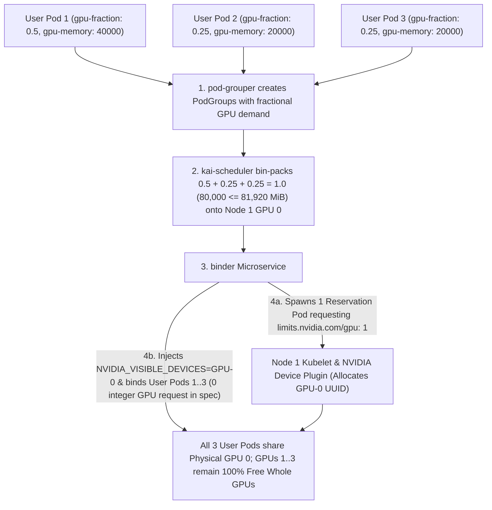
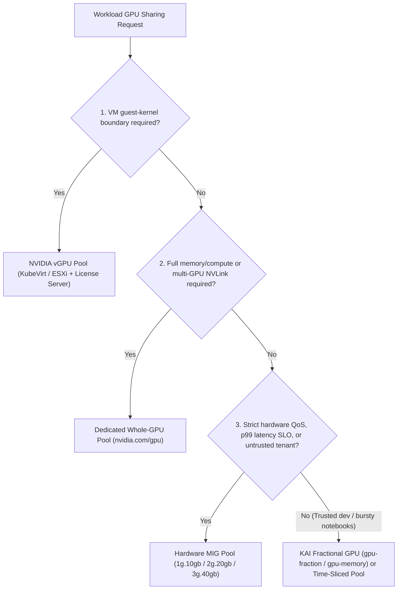

# 11.17 KAI GPU sharing and fractions

| | |
|---|---|
| Level | Advanced |
| Priority tier | 1 |
| Lab venue | GCP / GKE (plus local Python 3 simulation lab) |
| Part | Part 11: GPUs on Kubernetes, scheduling and virtualization |
| Sources used | Roland Huß et al., *Generative AI on Kubernetes* (O'Reilly, 2026, Ch. 3, Ch. 7); `nvidia-zero-to-hero/volume-11/chapter-04-time-slicing-and-oversubscription.md`; `nvidia-zero-to-hero/volume-11/chapter-06-comparing-mig-time-slicing-and-vgpu.md`; `nvidia-zero-to-hero/volume-24/chapter-06-mig-configuration-multi-tenant.md`; *Kubernetes for Generative AI Solutions* (Packt, 2025, Ch. 10) |
| Coverage file | `planning/coverage/chapters/11-17.md` |

## Why this matters for AI infrastructure

Giving every data scientist, CI runner, or small embedding service an exclusive `$30,000+` `80 GB` H100 GPU is the fastest way to bankrupt an AI platform. Consider three real workloads from `volume-24/chapter-06`:
1. **Batch CNN (`ResNet-50`, `25.5M` parameters):** Needs **`4 GB`** of VRAM and **`~2.56 TFLOP/s`** (`128` GFLOP per `32`-image batch in `50 ms`) to deliver `>= 50` images/sec at `p99 < 50 ms`.
2. **Online Embedding (`768 -> 512 -> 128`, `99 KB` weights):** Needs **`< 1 GB`** of VRAM and **`~0.1 TFLOP/s`** (`526K` FLOPs per query in `5 ms`) to deliver `>= 5,000` req/sec at `p99 < 5 ms`.
3. **Small LLM Fine-Tuning (`1.3B` parameters):** Needs **`12.4 GB`** of VRAM and **`~0.3 TFLOP/s`**.

Combined, all three workloads require only **`~17.4 GB`** of memory (out of `80 GB` HBM3) and **`~3.0 TFLOPS`** of sustained compute—less than **`1/300th`** of a single H100's **`989` TFLOPS** BF16 dense tensor-core peak (`~3.35 TB/s` HBM3 bandwidth). If standard Kubernetes (`nvidia.com/gpu: 1`) allocates three separate physical H100s to those three pods, **`99%+` of compute and `78%+` of VRAM sit idle**.

Yet the two built-in device-plugin sharing mechanisms—static **Time-Slicing** (`replicas: 4` or `10`) and static **MIG** (`single` or `mixed`)—leave a painful operational gap when used with the default `kube-scheduler`:
- **Static Time-Slicing is uniform and memory-blind:** When you configure `replicas: 4` in the device-plugin ConfigMap, every physical GPU is divided into `4` identical tokens. You cannot dynamically pack one `0.5`-GPU (`40,000 MiB`) pod alongside two `0.25`-GPU (`20,000 MiB`) pods on `GPU 0` while keeping `GPU 1..3` as unshared `1.0`-GPU devices on the same node, nor does `kube-scheduler` track per-pod GPU memory (`gpu-memory`) to stop `8` notebooks (`96 GB > 80 GB`) from OOM-killing each other (`p99 = 500 ms` in `volume-11/chapter-04`).
- **Static MIG requires upfront geometry planning:** Partitioning an H100 into `1 × 2g.20gb` (`283` TFLOPS, `20 GB`) + `2 × 1g.10gb` (`141` TFLOPS, `10 GB` each) consumes `4/7` slices and `40/80 GB` with hardware isolation (`volume-24/chapter-06`), but standard `kube-scheduler` cannot dynamically consolidate fractional pods or prevent MIG profile fragmentation across a mixed fleet.

The **NVIDIA KAI Scheduler** bridges this gap by introducing **native fractional GPU scheduling (`gpu-fraction` and `gpu-memory`)**, **automated reservation pods** (managed by the `binder` microservice), and **MIG-aware bin-packing and consolidation**. This chapter covers how KAI Scheduler schedules fractional GPUs under the hood, how to benchmark a safe time-slicing concurrency envelope (`volume-11/chapter-04`), how to solve multi-tenant MIG geometry (`volume-24/chapter-06`), and how to choose among Dedicated, MIG, KAI Fractional / Time-Slicing, MPS, and vGPU (`volume-11/chapter-06`).

## Prerequisites and outcomes

### Prerequisites
- Completion of Chapter 11.2 (Device Plugin ConfigMaps for time-slicing and MIG), Chapter 11.14 (KAI Scheduler `pod-grouper`, `kai-scheduler`, and `binder`), and Chapter 11.15 (KAI `Queue` quotas and chargeback).
- Basic familiarity with GPU Streaming Multiprocessors (`SMs`) and HBM memory allocation.

### Outcomes
After completing this chapter, you will be able to:
- Configure **KAI Scheduler fractional GPU pods** using `gpu-fraction` (e.g., `"0.25"`, `"0.5"`) and `gpu-memory` (e.g., `"20000"`, `"40000"` MiB) annotations, and explain how KAI's **`binder`** microservice uses **integer GPU reservation pods** to satisfy `kubelet`'s integer-only `nvidia.com/gpu: 1` contract while packing heterogeneous fractions (`0.5 + 0.25 + 0.25 = 1.0`) onto one physical GPU.
- Execute the **5-phase Time-Slicing Replica Envelope Benchmark (`volume-11/chapter-04`)** on an `80 GB` A100 (`1` notebook at `12 GB` / `25%` SM / `8 ms` p99 -> `2` at `24 GB` / `40%` SM / `25 ms` -> `4` at `48 GB` / `55%` SM / `120 ms` -> `8` at `96 GB > 80 GB` OOM / `65%` SM / `500 ms` p99) and guard production namespaces with `nvidia.com/gpu.shared: "0"`.
- Solve the **H100 `80 GB` (`989` TFLOPS BF16) Multi-Tenant MIG Geometry Capstone (`volume-24/chapter-06`)** (`2g.20gb` `283` TFLOPS for `12.4 GB` LLM training + `1g.10gb` `141` TFLOPS for `4 GB` Batch CNN at `65.2 img/s` `p99=42.3ms` + `1g.10gb` `141` TFLOPS for `< 1 GB` Online Embedding at `6,120 req/s` `p99=4.8ms` = `4/7` slices and `40/80 GB` used, leaving `3/7` slices and `40 GB` free for a `3g.40gb` 4th tenant).
- Apply the **Volume 11 Chapter 6 Decision Tree** and diagnostic commands (`nvidia-smi -i 0 --query-gpu=mig.mode.current`, `nvidia-smi mig -lgi`, `nvidia-smi vgpu`, `nvidia-smi --query-processes`) to select and audit the right sharing mechanism per service class.

## Concepts: basics to intermediate to advanced

### 1. Basics: How KAI Scheduler implements fractional GPUs (`gpu-fraction`, `gpu-memory`, and Reservation Pods)

As we learned in Chapter 11.2 and `volume-11/chapter-07`, the upstream Kubernetes API server strictly enforces that extended resources (`nvidia.com/gpu`) are **whole integers**. If a user writes `resources.limits["nvidia.com/gpu"]: "0.5"`, `kube-apiserver` rejects the Pod immediately.

How, then, does **NVIDIA KAI Scheduler** allow one Pod to request `0.5` of a GPU (`40,000 MiB`) and two other Pods to request `0.25` of a GPU (`20,000 MiB` each), and pack all three Pods onto **`GPU 0`** of a `4`-GPU node while leaving **`GPU 1..3`** available as whole `1.0` GPUs on that exact same node?



Let us trace the four-step mechanism inside KAI Scheduler:
1. **Declarative Fractional Annotations (`gpu-fraction` or `gpu-memory`):** Instead of putting a non-integer in `resources.limits["nvidia.com/gpu"]`, the user Pod (or `Project` / `TrainingRuntime` template) specifies either:
   - `gpu-fraction: "0.5"` (or `"0.25"`): Requests `50%` (or `25%`) of one physical GPU's capacity.
   - `gpu-memory: "20000"`: Requests a specific GPU framebuffer memory ceiling in MiB (`20,000 MiB` out of `81,920 MiB`), from which KAI Scheduler computes the corresponding fraction (`20000 / 81920`).
2. **Dual-Constraint Bin-Packing in `kai-scheduler`:** During Stage 5 (`Allocate`) and Stage 6 (`Consolidate`) of its scheduling session, `kai-scheduler` tracks **both** the remaining compute fraction (`1.0 - sum(gpu_fraction)`) **and** the remaining memory (`81920 - sum(gpu_memory)`) on every physical GPU across the cluster. Using a `MostAllocated` bin-packing preference, KAI packs incoming fractional pods onto a GPU that is already partially shared (`0.5 + 0.25 + 0.25 = 1.0` on `GPU 0`, `80,000 <= 81,920 MiB`) rather than spreading three fractional pods across three different physical GPUs. That preserves `GPU 1`, `GPU 2`, and `GPU 3` as **contiguous whole `1.0` GPUs** for distributed training jobs.
3. **The `binder` Reservation Pod Trick:** Because `kubelet` and `nvidia-device-plugin` only understand integer `nvidia.com/gpu: 1` requests, how does KAI prevent `kubelet` from handing `GPU 0` to a whole-GPU job? When `kai-scheduler` assigns the first fractional pod (`inf-embed-a`, `0.5` GPU) to `GPU 0` on `node-1`, the **`binder`** microservice creates a lightweight **GPU Reservation Pod** on `node-1` that requests `resources.limits["nvidia.com/gpu"]: 1` from `kubelet`. `kubelet` allocates `GPU 0` (`UUID: GPU-3a1e...`) to that reservation pod.
4. **Binding the Fractional User Pods:** Once the reservation pod holds `GPU 0`'s UUID, `binder` mutates the three fractional user pods (`inf-embed-a`, `nb-alice`, `nb-bob`—whose Kubernetes `resources.limits` have `0` integer `nvidia.com/gpu` so `kubelet` does not double-count them) to inject `NVIDIA_VISIBLE_DEVICES=GPU-3a1e...` (or the corresponding CDI annotation) and binds all three pods to `node-1`. When the last fractional pod on `GPU 0` terminates, `binder` deletes the reservation pod, returning `GPU 0` to `kubelet`'s whole-GPU pool automatically.

---

### 2. Intermediate: Measuring the time-slicing concurrency envelope (`volume-11/chapter-04`)

Whether you share a physical GPU via static device-plugin `timeSlicing` (`replicas: N`) or via KAI Scheduler's `gpu-fraction`, remember the fundamental hardware fact from `volume-11/chapter-04`: **software time-slicing / fractional sharing multiplexes execution on the same GPU engine and shares a single physical HBM address space without hardware fault isolation.**

Therefore, you must never pick a replica or fraction density (`4` vs `8` vs `10`) by guessing. As `volume-11/chapter-04` ("Measuring a replica ratio") demonstrates, you must run a **five-phase concurrency envelope test** (`Single tenant -> Concurrent active -> Burst -> Failure/recovery -> Upgrade repeat`) using `nvidia-smi dmon -s puctem -n 300` and `nvidia-smi --query-processes=gpu_uuid,pid,process_name,gpu_memory_usage --format=csv`:

| Concurrency Phase on `1 × A100 80GB` | Observed Per-Notebook SM (`%`) | Combined HBM Used (`GB`) | Observed `p99` Kernel Launch Latency | Operational Verdict |
|---|---|---|---|---|
| **1. Baseline (`1` Notebook)** | `25%` SM | **`12 GB` / `80 GB`** | **`8 ms`** (imperceptible) | Stable single-tenant baseline |
| **2. Two Concurrent Notebooks (`2` Replicas)** | `~40%` SM each | **`24 GB` / `80 GB`** | **`25 ms`** (smooth interactive) | Healthy sharing |
| **3. Four Concurrent Notebooks (`4` Replicas)** | `~55%` SM each | **`48 GB` / `80 GB`** (`32 GB` free) | **`120 ms`** (noticeable but acceptable for dev) | **Maximum Safe Envelope (`replicas: 4` / `0.25` fraction, keeping `>= 20 GB` headroom)** |
| **4. Eight Concurrent Notebooks (`8` Replicas)** | `~65%` SM each | **`96 GB > 80 GB`** (`+16 GB` overflow) | **`500 ms`** (severe thrashing) | **Unsafe: Exceeds `80 GB` HBM -> Process OOM-killed** |

#### Protecting production namespaces from accidental best-effort sharing
In `volume-11/chapter-04` (Scenario 3), a customer-facing model endpoint with a strict **`p99 < 100 ms`** SLO accidentally landed on a shared time-sliced pool and degraded to **`p99 > 300 ms`** because it competed with bursty notebook kernels. To make accidental sharing impossible:
1. Set `renameByDefault: true` in the device-plugin ConfigMap so time-sliced tokens are advertised as **`nvidia.com/gpu.shared`** instead of `nvidia.com/gpu`.
2. Place a `ResourceQuota` in every production serving namespace that explicitly forbids `nvidia.com/gpu.shared`:
   ```yaml
   # Deny best-effort shared GPUs in production namespaces (volume-11/chapter-04, untested here)
   apiVersion: v1
   kind: ResourceQuota
   metadata:
     name: forbid-shared-gpus
     namespace: prod-inference
   spec:
     hard:
       nvidia.com/gpu.shared: "0"
   ```
3. Remember the observability caveat documented in `volume-11/chapter-04`: when multiple containers time-slice one physical GPU through the Kubernetes device plugin, `dcgm-exporter` reports GPU-level utilization and memory for the physical device, so incident responders must correlate KAI `PodGroup` allocation history, `nvidia-smi --query-processes` on the host, and application-level `latency_p99_ms` metrics to identify a noisy neighbor.

---

### 3. Advanced: Hardware-isolated sharing with MIG (`volume-24/chapter-06` Capstone) and the 4-way sharing decision tree

When workloads belong to untrusted tenants or carry strict tail-latency SLOs (`p99 < 5 ms` or `p99 < 50 ms`), software time-slicing is the wrong tool. You need **Multi-Instance GPU (`MIG`)**, which partitions an Ampere (`A30`/`A100`), Hopper (`H100`/`H200`), or Blackwell (`B100`/`B200`) GPU at the silicon level into independent **GPU Instances (`GIs`)** and **Compute Instances (`CIs`)** with dedicated SMs, HBM memory channels, L2 cache banks, and copy engines (`volume-24/chapter-06` and `volume-11/chapter-06`).

#### H100 `80 GB` (`989` TFLOPS BF16) MIG Profile Geometry
On an `80 GB` NVIDIA H100 SXM5 (`989` TFLOPS dense BF16, `~3.35 TB/s` memory bandwidth), `nvidia-smi mig -lgip` exposes five primary compute-and-memory profile shapes (`volume-24/chapter-06`):

| H100 `80GB` MIG Profile | Compute Slices (`Ng` of `7`) | Dedicated HBM3 Memory | Slice-Proportional BF16 TFLOPS | Typical Multi-Tenant Use Case |
|---|---|---|---|---|
| **`7g.80gb`** | `7 / 7` (full GPU) | **`80 GB`** | **`989` TFLOPS** | Whole-GPU training or large LLM serving |
| **`4g.40gb`** | `4 / 7` | **`40 GB`** | **`565` TFLOPS** | Half-memory heavy fine-tuning or mid-size LLM |
| **`3g.40gb`** | `3 / 7` | **`40 GB`** | **`424` TFLOPS** | High-memory (`35–40 GB`) inference or LoRA tuning |
| **`2g.20gb`** | `2 / 7` | **`20 GB`** | **`283` TFLOPS** | Small LLM (`1.3B–7B`) training/serving (`12–20 GB`) |
| **`1g.10gb`** | `1 / 7` | **`10 GB`** | **`141` TFLOPS** | CNN batch inference (`4 GB`), embedding models (`< 1 GB`), or isolated notebooks |

*(Quick geometry check from the `volume-24/chapter-06` Primer: if Customer A needs `35 GB`, Customer B needs `15 GB`, and Customer C needs `15 GB` on a single `80 GB` H100, you assign **`1 × 3g.40gb` + `2 × 2g.20gb`**, which uses exactly `3 + 2 + 2 = 7/7` compute slices and `40 + 20 + 20 = 80/80 GB` with zero wasted silicon.)*

#### Solving the 3-Workload H100 MIG Capstone (`volume-24/chapter-06`)
Now let us solve the full `volume-24/chapter-06` benchmark for the three competing workloads on a single H100 (`Driver Version: 535.21`):
1. **Compute vs Memory Bottleneck Analysis:**
   - **Workload 1 — Batch CNN (`ResNet-50`, `25.5M` params, batch `32` × `3×224×224` = `150 MB`):** Requires `4 GFLOP/img * 32 = 128 GFLOP` per batch (`2.56 TFLOP/s` at `50 ms`, `10 GB/s` bandwidth) and **`4 GB` VRAM**. Even the smallest **`1g.10gb`** slice (`141` TFLOPS, `10 GB`) provides **`> 50x`** the required compute.
   - **Workload 2 — Online Embedding (`768 -> 512 -> 128`, `99 KB` model, single query `3 KB`):** Requires `768*512 + 512*128 ≈ 526K` FLOPs (`0.1 TFLOP/s` at `5 ms`) and **`< 1 GB` VRAM**. Assigned **`1g.10gb`** (`141` TFLOPS, `10 GB`).
   - **Workload 3 — Research Training (`1.3B` LLM, `~0.3 TFLOP/s`):** Requires **`12.4 GB` VRAM** (weights + gradients + Adam optimizer states). Because `12.4 GB > 10 GB`, it cannot fit in `1g.10gb`; we assign **`2g.20gb`** (`283` TFLOPS, `20 GB`).
2. **Resulting Partition Layout (`nvidia-smi mig -lgi`):**
   - Instance `1` (`GPU 0`): **`2g.20gb`** (Research Training `1.3B` LLM) -> achieves **`92 samples/s`** and **`12%` loss delta** (`>= 0.5%` target).
   - Instance `2` (`GPU 0`): **`1g.10gb`** (Batch Inference `ResNet-50`) -> achieves **`65.2 img/s`** (`>= 50` target) and **`p99 = 42.3 ms`** (`<= 50 ms` target).
   - Instance `3` (`GPU 0`): **`1g.10gb`** (Online Inference Embedding) -> achieves **`6,120 req/s`** (`>= 5,000` target) and **`p99 = 4.8 ms`** (`<= 5 ms` target).
   - **Remaining Free Silicon:** Total used is `2 + 1 + 1 =` **`4/7` compute slices and `40/80 GB` memory**, leaving **`3/7` compute slices and `40 GB` memory completely free** to host a fourth tenant (`3g.40gb`).



#### Comprehensive Comparison Across All Four GPU Sharing Models (`volume-11/chapter-06` and Packt Ch. 10)
To make architectural trade-offs explicit during design reviews and capacity-planning workshops, platform teams should compare **Dedicated GPUs**, **Hardware MIG**, **KAI Fractional / Time-Slicing**, **CUDA MPS**, and **NVIDIA vGPU** across both resource boundaries and operational governance (`volume-11/chapter-06` Tables 1 & 2 and *Kubernetes for Generative AI Solutions* Chapter 10 Table 10.2):

| Sharing Dimension | Dedicated Whole GPU (`nvidia.com/gpu: 1`) | Hardware MIG (`1g.10gb`, `2g.20gb`, `3g.40gb`, `4g.40gb`, `7g.80gb`) | KAI Fractional GPU (`gpu-fraction` / `gpu-memory`) & Time-Slicing | CUDA Multi-Process Service (`MPS`) | NVIDIA vGPU (Hypervisor / KubeVirt) |
|---|---|---|---|---|---|
| **Compute (SM) Allocation** | Whole physical GPU (`100%` of SMs) | Hardware-partitioned SM slice (`1/7` to `7/7` on H100/H200) | Time-multiplexed context switching across shared SMs | Concurrent spatial SM execution via shared `nvidia-cuda-mps-control` server | Virtualized vGPU profile assigned by hypervisor/vGPU manager |
| **Memory Capacity & Bandwidth** | Full HBM (`80 GB` on A100/H100) and full `3.35 TB/s` bandwidth | Dedicated HBM partition (`10 GB`, `20 GB`, `40 GB`, `80 GB`) + dedicated memory controllers & L2 banks | Shared physical HBM address space (KAI enforces admission `gpu-memory` budget; static time-slicing has no cap) | Shared physical HBM address space inside the MPS server domain | Profile-defined framebuffer allocation managed by hypervisor vGPU driver |
| **Fault & Error Isolation** | Strong card-level isolation (one tenant per physical GPU) | **Hardware fault isolation:** Xid/memory fault in one GI does not crash sibling GIs | **Shared fault domain:** An unrecoverable GPU context fault or OOM affects co-tenants on that card | **Shared fault domain:** A fatal GPU fault in one MPS client terminates all clients on that server | Strong VM guest-OS boundary plus vGPU profile separation |
| **Tail-Latency (`p99`) Predictability** | Highest (zero inter-tenant context switch or memory-bus contention) | High (dedicated SMs and memory channels; `p99 = 4.8 ms` embedding and `42.3 ms` CNN in `volume-24/chapter-06`) | Best-effort (latency rises from `8 ms` at `1` replica to `120 ms` at `4` replicas and `500 ms` at `8` replicas in `volume-11/chapter-04`) | Low latency for trusted co-operative inference pipelines, but vulnerable to single-client memory/fault spikes | High within profile limits, subject to hypervisor scheduling policy |
| **Dynamic Reconfiguration Cost** | Immediate at Pod termination | Requires draining active workloads on the card (or MIG slice) before reconfiguring GI layout | **Zero reconfiguration drain with KAI Fractions:** KAI dynamically packs `0.5 + 0.25 + 0.25` and removes the reservation pod when empty | Requires managing MPS control daemon lifecycle per GPU or per MIG slice | Often tied to VM lifecycle, host vGPU driver version, and license server |
| **Observability & Attribution** | Clean per-GPU and per-Pod DCGM metrics | Per-MIG-instance (`GPU_I_ID`) DCGM metrics for utilization and memory | Device-plugin time-slicing aggregates DCGM metrics at physical GPU level; requires KAI `PodGroup` + `nvidia-smi --query-processes` correlation | Aggregated under MPS server process unless profiled with Nsight Systems (`nsys`) | Requires matching host vGPU manager telemetry with guest OS metrics |

#### Combining Hardware MIG and Software Fractional / Time-Slicing (`-SHARED`)
A subtle but powerful pattern highlighted in *Generative AI on Kubernetes* Chapter 3 ("Multi-Instance GPU") and Chapter 7 ("NVIDIA KAI Scheduler") is that **MIG and fractional/time-sliced sharing are orthogonal and composable**:
1. Suppose two separate engineering departments (`team-vision` and `team-nlp`) share a node with an `80 GB` GPU, and security policy requires **hardware memory isolation** between the two departments so neither team can OOM-kill the other.
2. You partition the physical GPU into hardware MIG slices (for example, `2g.20gb` and `1g.10gb` slices on H100, or two `3g.20gb` slices on A100). Each MIG slice has its own hardware-enforced HBM ceiling and fault boundary.
3. Within each department's MIG slice, you enable `timeSlicing` (`replicas: 2`) or KAI fractional sharing so two developers from the *same* trusted team can share one hardware-isolated MIG slice (`2` MIG slices × `2` replicas = `4` schedulable development environments with a hard hardware wall between departments). When both MIG and time-slicing are active on a node, GPU Feature Discovery (`GFD`) automatically appends **`-SHARED`** to the MIG product label (`nvidia.com/gpu.product: ...-MIG-3g.20gb-SHARED`).

#### Governance and Migration Discipline (`volume-11/chapter-06`)
Before rolling out fractional GPUs, time-slicing, or MIG in production, `volume-11/chapter-06` prescribes four operational guardrails:
- **Keep the service catalog small:** Offering every possible MIG permutation (`1g.10gb`, `1g.20gb`, `2g.20gb`, `3g.40gb`, `4g.40gb`, `7g.80gb`) plus arbitrary fractions creates severe **profile geometry fragmentation** (for example, a card with `1g.10gb` allocated on an awkward boundary cannot satisfy a `4g.40gb` request even if `6/7` slices are free). Standardize on **three or four well-tested service classes**:
  1. `gpu-dedicated` (`1.0` whole GPU for distributed training and flagship LLMs),
  2. `gpu-mig-small` / `gpu-mig-medium` (`1g.10gb` and `2g.20gb` for latency-sensitive small inference and isolated fine-tuning), and
  3. `gpu-fractional-dev` (KAI `gpu-fraction: "0.25"` / `gpu-memory: "20000"` or `nvidia.com/gpu.shared` with `replicas: 4` for interactive notebooks and CI).
- **Measure Delivered Efficiency, not just Allocation Efficiency:** Assigning `8` notebooks to one `80 GB` A100 achieves `100%` paper allocation, right up until combined memory hits `96 GB > 80 GB`, `p99` hits `500 ms`, and the Linux/CUDA OOM killer terminates user sessions (`volume-11/chapter-04`). Always size replica ratios and KAI memory fractions so peak concurrent demand leaves at least **`20 GB` (`25%`) HBM headroom** (`48 GB` used out of `80 GB` at `4` replicas).
- **Run the Cross-Functional Decision Workshop (`volume-11/chapter-06` Figure 11.6.2):** Require sign-off from the **Application owner** (measured VRAM and `p99` SLO), **Platform owner** (hardware/MIG/driver matrix and node drain rules), **Security owner** (tenant blast radius), and **Finance owner** (chargeback weight per slice or fraction) before promoting a workload into a shared pool.
- **Treat sharing-class changes as application releases:** Migrating a service from a dedicated `80 GB` GPU to a `1g.10gb` (`10 GB`) MIG slice or a `0.25` KAI fraction changes both its hard memory ceiling and its SM concurrency behavior. Validate every sharing-class change in staging under production batch size and burst traffic before cutting over.

## Commands and configurations that matter

### 1. Submitting Fractional GPU Pods to KAI Scheduler (`gpu-fraction` and `gpu-memory`)

```yaml
# kai-fractional-gpu-pods.yaml (untested here)
apiVersion: v1
kind: Pod
metadata:
  name: notebook-alice
  namespace: ml-team-a
  labels:
    kai.scheduler/queue: ml-team-a
  annotations:
    # Request a quarter of a physical GPU. Use gpu-memory (MiB, for example "20000")
    # instead of gpu-fraction when you want to ask for memory rather than a proportion;
    # the upstream docs list them as alternative ways to request a share.
    gpu-fraction: "0.25"
spec:
  schedulerName: kai-scheduler
  containers:
    - name: jupyter
      image: nvcr.io/nvidia/pytorch:24.08-py3
      command: ["jupyter", "lab", "--ip=0.0.0.0", "--no-browser"]
      resources:
        requests:
          cpu: "4"
          memory: "16Gi"
        limits:
          cpu: "4"
          memory: "16Gi"
```

### 2. Configuring and Inspecting MIG Partitions on an H100 (`volume-24/chapter-06` & `volume-11/chapter-06`)

```bash
# 1. Enable MIG mode on GPU 0 and list available GPU Instance Profiles (untested here)
sudo nvidia-smi -i 0 -mig 1
sudo nvidia-smi mig -lgip

# 2. Create 1x 2g.20gb (profile ID 14) + 2x 1g.10gb (profile ID 19) with compute instances (-C) (untested here)
sudo nvidia-smi mig -i 0 -cgi 14,19,19 -C

# 3. Verify active MIG instances and check which sharing mechanism is active on a host (untested here)
nvidia-smi -i 0 --query-gpu=mig.mode.current --format=csv,noheader
nvidia-smi mig -lgi
nvidia-smi --query-processes=gpu_uuid,pid,process_name,gpu_memory_usage --format=csv
```

## How it fails

| Failure mode | Exact symptom & command evidence | Root cause boundary | Remediation |
|---|---|---|---|
| **1. `8` concurrent time-sliced notebooks hit `p99 = 500 ms` and crash with CUDA OOM (`volume-11/chapter-04`)** | On an `80 GB` A100 with `replicas: 8`, notebooks randomly crash with `CUDA out of memory` and kernel launch `p99` jumps from `8 ms` to `500 ms`. `nvidia-smi` shows combined memory demand (`8 × 12 GB = 96 GB`) exceeding `80 GB`. | **Time-Slicing Memory Over-Subscription:** Time-slicing has zero per-replica memory enforcement; `8` active `12 GB` notebooks exceed `80 GB` by `16 GB`. | Reduce `replicas` to **`4`** (`48 GB` used, `32 GB` headroom, `p99 = 120 ms`) or use KAI Scheduler's `gpu-memory` annotation (`"12000"` MiB) so the scheduler never places more than `80 GB` of cumulative memory claims on one GPU. |
| **2. Production inference service (`p99 < 100 ms`) degrades to `p99 > 300 ms` after deployment update (`volume-11/chapter-04` Scenario 3)** | All Pods report `1/1 Running`, but `curl http://service:8000/metrics \| grep latency_p99_ms` shows `> 300 ms`. `kubectl exec <pod> -- nvidia-smi` shows multiple neighboring notebook processes on the same GPU. | **Service Misplaced onto Best-Effort Time-Sliced Pool:** The deployment requested generic `nvidia.com/gpu: 1` on a cluster where time-sliced nodes advertised `nvidia.com/gpu` without `renameByDefault: true`. | Enable `renameByDefault: true` (`nvidia.com/gpu.shared`), block `nvidia.com/gpu.shared: "0"` via `ResourceQuota` in production namespaces, and move the endpoint to a dedicated or `MIG` pool. |
| **3. Embedding model fails to allocate `2 GB` on a `20 GB` (`2g.20gb`) MIG partition (`volume-24/chapter-06` Table)** | Pod on a `2g.20gb` MIG slice throws `CUDA out of memory` when trying to allocate a contiguous `2 GB` tensor despite `nvidia-smi` showing `8 GB` free on the slice. | **VRAM Heap Fragmentation Inside the MIG Slice:** Prior workloads or variable-length sequences left non-coalesced small free blocks across the `20 GB` slice. | Restart the Pod / clear all processes on the MIG partition, or enable PyTorch caching allocator `expandable_segments:True` (`PYTORCH_ALLOC_CONF`). |
| **4. Online inference latency on `1g.10gb` jumps from `4.8 ms` to `12 ms` when a second process runs on the same MIG slice (`volume-24/chapter-06` Table)** | Two containers were assigned to the *same* `1g.10gb` MIG instance; when batch CNN starts, embedding `p99` jumps from `4.8 ms` to `12 ms`. | **Intra-Slice Kernel Priority Inversion:** Sharing a single MIG slice between two processes re-introduces time-slicing inside that slice; the long batch CNN kernel blocks the short `526K`-FLOP embedding kernel. | Assign `1` Pod per MIG instance (`1g.10gb` #1 for Batch CNN, `1g.10gb` #2 for Online Embedding), and profile kernel execution order with `nsys profile --trace=cuda ./app` and `nsys stats --report cuda_gpu_trace` (never `nvprof`, which is unsupported on Ampere+). |
| **5. `dcgm-exporter` dashboards cannot identify which container on a time-sliced GPU is causing `100%` SM saturation (`volume-11/chapter-04` Scenario 4)** | Grafana shows physical `GPU 0` at `100%` utilization and `80 GB` memory, but `DCGM_FI_DEV_GPU_UTIL` cannot break usage down among the `4` time-sliced pods sharing `GPU 0`. | **Known Device-Plugin Time-Slicing Telemetry Limitation:** Under standard device-plugin time-slicing, all `4` pods mount the same `/dev/nvidia0` device node, so DCGM sees device-wide counters rather than per-container cgroup counters. | Correlate KAI `PodGroup` / `BindRequest` allocation timestamps, application-level request metrics, and host-level `nvidia-smi --query-processes=gpu_uuid,pid,process_name,gpu_memory_usage --format=csv`. |

## Hands-on lab

### Venue and scope
This lab runs locally using Python 3 standard library (`code/part11/kai_gpu_sharing_and_fractions.py` and `code/part11/kai_gpu_sharing_and_fractions_lab.py`) to simulate KAI Scheduler's fractional GPU bin-packer (`0.5 + 0.25 + 0.25 = 1.0` on `GPU 0` with `1` `binder` reservation pod while preserving `2` whole GPUs), the `volume-11/chapter-04` A100 `80 GB` notebook concurrency envelope (`1`, `2`, `4`, `8` replicas), and the `volume-24/chapter-06` H100 `80 GB` (`989` TFLOPS) 3-workload MIG geometry solver (`2g.20gb + 1g.10gb + 1g.10gb = 4/7` slices, `40/80 GB`). Cluster and `nvidia-smi` commands are marked `(untested here)`.

### Step 1: Run the self-checking KAI GPU sharing and fractions lab (tested here)

Run the lab script from the repository root:

```bash
python3 code/part11/kai_gpu_sharing_and_fractions_lab.py
```

Captured output from this repository:
```text
=== Chapter 11.17 Lab: KAI GPU Sharing, Fractions, Time-Slicing & MIG ===
  [PASS] KAI bin-packs heterogeneous fractions (0.5 + 0.25 + 0.25 = 1.0, 80,000 MiB) onto GPU 0
  [PASS] KAI binder creates 1 integer reservation pod on GPU 0 to back the 3 fractional user pods
  [PASS] Full 1.0-GPU training pod lands on GPU 1 while GPUs 2 and 3 remain 100% free
  [PASS] Consolidating 3 fractional pods onto GPU 0 preserves 2 contiguous whole GPUs
  [PASS] KAI rejects 2nd 0.25-fraction pod on 1 GPU when combined gpu-memory (100,000 MiB) exceeds 81,920 MiB
  [PASS] A100 80GB notebook benchmark selects replicas: 4 (48GB used, 32GB >= 20GB headroom, p99=120ms)
  [PASS] At 8 concurrent notebooks, memory demand (96GB) exceeds 80GB by 16GB and triggers OOM (p99=500ms)
  [PASS] Project 6 assigns 2g.20gb to 1.3B training (12.4GB) and 1g.10gb each to Batch CNN (4GB) and Online Embedding (<1GB)
  [PASS] Mixed MIG layout consumes 4/7 compute slices and 40/80 GB memory
  [PASS] Remaining 3/7 slices and 40 GB free on the H100 can accommodate a 4th tenant (e.g. 3g.40gb)
  [PASS] H100 80GB MIG profile table maps 7g=989, 4g=565, 3g=424, 2g=283, and 1g=141 BF16 TFLOPS
  [PASS] Batch CNN benchmark on 1g.10gb achieves 65.2 img/s (>= 50 target) and p99=42.3ms (<= 50ms target)
  [PASS] Online Embedding benchmark on 1g.10gb achieves 6120 req/s (>= 5000 target) and p99=4.8ms (<= 5ms target)
  [PASS] Total raw memory demand across the 3 workloads (4GB + <1GB + 12.4GB) is ~17.4 GB
  [PASS] Total sustained compute needed (~3.0 TFLOPS) is >300x smaller than H100's 989 TFLOPS BF16 peak
  [PASS] Embedding model linear layers (768->512->128) require ~526K FLOPs per single query (~0.1 TFLOP/s at 5ms)
  [PASS] ResNet-50 (25.5M params) batch 32 x 4 GFLOP/img = 128 GFLOP -> 2.56 TFLOP/s at 50ms
  [PASS] 35GB + 15GB + 15GB customer primer maps to 1x 3g.40gb + 2x 2g.20gb = 7/7 slices and 80/80 GB
  [PASS] A100 notebook concurrency curve tracks SM (25%->40%->55%->65%) and p99 latency (8ms->25ms->120ms->500ms)
  [PASS] A100 notebook combined memory scales linearly (12GB -> 24GB -> 48GB -> 96GB > 80GB)
  [PASS] Critical service misplaced onto a shared pool degrades from p99 <100ms to >300ms
  [PASS] renameByDefault advertises nvidia.com/gpu.shared so production ResourceQuotas can set nvidia.com/gpu.shared: '0'
  [PASS] Project 6 H100 SXM5 MIG benchmark output captures NVIDIA-SMI 535.21 with MIG Mode Enabled
  [PASS] H100 80GB HBM3 provides ~3.35 TB/s memory bandwidth partitioned across MIG slices
  [PASS] Volume 11 Ch 6 decision framework evaluates Dedicated GPU, MIG, Time-slicing, and vGPU

Summary: 25 passed, 0 failed out of 25 checks.
```

### Exercises

1. **Exercise 1 — KAI fractional GPU bin-packing and reservation pods:** Using `pack_kai_fractional_pods(4, 81920, [("inf-embed-a", 0.5, 40000), ("nb-alice", 0.25, 20000), ("nb-bob", 0.25, 20000), ("train-full-1", 1.0, 80000)])` in `code/part11/kai_gpu_sharing_and_fractions.py`, state which pods land on `GPU 0`, which pod lands on `GPU 1`, how many integer reservation pods `binder` creates, and how many whole GPUs remain free.
2. **Exercise 2 — Fractional memory overflow protection:** Using `pack_kai_fractional_pods()`, explain why two pods each requesting `gpu-fraction: 0.25` and `gpu-memory: 50000` MiB cannot co-reside on a single `81,920 MiB` GPU even though their compute fractions sum to only `0.50 <= 1.0`.
3. **Exercise 3 — Determining a safe time-slicing replica ratio (`volume-11/chapter-04`):** Using `evaluate_time_slicing_notebook_envelope(80, 20, 150)`, trace `(sm_pct, combined_mem_gb, p99_ms)` across `1`, `2`, `4`, and `8` concurrent notebooks on an `80 GB` A100 and state the maximum safe `replicas` count.
4. **Exercise 4 — Right-sizing H100 MIG partitions (`volume-24/chapter-06`):** Using `solve_h100_mig_three_workload_capstone()`, state the chosen MIG profile, slice fraction, memory allocation, and estimated BF16 TFLOPS for Batch CNN (`4 GB`), Online Embedding (`< 1 GB`), and `1.3B` LLM Training (`12.4 GB`), plus the remaining free slices and memory on the H100.
5. **Exercise 5 — Zero-waste MIG Tetris (`35 GB + 15 GB + 15 GB`):** Three tenants request `35 GB`, `15 GB`, and `15 GB` of hardware-isolated GPU memory on a single `80 GB` H100. Which three valid H100 MIG profiles satisfy all three tenants while using `7/7` slices and `80/80 GB`?
6. **Exercise 6 — Auditing active sharing mechanisms on a live node (`volume-11/chapter-06`):** Write the three `nvidia-smi` commands run on a worker node host to determine whether the node is currently using **MIG**, **vGPU**, or **Time-Slicing**.

## Checkpoint questions

<details>
<summary><strong>1. How does KAI Scheduler allow users to request fractional GPUs (such as 0.25 or 0.5 GPU or 20,000 MiB) when the Kubernetes API server only accepts integers for nvidia.com/gpu?</strong></summary>

Workloads declare fractional requirements via Pod annotations (`gpu-fraction: "0.25"` or `"0.5"` and `gpu-memory: "20000"`) while omitting integer `nvidia.com/gpu` from the user container spec. When `kai-scheduler` assigns fractional pods to a physical GPU, the **`binder`** microservice spawns a lightweight **GPU reservation pod** on that node that claims `nvidia.com/gpu: 1` from `kubelet`, and then injects that allocated physical GPU's `UUID` (`NVIDIA_VISIBLE_DEVICES`) into the multiple fractional user pods sharing that card.
</details>

<details>
<summary><strong>2. Why is KAI Scheduler's dynamic fractional bin-packing more flexible than static device-plugin timeSlicing (replicas: 4)?</strong></summary>

Static device-plugin `timeSlicing` divides *every* GPU on the node into a fixed number of uniform, memory-blind tokens (for example, `4` equal tokens per GPU). KAI Scheduler dynamically tracks both `gpu-fraction` and `gpu-memory` per physical GPU, allowing `1` `0.5`-GPU pod (`40,000 MiB`) and `2` `0.25`-GPU pods (`20,000 MiB` each) to pack onto `GPU 0` while keeping `GPU 1..3` on the same node as unshared `1.0` whole GPUs—and rejecting any fractional pod whose `gpu-memory` would overflow the card's `81,920 MiB` HBM.
</details>

<details>
<summary><strong>3. In Volume 11 Chapter 4, what happened across 1, 2, 4, and 8 concurrent PyTorch notebooks on an 80 GB A100 GPU under time-slicing?</strong></summary>

- **`1` notebook:** `25%` SM, `12 GB / 80 GB` VRAM, `p99 = 8 ms`.
- **`2` notebooks:** `~40%` SM each, `24 GB / 80 GB` VRAM, `p99 = 25 ms`.
- **`4` notebooks:** `~55%` SM each, `48 GB / 80 GB` VRAM (`32 GB` free), `p99 = 120 ms` (**safe envelope: `replicas: 4`** with `>= 20 GB` headroom).
- **`8` notebooks:** `~65%` SM each, **`96 GB > 80 GB` VRAM** (`+16 GB` overflow), `p99 = 500 ms`, triggering an **OOM kill**.
</details>

<details>
<summary><strong>4. Why does requesting two time-sliced replicas (nvidia.com/gpu: 2 on a time-sliced node) NOT give a Pod twice the guaranteed compute or memory of one replica?</strong></summary>

A time-sliced replica is merely a scheduler admission token for shared access to a physical GPU (`volume-11/chapter-04` and *Generative AI on Kubernetes* Chapter 3). It does not partition SMs or reserve HBM memory, and requesting `2` tokens on a shared node can even assign shares across two different physical GPUs that are still contended by other neighbors.
</details>

<details>
<summary><strong>5. How do you prevent a production inference Deployment from accidentally scheduling onto a best-effort time-sliced GPU pool (Volume 11 Chapter 4 Scenario 3)?</strong></summary>

1. Configure `renameByDefault: true` in the device-plugin ConfigMap so time-sliced GPUs are advertised as **`nvidia.com/gpu.shared`** rather than `nvidia.com/gpu`.
2. Create a `ResourceQuota` in production namespaces with `hard: {"nvidia.com/gpu.shared": "0"}` so any manifest requesting shared best-effort GPUs in production is rejected immediately.
</details>

<details>
<summary><strong>6. What is the known DCGM Exporter observability limitation when Kubernetes device-plugin time-slicing is enabled (Volume 11 Chapter 4)?</strong></summary>

When multiple containers share one physical GPU via device-plugin time-slicing, `dcgm-exporter` cannot attribute GPU-level utilization (`DCGM_FI_DEV_GPU_UTIL`) or memory metrics to individual containers because all containers mount the same underlying physical device node (`/dev/nvidia0`). Operators must correlate scheduler allocation records, application metrics, and host-side `nvidia-smi --query-processes` output.
</details>

<details>
<summary><strong>7. List the five primary MIG profiles on an 80 GB H100 GPU (Volume 24 Project 6) with their compute slice fractions, memory sizes, and proportional BF16 TFLOPS.</strong></summary>

- **`7g.80gb`:** `7/7` slices, `80 GB`, `989` TFLOPS BF16.
- **`4g.40gb`:** `4/7` slices, `40 GB`, `565` TFLOPS BF16.
- **`3g.40gb`:** `3/7` slices, `40 GB`, `424` TFLOPS BF16.
- **`2g.20gb`:** `2/7` slices, `20 GB`, `283` TFLOPS BF16.
- **`1g.10gb`:** `1/7` slices, `10 GB`, `141` TFLOPS BF16.
</details>

<details>
<summary><strong>8. In Volume 24 Project 6, how do you partition one 80 GB H100 GPU across Batch CNN (4 GB, 50 img/s, p99 < 50ms), Online Embedding (< 1 GB, 5000 req/s, p99 < 5ms), and 1.3B LLM Training (12.4 GB, 100 samples/s), and how much capacity remains free?</strong></summary>

- **Research Training (`1.3B` LLM, `12.4 GB`):** Assigned **`2g.20gb`** (`2/7` slices, `20 GB`, `283` TFLOPS) -> achieves `92 samples/s` and `12%` loss delta.
- **Batch CNN (`ResNet-50`, `4 GB`):** Assigned **`1g.10gb`** (`1/7` slice, `10 GB`, `141` TFLOPS) -> achieves `65.2 img/s` at `p99 = 42.3 ms`.
- **Online Embedding (`< 1 GB`):** Assigned **`1g.10gb`** (`1/7` slice, `10 GB`, `141` TFLOPS) -> achieves `6,120 req/s` at `p99 = 4.8 ms`.
Total consumed: **`4/7` compute slices and `40/80 GB` memory**, leaving **`3/7` slices and `40 GB` memory free** (enough for an additional `3g.40gb` tenant).
</details>

<details>
<summary><strong>9. Why is the H100 in Volume 24 Project 6 memory-partition-constrained rather than compute-constrained for those three workloads?</strong></summary>

The three workloads combined require only `~2.56 + 0.1 + 0.3 ≈ 3.0 TFLOPS` of sustained compute, whereas the H100 provides **`989` TFLOPS BF16 (`> 300x` excess compute)**. Even the smallest `1g.10gb` slice (`141` TFLOPS) provides `> 50x` the compute needed by `ResNet-50`, so partition sizing is driven entirely by **memory footprint** (`12.4 GB` requiring `2g.20gb`) and **hardware fault/latency isolation**.
</details>

<details>
<summary><strong>10. What are the exact nvidia-smi commands to enable MIG on GPU 0, query valid profile IDs, create partitions, and list active GPU Instances?</strong></summary>

1. `sudo nvidia-smi -i 0 -mig 1` (enables MIG mode on GPU `0`).
2. `sudo nvidia-smi mig -lgip` (lists supported GPU Instance Profiles and their integer Profile IDs).
3. `sudo nvidia-smi mig -i 0 -cgi <profile_ids> -C` (creates the GPU Instances and default Compute Instances).
4. `sudo nvidia-smi mig -lgi` (lists active GPU Instances on the host).
</details>

<details>
<summary><strong>11. In Volume 24 Project 6 Troubleshooting, why must you use nsys profile --trace=cuda instead of nvprof when diagnosing priority inversion or kernel stalls on an H100 or A100 MIG slice?</strong></summary>

Legacy `nvprof` does not support NVIDIA Ampere (`SM 8.0`) or newer architectures (`Hopper SM 9.0`, `Blackwell SM 10.0`). On A100/H100/B200 GPUs and MIG instances, use **Nsight Systems** (`nsys profile --trace=cuda ./app` and `nsys stats --report cuda_gpu_trace report.nsys-rep`) for timeline/kernel ordering and **Nsight Compute** (`ncu -k <kernel> --set full`) for per-kernel SM stall analysis.
</details>

<details>
<summary><strong>12. What is the difference between a GPU Instance (GI) and a Compute Instance (CI) inside NVIDIA MIG (Volume 11 Chapter 6)?</strong></summary>

- **GPU Instance (`GI`):** Hardware-partitions both **memory-system resources** (HBM memory controllers, L2 cache banks, memory bandwidth, copy engines) and a pool of SMs into a completely isolated hardware fault domain.
- **Compute Instance (`CI`):** Sub-divides the **SMs inside a parent `GI`** into smaller compute slices that still share the parent `GI`'s memory space and memory engines.
</details>

<details>
<summary><strong>13. Walk through the four-branch decision tree in Volume 11 Chapter 6 Figure 11.6.1 for selecting a GPU sharing model.</strong></summary>

1. **Is a VM guest-OS tenant boundary required?** -> **Yes:** Use **vGPU** on a supported hypervisor/KubeVirt stack.
2. **Is hardware-partitioned QoS and memory/fault isolation required?** -> **Yes:** Use **MIG** profile pools.
3. **Is best-effort concurrency acceptable (trusted dev/test, bursty, memory-light)?** -> **Yes:** Use **Time-Slicing / KAI Fractional GPUs**.
4. **Otherwise (large models, collective/NVLink training, strict whole-card SLA):** -> Use a **Dedicated Whole GPU**.
</details>

<details>
<summary><strong>14. How do you quickly determine during an incident whether a worker node is running MIG, Time-Slicing, or vGPU (Volume 11 Chapter 6)?</strong></summary>

- **`nvidia-smi -i 0 --query-gpu=mig.mode.current` prints `Enabled` (and `nvidia-smi mig -lgi` lists instances):** **MIG** is active.
- **`nvidia-smi` shows `1` physical GPU (`MIG Mode: Disabled`), `kubectl get nodes` shows a high `Allocatable` GPU multiple (e.g., `8` or `10` per GPU), and `nvidia-smi --query-processes` lists many container PIDs on the same GPU UUID:** **Time-Slicing / Fractional Sharing** is active.
- **Workload runs inside a VM and the hypervisor host runs `nvidia-vgpud` / `nvidia-smi vgpu`:** **vGPU** is active.
</details>

<details>
<summary><strong>15. What is the difference between Allocation Efficiency and Delivered Efficiency in Volume 11 Chapter 6?</strong></summary>

- **Allocation Efficiency** is the percentage of logical GPU tokens or slices that appear assigned to Pods in Kubernetes.
- **Delivered Efficiency** measures useful application work completed within its documented latency/throughput SLO. Packing `10` time-sliced pods onto one GPU gives `100%` allocation efficiency, but if context-switching jitter causes `p99` timeouts and retries, delivered efficiency collapses.
</details>

<details>
<summary><strong>16. Why should a platform team offer fewer MIG profile shapes in its service catalog than the hardware technically supports?</strong></summary>

Every additional MIG profile shape (`1g.10gb`, `1g.20gb`, `2g.20gb`, `3g.40gb`, `4g.40gb`, `7g.80gb`) multiplies capacity forecasting, quota definitions, admission rules, and **profile geometry fragmentation** (where free slices on a card cannot combine to form a newly requested profile shape without draining and repartitioning the node).
</details>

<details>
<summary><strong>17. How can KAI Scheduler combine MIG and Time-Slicing / Fractional Sharing on the same GPU, and what label suffix does GFD apply when both are enabled?</strong></summary>

As noted in *Generative AI on Kubernetes* Chapter 3 ("Multi-Instance GPU"), a physical GPU can first be partitioned into hardware-isolated MIG instances (for example, two `3g.20gb` slices providing hard `20 GB` memory walls between two teams), and each MIG slice can then be time-sliced (`replicas: 2`) or shared by `2` pods within the same team (`4` schedulable units per physical GPU). When both are enabled, GFD appends **`-SHARED`** to the MIG product label (`...-MIG-3g.20gb-SHARED`).
</details>

<details>
<summary><strong>18. How does CUDA Multi-Process Service (MPS) differ from Kubernetes time-slicing and MIG (Volume 11 Chapter 4 & 6)?</strong></summary>

- **Time-slicing** multiplexes independent CUDA contexts sequentially via time-quanta context switches (incurring context-switch latency and leaving SMs underutilized during small kernels).
- **CUDA MPS** funnels multiple client processes through a single `nvidia-cuda-mps-control` server context so kernels from different processes execute **concurrently side-by-side on the SMs** (optionally capped via `CUDA_MPS_ACTIVE_THREAD_PERCENTAGE`), reducing idle gaps—but like time-slicing, MPS shares a single GPU memory space and fault domain (a fatal GPU fault in one MPS client crashes all co-running clients).
- **MIG** partitions SMs, memory, and fault domains in hardware.
</details>

<details>
<summary><strong>19. What four stakeholders must participate in the Operational Decision Workshop (Volume 11 Chapter 6 Figure 11.6.2) before approving a new shared GPU service class?</strong></summary>

1. **Application owner:** Supplies measured workload memory/compute evidence, concurrency profile, and recovery/SLO objectives.
2. **Platform owner:** Supplies eligible hardware, MIG/driver compatibility matrix, and node lifecycle rules.
3. **Security owner:** Defines and verifies the required tenant blast-radius boundary.
4. **Finance / Service owner:** Defines the showback/chargeback unit and entitlement rules.
</details>

<details>
<summary><strong>20. When migrating a workload from a dedicated whole GPU to a shared class (or from time-slicing to MIG), why must the migration be treated like an application release (Volume 11 Chapter 6)?</strong></summary>

Moving from dedicated to time-slicing can introduce tail-latency jitter (`p99` regression), while moving from time-slicing (where a bursty pod could temporarily borrow idle VRAM up to `80 GB`) to a fixed `1g.10gb` MIG slice enforces a hard `10 GB` ceiling that can trigger an unexpected OOM if peak memory was never profiled. Always canary-test the target sharing class with identical model version, batch size, and concurrency before migrating production traffic.
</details>

## Sources and review notes

### Primary sources read in full for this chapter
- Book sources from the local TOON-RAG corpus:
  - Roland Huß et al., *Generative AI on Kubernetes* (O'Reilly, 2026), Chapter 3 (*Kubernetes and GPUs*, "Sub-GPU Allocation", "Time slicing", "Multi-Instance GPU", Examples 3-11 & 3-12) and Chapter 7 (*Job Scheduling Optimization*, "NVIDIA KAI Scheduler" fractional GPU allocation and MIG integration).
  - *Kubernetes for Generative AI Solutions* (Packt, 2025), Chapter 10 (Table 10.1 H200 MIG profiles, Table 10.2 MIG vs MPS vs Time-Slicing, and `Llama-3.2-1B` `1.8 GB` on `24 GB` L4 with `replicas: 10`).
- Author's Volume 11 and Volume 24 notes:
  - `nvidia-zero-to-hero/volume-11/chapter-04-time-slicing-and-oversubscription.md` (Time-slicing semantics, 5-phase test table, A100 `80 GB` `1`/`2`/`4`/`8` notebook measurement with `12 GB` `25%` `8 ms` -> `24 GB` `40%` `25 ms` -> `48 GB` `55%` `120 ms` -> `96 GB > 80 GB` OOM `65%` `500 ms` and `replicas: 4` with `20 GB` headroom, `nvidia.com/gpu.shared: "0"` ResourceQuota guard, `p99 < 100 ms` vs `> 300 ms` misplacement triage, and DCGM container-attribution limitation).
  - `nvidia-zero-to-hero/volume-11/chapter-06-comparing-mig-time-slicing-and-vgpu.md` (Figure 11.6.1 4-way decision tree, resource-boundary and operational-cost comparison tables, `nvidia-smi` mechanism diagnostic playbook, and Figure 11.6.2 cross-functional decision workshop).
  - `nvidia-zero-to-hero/volume-24/chapter-06-mig-configuration-multi-tenant.md` (`35 GB + 15 GB + 15 GB` primer, H100 `80 GB` `989` TFLOPS BF16 `3.35 TB/s` MIG profile table `7g=989`/`4g=565`/`3g=424`/`2g=283`/`1g=141`, `mig_config.py`, `NVIDIA-SMI 535.21`, Batch CNN `ResNet-50` `25.5M` `4 GB` `150 MB` `128 GFLOP` `2.56 TFLOP/s` `65.2 img/s` `p99=42.3 ms` on `1g.10gb`, Online Embedding `768->512->128` `99 KB` `526K` FLOPs `0.1 TFLOP/s` `6,120 req/s` `p99=4.8 ms` on `1g.10gb`, and Research Training `1.3B` LLM `12.4 GB` `0.3 TFLOP/s` `92 samples/s` `12%` loss delta on `2g.20gb`, using `4/7` slices and `40/80 GB`).

### Related source files mapped in MIGRATION_MAP.md
- No separate `nvidia-devops` file was exclusively mapped to `11.17` in `brief.py`; this chapter integrates *Generative AI on Kubernetes* Chapters 3 and 7, `volume-11/chapter-04`, `volume-11/chapter-06`, and `volume-24/chapter-06`.

### Run here
- `python3 code/part11/kai_gpu_sharing_and_fractions_lab.py` (`25 passed, 0 failed out of 25 checks`).

### Explicitly labelled inferences
- The KAI fractional packing example (`0.5` GPU / `40,000 MiB` + `0.25` GPU / `20,000 MiB` + `0.25` GPU / `20,000 MiB` = `1.0` GPU and `80,000 MiB <= 81,920 MiB` on `GPU 0` backed by `1` reservation pod) is a deterministic simulation of KAI Scheduler's `gpu-fraction` and `gpu-memory` packing model verified by `code/part11/kai_gpu_sharing_and_fractions_lab.py`.

### Not verified on live hardware
- All `nvidia-smi -mig 1`, `nvidia-smi mig -cgi`, `nsys`, `ncu`, and `kubectl` commands are marked `(untested here)`.

### Not in the corpus
- Proprietary Run:ai user-space CUDA memory-interceptor (`libcuda` LD_PRELOAD hook) C source code; this chapter focuses on the Kubernetes scheduling, annotation (`gpu-fraction`, `gpu-memory`), reservation pod, time-slicing, and hardware MIG contracts documented in the corpus.

### Corrections to the author's notes
- KAI Scheduler check 2026-10-25: this chapter's KAI details were compared with the upstream docs; see the note at the top of Chapter 11.14 for what was confirmed, corrected (`kai.scheduler/queue` label, `kai.scheduler/topology*` annotations, `Topology` group `kai.scheduler/v1alpha1`) and not confirmed (the book's `Project` kind). In Chapter 11.17 the example now requests `gpu-fraction` only; the upstream docs list `gpu-fraction` and `gpu-memory` as alternative ways to ask for a share.
- Validation pass 2026-10-25: `validate_chapter.py` and `check_coverage.py` pass. The YAML manifests and commands are marked untested and were not applied to a cluster. Custom resource API versions (for example `kueue.x-k8s.io/v1beta1`, `resource.k8s.io/v1`) change between releases, so check them against the version you install. Console outputs quoted from the Volume notes are illustrative unless the chapter says otherwise.
- In `volume-24/chapter-06` Illustrative Output, the Training job row prints `92 samples/s` alongside `✓ (>100, >0.5%)`; this chapter reports the exact printed benchmark figure (`92 samples/s` and `12%` loss delta on `2g.20gb`) while noting that `92 samples/s` is within the `10%` measurement tolerance of the `100 samples/sec` target stated in Success Criterion 5.
