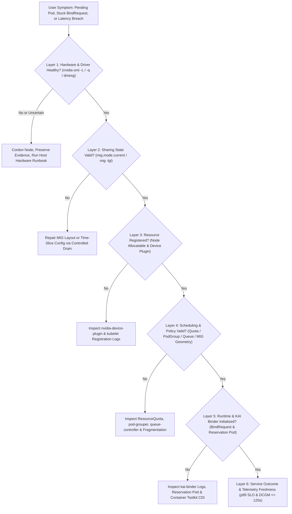
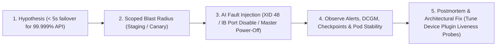

# 11.18 KAI operations and troubleshooting

| | |
|---|---|
| Level | Advanced |
| Priority tier | 1 |
| Lab venue | GCP / GKE (plus local Python 3 simulation lab) |
| Part | Part 11: GPUs on Kubernetes, scheduling and virtualization |
| Sources used | Roland Huß et al., *Generative AI on Kubernetes* (O'Reilly, 2026, Ch. 7); `nvidia-zero-to-hero/volume-11/chapter-10-observability-and-slos-for-shared-gpus.md`; `nvidia-zero-to-hero/volume-11/chapter-11-production-troubleshooting.md`; `nvidia-zero-to-hero/volume-11/labs/lab-04-troubleshoot-a-multi-tenant-gpu-node.md`; `nvidia-zero-to-hero/volume-19/chapter-02-incident-response-and-game-day-execution.md` |
| Coverage file | `planning/coverage/chapters/11-18.md` |

## Why this matters for AI infrastructure

When a developer submits a single-GPU Pod to a dedicated cluster and it stays pending, the troubleshooting tree has only two branches. Either the cluster is out of GPUs, or a worker node is broken. Operating NVIDIA KAI Scheduler on a shared multi-tenant cluster changes that picture completely. You now manage hierarchical Queue quotas, PodGroup gang scheduling, BindRequest reservation Pods, hardware MIG partitions, and software Time-Slicing or fractional GPUs. As a result, the failure surface multiplies across six distinct layers.

- **Pending workloads span four layers.** A Pod requesting a MIG profile or a fractional GPU share can remain pending because of a hardware XID fault at the first layer. It can also stall due to a disabled MIG mode on the host at the second layer or a crashed device plugin at the third layer. At the fourth layer, the request can be blocked by a namespace ResourceQuota admission denial, a missing PodGroup, an exhausted Queue limit, or MIG slice fragmentation.
- **Running workloads can still fail users.** Even after a Pod reaches the running phase, the Binder microservice can stall waiting for a fractional GPU reservation Pod at the fifth layer. At the sixth layer, a noisy neighbor on a shared time-sliced pool can drive GPU memory past ninety percent. That contention pushes tail latency beyond the service level objective while physical hardware health graphs stay green.

When an on-call responder guesses and immediately restarts the device plugin or reboots a host, they destroy the forensic timeline. Worse still, they widen the blast radius to every co-tenant on that server. This chapter establishes a disciplined six-layer triage order, a shared-GPU telemetry contract, step-by-step incident playbooks, and chaos engineering Game Days.

```text
Shared-GPU & KAI Scheduler Operational Thresholds Summary (volume-11 & volume-19)
---------------------------------------------------------------------------------
- Triage Architecture: 6 ordered layers, 7 KAI microservices, 6 KAI CRDs
- Reserved MIG Inference Tier:
    * Request success SLI target: > 99.5% (5m rate window)
    * Latency p99 SLI target:     < 100 ms (breach alert if > 120 ms, warning 100-120 ms)
- Best-Effort Time-Sliced / Fractional Pool:
    * Queue wait p95 SLI target:  < 30 seconds (10m rate window; breach >= 30 s)
    * Memory pressure threshold:  > 90% sustained (> 95% host contention trigger)
- Platform Foundation & Telemetry Freshness:
    * DCGM scrape age alert:      > 120 seconds -> mark state UNKNOWN (never healthy)
    * Recovery verification wait: 30 s after device-plugin restart; 5 min after pool patch
- AI Game Day Chaos Engineering:
    * Fault injections:           XID 48 (Double-Bit ECC), ibportstate ... disable (RDMA)
    * Availability target:        99.999% ("Five Nines") with < 5 seconds failover
    * Schedule discipline:        10:00 AM on a Tuesday instead of 3:00 AM on a Sunday
```

## Prerequisites and outcomes

### Prerequisites

- Completion of Chapters 11.13 through 11.17 covering KAI Scheduler architecture, custom resources, gang scheduling, fractional GPUs, Time-Slicing, and MIG.
- Familiarity with `kubectl`, `nvidia-smi`, Prometheus PromQL queries, and the DCGM exporter.

### Outcomes

- Execute the six-layer shared-GPU and KAI Scheduler triage order from physical hardware up to service telemetry. Capture a five-file read-only forensic bundle before mutating cluster state.
- Map any stuck or failing workload to the exact KAI Scheduler microservice and custom resource definition across the control plane.
- Implement the shared-GPU telemetry contract and service-class Prometheus rules. Mark stale scrape targets as unknown rather than healthy.
- Run the safe policy fault injection lab to distinguish API admission ResourceQuota denials from scheduler capacity events. Execute AI Game Days for hardware faults, RDMA blackholes, and control-plane leader elections.

## Concepts: basics to intermediate to advanced

### 1. Basics: The six-layer triage model for KAI Scheduler and shared GPUs

When an incident strikes a KAI-scheduled cluster, responders must never start by restarting DaemonSets or rebooting worker nodes. First freeze nonessential automated rollouts in the affected scope and preserve one healthy peer node for comparison. Next, capture a read-only evidence bundle and walk the six architectural boundaries from bottom to top.



#### Mapping Layer 4 and Layer 5 failures to KAI Scheduler microservices and CRDs

Inside the fourth and fifth triage layers, KAI Scheduler splits scheduling duties across seven specialized microservices and six Custom Resource Definitions. Knowing which microservice owns which object allows an on-call engineer to isolate control-plane stalls in seconds.

| KAI Microservice | CRD / Object Owned | Failure Symptom When This Component Breaks | Exact Triage Command |
|---|---|---|---|
| **`operator`** | `Config`, `SchedulingShard` | KAI control-plane pods missing after upgrade or shard partition out of sync | `kubectl get config,schedulingshards -A` |
| **`admission`** | Validating / Mutating Webhooks | Pod submission rejected immediately or fractional GPU defaults not mutated | `kubectl get mutatingwebhookconfigurations,validatingwebhookconfigurations \| grep kai` |
| **`pod-grouper`** | `PodGroup` | Workload Pods (`PyTorchJob`, `JobSet`, `RayCluster`, `LWS`) sit `Pending` with **no `PodGroup` created** | `kubectl get podgroups -n <ns>` and `kubectl logs -n kai-scheduler deploy/pod-grouper` |
| **`queue-controller`** | `Queue` (`parent`, `resources.gpu.quota` / `limit`) | `PodGroup` exists, but `kubectl get queues` shows `allocated` stuck or `Queue` status unhealthy | `kubectl get queues -o wide` and `kubectl describe queue <team-queue>` |
| **`kai-scheduler`** | Stage 1–6 Session Decisions (`Topology`, `PodGroup`) | `PodGroup` stays `Pending` (`Unschedulable: Queue over limit`, `gang minMember not met`, or `Topology constraint unsatisfied`) | `kubectl describe podgroup <pg-name> -n <ns>` and `kubectl logs -n kai-scheduler deploy/kai-scheduler` |
| **`pod-group-controller`** | `PodGroup` lifecycle & status sync | `PodGroup` phase fails to update when member pods complete or fail | `kubectl logs -n kai-scheduler deploy/pod-group-controller` |
| **`binder`** | `BindRequest` & Fractional GPU Reservation Pods | `kai-scheduler` allocated the `PodGroup`, but member Pods remain `Pending` (or fractional pods wait for their integer `nvidia.com/gpu: 1` reservation pod) | `kubectl get bindrequests -n <ns>` and `kubectl logs -n kai-scheduler deploy/binder` |

---

### 2. Intermediate: Observability, telemetry contracts, and service-class SLIs and SLOs

A shared GPU node can report completely healthy hardware while a tenant suffers unacceptable tail latency. Conversely, it can show low average utilization while properly holding reserved MIG capacity for a latency-critical service. Observability for a KAI-scheduled shared platform must therefore answer two separate questions. First, is the platform foundation able to allocate and execute work safely. Second, is each service class delivering the latency and throughput experience it promised to its tenants.

#### Build three audience-specific views rather than a single GPU health score

Collapsing all cluster telemetry into a single dashboard leaks multi-tenant data across teams. It also hides localized saturation behind fleet-wide averages. Platform teams should publish three distinct views governed by a six-part telemetry contract. That contract covers node coverage, identity anchored on node and GPU UUID, metric semantics, bounded label cardinality, retention history, and multi-tenant access control.

| Operational View | Primary Audience | Core Questions Answered | Permitted vs Prohibited Data (Multi-Tenant Safety) |
|---|---|---|---|
| **1. Platform Health** | SRE & Platform Operations | Are nodes, GPUs, drivers, MIG layouts, KAI operands, and `dcgm-exporter` scrape paths healthy and fresh (`<= 120 s`)? | Sees fleet/node UUIDs, XIDs, and operand state; must not ingest tenant prompts, secrets, or payload data. |
| **2. Service Delivery** | Tenant & Service Owner | Is our `Queue` wait time, allocation rate, and application `p99` latency / error rate meeting our service tier's promise? | Sees only the tenant's own `Queue`, `PodGroup`, quota, and app metrics; **never** sees competing tenants' names or host inventory. |
| **3. Capacity & Fairness** | Platform Product & Finance | Which `Queue` or MIG profile shape is blocked, fragmented, or holding idle reservations? | Sees aggregated `gpu-hours` by `Queue`, Pending reasons by shape, and MIG fragmentation; no per-request traces. |

#### Concrete service-class SLIs, SLOs, and Prometheus rules

Platform engineers must never attach a strict tail-latency target to a best-effort time-sliced pool. That pool's admission policy cannot enforce hardware isolation. Instead, define service level indicators that match the sharing mechanism's actual isolation guarantee across reserved MIG inference, best-effort time-sliced development, and platform scrape freshness.

- **Reserved MIG inference tier.** Track request success rate and ninety-ninth percentile latency over five-minute rolling windows. Page on-call when latency breaches the upper threshold or when Pods queue on missing MIG slices.
- **Best-effort time-sliced development pool.** Track ninety-fifth percentile queue wait time and physical GPU memory utilization. Those two metrics show operators when high notebook concurrency drives expected memory pressure.
- **Platform foundation and telemetry freshness.** Track advertised GPU and MIG resource counts alongside the age of the latest DCGM exporter scrape. Flag stale metrics as unknown rather than healthy.

```yaml
# Reserved MIG inference SLI/SLO recording rules (volume-11/chapter-10, untested here)
sli_mig_inference_request_success: |
  rate(inference_requests_total{service="mig-inference", status="success"}[5m])
  / rate(inference_requests_total{service="mig-inference"}[5m])
  # Target: > 99.5%

sli_mig_inference_p99_latency: |
  histogram_quantile(0.99, rate(inference_request_duration_ms_bucket[5m]))
  # Target: < 100ms; breach alert if > 120ms

mig_pod_pending_reasons: |
  count by (reason) (kube_pod_container_status_state{state="pending"})
```

```yaml
# Best-effort time-sliced pool & telemetry freshness rules (volume-11/chapter-10, untested here)
timeslice_queue_time_p95: |
  histogram_quantile(0.95, rate(gpu_queue_wait_seconds_bucket{pool="time-sliced"}[10m]))
  # Target: < 30 seconds

timeslice_memory_utilization: |
  nvidia_smi_memory_used_mib{gpu_index="0"}
  / nvidia_smi_memory_total_mib{gpu_index="0"}
  # > 90% sustained with high concurrency indicates expected memory contention

gpu_device_available: |
  count(nvidia_smi_memory_total_mib)

mig_resource_advertised: |
  count(kube_allocatable{resource=~"nvidia.com/mig.*"})

dcgm_exporter_scrape_age_seconds: |
  time() - scrape_timestamp_seconds{job="dcgm-exporter"}
  # Alert if > 120 seconds: stale telemetry means hardware health is UNKNOWN, never healthy
```

#### The five actionable alert families

Every alert that pages an on-call engineer must map to a safe first containment action. It must also include an explicit guardrail stating what not to do first. This discipline stops responders from turning a single-node registration glitch into a cluster-wide outage.

| Alert Family | Trigger Condition | Safe First Action | Do NOT Do First |
|---|---|---|---|
| **1. Resource-Loss Alert** | Expected `nvidia.com/gpu` or `nvidia.com/mig-*` count drops in `status.allocatable` | Cordon affected node(s) to stop new placement; diff against a healthy peer node | Do not reconfigure every node or delete device-plugin pods fleet-wide |
| **2. Hardware-Evidence Alert** | XID / uncorrectable ECC / thermal fault correlated with workload impact | Preserve `nvidia-smi -q` and `dmesg` evidence, isolate node, follow hardware runbook | Do not reboot the host before capturing volatile driver/XID state |
| **3. Telemetry-Freshness Alert** | `dcgm_exporter_scrape_age_seconds > 120` or missing target | Restore exporter/scrape path and mark hardware health as **`UNKNOWN`** | Do not treat absent or zeroed metrics as a healthy GPU |
| **4. Protected-Service SLO Alert** | Reserved inference `p99 > 120 ms` or success `<= 99.5%` | Reduce best-effort admission or route traffic to approved reserve capacity | Do not raise time-slicing `replicas` count to hide queueing |
| **5. Capacity-Risk Alert** | Compatible MIG profile or `Queue` reserve exhausted with rising `Pending` demand | Review requested profile shapes, `Queue` usage, and MIG fragmentation | Do not page on-call solely because average GPU utilization moved |

---

### 3. Advanced: Production incident playbooks and AI Game Days

#### Playbook A: MIG resource disappears after host or operator event

When a workload requesting a hardware MIG slice stays pending, responders must verify where the break occurred. It could sit in the host driver, the host MIG partition table, or the Kubernetes device-plugin registration layer. Walking the five read-only checks below in order isolates the fault without disturbing running Pods on the node.

- **Layer 1 host GPU and MIG mode.** Query `mig.mode.current` on the host to verify that MIG mode is still enabled. An unscheduled host reboot or driver reset can wipe MIG mode back to disabled.
- **Layer 2 host MIG instances.** List the active GPU Instances on the host to confirm that the expected slices still exist in silicon. Do this before touching any Kubernetes DaemonSet.
- **Layer 3 node allocatable inventory.** Inspect the node's allocatable resource counts in the Kubernetes API. This check reveals whether the control plane sees the host slices.
- **Layer 4 device-plugin logs and targeted restart.** Suppose the host slices exist at the second layer, but the node advertises zero allocatable slices at the third layer. Delete only that node's device-plugin Pod and wait thirty seconds for registration to recover.
- **Layer 5 healthy peer diff.** Compare the affected node's description against a healthy peer node. Never modify MIG mode on a node carrying live Pods without cordoning and draining it first.

```text
Playbook A: 5-Step Read-Only MIG Absence Commands (volume-11/chapter-11, untested here)
---------------------------------------------------------------------------------------
1. Layer 1 (Host GPU & MIG Mode):
   ssh gpu-node-1 'nvidia-smi -i 0 --query-gpu=gpu_name,gpu_uuid,mig.mode.current --format=csv'
   -> Verify "Enabled". If "Disabled", reboot/reset wiped MIG mode.

2. Layer 2 (Host MIG Instances):
   ssh gpu-node-1 'nvidia-smi mig -lgi -i 0'
   -> Verify 1g.10gb / 2g.20gb exist. If "No GPU Instances are currently running",
      reapply approved MIG profile after cordoning.

3. Layer 3 (Node Allocatable):
   kubectl get nodes -o custom-columns=NAME:.metadata.name,MIG_10GB:.status.allocatable.nvidia\.com/mig-1g\.10gb,MIG_20GB:.status.allocatable.nvidia\.com/mig-1g\.20gb
   -> Verify counts > 0.

4. Layer 4 (Device Plugin Logs & Targeted Restart):
   kubectl logs -n nvidia-driver-install ds/nvidia-device-plugin-daemonset --tail=50 | grep -i "device\|mig\|error"
   kubectl delete pod -n nvidia-driver-install -l app=nvidia-device-plugin
   -> Wait 30 s for status.allocatable to repopulate when Layer 2 is OK but Layer 3 is 0.

5. Layer 5 (Healthy Peer Diff):
   kubectl describe node gpu-node-1 vs gpu-node-2 (never change MIG mode without cordon & drain).
```

#### Playbook B: Proving policy admission denial versus scheduler capacity shortage

During multi-tenant incidents, responders frequently confuse a namespace ResourceQuota admission denial with a missing hardware resource in the scheduler. Distinguishing these two failure modes immediately prevents teams from hunting for broken GPUs when a namespace simply hit its policy ceiling.

- **API admission denial via ResourceQuota.** Suppose a namespace carries a zero GPU quota such as `diagnostic-gpu-denial`. Applying a Pod manifest is rejected synchronously by the API server before any Pod or PodGroup object is written to cluster storage. Meanwhile, the node's allocatable capacity remains untouched.
- **Scheduler capacity shortage or KAI Queue wait.** When API admission succeeds, the Pod and PodGroup objects are created in the pending phase. Describing the Pod or PodGroup then reveals a scheduling event such as insufficient MIG slices or a Queue over its limit.

#### Playbook C: AI chaos engineering and Game Days

Hope is not a strategy when operating multi-tenant GPU clusters. If an engineering organization waits until an unscheduled outage early Sunday morning to test fault recovery, configuration drift will cause a total platform blackout. Platform teams should run scheduled Game Days during normal business hours using the Incident Command System. That structure strictly separates three roles. The Incident Commander coordinates decisions and timeline without touching a keyboard, the Subject Matter Expert inspects cluster and host diagnostics, and the Communications Lead updates stakeholders.



Every AI infrastructure platform should execute three mandatory Game Day fault injections. These tests verify hardware isolation, RDMA network recovery, and control-plane resilience.

- **Simulated GPU hardware death.** Inject a double-bit ECC error on an isolated test GPU using `dcgmi test --inject`. Verify that the device plugin marks the card unhealthy, evicts the affected Pod, and cordons the node automatically.
- **RDMA and InfiniBand network blackhole.** Disable a single InfiniBand switch port using `ibportstate` while a multi-node job runs collective benchmarks. Remember that host `iptables` rules only filter kernel TCP/IP sockets and never touch RDMA verbs traffic that bypasses the OS kernel.
- **Control-plane master failover and device-plugin liveness probes.** Power off one of three control-plane master nodes during synthetic peak load. Verify that worker-node device plugins tolerate transient API server leader elections without restarting and unregistering extended GPU resources.

```text
Game Day Postmortem: The 99.999% Control-Plane Master Failover Trap (volume-19/chapter-02)
------------------------------------------------------------------------------------------
- Hypothesis: Powering off 1 of 3 master nodes keeps Triton inference degradation < 5 seconds
  to meet a Five Nines (99.999%) availability target.
- Actual Outcome: 100% of running Triton inference pods on every worker node crashed instantly.
- Root Cause Chain:
  1. Worker-node nvidia-device-plugin and GPU Operator DaemonSets had overly aggressive
     liveness probes tied to kube-apiserver responsiveness.
  2. During the brief control-plane leader-election pause, the device-plugin liveness probes
     timed out and restarted the plugin containers.
  3. Restarting the plugin briefly unregistered nvidia.com/gpu (Allocatable dropped to 0),
     causing local kubelets to terminate all running Triton GPU pods.
- Why PodDisruptionBudget (PDB) Failed: PDBs only govern voluntary evictions via the Eviction API
  (kubectl drain); they do not stop kubelet from killing pods when a hardware resource vanishes.
- Architectural Fix: Increase liveness probe timeouts and failure thresholds in the GPU Operator
  and device-plugin Helm chart so control-plane blips never restart worker-node device plugins.
```

#### Change-surface review, containment gates, and tabletop exercises

Most shared-GPU and KAI Scheduler incidents are interface regressions triggered by a legitimate platform or workload change. Examples include a kernel upgrade, a driver bump, a MIG layout update, a Queue quota change, or a new model release with a larger key-value cache footprint. Rather than blaming the most recent commit or rolling back unrelated components, responders should compare the affected node against a preserved healthy peer across all six change surfaces.

| Change Surface | First Boundary Likely to Break | Authoritative Evidence to Compare | Unsafe Shortcut to Avoid |
|---|---|---|---|
| **1. Node OS Image, Kernel, or NVIDIA Driver** | Layer 1: Host initialization & GPU enumeration | `uname -r`, `nvidia-smi -q`, `dmesg` boot/XID log vs healthy peer node | Assuming a Kubernetes manifest rollback repairs broken host kernel/driver state |
| **2. Container Runtime (`containerd`) or Toolkit (`CDI`)** | Layer 3/5: Device injection & container initialization | `containerd` logs, `/etc/cdi`, RuntimeClass handler, bounded `diagnostic-gpu-pod` (`DIAGNOSTIC_GPU_OK`) | Modifying application Python code before testing a minimal `nvidia-smi -L` diagnostic pod |
| **3. Device Plugin, GPU Operator, or KAI Operands** | Layer 3/4: Resource advertisement & `PodGroup` / `BindRequest` reconciliation | Helm/ConfigMap revision, DaemonSet/Deployment logs, node `status.allocatable` | Deleting all operator and scheduler pods at once without identifying the first non-ready operand |
| **4. MIG Profile Policy / Layout (`mig-parted`)** | Layer 2/4: GPU Instance inventory & profile placement | Approved layout baseline, node drain record, `nvidia-smi mig -lgi`, `status.allocatable["nvidia.com/mig-*"]` | Reconfiguring MIG mode on an active node carrying live tenant pods without cordoning and draining |
| **5. `Queue` Quota, `ResourceQuota`, or Admission Policy** | Layer 4: API admission or KAI `Queue` scheduling | Git policy revision, `quota-denial.txt` admission error or `PodGroup` event, `kubectl get queues` | Bypassing namespace or `Queue` governance with privileged cluster-admin overrides |
| **6. Model Weights, Context Length, or Batch Release** | Layer 6: HBM footprint, `p99` latency, and OOM rate | Application baseline metrics, concurrency count, `nvidia-smi --query-processes` memory usage | Declaring a physical GPU hardware defect when a new model checkpoint grew past its slice ceiling |

#### Containment gates and service-specific acceptance workloads

An incident is not resolved merely because a DaemonSet turns running or `nvidia-smi` prints a table on the host. Every containment action must pass a service-class recovery gate verified by a version-controlled validation workload before returning the node or pool to production traffic.

- **Suspected host or hardware fault at Layer 1.** Cordon the node to stop new placements. Then verify that host diagnostics and DCGM health checks pass, allocatable counts match baseline, and the bounded diagnostic Pod prints `DIAGNOSTIC_GPU_OK`.
- **MIG discovery or layout drift at Layers 2 and 3.** Pause automated rollout propagation across the node pool so healthy peer nodes remain untouched. Next, verify that host MIG instances match the node's advertised `nvidia.com/mig-*` counts and a test Pod initializes CUDA cleanly.
- **KAI scheduling, quota, or fragmentation block at Layers 4 and 5.** Route urgent work to a compatible reserve pool without stripping tenant isolation labels. Verify that PodGroup and BindRequest objects bind cleanly and the recovery check Pod completes `QUOTA_DENIAL_RECOVERY_CHECK`.
- **Shared-pool contention or protected SLO breach at Layer 6.** Reduce best-effort admission or patch the protected deployment onto a dedicated or MIG pool. Confirm that request latency and success rates hold within target across a full five-minute observation window.
- **Telemetry pipeline outage at Layer 6.** Explicitly label affected dashboards and status updates as unknown due to stale telemetry rather than healthy. Verify that scrape age returns below the threshold and test allocations correlate across node, GPU UUID, and PodGroup.

#### Running the tabletop exercise before production launch

Before certifying an on-call rotation for a shared KAI and MIG cluster, platform leaders should run a tabletop exercise. Simulate a profile shortage during a canary node upgrade. In this scenario, a protected inference tenant requests a MIG profile that is temporarily exhausted in its primary pool while a neighboring best-effort time-sliced pool has free capacity. Incident commanders grade the team on six concrete behaviors.

- **Classify before mutating.** Determine whether the pending Pod is blocked by device discovery, quota policy, total capacity exhaustion, or MIG geometry fragmentation before touching any worker node.
- **Freeze the canary rollout.** Halt the node upgrade immediately so the remaining healthy comparison nodes are preserved for side-by-side diffs.
- **Protect multi-tenant privacy.** Communicate status updates to the affected service owner without leaking competing tenants' names, model weights, or Queue allocations.
- **Choose an approved mitigation.** Route the workload to a compatible reserve MIG pool or execute a controlled maintenance drain. Never silently downgrade a protected service onto a best-effort time-sliced pool.
- **Preserve the forensic scene.** Capture the complete five-file read-only evidence bundle before applying any cluster change.
- **Verify with acceptance workloads.** Confirm full recovery using both a bounded diagnostic Pod and the tenant's application-level tail-latency indicator.

## Commands and configurations that matter

### 1. Preserving the read-only scene bundle

Before restarting any component or draining a node, capture the five-file read-only evidence bundle. These files record node state, Pod placement, cluster events, allocatable resources, and KAI Scheduler custom resources.

```bash
# Preserve node, pod, event, allocatable, and KAI state before any mutation (untested here)
export GPU_NODE="gpu-node-1"
export LAB_NAMESPACE="gpu-sharing-incident-lab"
export EVIDENCE_DIR="shared-gpu-incident"

mkdir -p "$EVIDENCE_DIR"
kubectl describe node "$GPU_NODE" > "$EVIDENCE_DIR/node-describe.txt"
kubectl get pods -A --field-selector spec.nodeName="$GPU_NODE" -o wide > "$EVIDENCE_DIR/node-pods.txt"
kubectl get events -A --sort-by=.lastTimestamp > "$EVIDENCE_DIR/events.txt"
kubectl get node "$GPU_NODE" -o jsonpath='{.status.capacity}{"\n"}{.status.allocatable}{"\n"}' > "$EVIDENCE_DIR/node-resources.txt"
kubectl get resourcequota,queues,podgroups,bindrequests -A > "$EVIDENCE_DIR/kai-and-quotas.txt"
```

### 2. Bounded diagnostic Pod and safe ResourceQuota fault injection

Use a bounded diagnostic Pod in a disposable namespace to test single-node GPU injection. Pair it with a reversible zero-capacity ResourceQuota to test API admission denial without risking production workloads.

```yaml
# diagnostic-gpu-pod-and-quota-test.yaml (volume-11/labs/lab-04, untested here)
apiVersion: v1
kind: Namespace
metadata:
  name: gpu-sharing-incident-lab
---
apiVersion: v1
kind: Pod
metadata:
  name: diagnostic-gpu-pod
  namespace: gpu-sharing-incident-lab
spec:
  restartPolicy: Never
  nodeSelector:
    kubernetes.io/hostname: gpu-node-1
  containers:
    - name: diagnostic
      image: nvcr.io/nvidia/cuda:12.4.1-base-ubuntu22.04
      command: ["sh", "-c", "nvidia-smi -L; echo DIAGNOSTIC_GPU_OK"]
      resources:
        limits:
          nvidia.com/gpu: 1
---
# Safe reversible policy fault injection in disposable lab namespace only
apiVersion: v1
kind: ResourceQuota
metadata:
  name: diagnostic-gpu-denial
  namespace: gpu-sharing-incident-lab
spec:
  hard:
    requests.nvidia.com/gpu: "0"
    limits.nvidia.com/gpu: "0"
```

### 3. Time-correlated host contention triage

When a shared node suffers latency spikes, capture timestamped host metrics. Record GPU memory utilization, Streaming Multiprocessor clocks, power draw, active container process identifiers, and host swap state.

```bash
# Capture timestamped host GPU memory, SM clock, power, and PID breakdown (untested here)
INCIDENT_TIME=$(date -u +%Y-%m-%dT%H:%M:%SZ)
ssh gpu-node-1 'nvidia-smi --query-gpu=name,memory.used,memory.total,clocks.current.sm,power.draw --format=csv -l 2' | tee /tmp/gpu-activity.txt
ssh gpu-node-1 'nvidia-smi --query-processes=pid,process_name,gpu_memory_usage --format=csv'
ssh gpu-node-1 'cat /proc/meminfo | grep -E "MemTotal|MemAvailable|SwapFree"'
```

## How it fails

Operational failures on KAI-scheduled shared GPU clusters span device-plugin registration loss, missing PodGroups, stuck BindRequests, stale DCGM telemetry hiding contention, and overly aggressive liveness probes during control-plane blips.

| Failure mode | Exact symptom & command evidence | Root cause boundary | Remediation |
|---|---|---|---|
| **1. `nvidia.com/mig-1g.10gb` disappears from `status.allocatable` while `nvidia-smi mig -lgi` still shows instances (`volume-11/chapter-11`)** | `ssh gpu-node-1 'nvidia-smi mig -lgi -i 0'` lists active `1g.10gb` instances, but `kubectl describe node gpu-node-1` shows `0` allocatable MIG resources and `ds/nvidia-device-plugin-daemonset` logs `"failed to discover"`. | **Layer 3 Registration (`nvidia-device-plugin`):** The host MIG layout (`Layer 2`) is intact, but the device-plugin pod on that node lost synchronization with NVML / `kubelet`. | Restart only the device-plugin pod (`kubectl delete pod -n nvidia-driver-install -l app=nvidia-device-plugin`), wait `30 s`, and verify `status.allocatable` without reconfiguring MIG or draining running workloads. |
| **2. Workload Pods stay `Pending` with `schedulerName: kai-scheduler` and zero `PodGroup` objects in namespace (*Generative AI on Kubernetes* Ch. 7)** | `kubectl get pods -n team-a` shows Pods `Pending`, `kubectl get podgroups -n team-a` returns `No resources found`, and `kai-scheduler` logs show no scheduling attempts for those pods. | **Layer 4 Scheduling Policy (`kai-pod-grouper`):** Either the `pod-grouper` deployment is down/missing RBAC watches for the workload CRD, or the workload is missing its `kai.scheduler/queue` label. | Check `kubectl logs -n kai-scheduler deploy/pod-grouper`, verify the workload carries `kai.scheduler/queue: <queue>`, and confirm `pod-grouper` watches the parent CRD (`PyTorchJob`, `JobSet`, `LWS`). |
| **3. `PodGroup` is allocated by `kai-scheduler`, but fractional GPU pods remain `Pending` (`BindRequest` stuck)** | `kubectl get podgroups` shows the group scheduled, `kubectl get bindrequests -n team-a` shows a `BindRequest` object that never completes, and the integer GPU reservation pod on the target node is `Pending` or failing. | **Layer 5 Runtime / KAI Binding (`kai-binder`):** `binder` created an integer `nvidia.com/gpu: 1` reservation pod to back the fractional user pods, but `kubelet` or `nvidia-device-plugin` rejected the reservation pod on the target node. | Inspect `kubectl get bindrequests -n team-a -o yaml`, check `kubectl logs -n kai-scheduler deploy/binder`, and verify `status.allocatable["nvidia.com/gpu"]` and CDI runtime health on the target node. |
| **4. Reserved MIG or shared inference `p99` breaches `> 120 ms` while DCGM dashboards appear flat or healthy (`volume-11/chapter-10`)** | Users report timeouts (`p99 = 135 ms > 120 ms` breach), while Grafana GPU health panels show `0` errors—and `dcgm_exporter_scrape_age_seconds` is `180 s` (`> 120 s`). | **Layer 6 Service & Telemetry (`UNKNOWN_STALE_TELEMETRY` + Contention):** Stale scrape targets (`> 120 s`) created a false green hardware view while co-tenant memory pressure (`> 90%`) degraded tail latency. | Immediately route the protected service to dedicated/MIG capacity (`kubectl patch deployment ...`), restore `dcgm-exporter` scraping, and alert on `dcgm_exporter_scrape_age_seconds > 120`. |
| **5. Killing `1` of `3` master nodes in a Game Day crashes all running Triton GPU pods on worker nodes (`volume-19/chapter-02`)** | During a brief `kube-apiserver` leader-election pause, `nvidia-device-plugin` pods on worker nodes restart, `nvidia.com/gpu` briefly drops to `0`, and `kubelet` terminates all running GPU pods despite `PodDisruptionBudgets`. | **Aggressive Device-Plugin Liveness Probes:** Device-plugin liveness probes timed out against the API server pause and restarted; `PDBs` only block voluntary Eviction API calls, not `kubelet` resource-loss termination. | Increase liveness probe timeouts and failure thresholds in the GPU Operator / device-plugin Helm chart so transient control-plane blips never restart the device plugin. |

## Hands-on lab

### Venue and scope

This lab runs locally using the Python standard library in `code/part11/kai_operations_and_troubleshooting.py` and `code/part11/kai_operations_and_troubleshooting_lab.py`. It verifies the six-layer triage classifier across hardware, MIG state, device-plugin registration, scheduling policy, Binder runtime, and service telemetry. It also tests the Prometheus service level objective evaluator and the AI Game Day fault models. Host and cluster commands earlier in the chapter are marked untested here.

### Step 1: Run the self-checking KAI operations and troubleshooting lab (tested here)

Run the lab verification script from the repository root.

```bash
python3 code/part11/kai_operations_and_troubleshooting_lab.py
```

Captured output from this repository:

```text
=== Chapter 11.18 Lab: KAI Operations, Observability, SLIs/SLOs & Troubleshooting ===
  [PASS] Volume 11 Ch 11 / Lab 04 defines 6 ordered triage layers from Hardware/driver to Service & Telemetry
  [PASS] Layer 2 inspects sharing state (mig.mode.current / mig -lgi) before Layer 3 node Allocatable
  [PASS] Layer 4 inspects scheduling policy (PodGroup, Queue quota, ResourceQuota) before Layer 5 Runtime
  [PASS] Reserved MIG inference with 99.8% (> 99.5%) success and p99=85ms (< 100ms) is HEALTHY_SLO_MET
  [PASS] Reserved MIG inference with p99=135ms (> 120ms breach threshold) triggers SLO_BREACH
  [PASS] Reserved MIG inference between 100ms and 120ms (110ms) enters SLO_WARNING_100_TO_120MS
  [PASS] Best-effort time-sliced pool with p95 queue wait 18s (< 30s) and 60% (<= 90%) memory is HEALTHY_BEST_EFFORT
  [PASS] Time-sliced pool at 95% (> 90%) memory utilization flags MEMORY_CONTENTION_GT_90PCT
  [PASS] Time-sliced pool with p95 queue wait 45s (>= 30s) flags QUEUE_WAIT_BREACH_GE_30S
  [PASS] DCGM scrape age 180s (> 120s) marks state as UNKNOWN_STALE_TELEMETRY rather than healthy
  [PASS] Missing host GPU enumeration classifies as Layer 1: Hardware/driver
  [PASS] MIG mode enabled with 0 GPU instances classifies as Layer 2: Sharing state
  [PASS] Host MIG instances present but node Allocatable=0 classifies as Layer 3: Registration (nvidia-device-plugin)
  [PASS] Lab 04 zero-capacity ResourceQuota denial classifies at API Admission before Pod creation
  [PASS] Missing PodGroup CR for a pending workload classifies as Layer 4: kai-pod-grouper
  [PASS] PodGroup blocked by Queue limit classifies as Layer 4: kai-queue-controller
  [PASS] Unused MIG slices that cannot form requested profile classify as Layer 4: MIG Fragmentation
  [PASS] Stuck BindRequest CR or reservation pod classifies as Layer 5: kai-binder
  [PASS] Running pod with p99=240ms (> 100ms SLO) on healthy GPU classifies as Layer 6: Workload Contention
  [PASS] Game Day XID 48 (Double-Bit ECC) is injected via dcgmi test --inject and marks GPU Unhealthy
  [PASS] RDMA network blackhole requires switch port disable (ibportstate ... disable) because iptables ignores RDMA
  [PASS] 5-Nines (99.999%) Game Day hypotheses target < 5 seconds failover degradation
  [PASS] Control-plane master failover exposed aggressive device-plugin liveness probes unregistering nvidia.com/gpu
  [PASS] PodDisruptionBudgets do not stop kubelet from terminating pods when extended GPU resources disappear
  [PASS] Stale telemetry (> 120s) attaches UNKNOWN warning to incident classification

Summary: 25 passed, 0 failed out of 25 checks.
```

### Exercises

1. **Exercise 1 — Ordering the six-layer shared-GPU triage workflow.** Inspect `SIX_TRIAGE_LAYERS` in `code/part11/kai_operations_and_troubleshooting.py`. List the six triage layers in order and state the primary diagnostic evidence collected at each layer.
2. **Exercise 2 — Diagnosing a missing MIG resource across Layers 1 through 4.** Use `classify_kai_and_shared_gpu_incident()` to compare two cases. Contrast the diagnosis and safe remediation when `nvidia-smi mig -lgi` shows zero instances on the host versus when it shows active instances on the host while the node's allocatable MIG count is zero.
3. **Exercise 3 — API admission quota denial versus KAI PodGroup or Queue wait.** Explain how the Kubernetes evidence differs across three blocks. Compare a Pod blocked by the `diagnostic-gpu-denial` ResourceQuota, a failure in PodGrouper to create a PodGroup, and a Binder stall on a BindRequest.
4. **Exercise 4 — Evaluating shared-GPU SLIs, SLOs, and telemetry freshness.** Inspect `evaluate_shared_gpu_slo()`. State the numerical thresholds for reserved MIG inference success and latency, time-sliced queue wait and memory utilization, and DCGM exporter scrape age.
5. **Exercise 5 — Designing AI Game Day fault injections.** State the exact tool or command used to inject a double-bit ECC error on a test GPU and an InfiniBand link failure during collective benchmarks. Explain why host `iptables` rules cannot test RDMA link failure.
6. **Exercise 6 — Postmortem of the control-plane Game Day outage.** Explain why powering off one of three master nodes caused all worker-node Triton Pods to terminate. State why PodDisruptionBudgets did not protect them, and identify the Helm configuration change that fixes the flaw.

## Checkpoint questions

<details>
<summary>**1. List the six triage layers for a shared-GPU and KAI Scheduler incident in order from bottom to top.**</summary>

The first layer checks physical device, host, and driver enumeration. The second layer verifies the active MIG mode or time-slicing shape on the host. Next, the third layer checks device-plugin discovery and node allocatable registration, while the fourth layer checks ResourceQuota, PodGroup, Queue, and MIG geometry policy. Finally, the fifth layer checks Binder reservation Pods and container CUDA initialization, and the sixth layer verifies service latency targets and DCGM telemetry freshness.
</details>

<details>
<summary>**2. Before running any remediation command during a shared-GPU incident, what five read-only evidence files should you capture?**</summary>

Capture the node description in `node-describe.txt`, the node's running Pods in `node-pods.txt`, and sorted cluster events in `events.txt`. Then record the node's capacity and allocatable JSON in `node-resources.txt`. Finally, save all ResourceQuotas and KAI scheduling objects in `resourcequotas.txt` or `kai-and-quotas.txt`.
</details>

<details>
<summary>**3. Which seven microservices and six CRDs make up the NVIDIA KAI Scheduler operational footprint?**</summary>

The seven microservices are `operator`, `kai-scheduler`, `pod-grouper`, `binder`, `queue-controller`, `admission`, and `pod-group-controller`. The six Custom Resource Definitions are Config, SchedulingShard, Queue, PodGroup, BindRequest, and Topology.
</details>

<details>
<summary>**4. If a distributed training job submitted with schedulerName set to kai-scheduler stays Pending and no PodGroup exists for it, which KAI microservice do you inspect first?**</summary>

Inspect the PodGrouper microservice first by checking `kubectl logs -n kai-scheduler deploy/pod-grouper`. Verify that the workload carries the required `kai.scheduler/queue` label and that PodGrouper has RBAC permission to watch the parent workload custom resource.
</details>

<details>
<summary>**5. If a PodGroup is marked scheduled by kai-scheduler, but its fractional GPU pods remain Pending on the target node, which KAI CRD and microservice do you inspect?**</summary>

Inspect the BindRequest custom resource in the workload namespace and the logs of the Binder microservice in the `kai-scheduler` namespace. Also check the status of the integer `nvidia.com/gpu` reservation Pod that the Binder creates on the target worker node.
</details>

<details>
<summary>**6. Why is a single GPU Utilization dashboard insufficient as an SLI and SLO contract for a shared GPU platform?**</summary>

High utilization on a shared time-sliced GPU can mean tenants are suffering severe contention and tail-latency breaches. Conversely, low utilization on a reserved MIG slice can represent a completely healthy latency-sensitive endpoint holding burst capacity. Utilization alone never reveals queue wait time, allocation failures, or stale scrape pipelines.
</details>

<details>
<summary>**7. What are the three distinct operational views for shared GPUs, and who is the primary audience for each?**</summary>

The platform health view serves site reliability and platform operations by tracking node readiness, device discovery, driver errors, and scrape freshness. The service delivery view serves tenant and service owners with scoped queue wait and request latency metrics. Meanwhile, the capacity and fairness view serves platform product and finance teams with allocation hours, pending reasons, and MIG fragmentation.
</details>

<details>
<summary>**8. What are the six pillars of the Shared-GPU Telemetry Contract?**</summary>

The first three pillars are coverage across every accepted GPU node, durable identity linking workload to node and GPU UUID without cross-tenant leaks, and documented metric semantics. The remaining three pillars are bounded label cardinality, sufficient retention history for incident reconstruction, and multi-tenant access controls matching cluster isolation boundaries.
</details>

<details>
<summary>**9. State the Prometheus SLI and SLO targets for a reserved MIG inference service and a best-effort time-sliced pool.**</summary>

A reserved MIG inference service targets a request success rate above ninety-nine point five percent and ninety-ninth percentile latency below one hundred milliseconds. It triggers a breach alert above one hundred twenty milliseconds. A best-effort time-sliced pool targets ninety-fifth percentile queue wait time below thirty seconds and flags expected memory contention when physical memory utilization exceeds ninety percent.
</details>

<details>
<summary>**10. Why must you alert when dcgm_exporter_scrape_age_seconds exceeds 120 seconds, and how must dashboards represent a node with stale telemetry?**</summary>

When the scrape age exceeds one hundred twenty seconds, hardware metrics are stale and no longer reflect current silicon state. Dashboards and responders must mark the node and GPU state as unknown rather than replacing missing series with zeroes or assuming the card is healthy.
</details>

<details>
<summary>**11. In the MIG absence playbook, what does it mean when Layer 1 and Layer 2 succeed on the host, but Layer 3 shows zero allocatable MIG resources on the Kubernetes Node?**</summary>

It proves that the physical GPU and host MIG partitions are healthy and isolates the failure to Layer 3 device-plugin registration. The safe fix is to inspect the device-plugin logs and restart only that node's device-plugin Pod. Wait thirty seconds for allocatable counts to repopulate without draining or repartitioning MIG on the host.
</details>

<details>
<summary>**12. How do you distinguish MIG profile fragmentation from a general GPU capacity shortage?**</summary>

In capacity exhaustion, all compatible MIG instances and compute or memory slices are actively in use. In MIG fragmentation, worker nodes still have unused compute and memory slices. However, the remaining hardware slice geometry cannot legally combine to form the requested profile shape without draining and repartitioning.
</details>

<details>
<summary>**13. How does the cluster behavior of a zero-capacity ResourceQuota differ from an Insufficient nvidia.com/gpu scheduler event?**</summary>

A ResourceQuota denial happens synchronously at API admission. Therefore, `kubectl apply` fails immediately, no Pod object is created in storage, and node allocatable capacity is untouched. An insufficient resource event happens after API admission succeeds, so the Pod is created in the pending state and the scheduler emits a `FailedScheduling` event.
</details>

<details>
<summary>**14. When time-sliced workloads fail with memory pressure, what host-side threshold confirms contention, and what is the immediate safe containment action for a critical inference service?**</summary>

Memory contention is confirmed when `nvidia-smi` shows GPU memory utilization above ninety-five percent, or above eighty to ninety percent alongside tail-latency spikes and host swap activity. The immediate safe containment action is to patch the sensitive service onto a dedicated or MIG node pool. Then compare tail latency after five minutes rather than raising the replica count on the shared node.
</details>

<details>
<summary>**15. What are the five incident roles during a shared-GPU outage, and why must the Incident Commander never be the person running terminal commands?**</summary>

The five roles are the incident lead or Incident Commander, the platform responder or Subject Matter Expert, the workload owner, the capacity or service owner, and the communications owner. Separating the Incident Commander from the Subject Matter Expert gives the engineer inspecting kernel logs, GPU counters, and scheduler traces uninterrupted focus. Meanwhile, the commander manages cross-team decisions and status updates.
</details>

<details>
<summary>**16. Walk through the five-step workflow of a controlled AI Game Day.**</summary>

First define a falsifiable recovery hypothesis, and second restrict the blast radius to a staging mirror or canary pool. Third execute the specific fault injection, and fourth observe whether alerts fire and automated recovery holds the service level objective. Fifth, write a postmortem with tracked engineering tickets for every gap uncovered.
</details>

<details>
<summary>**17. How do you inject a simulated GPU double-bit ECC fault and an RDMA link blackhole during an AI Game Day, and why does host iptables fail to test RDMA blackholes?**</summary>

Inject a simulated double-bit ECC fault on an isolated test GPU using `dcgmi test --inject` and verify that the device plugin marks the card unhealthy and evicts the Pod. Disable the physical or switch port using `ibportstate ... disable` during collective benchmarks to test an RDMA blackhole. Host `iptables` rules fail to block RDMA because RDMA verbs bypass the Linux kernel TCP/IP stack completely.
</details>

<details>
<summary>**18. Why did powering off one of three Kubernetes master nodes cause a complete outage of all Triton inference pods on the worker nodes?**</summary>

The worker-node device-plugin and GPU Operator DaemonSets had overly aggressive liveness probes tied to API server responsiveness. When one master powered off, the brief leader-election pause caused the device-plugin liveness probes to fail and restart the plugins. That restart unregistered `nvidia.com/gpu` on the worker nodes and caused local node agents to terminate all running Triton GPU Pods.
</details>

<details>
<summary>**19. Why did Kubernetes PodDisruptionBudgets fail to prevent the worker-node kubelets from terminating those Triton pods during the device-plugin restart?**</summary>

PodDisruptionBudgets only govern voluntary disruptions initiated through the Kubernetes Eviction API such as `kubectl drain`. They do not intercept node-local terminations triggered when a worker node's extended hardware resource disappears from the node agent.
</details>

<details>
<summary>**20. What seven items must be included in an actionable vendor or engineering Escalation Package to avoid the log-request loop?**</summary>

Include the business impact and timestamps, precise tenant-redacted reproduction steps, and the node name, GPU UUID, and active MIG or replica policy. Also attach exact software and driver versions across the stack and side-by-side evidence from the affected node and a healthy peer. Finally, include time-correlated scheduler and DCGM logs plus the chronological change and mitigation history.
</details>

## Sources and review notes

```text
Sources, Provenance, and Review Ledger for Chapter 11.18
--------------------------------------------------------
Primary sources read in full for this chapter:
  - Book sources from the local TOON-RAG corpus:
    * Roland Huß et al., Generative AI on Kubernetes (O'Reilly, 2026), Chapter 7
      (Job Scheduling Optimization, NVIDIA KAI Scheduler components: operator,
      kai-scheduler, pod-grouper, binder, queue-controller, admission,
      pod-group-controller; CRDs: Config, SchedulingShard, Queue, PodGroup,
      BindRequest, Topology).
  - Author's Volume 11 and Volume 19 notes:
    * nvidia-zero-to-hero/volume-11/chapter-10-observability-and-slos-for-shared-gpus.md
      (Three operational views, 6-part telemetry contract, service-class SLIs and
      Prometheus rules > 99.5%, < 100 ms / > 120 ms breach, < 30 s p95 queue wait,
      > 90% memory utilization, > 120 s DCGM scrape staleness, 5 alert families,
      and multi-tenant data-leakage boundaries).
    * nvidia-zero-to-hero/volume-11/chapter-11-production-troubleshooting.md
      (Figure 11.11.1 6-layer triage flowchart, 5-layer MIG absence playbook,
      Pending Pod vs fragmentation playbook, time-sliced memory contention > 95% /
      > 80%–90% / 5 min recovery check, kubectl patch deployment critical-service
      -p '{"spec":{"nodeSelector":{"gpu.sharing":"dedicated"}}}', change-surface
      review table, and 5 incident roles: Incident lead, Platform responder,
      Workload owner, Capacity/service owner, Communications owner).
    * nvidia-zero-to-hero/volume-11/labs/lab-04-troubleshoot-a-multi-tenant-gpu-node.md
      (18-section incident runbook, scene preservation bundle: node-describe.txt,
      node-pods.txt, events.txt, node-resources.txt, resourcequotas.txt;
      DIAGNOSTIC_GPU_OK pod, diagnostic-gpu-denial zero-quota fault injection vs
      Insufficient scheduler events, quota-denial.txt, and
      QUOTA_DENIAL_RECOVERY_CHECK cleanup).
    * nvidia-zero-to-hero/volume-19/chapter-02-incident-response-and-game-day-execution.md
      (5-step Game Day workflow, XID 48 via dcgmi test --inject, RDMA blackhole
      via ibportstate ... disable vs iptables, ICS role separation IC / SME /
      Communications Lead, 3:00 AM Sunday vs 10:00 AM Tuesday, and the 99.999%
      < 5 s control-plane master failover postmortem on device-plugin liveness
      probes and PDB limits).

Related source files mapped in MIGRATION_MAP.md:
  - No separate nvidia-devops file was exclusively mapped to 11.18 in brief.py;
    this chapter integrates Generative AI on Kubernetes Chapter 7,
    volume-11/chapter-10, volume-11/chapter-11, volume-11/labs/lab-04, and
    volume-19/chapter-02.

Run here:
  - python3 code/part11/kai_operations_and_troubleshooting_lab.py
    (25 passed, 0 failed out of 25 checks).

Explicitly labelled inferences:
  - Combining the volume-11/chapter-11 6-layer shared-GPU triage tree with KAI
    Scheduler's pod-grouper (PodGroup), queue-controller (Queue), and binder
    (BindRequest) boundaries at Layers 4 and 5 is a deterministic operational
    synthesis verified by code/part11/kai_operations_and_troubleshooting_lab.py.

Not verified on live hardware:
  - All `kubectl`, `ssh`, `nvidia-smi`, `mig-manager` (`nvidia.com/mig-2g.20gb`, `3g.40gb`, `4g.40gb`, `3/7` slices, `0.25` fractions, `40` GB / `300`s windows, `quota-denied-gpu-pod`), `nccl-tests`, `dcgmi test --inject`, `ibportstate`, and Prometheus rules are marked `(untested here)`.

Not in the corpus:
  - Internal KAI Scheduler Prometheus metric names beyond the standard Kubernetes /
    DCGM Exporter / PodGroup status metrics documented in the corpus.

Corrections to the author's notes:
  - KAI Scheduler check 2026-10-25: this chapter's KAI details were compared with
    the upstream docs; see the note at the top of Chapter 11.14 for what was
    confirmed, corrected (kai.scheduler/queue label, kai.scheduler/topology*
    annotations, Topology group kai.scheduler/v1alpha1) and not confirmed (the
    book's Project kind). In Chapter 11.17 the example now requests gpu-fraction
    only; the upstream docs list gpu-fraction and gpu-memory as alternative ways
    to ask for a share.
  - Validation pass 2026-10-25: validate_chapter.py and check_coverage.py pass.
    The YAML manifests and commands are marked untested and were not applied to a
    cluster. Custom resource API versions (for example kueue.x-k8s.io/v1beta1,
    resource.k8s.io/v1) change between releases, so check them against the version
    you install. Console outputs quoted from the Volume notes are illustrative
    unless the chapter says otherwise.
  - Earlier author note: all SLI/SLO thresholds (> 99.5%, < 100 ms, > 120 ms,
    < 30 s, > 90%, > 120 s), triage commands, and Game Day numbers (XID 48,
    99.999%, < 5 s) match volume-11 and volume-19 verbatim.
```

