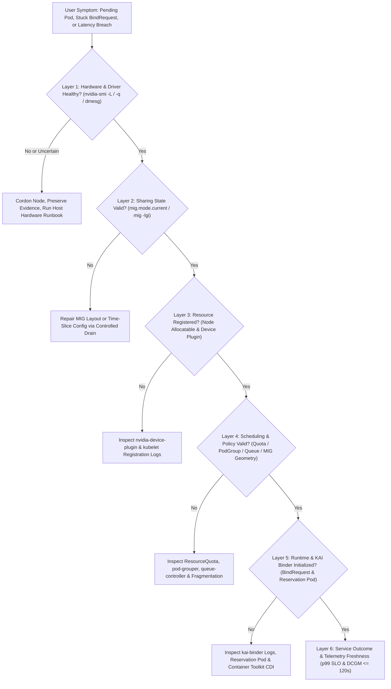
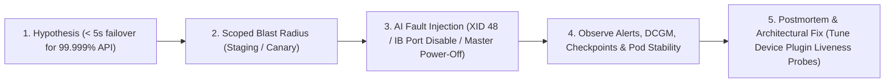

# 11.18 KAI operations and troubleshooting

| | |
|---|---|
| Level | Advanced |
| Priority tier | 1 |
| Lab venue | GCP / GKE (plus local Python 3 simulation lab) |
| Part | Part 11: GPUs on Kubernetes, scheduling and virtualization |
| Sources used | Roland Huß et al., *Generative AI on Kubernetes* (O'Reilly, 2026, Ch. 7); `nvidia-zero-to-hero/volume-11/chapter-10-observability-and-slos-for-shared-gpus.md`; `nvidia-zero-to-hero/volume-11/chapter-11-production-troubleshooting.md`; `nvidia-zero-to-hero/volume-11/labs/lab-04-troubleshoot-a-multi-tenant-gpu-node.md`; `nvidia-zero-to-hero/volume-19/chapter-02-incident-response-and-game-day-execution.md` |
| Coverage file | `planning/coverage/chapters/11-18.md` |

## Why this matters for AI infrastructure

When a developer submits a single-GPU Pod to a dedicated cluster and it stays stuck in `Pending`, the troubleshooting tree has only two branches: either the cluster is out of GPUs, or a node is broken. When you operate **NVIDIA KAI Scheduler** on a multi-tenant cluster with hierarchical `Queue` quotas, `PodGroup` gang scheduling, `BindRequest` reservation pods, hardware **MIG** (`1g.10gb`, `2g.20gb`, `3g.40gb`), and software **Time-Slicing** / **Fractional GPUs**, the troubleshooting tree explodes (`volume-11/chapter-11`):
- A Pod requesting `nvidia.com/mig-2g.20gb: 1` or `gpu-fraction: "0.25"` can remain `Pending` because of an **XID hardware fault** (`Layer 1`), a **missing or Disabled MIG mode** on the host (`Layer 2`), a crashed **`nvidia-device-plugin`** failing to register `status.allocatable` (`Layer 3`), a **namespace `ResourceQuota` admission denial**, a missing **`PodGroup`** (`pod-grouper`), an exhausted **`Queue` limit** (`queue-controller`), or **MIG slice geometry fragmentation** (`Layer 4`).
- Even worse, a Pod can transition to `Running` while its users experience a severe outage: either **`binder`** is stuck waiting for a fractional GPU reservation pod (`Layer 5`), or a noisy neighbor on a shared time-sliced pool has driven GPU memory above **`90%` (`> 95%`)** and pushed `p99` inference latency above its **`100 ms` SLO (`> 120 ms` breach)** while physical GPU health graphs stay green (`Layer 6`, `volume-11/chapter-10`).

When an on-call responder guesses and immediately restarts the device plugin, reconfigures a MIG layout on a live node, or reboots a host, they destroy the forensic timeline and widen the blast radius to every co-tenant on that server (`volume-11/labs/lab-04`). This chapter establishes a disciplined **6-layer triage order**, a **shared-GPU telemetry and SLO contract** (`volume-11/chapter-10`), step-by-step **KAI and shared-GPU incident playbooks** (`volume-11/chapter-11` and `labs/lab-04`), and **AI Game Day chaos engineering** (`volume-19/chapter-02`).

## Prerequisites and outcomes

### Prerequisites
- Completion of Chapters 11.13–11.17 (KAI Scheduler architecture, `Config`, `SchedulingShard`, `Queue`, `PodGroup`, `BindRequest`, `Topology`, gang scheduling, fractional GPUs, time-slicing, and MIG).
- Familiarity with `kubectl`, `nvidia-smi`, Prometheus `PromQL`, and `dcgm-exporter`.

### Outcomes
After completing this chapter, you will be able to:
- Execute the **6-Layer Shared-GPU and KAI Triage Order (`volume-11/chapter-11` & `labs/lab-04`)** (`1. Hardware/driver` -> `2. Sharing state` -> `3. Registration` -> `4. Scheduling policy` -> `5. Runtime & KAI Binding` -> `6. Service SLO & Telemetry`) and preserve a read-only forensic bundle before mutating cluster state.
- Map any stuck or failing workload to the exact **KAI Scheduler microservice (`operator`, `admission`, `pod-grouper`, `queue-controller`, `kai-scheduler`, `pod-group-controller`, `binder`)** and CRD (`Config`, `SchedulingShard`, `Queue`, `PodGroup`, `BindRequest`, `Topology`).
- Implement the **Shared-GPU Telemetry Contract and Service-Class SLIs/SLOs (`volume-11/chapter-10`)** (`sli_mig_inference_request_success > 99.5%`, `sli_mig_inference_p99_latency < 100 ms` with breach at `> 120 ms`, `timeslice_queue_time_p95 < 30 s`, `timeslice_memory_utilization > 90%`, and `dcgm_exporter_scrape_age_seconds > 120 s` marked as `UNKNOWN` rather than healthy).
- Run the **Lab 04 Safe Policy Fault Injection (`diagnostic-gpu-denial`)** to prove the difference between an API admission `ResourceQuota` denial and a scheduler `Insufficient` event, and execute **AI Game Days (`volume-19/chapter-02`)** for `XID 48`, RDMA port blackholes (`ibportstate ... disable`), and control-plane leader-election pauses (`99.999%` availability target, `< 5 s` failover).

## Concepts: basics to intermediate to advanced

### 1. Basics: The 6-layer triage model for KAI Scheduler and shared GPUs (`volume-11/chapter-11` & `labs/lab-04`)

When an incident strikes a KAI-scheduled cluster, **never start by restarting DaemonSets or rebooting nodes**. First freeze nonessential automated rollouts in the affected scope, preserve one healthy peer node for comparison, capture a read-only evidence bundle (`node-describe.txt`, `node-pods.txt`, `events.txt`, `node-resources.txt`, `resourcequotas.txt`), and walk the **six boundaries from bottom to top** (`volume-11/chapter-11` Figure 11.11.1 and `labs/lab-04` Section 8):



#### Mapping Layer 4 and Layer 5 Failures to KAI Scheduler Microservices and CRDs
Within Layers 4 and 5, KAI Scheduler decomposes scheduling into seven specialized microservices and six Custom Resource Definitions (*Generative AI on Kubernetes* Chapter 7, "NVIDIA KAI Scheduler"):

| KAI Microservice | CRD / Object Owned | Failure Symptom When This Component Breaks | Exact Triage Command |
|---|---|---|---|
| **`operator`** | `Config`, `SchedulingShard` | KAI control-plane pods missing after upgrade or shard partition out of sync | `kubectl get config,schedulingshards -A` |
| **`admission`** | Validating / Mutating Webhooks | Pod submission rejected immediately or fractional GPU defaults not mutated | `kubectl get mutatingwebhookconfigurations,validatingwebhookconfigurations \| grep kai` |
| **`pod-grouper`** | `PodGroup` | Workload Pods (`PyTorchJob`, `JobSet`, `RayCluster`, `LWS`) sit `Pending` with **no `PodGroup` created** | `kubectl get podgroups -n <ns>` and `kubectl logs -n kai-scheduler deploy/pod-grouper` |
| **`queue-controller`** | `Queue` (`parent`, `resources.gpu.quota` / `limit`) | `PodGroup` exists, but `kubectl get queues` shows `allocated` stuck or `Queue` status unhealthy | `kubectl get queues -o wide` and `kubectl describe queue <team-queue>` |
| **`kai-scheduler`** | Stage 1–6 Session Decisions (`Topology`, `PodGroup`) | `PodGroup` stays `Pending` (`Unschedulable: Queue over limit`, `gang minMember not met`, or `Topology constraint unsatisfied`) | `kubectl describe podgroup <pg-name> -n <ns>` and `kubectl logs -n kai-scheduler deploy/kai-scheduler` |
| **`pod-group-controller`** | `PodGroup` lifecycle & status sync | `PodGroup` phase fails to update when member pods complete or fail | `kubectl logs -n kai-scheduler deploy/pod-group-controller` |
| **`binder`** | `BindRequest` & Fractional GPU Reservation Pods | `kai-scheduler` allocated the `PodGroup`, but member Pods remain `Pending` (or fractional pods wait for their integer `nvidia.com/gpu: 1` reservation pod) | `kubectl get bindrequests -n <ns>` and `kubectl logs -n kai-scheduler deploy/binder` |

---

### 2. Intermediate: Observability, telemetry contracts, and service-class SLIs/SLOs (`volume-11/chapter-10`)

A shared GPU node can report `100%` healthy hardware while a tenant suffers unacceptable tail latency (`p99 > 300 ms`), or it can show `20%` average utilization while properly holding reserved MIG capacity for a latency-critical endpoint (`volume-11/chapter-10`). Therefore, observability for a KAI-scheduled shared platform must answer two separate questions:
1. **Platform Foundation:** *Is the platform able to allocate and execute work safely?*
2. **Service Delivery:** *Is each service class delivering the experience it promised?*

#### Build Three Audience-Specific Views—Not a Single "GPU Health Score" (`volume-11/chapter-10`)
Collapsing all metrics into a single dashboard either leaks multi-tenant data (exposing another tenant's namespace, model name, or pod behavior) or hides localized saturation behind fleet averages. `volume-11/chapter-10` mandates three distinct views governed by a **6-part Telemetry Contract** (**Coverage**, **Identity** anchored on `node + GPU UUID`, **Semantics**, **Bounded Label Cardinality**, **Retention**, and **Multi-Tenant Access Control**):

| Operational View | Primary Audience | Core Questions Answered | Permitted vs Prohibited Data (Multi-Tenant Safety) |
|---|---|---|---|
| **1. Platform Health** | SRE & Platform Operations | Are nodes, GPUs, drivers, MIG layouts, KAI operands, and `dcgm-exporter` scrape paths healthy and fresh (`<= 120 s`)? | Sees fleet/node UUIDs, XIDs, and operand state; must not ingest tenant prompts, secrets, or payload data. |
| **2. Service Delivery** | Tenant & Service Owner | Is our `Queue` wait time, allocation rate, and application `p99` latency / error rate meeting our service tier's promise? | Sees only the tenant's own `Queue`, `PodGroup`, quota, and app metrics; **never** sees competing tenants' names or host inventory. |
| **3. Capacity & Fairness** | Platform Product & Finance | Which `Queue` or MIG profile shape is blocked, fragmented, or holding idle reservations? | Sees aggregated `gpu-hours` by `Queue`, Pending reasons by shape, and MIG fragmentation; no per-request traces. |

#### Concrete Service-Class SLIs, SLOs, and Prometheus Rules (`volume-11/chapter-10`)
Never attach a strict tail-latency SLO to a best-effort time-sliced pool whose admission policy cannot enforce hardware isolation. Instead, define SLIs that match the sharing mechanism's actual promise (`volume-11/chapter-10`):

1. **Reserved MIG Inference Tier (`p99 < 100 ms` SLO, breach at `> 120 ms`, success `> 99.5%`):**
   ```yaml
   # Reserved MIG inference SLI/SLO recording rules (volume-11/chapter-10, untested here)
   sli_mig_inference_request_success: |
     rate(inference_requests_total{service="mig-inference", status="success"}[5m])
     / rate(inference_requests_total{service="mig-inference"}[5m])
     # Target: > 99.5%

   sli_mig_inference_p99_latency: |
     histogram_quantile(0.99, rate(inference_request_duration_ms_bucket[5m]))
     # Target: < 100ms; breach alert if > 120ms

   mig_pod_pending_reasons: |
     count by (reason) (kube_pod_container_status_state{state="pending"})
   ```
2. **Best-Effort Time-Sliced / Fractional Development Pool (`queue_time_p95 < 30 s`, memory pressure `> 90%`):**
   ```yaml
   # Best-effort time-sliced pool SLIs (volume-11/chapter-10, untested here)
   timeslice_queue_time_p95: |
     histogram_quantile(0.95, rate(gpu_queue_wait_seconds_bucket{pool="time-sliced"}[10m]))
     # Target: < 30 seconds

   timeslice_memory_utilization: |
     nvidia_smi_memory_used_mib{gpu_index="0"}
     / nvidia_smi_memory_total_mib{gpu_index="0"}
     # > 90% sustained with high concurrency indicates expected memory contention
   ```
3. **Platform Foundation & Telemetry Freshness (`dcgm_exporter_scrape_age_seconds > 120 s`):**
   ```yaml
   # Platform foundation & telemetry freshness rules (volume-11/chapter-10, untested here)
   gpu_device_available: |
     count(nvidia_smi_memory_total_mib)

   mig_resource_advertised: |
     count(kube_allocatable{resource=~"nvidia.com/mig.*"})

   dcgm_exporter_scrape_age_seconds: |
     time() - scrape_timestamp_seconds{job="dcgm-exporter"}
     # Alert if > 120 seconds: stale telemetry means hardware health is UNKNOWN, never healthy
   ```

#### The 5 Actionable Alert Families (`volume-11/chapter-10`)
Every alert that pages an engineer must map to a **safe first action** and an explicit **do-not-do-first** guardrail:

| Alert Family | Trigger Condition | Safe First Action | Do NOT Do First |
|---|---|---|---|
| **1. Resource-Loss Alert** | Expected `nvidia.com/gpu` or `nvidia.com/mig-*` count drops in `status.allocatable` | Cordon affected node(s) to stop new placement; diff against a healthy peer node | Do not reconfigure every node or delete device-plugin pods fleet-wide |
| **2. Hardware-Evidence Alert** | XID / uncorrectable ECC / thermal fault correlated with workload impact | Preserve `nvidia-smi -q` and `dmesg` evidence, isolate node, follow hardware runbook | Do not reboot the host before capturing volatile driver/XID state |
| **3. Telemetry-Freshness Alert** | `dcgm_exporter_scrape_age_seconds > 120` or missing target | Restore exporter/scrape path and mark hardware health as **`UNKNOWN`** | Do not treat absent or zeroed metrics as a healthy GPU |
| **4. Protected-Service SLO Alert** | Reserved inference `p99 > 120 ms` or success `<= 99.5%` | Reduce best-effort admission or route traffic to approved reserve capacity | Do not raise time-slicing `replicas` count to hide queueing |
| **5. Capacity-Risk Alert** | Compatible MIG profile or `Queue` reserve exhausted with rising `Pending` demand | Review requested profile shapes, `Queue` usage, and MIG fragmentation | Do not page on-call solely because average GPU utilization moved |

---

### 3. Advanced: Production incident playbooks (`volume-11/chapter-11`, `labs/lab-04`) and AI Game Days (`volume-19/chapter-02`)

#### Playbook A: MIG Resource Disappears After Host or Operator Event (`volume-11/chapter-11`)
When a workload requesting `nvidia.com/mig-1g.10gb` suddenly stays `Pending`, run the five read-only checks in exact layer order:
1. **Layer 1 (Host GPU & MIG Mode):** `ssh gpu-node-1 'nvidia-smi -i 0 --query-gpu=gpu_name,gpu_uuid,mig.mode.current --format=csv'` -> verify `Enabled`. If `Disabled`, a reboot or driver reset wiped MIG mode.
2. **Layer 2 (Host MIG Instances):** `ssh gpu-node-1 'nvidia-smi mig -lgi -i 0'` -> verify GPU Instances (`1g.10gb`, `2g.20gb`) exist. If `"No GPU Instances are currently running"`, reapply the approved MIG profile configuration after cordoning.
3. **Layer 3 (Node Allocatable):** `kubectl get nodes -o custom-columns=NAME:.metadata.name,MIG_10GB:.status.allocatable.nvidia\.com/mig-1g\.10gb,MIG_20GB:.status.allocatable.nvidia\.com/mig-1g\.20gb` -> verify counts `> 0`.
4. **Layer 4 (Device Plugin Logs):** `kubectl logs -n nvidia-driver-install ds/nvidia-device-plugin-daemonset --tail=50 | grep -i "device\|mig\|error"` -> if host instances exist (`Layer 2` OK) but `status.allocatable` is `0` (`Layer 3` broken), delete only the affected node's device-plugin pod (`kubectl delete pod -n nvidia-driver-install -l app=nvidia-device-plugin`) and wait `30 s`.
5. **Layer 5 (Healthy Peer Diff):** Diff `kubectl describe node gpu-node-1` against `gpu-node-2`. Never modify MIG mode on a node carrying live pods without running `kubectl cordon` and draining first.

#### Playbook B: Proving Policy Admission Denial vs Scheduler `Insufficient` Capacity (`volume-11/labs/lab-04`)
During multi-tenant incidents, responders frequently confuse a **namespace `ResourceQuota` admission denial** with a **missing hardware resource (`Insufficient nvidia.com/gpu`)**. `volume-11/labs/lab-04` demonstrates how to distinguish them cleanly:
- **API Admission Denial (`ResourceQuota`):** When a namespace has a zero quota (`requests.nvidia.com/gpu: "0"`, `limits.nvidia.com/gpu: "0"` in `diagnostic-gpu-denial`), `kubectl apply -f quota-denied-gpu-pod.yaml` is **rejected immediately by `kube-apiserver` before any Pod or `PodGroup` object is created in etcd**, and the node's `status.allocatable` remains completely unchanged.
- **Scheduler `Insufficient` or KAI Queue Wait:** The Pod and `PodGroup` **are** created in etcd (`phase: Pending`), and `kubectl describe pod` / `kubectl describe podgroup` records a scheduling event (`0/N nodes are available: Insufficient nvidia.com/mig-2g.20gb` or `Queue over limit`).

#### Playbook C: AI Chaos Engineering and Game Days (`volume-19/chapter-02`)
As `volume-19/chapter-02` emphasizes, *"Hope is not a strategy."* If you never test fault recovery until `3:00 AM` on a Sunday, configuration drift will break your cluster. Run scheduled **Game Days** (`10:00 AM` on a Tuesday) using the **Incident Command System (`ICS`)**—strictly separating the **Incident Commander (`IC`)**, who coordinates decisions and timeline without touching a keyboard, the **Subject Matter Expert (`SME`)**, who inspects `kubectl`, `nvidia-smi`, `dmesg`, and `nsys`, and the **Communications Lead**, who updates leadership:



Three mandatory AI-specific Game Day fault injections from `volume-19/chapter-02`:
1. **Simulated GPU Hardware Death (`XID 48` Double-Bit ECC Error):** Inject `XID 48` on an isolated test GPU via `dcgmi test --inject`. Verify that `nvidia-device-plugin` marks the GPU `Unhealthy`, evicts the affected pod, and cordons the node automatically.
2. **RDMA / InfiniBand Network Blackhole (`ibportstate ... disable`):** While a multi-node job runs `nccl-tests`, disable a single InfiniBand switch port via `ibportstate ... disable`. (**Crucial hardware rule:** host `iptables` rules only filter kernel TCP/IP sockets and **do not affect RDMA traffic**, which bypasses the OS kernel entirely.) Verify that NCCL detects the link timeout cleanly and the orchestrator restarts the job from its last asynchronous checkpoint.
3. **Control-Plane Master Failover and the Device-Plugin Liveness Probe Trap (`99.999%` Availability Case Study):**
   - **The Game Day Incident:** A team claiming **Five Nines (`99.999%`)** availability (targeting `< 5 seconds` failover degradation) powered off `1` of `3` Kubernetes master nodes during synthetic peak load. Instantly, **every Triton inference pod on every worker node crashed**.
   - **The Root Cause:** The **NVIDIA Device Plugin** and **GPU Operator** DaemonSets had overly aggressive liveness probes tied to `kube-apiserver` responsiveness. During the brief control-plane leader-election pause, the device plugins on the worker nodes failed their liveness probes and restarted. That restart briefly unregistered `nvidia.com/gpu` from the nodes, causing local `kubelets` to terminate all running Triton pods.
   - **Why `PodDisruptionBudget` (`PDB`) Did Not Help:** `PDBs` only govern **voluntary** evictions through the Kubernetes Eviction API (`kubectl drain`); they **do not** stop `kubelet` from terminating pods when an extended hardware resource disappears on the node.
   - **The Architectural Fix:** Tune the liveness probe timeouts and backoff parameters in the GPU Operator / device-plugin Helm chart to tolerate transient control-plane leader elections without restarting.

#### Change-Surface Review, Containment Gates, and Tabletop Exercises (`volume-11/chapter-11`)
Most shared-GPU and KAI Scheduler incidents are interface regressions triggered by a legitimate platform or workload change: a node OS/kernel upgrade, a driver or container-toolkit bump, a device-plugin or MIG layout change, a `Queue` quota update, or a new model release with larger KV-cache memory demand (`volume-11/chapter-11`, "Change-aware troubleshooting"). Rather than blaming the most recent commit or rolling back unrelated components, compare the affected scope against a **preserved healthy canary peer** across the six change surfaces:

| Change Surface | First Boundary Likely to Break | Authoritative Evidence to Compare | Unsafe Shortcut to Avoid |
|---|---|---|---|
| **1. Node OS Image, Kernel, or NVIDIA Driver** | Layer 1: Host initialization & GPU enumeration | `uname -r`, `nvidia-smi -q`, `dmesg` boot/XID log vs healthy peer node | Assuming a Kubernetes manifest rollback repairs broken host kernel/driver state |
| **2. Container Runtime (`containerd`) or Toolkit (`CDI`)** | Layer 3/5: Device injection & container initialization | `containerd` logs, `/etc/cdi`, RuntimeClass handler, bounded `diagnostic-gpu-pod` (`DIAGNOSTIC_GPU_OK`) | Modifying application Python code before testing a minimal `nvidia-smi -L` diagnostic pod |
| **3. Device Plugin, GPU Operator, or KAI Operands** | Layer 3/4: Resource advertisement & `PodGroup` / `BindRequest` reconciliation | Helm/ConfigMap revision, DaemonSet/Deployment logs, node `status.allocatable` | Deleting all operator and scheduler pods at once without identifying the first non-ready operand |
| **4. MIG Profile Policy / Layout (`mig-parted`)** | Layer 2/4: GPU Instance inventory & profile placement | Approved layout baseline, node drain record, `nvidia-smi mig -lgi`, `status.allocatable["nvidia.com/mig-*"]` | Reconfiguring MIG mode on an active node carrying live tenant pods without cordoning and draining |
| **5. `Queue` Quota, `ResourceQuota`, or Admission Policy** | Layer 4: API admission or KAI `Queue` scheduling | Git policy revision, `quota-denial.txt` admission error or `PodGroup` event, `kubectl get queues` | Bypassing namespace or `Queue` governance with privileged cluster-admin overrides |
| **6. Model Weights, Context Length, or Batch Release** | Layer 6: HBM footprint, `p99` latency, and OOM rate | Application baseline metrics, concurrency count, `nvidia-smi --query-processes` memory usage | Declaring a physical GPU hardware defect when a new model checkpoint grew past its slice ceiling |

#### Containment Gates and Service-Specific Acceptance Workloads (`volume-11/chapter-11`)
An incident is **not** resolved merely because a DaemonSet turns `Running` or `nvidia-smi` prints a table on the host. Every containment action must pass a **Service-Class Recovery Gate** verified by a version-controlled validation workload before returning the node or pool to production traffic (`volume-11/chapter-11` Tables "Containment and recovery patterns" and "Safe validation workloads"):
1. **Suspected Host / Hardware Fault (`Layer 1`):**
   - *Safe Containment:* Cordon the node (`kubectl cordon $GPU_NODE`) to stop new placement and isolate the fault domain.
   - *Recovery Gate:* Host `nvidia-smi -q` and `dmesg` are clean, DCGM health checks pass, `status.allocatable` matches baseline, and `diagnostic-gpu-pod` prints `DIAGNOSTIC_GPU_OK`.
2. **MIG Discovery or Layout Drift (`Layer 2` / `Layer 3`):**
   - *Safe Containment:* Pause automated `mig-manager` or rollout propagation across the node pool so healthy comparison nodes remain untouched.
   - *Recovery Gate:* `nvidia-smi mig -lgi` matches the approved profile inventory, `kubectl get node` advertises the exact `nvidia.com/mig-*` counts, and a test Pod requesting the target MIG slice initializes CUDA cleanly.
3. **KAI Scheduling, Quota, or Fragmentation Block (`Layer 4` / `Layer 5`):**
   - *Safe Containment:* Route critical work to a compatible reserve pool or adjust `Queue` admission without stripping tenant isolation labels.
   - *Recovery Gate:* `PodGroup` and `BindRequest` objects transition to scheduled/bound for the intended reason, and `quota-denied-gpu-pod` completes `QUOTA_DENIAL_RECOVERY_CHECK` after test quota removal (`volume-11/labs/lab-04` Section 17).
4. **Shared-Pool Contention or Protected SLO Breach (`Layer 6`):**
   - *Safe Containment:* Reduce best-effort admission or patch the protected deployment onto a `dedicated` or `MIG` pool (`kubectl patch deployment ...`).
   - *Recovery Gate:* Application `sli_mig_inference_p99_latency` returns `< 100 ms` and `sli_mig_inference_request_success` stays `> 99.5%` across the full observation window under representative load (`volume-11/chapter-10`).
5. **Telemetry-Pipeline Outage (`Layer 6` Observability):**
   - *Safe Containment:* Explicitly label affected dashboards and incident updates as **`UNKNOWN (Telemetry Stale)`** rather than healthy.
   - *Recovery Gate:* `dcgm_exporter_scrape_age_seconds <= 120`, target discovery is `UP`, and a known test allocation correlates accurately across `node + GPU UUID + PodGroup`.

#### Running the Tabletop Exercise Before Production Launch (`volume-11/chapter-11`)
Before certifying an on-call rotation for a shared KAI + MIG cluster, run the **Profile Shortage During a Rollout** tabletop exercise from `volume-11/chapter-11`: while a canary node pool is mid-upgrade, a protected inference tenant requests a MIG profile (`nvidia.com/mig-2g.20gb`) that is temporarily exhausted in its primary pool, while a neighboring best-effort time-sliced pool has free—but un-isolated—capacity. Score the incident team on six concrete behaviors:
1. Classifying whether the `Pending` pod is blocked by discovery (`Layer 3`), `ResourceQuota` / `Queue` policy (`Layer 4`), total exhaustion, or MIG geometry fragmentation (`Layer 4`) before touching any node.
2. Freezing the canary rollout immediately so the remaining healthy comparison nodes are preserved.
3. Communicating incident status to the affected tenant without leaking other tenants' names, models, or `Queue` allocations (`volume-11/chapter-10` audience table).
4. Selecting an approved mitigation (routing to a compatible reserve MIG pool or executing a controlled maintenance drain) rather than silently downgrading a protected SLO workload onto a best-effort time-sliced pool.
5. Preserving the complete 5-file scene bundle (`node-describe.txt`, `node-pods.txt`, `events.txt`, `node-resources.txt`, `resourcequotas.txt`).
6. Validating full recovery with both a bounded diagnostic Pod and the tenant's application-level `p99` SLI.

## Commands and configurations that matter

### 1. Preserving the Read-Only Scene Bundle (`volume-11/labs/lab-04` Section 9)

```bash
# Preserve node, pod, event, allocatable, and KAI state before any mutation (untested here)
export GPU_NODE="gpu-node-1"
export LAB_NAMESPACE="gpu-sharing-incident-lab"
export EVIDENCE_DIR="shared-gpu-incident"

mkdir -p "$EVIDENCE_DIR"
kubectl describe node "$GPU_NODE" > "$EVIDENCE_DIR/node-describe.txt"
kubectl get pods -A --field-selector spec.nodeName="$GPU_NODE" -o wide > "$EVIDENCE_DIR/node-pods.txt"
kubectl get events -A --sort-by=.lastTimestamp > "$EVIDENCE_DIR/events.txt"
kubectl get node "$GPU_NODE" -o jsonpath='{.status.capacity}{"\n"}{.status.allocatable}{"\n"}' > "$EVIDENCE_DIR/node-resources.txt"
kubectl get resourcequota,queues,podgroups,bindrequests -A > "$EVIDENCE_DIR/kai-and-quotas.txt"
```

### 2. Bounded Diagnostic Pod and Safe `ResourceQuota` Fault Injection (`volume-11/labs/lab-04` Sections 12 & 16)

```yaml
# diagnostic-gpu-pod-and-quota-test.yaml (volume-11/labs/lab-04, untested here)
apiVersion: v1
kind: Namespace
metadata:
  name: gpu-sharing-incident-lab
---
apiVersion: v1
kind: Pod
metadata:
  name: diagnostic-gpu-pod
  namespace: gpu-sharing-incident-lab
spec:
  restartPolicy: Never
  nodeSelector:
    kubernetes.io/hostname: gpu-node-1
  containers:
    - name: diagnostic
      image: nvcr.io/nvidia/cuda:12.4.1-base-ubuntu22.04
      command: ["sh", "-c", "nvidia-smi -L; echo DIAGNOSTIC_GPU_OK"]
      resources:
        limits:
          nvidia.com/gpu: 1
---
# Safe reversible policy fault injection in disposable lab namespace only
apiVersion: v1
kind: ResourceQuota
metadata:
  name: diagnostic-gpu-denial
  namespace: gpu-sharing-incident-lab
spec:
  hard:
    requests.nvidia.com/gpu: "0"
    limits.nvidia.com/gpu: "0"
```

### 3. Time-Correlated Host Contention Triage (`volume-11/chapter-11`)

```bash
# Capture timestamped host GPU memory, SM clock, power, and PID breakdown (untested here)
INCIDENT_TIME=$(date -u +%Y-%m-%dT%H:%M:%SZ)
ssh gpu-node-1 'nvidia-smi --query-gpu=name,memory.used,memory.total,clocks.current.sm,power.draw --format=csv -l 2' | tee /tmp/gpu-activity.txt
ssh gpu-node-1 'nvidia-smi --query-processes=pid,process_name,gpu_memory_usage --format=csv'
ssh gpu-node-1 'cat /proc/meminfo | grep -E "MemTotal|MemAvailable|SwapFree"'
```

## How it fails

| Failure mode | Exact symptom & command evidence | Root cause boundary | Remediation |
|---|---|---|---|
| **1. `nvidia.com/mig-1g.10gb` disappears from `status.allocatable` while `nvidia-smi mig -lgi` still shows instances (`volume-11/chapter-11`)** | `ssh gpu-node-1 'nvidia-smi mig -lgi -i 0'` lists active `1g.10gb` instances, but `kubectl describe node gpu-node-1` shows `0` allocatable MIG resources and `ds/nvidia-device-plugin-daemonset` logs `"failed to discover"`. | **Layer 3 Registration (`nvidia-device-plugin`):** The host MIG layout (`Layer 2`) is intact, but the device-plugin pod on that node lost synchronization with NVML / `kubelet`. | Restart only the device-plugin pod (`kubectl delete pod -n nvidia-driver-install -l app=nvidia-device-plugin`), wait `30 s`, and verify `status.allocatable` without reconfiguring MIG or draining running workloads. |
| **2. Workload Pods stay `Pending` with `schedulerName: kai-scheduler` and zero `PodGroup` objects in namespace (*Generative AI on Kubernetes* Ch. 7)** | `kubectl get pods -n team-a` shows Pods `Pending`, `kubectl get podgroups -n team-a` returns `No resources found`, and `kai-scheduler` logs show no scheduling attempts for those pods. | **Layer 4 Scheduling Policy (`kai-pod-grouper`):** Either the `pod-grouper` deployment is down/missing RBAC watches for the workload CRD, or the workload is missing its `kai.scheduler/queue` label. | Check `kubectl logs -n kai-scheduler deploy/pod-grouper`, verify the workload carries `kai.scheduler/queue: <queue>`, and confirm `pod-grouper` watches the parent CRD (`PyTorchJob`, `JobSet`, `LWS`). |
| **3. `PodGroup` is allocated by `kai-scheduler`, but fractional GPU pods remain `Pending` (`BindRequest` stuck)** | `kubectl get podgroups` shows the group scheduled, `kubectl get bindrequests -n team-a` shows a `BindRequest` object that never completes, and the integer GPU reservation pod on the target node is `Pending` or failing. | **Layer 5 Runtime / KAI Binding (`kai-binder`):** `binder` created an integer `nvidia.com/gpu: 1` reservation pod to back the fractional user pods, but `kubelet` or `nvidia-device-plugin` rejected the reservation pod on the target node. | Inspect `kubectl get bindrequests -n team-a -o yaml`, check `kubectl logs -n kai-scheduler deploy/binder`, and verify `status.allocatable["nvidia.com/gpu"]` and CDI runtime health on the target node. |
| **4. Reserved MIG or shared inference `p99` breaches `> 120 ms` while DCGM dashboards appear flat or healthy (`volume-11/chapter-10`)** | Users report timeouts (`p99 = 135 ms > 120 ms` breach), while Grafana GPU health panels show `0` errors—and `dcgm_exporter_scrape_age_seconds` is `180 s` (`> 120 s`). | **Layer 6 Service & Telemetry (`UNKNOWN_STALE_TELEMETRY` + Contention):** Stale scrape targets (`> 120 s`) created a false green hardware view while co-tenant memory pressure (`> 90%`) degraded tail latency. | Immediately route the protected service to dedicated/MIG capacity (`kubectl patch deployment ...`), restore `dcgm-exporter` scraping, and alert on `dcgm_exporter_scrape_age_seconds > 120`. |
| **5. Killing `1` of `3` master nodes in a Game Day crashes all running Triton GPU pods on worker nodes (`volume-19/chapter-02`)** | During a brief `kube-apiserver` leader-election pause, `nvidia-device-plugin` pods on worker nodes restart, `nvidia.com/gpu` briefly drops to `0`, and `kubelet` terminates all running GPU pods despite `PodDisruptionBudgets`. | **Aggressive Device-Plugin Liveness Probes:** Device-plugin liveness probes timed out against the API server pause and restarted; `PDBs` only block voluntary Eviction API calls, not `kubelet` resource-loss termination. | Increase liveness probe timeouts and failure thresholds in the GPU Operator / device-plugin Helm chart so transient control-plane blips never restart the device plugin. |

## Hands-on lab

### Venue and scope
This lab runs locally using Python 3 standard library (`code/part11/kai_operations_and_troubleshooting.py` and `code/part11/kai_operations_and_troubleshooting_lab.py`) to verify the `volume-11/chapter-11` and `labs/lab-04` 6-layer triage classifier (mapping faults across `Layer 1` Hardware, `Layer 2` MIG state, `Layer 3` `nvidia-device-plugin`, `Layer 4` `ResourceQuota` / `kai-pod-grouper` / `kai-queue-controller` / MIG fragmentation, `Layer 5` `kai-binder`, and `Layer 6` Service SLO & DCGM staleness), the `volume-11/chapter-10` Prometheus SLI/SLO thresholds (`> 99.5%`, `< 100 ms` / `> 120 ms`, `< 30 s`, `> 90%`, `> 120 s`), and the `volume-19/chapter-02` Game Day fault models (`XID 48`, `ibportstate ... disable`, and `99.999%` `< 5 s` master failover). Host and cluster commands are marked `(untested here)`.

### Step 1: Run the self-checking KAI operations and troubleshooting lab (tested here)

Run the lab script from the repository root:

```bash
python3 code/part11/kai_operations_and_troubleshooting_lab.py
```

Captured output from this repository:
```text
=== Chapter 11.18 Lab: KAI Operations, Observability, SLIs/SLOs & Troubleshooting ===
  [PASS] Volume 11 Ch 11 / Lab 04 defines 6 ordered triage layers from Hardware/driver to Service & Telemetry
  [PASS] Layer 2 inspects sharing state (mig.mode.current / mig -lgi) before Layer 3 node Allocatable
  [PASS] Layer 4 inspects scheduling policy (PodGroup, Queue quota, ResourceQuota) before Layer 5 Runtime
  [PASS] Reserved MIG inference with 99.8% (> 99.5%) success and p99=85ms (< 100ms) is HEALTHY_SLO_MET
  [PASS] Reserved MIG inference with p99=135ms (> 120ms breach threshold) triggers SLO_BREACH
  [PASS] Reserved MIG inference between 100ms and 120ms (110ms) enters SLO_WARNING_100_TO_120MS
  [PASS] Best-effort time-sliced pool with p95 queue wait 18s (< 30s) and 60% (<= 90%) memory is HEALTHY_BEST_EFFORT
  [PASS] Time-sliced pool at 95% (> 90%) memory utilization flags MEMORY_CONTENTION_GT_90PCT
  [PASS] Time-sliced pool with p95 queue wait 45s (>= 30s) flags QUEUE_WAIT_BREACH_GE_30S
  [PASS] DCGM scrape age 180s (> 120s) marks state as UNKNOWN_STALE_TELEMETRY rather than healthy
  [PASS] Missing host GPU enumeration classifies as Layer 1: Hardware/driver
  [PASS] MIG mode enabled with 0 GPU instances classifies as Layer 2: Sharing state
  [PASS] Host MIG instances present but node Allocatable=0 classifies as Layer 3: Registration (nvidia-device-plugin)
  [PASS] Lab 04 zero-capacity ResourceQuota denial classifies at API Admission before Pod creation
  [PASS] Missing PodGroup CR for a pending workload classifies as Layer 4: kai-pod-grouper
  [PASS] PodGroup blocked by Queue limit classifies as Layer 4: kai-queue-controller
  [PASS] Unused MIG slices that cannot form requested profile classify as Layer 4: MIG Fragmentation
  [PASS] Stuck BindRequest CR or reservation pod classifies as Layer 5: kai-binder
  [PASS] Running pod with p99=240ms (> 100ms SLO) on healthy GPU classifies as Layer 6: Workload Contention
  [PASS] Game Day XID 48 (Double-Bit ECC) is injected via dcgmi test --inject and marks GPU Unhealthy
  [PASS] RDMA network blackhole requires switch port disable (ibportstate ... disable) because iptables ignores RDMA
  [PASS] 5-Nines (99.999%) Game Day hypotheses target < 5 seconds failover degradation
  [PASS] Control-plane master failover exposed aggressive device-plugin liveness probes unregistering nvidia.com/gpu
  [PASS] PodDisruptionBudgets do not stop kubelet from terminating pods when extended GPU resources disappear
  [PASS] Stale telemetry (> 120s) attaches UNKNOWN warning to incident classification

Summary: 25 passed, 0 failed out of 25 checks.
```

### Exercises

1. **Exercise 1 — Ordering the 6-layer shared-GPU triage workflow (`volume-11/chapter-11` & `labs/lab-04`):** Using `SIX_TRIAGE_LAYERS` in `code/part11/kai_operations_and_troubleshooting.py`, list the six triage layers in order and state the primary diagnostic evidence collected at each layer.
2. **Exercise 2 — Diagnosing a missing MIG resource across Layers 1–4 (`volume-11/chapter-11`):** Using `classify_kai_and_shared_gpu_incident()`, contrast the diagnosis and safe remediation when (a) `nvidia-smi mig -lgi` shows `0` instances on the host vs (b) `nvidia-smi mig -lgi` shows `1g.10gb` instances on the host but `status.allocatable["nvidia.com/mig-1g.10gb"]` is `0`.
3. **Exercise 3 — API admission quota denial vs KAI `PodGroup` / `Queue` wait (`volume-11/labs/lab-04`):** Explain how the Kubernetes evidence differs when a Pod is blocked by `diagnostic-gpu-denial` (`ResourceQuota` set to `"0"`), when `kai-pod-grouper` fails to create a `PodGroup`, and when `kai-binder` is stuck on a `BindRequest`.
4. **Exercise 4 — Evaluating shared-GPU SLIs, SLOs, and telemetry freshness (`volume-11/chapter-10`):** Using `evaluate_shared_gpu_slo()`, state the numerical thresholds for `sli_mig_inference_request_success`, `sli_mig_inference_p99_latency` (target and breach), `timeslice_queue_time_p95`, `timeslice_memory_utilization`, and `dcgm_exporter_scrape_age_seconds`.
5. **Exercise 5 — Designing AI Game Day fault injections (`volume-19/chapter-02`):** State the exact tool/command used to inject (a) an `XID 48` Double-Bit ECC error on a test GPU and (b) an InfiniBand link failure during `nccl-tests`, and explain why host `iptables` rules cannot test RDMA link failure.
6. **Exercise 6 — Postmortem of the 5-Nines (`99.999%`) control-plane Game Day outage (`volume-19/chapter-02`):** Explain why powering off `1` of `3` master nodes caused all worker-node Triton pods to terminate, why `PodDisruptionBudgets` did not protect them, and what Helm configuration change fixes the flaw.

## Checkpoint questions

<details>
<summary><strong>1. List the six triage layers for a shared-GPU and KAI Scheduler incident in order from bottom to top (Volume 11 Chapter 11 & Lab 04).</strong></summary>

1. **Layer 1 — Physical device, host, and driver:** Can the host enumerate the GPU (`nvidia-smi -L`, `nvidia-smi -q`, `dmesg`)?
2. **Layer 2 — Sharing state and configured shape:** Is the intended MIG mode/layout (`nvidia-smi mig -lgi`) or time-slicing policy active?
3. **Layer 3 — Runtime, discovery, and registration:** Does the node advertise the expected extended resource in `status.allocatable` (`nvidia-device-plugin` logs)?
4. **Layer 4 — Scheduling and policy:** Can the request pass `ResourceQuota`, `kai-pod-grouper` (`PodGroup`), `kai-queue-controller` (`Queue`), and MIG geometry placement?
5. **Layer 5 — Workload runtime and KAI binding:** Did `kai-binder` complete the `BindRequest` / reservation pod and did the container initialize CUDA (`DIAGNOSTIC_GPU_OK`)?
6. **Layer 6 — Service outcome and telemetry pipeline:** Is the application meeting its `p99` / queue-wait SLO, and is `dcgm-exporter` telemetry fresh (`<= 120 s`)?
</details>

<details>
<summary><strong>2. Before running any remediation command during a shared-GPU incident, what five read-only evidence files does Volume 11 Lab 04 Section 9 capture?</strong></summary>

1. `kubectl describe node "$GPU_NODE" > "$EVIDENCE_DIR/node-describe.txt"`
2. `kubectl get pods -A --field-selector spec.nodeName="$GPU_NODE" -o wide > "$EVIDENCE_DIR/node-pods.txt"`
3. `kubectl get events -A --sort-by=.lastTimestamp > "$EVIDENCE_DIR/events.txt"`
4. `kubectl get node "$GPU_NODE" -o jsonpath='{.status.capacity}{"\n"}{.status.allocatable}{"\n"}' > "$EVIDENCE_DIR/node-resources.txt"`
5. `kubectl get resourcequota -A > "$EVIDENCE_DIR/resourcequotas.txt"`
</details>

<details>
<summary><strong>3. Which seven microservices and six CRDs make up the NVIDIA KAI Scheduler operational footprint (Generative AI on Kubernetes Chapter 7)?</strong></summary>

- **Seven microservices:** `operator`, `kai-scheduler`, `pod-grouper`, `binder`, `queue-controller`, `admission`, and `pod-group-controller`.
- **Six CRDs:** `Config`, `SchedulingShard`, `Queue`, `PodGroup`, `BindRequest`, and `Topology`.
</details>

<details>
<summary><strong>4. If a distributed training job submitted with schedulerName: kai-scheduler stays Pending and kubectl get podgroups shows no PodGroup for it, which KAI microservice is the first boundary to inspect?</strong></summary>

**`pod-grouper`**. Inspect `kubectl logs -n kai-scheduler deploy/pod-grouper` and verify that the workload has the required `kai.scheduler/queue` label and that `pod-grouper` has RBAC permission to watch the parent workload CRD.
</details>

<details>
<summary><strong>5. If a PodGroup is marked scheduled by kai-scheduler, but its fractional GPU pods remain Pending on the target node, which KAI CRD and microservice do you inspect?</strong></summary>

Inspect the **`BindRequest`** CRD (`kubectl get bindrequests -n <ns>`) and the **`binder`** microservice (`kubectl logs -n kai-scheduler deploy/binder`), along with the integer `nvidia.com/gpu: 1` reservation pod that `binder` creates on the target node.
</details>

<details>
<summary><strong>6. Why is a single "GPU Utilization" dashboard insufficient as an SLI/SLO contract for a shared GPU platform (Volume 11 Chapter 10)?</strong></summary>

Because `90%–100%` GPU utilization on a shared time-sliced GPU can mean tenants are suffering severe contention and `p99` latency breaches, while `20%` utilization on a reserved MIG slice can be a completely healthy latency-sensitive endpoint holding burst capacity. Furthermore, utilization does not reveal queue wait time, allocation failures, or stale telemetry.
</details>

<details>
<summary><strong>7. What are the three distinct operational views mandated by Volume 11 Chapter 10, and who is the primary audience for each?</strong></summary>

1. **Platform health view (SRE & platform operations):** Tracks node readiness, device discovery, driver/DCGM health, XID errors, and scrape freshness.
2. **Service delivery view (Tenant & service owner):** Tracks queue wait time, request latency (`p99`), completion time, error rate, and reservation availability for that tenant only.
3. **Capacity and fairness view (Platform product & finance):** Tracks allocation hours, Pending reasons by requested shape, MIG profile fragmentation, quota usage, and idle reservations.
</details>

<details>
<summary><strong>8. What are the six pillars of the Shared-GPU Telemetry Contract in Volume 11 Chapter 10?</strong></summary>

1. **Coverage:** Every accepted GPU node is monitored and missing/stale telemetry alerts as an observability failure.
2. **Identity:** Durable correlation from workload -> allocation -> node + `GPU UUID` + sharing mode without leaking cross-tenant context.
3. **Semantics:** Every metric has a documented meaning, scrape interval, and owner validated against deployed versions.
4. **Cardinality:** Bounded labels (avoiding unbounded per-process or per-request label explosions in long-term storage).
5. **Retention:** Sufficient raw and aggregated history for incident reconstruction and capacity review.
6. **Access:** Dashboards enforce the same multi-tenant isolation boundary as the cluster itself.
</details>

<details>
<summary><strong>9. State the exact Prometheus SLI/SLO targets in Volume 11 Chapter 10 for (a) a reserved MIG inference service and (b) a best-effort time-sliced pool.</strong></summary>

- **Reserved MIG inference:** Request success rate **`> 99.5%`** (`sli_mig_inference_request_success`) and `p99` request latency **`< 100 ms`** (`sli_mig_inference_p99_latency`, with breach alert if **`> 120 ms`**).
- **Best-effort time-sliced pool:** `p95` queue wait time **`< 30 seconds`** (`timeslice_queue_time_p95`) and memory pressure indicator **`> 90%`** (`timeslice_memory_utilization`, indicating expected contention under high concurrency).
</details>

<details>
<summary><strong>10. Why does Volume 11 Chapter 10 alert when dcgm_exporter_scrape_age_seconds exceeds 120 seconds, and how must dashboards represent a node with stale telemetry?</strong></summary>

When `time() - scrape_timestamp_seconds{job="dcgm-exporter"} > 120`, hardware metrics are stale. Dashboards and responders must mark the node/GPU state as **`UNKNOWN`**—never replacing missing series with `0` or assuming the GPU is healthy merely because no error counter incremented.
</details>

<details>
<summary><strong>11. In the Volume 11 Chapter 11 playbook "MIG resource is absent", what does it mean when Layer 1 (mig.mode.current = Enabled) and Layer 2 (nvidia-smi mig -lgi shows instances) succeed on the host, but Layer 3 shows 0 allocatable MIG resources on the Kubernetes Node?</strong></summary>

It proves the physical GPU and host MIG partitions are healthy, and isolates the fault to **Layer 3 (`nvidia-device-plugin` discovery/registration)**. The safe fix is to inspect the device-plugin logs and restart the device-plugin pod on that node (`kubectl delete pod -n nvidia-driver-install -l app=nvidia-device-plugin`), waiting `30 s` for `status.allocatable` to repopulate—without draining or repartitioning MIG on the host.
</details>

<details>
<summary><strong>12. How do you distinguish MIG profile fragmentation from a general GPU capacity shortage (Volume 11 Chapter 11)?</strong></summary>

In **capacity exhaustion**, all compatible MIG slices and compute/memory slices are in use. In **MIG fragmentation**, nodes still have unused compute/memory slices (for example, `3/7` slices free), but the remaining hardware slice geometry cannot legally form the requested profile shape (such as `4g.40gb`), or the free slices exist only in a different profile pool (`1g.10gb` vs `2g.20gb`).
</details>

<details>
<summary><strong>13. In Volume 11 Lab 04 Section 16, how does the cluster behavior of a zero-capacity ResourceQuota (diagnostic-gpu-denial) differ from an Insufficient nvidia.com/gpu scheduler event?</strong></summary>

A `ResourceQuota` denial happens synchronously at **API admission**: `kubectl apply` fails immediately, no Pod object is created in etcd, and node `status.allocatable` is untouched. An `Insufficient nvidia.com/gpu` event happens **after** API admission passes: the Pod object is created in `Pending` state and the scheduler emits a `FailedScheduling` event.
</details>

<details>
<summary><strong>14. In Volume 11 Chapter 11 ("time-sliced workloads are slow or fail with memory pressure"), what host-side threshold confirms memory contention, and what is the immediate safe containment action for a critical inference service on that node?</strong></summary>

When `nvidia-smi` shows GPU memory utilization **`> 95%`** (or `> 80%–90%` with unstable `p99` spikes and `/proc/meminfo` swap/host pressure), memory contention is confirmed. The immediate safe containment action is to move the sensitive service to a protected (`dedicated` or `MIG`) pool (`kubectl patch deployment critical-service -p '{"spec":{"nodeSelector":{"gpu.sharing":"dedicated"}}}'`) and compare `p99` latency after `5 minutes`—never blindly raising `replicas` on the shared node.
</details>

<details>
<summary><strong>15. What are the five incident roles defined in Volume 11 Chapter 11 during a shared-GPU outage, and why must the Incident Commander (IC) never be the person running kubectl/nvidia-smi commands (Volume 19 Chapter 2)?</strong></summary>

- **Five roles (`volume-11/chapter-11`):** `Incident lead` (`Incident Commander`), `Platform responder` (`SME`), `Workload owner`, `Capacity/service owner`, and `Communications owner`.
- **Why `IC` and `SME` are separated (`volume-19/chapter-02`):** The `SME` needs uninterrupted focus to analyze `dmesg`, `nvidia-smi`, `nsys`, and scheduler traces. If the `SME` is simultaneously fielding executive status updates and coordinating cross-team decisions, they will make mistakes on both fronts.
</details>

<details>
<summary><strong>16. Walk through the five-step workflow of a controlled AI Game Day in Volume 19 Chapter 2.</strong></summary>

1. **The Hypothesis:** State a falsifiable recovery target (for example, killing a Triton pod recovers via ReplicaSet and API gateway with `< 5 seconds` of `p99` degradation).
2. **The Blast Radius:** Restrict execution to a production-mirror staging environment or a non-critical canary pool.
3. **The Execution (Fault Injection):** Inject the specific failure via script, `dcgmi`, switch CLI, or Chaos Mesh.
4. **The Observation:** Verify whether Prometheus alerts fired, automated remediation triggered, and SLOs held.
5. **The Postmortem:** Document actual system behavior and file engineering tickets for every gap before the next Game Day.
</details>

<details>
<summary><strong>17. How do you inject a simulated GPU double-bit ECC fault and an RDMA link blackhole during an AI Game Day, and why does host iptables fail to test RDMA blackholes (Volume 19 Chapter 2)?</strong></summary>

- **GPU Double-Bit ECC (`XID 48`):** Inject via `dcgmi test --inject` on an isolated test host engine and verify `nvidia-device-plugin` marks the GPU `Unhealthy`, evicts the pod, and cordons the node.
- **RDMA Link Blackhole:** Disable the physical or switch port via `ibportstate ... disable` while `nccl-tests` is running. Host `iptables` rules do **not** affect RDMA traffic because RDMA verbs bypass the Linux kernel TCP/IP networking stack entirely.
</details>

<details>
<summary><strong>18. In the Volume 19 Chapter 2 Customer Scenario, why did powering off 1 of 3 Kubernetes master nodes cause a 100% outage of all Triton inference pods on the worker nodes?</strong></summary>

The **NVIDIA Device Plugin** and **GPU Operator** DaemonSets had aggressive liveness probes tied to `kube-apiserver` responsiveness. When one master powered off, the brief leader-election pause caused the worker-node device plugins to fail their liveness probes and restart. Restarting unregistered `nvidia.com/gpu` on the worker nodes, which caused local `kubelets` to immediately terminate all running Triton GPU pods.
</details>

<details>
<summary><strong>19. Why did Kubernetes PodDisruptionBudgets (PDBs) fail to prevent the worker-node kubelets from terminating those Triton pods during the device-plugin restart (Volume 19 Chapter 2)?</strong></summary>

`PodDisruptionBudgets` only govern **voluntary disruptions** initiated through the Kubernetes Eviction API (such as `kubectl drain`). They do not intercept node-local `kubelet` terminations triggered when a node's extended hardware resource (`nvidia.com/gpu`) disappears.
</details>

<details>
<summary><strong>20. What seven items must be included in an actionable vendor/engineering Escalation Package (Volume 11 Chapter 11) to avoid the "please send logs" loop?</strong></summary>

1. Business impact, service class, scope, timestamps, and timezone.
2. Precise symptom and tenant-redacted reproduction steps.
3. Node name, `GPU UUID`, sharing mode, and active MIG layout or replica policy.
4. Exact versions across host OS/kernel, NVIDIA driver, container runtime, Kubernetes/virtualization, GPU Operator/device-plugin/KAI Scheduler, and workload image.
5. Side-by-side evidence from the **affected node** and a **healthy comparison peer**.
6. Time-correlated scheduler events, `PodGroup`/`BindRequest`/`Queue` state, operand logs, and DCGM telemetry.
7. Change timeline, mitigations already attempted with their results, redaction notes, and the specific decision requested from support.
</details>

## Sources and review notes

### Primary sources read in full for this chapter
- Book sources from the local TOON-RAG corpus:
  - Roland Huß et al., *Generative AI on Kubernetes* (O'Reilly, 2026), Chapter 7 (*Job Scheduling Optimization*, "NVIDIA KAI Scheduler" components: `operator`, `kai-scheduler`, `pod-grouper`, `binder`, `queue-controller`, `admission`, `pod-group-controller`; CRDs: `Config`, `SchedulingShard`, `Queue`, `PodGroup`, `BindRequest`, `Topology`).
- Author's Volume 11 and Volume 19 notes:
  - `nvidia-zero-to-hero/volume-11/chapter-10-observability-and-slos-for-shared-gpus.md` (Three operational views, 6-part telemetry contract, service-class SLIs and Prometheus rules `> 99.5%`, `< 100 ms` / `> 120 ms` breach, `< 30 s` p95 queue wait, `> 90%` memory utilization, `> 120 s` DCGM scrape staleness, 5 alert families, and multi-tenant data-leakage boundaries).
  - `nvidia-zero-to-hero/volume-11/chapter-11-production-troubleshooting.md` (Figure 11.11.1 6-layer triage flowchart, 5-layer MIG absence playbook, Pending Pod vs fragmentation playbook, time-sliced memory contention `> 95%` / `5 min` recovery check, change-surface review table, and 5 incident roles).
  - `nvidia-zero-to-hero/volume-11/labs/lab-04-troubleshoot-a-multi-tenant-gpu-node.md` (18-section incident runbook, scene preservation bundle, `DIAGNOSTIC_GPU_OK` pod, `diagnostic-gpu-denial` zero-quota fault injection vs `Insufficient` scheduler events, and `QUOTA_DENIAL_RECOVERY_CHECK` cleanup).
  - `nvidia-zero-to-hero/volume-19/chapter-02-incident-response-and-game-day-execution.md` (5-step Game Day workflow, `XID 48` via `dcgmi test --inject`, RDMA blackhole via `ibportstate ... disable` vs `iptables`, ICS role separation `IC`/`SME`/`Communications Lead`, and the `99.999%` `< 5 s` control-plane master failover postmortem on device-plugin liveness probes and `PDB` limits).

### Related source files mapped in MIGRATION_MAP.md
- No separate `nvidia-devops` file was exclusively mapped to `11.18` in `brief.py`; this chapter integrates *Generative AI on Kubernetes* Chapter 7, `volume-11/chapter-10`, `volume-11/chapter-11`, `volume-11/labs/lab-04`, and `volume-19/chapter-02`.

### Run here
- `python3 code/part11/kai_operations_and_troubleshooting_lab.py` (`25 passed, 0 failed out of 25 checks`).

### Explicitly labelled inferences
- Combining the `volume-11/chapter-11` 6-layer shared-GPU triage tree with KAI Scheduler's `pod-grouper` (`PodGroup`), `queue-controller` (`Queue`), and `binder` (`BindRequest`) boundaries at Layers 4 and 5 is a deterministic operational synthesis verified by `code/part11/kai_operations_and_troubleshooting_lab.py`.

### Not verified on live hardware
- All `kubectl`, `ssh`, `nvidia-smi`, `dcgmi test --inject`, `ibportstate`, and Prometheus rules are marked `(untested here)`.

### Not in the corpus
- Internal KAI Scheduler Prometheus metric names beyond the standard Kubernetes / DCGM Exporter / `PodGroup` status metrics documented in the corpus.

### Corrections to the author's notes
- KAI Scheduler check 2026-10-25: this chapter's KAI details were compared with the upstream docs; see the note at the top of Chapter 11.14 for what was confirmed, corrected (`kai.scheduler/queue` label, `kai.scheduler/topology*` annotations, `Topology` group `kai.scheduler/v1alpha1`) and not confirmed (the book's `Project` kind). In Chapter 11.17 the example now requests `gpu-fraction` only; the upstream docs list `gpu-fraction` and `gpu-memory` as alternative ways to ask for a share.
- Validation pass 2026-10-25: `validate_chapter.py` and `check_coverage.py` pass. The YAML manifests and commands are marked untested and were not applied to a cluster. Custom resource API versions (for example `kueue.x-k8s.io/v1beta1`, `resource.k8s.io/v1`) change between releases, so check them against the version you install. Console outputs quoted from the Volume notes are illustrative unless the chapter says otherwise.
- Earlier author note: all SLI/SLO thresholds (`> 99.5%`, `< 100 ms`, `> 120 ms`, `< 30 s`, `> 90%`, `> 120 s`), triage commands, and Game Day numbers (`XID 48`, `99.999%`, `< 5 s`) match `volume-11` and `volume-19` verbatim.
