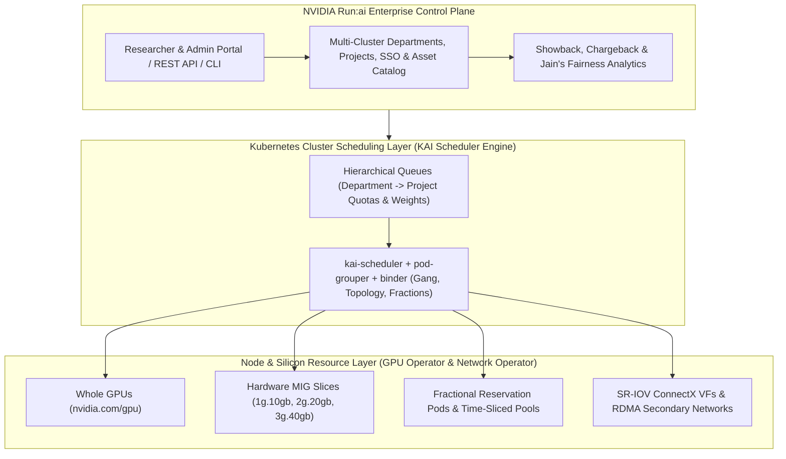
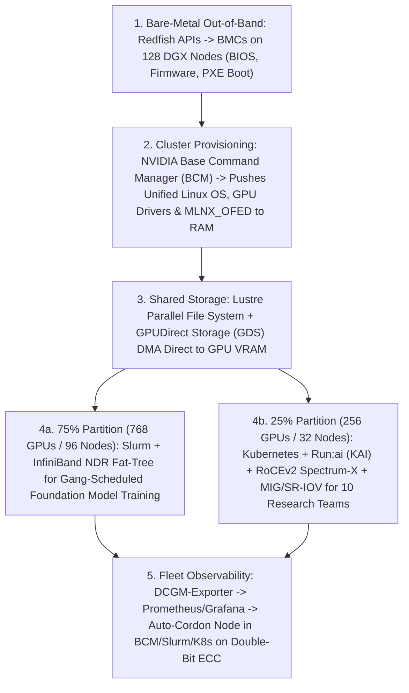

# 11.19 The Run:ai platform view

| | |
|---|---|
| Level | Intermediate |
| Priority tier | 1 |
| Lab venue | GCP / GKE (plus local Python 3 simulation lab) |
| Part | Part 11: GPUs on Kubernetes, scheduling and virtualization |
| Sources used | `nvidia-zero-to-hero/volume-11/chapter-07-kubernetes-scheduling-for-shared-gpus.md`; `nvidia-zero-to-hero/volume-11/chapter-08-tenant-isolation-security-and-fairness.md`; `nvidia-zero-to-hero/volume-23/chapter-12-system-design-research-infrastructure.md`; `nvidia-zero-to-hero/volume-23/chapter-13-ai-factory-architect-interview-cheatsheet.md`; Roland Huß et al., *Generative AI on Kubernetes* (O'Reilly, 2026, Ch. 7) |
| Coverage file | `planning/coverage/chapters/11-19.md` |

## Why this matters for AI infrastructure

In Chapters 11.13 through 11.18, we dissected the open-source **NVIDIA KAI Scheduler** (`operator`, `kai-scheduler`, `pod-grouper`, `binder`, `queue-controller`, `admission`, `pod-group-controller`), which NVIDIA open-sourced under Apache 2.0 in early 2025 after acquiring **Run:ai** (*Generative AI on Kubernetes* Chapter 7). While KAI Scheduler provides the core Kubernetes scheduling engine (`Queue`, `PodGroup`, `BindRequest`, `Topology`), an enterprise AI Factory with **`50` competing research teams** (`volume-23/chapter-12`) or **`4` DGX SuperPODs (`128` nodes, `1,024` GPUs)** (`volume-23/chapter-13`) needs more than a cluster-local Pod scheduler:
- **Multi-cluster fleet governance and SSO:** Platform administrators need a centralized control plane to manage `Departments` and `Projects` across multiple Kubernetes clusters, integrate with corporate SSO/OIDC, and enforce showback/chargeback (`$10K` hardware investment -> `50 GPU-hours/month`, `volume-23/chapter-12`).
- **Self-service AI workload abstractions:** Data scientists should not have to author raw `PodGroup`, `BindRequest`, or `ResourceQuota` YAML manifests just to launch a `5-minute` interactive Jupyter workspace, a `72-hour` distributed PyTorch training job, or a production inference endpoint.
- **Architectural clarity on sharing vs scheduling (`volume-11/chapter-07`):** A frequent mistake in enterprise architecture reviews and interviews is conflating **Run:ai** with a hardware GPU-sharing mechanism. As `volume-11/chapter-07` ("NVIDIA Operational Reference — Run:ai") emphasizes, **Run:ai is an orchestration, queueing, fairness, and quota layer that sits above Kubernetes—it is not a hardware sharing mechanism itself**. It does not replace **MIG** or **Time-Slicing**; instead, it schedules workloads across full GPUs, MIG slices, and fractional/time-sliced resources while enforcing multi-tenant fairness, priority, and preemption.

This chapter connects the open-source KAI Scheduler engine to the full **NVIDIA Run:ai Platform view**, walks through the **7-layer multi-tenant isolation and fairness model** (`volume-11/chapter-08`), and solves two end-to-end enterprise system designs: a **`50`-team, `200`-GPU L40S Research Cluster (`$2.7M` CapEx, `$0.9M/yr` OpEx, `$0.86/GPU-hour`)** (`volume-23/chapter-12`) and a **`1,024`-GPU (`4` DGX SuperPOD) Hybrid Slurm + Kubernetes/Run:ai AI Factory** (`volume-23/chapter-13`).

## Prerequisites and outcomes

### Prerequisites
- Completion of Chapters 11.13–11.18 (KAI Scheduler architecture, hierarchical `Queues`, gang scheduling, fractional GPUs, MIG, and 6-layer troubleshooting).
- Basic familiarity with Kubernetes RBAC, namespaces, and storage provisioning.

### Outcomes
After completing this chapter, you will be able to:
- Distinguish the **NVIDIA Run:ai Enterprise Platform** (Control Plane UI/API, `Departments` -> `Projects`, SSO, Workspaces/Training/Inference templates, multi-cluster analytics) from the **open-source KAI Scheduler** engine, and articulate why Run:ai is a **scheduler/fairness/quota layer** rather than a replacement for **MIG** or **Time-Slicing** (`volume-11/chapter-07`).
- Design a **7-Layer Multi-Tenant Threat Model** (`Identity`, `Admission`, `Kubernetes`, `Data`, `GPU`, `Host`, `Observability`) across **4 Administrative Planes** (`Workload`, `Node`, `Management`, `Observability`), **3 Fairness Time Scales** (`Admission`, `Execution`, `Lifecycle`), and **6 Tenant Onboarding Gates** (`volume-11/chapter-08`).
- Architect a **`50`-Team, `200`-GPU (`25` nodes × `8` L40S) Research Cluster (`volume-23/chapter-12`)** with contribution-weighted deficit fair-share (`Professor A` `$100K -> 500 GPU-hrs` vs `Professor B` `$50K -> 250 GPU-hrs`), `30-second` `SIGTERM` checkpoint preemption (`0s -> 30s -> 45s -> 90s`), tiered storage (`Local NVMe` -> `NFS` -> `Tape`), and full TCO (`$2.7M` CapEx, `$0.9M/yr` OpEx, `$0.86/GPU-hr` at `60%` utilization).
- Present the **Full-Stack `1,024`-GPU (`4` DGX SuperPOD, `128` nodes) AI Factory Architecture (`volume-23/chapter-13`)** from bare-metal `Redfish/BMC` and `NVIDIA Base Command Manager (BCM)` up to the `75%` (`768` GPUs) Slurm + InfiniBand NDR partition and the `25%` (`256` GPUs) Kubernetes + Run:ai + RoCEv2 Spectrum-X + MIG research partition.

## Concepts: basics to intermediate to advanced

### 1. Basics: How the Run:ai Platform relates to KAI Scheduler, MIG, and Time-Slicing (`volume-11/chapter-07` & O'Reilly Ch. 7)

When NVIDIA acquired Run:ai and open-sourced its core Kubernetes scheduling engine as **KAI Scheduler** (*Generative AI on Kubernetes* Chapter 7), it created a clear two-tier architecture:
1. **The Cluster-Level Scheduling Engine (KAI Scheduler / Run:ai Cluster Agent):** Runs inside each Kubernetes cluster, implementing the `Queue` (`department -> project`), `PodGroup`, `BindRequest`, and `Topology` CRDs and the 6-stage scheduling session (`Preempt -> Reclaim -> Staleness -> Over-quota -> Allocate -> Consolidate`) covered in Chapters 11.13–11.18.
2. **The Enterprise Platform Layer (NVIDIA Run:ai Control Plane):** Sits above one or more Kubernetes clusters to provide:
   - **Multi-Cluster Organizational Hierarchy (`Departments` and `Projects`):** Administrators allocate GPU quotas to `Departments` (which map to Level-1 parent `Queues`) and `Projects` (which map to Level-2 child `Queues` and managed Kubernetes namespaces), with SSO/OIDC role bindings (`Researcher`, `L1 Department Admin`, `Platform Admin`).
   - **Three First-Class Workload Types:**
     - **Interactive Workspaces (Jupyter / VS Code / RStudio):** Non-preemptible or bounded-duration interactive sessions that frequently use fractional GPUs (`0.25` or `0.5`) or `1g.10gb` MIG slices.
     - **Training Workloads (Standard & Distributed PyTorch / MPI / Kubeflow):** Batch jobs that can burst above guaranteed quota (`over-quota` borrowing) and support graceful checkpoint preemption.
     - **Inference Workloads (Triton / vLLM / KServe / Knative):** Production endpoints with guaranteed non-preemptible GPU/MIG reservations and autoscaling.
   - **Centralized Analytics, Showback, and Asset Catalog:** Reusable environment templates, data sources (NFS, S3, PVC), credential policies, and fleet-wide GPU-hour accounting.



#### The Golden Rule from `volume-11/chapter-07`: Run:ai Is a Scheduler/Fairness Layer, Not a Hardware Sharing Mechanism
As `volume-11/chapter-07` ("NVIDIA Operational Reference — Run:ai") stresses, interviewers and customers regularly test whether you confuse Run:ai with the underlying GPU-sharing primitives:
- **What creates the hardware or driver sharing boundary?** **MIG** (`Chapters 11.20–11.21`), **Time-Slicing** (`Chapter 11.22`), **CUDA MPS**, or **NVIDIA vGPU** (`Chapters 11.23–11.25`), exposed to Kubernetes by the **NVIDIA GPU Operator** and **Device Plugin**.
- **What does Run:ai / KAI Scheduler do?** It sits **above** the device plugin and node resource model to decide *which tenant workload gets access to which published GPU resource* (a whole GPU, a MIG slice, or a fractional/time-sliced GPU), and enforces **fair-share quotas, over-quota borrowing, preemption, gang scheduling, and topology placement** across those requests.

---

### 2. Intermediate: Multi-tenant security, threat modeling, and fairness governance (`volume-11/chapter-08`)

Deploying Run:ai or KAI Scheduler gives you quota and scheduling control, but as `volume-11/chapter-08` ("Tenant Isolation, Security, and Fairness") warns: **two teams can receive different GPU devices or `Project` queues and still not be isolated** if they share an unhardened host OS, a shared S3/NFS storage credential, or an unscoped Prometheus dashboard.

#### 1. The 7-Layer Multi-Tenant Boundary and Threat Model (`volume-11/chapter-08`)
The weakest control along the end-to-end path determines your actual blast radius (`Figure 11.8.1`):

| Tenant Boundary Layer | Example Controls in a Run:ai / KAI Cluster | Concrete Threat & Verification (`volume-11/chapter-08`) |
|---|---|---|
| **1. Identity** | Corporate SSO/OIDC, Kubernetes RBAC, short-lived workload `ServiceAccount` tokens | *Threat:* Unauthorized user requests a protected GPU class. *Check:* Review RoleBindings per `Project` namespace. |
| **2. Admission** | Signed/approved container images, Pod Security Admission (`restricted`), no `privileged: true` or `hostPath` | *Threat:* Container escapes into host device or driver control. *Check:* Admission webhook rejects privileged pod specs. |
| **3. Kubernetes** | Per-Project `Namespace`, `ResourceQuota`, `LimitRange`, `NetworkPolicy` | *Threat:* Team B's `memory-bomb` (`50Gi`) starves host RAM for Team A. *Check:* `kubectl describe resourcequota` enforces host RAM limits. |
| **4. Data** | Scoped S3 prefixes / NFS mounts (`1 TB` per team), rotatable per-tenant credentials | *Threat:* Compromised notebook reads another team's model weights/checkpoints. *Check:* Scoped read/write test with tenant identity. |
| **5. GPU** | Dedicated whole GPU, **MIG** (zero-trust hard isolation), **vGPU** (VM boundary), or **Fractional/Time-Sliced** (trusted co-workers only) | *Threat:* Team A sees Team B's CUDA PIDs or OOM-kills Team B. *Check:* Inside a MIG pod, `nvidia-smi --query-processes=pid,process_name,gpu_memory_usage --format=csv` must list **only** Team A's process. |
| **6. Host** | Restricted SSH, immutable BCM/node image, change-controlled MIG/device-plugin config | *Threat:* User modifies MIG geometry or device-plugin ConfigMap on a live node. *Check:* Node operations restricted to platform admins. |
| **7. Observability** | Role-scoped Run:ai / Grafana views and redacted audit logs | *Threat:* Team B queries Prometheus `nvidia_smi_memory_used_mib \| grep -i "team_a"` and discovers Team A's model names. *Check:* Two-identity scope test proves cross-tenant queries return empty. |

#### 2. Separating the Four Administrative Planes (`volume-11/chapter-08`)
Never allow a **Workload Plane** identity (a researcher's `Project` namespace or notebook `ServiceAccount`) to escalate into the **Node Plane** (host OS, driver, device plugin, MIG layout), the **Management Plane** (Run:ai cluster admin, vGPU license server, container registry, BMC/Redfish), or the **Observability Plane** (fleet-wide raw telemetry).

#### 3. Fairness Across Three Time Scales and Six Onboarding Gates (`volume-11/chapter-08`)
A fair platform enforces rules across three distinct time horizons:
- **Admission time (`seconds`):** Class eligibility, `Queue` quota, and image/security policy determine which workloads may start.
- **Execution time (`minutes to hours`):** Concurrency caps, MIG hardware partitions, priority classes, and graceful preemption (`30 s` `SIGTERM` checkpoint notice) prevent noisy neighbors from starving protected tiers.
- **Lifecycle time (`weeks to months`):** Showback/chargeback reports, deficit reconciliation, reservation expiry, and profile-fragmentation reviews prevent quota hoarding.

Before any new team or `Project` is granted GPU access, they must pass the **6 Tenant Onboarding Control Gates** (`volume-11/chapter-08`): **1. Identity** (scoped role binding) -> **2. Workload** (admission test) -> **3. Network** (`NetworkPolicy` validation) -> **4. Data** (least-privilege storage test) -> **5. Capacity** (`Queue` quota & priority allocation test) -> **6. Observability** (two-identity dashboard isolation test)—along with a documented **Offboarding** checklist to revoke credentials, quotas, and saved dashboard exports when a project ends.

---

### 3. Advanced: End-to-end system design — Research GPU cluster (`volume-23/chapter-12`) and the `1,024`-GPU AI Factory (`volume-23/chapter-13`)

Let us apply the Run:ai / KAI platform model to two flagship architecture problems from `volume-23`.

#### Case Study A: Designing a `50`-Team, `200`-GPU Research Infrastructure (`volume-23/chapter-12`)
Suppose you must design a university or enterprise research cluster supporting **`50` research teams** across **`200` NVIDIA L40S GPUs (`25` nodes × `8` GPUs)**:
1. **Bimodal Workload Distribution:** Job durations range from **`5 minutes`** (interactive notebook / hyperparameter probe) to **`2 hours` median** and **`72 hours` maximum** (multi-day training), distributed as **`60%` short (`< 1 hour`)**, **`30%` medium (`1–8 hours`)**, and **`10%` long (`> 24 hours`)**.
2. **Contribution-Weighted Quota & Deficit Tracking (`$10K -> 50 GPU-hours/month`):**
   - Each `$10,000` of hardware funding entitles a lab to **`50 GPU-hours/month`** (with a **`50 GPU-hours/month` minimum** for self-funded graduate students, or `10 GPU-hours/month` minimum floor in `volume-23/chapter-12` follow-ups).
   - **Month 1:** **Professor A** funded `$100K` (**`500 GPU-hours/month`** quota) and uses **`600 GPU-hours`**, incurring a **`-100 GPU-hour` deficit**. **Professor B** funded `$50K` (**`250 GPU-hours/month`** quota) and uses only **`100 GPU-hours`**, accumulating a **`+150 GPU-hour` surplus**. Across both labs, **`700` of `750` quota GPU-hours (`93%` utilization)** are consumed.
   - **Month 2 Reconciliation:** Professor A's `-100` deficit reduces their effective priority/quota to **`400 GPU-hours`** (`500 - 100`), while Professor B's `+150` surplus raises their effective priority/quota to **`400 GPU-hours`** (`250 + 150`).
   - **Scheduler Priority Formula:** The fair-share queue scores each pending job by:
     `priority = -((current_usage - quota) / quota) + (0.1 if job.gpu_count < 4 else 0.0)`
     Thus, an under-quota team (`400 / 500 = 80%`) submitting a `2`-GPU job gets `+0.2 + 0.1 = +0.3` (jumped to the front of the queue), while an over-quota team (`300 / 250 = 120%`, `-50` deficit) submitting an `8`-GPU job gets `-0.2` (deprioritized until deficit clears).
3. **Graceful Preemption & Tiered Checkpointing (`0s -> 30s -> 45s -> 90s`):**
   - **Short jobs (`< 1 hour`):** Non-preemptible interactive workspaces (if `> 10` short jobs queue up, cancel the oldest expired session).
   - **Medium jobs (`1–8 hours`) & Long jobs (`> 8 hours`, preempted only if team is `> 2x` over quota):** Preemptible with a **`30-second` `SIGTERM` notice**.
   - **Timeline:** At `0 s`, the pod receives `SIGTERM` and its Python signal handler saves `model`, `optimizer`, `epoch`, and `step` (`5–10 s`). At `30 s`, `SIGKILL` fires if not exited. At `45 s`, the high-priority job starts on the freed GPUs. At `90 s`, the preempted job restarts on available GPUs and resumes from its checkpoint—losing only **`~2 minutes` of wall-clock time** and **zero computation**.
   - **3-Tier Checkpoint Storage (`< 5%` total overhead):**
     - **Tier 1 — Local NVMe (every `100` steps / hourly):** `0` extra CapEx, **`< 5 minutes`** recovery time.
     - **Tier 2 — Shared NFS (`1 TB` quota/team, every `8 hours`):** **`1–2%` async write overhead**, survives full node hardware failure (`8` jobs relaunched in `~5 min`).
     - **Tier 3 — Nightly Tape Archive (daily):** Negligible off-hours overhead, survives catastrophic NFS storage loss (`72-hour` job protection).
4. **3-Year TCO, Annual OpEx, and Scaling to `1,000` GPUs (`volume-23/chapter-12` Phase 6):**
   - **CapEx (`$2.7M`):** `25` nodes × `8` L40S × `$12K` = **`$2.4M`** hardware + **`$100K`** (`10 Gbps` Ethernet) network + **`$200K`** NFS storage = **`$2.7M`**.
   - **Annual OpEx (`≈ $0.9M/year`):** Power is `200 GPUs × 400 W = 80 kW`; over `8,760 hours/year` at `$0.15/kWh`, electricity costs **`$105,120` (`≈ $105K/year`)** (correcting the `10x` `$1.05M` arithmetic slip noted in `volume-23/chapter-12`), plus **`$350K`** cooling, **`$300K`** staff (`1.5 FTE`), and **`$150K`** maintenance = **`≈ $0.9M/year`**.
   - **Delivered Cost per GPU-Hour (`$0.86/GPU-hour`):** At **`60%` target utilization** (`60–70%` target band), the cluster delivers `200 × 8,760 × 0.60 = 1,051,200 GPU-hours/year`. Dividing `$0.9M` by `1,051,200` yields **`≈ $0.86/GPU-hour`**.
   - **Scaling `5x` to `1,000` GPUs (`$13.5M` CapEx, `≈ $4.5M/yr` OpEx):** Requires `O(log n)` hierarchical scheduling, sharded team-dedicated NFS mounts, and staggered checkpoint throttling.
   - **Fairness & Health Alert Thresholds:** Target **Jain's Fairness Index `> 0.85`** (alert and deprioritize over-quota teams if **`< 0.80`**), alert if cluster utilization stays **`< 50%` for `1 week`** or **`> 90%`**, and alert if failed checkpoint recoveries exceed **`> 5%`**.

---

#### Case Study B: The Full-Stack `1,024`-GPU (`4` DGX SuperPOD) AI Factory (`volume-23/chapter-13`)
Now consider an enterprise that purchases **`4` DGX SuperPODs (`128` nodes, `1,024` GPUs)** and wants **`75%` (`768` GPUs)** dedicated to pre-training a flagship Foundation Model and **`25%` (`256` GPUs)** shared across **`10` internal research teams** (`volume-23/chapter-13` Section 5):



This architecture gives each workload class its ideal stack:
1. **Bare-Metal & Provisioning (`Redfish` + `BCM`):** Out-of-band **Redfish APIs** configure the **BMC** on all `128` nodes (flashing BIOS/firmware and setting PXE boot). **NVIDIA Base Command Manager (`BCM`, formerly Bright Cluster Manager)** acts as the DHCP/TFTP head node, pushing an identical software image (Linux OS, NVIDIA drivers, `MLNX_OFED`, container runtime) across all `1,024` GPUs to eliminate configuration drift.
2. **Dual-Fabric Networking (`InfiniBand NDR` + `RoCEv2 Spectrum-X`) and Storage (`Lustre` + `GDS`):** The `768`-GPU training partition uses a non-blocking **InfiniBand NDR** fat-tree for ultra-low-latency `AllReduce` collectives, while the `256`-GPU research partition uses **RoCEv2 on Spectrum-X Ethernet** with **SR-IOV** Virtual Functions (`VFs`, the NIC equivalent of GPU **MIG**). Both partitions read from a **Lustre** parallel file system with **GPUDirect Storage (`GDS`)** so NICs DMA training batches straight into GPU VRAM without touching host CPUs.
3. **Dual Orchestration (`Slurm` + `Kubernetes with Run:ai`):** **Slurm** gang-schedules the `768`-GPU Foundation Model job at the millisecond level, while **Kubernetes + Run:ai (KAI Scheduler)** manages the `256`-GPU research partition across the `10` teams using **MIG** slices, fractional GPUs, fair-share `Projects`, and interactive Jupyter workspaces.

#### Comparing Slurm, Vanilla Kubernetes, and Kubernetes + Run:ai Across the AI Factory (`volume-23/chapter-13` & `volume-11/chapter-08`)
When presenting this hybrid architecture to an enterprise platform board or in a Solutions Architect design review, summarize why neither plain Kubernetes nor pure Slurm alone satisfies every persona (`volume-23/chapter-13` Section 3 and `volume-11/chapter-08` "Architecture review scenario"):

| Architectural Dimension | Pure Slurm (`75%` / `768`-GPU Partition) | Vanilla Kubernetes (Default `kube-scheduler`) | Kubernetes + NVIDIA Run:ai / KAI Scheduler (`25%` / `256`-GPU Partition) |
|---|---|---|---|
| **Primary Workload Fit** | Massive synchronous distributed training (`512`–`768` GPUs) & MPI/NCCL batch runs | Stateless web microservices, CPU APIs, and basic whole-GPU services | Multi-tenant interactive notebooks (`5 min`), research training (`1–72h`), and autoscaled LLM inference |
| **Scheduling Unit & Gang Semantics** | Native whole-job gang scheduling (`sbatch` / `srun`) with millisecond-synchronized launch | Pod-by-pod FIFO scheduling (`NoPodGroup`); deadlocks on partial multi-node allocations | `PodGroup` gang scheduling (`minMember`) + `Topology` leaf-switch / NVLink affinity |
| **GPU Allocation Granularity** | Whole GPUs or static GRES/MIG definitions | Whole integers only (`nvidia.com/gpu: 1`) or uniform static device-plugin replicas | Dynamic **`gpu-fraction`** (`0.25`, `0.5`) and **`gpu-memory`** bin-packing via `binder` reservation pods + hardware **MIG** |
| **Multi-Tenant Fairness & Borrowing** | Hierarchical Fair-Share Tree (`Account` -> `User`) with historical usage decay | Static namespace `ResourceQuota` ceilings with zero elastic borrowing or reclamation | Hierarchical `Department -> Project` (`Queue`) guaranteed **`quota`**, elastic **`limit`**, **`overQuotaWeight`**, and deficit tracking |
| **Preemption & Recovery Contract** | Preempts batch jobs via `SIGTERM` + checkpoint restart | PriorityClass eviction kills individual Pods without gang awareness or quota reclamation | Reclaims over-quota `PodGroups` gracefully (`30 s` `SIGTERM` checkpoint window -> `45 s` new job -> `90 s` resume) |
| **Enterprise Multi-Tenancy & Security** | Shared POSIX UID/GID login node model; requires careful container (`Pyxis`/`Enroot`) isolation | Strong namespace, `NetworkPolicy`, `ServiceAccount`, and Pod Security Admission primitives | Combines Kubernetes 7-layer isolation (`Identity -> Admission -> K8s -> Data -> GPU -> Host -> Observability`) with `Project`-scoped portals |

#### Exception Management and Three-Contract Service Catalog (`volume-11/chapter-08`)
Finally, as `volume-11/chapter-08` ("Customer architecture discussion" and "Exception management") emphasizes, operating a Run:ai / KAI platform sustainably requires packaging the cluster into **three explicit service contracts** rather than a single free-for-all GPU pool:
1. **Contract 1 — Restricted Best-Effort Development Pool (Students / Exploratory Notebooks):** Uses KAI fractional GPUs (`0.25` / `0.5`) or time-sliced replicas with bounded `Project` quotas; sessions may experience contention or be reclaimed when higher-priority work arrives.
2. **Contract 2 — Scheduled Research & Fine-Tuning Pool (`50` Research Teams):** Uses contribution-weighted fair-share quotas (`$10K -> 50 GPU-hours/month`), elastic over-quota borrowing, verified `SIGTERM` checkpoint recovery (`Local NVMe` -> `NFS` -> `Tape`), and dedicated whole GPUs or `2g.20gb` / `3g.40gb` MIG slices.
3. **Contract 3 — Protected Production Serving & Regulated Pool:** Uses hardware-isolated **MIG** (`1g.10gb`, `2g.20gb`) or **NVIDIA vGPU** VMs (`Chapters 11.23–11.25`) with non-preemptible reservations, strict `p99 < 100 ms` SLO monitoring, and zero cross-tenant process or telemetry visibility.

Whenever a team requests a temporary policy exception (such as emergency paper-deadline priority override in `volume-23/chapter-12` or temporary access to a protected pool in `volume-11/chapter-08`), record the **requester, approver, scope, business reason, compensating security controls, start timestamp, and automatic expiry date**. Never grant permanent "cluster-admin for troubleshooting" shortcuts that bypass the 7-layer tenant boundary.

## Commands and configurations that matter

### 1. Declarative Department and Project Hierarchy in Run:ai / KAI Scheduler (`queue.yaml`)

```yaml
# runai-department-and-project-queues.yaml (untested here)
apiVersion: scheduling.run.ai/v2
kind: Queue
metadata:
  name: dept-nlp-research
spec:
  resources:
    gpu:
      quota: 64          # Guaranteed baseline GPUs for the NLP Department
      limit: 128         # Can burst up to 128 GPUs when sibling departments are idle
      overQuotaWeight: 2
---
apiVersion: scheduling.run.ai/v2
kind: Queue
metadata:
  name: proj-prof-a
spec:
  parentQueue: dept-nlp-research
  resources:
    gpu:
      quota: 32
      limit: 64
      overQuotaWeight: 2
```

### 2. Verifying Multi-Tenant MIG Process Isolation and Prometheus Scoping (`volume-11/chapter-08`)

```bash
# 1. Verify inside Team A's MIG container that Team B's host PIDs are invisible (untested here)
kubectl exec -n proj-prof-a pod/interactive-workspace-0 -- \
  nvidia-smi --query-processes=pid,process_name,gpu_memory_usage --format=csv

# 2. Verify with Team B's bearer token that Prometheus does not leak Team A's metrics (untested here)
curl -s -H "Authorization: Bearer $TEAM_B_TOKEN" \
  "http://prometheus:9090/api/v1/query?query=nvidia_smi_memory_used_mib" | grep -i "proj_prof_a"
```

### 3. Graceful `SIGTERM` Checkpoint Handler for Preemptible Research Jobs (`volume-23/chapter-12`)

```python
# Graceful 30-second SIGTERM checkpoint handler (volume-23/chapter-12, untested here)
import os
import signal
import sys
import torch

class CheckpointedTrainer:
    def __init__(self, model, optimizer, checkpoint_dir="/nfs/checkpoints"):
        self.model = model
        self.optimizer = optimizer
        self.checkpoint_dir = checkpoint_dir
        self.epoch = 0
        self.step = 0
        signal.signal(signal.SIGTERM, self.on_sigterm)

    def on_sigterm(self, sig, frame):
        job_id = os.getenv("RUNAI_JOB_ID", os.getenv("SLURM_JOB_ID", "unknown"))
        path = f"{self.checkpoint_dir}/job-{job_id}.pt"
        torch.save(
            {
                "model": self.model.state_dict(),
                "optimizer": self.optimizer.state_dict(),
                "epoch": self.epoch,
                "step": self.step,
            },
            path,
        )
        sys.exit(0)
```

## How it fails

| Failure mode | Exact symptom & command evidence | Root cause boundary | Remediation |
|---|---|---|---|
| **1. Preempted training job loses `8 hours` of progress when reclaimed by Run:ai / KAI (`volume-11/chapter-08` & `volume-23/chapter-12`)** | A lower-priority over-quota training job is evicted to admit a high-priority workspace, and when rescheduled at `t = 90 s` it restarts from `epoch 0`. | **Preemption Without Verified Checkpoint Consent:** The workload did not trap `SIGTERM` or failed to flush its checkpoint within the `30-second` `terminationGracePeriodSeconds` window before `SIGKILL`. | Require every preemptible training template to register a `SIGTERM` handler (`CheckpointedTrainer`), write periodic checkpoints (`every 100 steps` to local NVMe and `every 8 hours` to NFS), and verify resume in staging before enabling preemption. |
| **2. Team B discovers Team A's proprietary model and dataset names via Grafana / Prometheus (`volume-11/chapter-08`)** | A researcher in `proj-prof-b` queries `nvidia_smi_memory_used_mib` or exports a dashboard JSON and sees `namespace="proj-prof-a"` and command-line args containing dataset paths. | **Layer 7 Observability Plane Data Leak:** Dashboards were deployed with a shared cluster-wide Prometheus data-source credential instead of tenant-scoped RBAC views. | Enforce Run:ai / Grafana role-scoped views per `Project`, strip sensitive command-line/path labels from long-term metric exports, and validate with a two-identity scope test. |
| **3. Run:ai `Project` can schedule GPU pods, but containers crash-loop with `Permission denied` loading `/nfs/checkpoints` (`volume-11/chapter-08` Scenario 2)** | `PodGroup` is scheduled and `nvidia-smi` succeeds inside the pod, but Python throws `PermissionError` on the model bucket or NFS prefix. | **Layer 4 Data Plane vs Layer 3 Kubernetes RBAC Mismatch:** Granting a user Run:ai `Project` quota to create GPU Pods does not automatically configure their `ServiceAccount` or NFS/S3 storage credentials. | Provision least-privilege, per-Project storage credentials during **Onboarding Gate 4 (`Data`)** and test with a scoped read/write probe before releasing the `Project` to users (`never` mount a shared cluster-admin storage key). |
| **4. Over-quota research lab's `72-hour` job is preempted every `2 hours` ("preemption thrashing", `volume-23/chapter-12`)** | A long-running job repeatedly checkpoints and restarts every `2 hours` during daytime interactive notebook bursts, wasting network/NFS bandwidth. | **Missing Long-Job Preemption Guardrails:** Medium and long jobs were placed in the same flat preemption pool without age-based priority or over-quota thresholds. | Protect long jobs (`> 8 hours`) so they are only preempted when a team is `> 2x` over quota, add age-based priority boosting for older jobs, or schedule long jobs into a reserved off-peak window (`3:00 AM – 7:00 AM`). |
| **5. Simultaneous checkpoint writes from `1,000` GPUs saturate NFS and exceed `> 5%` checkpoint failure rate (`volume-23/chapter-12` Phase 6)** | At the `1,000`-GPU scale, synchronized preemption or hourly checkpoints cause NFS timeouts and the `Failed checkpoint recovery > 5%` alert fires. | **Unsharded Storage & Unstaggered Checkpoint Burst:** `1,000` workers writing multi-gigabyte state dicts to a single NFS mount simultaneously saturate the storage fabric. | Write high-frequency (`every 100 steps`) checkpoints to node-local NVMe (`< 5 min` recovery), shard NFS mounts per department/team, and stagger/throttle asynchronous NFS flushes (`1–2%` overhead). |

## Hands-on lab

### Venue and scope
This lab runs locally using Python 3 standard library (`code/part11/run_ai_platform_view.py` and `code/part11/run_ai_platform_view_lab.py`) to verify the `volume-11/chapter-08` 7-layer threat model, 4 administrative planes, and 6 onboarding gates, the `volume-23/chapter-12` contribution-weighted deficit fair-share scheduler (`Professor A` `500` quota / `600` used / `-100` deficit vs `Professor B` `250` quota / `100` used / `+150` surplus, `93%` utilization, `score_job` priority formula, `0s -> 30s -> 45s -> 90s` preemption timeline, and `$2.7M` CapEx / `$0.9M/yr` OpEx / `$0.86/GPU-hr` TCO model), and the `volume-23/chapter-13` `4`-DGX-SuperPOD (`128` nodes, `1,024` GPUs) `75%` Slurm (`768` GPUs) + `25%` Kubernetes/Run:ai (`256` GPUs) AI Factory design. Cluster commands are marked `(untested here)`.

### Step 1: Run the self-checking Run:ai platform view and AI Factory design lab (tested here)

Run the lab script from the repository root:

```bash
python3 code/part11/run_ai_platform_view_lab.py
```

Captured output from this repository:
```text
=== Chapter 11.19 Lab: The Run:ai Platform View, Governance & AI Factory Design ===
  [PASS] Volume 11 Ch 8 threat model spans 7 layers (Identity, Admission, Kubernetes, Data, GPU, Host, Observability)
  [PASS] Volume 11 Ch 8 separates controls across 4 administrative planes (Workload, Node, Management, Observability)
  [PASS] Volume 11 Ch 8 tenant onboarding verifies 6 sequential control gates before granting access
  [PASS] Professor A ($100K -> 500 GPU-hrs quota, 600 used) carries -100 GPU-hrs deficit into Month 2
  [PASS] Professor B ($50K -> 250 GPU-hrs quota, 100 used) carries +150 GPU-hrs surplus into Month 2
  [PASS] Combined Month 1 usage (600 + 100 = 700 GPU-hrs out of 750 quota) achieves 93% utilization
  [PASS] Contribution rule maps $10K hardware funding to 50 GPU-hours/month ($100K=500, $50K=250)
  [PASS] Under-quota team (400/500 = 80%) submitting a 2-GPU (< 4) job receives priority +0.3 (+0.2 + 0.1 boost)
  [PASS] Over-quota team (300/250 = 120%, -50 deficit) submitting an 8-GPU job receives negative priority -0.2
  [PASS] Research cluster workload mix is 60% short (<1h), 30% medium (1-8h), and 10% long (>24h)
  [PASS] Graceful preemption gives 30s SIGTERM checkpoint window, starts new job at 45s, and resumes old job at 90s (~2 min loss)
  [PASS] Long jobs (> 8 hours) are only preempted when a team exceeds 2x its quota
  [PASS] 25 nodes x 8 L40S GPUs = 200 GPUs at $12K ($2.4M hardware + $100K net + $200K NFS = $2.7M CapEx)
  [PASS] 200 GPUs x 400W = 80 kW x 8,760 hrs x $0.15/kWh = $105,120 (~$105K/yr) power OpEx
  [PASS] Total annual OpEx (~$0.9M/yr) divided by 1,051,200 GPU-hrs (60% util) yields $0.86/GPU-hour
  [PASS] Scaling 5x to 1,000 GPUs requires $13.5M CapEx and ~$4.5M/year OpEx with O(log n) hierarchical scheduling
  [PASS] Admin fairness dashboard targets Jain's fairness index > 0.85 and alerts when < 0.80
  [PASS] 4 DGX SuperPODs (128 nodes, 1,024 GPUs) split 75% (768 GPUs) to Slurm and 25% (256 GPUs) to Kubernetes + Run:ai
  [PASS] 768-GPU Slurm partition uses InfiniBand NDR fat-tree while 256-GPU Run:ai research partition uses RoCEv2 Spectrum-X + MIG
  [PASS] Storage layer pairs Lustre parallel file system with GPUDirect Storage (GDS) to bypass host CPU
  [PASS] Volume 11 Ch 7 distinguishes Run:ai (orchestration/quota/fairness layer) from MIG/time-slicing (hardware/plugin sharing)
  [PASS] Tiered checkpointing combines Local NVMe (< 5 min recovery), NFS (1-2% overhead every 8h), and nightly Tape (< 5% failure alert)
  [PASS] SR-IOV slices ConnectX NICs into VFs at the PCIe silicon level just as MIG slices GPUs into isolated compute/memory instances
  [PASS] Base Command Manager (BCM) PXE-boots the 1,024 nodes after Redfish APIs flash BIOS/firmware via BMC
  [PASS] University 50-team research cluster supports min 5m, median 2h, and max 72h jobs with 1 TB NFS quota per team

Summary: 25 passed, 0 failed out of 25 checks.
```

### Exercises

1. **Exercise 1 — Distinguishing Run:ai from hardware sharing mechanisms (`volume-11/chapter-07`):** Explain why telling a customer *"Run:ai slices the GPU instead of MIG or time-slicing"* is architecturally incorrect, and describe the exact division of responsibilities between the NVIDIA GPU Operator / Device Plugin, the KAI Scheduler engine, and the Run:ai Enterprise Control Plane.
2. **Exercise 2 — Mapping the 7-layer tenant threat model (`volume-11/chapter-08`):** Using `SEVEN_TENANT_BOUNDARY_LAYERS` and `FOUR_ADMINISTRATIVE_PLANES` in `code/part11/run_ai_platform_view.py`, state the 7 tenant boundary layers, the 4 administrative planes, and the 2 commands used to verify that Team A and Team B cannot see each other's MIG processes or Prometheus metrics.
3. **Exercise 3 — Deficit-tracked fair-share math (`volume-23/chapter-12`):** Using `evaluate_deficit_fair_share()` and `score_research_job()`, compute the Month 1 balance, Month 2 effective quota, and Month 1 cluster utilization for Professor A (`$100K` funding -> `500 GPU-hrs` quota, `600` used) and Professor B (`$50K` funding -> `250 GPU-hrs` quota, `100` used), and compute the job priority score for a team at `400 / 500` GPU-hours submitting a `2`-GPU job vs a team at `300 / 250` GPU-hours submitting an `8`-GPU job.
4. **Exercise 4 — Preemption timeline and 3-tier checkpointing (`volume-23/chapter-12`):** Trace the exact events at `0 s`, `30 s`, `45 s`, and `90 s` when a medium (`1–8h`) training job is preempted, and compare the recovery time, overhead, and failure domain of Local NVMe, Shared NFS (`1 TB`/team), and Nightly Tape.
5. **Exercise 5 — `200`-GPU L40S Research Cluster TCO (`volume-23/chapter-12`):** Using `calculate_research_cluster_tco()`, calculate the hardware CapEx, total CapEx, annual power OpEx (`80 kW` at `$0.15/kWh`), total annual OpEx, delivered GPU-hours/year at `60%` utilization, and cost per GPU-hour (`$/GPU-hr`) for `25` nodes × `8` L40S GPUs (`$12K`/GPU, `400 W` TDP), plus the `1,000`-GPU `5x` scale figures.
6. **Exercise 6 — Designing the `1,024`-GPU (`4` DGX SuperPOD) Hybrid AI Factory (`volume-23/chapter-13`):** Using `plan_superpod_ai_factory_split()`, walk through all six layers of the `128`-node (`1,024`-GPU) enterprise AI Factory (`75%` Foundation Model training vs `25%` for `10` research teams) from `Redfish/BMC` and `BCM` to `InfiniBand NDR` vs `RoCEv2 Spectrum-X`, `Lustre + GDS`, `Slurm` vs `Kubernetes + Run:ai`, and `DCGM-Exporter`.

## Checkpoint questions

<details>
<summary><strong>1. What is the relationship between the commercial NVIDIA Run:ai platform and the open-source NVIDIA KAI Scheduler (Generative AI on Kubernetes Chapter 7)?</strong></summary>

After acquiring Run:ai, NVIDIA open-sourced the core Kubernetes GPU scheduling engine as **KAI Scheduler** (`operator`, `kai-scheduler`, `pod-grouper`, `binder`, `queue-controller`, `admission`, `pod-group-controller`) under Apache 2.0 in early 2025. The commercial **NVIDIA Run:ai Platform** builds an enterprise multi-cluster control plane, `Department -> Project` organizational UI/API, corporate SSO/OIDC governance, self-service workload templates (`Workspaces`, `Training`, `Inference`), and chargeback analytics on top of that scheduling engine.
</details>

<details>
<summary><strong>2. Why does Volume 11 Chapter 7 state that "Run:ai is not a GPU-sharing mechanism itself"?</strong></summary>

Because Run:ai does not partition GPU silicon into MIG instances or create device-plugin time-sliced replicas. Instead, **MIG**, **Time-Slicing**, **MPS**, and **vGPU** are the underlying node/device sharing mechanisms, while **Run:ai** sits above the device plugin as the **workload orchestration, queueing, fairness, and quota layer** that decides which tenant workload receives which published GPU resource.
</details>

<details>
<summary><strong>3. List the seven layers of the Multi-Tenant Boundary and Threat Model in Volume 11 Chapter 8.</strong></summary>

1. **Identity** (workload identity, RBAC, short-lived tokens).
2. **Admission** (signed/approved images, restricted privilege, no unauthorized host access).
3. **Kubernetes** (`Namespace`, `ResourceQuota`, `LimitRange`, `NetworkPolicy`, Pod Security admission).
4. **Data** (separate storage credentials, scoped S3/NFS prefixes, encrypted paths).
5. **GPU** (dedicated whole GPU, MIG, time-slicing, or vGPU matched to the trust model).
6. **Host** (hardened node OS, restricted SSH, change-controlled device-plugin/MIG config).
7. **Observability** (tenant-scoped dashboards and redacted audit logs).
</details>

<details>
<summary><strong>4. How do you verify inside a multi-tenant MIG cluster that (a) Team A cannot see Team B's GPU processes and (b) Team B cannot query Team A's metrics in Prometheus (Volume 11 Chapter 8)?</strong></summary>

- **Process isolation check:** Exec into Team A's pod on its MIG instance and run `nvidia-smi --query-processes=pid,process_name,gpu_memory_usage --format=csv`; only Team A's container process should appear.
- **Telemetry isolation check:** Query Prometheus using Team B's credentials (`curl http://prometheus:9090/api/v1/query?query=nvidia_smi_memory_used_mib | grep -i "team_a"`); it must return zero results for Team A.
</details>

<details>
<summary><strong>5. What are the four administrative planes separated in Volume 11 Chapter 8, and why must a workload namespace never have authority over the Node or Management planes?</strong></summary>

1. **Workload plane** (Pods, VMs, service accounts, images, dataset access).
2. **Node plane** (host OS, device plugin, container runtime, GPU driver, physical MIG state).
3. **Management plane** (cluster admin, Run:ai control plane, vGPU license server, registry admin, BMC/Redfish).
4. **Observability plane** (role-scoped dashboards, retention, and audit logs).
If a tenant in the Workload plane can alter the Node or Management plane (for example, changing MIG geometry or device-plugin ConfigMaps), they can disrupt or inspect every other tenant on the host.
</details>

<details>
<summary><strong>6. What are the six policy elements of a multi-tenant Fairness Contract in Volume 11 Chapter 8?</strong></summary>

1. **Entitlement** (baseline quota per tenant/project measured in requested, allocated, and idle GPU-hours).
2. **Priority** (which service classes may preempt or borrow capacity).
3. **Borrowing** (when unused reserved capacity is reclaimable, recall warning window, and checkpoint state).
4. **Limits** (maximum concurrent shared allocations to prevent physical saturation).
5. **Cost** (showback/chargeback unit and guarantee level).
6. **Appeals** (who resolves policy conflicts and tracks remediation dates).
</details>

<details>
<summary><strong>7. How do fairness controls operate across the three time scales (Admission, Execution, Lifecycle) in Volume 11 Chapter 8?</strong></summary>

- **Admission (real-time):** Class eligibility, quota, and approvals stop unauthorized or unbounded workloads from starting.
- **Execution (runtime):** Concurrency limits, protected MIG/dedicated pools, and priority/preemption rules prevent noisy neighbors from degrading active SLO workloads.
- **Lifecycle (weeks/months):** Showback/chargeback, reservation expiry reviews, and demand forecasting eliminate quota hoarding and profile fragmentation.
</details>

<details>
<summary><strong>8. What are the six sequential Tenant Onboarding Control Gates in Volume 11 Chapter 8?</strong></summary>

1. **Identity:** Scoped tenant roles and `ServiceAccount` review.
2. **Workload:** Approved container image and manifest admission test.
3. **Network:** `NetworkPolicy` validation proving only required peers are reachable.
4. **Data:** Scoped read/write test proving least-privilege access to artifacts and checkpoints.
5. **Capacity:** Controlled allocation test verifying `Queue` quota and priority behavior.
6. **Observability:** Two-identity scope test proving dashboards and logs do not leak cross-tenant context.
</details>

<details>
<summary><strong>9. In the Volume 23 Chapter 12 Research Infrastructure design (50 teams, 200 GPUs), what is the bimodal job duration distribution across short, medium, and long jobs?</strong></summary>

Job durations span from a **`5-minute` minimum** to a **`2-hour` median** and **`72-hour` maximum**, split across:
- **`60%` short jobs (`< 1 hour`)** — non-preemptible interactive notebooks and hyperparameter probes.
- **`30%` medium jobs (`1–8 hours`)** — preemptible with `30-second` `SIGTERM` checkpoint notice.
- **`10%` long jobs (`> 24 hours` / `> 8 hours`)** — preemptible only when a team is `> 2x` over its quota.
</details>

<details>
<summary><strong>10. Walk through the contribution-weighted quota and deficit-tracking calculation for Professor A ($100K funded) and Professor B ($50K funded) across Month 1 and Month 2 in Volume 23 Chapter 12.</strong></summary>

At **`$10K` hardware investment = `50 GPU-hours/month`**:
- **Professor A (`$100K`):** Receives **`500 GPU-hours/month`** quota. In Month 1, A uses **`600 GPU-hours`**, creating a **`-100 GPU-hour` deficit**. In Month 2, A's effective quota adjusts to `500 - 100 =` **`400 GPU-hours`**.
- **Professor B (`$50K`):** Receives **`250 GPU-hours/month`** quota. In Month 1, B uses **`100 GPU-hours`**, creating a **`+150 GPU-hour` surplus**. In Month 2, B's effective quota adjusts to `250 + 150 =` **`400 GPU-hours`**.
- Total Month 1 usage is `600 + 100 = 700 GPU-hours` out of `750` (`93%` utilization).
</details>

<details>
<summary><strong>11. Write the job priority scoring formula used by FairShareScheduler.score_job() in Volume 23 Chapter 12, and explain why it adds +0.1 for jobs requesting fewer than 4 GPUs.</strong></summary>

`deficit = (current_usage - quota) / quota`
`priority = -deficit + (0.1 if job.gpu_count < 4 else 0)`
Teams under quota have a negative `deficit`, which yields a **positive `priority`** (moving their jobs to the front of the queue), while teams over quota receive a negative `priority`. Adding **`+0.1` for small jobs (`job.gpu_count < 4`)** helps pack small jobs into idle gaps and reduces cluster fragmentation.
</details>

<details>
<summary><strong>12. Trace the exact preemption timeline (0s, 30s, 45s, 90s) when a research training job is preempted in Volume 23 Chapter 12.</strong></summary>

- **`0 s`:** Scheduler sends `SIGTERM` to the container.
- **`0–30 s`:** Application's `on_sigterm` handler saves `model`, `optimizer`, `epoch`, and `step` to `/nfs/checkpoints` (typically completes in `5–10 s`) and exits `0`.
- **`30 s`:** If the process has not exited, `SIGKILL` forcibly terminates it.
- **`45 s`:** The new higher-priority job starts on the freed GPUs.
- **`90 s`:** The preempted job restarts on available GPUs and resumes from its saved checkpoint, losing only **`~2 minutes` of wall-clock time** and zero training steps.
</details>

<details>
<summary><strong>13. Compare the three tiers of checkpoint storage (Local NVMe, Shared NFS, Tape Archive) in Volume 23 Chapter 12 Phase 5.</strong></summary>

- **Tier 1 — Local NVMe (every `100` steps / hourly):** `0` additional hardware cost; **`< 5 minutes`** recovery time; fallback if NFS disconnects.
- **Tier 2 — Shared NFS (`1 TB` quota/team, every `8 hours`):** **`1–2%` async write overhead**; survives a full node hardware failure (`8` jobs on a failed node relaunch on healthy nodes in `~5 min`).
- **Tier 3 — Tape Archive (nightly):** Negligible off-hours overhead; protects `72-hour` runs against catastrophic primary NFS storage failure.
</details>

<details>
<summary><strong>14. Calculate the 3-year CapEx, annual OpEx, and cost per GPU-hour ($/GPU-hr) for the 200-GPU (25 nodes x 8 L40S) research cluster in Volume 23 Chapter 12 Phase 6.</strong></summary>

- **CapEx (`$2.7M`):** `25 nodes × 8 L40S × $12K = $2.4M` hardware + `$100K` network + `$200K` NFS storage = **`$2.7M`**.
- **Annual OpEx (`≈ $0.9M/year`):** Power (`200 × 400 W = 80 kW × 8,760 h × $0.15/kWh = $105,120 ≈ $105K/yr`) + Cooling (`$350K`) + Staff (`1.5 FTE = $300K`) + Maintenance (`$150K`) = **`≈ $0.9M/year`**.
- **Cost per GPU-hour (`≈ $0.86/GPU-hour`):** At `60%` utilization (`200 × 8,760 × 0.6 = 1,051,200 GPU-hours/year`), `$0.9M / 1,051,200 ≈` **`$0.86/GPU-hour`**.
</details>

<details>
<summary><strong>15. What are the four administrative dashboard alert thresholds in Volume 23 Chapter 12 Phase 7 for a shared research cluster?</strong></summary>

1. **Jain's Fairness Index `< 0.80`** (target `> 0.85`) -> automatically deprioritize over-quota teams.
2. **Cluster utilization `< 50%` for `1 week`** -> onboard more workloads or growth opportunity.
3. **Cluster utilization `> 90%`** (target `60–70%`) -> scale cluster capacity or tighten quotas.
4. **Failed checkpoint recovery rate `> 5%`** -> investigate NFS/storage health immediately.
</details>

<details>
<summary><strong>16. How do you prevent a research team's 72-hour job from being preempted every 2 hours during daytime bursts (Volume 23 Chapter 12 Follow-ups)?</strong></summary>

1. Require `> 2x` over-quota usage before allowing a long (`> 8 hour`) job to be preempted.
2. Add **age-based priority boosting** so older running jobs accumulate higher priority over time.
3. Offer a dedicated **off-peak reservation window** (such as `3:00 AM – 7:00 AM` exclusive execution) or allow the lab to fund additional baseline quota.
</details>

<details>
<summary><strong>17. In Volume 23 Chapter 13, how do Redfish/BMC and NVIDIA Base Command Manager (BCM) work together to provision 1,000+ bare-metal DGX nodes?</strong></summary>

1. **Redfish APIs -> BMC (Baseboard Management Controller):** Out-of-band REST APIs talk to the dedicated BMC management processor on each motherboard (even while the server is powered off) to flash BIOS/firmware, configure RAID, and set PXE network boot.
2. **NVIDIA Base Command Manager (`BCM`, formerly Bright Cluster Manager):** Acts as the central DHCP/TFTP provisioning brain that PXE-boots all nodes and pushes a unified, bit-for-bit identical software image (Linux OS, NVIDIA drivers, `MLNX_OFED`, container runtime, and Slurm/Kubernetes agents) into node RAM.
</details>

<details>
<summary><strong>18. In Volume 23 Chapter 13, when should a Solutions Architect recommend Slurm, plain Kubernetes, or Kubernetes with Run:ai?</strong></summary>

- **Slurm:** Best for massive, tightly coupled **Distributed Training** (such as `512` or `768` GPUs) requiring strictHPC gang scheduling and whole-job checkpoint restart.
- **Plain Kubernetes:** Designed for stateless microservices and HTTP load balancing, but lacks native gang scheduling, hierarchical GPU fair-share queues, and fractional GPU memory bin-packing.
- **Kubernetes with Run:ai (KAI Scheduler):** Best for **multi-tenant Research, Fine-Tuning, and Inference**, combining Kubernetes cloud-native flexibility with HPC-grade fair-share quotas, preemption, MIG orchestration, and dynamic fractional GPUs.
</details>

<details>
<summary><strong>19. Why does Volume 23 Chapter 13 Section 4 describe SR-IOV and MIG as "philosophically the same thing, but for different pieces of silicon"?</strong></summary>

- **SR-IOV (Single-Root I/O Virtualization)** partitions a physical **Network Interface Card** (such as a ConnectX-7) at the PCIe silicon level into isolated **Virtual Functions (`VFs`)** that bypass the software hypervisor for line-rate RDMA/RoCE.
- **MIG (Multi-Instance GPU)** partitions a physical **GPU** at the silicon level into isolated **GPU Instances** with dedicated SMs, HBM memory channels, and L2 cache banks. Together, `MIG + SR-IOV` give a tenant hardware-isolated compute **and** hardware-isolated networking.
</details>

<details>
<summary><strong>20. Walk through the 6-layer architecture for the 4-DGX-SuperPOD (128 nodes, 1,024 GPUs) customer design in Volume 23 Chapter 13 Section 5.</strong></summary>

1. **Out-of-Band Management:** Redfish APIs -> BMCs across all `128` DGX nodes to unify BIOS/firmware.
2. **Cluster Provisioning:** Highly available **BCM** head node PXE-booting all `128` nodes (`1,024` GPUs) with a hardened OS, NVIDIA driver, and `MLNX_OFED` image.
3. **Networking:** Non-blocking **InfiniBand NDR** fat-tree for the `75%` (`768`-GPU) training partition; **RoCEv2 on Spectrum-X Ethernet** for the `25%` (`256`-GPU) research partition.
4. **Storage:** **Lustre** parallel file system with **GPUDirect Storage (`GDS`)** DMA directly from NICs to GPU VRAM.
5. **Orchestration:** **Slurm** on the `768`-GPU Foundation Model partition; **Kubernetes + Run:ai** with **MIG** on the `256`-GPU partition for the `10` internal research teams.
6. **Observability:** **DCGM-Exporter** -> Prometheus/Grafana across all `1,024` GPUs with automated node cordoning in BCM/Slurm/K8s on double-bit ECC faults.
</details>

## Sources and review notes

### Primary sources read in full for this chapter
- Author's Volume 11 and Volume 23 notes:
  - `nvidia-zero-to-hero/volume-11/chapter-07-kubernetes-scheduling-for-shared-gpus.md` ("NVIDIA Operational Reference — Run:ai": Run:ai as a workload-orchestration, queueing, fairness, and quota layer above Kubernetes rather than a hardware GPU-sharing mechanism).
  - `nvidia-zero-to-hero/volume-11/chapter-08-tenant-isolation-security-and-fairness.md` (Figure 11.8.1 7-layer tenant boundary, MIG process & Prometheus query verification, 6 fairness policy elements, 4 administrative planes, 3 fairness time scales, 6 tenant onboarding gates, and the 3-tier university architecture).
  - `nvidia-zero-to-hero/volume-23/chapter-12-system-design-research-infrastructure.md` (`50` research teams, `200` L40S GPUs across `25` nodes × `8` GPUs, bimodal duration `5 min` / `2h` median / `72h` max, `60%`/`30%`/`10%` split, `$10K -> 50 GPU-hrs/month`, Professor A `$100K -> 500` uses `600` -> `-100` deficit, Professor B `$50K -> 250` uses `100` -> `+150` surplus, `700/750 = 93%`, `FairShareScheduler.score_job()`, `0s -> 30s -> 45s -> 90s` `SIGTERM` checkpoint protocol, 3-tier NVMe/NFS/Tape storage, `$2.7M` CapEx, `$0.9M/yr` OpEx with `$105K/yr` corrected `80 kW` power, `$0.86/GPU-hr` at `60%` utilization, `1,000`-GPU `$13.5M` CapEx / `$4.5M/yr` OpEx scaling, and Jain's fairness index `> 0.85` / `< 0.8`).
  - `nvidia-zero-to-hero/volume-23/chapter-13-ai-factory-architect-interview-cheatsheet.md` (Redfish/BMC, Base Command Manager `BCM`, Slurm vs Kubernetes vs Run:ai, SR-IOV vs MIG, and the `4` DGX SuperPOD `128`-node `1,024`-GPU `75%` `768`-GPU Slurm + `25%` `256`-GPU Kubernetes/Run:ai system design).
- Book sources from the local TOON-RAG corpus:
  - Roland Huß et al., *Generative AI on Kubernetes* (O'Reilly, 2026), Chapter 7 (*Job Scheduling Optimization*, "NVIDIA KAI Scheduler" open-sourced after NVIDIA's acquisition of Run:ai).

### Related source files mapped in MIGRATION_MAP.md
- No separate `nvidia-devops` file was exclusively mapped to `11.19` in `brief.py`; this chapter synthesizes `volume-11/chapter-07`, `volume-11/chapter-08`, `volume-23/chapter-12`, `volume-23/chapter-13`, and *Generative AI on Kubernetes* Chapter 7.

### Run here
- `python3 code/part11/run_ai_platform_view_lab.py` (`25 passed, 0 failed out of 25 checks`).

### Explicitly labelled inferences
- Mapping Run:ai's `Department` and `Project` UI hierarchy to KAI Scheduler's two-level `Queue` CRD (`dept-nlp-research` -> `proj-prof-a`) follows *Generative AI on Kubernetes* Chapter 7 ("Hierarchical queues with a two-level structure of departments and projects").

### Not verified on live hardware
- All `kubectl`, `nvidia-smi`, `curl`, and PyTorch `SIGTERM` checkpoint snippets are marked `(untested here)`.

### Not in the corpus
- Version-specific commercial Run:ai SaaS/self-hosted installer Helm values and licensing server endpoints (as noted in `volume-10/00c-slurm-bcm-interview-lab.md` and `volume-11/chapter-07`).

### Corrections to the author's notes
- Corpus coverage: Run:ai product behavior (control plane, projects, departments, licensing) is described in the Volume notes and the books at a high level. Product names, licensing and the relationship to the open-source KAI Scheduler change often, so verify them with NVIDIA before relying on them.
- KAI Scheduler check 2026-10-25: this chapter's KAI details were compared with the upstream docs; see the note at the top of Chapter 11.14 for what was confirmed, corrected (`kai.scheduler/queue` label, `kai.scheduler/topology*` annotations, `Topology` group `kai.scheduler/v1alpha1`) and not confirmed (the book's `Project` kind). In Chapter 11.17 the example now requests `gpu-fraction` only; the upstream docs list `gpu-fraction` and `gpu-memory` as alternative ways to ask for a share.
- Validation pass 2026-10-25: `validate_chapter.py` and `check_coverage.py` pass. The YAML manifests and commands are marked untested and were not applied to a cluster. Custom resource API versions (for example `kueue.x-k8s.io/v1beta1`, `resource.k8s.io/v1`) change between releases, so check them against the version you install. Console outputs quoted from the Volume notes are illustrative unless the chapter says otherwise.
- Preserves the arithmetic correction already documented in `volume-23/chapter-12` Phase 6: `200 GPUs × 400 W = 80 kW × 8,760 hours × $0.15/kWh = $105,120/year (≈ $105K/year)` (rather than `$1.05M/year`), yielding `≈ $0.9M/year` total OpEx and `≈ $0.86/GPU-hour` at `60%` utilization (`1,051,200 GPU-hours/year`) instead of `$1.85M/year` or `$44/GPU-hour`.
