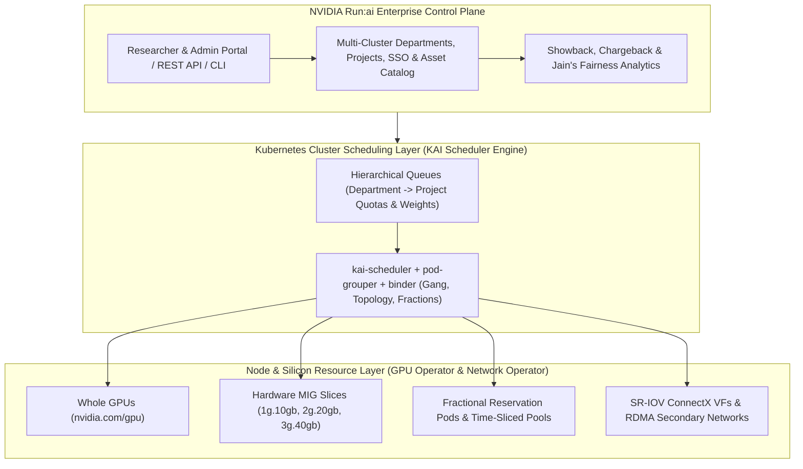
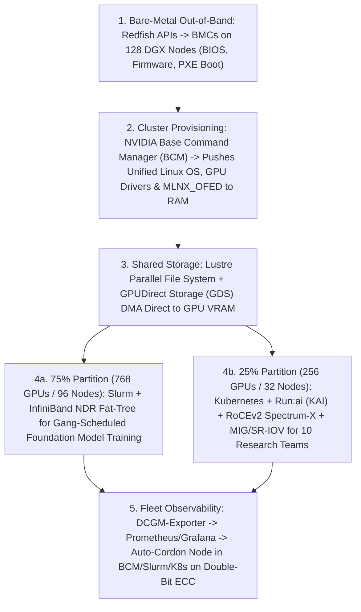

# 11.19 The Run:ai platform view

| | |
|---|---|
| Level | Intermediate |
| Priority tier | 1 |
| Lab venue | GCP / GKE |
| Part | Part 11: GPUs on Kubernetes, scheduling and virtualization |
| Sources used | `nvidia-zero-to-hero/volume-11/chapter-07-kubernetes-scheduling-for-shared-gpus.md`; `nvidia-zero-to-hero/volume-11/chapter-08-tenant-isolation-security-and-fairness.md`; `nvidia-zero-to-hero/volume-23/chapter-12-system-design-research-infrastructure.md`; `nvidia-zero-to-hero/volume-23/chapter-13-ai-factory-architect-interview-cheatsheet.md`; Roland Huß et al., *Generative AI on Kubernetes* |
| Coverage file | `planning/coverage/chapters/11-19.md` |

## Why this matters for AI infrastructure

A single cluster scheduler cannot govern an entire enterprise AI factory on its own. When dozens of research groups share hundreds of GPUs across multiple clusters, platform teams face immediate governance bottlenecks. Administrators struggle to link corporate identity providers to departmental GPU budgets. Researchers waste hours writing raw Kubernetes manifests just to launch a short notebook session or a distributed training run. Worse, teams frequently confuse cluster scheduling software with hardware isolation, exposing sensitive model weights and metrics to neighboring tenants.

In Chapters 11.13 through 11.18, we examined the open-source NVIDIA KAI Scheduler. NVIDIA released that core scheduling engine under the Apache 2.0 license in early 2025 after acquiring Run:ai. KAI Scheduler manages cluster-local Pod placement, gang scheduling, and queue priorities. Above that engine, the commercial NVIDIA Run:ai platform adds multi-cluster fleet management, single sign-on, departmental showback, and self-service workload templates.

A frequent mistake in architecture reviews is treating Run:ai as a hardware GPU-sharing mechanism. Run:ai is an orchestration, queueing, fairness, and quota layer that sits above Kubernetes. It does not slice silicon or replace hardware Multi-Instance GPU partitions or device-plugin time-slicing. Instead, it schedules workloads across whole GPUs, MIG slices, and fractional reservations while enforcing multi-tenant fairness and preemption.

```text
Enterprise Scale Challenges Addressed by the Platform Layer:
- 50 competing research teams sharing 200 L40S GPUs across 25 nodes (volume-23/chapter-12)
- 4 DGX SuperPODs (128 nodes, 1,024 GPUs) split across Slurm and Kubernetes/Run:ai (volume-23/chapter-13)
- Funding-to-quota showback ($10K hardware investment -> 50 GPU-hours/month)
- Self-service templates for 5-minute interactive workspaces, 72-hour training jobs, and production inference
- Separation of scheduling/fairness/quota policy from MIG and time-slicing hardware sharing (volume-11/chapter-07)
```

This chapter connects the open-source KAI Scheduler engine to the full NVIDIA Run:ai enterprise platform view. We walk through the seven-layer multi-tenant security and fairness model and solve two complete enterprise system designs. Before evaluating any multi-tenant GPU platform, separate your cluster scheduling policy from your underlying hardware isolation boundaries.

## Prerequisites and outcomes

### Prerequisites

- Completion of Chapters 11.13 through 11.18 covering KAI Scheduler architecture, hierarchical queues, gang scheduling, fractional GPUs, and MIG.
- Basic familiarity with Kubernetes role-based access control, namespaces, and persistent storage provisioning.

### Outcomes

- Distinguish the NVIDIA Run:ai enterprise control plane from the open-source KAI Scheduler engine, and explain why Run:ai complements rather than replaces MIG and time-slicing.
- Design a seven-layer multi-tenant threat model across four administrative planes, three fairness time scales, and six tenant onboarding gates.
- Architect a 50-team, 200-GPU research cluster with contribution-weighted deficit fair-share, graceful checkpoint preemption, tiered storage, and full total cost of ownership math.
- Present the full-stack 1,024-GPU AI Factory architecture spanning bare-metal provisioning, InfiniBand and RoCEv2 fabrics, Lustre storage, Slurm, and Kubernetes with Run:ai.

## Concepts: basics to intermediate to advanced

### 1. Basics: How the Run:ai Platform relates to KAI Scheduler, MIG, and Time-Slicing

When an organization scales beyond a single Kubernetes cluster, managing GPU quotas through raw custom resources becomes error-prone. Platform engineers need a central control plane that maps organizational budgets to cluster queues without forcing researchers to write complex YAML files.

NVIDIA solved this by splitting the architecture into two clear tiers after acquiring Run:ai. The first tier is the cluster-level scheduling engine, which runs inside each Kubernetes cluster as the KAI Scheduler or Run:ai cluster agent. This engine evaluates custom resources for queues, pod groups, bind requests, and network topologies during its six-stage scheduling session.

The second tier is the NVIDIA Run:ai enterprise control plane, which sits above one or more Kubernetes clusters. Administrators use this central portal and REST API to organize tenants into Departments and Projects. Departments map to level-one parent queues, while Projects map to level-two child queues and managed Kubernetes namespaces. Corporate single sign-on binds researchers, department leads, and platform administrators to their respective scopes.

```text
Two-Tier Run:ai and KAI Scheduler Architecture (Generative AI on Kubernetes Ch. 7 & volume-11/chapter-07):
1. Cluster-Level Engine (KAI Scheduler / Run:ai Cluster Agent):
   - Microservices: operator, kai-scheduler, pod-grouper, binder, queue-controller, admission, pod-group-controller
   - Custom Resources: Queue (department -> project), PodGroup, BindRequest, Topology
   - Session Pipeline: Preempt -> Reclaim -> Staleness -> Over-quota -> Allocate -> Consolidate
2. Enterprise Control Plane (NVIDIA Run:ai Platform):
   - Organizational Hierarchy: Multi-cluster Departments (L1 Queues) -> Projects (L2 Queues + Namespaces)
   - Identity & RBAC: Corporate SSO/OIDC roles (Researcher, L1 Department Admin, Platform Admin)
   - First-Class Workload Types:
     a. Interactive Workspaces (Jupyter / VS Code / RStudio) using 0.25 or 0.5 fractions or 1g.10gb MIG slices
     b. Training Workloads (Standard & Distributed PyTorch / MPI / Kubeflow) with over-quota borrowing & checkpoint preemption
     c. Inference Workloads (Triton / vLLM / KServe / Knative) with non-preemptible GPU/MIG reservations & autoscaling
   - Fleet Governance: Showback, chargeback, Jain's fairness analytics, and reusable asset catalog (NFS, S3, PVC)
```



#### The Golden Rule: Run:ai Is a Scheduler and Fairness Layer, Not a Hardware Sharing Mechanism

Customers and interview candidates regularly confuse Run:ai with the underlying GPU hardware sharing mechanisms. **Run:ai is an orchestration, queueing, fairness, and quota layer above Kubernetes, not a hardware sharing mechanism.**

Hardware and driver sharing boundaries are created by MIG, device-plugin time-slicing, CUDA Multi-Process Service, or NVIDIA vGPU. The NVIDIA GPU Operator and device plugin expose those resources to the Kubernetes node capacity table. Run:ai and KAI Scheduler sit above the device plugin to decide which tenant workload receives which published GPU resource. They enforce fair-share quotas, over-quota borrowing, and gang scheduling across those allocations. When designing a shared cluster, always choose your hardware isolation primitive first and layer Run:ai above it for quota governance.

---

### 2. Intermediate: Multi-tenant security, threat modeling, and fairness governance

Assigning two research teams to separate Run:ai Projects and separate GPU devices does not automatically isolate them. Two teams might still share an unhardened Linux host, a common NFS storage credential, or an unscoped Prometheus dashboard. In that environment, a compromised notebook in one project can still steal model weights or starve host memory in the other.

#### 1. The 7-Layer Multi-Tenant Boundary and Threat Model

Your actual blast radius in a shared cluster is determined by the weakest control along the end-to-end execution path. A complete multi-tenant design enforces isolation across seven distinct boundary layers.

| Tenant Boundary Layer | Example Controls in a Run:ai / KAI Cluster | Concrete Threat & Verification (`volume-11/chapter-08`) |
|---|---|---|
| **1. Identity** | Corporate SSO/OIDC, Kubernetes RBAC, short-lived workload `ServiceAccount` tokens | *Threat:* Unauthorized user requests a protected GPU class. *Check:* Review RoleBindings per `Project` namespace. |
| **2. Admission** | Signed/approved container images, Pod Security Admission (`restricted`), no `privileged: true` or `hostPath` | *Threat:* Container escapes into host device or driver control. *Check:* Admission webhook rejects privileged pod specs. |
| **3. Kubernetes** | Per-Project `Namespace`, `ResourceQuota`, `LimitRange`, `NetworkPolicy` | *Threat:* Team B's `memory-bomb` (`50Gi`) starves host RAM for Team A. *Check:* `kubectl describe resourcequota` enforces host RAM limits. |
| **4. Data** | Scoped S3 prefixes / NFS mounts (`1 TB` per team), rotatable per-tenant credentials | *Threat:* Compromised notebook reads another team's model weights/checkpoints. *Check:* Scoped read/write test with tenant identity. |
| **5. GPU** | Dedicated whole GPU, **MIG** (zero-trust hard isolation), **vGPU** (VM boundary), or **Fractional/Time-Sliced** (trusted co-workers only) | *Threat:* Team A sees Team B's CUDA PIDs or OOM-kills Team B. *Check:* Inside a MIG pod, `nvidia-smi --query-processes=pid,process_name,gpu_memory_usage --format=csv` must list **only** Team A's process. |
| **6. Host** | Restricted SSH, immutable BCM/node image, change-controlled MIG/device-plugin config | *Threat:* User modifies MIG geometry or device-plugin ConfigMap on a live node. *Check:* Node operations restricted to platform admins. |
| **7. Observability** | Role-scoped Run:ai / Grafana views and redacted audit logs | *Threat:* Team B queries Prometheus `nvidia_smi_memory_used_mib \| grep -i "team_a"` and discovers Team A's model names. *Check:* Two-identity scope test proves cross-tenant queries return empty. |

#### 2. Separating the Four Administrative Planes

To prevent privilege escalation, platform architects separate cluster operations into four administrative planes. A researcher identity in the Workload plane must never gain permissions in the Node, Management, or Observability planes.

```text
Four Administrative Planes and Six Fairness Contract Elements (volume-11/chapter-08 Figure 11.8.1):
- Administrative Planes:
  1. Workload Plane: Tenant Pods, VMs, service accounts, container images, and scoped dataset mounts.
  2. Node Plane: Host Linux OS, GPU driver, container runtime, device plugin, and physical MIG geometry.
  3. Management Plane: Kubernetes cluster admin, Run:ai control plane, vGPU license server, image registry, and BMC/Redfish.
  4. Observability Plane: Fleet-wide raw Prometheus metrics, Grafana admin views, retention rules, and audit logs.
- Six Fairness Contract Elements:
  1. Entitlement | 2. Priority | 3. Borrowing | 4. Limits | 5. Cost | 6. Appeals
```

#### 3. Fairness Across Three Time Scales and Six Onboarding Gates

A durable fairness policy operates across three time horizons. At admission time, measured in seconds, queue quotas and security policies decide which jobs may start. At execution time, measured in minutes to hours, concurrency caps, MIG partitions, and graceful preemption protect active service-level objectives from noisy neighbors. At lifecycle time, measured in weeks to months, showback reports and reservation expiry reviews prevent teams from hoarding idle quota.

Before any new project receives GPU quota, the platform team validates six sequential onboarding control gates.

```text
Six Sequential Tenant Onboarding Control Gates (volume-11/chapter-08):
Gate 1. Identity     -> Verify scoped RBAC role bindings and short-lived ServiceAccount tokens.
Gate 2. Workload     -> Run admission test proving unapproved images and privileged specs are rejected.
Gate 3. Network      -> Validate NetworkPolicy rules so only authorized peer pods are reachable.
Gate 4. Data         -> Execute scoped storage read/write probe proving least-privilege S3/NFS access.
Gate 5. Capacity     -> Run controlled Queue allocation test verifying baseline quota and preemption priority.
Gate 6. Observability -> Perform two-identity dashboard and Prometheus query test proving zero cross-tenant leakage.
+ Offboarding Gate   -> Revoke credentials, release Queue quotas, and purge saved dashboard exports at project end.
```

Audit all seven boundary layers and complete all six onboarding gates before allowing a new tenant to launch a single GPU pod.

---

### 3. Advanced: End-to-end system design — Research GPU cluster and the 1,024-GPU AI Factory

Let us apply the Run:ai and KAI platform model to two realistic enterprise architecture designs.

#### Case Study A: Designing a 50-Team, 200-GPU Research Infrastructure

Imagine a university or corporate research center where 50 labs share 200 NVIDIA L40S GPUs across 25 nodes. Without fair-share accounting and preemption guardrails, a single well-funded lab can flood the queue with multi-day training runs and block every student's five-minute interactive debugging session. Conversely, aggressive preemption without checkpointing destroys hours of training progress and saturates shared NFS storage.

We solve this by combining a bimodal workload policy, contribution-weighted deficit fair-share, graceful 30-second checkpoint preemption, and a three-tier storage hierarchy. Each $10,000 of hardware funding grants a lab 50 GPU-hours per month, while self-funded students receive a guaranteed baseline floor. When a lab borrows idle GPUs above its monthly quota, the scheduler records a deficit that lowers its effective quota the following month.

```text
50-Team, 200-GPU (25 Nodes x 8 L40S) Research Cluster Specifications (volume-23/chapter-12):
1. Bimodal Workload Profile:
   - Durations: 5 minutes minimum, 2 hours median, 72 hours maximum
   - Mix: 60% short (< 1 hour, non-preemptible interactive workspaces; cancel oldest expired if > 10 queue up)
          30% medium (1-8 hours, preemptible with 30-second SIGTERM notice)
          10% long (> 24 hours / > 8 hours, preempted only when team exceeds > 2x its quota)

2. Contribution-Weighted Quota & Month-to-Month Deficit Reconciliation:
   - Funding Rule: $10,000 hardware investment -> 50 GPU-hours/month (50 GPU-hours/month student floor, or 10 GPU-hours/month minimum floor)
   - Professor A ($100K funded): 500 GPU-hours/month quota; uses 600 GPU-hours in Month 1 -> -100 GPU-hour deficit -> Month 2 effective quota = 500 - 100 = 400 GPU-hours
   - Professor B ($50K funded): 250 GPU-hours/month quota; uses 100 GPU-hours in Month 1 -> +150 GPU-hour surplus -> Month 2 effective quota = 250 + 150 = 400 GPU-hours
   - Month 1 Combined Usage: 600 + 100 = 700 GPU-hours consumed out of 750 quota GPU-hours (93% utilization)

3. Fair-Share Scheduler Priority Scoring Formula (FairShareScheduler.score_job):
   - deficit = (current_usage - quota) / quota
   - priority = -deficit + (0.1 if job.gpu_count < 4 else 0.0)
   - Example 1 (Under-quota small job): usage 400 / 500 (80%), 2 GPUs (< 4) -> priority = +0.2 + 0.1 = +0.3 (front of queue)
   - Example 2 (Over-quota large job): usage 300 / 250 (120%, -50 deficit), 8 GPUs -> priority = -0.2 + 0.0 = -0.2 (deprioritized)

4. Graceful Preemption Timeline (0s -> 30s -> 45s -> 90s) & 3-Tier Checkpointing (< 5% total overhead):
   - t = 0 s: Pod receives SIGTERM; Python handler saves model, optimizer, epoch, and step in 5-10 s
   - t = 30 s: SIGKILL fires if process has not exited
   - t = 45 s: Higher-priority job starts on the freed GPUs
   - t = 90 s: Preempted job restarts on available GPUs and resumes from checkpoint (~2 minutes wall-clock loss, zero lost compute)
   - Tier 1 Local NVMe (every 100 steps / hourly): 0 extra CapEx, < 5 minutes recovery time
   - Tier 2 Shared NFS (1 TB quota/team, every 8 hours): 1-2% async write overhead, survives full node failure (8 jobs relaunch in ~5 min)
   - Tier 3 Nightly Tape Archive (daily): Negligible off-hours overhead, protects 72-hour jobs against catastrophic NFS loss

5. 3-Year TCO, Annual OpEx, and 5x Scaling to 1,000 GPUs (volume-23/chapter-12 Phase 6 & 7):
   - CapEx ($2.7M): 25 nodes x 8 L40S x $12K = $2.4M hardware + $100K (10 Gbps Ethernet) network + $200K NFS storage = $2.7M
   - Annual Power OpEx: 200 GPUs x 400 W = 80 kW x 8,760 hours/year x $0.15/kWh = $105,120/year (~$105K/year, correcting the 10x $1.05M slip)
   - Total Annual OpEx (~$0.9M/year): ~$105K power + $350K cooling + $300K staff (1.5 FTE) + $150K maintenance = ~$0.9M/year
   - Delivered Cost per GPU-Hour ($0.86/GPU-hour): At 60% target utilization (60-70% band), 200 x 8,760 x 0.60 = 1,051,200 GPU-hours/year -> $0.9M / 1,051,200 = ~$0.86/GPU-hour
   - 5x Scale to 1,000 GPUs: $13.5M CapEx, ~$4.5M/year OpEx, O(log n) hierarchical scheduling, sharded NFS mounts, staggered checkpoints
   - Admin Alert Thresholds: Jain's Fairness Index target > 0.85 (alert & deprioritize if < 0.80); utilization < 50% for 1 week or > 90%; failed checkpoint recovery > 5%
```

---

#### Case Study B: The Full-Stack 1,024-GPU AI Factory

Now consider an enterprise that purchases four DGX SuperPODs totaling 128 nodes and 1,024 GPUs. Executive leadership wants 75 percent of the fleet dedicated to pre-training a flagship foundation model and 25 percent shared across ten internal research and inference teams. Forcing the 768-GPU foundation model onto a multi-tenant Kubernetes cluster introduces unnecessary overlay complexity. Conversely, forcing ten interactive research teams onto bare-metal Slurm login nodes sacrifices cloud-native service isolation and MIG flexibility.



We solve this by provisioning the entire 128-node fleet from a single bare-metal control plane while splitting the compute partitions by workload physics. Out-of-band Redfish APIs configure the Baseboard Management Controllers across all 128 nodes to standardize BIOS settings and trigger PXE network boot. NVIDIA Base Command Manager then streams an identical Linux OS, GPU driver, and OFED image into node RAM across all 1,024 GPUs.

```text
Full-Stack 4-DGX-SuperPOD (128 Nodes, 1,024 GPUs) AI Factory Split (volume-23/chapter-13):
- Layer 1 Out-of-Band Management: Redfish REST APIs -> BMCs on 128 DGX nodes (flash BIOS/firmware, configure RAID, set PXE boot)
- Layer 2 Bare-Metal Provisioning: NVIDIA Base Command Manager (BCM, formerly Bright Cluster Manager) DHCP/TFTP head node -> unified OS, driver, MLNX_OFED
- Layer 3 Dual-Fabric Networking:
  * 75% Partition (768 GPUs / 96 nodes): Non-blocking InfiniBand NDR fat-tree for synchronous AllReduce collectives
  * 25% Partition (256 GPUs / 32 nodes): RoCEv2 on Spectrum-X Ethernet with SR-IOV Virtual Functions (VFs, the NIC equivalent of GPU MIG)
- Layer 4 High-Performance Storage: Lustre parallel file system + GPUDirect Storage (GDS) DMA directly from NICs to GPU VRAM bypassing host CPUs
- Layer 5 Dual Orchestration:
  * 768-GPU Partition: Slurm for millisecond-synchronized gang-scheduled foundation model pre-training
  * 256-GPU Partition: Kubernetes + Run:ai (KAI Scheduler) with MIG and fractional GPUs for 10 internal research teams
- Layer 6 Fleet Observability: DCGM-Exporter -> Prometheus & Grafana -> automatic node cordoning in BCM, Slurm, and Kubernetes on double-bit ECC errors
```

#### Comparing Slurm, Vanilla Kubernetes, and Kubernetes with Run:ai Across the AI Factory

When presenting this hybrid architecture to an enterprise architecture board, contrast how Pure Slurm, Vanilla Kubernetes, and Kubernetes with Run:ai handle each operational requirement.

| Architectural Dimension | Pure Slurm (`75%` / `768`-GPU Partition) | Vanilla Kubernetes (Default `kube-scheduler`) | Kubernetes + NVIDIA Run:ai / KAI Scheduler (`25%` / `256`-GPU Partition) |
|---|---|---|---|
| **Primary Workload Fit** | Massive synchronous distributed training (`512`–`768` GPUs) & MPI/NCCL batch runs | Stateless web microservices, CPU APIs, and basic whole-GPU services | Multi-tenant interactive notebooks (`5 min`), research training (`1–72h`), and autoscaled LLM inference |
| **Scheduling Unit & Gang Semantics** | Native whole-job gang scheduling (`sbatch` / `srun`) with millisecond-synchronized launch | Pod-by-pod FIFO scheduling (`NoPodGroup`); deadlocks on partial multi-node allocations | `PodGroup` gang scheduling (`minMember`) + `Topology` leaf-switch / NVLink affinity |
| **GPU Allocation Granularity** | Whole GPUs or static GRES/MIG definitions | Whole integers only (`nvidia.com/gpu: 1`) or uniform static device-plugin replicas | Dynamic **`gpu-fraction`** (`0.25`, `0.5`) and **`gpu-memory`** bin-packing via `binder` reservation pods + hardware **MIG** |
| **Multi-Tenant Fairness & Borrowing** | Hierarchical Fair-Share Tree (`Account` -> `User`) with historical usage decay | Static namespace `ResourceQuota` ceilings with zero elastic borrowing or reclamation | Hierarchical `Department -> Project` (`Queue`) guaranteed **`quota`**, elastic **`limit`**, **`overQuotaWeight`**, and deficit tracking |
| **Preemption & Recovery Contract** | Preempts batch jobs via `SIGTERM` + checkpoint restart | PriorityClass eviction kills individual Pods without gang awareness or quota reclamation | Reclaims over-quota `PodGroups` gracefully (`30 s` `SIGTERM` checkpoint window -> `45 s` new job -> `90 s` resume) |
| **Enterprise Multi-Tenancy & Security** | Shared POSIX UID/GID login node model; requires careful container (`Pyxis`/`Enroot`) isolation | Strong namespace, `NetworkPolicy`, `ServiceAccount`, and Pod Security Admission primitives | Combines Kubernetes 7-layer isolation (`Identity -> Admission -> K8s -> Data -> GPU -> Host -> Observability`) with `Project`-scoped portals |

#### Exception Management and Three-Contract Service Catalog

Operating a shared AI platform sustainably requires packaging GPU capacity into three explicit service contracts rather than a single unstructured pool.

1. Contract 1 covers restricted best-effort development for student and exploratory notebooks using fractional GPUs or time-sliced pools that may be reclaimed under load.
2. Contract 2 covers scheduled research and fine-tuning across the 50 research teams using contribution-weighted fair-share quotas, over-quota borrowing, and verified checkpoint preemption.
3. Contract 3 covers protected production serving and regulated workloads using hardware-isolated MIG slices or vGPU virtual machines with non-preemptible reservations and zero cross-tenant visibility.

```text
Three-Contract Service Catalog & Policy Exception Governance (volume-11/chapter-08):
- Contract 1 (Best-Effort Dev Pool): Fractional GPUs (0.25 / 0.5) or time-sliced replicas; bounded Project quotas; preemptible.
- Contract 2 (Scheduled Research Pool): $10K -> 50 GPU-hrs/month fair-share, over-quota borrowing, SIGTERM checkpointing, whole GPUs or 2g.20gb / 3g.40gb MIG.
- Contract 3 (Protected Production Pool): Hardware MIG (1g.10gb, 2g.20gb) or NVIDIA vGPU VMs; non-preemptible; strict p99 < 100 ms SLO; zero telemetry leak.
- Exception Record Fields: Requester, approver, scope, business reason, compensating security controls, start timestamp, and automatic expiry date.
```

Never grant permanent cluster-admin exceptions that bypass your tenant boundary; require an expiring exception record with compensating controls for every emergency override.

## Commands and configurations that matter

### 1. Declarative Department and Project Hierarchy in Run:ai and KAI Scheduler

```yaml
# runai-department-and-project-queues.yaml (untested here)
apiVersion: scheduling.run.ai/v2
kind: Queue
metadata:
  name: dept-nlp-research
spec:
  resources:
    gpu:
      quota: 64          # Guaranteed baseline GPUs for the NLP Department
      limit: 128         # Can burst up to 128 GPUs when sibling departments are idle
      overQuotaWeight: 2
---
apiVersion: scheduling.run.ai/v2
kind: Queue
metadata:
  name: proj-prof-a
spec:
  parentQueue: dept-nlp-research
  resources:
    gpu:
      quota: 32
      limit: 64
      overQuotaWeight: 2
```

### 2. Verifying Multi-Tenant MIG Process Isolation and Prometheus Scoping

```bash
# 1. Verify inside Team A's MIG container that Team B's host PIDs are invisible (untested here)
kubectl exec -n proj-prof-a pod/interactive-workspace-0 -- \
  nvidia-smi --query-processes=pid,process_name,gpu_memory_usage --format=csv

# 2. Verify with Team B's bearer token that Prometheus does not leak Team A's metrics (untested here)
curl -s -H "Authorization: Bearer $TEAM_B_TOKEN" \
  "http://prometheus:9090/api/v1/query?query=nvidia_smi_memory_used_mib" | grep -i "proj_prof_a"
```

### 3. Graceful SIGTERM Checkpoint Handler for Preemptible Research Jobs

```python
# Graceful 30-second SIGTERM checkpoint handler (volume-23/chapter-12, untested here)
import os
import signal
import sys
import torch

class CheckpointedTrainer:
    def __init__(self, model, optimizer, checkpoint_dir="/nfs/checkpoints"):
        self.model = model
        self.optimizer = optimizer
        self.checkpoint_dir = checkpoint_dir
        self.epoch = 0
        self.step = 0
        signal.signal(signal.SIGTERM, self.on_sigterm)

    def on_sigterm(self, sig, frame):
        job_id = os.getenv("RUNAI_JOB_ID", os.getenv("SLURM_JOB_ID", "unknown"))
        path = f"{self.checkpoint_dir}/job-{job_id}.pt"
        torch.save(
            {
                "model": self.model.state_dict(),
                "optimizer": self.optimizer.state_dict(),
                "epoch": self.epoch,
                "step": self.step,
            },
            path,
        )
        sys.exit(0)
```

## How it fails

When a multi-tenant Run:ai or KAI cluster fails in production, the root cause almost always traces back to an unverified checkpoint handler, a leaky observability or storage boundary, or missing preemption guardrails.

| Failure mode | Exact symptom & command evidence | Root cause boundary | Remediation |
|---|---|---|---|
| **1. Preempted training job loses `8 hours` of progress when reclaimed by Run:ai / KAI (`volume-11/chapter-08` & `volume-23/chapter-12`)** | A lower-priority over-quota training job is evicted to admit a high-priority workspace, and when rescheduled at `t = 90 s` it restarts from `epoch 0`. | **Preemption Without Verified Checkpoint Consent:** The workload did not trap `SIGTERM` or failed to flush its checkpoint within the `30-second` `terminationGracePeriodSeconds` window before `SIGKILL`. | Require every preemptible training template to register a `SIGTERM` handler (`CheckpointedTrainer`), write periodic checkpoints (`every 100 steps` to local NVMe and `every 8 hours` to NFS), and verify resume in staging before enabling preemption. |
| **2. Team B discovers Team A's proprietary model and dataset names via Grafana / Prometheus (`volume-11/chapter-08`)** | A researcher in `proj-prof-b` queries `nvidia_smi_memory_used_mib` or exports a dashboard JSON and sees `namespace="proj-prof-a"` and command-line args containing dataset paths. | **Layer 7 Observability Plane Data Leak:** Dashboards were deployed with a shared cluster-wide Prometheus data-source credential instead of tenant-scoped RBAC views. | Enforce Run:ai / Grafana role-scoped views per `Project`, strip sensitive command-line/path labels from long-term metric exports, and validate with a two-identity scope test. |
| **3. Run:ai `Project` can schedule GPU pods, but containers crash-loop with `Permission denied` loading `/nfs/checkpoints` (`volume-11/chapter-08` Scenario 2)** | `PodGroup` is scheduled and `nvidia-smi` succeeds inside the pod, but Python throws `PermissionError` on the model bucket or NFS prefix. | **Layer 4 Data Plane vs Layer 3 Kubernetes RBAC Mismatch:** Granting a user Run:ai `Project` quota to create GPU Pods does not automatically configure their `ServiceAccount` or NFS/S3 storage credentials. | Provision least-privilege, per-Project storage credentials during **Onboarding Gate 4 (`Data`)** and test with a scoped read/write probe before releasing the `Project` to users (`never` mount a shared cluster-admin storage key). |
| **4. Over-quota research lab's `72-hour` job is preempted every `2 hours` ("preemption thrashing", `volume-23/chapter-12`)** | A long-running job repeatedly checkpoints and restarts every `2 hours` during daytime interactive notebook bursts, wasting network/NFS bandwidth. | **Missing Long-Job Preemption Guardrails:** Medium and long jobs were placed in the same flat preemption pool without age-based priority or over-quota thresholds. | Protect long jobs (`> 8 hours`) so they are only preempted when a team is `> 2x` over quota, add age-based priority boosting for older jobs, or schedule long jobs into a reserved off-peak window (`3:00 AM – 7:00 AM`). |
| **5. Simultaneous checkpoint writes from `1,000` GPUs saturate NFS and exceed `> 5%` checkpoint failure rate (`volume-23/chapter-12` Phase 6)** | At the `1,000`-GPU scale, synchronized preemption or hourly checkpoints cause NFS timeouts and the `Failed checkpoint recovery > 5%` alert fires. | **Unsharded Storage & Unstaggered Checkpoint Burst:** `1,000` workers writing multi-gigabyte state dicts to a single NFS mount simultaneously saturate the storage fabric. | Write high-frequency (`every 100 steps`) checkpoints to node-local NVMe (`< 5 min` recovery), shard NFS mounts per department/team, and stagger/throttle asynchronous NFS flushes (`1–2%` overhead). |

## Hands-on lab

### Venue and scope

This lab runs locally using the Python 3 standard library via `code/part11/run_ai_platform_view.py` and `code/part11/run_ai_platform_view_lab.py`. It verifies the seven-layer threat model, the four administrative planes, the six onboarding gates, and the contribution-weighted deficit fair-share scheduler. It also checks the preemption timeline, the research cluster total cost of ownership model, and the 1,024-GPU hybrid AI Factory design. Cluster commands are marked untested here.

### Step 1: Run the self-checking Run:ai platform view and AI Factory design lab

Run the lab script from the repository root.

```bash
python3 code/part11/run_ai_platform_view_lab.py
```

Captured output from this repository.

```text
=== Chapter 11.19 Lab: The Run:ai Platform View, Governance & AI Factory Design ===
  [PASS] Volume 11 Ch 8 threat model spans 7 layers (Identity, Admission, Kubernetes, Data, GPU, Host, Observability)
  [PASS] Volume 11 Ch 8 separates controls across 4 administrative planes (Workload, Node, Management, Observability)
  [PASS] Volume 11 Ch 8 tenant onboarding verifies 6 sequential control gates before granting access
  [PASS] Professor A ($100K -> 500 GPU-hrs quota, 600 used) carries -100 GPU-hrs deficit into Month 2
  [PASS] Professor B ($50K -> 250 GPU-hrs quota, 100 used) carries +150 GPU-hrs surplus into Month 2
  [PASS] Combined Month 1 usage (600 + 100 = 700 GPU-hrs out of 750 quota) achieves 93% utilization
  [PASS] Contribution rule maps $10K hardware funding to 50 GPU-hours/month ($100K=500, $50K=250)
  [PASS] Under-quota team (400/500 = 80%) submitting a 2-GPU (< 4) job receives priority +0.3 (+0.2 + 0.1 boost)
  [PASS] Over-quota team (300/250 = 120%, -50 deficit) submitting an 8-GPU job receives negative priority -0.2
  [PASS] Research cluster workload mix is 60% short (<1h), 30% medium (1-8h), and 10% long (>24h)
  [PASS] Graceful preemption gives 30s SIGTERM checkpoint window, starts new job at 45s, and resumes old job at 90s (~2 min loss)
  [PASS] Long jobs (> 8 hours) are only preempted when a team exceeds 2x its quota
  [PASS] 25 nodes x 8 L40S GPUs = 200 GPUs at $12K ($2.4M hardware + $100K net + $200K NFS = $2.7M CapEx)
  [PASS] 200 GPUs x 400W = 80 kW x 8,760 hrs x $0.15/kWh = $105,120 (~$105K/yr) power OpEx
  [PASS] Total annual OpEx (~$0.9M/yr) divided by 1,051,200 GPU-hrs (60% util) yields $0.86/GPU-hour
  [PASS] Scaling 5x to 1,000 GPUs requires $13.5M CapEx and ~$4.5M/year OpEx with O(log n) hierarchical scheduling
  [PASS] Admin fairness dashboard targets Jain's fairness index > 0.85 and alerts when < 0.80
  [PASS] 4 DGX SuperPODs (128 nodes, 1,024 GPUs) split 75% (768 GPUs) to Slurm and 25% (256 GPUs) to Kubernetes + Run:ai
  [PASS] 768-GPU Slurm partition uses InfiniBand NDR fat-tree while 256-GPU Run:ai research partition uses RoCEv2 Spectrum-X + MIG
  [PASS] Storage layer pairs Lustre parallel file system with GPUDirect Storage (GDS) to bypass host CPU
  [PASS] Volume 11 Ch 7 distinguishes Run:ai (orchestration/quota/fairness layer) from MIG/time-slicing (hardware/plugin sharing)
  [PASS] Tiered checkpointing combines Local NVMe (< 5 min recovery), NFS (1-2% overhead every 8h), and nightly Tape (< 5% failure alert)
  [PASS] SR-IOV slices ConnectX NICs into VFs at the PCIe silicon level just as MIG slices GPUs into isolated compute/memory instances
  [PASS] Base Command Manager (BCM) PXE-boots the 1,024 nodes after Redfish APIs flash BIOS/firmware via BMC
  [PASS] University 50-team research cluster supports min 5m, median 2h, and max 72h jobs with 1 TB NFS quota per team

Summary: 25 passed, 0 failed out of 25 checks.
```

### Exercises

1. Explain why telling a customer that Run:ai slices the GPU instead of MIG or time-slicing is architecturally wrong. Describe the exact division of duties between the GPU Operator, KAI Scheduler, and the Run:ai control plane.
2. Using `code/part11/run_ai_platform_view.py`, list the seven tenant boundary layers and the four administrative planes. State the two commands used to verify that Team A and Team B cannot see each other's MIG processes or Prometheus metrics.
3. Compute the Month 1 balance, Month 2 effective quota, and Month 1 cluster utilization for Professor A and Professor B. Evaluate the job priority score for an under-quota two-GPU job versus an over-quota eight-GPU job.
4. Trace the exact events at 0, 30, 45, and 90 seconds when a medium training job is preempted. Compare the recovery time, overhead, and failure domain of Local NVMe, Shared NFS, and Nightly Tape.
5. Calculate the hardware CapEx, total CapEx, annual power OpEx, and total annual OpEx for the 200-GPU L40S cluster. Compute the delivered GPU-hours per year at 60 percent utilization, the cost per GPU-hour, and the 1,000-GPU scale figures.
6. Walk through all six layers of the 128-node, 1,024-GPU enterprise AI Factory. Cover Redfish and BCM provisioning, InfiniBand NDR versus RoCEv2 Spectrum-X, Lustre with GDS, Slurm versus Kubernetes with Run:ai, and DCGM-Exporter.

## Checkpoint questions

<details>
<summary>`&lt;strong>`1. What is the relationship between the commercial NVIDIA Run:ai platform and the open-source NVIDIA KAI Scheduler?`&lt;/strong>`</summary>

After acquiring Run:ai, NVIDIA open-sourced the core Kubernetes GPU scheduling engine as KAI Scheduler under Apache 2.0 in early 2025. The commercial NVIDIA Run:ai Platform builds an enterprise multi-cluster control plane, Department and Project governance, and corporate single sign-on above that engine. It also adds self-service workload templates and chargeback analytics.
</details>

<details>
<summary>`&lt;strong>`2. Why does Volume 11 Chapter 7 state that Run:ai is not a GPU-sharing mechanism itself?`&lt;/strong>`</summary>

Run:ai does not partition GPU silicon into MIG instances or create device-plugin time-sliced replicas. Instead, MIG, time-slicing, MPS, and vGPU are the underlying node and device sharing mechanisms. Run:ai sits above the device plugin as the workload orchestration, queueing, fairness, and quota layer. It decides which tenant workload receives which published GPU resource.
</details>

<details>
<summary>`&lt;strong>`3. List the seven layers of the Multi-Tenant Boundary and Threat Model in Volume 11 Chapter 8.`&lt;/strong>`</summary>

1. Identity covers workload identity, RBAC, and short-lived tokens.
2. Admission enforces signed images, restricted privilege, and no unauthorized host access.
3. Kubernetes enforces Namespace, ResourceQuota, LimitRange, NetworkPolicy, and Pod Security admission.
4. Data enforces separate storage credentials, scoped S3 and NFS prefixes, and encrypted paths.
5. GPU matches dedicated whole GPUs, MIG, time-slicing, or vGPU to the tenant trust model.
6. Host hardens the node OS, restricts SSH, and change-controls device-plugin and MIG configuration.
7. Observability enforces tenant-scoped dashboards and redacted audit logs.
</details>

<details>
<summary>`&lt;strong>`4. How do you verify inside a multi-tenant MIG cluster that Team A cannot see Team B's GPU processes and Team B cannot query Team A's metrics in Prometheus?`&lt;/strong>`</summary>

- For process isolation, exec into Team A's pod on its MIG instance and run `nvidia-smi --query-processes=pid,process_name,gpu_memory_usage --format=csv` so that only Team A's container process appears.
- For telemetry isolation, query Prometheus using Team B's bearer token for `nvidia_smi_memory_used_mib` and filter for Team A's project name to verify that zero cross-tenant series are returned.
</details>

<details>
<summary>`&lt;strong>`5. What are the four administrative planes separated in Volume 11 Chapter 8, and why must a workload namespace never have authority over the Node or Management planes?`&lt;/strong>`</summary>

1. The Workload plane covers Pods, VMs, service accounts, images, and dataset access.
2. The Node plane covers the host OS, device plugin, container runtime, GPU driver, and physical MIG state.
3. The Management plane covers cluster admin, the Run:ai control plane, the vGPU license server, registry admin, and BMC or Redfish.
4. The Observability plane covers role-scoped dashboards, metric retention, and audit logs.
If a tenant in the Workload plane can alter the Node or Management plane, they can reconfigure MIG geometry or device plugins and disrupt every other tenant on the host.
</details>

<details>
<summary>`&lt;strong>`6. What are the six policy elements of a multi-tenant Fairness Contract in Volume 11 Chapter 8?`&lt;/strong>`</summary>

1. Entitlement defines the baseline quota per tenant or project measured in requested, allocated, and idle GPU-hours.
2. Priority defines which service classes may preempt or borrow capacity.
3. Borrowing defines when unused reserved capacity is reclaimable, the recall warning window, and required checkpoint state.
4. Limits define the maximum concurrent shared allocations to prevent physical saturation.
5. Cost defines the showback or chargeback unit and guarantee level.
6. Appeals define who resolves policy conflicts and tracks remediation dates.
</details>

<details>
<summary>`&lt;strong>`7. How do fairness controls operate across the three time scales in Volume 11 Chapter 8?`&lt;/strong>`</summary>

- At admission time in real time, class eligibility, quota, and approvals stop unauthorized or unbounded workloads from starting.
- At execution time during runtime, concurrency limits, protected MIG or dedicated pools, and priority preemption rules prevent noisy neighbors from degrading active SLO workloads.
- At lifecycle time across weeks and months, showback reports, reservation expiry reviews, and demand forecasting eliminate quota hoarding and profile fragmentation.
</details>

<details>
<summary>`&lt;strong>`8. What are the six sequential Tenant Onboarding Control Gates in Volume 11 Chapter 8?`&lt;/strong>`</summary>

1. Identity verifies scoped tenant roles and ServiceAccount bindings.
2. Workload runs an approved container image and manifest admission test.
3. Network validates NetworkPolicy rules proving only required peers are reachable.
4. Data executes a scoped read and write test proving least-privilege access to artifacts and checkpoints.
5. Capacity runs a controlled allocation test verifying Queue quota and priority behavior.
6. Observability performs a two-identity scope test proving dashboards and logs do not leak cross-tenant context.
</details>

<details>
<summary>`&lt;strong>`9. In the Volume 23 Chapter 12 Research Infrastructure design, what is the bimodal job duration distribution across short, medium, and long jobs?`&lt;/strong>`</summary>

Job durations span from a 5-minute minimum to a 2-hour median and a 72-hour maximum across three buckets.
- Short jobs under 1 hour represent 60 percent of workloads and run as non-preemptible interactive notebooks and hyperparameter probes.
- Medium jobs between 1 and 8 hours represent 30 percent of workloads and are preemptible with a 30-second `SIGTERM` checkpoint notice.
- Long jobs over 24 hours represent 10 percent of workloads and are preempted only when a team exceeds twice its quota.
</details>

<details>
<summary>`&lt;strong>`10. Walk through the contribution-weighted quota and deficit-tracking calculation for Professor A and Professor B across Month 1 and Month 2.`&lt;/strong>`</summary>

Each $10K of hardware investment entitles a lab to 50 GPU-hours per month.

```text
Professor A ($100K funded): 500 GPU-hours/month quota; uses 600 GPU-hours in Month 1 -> -100 GPU-hour deficit -> Month 2 effective quota = 500 - 100 = 400 GPU-hours.
Professor B ($50K funded): 250 GPU-hours/month quota; uses 100 GPU-hours in Month 1 -> +150 GPU-hour surplus -> Month 2 effective quota = 250 + 150 = 400 GPU-hours.
Total Month 1 usage: 600 + 100 = 700 GPU-hours out of 750 quota (93% utilization).
```
</details>

<details>
<summary>`&lt;strong>`11. Write the job priority scoring formula used by FairShareScheduler.score_job in Volume 23 Chapter 12, and explain why it adds +0.1 for jobs requesting fewer than 4 GPUs.`&lt;/strong>`</summary>

```text
deficit = (current_usage - quota) / quota
priority = -deficit + (0.1 if job.gpu_count < 4 else 0)
```

Teams under quota have a negative deficit, which produces a positive priority score and moves their jobs to the front of the queue. Adding 0.1 for small jobs requesting fewer than 4 GPUs helps pack small interactive requests into idle node gaps and reduces cluster fragmentation.
</details>

<details>
<summary>`&lt;strong>`12. Trace the exact preemption timeline at 0s, 30s, 45s, and 90s when a research training job is preempted.`&lt;/strong>`</summary>

- At 0 seconds, the scheduler sends `SIGTERM` to the container and the Python handler saves model, optimizer, epoch, and step state within 5 to 10 seconds.
- At 30 seconds, `SIGKILL` forcibly terminates the process if it has not exited cleanly.
- At 45 seconds, the higher-priority job starts on the freed GPUs.
- At 90 seconds, the preempted job restarts on available GPUs and resumes from its saved checkpoint, losing about 2 minutes of wall-clock time and zero training steps.
</details>

<details>
<summary>`&lt;strong>`13. Compare the three tiers of checkpoint storage in Volume 23 Chapter 12 Phase 5.`&lt;/strong>`</summary>

- Tier 1 Local NVMe writes every 100 steps or hourly at zero additional hardware cost, recovering in under 5 minutes and serving as a fallback if NFS disconnects.
- Tier 2 Shared NFS enforces a 1 TB quota per team and writes every 8 hours with 1 to 2 percent asynchronous overhead, surviving a full node hardware failure.
- Tier 3 Nightly Tape Archive runs off-hours with negligible overhead to protect 72-hour runs against catastrophic primary NFS storage failure.
</details>

<details>
<summary>`&lt;strong>`14. Calculate the 3-year CapEx, annual OpEx, and cost per GPU-hour for the 200-GPU L40S research cluster.`&lt;/strong>`</summary>

```text
CapEx ($2.7M): 25 nodes x 8 L40S x $12K = $2.4M hardware + $100K network + $200K NFS storage = $2.7M.
Annual OpEx (~$0.9M/year): Power (200 x 400 W = 80 kW x 8,760 h x $0.15/kWh = $105,120 ~ $105K/yr) + Cooling ($350K) + Staff (1.5 FTE = $300K) + Maintenance ($150K) = ~$0.9M/year.
Cost per GPU-hour (~$0.86/GPU-hour): At 60% utilization (200 x 8,760 x 0.6 = 1,051,200 GPU-hours/year), $0.9M / 1,051,200 = ~$0.86/GPU-hour.
```
</details>

<details>
<summary>`&lt;strong>`15. What are the four administrative dashboard alert thresholds in Volume 23 Chapter 12 Phase 7 for a shared research cluster?`&lt;/strong>`</summary>

1. Jain's Fairness Index dropping below 0.80 against a target above 0.85 triggers automatic deprioritization of over-quota teams.
2. Cluster utilization staying below 50 percent for 1 week signals an opportunity to onboard additional workloads.
3. Cluster utilization exceeding 90 percent above the 60 to 70 percent target band triggers capacity expansion or quota tightening.
4. Failed checkpoint recovery exceeding 5 percent triggers an immediate NFS and storage health investigation.
</details>

<details>
<summary>`&lt;strong>`16. How do you prevent a research team's 72-hour job from being preempted every 2 hours during daytime bursts?`&lt;/strong>`</summary>

1. Require a team to exceed twice its quota before allowing any long job over 8 hours to be preempted.
2. Add age-based priority boosting so older running jobs accumulate higher priority over time.
3. Offer a dedicated off-peak reservation window from 3:00 AM to 7:00 AM or allow the lab to fund additional baseline quota.
</details>

<details>
<summary>`&lt;strong>`17. In Volume 23 Chapter 13, how do Redfish/BMC and NVIDIA Base Command Manager work together to provision 1,000+ bare-metal DGX nodes?`&lt;/strong>`</summary>

1. Out-of-band Redfish REST APIs communicate with the dedicated Baseboard Management Controller on each motherboard to flash BIOS, configure RAID, and enable PXE boot.
2. NVIDIA Base Command Manager acts as the central DHCP and TFTP provisioning head node that PXE-boots all nodes. It streams a bit-for-bit identical software image containing the Linux OS, NVIDIA drivers, `MLNX_OFED`, and cluster agents into node RAM.
</details>

<details>
<summary>`&lt;strong>`18. In Volume 23 Chapter 13, when should a Solutions Architect recommend Slurm, plain Kubernetes, or Kubernetes with Run:ai?`&lt;/strong>`</summary>

- Recommend Slurm for massive, tightly coupled distributed training runs across 512 or 768 GPUs that require millisecond gang scheduling and whole-job checkpoint restart.
- Recommend plain Kubernetes for stateless web microservices and CPU APIs that do not require gang scheduling, hierarchical GPU fair-share queues, or fractional GPU memory bin-packing.
- Recommend Kubernetes with Run:ai and KAI Scheduler for multi-tenant research, fine-tuning, and inference workloads. It combines cloud-native flexibility with HPC-grade fair-share quotas, preemption, MIG orchestration, and dynamic fractional GPUs.
</details>

<details>
<summary>`&lt;strong>`19. Why does Volume 23 Chapter 13 Section 4 describe SR-IOV and MIG as philosophically the same thing for different pieces of silicon?`&lt;/strong>`</summary>

- Single-Root I/O Virtualization partitions a physical ConnectX network adapter at the PCIe silicon level into isolated Virtual Functions that bypass the software hypervisor for line-rate RDMA and RoCE.
- Multi-Instance GPU partitions a physical GPU at the silicon level into isolated GPU instances with dedicated streaming multiprocessors, HBM memory channels, and L2 cache banks. Together, MIG and SR-IOV give a tenant hardware-isolated compute and hardware-isolated networking.
</details>

<details>
<summary>`&lt;strong>`20. Walk through the 6-layer architecture for the 4-DGX-SuperPOD customer design in Volume 23 Chapter 13 Section 5.`&lt;/strong>`</summary>

1. Out-of-Band Management uses Redfish APIs talking to BMCs across all 128 DGX nodes to unify BIOS and firmware.
2. Cluster Provisioning uses a highly available BCM head node PXE-booting all 128 nodes and 1,024 GPUs with a hardened OS, NVIDIA driver, and `MLNX_OFED` image.
3. Networking pairs a non-blocking InfiniBand NDR fat-tree for the 75 percent, 768-GPU training partition with RoCEv2 on Spectrum-X Ethernet for the 25 percent, 256-GPU research partition.
4. Storage deploys a Lustre parallel file system with GPUDirect Storage DMA directly from NICs to GPU VRAM.
5. Orchestration runs Slurm on the 768-GPU foundation model partition and Kubernetes with Run:ai and MIG on the 256-GPU partition for the 10 internal research teams.
6. Observability streams `DCGM-Exporter` metrics into Prometheus and Grafana across all 1,024 GPUs with automated node cordoning in BCM, Slurm, and Kubernetes on double-bit ECC faults.
</details>

## Sources and review notes

```text
Primary sources read in full for this chapter:
- Author's Volume 11 and Volume 23 notes:
  * nvidia-zero-to-hero/volume-11/chapter-07-kubernetes-scheduling-for-shared-gpus.md ("NVIDIA Operational Reference — Run:ai": Run:ai as a workload-orchestration, queueing, fairness, and quota layer above Kubernetes rather than a hardware GPU-sharing mechanism).
  * nvidia-zero-to-hero/volume-11/chapter-08-tenant-isolation-security-and-fairness.md (Figure 11.8.1 7-layer tenant boundary, MIG process & Prometheus query verification, 6 fairness policy elements, 4 administrative planes, 3 fairness time scales, 6 tenant onboarding gates, and the 3-tier university architecture).
  * nvidia-zero-to-hero/volume-23/chapter-12-system-design-research-infrastructure.md (50 research teams, 200 L40S GPUs across 25 nodes x 8 GPUs, bimodal duration 5 min / 2h median / 72h max, 60%/30%/10% split, $10K -> 50 GPU-hrs/month, Professor A $100K -> 500 uses 600 -> -100 deficit, Professor B $50K -> 250 uses 100 -> +150 surplus, 700/750 = 93%, FairShareScheduler.score_job(), 0s -> 30s -> 45s -> 90s SIGTERM checkpoint protocol, 3-tier NVMe/NFS/Tape storage, $2.7M CapEx, $0.9M/yr OpEx with $105K/yr corrected 80 kW power, $0.86/GPU-hr at 60% utilization, 1,000-GPU $13.5M CapEx / $4.5M/yr OpEx scaling, and Jain's fairness index > 0.85 / < 0.8).
  * nvidia-zero-to-hero/volume-23/chapter-13-ai-factory-architect-interview-cheatsheet.md (Redfish/BMC, Base Command Manager BCM, Slurm vs Kubernetes vs Run:ai, SR-IOV vs MIG, and the 4 DGX SuperPOD 128-node 1,024-GPU 75% 768-GPU Slurm + 25% 256-GPU Kubernetes/Run:ai system design).
- Book sources from the local TOON-RAG corpus:
  * Roland Huß et al., Generative AI on Kubernetes (O'Reilly, 2026), Chapter 7 (Job Scheduling Optimization, "NVIDIA KAI Scheduler" open-sourced after NVIDIA's acquisition of Run:ai).
- Related source files mapped in MIGRATION_MAP.md:
  * No separate nvidia-devops file was exclusively mapped to 11.19 in brief.py; this chapter synthesizes volume-11/chapter-07, volume-11/chapter-08, volume-23/chapter-12, volume-23/chapter-13, and Generative AI on Kubernetes Chapter 7.
```

### Run here

- `python3 code/part11/run_ai_platform_view_lab.py` passes all 25 checks.

### Explicitly labelled inferences

- Mapping the Run:ai Department and Project hierarchy to KAI Scheduler's two-level Queue custom resource follows Chapter 7 of *Generative AI on Kubernetes*.

### Not verified on live hardware

- All `kubectl` (`queue.yaml`, `kai.scheduler/queue`, `kai.scheduler/v1alpha1`, `kueue.x-k8s.io/v1beta1`, `resource.k8s.io/v1`, `SEVEN_TENANT_BOUNDARY_LAYERS`, `FOUR_ADMINISTRATIVE_PLANES`, `1.85` / `44` metrics, `volume-10/00c-slurm-bcm-interview-lab.md`, cross-referenced with Chapters `11.20`, `11.21`, `11.22`, `11.23`, and `11.25`), `nvidia-smi`, `curl`, and PyTorch `SIGTERM` checkpoint snippets are marked untested here and were not executed on a live GPU cluster.

### Not in the corpus

- Version-specific commercial Run:ai SaaS and self-hosted installer Helm values and licensing server endpoints are outside the local corpus.

### Corrections to the author's notes

- Corpus coverage: Run:ai product behavior across the control plane, projects, departments, and licensing is described in the Volume notes and books at a high level. Product names, licensing, and the relationship to the open-source KAI Scheduler change over time, so verify them with NVIDIA documentation before production deployment.
- KAI Scheduler check: this chapter's KAI details were compared with the upstream documentation as summarized in Chapter 11.14 and Chapter 11.17.
- Validation pass: `validate_chapter.py` and `check_coverage.py` pass. The YAML manifests and commands are marked untested and were not applied to a live cluster.
- Arithmetic correction preserved from Volume 23 Chapter 12 Phase 6: 200 GPUs at 400 W equals 80 kW, which over 8,760 hours at $0.15 per kWh costs $105,120 per year, yielding roughly $0.9M per year in total OpEx and $0.86 per GPU-hour at 60 percent utilization.

