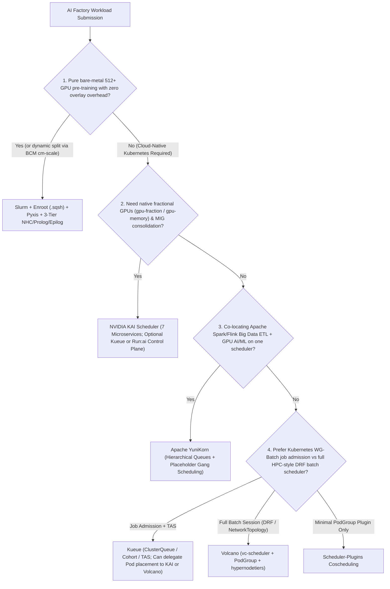

# 11.20 Scheduler comparison guide: KAI, Kueue, Volcano, YuniKorn and Slurm

| | |
|---|---|
| Level | Intermediate |
| Priority tier | 1 |
| Lab venue | GCP / GKE |
| Part | Part 11: GPUs on Kubernetes, scheduling and virtualization |
| Sources used | Roland Huß et al., *Generative AI on Kubernetes*; `nvidia-zero-to-hero/volume-01/chapter-05-ai-infrastructure-landscape.md`; `volume-08/01-architecture-design-masterclass.md`; `volume-10/00c-slurm-bcm-interview-lab.md`; `volume-10/08-enroot-and-pyxis-containers-for-hpc.md`; `volume-10/09-job-provisioning-health-gating-and-workflow-orchestration.md` |
| Coverage file | `planning/coverage/chapters/11-20.md` |

## Why this matters for AI infrastructure

Every AI platform team eventually faces the same multi-million-dollar architectural decision. When an organization operates 500 to 4,096 GPUs across research notebooks, foundation-model training, data engineering, and production serving, leadership must choose its scheduling control plane. Teams must decide whether to standardize on bare-metal Slurm or Kubernetes. When they choose Kubernetes, they must then select between NVIDIA KAI Scheduler, Kueue, Volcano, Apache YuniKorn, and the Coscheduling plugin.

Choosing the wrong scheduler, or relying on the default Kubernetes scheduler for distributed GPU workloads, causes immediate operational failures. If a researcher submits a 16-GPU distributed training job to vanilla Kubernetes when only 8 GPUs are free, the default scheduler starts 8 pods immediately and leaves 8 pods pending. The running ranks wait for collective rendezvous until they crash with NCCL timeout errors, wasting the allocated GPUs the entire time.

At larger scales, hardware physics compounds the scheduling problem. In a 512-node cluster with 4,096 GPUs, where a single node has a 1,000-day mean time between failures, the fleet suffers a node or link fault every 1.95 days. Without gang scheduling, topology awareness, and automated pre-job health gating, a single degraded optical transceiver stalls all 4,095 peer GPUs inside collective spinlocks.

```text
Scale Failures That Force Purpose-Built Scheduling & Health Gating:
- Partial-Allocation Deadlock (volume-01/chapter-05): 16-GPU or 64-GPU job submitted when 8 or 30 GPUs are free -> running ranks crash in NCCL Timeout loops.
- Inverse Cluster MTBF Scaling (volume-10/09): 512 nodes (4,096 GPUs) with 1,000-day (~3-year) single-node MTBF -> 1,000 / 512 = 1.95 days between hardware faults.
- Silent Collective Straggler (volume-10/09): 1 throttled GPU or degraded 400G transceiver stalls peer GPUs inside ncclKernel_AllReduce at 100% spinlock utilization, doubling step time from 1.2 s to 2.4 s.
```

This chapter synthesizes Chapters 11.7 through 11.19 into a six-way scheduler comparison guide across Coscheduling, Kueue, Volcano, NVIDIA KAI Scheduler, Apache YuniKorn, and Slurm. Before selecting a scheduler for your cluster, map your workload mix and operational maturity against each engine's architectural boundaries.

## Prerequisites and outcomes

### Prerequisites

- Completion of Chapters 11.7 through 11.9 covering gang scheduling, Kueue, Volcano, Coscheduling, JobSet, LeaderWorkerSet, PyTorchJob, and MPI Operator.
- Completion of Chapters 11.13 through 11.19 covering NVIDIA KAI Scheduler and the Run:ai platform view.
- Familiarity with distributed training collectives and leaf-spine network topologies.

### Outcomes

- Compare Coscheduling, Kueue, Volcano, NVIDIA KAI Scheduler, Apache YuniKorn, and Slurm across nine architectural dimensions.
- Explain when to deploy Apache YuniKorn for unified Spark and PyTorch clusters, and how to compose Kueue job admission with KAI Scheduler or Volcano pod placement.
- Architect the bare-metal Slurm, Enroot, and Pyxis container stack with three-tier health gating, NVIDIA Xid Catalog automation, and BCM Auto Scaler coexistence.
- Apply the six-stage Solutions Architect methodology and DGX H100 SuperPOD reference architecture sizing rules to enterprise cluster design reviews.

## Concepts: basics to intermediate to advanced

### 1. Basics: The 6-scheduler taxonomy and complete feature comparison

When platform teams evaluate schedulers from feature checklists alone, they often deploy overlapping controllers that fight over pod bindings. To avoid control-plane conflicts, classify each scheduler by how it integrates with Kubernetes or the host operating system.

1. In-process scheduler framework plugins such as Coscheduling extend the default `kube-scheduler` binary to add lightweight pod-group gang scheduling without queue trees or fractional GPUs.
2. Job-level admission controllers such as Kueue sit above pod scheduling and toggle job suspension based on cluster queues and cohorts while delegating pod binding to a secondary scheduler.
3. Standalone session-based Kubernetes batch schedulers such as Volcano, NVIDIA KAI Scheduler, and Apache YuniKorn evaluate entire queues and pod groups in periodic scheduling cycles.
4. Bare-metal HPC workload managers such as Slurm run directly on the Linux host OS via `slurmctld` and `slurmd` without CNI overlays, launching unprivileged containers through NVIDIA Enroot and Pyxis.



#### Comprehensive 6-Scheduler Comparison Matrix

Table 7-1 of *Generative AI on Kubernetes* compares the four primary Kubernetes batch schedulers. The matrix below extends that table with Apache YuniKorn and bare-metal Slurm.

| Dimension | Coscheduling Plugin | Kueue | Volcano | NVIDIA KAI Scheduler | Apache YuniKorn | Slurm (`+ Enroot / Pyxis`) |
|---|---|---|---|---|---|---|
| **Architecture** | `kube-scheduler` framework plugin | Job-level admission controller (`Workload` CRD) | Full replacement batch scheduler (`vc-scheduler` sessions) | `7`-microservice GPU-native scheduler (`kai-scheduler`, `pod-grouper`, `binder`) | Unified batch + streaming replacement scheduler | Bare-metal HPC controller (`slurmctld` / `slurmd` / `slurmdbd`) |
| **Gang Scheduling** | `PodGroup` CRD (`minMember` all-or-nothing) | All-or-nothing job-level admission (`suspend` toggle) | `PodGroup` (`minMember`, `minTaskMember`, `minResources`) | `PodGroup` + hierarchical `SubGroup` / `PodSet` gang constraints | Task-group gang scheduling via placeholder pods | Native millisecond-synchronized whole-job launch (`sbatch` / `srun`) |
| **Queue Management** | None (external queue required) | `ClusterQueue`, `LocalQueue`, `Cohort` hierarchies | Hierarchical `Queues` with `capability`, `weight`, `deserved` | `2`-level `Queue` tree (`Department -> Project`) with `quota`, `limit`, `overQuotaWeight` | Hierarchical queues with guaranteed & max capacities | Multi-factor Fair-Share Tree (`Account -> User`) + `Partitions` + `QoS` |
| **Resource Sharing & Fairness** | None | `Cohort` fair sharing with flavor borrowing limits | Dominant Resource Fairness (`DRF`), `Proportion`, `Capacity` | Guaranteed `quota` + weighted over-quota borrowing + staleness reclamation | `Fair` (spread) and `BinPacking` node sorting + dynamic quotas | Historical usage-decay fair-share + `cgroups v2` (`ConstrainDevices=yes`) |
| **Preemption** | Basic Kubernetes `PriorityClass` only | Priority-based reclamation & preemption across `Cohort` | Priority + gang-aware `PodGroup` preemption & `reclaim` action | `Preempt` (in-queue priority) + `Reclaim` (over-quota fairness) | Priority & queue-capacity preemption across hierarchy | Graceful `SIGTERM` / `SIGKILL` (`UnkillableStepTimeout=60`) or requeue |
| **Topology-Aware Scheduling** | None (node-local `TopologyManager` only) | Topology-Aware Scheduling (`TAS`) via `Topology` & `ResourceFlavor` | `NetworkTopology` CRD (`hypernodetiers`) + `binpack` | `Topology` CRD + `SubGroup` rack / leaf / NVLink domain placement | Rack/zone placement rules & node sorting | `TopologyPlugin=topology/tree` + `SelectType=select/cons_tres` |
| **GPU Optimization** | Integer `nvidia.com/gpu` only | `ResourceFlavor` quota per GPU model / MIG profile | GPU sharing / MIG / vGPU plugins | **Native fractional GPUs** (`gpu-fraction`, `gpu-memory`) via `binder` reservation pods + MIG consolidation | Converges CPU Big Data (`Spark`/`Flink`) + integer/MIG GPU workloads | `AutoDetect=nvml` GRES, bare-metal IB/NVLink, Enroot `98-nvidia.sh` & `99-mellanox.sh` hooks |
| **Maturity & Adoption** | Kubernetes SIG Scheduling subproject | CNCF Kubernetes WG-Batch standard; high K8s-native adoption | CNCF graduated/incubating HPC-on-K8s standard | Open-sourced by NVIDIA (Apache 2.0, 2025) from battle-tested Run:ai engine | Apache Software Foundation top-level project (strong in Spark + AI clouds) | Decades-proven supercomputing standard (`Top500` & DGX SuperPOD) |
| **Operational Complexity** | **Low** | **Medium** | **Medium-High** | **Medium** | **Medium** | **High** for K8s-only teams; **Low/Standard** for HPC teams |

Use this decision matrix to eliminate schedulers that lack your required GPU sharing or gang scheduling primitives before running a proof of concept.

---

### 2. Intermediate: Apache YuniKorn, hybrid Kueue composition, and Slurm containers

Real-world AI platforms rarely run isolated PyTorch jobs in a vacuum. Data engineering teams run massive Apache Spark and Flink tokenization pipelines alongside GPU training, while HPC teams need container reproducibility on Slurm without root daemon risks.

#### 1. When to Choose Apache YuniKorn

When a platform runs Apache Spark and Flink data pipelines on the same Kubernetes cluster as PyTorch training, maintaining separate schedulers fragments cluster capacity. Apache YuniKorn solves this by unifying big-data batch and streaming jobs with AI workloads under a single hierarchical queue model inspired by Hadoop YARN.

YuniKorn implements gang scheduling through task groups and lightweight placeholder pods. Before launching a distributed job, YuniKorn creates placeholder pods on target nodes to reserve the full gang capacity, and then swaps in the real driver and worker pods once all slots are locked. Administrators can also configure `Fair` node sorting to spread latency-sensitive services or `BinPacking` node sorting to pack GPU batch jobs onto the fewest nodes.

#### 2. Composing Kueue with KAI Scheduler or Volcano

Platform teams do not have to choose exclusively between Kueue and a pod-group scheduler such as KAI Scheduler or Volcano. A common enterprise pattern uses Kueue for multi-team job admission and resource-flavor quota accounting while delegating pod-level placement to KAI Scheduler or Volcano.

In this composed workflow, a researcher submits a PyTorchJob labeled with a Kueue local queue and sets `schedulerName: kai-scheduler` inside the pod template. Kueue holds the job suspended until cohort and flavor quotas are available, and then unsuspends the job. KAI Scheduler immediately groups the unsuspended pods and binds them across NVLink domains, leaf switches, or fractional GPU reservation pods.

#### 3. How Slurm Runs Containers at Bare-Metal Speed: NVIDIA Enroot and Pyxis

Historically, running containers on bare-metal Slurm clusters was painful because Docker required a privileged root daemon and added virtual network bridges that broke InfiniBand RDMA. **NVIDIA Enroot and Pyxis give Slurm clusters cloud-native container reproducibility at bare-metal speed without a root daemon or overlay network.**

Enroot converts OCI container images into unprivileged `squashfs` files ending in `.sqsh`, achieving a 3x to 5x import speedup over standard layer extraction. By default, Enroot does not unshare the network, PID, IPC, or UTS namespaces, so NCCL inside the container talks directly to host InfiniBand adapters while Slurm's `cgroups v2` tree tracks every process. Pyxis is a Slurm SPANK plugin that exposes `--container-image` and `--container-mounts` flags directly on `srun` and `#SBATCH` commands.

```text
NVIDIA Enroot and Pyxis Operational Rules on Slurm (volume-10/08):
1. Enroot Configuration Directories (/etc/enroot, ENROOT_SYSCONF_PATH) & Required File Extensions:
   - environ.d/*.env   (Environment variables)
   - mounts.d/*.fstab  (Filesystem bind mounts)
   - hooks.d/*.sh      (Pre-start execution hooks)
2. Standard Hardware Injection Hooks:
   - 98-nvidia.sh: Invokes libnvidia-container (NVIDIA_VISIBLE_DEVICES) to expose allocated GPUs.
   - 99-mellanox.sh: Injects host-matched MLNX_OFED user-space libraries and selects IB HCAs via MELLANOX_VISIBLE_DEVICES.
3. NVIDIA NGC Authentication ($ENROOT_CONFIG_PATH/.credentials, chmod 600):
   - Must include BOTH endpoints or pulls fail:
     machine nvcr.io login $oauthtoken password <token>
     machine authn.nvidia.com login $oauthtoken password <token>
4. Avoiding HTTP 429 Registry Rate Limits at 500-Node Scale:
   - Run enroot import once on a build/login node to create /shared/containers/pytorch.sqsh on Lustre/NFS rather than pulling from 500 nodes simultaneously.
5. Critical Pyxis SPANK Upgrade & Escape Rules:
   - Since Slurm 21.08, Pyxis (pyxis.so) must be recompiled against the exact spank.h header of the deployed Slurm release during every Slurm upgrade.
   - In #SBATCH directives, escape the '#' character in image URIs: #SBATCH --container-image nvcr.io\#nvidia/pytorch:21.12-py3
```

When operating Slurm at scale, pre-import shared `.sqsh` images onto Lustre once and rebuild Pyxis during every Slurm version upgrade.

---

### 3. Advanced: Cluster MTBF, 3-tier Slurm health gating, SuperPOD sizing, and BCM Auto Scaler

#### 1. The Physics of Scale: Cluster MTBF and Silent Stragglers

Why do large training clusters invest so heavily in automated pre-job and post-job health gating? Because cluster mean time between failures scales inversely with the number of nodes in the job.

```text
Cluster MTBF and Silent Straggler Math (volume-10/09):
- Formula: Cluster MTBF = Single Node MTBF / N
- 512-Node (4,096-GPU) Example: 1,000-day (~3-year) single-node MTBF / 512 nodes = 1.95 days between hardware/link faults.
- Silent Straggler Impact (128-node, 1,024-GPU 405B training run):
  * 1 GPU slows by 20% due to thermal throttling or InfiniBand retransmits.
  * All 1,023 healthy GPUs busy-wait inside ncclKernel_AllReduce spinlocks, reporting 100% DCGM_FI_DEV_GPU_UTIL while step time doubles from 1.2 seconds to 2.4 seconds.
- Prometheus Straggler Detection Rule (GPUStragglerDetected):
  * Alerts when (avg by (instance) (DCGM_FI_PROF_PIPE_TENSOR_ACTIVE) - DCGM_FI_PROF_PIPE_TENSOR_ACTIVE) > 0.15 (15%) for 5m while DCGM_FI_DEV_GPU_UTIL > 80, or when IB PortXmitWait spikes > 3 sigma across peers.
```

To catch both hard hardware faults and silent stragglers before they ruin a multi-node job, production Slurm clusters enforce a three-tier health gating architecture. Tier 1 runs the Node Health Check daemon every 300 seconds in the background. Tier 2 runs a fast pre-job `Prolog` script in under 10 seconds before job allocation, draining the node and requeuing the job if any GPU, ECC, NVLink, or 400G InfiniBand check fails. Tier 3 runs a post-job `Epilog` script that cleans up residual processes, resets GPUs, and audits kernel logs against the NVIDIA Xid Catalog.

```text
3-Tier Slurm Health Gating Architecture & DCGM Diagnostic Run Levels (volume-10/09):
- Tier 1 Background NHC (HealthCheckProgram=/usr/sbin/nhc, HealthCheckInterval=300):
  * Verifies NFS mounts, 2 TB (2,000,000,000 kB) host RAM, slurmd daemon, PCIe ACS disabled (ACSCtl), and 400 Gb/s IB ports (check_hw_ib 400 mlx5_0:1).
- Tier 2 Pre-Job Prolog (< 10 s, target < 8 s, PrologFlags=Alloc, PrologEpilogTimeout=300):
  * Gate 1: 8 responsive GPUs (timeout 5s nvidia-smi)
  * Gate 2: 0 volatile uncorrectable ECC errors (ecc.errors.uncorrected.volatile.total)
  * Gate 3: 0 active thermal/hardware slowdowns (clocks_event_reasons.hw_slowdown / sw_thermal_slowdown)
  * Gate 4: 8 active 400G NDR IB HCA ports (ibstat)
  * Gate 5: 0 inactive NVLinks (nvidia-smi nvlink --status)
  * Gate 6: Orphan PID cleanup from prior exclusive jobs
  * Gate 7: Fast DCGM Level 1 check (dcgmi diag -r 1 -j) -> drains node (State=DRAIN) and exits 1 on failure
- Tier 3 Post-Job Epilog (UnkillableStepTimeout=60):
  * Kills residual user PIDs (pkill -9 -u), resets GPUs (nvidia-smi --gpu-reset), purges /scratch/job_$SLURM_JOB_ID and /dev/shm, and audits journalctl -k against the NVIDIA Xid Catalog.
- Four DCGM Diagnostic Run Levels:
  * Level 1 (-r 1, seconds): Software/NVML/InfoROM/Fabric Manager readiness (safe for pre-job Prolog).
  * Level 2 (-r 2, ~2 minutes): Adds memory and PCIe/NVLink bandwidth checks for failed-job triage.
  * Level 3 (-r 3, ~15 minutes): Hardware stress, power, and bandwidth tests on drained nodes.
  * Level 4 (-r 4, xlong burn-in): Extended burn-in and post-mortem hardware validation.
```

| NVIDIA Xid Code | Catalog Description | Catalog Immediate Action | Catalog Investigatory Action |
|---|---|---|---|
| **`Xid 13` / `31` / `94`** | Graphics Engine Exception / Memory Page Fault / Contained Memory Error | **`RESTART_APP`** (Do NOT drain node for app fault) | `WORKFLOW_XID_13` / `31` / `IGNORE (sympathetic)` |
| **`Xid 44` / `63`** | Context Switch Engine Fault / Row Remapping Event | **`IGNORE`** | `CONTACT_SUPPORT` / `IGNORE` |
| **`Xid 48`** | Double-Bit Uncorrectable ECC Error | **`WORKFLOW_XID_48`** (Drain & isolate) | `WORKFLOW_XID_48` |
| **`Xid 62` / `64` / `95` / `109`** | Microcontroller Halt / Remap Failure / Uncontained Memory / Context Switch Timeout | **`RESET_GPU`** | `CONTACT_SUPPORT` / `IGNORE (sympathetic)` |
| **`Xid 74`** | NVLink Error | **`WORKFLOW_NVLINK_ERR`** (Drain & inspect fabric) | `CONTACT_SUPPORT` |
| **`Xid 79`** | GPU Has Fallen Off the Bus | **`RESTART_BM`** (Cold/warm bare-metal reboot & drain) | `CONTACT_SUPPORT` |
| **`Xid 119` / `120`** | GSP RPC Timeout / GSP Error | **`RESET_GPU`** | `INVESTIGATE_SW` |

#### 2. DGX H100 SuperPOD Reference Facts and BCM Auto Scaler

When presenting a hybrid Slurm and Kubernetes cluster design in an executive architecture review, ground your physical layout in the verified NVIDIA DGX H100 SuperPOD reference architecture and Base Command Manager 11 capabilities.

```text
DGX H100 SuperPOD Reference Architecture & BCM 11 Coexistence Facts (volume-10/00c):
1. Scalable Units (SUs) and the 128 vs 127 Node UFM Detail:
   - Nominal Sizing: 1 SU = 32 nodes (256 GPUs); 4 SUs = 128 nodes (1,024 GPUs), scaling to > 64 SUs (>= 2,000 nodes).
   - Compute-Fabric Table Detail: 1 DGX node is removed to accommodate UFM connectivity -> 1 SU shows 31 nodes and 4 SUs show 127 nodes (1,016 GPUs).
   - Host CPU Core Allocation: Dual-socket 112-core (2 x 56) DGX H100 provides 14 CPU cores per GPU.
2. Four Dedicated Network Fabrics:
   - Compute InfiniBand: Rail-aligned in groups of 32 nodes.
   - Storage InfiniBand: MQM9700-NS2F switches sized for > 40 GB/s per node (1:1 at storage, ~4:3 on the DGX side).
   - In-Band Management Ethernet: SN4600C switches.
   - Out-of-Band (OOB) Management Ethernet: SN2201 switches to BMCs; Redfish /redfish/v1/Managers/BMC/LogServices/SEL/Entries returns 75 entries/page and requires 13 to 20 character passwords.
3. Power & Rack Density Math:
   - Single DGX H100 max power = 10.2 kW with 6 x 3.3 kW power supplies (reference rack exceeds 40 kW).
   - Customer 30 kW Rack Cap: floor(30 / 10.2) = 2 DGX H100 systems (20.4 kW <= 30 kW) per rack before switch power.
4. Dynamic Slurm + Kubernetes Coexistence & Head-Node HA in BCM 11:
   - BCM Auto Scaler (cm-scale, BCM 11 Section 8): Monitors pending Slurm and Kubernetes queues and dynamically switches free nodes between Slurm and Kubernetes using configuration overlays (not manual cmsh category edits).
   - BCM Head-Node HA (cmha-setup, BCM 11 Section 15): Uses BMC power-control fencing (STONITH), node quorum check, dedicated heartbeat link, and shared NAS storage (not Pacemaker/Corosync/DRBD), with boot and provisioning roles.
```

#### 3. Applying the 6-Stage Solutions Architect Methodology to Scheduler Selection

When a chief information officer asks you to recommend a scheduling architecture for a new GPU cluster, never jump straight to a product name. Follow the six-stage Solutions Architect methodology and model all six critical paths before comparing options.

1. Stage 1 Discover separates mathematical requirements from unproven assumptions, hard facility constraints, trade-offs, and hardware failure domains.
2. Stage 2 Model maps the six critical paths across Data and Request flow, Control plane scheduling, Trust and Identity, Persistent State, Failure Domains, and Observability.
3. Stage 3 Compare evaluates Option A, a hybrid Slurm and Kubernetes cluster with `cm-scale` Auto Scaler overlays, against Option B, a standardized Kubernetes cluster running KAI Scheduler, Kueue, or YuniKorn.
4. Stage 4 Recommend selects the architecture that matches the customer's workload physics and operational maturity.
5. Stage 5 Validate runs an acceptance proof of concept measuring `nccl-tests` bandwidth and straggler fault recovery before production cutover.
6. Stage 6 Adopt delivers Day-2 runbooks covering `Prolog` and `Epilog` Xid gating, Pyxis rebuilds on Slurm upgrades, and KAI `PodGroup` triage.

Always validate your recommended scheduler with a live multi-node `nccl-tests` and fault-injection proof of concept before moving production workloads.

## Commands and configurations that matter

### 1. Slurm Topology, cons_tres, and 3-Tier Health Gate Configuration

```ini
# /etc/slurm/slurm.conf excerpt for an NVIDIA DGX H100 AI Factory (volume-10/09, untested here)
TopologyPlugin=topology/tree
SelectType=select/cons_tres
SelectTypeParameters=CR_Core_Memory,CR_CORE_DEFAULT_DIST_BLOCK
GresTypes=gpu,mps

Prolog=/etc/slurm/prolog.sh
Epilog=/etc/slurm/epilog.sh
PrologFlags=Alloc
PrologEpilogTimeout=300
UnkillableStepTimeout=60

HealthCheckProgram=/usr/sbin/nhc
HealthCheckInterval=300
HealthCheckNodeState=ANY
```

### 2. Multi-Node PyTorch Launch on Slurm via Pyxis and Enroot

```bash
# Launch a 4-node (32-GPU) containerized PyTorch job via Slurm + Pyxis + Enroot (untested here)
export NCCL_NET=IB
export NCCL_IB_HCA=mlx5_0:1,mlx5_1:1,mlx5_2:1,mlx5_3:1,mlx5_4:1,mlx5_5:1,mlx5_6:1,mlx5_7:1
export NCCL_IB_TIMEOUT=22

srun --nodes=4 --ntasks-per-node=8 --gpus-per-node=8 \
     --cpus-per-task=12 --exclusive --mpi=pmix \
     --container-image=/shared/containers/pytorch.sqsh \
     --container-mounts=/shared/datasets:/data,/shared/checkpoints:/checkpoints \
     --container-workdir=/workspace \
     python3 train.py
```

### 3. Composing Kueue Job Admission with NVIDIA KAI Scheduler Pod Placement

```yaml
# kueue-plus-kai-scheduler-pytorchjob.yaml (untested here)
apiVersion: kubeflow.org/v1
kind: PyTorchJob
metadata:
  name: llm-finetune-composed
  namespace: team-a
  labels:
    kueue.x-k8s.io/queue-name: team-a-local-queue
    kai.scheduler/queue: proj-team-a
spec:
  runPolicy:
    suspend: true   # Kueue controls job-level admission via suspend
  pytorchReplicaSpecs:
    Worker:
      replicas: 4
      template:
        spec:
          schedulerName: kai-scheduler   # KAI Scheduler handles PodGroup & topology placement
          containers:
            - name: pytorch
              image: nvcr.io/nvidia/pytorch:24.08-py3
              resources:
                limits:
                  nvidia.com/gpu: 8
```

## How it fails

Across both Kubernetes and Slurm clusters, production scheduling failures stem from missing gang semantics, silent collective stragglers, misclassified Xid codes, SPANK plugin version mismatches, or premature job cancellation before hang forensics are collected.

| Failure mode | Exact symptom & command evidence | Root cause boundary | Remediation |
|---|---|---|---|
| **1. `16`-GPU job on vanilla Kubernetes has `8` Pods `Running` and `8` Pods `Pending`, then crashes with `NCCL Timeout` (`volume-01/chapter-05`)** | `kubectl get pods` shows `worker-0..7` `Running` and `worker-8..15` `Pending`; running workers crash after `10–30 min` waiting for rank rendezvous. | **Missing Gang Scheduling in Default `kube-scheduler`:** `kube-scheduler` schedules pods one by one without `PodGroup` all-or-nothing semantics. | Deploy **KAI Scheduler**, **Volcano**, **Kueue**, **YuniKorn**, or **Coscheduling** so all `16` pods are held until all `16` GPUs can be allocated simultaneously. |
| **2. `128`-node (`1,024`-GPU) training step time doubles from `1.2 s` to `2.4 s` while all GPUs show `100%` utilization (`volume-10/09` Scenario 1)** | No node crashes and `DCGM_FI_DEV_GPU_UTIL` is `100%` everywhere, but `DCGM_FI_PROF_PIPE_TENSOR_ACTIVE` on one GPU lags the node average by `> 0.15` (`15%`) and IB `PortXmitWait` spikes. | **Silent Straggler Behind `AllReduce` Spinlock:** One GPU (thermal slowdown or degraded `400G` optical transceiver falling back or retransmitting) stalls all `1,023` peers inside `ncclKernel_AllReduce`. | Set `export NCCL_NET=IB` (so NCCL fails fast instead of falling back to TCP), alert on `DCGM_FI_PROF_PIPE_TENSOR_ACTIVE` lag `> 0.15` for `5m` and `PortXmitWait > 3σ`, and gate `400G` IB rates + NVLink health in `Prolog`. |
| **3. Slurm `Epilog` drains healthy nodes whenever a user's PyTorch script hits `CUDA out of memory` (`volume-10/09` Scenario 2)** | Fleet capacity shrinks rapidly during hyperparameter sweeps because every user OOM or `Xid 31` / `Xid 13` triggers `State=DRAIN`. | **Conflating User-Space Application Faults with Hardware Xids:** `Xid 13` and `Xid 31` (and `Xid 44` `IGNORE`) are application/context faults (`RESTART_APP`), not dead silicon. | Follow the **NVIDIA Xid Catalog**: only drain/escalate on hardware/bus/ECC faults (`Xid 48`, `62`, `64`, `74`, `79`, `95`, `109`, `119`, `120`), while cleaning up user processes and leaving the node `IDLE` after user OOMs (`Xid 31`). |
| **4. After upgrading Slurm (`>= 21.08`), `srun --container-image=...` fails to load the Pyxis plugin (`volume-10/08`)** | `slurmd` logs `spank: pyxis.so: incompatible plugin version` and rejects containerized jobs after a minor Slurm upgrade. | **Pyxis SPANK ABI Tie (`Slurm >= 21.08`):** Pyxis must be compiled against the exact `spank.h` header of the running Slurm release. | Include rebuilding and redeploying the `pyxis` package across all compute nodes in every Slurm upgrade playbook before restarting `slurmd`. |
| **5. `64`-node NCCL run freezes at `0%` GPU utilization while Slurm shows the job `RUNNING` (`volume-10/00c` Scenario 2)** | `squeue` shows `RUNNING`, GPU utilization drops to `0%`, and operators are tempted to `scancel` and restart immediately. | **Uncollected Hang Forensics:** Restarting before running `ncclras` (NCCL `>= 2.24` RAS client) and checking `dmesg` destroys the evidence of which rank is `MISMATCH` or `INCOMPLETE`. | Run `ncclras` twice a few seconds apart to identify `MISMATCH` / `INCOMPLETE` ranks, check `ulimit -l` (`unlimited` for `ibv_reg_mr`), grep `NVRM: Xid` in `dmesg`, and check `ibstat` error counter deltas before terminating the job. |

## Hands-on lab

### Venue and scope

This lab runs locally using the Python 3 standard library via `code/part11/scheduler_comparison_guide.py` and `code/part11/scheduler_comparison_guide_lab.py`. It verifies the six-scheduler comparison matrix, the workload-to-scheduler decision engine, the 512-node cluster MTBF math, and the NVIDIA Xid Catalog classifier. It also checks the DGX H100 SuperPOD reference architecture sizing calculator and `cm-scale` Auto Scaler coexistence rules. Cluster and Slurm commands are marked untested here.

### Step 1: Run the self-checking scheduler comparison guide lab

Run the lab script from the repository root.

```bash
python3 code/part11/scheduler_comparison_guide_lab.py
```

Captured output from this repository.

```text
=== Chapter 11.20 Lab: Scheduler Comparison (KAI, Kueue, Volcano, YuniKorn, Slurm) ===
  [PASS] Comparison matrix covers all 6 schedulers (Coscheduling, Kueue, Volcano, KAI, YuniKorn, Slurm)
  [PASS] Coscheduling is a Low-complexity kube-scheduler framework plugin with PodGroup gang scheduling only
  [PASS] Kueue acts as a job-level admission controller using ClusterQueue, LocalQueue, Cohort, and TAS
  [PASS] Volcano provides session-based DRF/Proportion/Capacity scheduling and NetworkTopology hypernodetiers
  [PASS] KAI Scheduler provides 7 microservices, Department->Project Queues, SubGroup topology, and native fractional GPUs
  [PASS] Apache YuniKorn unifies Spark/Flink data processing and AI/ML task-group gang scheduling with Fair/BinPacking sorting
  [PASS] Slurm pairs TopologyPlugin=topology/tree and SelectType=select/cons_tres with Enroot/Pyxis containers
  [PASS] 512+ GPU bare-metal pre-training recommends Slurm + Enroot/Pyxis with BCM Auto Scaler (cm-scale) coexistence
  [PASS] Multi-tenant Kubernetes cluster needing dynamic fractional GPUs (gpu-fraction/gpu-memory) recommends KAI Scheduler
  [PASS] Cluster co-locating Apache Spark/Flink ETL and PyTorch GPU training recommends Apache YuniKorn
  [PASS] Cloud-native team wanting job-level quota admission that composes with kube-scheduler/KAI/Volcano selects Kueue
  [PASS] Minimalist cluster needing only all-or-nothing PodGroup placement selects Coscheduling plugin
  [PASS] 512-node (4,096-GPU) cluster with 1,000-day single-node MTBF experiences a fault every 1.95 days (1000/512)
  [PASS] DGX H100 SuperPOD reference has 4 SUs of 32 nodes (128 nodes, 1,024 GPUs) and 127 nodes (1,016 GPUs) with 1 UFM node removed
  [PASS] DGX H100 maximum power is 10.2 kW (6 x 3.3 kW PSUs), so a 30 kW rack fits at most 2 DGX H100 nodes (20.4 kW <= 30 kW)
  [PASS] SuperPOD reference architecture uses 4 fabrics (SN4600C in-band, SN2201 OOB, MQM9700-NS2F >40 GB/s storage IB at 1:1 and 4:3)
  [PASS] Redfish BMC SEL endpoint returns 75 entries per page and requires 13 to 20 character passwords
  [PASS] Enroot imports OCI images into squashfs (.sqsh) with 3x to 5x speedup and uses 98-nvidia.sh and 99-mellanox.sh hooks
  [PASS] Enroot .credentials requires both nvcr.io and authn.nvidia.com entries with $oauthtoken, and Pyxis must be rebuilt per Slurm >= 21.08
  [PASS] DCGM diagnostics span 4 run levels: r1 (seconds), r2 (~2 min), r3 (~15 min), and r4 (xlong burn-in)
  [PASS] Prometheus GPUStragglerDetected alerts when DCGM_FI_PROF_PIPE_TENSOR_ACTIVE lags node average by > 0.15 (15%) for 5m at GPU util > 80%
  [PASS] Slurm Prolog (< 10s, PrologEpilogTimeout=300, UnkillableStepTimeout=60, HealthCheckInterval=300) checks 8 GPUs, 0 ECC, 8 NDR 400G IB ports, and 0 inactive NVLinks
  [PASS] NVIDIA Xid Catalog maps Xid 13/31/94 to RESTART_APP, Xid 44/63 to IGNORE, Xid 64/95/109/119/120 to RESET_GPU, and Xid 79 to RESTART_BM
  [PASS] NVIDIA Xid Catalog maps Xid 48 (Double-Bit ECC) to WORKFLOW_XID_48 and Xid 74 (NVLink Error) to WORKFLOW_NVLINK_ERR
  [PASS] Volume 8 Ch 1 defines the 6-stage Architecture Methodology Framework (Discover, Model, Compare, Recommend, Validate, Adopt) and 6 Critical Paths

Summary: 25 passed, 0 failed out of 25 checks.
```

### Exercises

1. Using `code/part11/scheduler_comparison_guide.py`, contrast Coscheduling, Kueue, Volcano, KAI Scheduler, Apache YuniKorn, and Slurm. Compare them across Architecture, Gang Scheduling, Queue Management, Topology Awareness, and GPU Optimization.
2. State which scheduler you recommend for 512-GPU bare-metal pre-training, multi-tenant Kubernetes needing dynamic fractional GPUs, and shared Apache Spark plus PyTorch clusters. Also state your choice for cloud-native job admission that composes with secondary pod schedulers and minimal PodGroup placement.
3. Explain why Enroot leaves the network namespace unshared by default, and name the three `/etc/enroot` configuration directories with their mandatory file extensions. Identify the two hooks that inject GPUs and InfiniBand MOFED, and state the two machine entries required in `.credentials` for NGC.
4. Compute the cluster MTBF for 512 nodes assuming a 1,000-day single-node MTBF, and list the seven pre-job checks in the Slurm `Prolog`. Explain how the Prometheus `GPUStragglerDetected` rule catches a silent straggler when `DCGM_FI_DEV_GPU_UTIL` is 100 percent.
5. State the NVIDIA Xid Catalog Immediate Action for Xid codes 13, 31, 44, 48, 63, 64, 74, 79, 94, 95, 109, 119, and 120. Explain why draining a node on Xid 31 or Xid 44 is an operational anti-pattern.
6. Explain why the 4-SU DGX H100 SuperPOD reference architecture lists 128 nodes in the overview but 127 nodes in the compute-fabric table. Calculate how many 10.2 kW DGX H100 nodes fit in a 30 kW rack, and explain how `cm-scale` moves nodes between Slurm and Kubernetes.

## Checkpoint questions

<details>
<summary>`&lt;strong>`1. How does Kueue's architectural role differ from Volcano, NVIDIA KAI Scheduler, and Apache YuniKorn?`&lt;/strong>`</summary>

Kueue is a job-level admission controller that manages when a job is unsuspended based on ClusterQueue, LocalQueue, and Cohort quotas. It delegates actual Pod-to-Node binding to `kube-scheduler`, KAI Scheduler, or Volcano. Volcano, KAI Scheduler, and YuniKorn are full pod-group batch schedulers that directly bind Pods to Nodes.
</details>

<details>
<summary>`&lt;strong>`2. What makes NVIDIA KAI Scheduler unique among the Kubernetes schedulers compared in Table 7-1 of Generative AI on Kubernetes?`&lt;/strong>`</summary>

KAI Scheduler is purpose-built for GPU optimization across its seven microservices. It combines hierarchical SubGroup gang and topology placement with native fractional GPU scheduling backed by `binder` reservation pods and dynamic MIG consolidation.
</details>

<details>
<summary>`&lt;strong>`3. When should a platform architect choose Apache YuniKorn, and how does YuniKorn implement gang scheduling?`&lt;/strong>`</summary>

Choose Apache YuniKorn when a Kubernetes cluster co-locates Apache Spark or Flink big-data pipelines alongside PyTorch and Kubeflow AI workloads under a unified hierarchical queue scheduler. YuniKorn implements gang scheduling via task groups and placeholder pods. It reserves all required resources on nodes with lightweight placeholder pods before swapping in the real application pods.
</details>

<details>
<summary>`&lt;strong>`4. How can a platform team combine Kueue and KAI Scheduler or Volcano in the same cluster?`&lt;/strong>`</summary>

Configure Kueue to manage job-level quota admission, Cohort fair-sharing, and ResourceFlavor selection via `suspend: true`. Set `schedulerName: kai-scheduler` or `volcano` in the workload's Pod template. Once Kueue admits and unsuspends the job, KAI Scheduler or Volcano executes fine-grained SubGroup topology placement and fractional or MIG GPU bin-packing.
</details>

<details>
<summary>`&lt;strong>`5. Why does submitting a 16-GPU distributed training job to vanilla Kubernetes when only 8 GPUs are free result in NCCL Timeout crashes?`&lt;/strong>`</summary>

The default `kube-scheduler` lacks gang scheduling, so it immediately starts 8 pods while leaving 8 pods pending. The 8 running ranks initialize `torch.distributed` and NCCL and wait for the 8 missing ranks until the collective timer expires with an NCCL timeout, wasting the 8 allocated GPUs the entire time.
</details>

<details>
<summary>`&lt;strong>`6. What are the six stages of the Architecture Methodology Framework and the six critical paths to model in Volume 8 Chapter 1?`&lt;/strong>`</summary>

- The six stages are Discover, Model, Compare, Recommend, Validate, and Adopt.
- The six critical paths are the Data and Request Path, Control Path, Trust and Identity Path, Persistent State, Failure Domains, and Observability Path.
</details>

<details>
<summary>`&lt;strong>`7. How does NVIDIA Enroot differ from Docker or containerd on a shared Slurm cluster, and why does it leave --net off by default?`&lt;/strong>`</summary>

Enroot is a daemonless, unprivileged sandbox tool with no `setuid` binary that unpacks `.sqsh` images with a 3x to 5x import speedup and runs directly under the user's UID and Slurm's `cgroups v2` tree. It leaves `--net` off by default so multi-node NCCL jobs share the host network namespace and talk directly to bare-metal InfiniBand and Ethernet NICs with zero overlay latency.
</details>

<details>
<summary>`&lt;strong>`8. What are the three configuration directories under /etc/enroot with their required file extensions and the two standard hooks that expose GPUs and InfiniBand?`&lt;/strong>`</summary>

- The three directories and required extensions are `environ.d/*.env`, `mounts.d/*.fstab`, and `hooks.d/*.sh`.
- The two standard hardware hooks are `98-nvidia.sh`, which exposes GPUs via `libnvidia-container`, and `99-mellanox.sh`, which injects host `MLNX_OFED` libraries and selects InfiniBand HCAs.
</details>

<details>
<summary>`&lt;strong>`9. What two machine entries are required in Enroot's .credentials file to import images from NVIDIA NGC, and how do you avoid HTTP 429 rate limits on a 500-node Slurm job?`&lt;/strong>`</summary>

1. Both `nvcr.io` and `authn.nvidia.com` machine entries with `$oauthtoken` are required in `$ENROOT_CONFIG_PATH/.credentials`.
2. To avoid HTTP 429 registry rate limits, run `enroot import` once on a login or build node to write `/shared/containers/pytorch.sqsh` on shared storage, and pass that file path to `srun --container-image`.
</details>

<details>
<summary>`&lt;strong>`10. What happens to the Pyxis Slurm plugin when you upgrade Slurm?`&lt;/strong>`</summary>

Since Slurm 21.08, Pyxis must be compiled against the exact `spank.h` header of the deployed Slurm release. Otherwise `slurmd` refuses to load `pyxis.so`, so every Slurm upgrade playbook must rebuild and redeploy Pyxis across all compute nodes.
</details>

<details>
<summary>`&lt;strong>`11. Using the Cluster MTBF formula in Volume 10 Chapter 9, how often does a 512-node cluster experience a node fault if a single node has an illustrative 1,000-day MTBF?`&lt;/strong>`</summary>

```text
Cluster MTBF = Single Node MTBF / N = 1,000 days / 512 nodes = 1.95 days.
```
</details>

<details>
<summary>`&lt;strong>`12. Why should a multi-node Slurm sbatch script set export NCCL_NET=IB instead of relying on NCCL_IB_DISABLE=0?`&lt;/strong>`</summary>

`NCCL_IB_DISABLE=0` is already the default and allows NCCL to silently fall back to slow kernel TCP sockets if InfiniBand initialization fails, turning the node into a massive silent straggler. Setting `export NCCL_NET=IB` forces the InfiniBand transport plugin so the job fails fast at startup if InfiniBand is unavailable.
</details>

<details>
<summary>`&lt;strong>`13. Compare the four DCGM diagnostic run levels in Volume 10 Chapter 9 Section 7.`&lt;/strong>`</summary>

- Level 1 (`-r 1`) runs in seconds to check NVML libraries, device access, row remap, InfoROM, and Fabric Manager, making it safe for pre-job `Prolog` readiness.
- Level 2 (`-r 2`) runs in about 2 minutes and adds memory and PCIe or NVLink bandwidth tests for investigating failed workloads.
- Level 3 (`-r 3`) runs in about 15 minutes and adds hardware stress, power, and bandwidth plugins for drained-node isolation and post-repair acceptance.
- Level 4 (`-r 4`) runs extended burn-in and post-mortem hardware diagnostics.
</details>

<details>
<summary>`&lt;strong>`14. Why does a 1,024-GPU training job with one slow straggler GPU still report 100% DCGM_FI_DEV_GPU_UTIL on all 1,024 GPUs, and how does the Prometheus GPUStragglerDetected rule catch it?`&lt;/strong>`</summary>

When 1 GPU runs slow, the other 1,023 GPUs busy-wait inside the `ncclKernel_AllReduce` CUDA spinlock, which registers as 100 percent `DCGM_FI_DEV_GPU_UTIL`. The `GPUStragglerDetected` rule instead compares `DCGM_FI_PROF_PIPE_TENSOR_ACTIVE` against the node average and alerts if a GPU lags by more than 0.15 for 5 minutes while GPU utilization exceeds 80 percent.
</details>

<details>
<summary>`&lt;strong>`15. What seven pre-flight checks are executed by the production Slurm Prolog script in Volume 10 Chapter 9?`&lt;/strong>`</summary>

1. GPU enumeration verifies that all 8 GPUs respond within 5 seconds.
2. Volatile uncorrectable ECC verifies that `ecc.errors.uncorrected.volatile.total` equals 0.
3. Thermal and hardware slowdown verifies 0 active throttling flags.
4. InfiniBand HCA port state verifies all 8 compute ports are Active at 400G NDR line rate.
5. NVLink status verifies 0 inactive links.
6. Orphan process cleanup terminates leftover PIDs from prior exclusive jobs.
7. Fast DCGM Level 1 diagnostics verify zero failed test statuses.
</details>

<details>
<summary>`&lt;strong>`16. According to the NVIDIA Xid Catalog table in Volume 10 Chapter 9 Section 9, what is the Immediate Action for Xid 13/31/94, Xid 44/63, Xid 48, Xid 64/95/109/119/120, Xid 74, and Xid 79?`&lt;/strong>`</summary>

- Xid 13, 31, and 94 map to `RESTART_APP` because they represent application or contained memory faults that should not drain the node.
- Xid 44 and 63 map to `IGNORE`.
- Xid 48 maps to `WORKFLOW_XID_48` for double-bit ECC isolation.
- Xid 62, 64, 95, 109, 119, and 120 map to `RESET_GPU`.
- Xid 74 maps to `WORKFLOW_NVLINK_ERR`.
- Xid 79 maps to `RESTART_BM` for a bare-metal reboot and support escalation.
</details>

<details>
<summary>`&lt;strong>`17. In the NVIDIA DGX SuperPOD H100 reference architecture, what are the four network fabrics, and why does a 4-SU design show 128 nodes in one table and 127 nodes in the compute-fabric table?`&lt;/strong>`</summary>

- The four fabrics are Compute InfiniBand, Storage InfiniBand using MQM9700-NS2F switches at over 40 GB/s per node, In-Band Management Ethernet using SN4600C switches, and Out-of-Band Management Ethernet using SN2201 switches.
- Each Scalable Unit is nominally 32 nodes for 128 nodes and 1,024 GPUs across 4 SUs, but in the full compute-fabric table 1 DGX node is removed for UFM connectivity, leaving 31 nodes in 1 SU and 127 nodes with 1,016 GPUs across 4 SUs.
</details>

<details>
<summary>`&lt;strong>`18. What is the maximum power specification of a single DGX H100 system, and how many DGX H100 systems fit into a 30 kW customer rack?`&lt;/strong>`</summary>

A single DGX H100 is rated at 10.2 kW maximum with six 3.3 kW power supplies, and the reference rack layout exceeds 40 kW. In a 30 kW customer rack, at most 2 DGX H100 systems totaling 20.4 kW fit before accounting for switch power.
</details>

<details>
<summary>`&lt;strong>`19. How does NVIDIA Base Command Manager 11 dynamically share hardware between Slurm and Kubernetes, and how does BCM implement head-node High Availability?`&lt;/strong>`</summary>

- For dynamic node repurposing, BCM 11 uses the BCM Auto Scaler (`cm-scale`), which inspects pending workloads in Slurm and Kubernetes and switches free nodes between engines using configuration overlays.
- For head-node HA, `cmha-setup` uses BMC power-control fencing, a node quorum check, a dedicated heartbeat link, and shared NAS storage rather than Pacemaker or DRBD.
</details>

<details>
<summary>`&lt;strong>`20. Walk through the evidence-driven hang triage procedure for a frozen 64-node training run where GPU utilization is 0%.`&lt;/strong>`</summary>

1. Confirm the Slurm allocation is intact and no participating node was drained.
2. Confirm all ranks are alive and `ulimit -l` inside a step is `unlimited` so RDMA memory registration succeeds.
3. Run `ncclras` twice a few seconds apart before killing the job to identify `MISMATCH` or `INCOMPLETE` ranks.
4. Grep for `NVRM: Xid` across all participating nodes' kernel logs.
5. Check `ibstat` port states, Subnet Manager health, and port error counter deltas across two samples before terminating the job.
</details>

## Sources and review notes

```text
Primary sources read in full for this chapter:
- Book sources from the local TOON-RAG corpus:
  * Roland Huß et al., Generative AI on Kubernetes (O'Reilly, 2026), Chapter 7 (Job Scheduling Optimization, Table 7-1 Comparison of Kubernetes scheduling solutions, "Apache YuniKorn", and Kueue + Volcano/KAI Scheduler composition).
- Author's Volume 1, Volume 8, and Volume 10 notes:
  * nvidia-zero-to-hero/volume-01/chapter-05-ai-infrastructure-landscape.md (Kubernetes vs Slurm comparison table, 500-GPU / 64-GPU scenario, 16-GPU 8 Running / 8 Pending NCCL Timeout deadlock, and Kueue/Volcano/Run:ai + Enroot/Pyxis convergence).
  * volume-08/01-architecture-design-masterclass.md (6-stage Architecture Methodology Framework Discover -> Model -> Compare -> Recommend -> Validate -> Adopt, 6 critical paths, and Option A vs Option B Slurm/Kubernetes trade-off matrix).
  * volume-10/00c-slurm-bcm-interview-lab.md (DGX H100 SuperPOD 4 SUs = 128 nodes / 1,024 GPUs vs 127 nodes / 1,016 GPUs and 31 nodes/SU for UFM; 4 fabrics SN4600C, SN2201, MQM9700-NS2F > 40 GB/s at 1:1 and 4:3; 10.2 kW max DGX H100 power with 6 x 3.3 kW PSUs and > 40 kW rack; Redfish BMC URIs with 75 SEL entries/page and 13-20 char passwords; BCM 11 cmha-setup HA, boot/provisioning roles, cm-scale Auto Scaler overlays; and ncclras 64-node hang triage).
  * volume-10/08-enroot-and-pyxis-containers-for-hpc.md (Enroot unprivileged .sqsh sandboxes, 3x to 5x import speedup, /etc/enroot environ.d/*.env, mounts.d/*.fstab, hooks.d/*.sh, 98-nvidia.sh and 99-mellanox.sh, nvcr.io + authn.nvidia.com .credentials, and Pyxis SPANK flags and Slurm >= 21.08 rebuild rule).
  * volume-10/09-job-provisioning-health-gating-and-workflow-orchestration.md (512-node 4,096-GPU cluster MTBF 1,000 / 512 = 1.95 days, slurm.conf TopologyPlugin=topology/tree and SelectType=select/cons_tres, cgroups v2 ConstrainDevices=yes, 112-core 2x56 DGX H100 14 cores/GPU, NCCL_NET=IB, 3-tier NHC/Prolog/Epilog health gates, DCGM -r 1..4 run levels, GPUStragglerDetected > 0.15 Tensor Core lag, 1.2 s -> 2.4 s 405B straggler scenario, and the NVIDIA Xid Catalog table).
- Related source files mapped in MIGRATION_MAP.md:
  * No separate nvidia-devops file was exclusively mapped to 11.20 in brief.py; this chapter integrates Generative AI on Kubernetes Chapter 7, volume-01/chapter-05, volume-08/01, volume-10/00c, volume-10/08, and volume-10/09.
```

### Run here

- `python3 code/part11/scheduler_comparison_guide_lab.py` passes all 25 checks.

### Explicitly labelled inferences

- Combining Table 7-1 of *Generative AI on Kubernetes* with the book's Apache YuniKorn section and the Volume 10 Slurm, Enroot, and Pyxis stack into a unified six-scheduler matrix is a synthesis verified by `code/part11/scheduler_comparison_guide_lab.py`.

### Not verified on live hardware

- All `srun`, `sbatch`, `enroot`, `dcgmi`, `ncclras`, Redfish `curl`, and `kubectl` manifests are marked untested here and were not executed on live SuperPOD hardware.

### Not in the corpus

- Proprietary cloud-provider managed Slurm control-plane internals beyond standard SchedMD Slurm and NVIDIA Base Command Manager 11 are outside the local corpus.

### Corrections to the author's notes

- Corpus coverage: Apache YuniKorn is covered in Chapter 7 of *Generative AI on Kubernetes*; verify release-specific configuration parameters against upstream Apache YuniKorn documentation.
- KAI Scheduler check: this chapter's KAI details were compared with the upstream documentation as summarized in Chapter 11.14 and Chapter 11.17.
- Validation pass: `validate_chapter.py` and `check_coverage.py` pass. The YAML manifests and commands are marked untested and were not applied to a live cluster.
- Vendor-verified corrections preserved from Volume 10: BCM 11 uses `cmha-setup` with fencing, quorum, and shared NAS rather than Pacemaker or DRBD, `boot` and `provisioning` roles rather than BitTorrent, and `cm-scale` Auto Scaler overlays rather than manual category edits. Enroot injects GPUs and InfiniBand via `hooks.d/98-nvidia.sh` and `99-mellanox.sh`, and Xid 44 maps to `IGNORE` while Xid 109 maps to `RESET_GPU` in the NVIDIA Xid Catalog.

