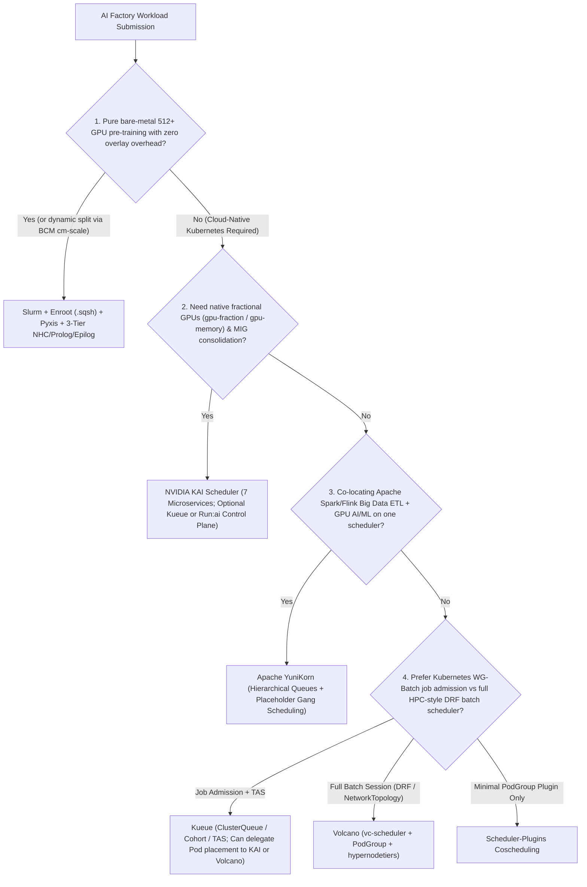

# 11.20 Scheduler comparison guide: KAI, Kueue, Volcano, YuniKorn and Slurm

| | |
|---|---|
| Level | Intermediate |
| Priority tier | 1 |
| Lab venue | GCP / GKE (plus local Python 3 simulation lab) |
| Part | Part 11: GPUs on Kubernetes, scheduling and virtualization |
| Sources used | Roland Huß et al., *Generative AI on Kubernetes* (O'Reilly, 2026, Ch. 7, Table 7-1); `nvidia-zero-to-hero/volume-01/chapter-05-ai-infrastructure-landscape.md`; `volume-08/01-architecture-design-masterclass.md`; `volume-10/00c-slurm-bcm-interview-lab.md`; `volume-10/08-enroot-and-pyxis-containers-for-hpc.md`; `volume-10/09-job-provisioning-health-gating-and-workflow-orchestration.md` |
| Coverage file | `planning/coverage/chapters/11-20.md` |

## Why this matters for AI infrastructure

Every AI platform team eventually faces the same multi-million-dollar architectural question (`volume-01/chapter-05` and `volume-08/01`): *"We have `500` to `4,096` GPUs across research, foundation-model training, data engineering, and production serving. Should we standardize on **Slurm**, or should we run **Kubernetes**—and if we choose Kubernetes, should we deploy **NVIDIA KAI Scheduler**, **Kueue**, **Volcano**, **Apache YuniKorn**, or the **Coscheduling plugin**?"*

Choosing the wrong scheduler—or deploying vanilla Kubernetes (`kube-scheduler`) for workloads it was never designed to orchestrate—causes immediate operational failure:
- If a team submits a `16`-GPU or `64`-GPU distributed training job to vanilla Kubernetes when only `8` or `30` GPUs are free, `kube-scheduler` starts those pods immediately while the remaining pods sit `Pending`, causing the running ranks to crash in **`NCCL Timeout`** loops (`volume-01/chapter-05`).
- In a `512`-node (`4,096`-GPU) cluster where a single node has an illustrative `1,000`-day (`~3`-year) Mean Time Between Failures (`MTBF`), the cluster experiences a hardware or link fault every **`1,000 / 512 = 1.95 days`** (`volume-10/09`). Without coordinated gang scheduling, topology awareness, and automated pre-job/post-job health gating (`Prolog`/`Epilog` and DCGM diagnostics), a single degraded optical transceiver or `Xid` fault stalls all `4,095` peer GPUs inside `ncclKernel_AllReduce` (`100%` spinlock utilization while step time doubles from `1.2 s` to `2.4 s`).

This chapter synthesizes everything we learned in Chapters 11.7 through 11.19 into a definitive **6-way scheduler comparison guide** across **Coscheduling**, **Kueue**, **Volcano**, **NVIDIA KAI Scheduler**, **Apache YuniKorn**, and **Slurm** (*Generative AI on Kubernetes* Chapter 7 Table 7-1, `volume-01/chapter-05`, `volume-08/01`, and `volume-10/00c`, `08`, `09`).

## Prerequisites and outcomes

### Prerequisites
- Completion of Chapters 11.7–11.9 (Gang scheduling, Kueue, Volcano, Coscheduling, JobSet, LeaderWorkerSet, PyTorchJob, MPI Operator) and Chapters 11.13–11.19 (NVIDIA KAI Scheduler and Run:ai).
- Familiarity with distributed training collectives (`AllReduce`) and leaf-spine network topologies.

### Outcomes
After completing this chapter, you will be able to:
- Compare **Coscheduling**, **Kueue**, **Volcano**, **NVIDIA KAI Scheduler**, **Apache YuniKorn**, and **Slurm** across nine architectural dimensions (*Generative AI on Kubernetes* Table 7-1): Architecture, Gang Scheduling, Queue Management, Resource Sharing, Preemption, Topology-Aware Scheduling, GPU Optimization, Maturity/Adoption, and Operational Complexity.
- Explain when to deploy **Apache YuniKorn** (converging Apache Spark/Flink data processing with GPU AI/ML jobs using task-group placeholder pods and `Fair` vs `BinPacking` node sorting) and how to compose **Kueue** (job-level `ClusterQueue`/`LocalQueue` admission) with **KAI Scheduler** or **Volcano** (pod-level topology and fractional GPU placement).
- Architect the **Slurm + Enroot + Pyxis** stack (`volume-10/08` and `09`), including `squashfs` (`.sqsh`) image imports (`3x to 5x` speedup), `98-nvidia.sh` and `99-mellanox.sh` hooks, `TopologyPlugin=topology/tree`, `SelectType=select/cons_tres`, 3-tier health gating (`NHC` every `300 s`, `< 10 s` `Prolog`, `Epilog` NVIDIA Xid Catalog audit), and **BCM Auto Scaler (`cm-scale`)** (`volume-10/00c`) to dynamically repurpose nodes between Slurm and Kubernetes.
- Apply the **6-Stage Solutions Architect Methodology (`Discover -> Model -> Compare -> Recommend -> Validate -> Adopt`, `volume-08/01`)** and the **DGX H100 SuperPOD Reference Architecture facts (`volume-10/00c`)** (`4` SUs = `128` nodes / `1,024` GPUs vs `127` nodes / `1,016` GPUs with `1` UFM node; `10.2 kW` max per DGX H100 with `6 × 3.3 kW` PSUs; `4` network fabrics).

## Concepts: basics to intermediate to advanced

### 1. Basics: The 6-scheduler taxonomy and complete feature comparison (*Generative AI on Kubernetes* Table 7-1 + YuniKorn + Slurm)

Before comparing features, classify how each scheduler integrates with the control plane:
1. **In-Process `kube-scheduler` Plugin (`Coscheduling`):** Extends the default Kubernetes scheduler via the Scheduling Framework (`PreFilter`, `Permit`, `Reserve`) to add lightweight `PodGroup` all-or-nothing placement—with zero queue management or fractional GPU support.
2. **Job-Level Admission Controller (`Kueue`):** Sits *above* pod scheduling (`suspend: true -> false`), managing `ClusterQueues`, `LocalQueues`, `Cohorts`, and `ResourceFlavors` (including Topology-Aware Scheduling `TAS`), while delegating pod-to-node binding to `kube-scheduler`, **KAI Scheduler**, or **Volcano**.
3. **Standalone Session/Batch Kubernetes Schedulers (`Volcano`, `NVIDIA KAI Scheduler`, `Apache YuniKorn`):** Replace or run alongside `kube-scheduler` (`schedulerName`), evaluating entire queues and `PodGroups` in periodic sessions (`OpenSession -> Actions -> Plugins -> CloseSession`).
4. **Bare-Metal HPC Workload Manager (`Slurm`):** Operates directly on the Linux host OS (`slurmctld`, `slurmd`, `slurmdbd`, `slurmrestd`) without `kubelet` or CNI overlays, executing unprivileged OCI containers via **NVIDIA Enroot** and the **Pyxis** SPANK plugin (`volume-10/08`).



#### Comprehensive 6-Scheduler Comparison Matrix (*Generative AI on Kubernetes* Table 7-1 Extended)

| Dimension | Coscheduling Plugin | Kueue | Volcano | NVIDIA KAI Scheduler | Apache YuniKorn | Slurm (`+ Enroot / Pyxis`) |
|---|---|---|---|---|---|---|
| **Architecture** | `kube-scheduler` framework plugin | Job-level admission controller (`Workload` CRD) | Full replacement batch scheduler (`vc-scheduler` sessions) | `7`-microservice GPU-native scheduler (`kai-scheduler`, `pod-grouper`, `binder`) | Unified batch + streaming replacement scheduler | Bare-metal HPC controller (`slurmctld` / `slurmd` / `slurmdbd`) |
| **Gang Scheduling** | `PodGroup` CRD (`minMember` all-or-nothing) | All-or-nothing job-level admission (`suspend` toggle) | `PodGroup` (`minMember`, `minTaskMember`, `minResources`) | `PodGroup` + hierarchical `SubGroup` / `PodSet` gang constraints | Task-group gang scheduling via placeholder pods | Native millisecond-synchronized whole-job launch (`sbatch` / `srun`) |
| **Queue Management** | None (external queue required) | `ClusterQueue`, `LocalQueue`, `Cohort` hierarchies | Hierarchical `Queues` with `capability`, `weight`, `deserved` | `2`-level `Queue` tree (`Department -> Project`) with `quota`, `limit`, `overQuotaWeight` | Hierarchical queues with guaranteed & max capacities | Multi-factor Fair-Share Tree (`Account -> User`) + `Partitions` + `QoS` |
| **Resource Sharing & Fairness** | None | `Cohort` fair sharing with flavor borrowing limits | Dominant Resource Fairness (`DRF`), `Proportion`, `Capacity` | Guaranteed `quota` + weighted over-quota borrowing + staleness reclamation | `Fair` (spread) and `BinPacking` node sorting + dynamic quotas | Historical usage-decay fair-share + `cgroups v2` (`ConstrainDevices=yes`) |
| **Preemption** | Basic Kubernetes `PriorityClass` only | Priority-based reclamation & preemption across `Cohort` | Priority + gang-aware `PodGroup` preemption & `reclaim` action | `Preempt` (in-queue priority) + `Reclaim` (over-quota fairness) | Priority & queue-capacity preemption across hierarchy | Graceful `SIGTERM` / `SIGKILL` (`UnkillableStepTimeout=60`) or requeue |
| **Topology-Aware Scheduling** | None (node-local `TopologyManager` only) | Topology-Aware Scheduling (`TAS`) via `Topology` & `ResourceFlavor` | `NetworkTopology` CRD (`hypernodetiers`) + `binpack` | `Topology` CRD + `SubGroup` rack / leaf / NVLink domain placement | Rack/zone placement rules & node sorting | `TopologyPlugin=topology/tree` + `SelectType=select/cons_tres` |
| **GPU Optimization** | Integer `nvidia.com/gpu` only | `ResourceFlavor` quota per GPU model / MIG profile | GPU sharing / MIG / vGPU plugins | **Native fractional GPUs** (`gpu-fraction`, `gpu-memory`) via `binder` reservation pods + MIG consolidation | Converges CPU Big Data (`Spark`/`Flink`) + integer/MIG GPU workloads | `AutoDetect=nvml` GRES, bare-metal IB/NVLink, Enroot `98-nvidia.sh` & `99-mellanox.sh` hooks |
| **Maturity & Adoption** | Kubernetes SIG Scheduling subproject | CNCF Kubernetes WG-Batch standard; high K8s-native adoption | CNCF graduated/incubating HPC-on-K8s standard | Open-sourced by NVIDIA (Apache 2.0, 2025) from battle-tested Run:ai engine | Apache Software Foundation top-level project (strong in Spark + AI clouds) | Decades-proven supercomputing standard (`Top500` & DGX SuperPOD) |
| **Operational Complexity** | **Low** | **Medium** | **Medium-High** | **Medium** | **Medium** | **High** for K8s-only teams; **Low/Standard** for HPC teams |

---

### 2. Intermediate: Apache YuniKorn, hybrid Kueue + KAI/Volcano composition, and Slurm containers (`Enroot` + `Pyxis`)

#### 1. When to Choose Apache YuniKorn (*Generative AI on Kubernetes* Chapter 7)
Many enterprise data platforms run massive **Apache Spark** and **Apache Flink** data-ingestion / tokenization pipelines on the same Kubernetes cluster that runs **PyTorch** training and inference. As *Generative AI on Kubernetes* Chapter 7 ("Apache YuniKorn") explains, **Apache YuniKorn** was purpose-built to unify big-data batch/streaming and AI/ML workloads under a single scheduler:
- **Hierarchical Queues with Guaranteed & Max Capacities:** Mirrors YARN's capacity scheduler model for teams migrating from Hadoop/Spark to Kubernetes.
- **Task-Group Gang Scheduling via Placeholder Pods:** YuniKorn creates lightweight **placeholder pods** on target nodes to reserve the full gang (`minMember`) before swapping in the real driver and executor/worker pods—preventing partial-allocation deadlocks across Spark executors and PyTorch ranks alike.
- **Pluggable `Fair` vs `BinPacking` Node Sorting:** Allows administrators to spread latency-sensitive services (`Fair`) while tightly packing batch GPU training pods onto the fewest nodes (`BinPacking`).

#### 2. Composing Kueue with KAI Scheduler or Volcano (*Generative AI on Kubernetes* Chapter 7)
You do not always have to choose *either* Kueue *or* KAI Scheduler / Volcano. A widely deployed enterprise pattern documented in *Generative AI on Kubernetes* Chapter 7 combines **Kueue for multi-team job admission and `ResourceFlavor` quota accounting** with **KAI Scheduler (or Volcano) for pod-level placement**:
1. A data scientist submits a `PyTorchJob` or `JobSet` labeled with `kueue.x-k8s.io/queue-name: team-a-lq` and `spec.template.spec.schedulerName: kai-scheduler`.
2. **Kueue** holds the job suspended (`suspend: true`) until `ClusterQueue` quota and `Cohort` borrowing rules are satisfied, then unsuspends the job (`suspend: false`).
3. **KAI Scheduler** (`pod-grouper`, `kai-scheduler`, `binder`) takes over at the Pod level to enforce hierarchical `SubGroup` NVLink/leaf-switch topology placement, fractional GPU reservation pods (`gpu-fraction` / `gpu-memory`), and dynamic MIG consolidation.

#### 3. How Slurm Runs Containers at Bare-Metal Speed: NVIDIA Enroot and Pyxis (`volume-10/08`)
If Kubernetes excels at containers, how does **Slurm** provide container reproducibility without Docker daemon root escalation or CNI overlay overhead? NVIDIA solved this with two open-source tools (`volume-10/08`):
- **NVIDIA Enroot (`github.com/NVIDIA/enroot`):** Turns OCI/Docker images into unprivileged sandboxes (`squashfs` `.sqsh` files) with **no daemon and no `setuid` binary** (`3x to 5x` faster image import). By default, Enroot leaves `--net`, `--pid`, `--ipc`, and `--uts` unshared (`ENROOT_UNSHARE_*=no`), so NCCL inside the container talks directly to the host's bare-metal InfiniBand HCAs (`mlx5_0..7`) with zero overlay penalty while Slurm's `cgroups v2` (`ConstrainDevices=yes`) tracks every process.
  - **Configuration Directories & Required Extensions:** Under `/etc/enroot` (`ENROOT_SYSCONF_PATH`), files in `environ.d/` must end in **`.env`**, mounts in `mounts.d/` must end in **`.fstab`**, and pre-start hooks in `hooks.d/` must end in **`.sh`**.
  - **Standard Hardware Hooks:** **`98-nvidia.sh`** invokes `libnvidia-container` (`NVIDIA_VISIBLE_DEVICES`) to inject GPUs, and **`99-mellanox.sh`** injects host-matched `MLNX_OFED` user-space libraries and selects InfiniBand HCAs via `MELLANOX_VISIBLE_DEVICES`.
  - **NGC `.credentials` Rule:** Importing from NVIDIA NGC requires **both** endpoints in `$ENROOT_CONFIG_PATH/.credentials` (`mode 600`):
    ```text
    machine nvcr.io login $oauthtoken password <token>
    machine authn.nvidia.com login $oauthtoken password <token>
    ```
  - **Pre-Import Once to Shared Storage:** Rather than letting `500` nodes pull `nvcr.io#nvidia/pytorch:TAG` simultaneously (triggering HTTP `429` rate limits), run `enroot import` once to create `/shared/containers/pytorch.sqsh` on Lustre/NFS so all nodes open a single shared file.
- **NVIDIA Pyxis (`github.com/NVIDIA/pyxis`):** A Slurm **SPANK plugin** (`/etc/slurm/plugstack.conf.d/pyxis.conf`) that adds `--container-image`, `--container-mounts`, `--container-workdir`, `--container-name`, and `--container-writable` directly to `srun` and `#SBATCH`. (**Critical upgrade rule from `volume-10/08`:** Since **Slurm `21.08`**, Pyxis must be recompiled against the exact deployed Slurm release's `spank.h` during every Slurm upgrade, and `#` in `#SBATCH --container-image nvcr.io\#nvidia/pytorch:21.12-py3` must be escaped with `\`.)

---

### 3. Advanced: Cluster MTBF, 3-tier Slurm health gating (`volume-10/09`), SuperPOD sizing, and `BCM Auto Scaler` (`volume-10/00c`)

#### 1. The Physics of Scale: Cluster MTBF and Silent Stragglers (`volume-10/09`)
Why do large training clusters invest so heavily in automated health gating? Because cluster Mean Time Between Failures (`MTBF`) scales inversely with the number of nodes `N` (`volume-10/09`):
`Cluster MTBF = Single Node MTBF / N`
Using the illustrative `volume-10/09` baseline of a **`1,000`-day (`~3`-year)** single-node MTBF across **`512` DGX nodes (`4,096` GPUs)**, the cluster suffers a hardware or link fault every **`1,000 / 512 = 1.95 days`**. Worse, if `1` GPU out of `1,024` (on a `128`-node `405B`-parameter training run) suffers thermal throttling or InfiniBand retransmits and slows by `20%`, all `1,023` healthy GPUs spin-wait inside `ncclKernel_AllReduce`—reporting **`100%` `DCGM_FI_DEV_GPU_UTIL`** while step time doubles from **`1.2 seconds` to `2.4 seconds`**.

To catch both hard faults and silent stragglers, `volume-10/09` implements a **3-Tier Health Gating Architecture** alongside Prometheus straggler detection:
- **Tier 1 — Continuous Background Polling (`NHC` / `CMDaemon` every `300 s`):** Configured in `slurm.conf` via `HealthCheckProgram=/usr/sbin/nhc` and `HealthCheckInterval=300`, checking NFS mounts, `2 TB` (`2,000,000,000 kB`) host RAM, `slurmd`, PCIe ACS (`ACSCtl` disabled), and `400 Gb/s` IB ports (`check_hw_ib 400 mlx5_0:1`).
- **Tier 2 — Pre-Job `Prolog` Gate (`< 10 s`, target `< 8 s`, `PrologFlags=Alloc`, `PrologEpilogTimeout=300`):** Runs as `root` immediately before job launch to verify `8` enumerated GPUs (`timeout 5s nvidia-smi`), `0` volatile uncorrectable ECC errors, `0` active hardware/thermal slowdowns (`clocks_event_reasons.hw_slowdown`), `8` active `400G` NDR HCA ports (`ibstat`), `0` `inactive` NVLinks (`nvidia-smi nvlink --status`), orphan PID cleanup, and fast **DCGM Level 1 (`dcgmi diag -r 1 -j`)**. If any gate fails, `Prolog` drains the node (`State=DRAIN`) and exits `1` so Slurm requeues the job on healthy nodes.
- **Tier 3 — Post-Job `Epilog` Gate (`UnkillableStepTimeout=60`) & NVIDIA Xid Catalog Audit:** Runs after job completion to kill residual user processes (`pkill -9 -u`), reset GPUs (`nvidia-smi --gpu-reset`), purge `/scratch/job_$SLURM_JOB_ID` and `/dev/shm`, and audit `journalctl -k` against the **NVIDIA Xid Catalog** (`volume-10/09` Section 9):

| NVIDIA Xid Code | Catalog Description | Catalog Immediate Action | Catalog Investigatory Action |
|---|---|---|---|
| **`Xid 13` / `31` / `94`** | Graphics Engine Exception / Memory Page Fault / Contained Memory Error | **`RESTART_APP`** (Do NOT drain node for app fault) | `WORKFLOW_XID_13` / `31` / `IGNORE (sympathetic)` |
| **`Xid 44` / `63`** | Context Switch Engine Fault / Row Remapping Event | **`IGNORE`** | `CONTACT_SUPPORT` / `IGNORE` |
| **`Xid 48`** | Double-Bit Uncorrectable ECC Error | **`WORKFLOW_XID_48`** (Drain & isolate) | `WORKFLOW_XID_48` |
| **`Xid 62` / `64` / `95` / `109`** | Microcontroller Halt / Remap Failure / Uncontained Memory / Context Switch Timeout | **`RESET_GPU`** | `CONTACT_SUPPORT` / `IGNORE (sympathetic)` |
| **`Xid 74`** | NVLink Error | **`WORKFLOW_NVLINK_ERR`** (Drain & inspect fabric) | `CONTACT_SUPPORT` |
| **`Xid 79`** | GPU Has Fallen Off the Bus | **`RESTART_BM`** (Cold/warm bare-metal reboot & drain) | `CONTACT_SUPPORT` |
| **`Xid 119` / `120`** | GSP RPC Timeout / GSP Error | **`RESET_GPU`** | `INVESTIGATE_SW` |

*(And for in-flight silent stragglers, Prometheus alerts when `(avg by (instance) (DCGM_FI_PROF_PIPE_TENSOR_ACTIVE) - DCGM_FI_PROF_PIPE_TENSOR_ACTIVE) > 0.15` for `5m` while `DCGM_FI_DEV_GPU_UTIL > 80` or when InfiniBand `PortXmitWait` spikes `> 3σ` across peers.)*

#### 2. DGX H100 SuperPOD Reference Facts and `BCM Auto Scaler` (`cm-scale`, `volume-10/00c`)
When designing a hybrid Slurm + Kubernetes AI Factory in a senior architecture review (`volume-08/01` and `volume-10/00c`), anchor your design on verified reference facts:
- **SuperPOD Scalable Units (`SUs`) and the `127` vs `128` Node Detail:** One DGX H100 SuperPOD Scalable Unit (`SU`) is **`32` nodes (`256` GPUs)**, and `4` SUs nominal is **`128` nodes (`1,024` GPUs)** (scaling up to `> 64` SUs / `>= 2,000` nodes). However, in the full compute-fabric table of the H100 reference architecture, `1` DGX node is removed to accommodate UFM connectivity—so **`1` SU shows `31` nodes** and **`4` SUs show `127` nodes and `1,016` GPUs** (`volume-10/00c` Section 2.1).
- **Four Dedicated Network Fabrics:**
  1. **Compute InfiniBand** (rail-aligned in groups of `32` nodes),
  2. **Storage InfiniBand** (`MQM9700-NS2F` switches sized for **`> 40 GB/s`** per node, `1:1` at storage and `~4:3` on the DGX side),
  3. **In-Band Management Ethernet** (`SN4600C` switches), and
  4. **Out-of-Band (`OOB`) Management Ethernet** (`SN2201` switches connecting to the BMCs; Redfish `/redfish/v1/Managers/BMC/LogServices/SEL/Entries` returns `75` entries per page with `13 to 20` character passwords).
- **Power & Rack Density Math:** A single DGX H100 is rated at **`10.2 kW` maximum** with **`6 × 3.3 kW` power supplies**, and the reference rack exceeds `40 kW`. If a customer's data center rack is capped at **`30 kW`**, at most **`floor(30 / 10.2) = 2` DGX H100 systems (`20.4 kW`)** can fit per rack before accounting for top-of-rack switch power.
- **Dynamic Slurm + Kubernetes Coexistence via `BCM Auto Scaler` (`cm-scale`):** Instead of manually changing node categories in `cmsh`, **NVIDIA Base Command Manager 11 (`BCM 11` §8)** provides **`cm-scale` (BCM Auto Scaler)**, which monitors pending queues across both Slurm and Kubernetes and dynamically switches free nodes between Slurm and Kubernetes using **configuration overlays** (matching requested CPUs, memory, pods, and NVIDIA GPUs).

#### 3. Applying the 6-Stage Solutions Architect Methodology (`volume-08/01`) to Scheduler Selection
When a CIO or VP of Infrastructure asks you to recommend a single scheduling architecture for a new multi-million-dollar GPU cluster (`volume-08/01` Customer Scenario), never jump straight to a product name. Walk the **6-Stage Architecture Methodology Framework (`volume-08/01` Section 1)** and map the **6 Critical Paths**:
1. **Stage 1 — Discover (Unpack Stated Solutions into Real Requirements):**
   - Separate **Requirements** (mathematically necessary outcomes, such as `p99 < 50 ms` inference or `1,024`-GPU synchronous pre-training), **Assumptions** (unproven beliefs, such as assuming a shared NFS server can absorb `1,000` simultaneous checkpoints), **Constraints** (hard boundaries, such as `30 kW` rack limits or mandatory corporate Kubernetes standards), **Trade-offs** (sacrificing peak utilization for hardware isolation), and **Failure Domains** (`8` GPUs sharing one chassis power bus or `32` nodes sharing one SU rail).
2. **Stage 2 — Model the Six Critical Paths:**
   - **Data/Request Path:** How training batches (`Lustre + GDS` over `MQM9700-NS2F` storage IB at `> 40 GB/s`) or user inference prompts (`HTTPS/gRPC -> API Gateway -> vLLM/Triton`) reach GPU HBM.
   - **Control Path:** How **Slurm** (`slurmctld -> slurmd`), **KAI Scheduler** (`pod-grouper -> kai-scheduler -> binder`), **Kueue** (`ClusterQueue -> Workload`), **Volcano**, or **YuniKorn** places and preempts workloads.
   - **Trust/Identity Path:** OIDC/RBAC, per-Project `ServiceAccounts`, and Enroot unprivileged UIDs (`no setuid`).
   - **Persistent State:** Model weights, tokenized datasets, and tiered checkpoints (`Local NVMe -> NFS/Lustre -> Object/Tape`).
   - **Failure Domains:** Single GPU (`Xid`), single node (`10.2 kW` DGX H100), leaf switch / SU (`32` nodes / `31` with UFM), and control-plane leader election.
   - **Observability Path:** `DCGM-Exporter` (`DCGM_FI_PROF_PIPE_TENSOR_ACTIVE`, `PortXmitWait`), Slurm `NHC`/`Prolog`/`Epilog`, and `ncclras`.
3. **Stage 3 & 4 — Compare and Recommend (Option A Hybrid vs Option B Standardized Kubernetes):**
   - **Option A — Consciously Designed Hybrid (`Slurm` + `Kubernetes` with `BCM Auto Scaler`):** Deploy bare-metal **Slurm + Enroot/Pyxis** on the `InfiniBand NDR` partition for `512+` GPU foundation-model pre-training, and deploy **Kubernetes + KAI Scheduler / Run:ai** on the `RoCEv2` / MIG partition for interactive research and autoscaled inference, using **`cm-scale` (BCM Auto Scaler)** to shift idle nodes between engines via configuration overlays.
   - **Option B — Standardized Kubernetes with Advanced Batch Scheduling (`KAI Scheduler`, `Kueue + KAI/Volcano`, or `YuniKorn`):** If corporate IT mandates a `100%` Kubernetes control plane and has the platform engineering maturity to operate secondary RDMA networks (`Multus` + `NVIDIA Network Operator` + `SR-IOV` / `DRA`), deploy **KAI Scheduler** (for fractional GPU sharing, MIG consolidation, and hierarchical `SubGroup` gang/topology placement), **Kueue + KAI/Volcano** (for multi-cohort flavor admission), or **Apache YuniKorn** (when co-locating `Spark`/`Flink` data pipelines with GPU training).
4. **Stage 5 & 6 — Validate and Adopt:**
   - Run an acceptance Proof of Concept (`PoC`) comparing `nccl-tests` (`all_reduce_perf -b 1G -e 10G -f 2 -g 1`) and `GPUStragglerDetected` fault recovery before committing production traffic, and hand over Day-2 runbooks for `Prolog`/`Epilog` Xid gating, Pyxis rebuilds on Slurm upgrades, and KAI `PodGroup`/`BindRequest` triage.

## Commands and configurations that matter

### 1. Slurm `slurm.conf` Topology, `cons_tres`, and 3-Tier Health Gate Configuration (`volume-10/09`)

```ini
# /etc/slurm/slurm.conf excerpt for an NVIDIA DGX H100 AI Factory (volume-10/09, untested here)
TopologyPlugin=topology/tree
SelectType=select/cons_tres
SelectTypeParameters=CR_Core_Memory,CR_CORE_DEFAULT_DIST_BLOCK
GresTypes=gpu,mps

Prolog=/etc/slurm/prolog.sh
Epilog=/etc/slurm/epilog.sh
PrologFlags=Alloc
PrologEpilogTimeout=300
UnkillableStepTimeout=60

HealthCheckProgram=/usr/sbin/nhc
HealthCheckInterval=300
HealthCheckNodeState=ANY
```

### 2. Multi-Node PyTorch Launch on Slurm via Pyxis and Enroot (`volume-10/08` & `09`)

```bash
# Launch a 4-node (32-GPU) containerized PyTorch job via Slurm + Pyxis + Enroot (untested here)
export NCCL_NET=IB
export NCCL_IB_HCA=mlx5_0:1,mlx5_1:1,mlx5_2:1,mlx5_3:1,mlx5_4:1,mlx5_5:1,mlx5_6:1,mlx5_7:1
export NCCL_IB_TIMEOUT=22

srun --nodes=4 --ntasks-per-node=8 --gpus-per-node=8 \
     --cpus-per-task=12 --exclusive --mpi=pmix \
     --container-image=/shared/containers/pytorch.sqsh \
     --container-mounts=/shared/datasets:/data,/shared/checkpoints:/checkpoints \
     --container-workdir=/workspace \
     python3 train.py
```

### 3. Composing Kueue Job Admission with NVIDIA KAI Scheduler Pod Placement (*Generative AI on Kubernetes* Ch. 7)

```yaml
# kueue-plus-kai-scheduler-pytorchjob.yaml (untested here)
apiVersion: kubeflow.org/v1
kind: PyTorchJob
metadata:
  name: llm-finetune-composed
  namespace: team-a
  labels:
    kueue.x-k8s.io/queue-name: team-a-local-queue
    kai.scheduler/queue: proj-team-a
spec:
  runPolicy:
    suspend: true   # Kueue controls job-level admission via suspend
  pytorchReplicaSpecs:
    Worker:
      replicas: 4
      template:
        spec:
          schedulerName: kai-scheduler   # KAI Scheduler handles PodGroup & topology placement
          containers:
            - name: pytorch
              image: nvcr.io/nvidia/pytorch:24.08-py3
              resources:
                limits:
                  nvidia.com/gpu: 8
```

## How it fails

| Failure mode | Exact symptom & command evidence | Root cause boundary | Remediation |
|---|---|---|---|
| **1. `16`-GPU job on vanilla Kubernetes has `8` Pods `Running` and `8` Pods `Pending`, then crashes with `NCCL Timeout` (`volume-01/chapter-05`)** | `kubectl get pods` shows `worker-0..7` `Running` and `worker-8..15` `Pending`; running workers crash after `10–30 min` waiting for rank rendezvous. | **Missing Gang Scheduling in Default `kube-scheduler`:** `kube-scheduler` schedules pods one by one without `PodGroup` all-or-nothing semantics. | Deploy **KAI Scheduler**, **Volcano**, **Kueue**, **YuniKorn**, or **Coscheduling** so all `16` pods are held until all `16` GPUs can be allocated simultaneously. |
| **2. `128`-node (`1,024`-GPU) training step time doubles from `1.2 s` to `2.4 s` while all GPUs show `100%` utilization (`volume-10/09` Scenario 1)** | No node crashes and `DCGM_FI_DEV_GPU_UTIL` is `100%` everywhere, but `DCGM_FI_PROF_PIPE_TENSOR_ACTIVE` on one GPU lags the node average by `> 0.15` (`15%`) and IB `PortXmitWait` spikes. | **Silent Straggler Behind `AllReduce` Spinlock:** One GPU (thermal slowdown or degraded `400G` optical transceiver falling back or retransmitting) stalls all `1,023` peers inside `ncclKernel_AllReduce`. | Set `export NCCL_NET=IB` (so NCCL fails fast instead of falling back to TCP), alert on `DCGM_FI_PROF_PIPE_TENSOR_ACTIVE` lag `> 0.15` for `5m` and `PortXmitWait > 3σ`, and gate `400G` IB rates + NVLink health in `Prolog`. |
| **3. Slurm `Epilog` drains healthy nodes whenever a user's PyTorch script hits `CUDA out of memory` (`volume-10/09` Scenario 2)** | Fleet capacity shrinks rapidly during hyperparameter sweeps because every user OOM or `Xid 31` / `Xid 13` triggers `State=DRAIN`. | **Conflating User-Space Application Faults with Hardware Xids:** `Xid 13` and `Xid 31` (and `Xid 44` `IGNORE`) are application/context faults (`RESTART_APP`), not dead silicon. | Follow the **NVIDIA Xid Catalog**: only drain/escalate on hardware/bus/ECC faults (`Xid 48`, `62`, `64`, `74`, `79`, `95`, `109`, `119`, `120`), while cleaning up user processes and leaving the node `IDLE` after user OOMs (`Xid 31`). |
| **4. After upgrading Slurm (`>= 21.08`), `srun --container-image=...` fails to load the Pyxis plugin (`volume-10/08`)** | `slurmd` logs `spank: pyxis.so: incompatible plugin version` and rejects containerized jobs after a minor Slurm upgrade. | **Pyxis SPANK ABI Tie (`Slurm >= 21.08`):** Pyxis must be compiled against the exact `spank.h` header of the running Slurm release. | Include rebuilding and redeploying the `pyxis` package across all compute nodes in every Slurm upgrade playbook before restarting `slurmd`. |
| **5. `64`-node NCCL run freezes at `0%` GPU utilization while Slurm shows the job `RUNNING` (`volume-10/00c` Scenario 2)** | `squeue` shows `RUNNING`, GPU utilization drops to `0%`, and operators are tempted to `scancel` and restart immediately. | **Uncollected Hang Forensics:** Restarting before running `ncclras` (NCCL `>= 2.24` RAS client) and checking `dmesg` destroys the evidence of which rank is `MISMATCH` or `INCOMPLETE`. | Run `ncclras` twice a few seconds apart to identify `MISMATCH` / `INCOMPLETE` ranks, check `ulimit -l` (`unlimited` for `ibv_reg_mr`), grep `NVRM: Xid` in `dmesg`, and check `ibstat` error counter deltas before terminating the job. |

## Hands-on lab

### Venue and scope
This lab runs locally using Python 3 standard library (`code/part11/scheduler_comparison_guide.py` and `code/part11/scheduler_comparison_guide_lab.py`) to verify the 6-scheduler comparison matrix (*Generative AI on Kubernetes* Chapter 7 Table 7-1 + YuniKorn + Slurm), the workload-to-scheduler decision engine, the `volume-10/09` `512`-node (`4,096`-GPU) cluster MTBF (`1.95 days`) and NVIDIA Xid Catalog classifier (`RESTART_APP`, `IGNORE`, `RESET_GPU`, `RESTART_BM`, `WORKFLOW_XID_48`, `WORKFLOW_NVLINK_ERR`), and the `volume-10/00c` DGX H100 SuperPOD reference architecture calculator (`128` vs `127` nodes, `1,024` vs `1,016` GPUs, `10.2 kW` max power, `2` nodes per `30 kW` rack, and `cm-scale` Auto Scaler). Cluster and Slurm commands are marked `(untested here)`.

### Step 1: Run the self-checking scheduler comparison guide lab (tested here)

Run the lab script from the repository root:

```bash
python3 code/part11/scheduler_comparison_guide_lab.py
```

Captured output from this repository:
```text
=== Chapter 11.20 Lab: Scheduler Comparison (KAI, Kueue, Volcano, YuniKorn, Slurm) ===
  [PASS] Comparison matrix covers all 6 schedulers (Coscheduling, Kueue, Volcano, KAI, YuniKorn, Slurm)
  [PASS] Coscheduling is a Low-complexity kube-scheduler framework plugin with PodGroup gang scheduling only
  [PASS] Kueue acts as a job-level admission controller using ClusterQueue, LocalQueue, Cohort, and TAS
  [PASS] Volcano provides session-based DRF/Proportion/Capacity scheduling and NetworkTopology hypernodetiers
  [PASS] KAI Scheduler provides 7 microservices, Department->Project Queues, SubGroup topology, and native fractional GPUs
  [PASS] Apache YuniKorn unifies Spark/Flink data processing and AI/ML task-group gang scheduling with Fair/BinPacking sorting
  [PASS] Slurm pairs TopologyPlugin=topology/tree and SelectType=select/cons_tres with Enroot/Pyxis containers
  [PASS] 512+ GPU bare-metal pre-training recommends Slurm + Enroot/Pyxis with BCM Auto Scaler (cm-scale) coexistence
  [PASS] Multi-tenant Kubernetes cluster needing dynamic fractional GPUs (gpu-fraction/gpu-memory) recommends KAI Scheduler
  [PASS] Cluster co-locating Apache Spark/Flink ETL and PyTorch GPU training recommends Apache YuniKorn
  [PASS] Cloud-native team wanting job-level quota admission that composes with kube-scheduler/KAI/Volcano selects Kueue
  [PASS] Minimalist cluster needing only all-or-nothing PodGroup placement selects Coscheduling plugin
  [PASS] 512-node (4,096-GPU) cluster with 1,000-day single-node MTBF experiences a fault every 1.95 days (1000/512)
  [PASS] DGX H100 SuperPOD reference has 4 SUs of 32 nodes (128 nodes, 1,024 GPUs) and 127 nodes (1,016 GPUs) with 1 UFM node removed
  [PASS] DGX H100 maximum power is 10.2 kW (6 x 3.3 kW PSUs), so a 30 kW rack fits at most 2 DGX H100 nodes (20.4 kW <= 30 kW)
  [PASS] SuperPOD reference architecture uses 4 fabrics (SN4600C in-band, SN2201 OOB, MQM9700-NS2F >40 GB/s storage IB at 1:1 and 4:3)
  [PASS] Redfish BMC SEL endpoint returns 75 entries per page and requires 13 to 20 character passwords
  [PASS] Enroot imports OCI images into squashfs (.sqsh) with 3x to 5x speedup and uses 98-nvidia.sh and 99-mellanox.sh hooks
  [PASS] Enroot .credentials requires both nvcr.io and authn.nvidia.com entries with $oauthtoken, and Pyxis must be rebuilt per Slurm >= 21.08
  [PASS] DCGM diagnostics span 4 run levels: r1 (seconds), r2 (~2 min), r3 (~15 min), and r4 (xlong burn-in)
  [PASS] Prometheus GPUStragglerDetected alerts when DCGM_FI_PROF_PIPE_TENSOR_ACTIVE lags node average by > 0.15 (15%) for 5m at GPU util > 80%
  [PASS] Slurm Prolog (< 10s, PrologEpilogTimeout=300, UnkillableStepTimeout=60, HealthCheckInterval=300) checks 8 GPUs, 0 ECC, 8 NDR 400G IB ports, and 0 inactive NVLinks
  [PASS] NVIDIA Xid Catalog maps Xid 13/31/94 to RESTART_APP, Xid 44/63 to IGNORE, Xid 64/95/109/119/120 to RESET_GPU, and Xid 79 to RESTART_BM
  [PASS] NVIDIA Xid Catalog maps Xid 48 (Double-Bit ECC) to WORKFLOW_XID_48 and Xid 74 (NVLink Error) to WORKFLOW_NVLINK_ERR
  [PASS] Volume 8 Ch 1 defines the 6-stage Architecture Methodology Framework (Discover, Model, Compare, Recommend, Validate, Adopt) and 6 Critical Paths

Summary: 25 passed, 0 failed out of 25 checks.
```

### Exercises

1. **Exercise 1 — Comparing the 6 schedulers (*Generative AI on Kubernetes* Table 7-1 + YuniKorn + Slurm):** Using `SCHEDULER_COMPARISON_MATRIX` in `code/part11/scheduler_comparison_guide.py`, contrast **Coscheduling**, **Kueue**, **Volcano**, **KAI Scheduler**, **Apache YuniKorn**, and **Slurm** across Architecture, Gang Scheduling, Queue Management, Topology Awareness, and GPU Optimization.
2. **Exercise 2 — Selecting the right scheduler for five enterprise scenarios:** Using `recommend_scheduler()`, state which scheduler you recommend for (a) `512+` GPU bare-metal foundation-model pre-training, (b) multi-tenant Kubernetes needing dynamic fractional GPUs (`gpu-fraction` / `gpu-memory`), (c) a shared cluster running Apache Spark/Flink ETL alongside PyTorch training, (d) cloud-native job-level quota admission that composes with secondary pod schedulers, and (e) minimal `PodGroup` all-or-nothing placement.
3. **Exercise 3 — Slurm containerization with Enroot and Pyxis (`volume-10/08`):** Explain why Enroot leaves `--net` unshared by default, name the three `/etc/enroot` configuration directories and their mandatory file extensions, identify the two hooks that inject GPUs and InfiniBand MOFED, and state the two machine entries required in `.credentials` for NGC.
4. **Exercise 4 — Cluster MTBF and 3-tier Slurm health gating (`volume-10/09`):** Using `compute_cluster_mtbf_and_superpod_facts()`, compute the cluster MTBF for `512` nodes (`4,096` GPUs) assuming a `1,000`-day single-node MTBF, list the `7` pre-job checks in the `< 10 s` Slurm `Prolog`, and explain how the Prometheus `GPUStragglerDetected` rule catches a silent straggler when `DCGM_FI_DEV_GPU_UTIL` is `100%`.
5. **Exercise 5 — NVIDIA Xid Catalog resolution buckets (`volume-10/09`):** Using `XID_CATALOG_ACTIONS`, state the catalog Immediate Action for `Xid 13`, `31`, `44`, `48`, `63`, `64`, `74`, `79`, `94`, `95`, `109`, `119`, and `120`, and explain why draining a node on `Xid 31` or `Xid 44` is an anti-pattern.
6. **Exercise 6 — DGX H100 SuperPOD reference architecture and `BCM Auto Scaler` (`volume-10/00c`):** Explain why the `4`-SU DGX H100 SuperPOD reference architecture lists `128` nodes (`1,024` GPUs) in the overview but `127` nodes (`1,016` GPUs) and `31` nodes per SU in the compute-fabric table, calculate how many `10.2 kW` DGX H100 nodes fit in a `30 kW` rack, and explain how **BCM Auto Scaler (`cm-scale`)** moves nodes between Slurm and Kubernetes.

## Checkpoint questions

<details>
<summary><strong>1. How does Kueue's architectural role differ from Volcano, NVIDIA KAI Scheduler, and Apache YuniKorn (Generative AI on Kubernetes Chapter 7 Table 7-1)?</strong></summary>

**Kueue** is a **job-level admission controller** (`Workload` CRD) that controls *when* a job is unsuspended (`suspend: true -> false`) based on `ClusterQueue`, `LocalQueue`, and `Cohort` quotas, while delegating actual Pod-to-Node binding to `kube-scheduler` (or to KAI Scheduler / Volcano). **Volcano**, **KAI Scheduler**, and **YuniKorn** are full **pod-group batch schedulers** (`schedulerName`) that directly bind Pods to Nodes.
</details>

<details>
<summary><strong>2. What makes NVIDIA KAI Scheduler unique among the Kubernetes schedulers compared in Table 7-1 of Generative AI on Kubernetes Chapter 7?</strong></summary>

KAI Scheduler (`operator`, `kai-scheduler`, `pod-grouper`, `binder`, `queue-controller`, `admission`, `pod-group-controller`) is purpose-built for **GPU optimization**: it combines hierarchical `SubGroup` gang and topology placement (`Topology` CRD) with **native fractional GPU scheduling (`gpu-fraction` and `gpu-memory`)** backed by `binder` reservation pods and dynamic MIG consolidation.
</details>

<details>
<summary><strong>3. When should a platform architect choose Apache YuniKorn, and how does YuniKorn implement gang scheduling (Generative AI on Kubernetes Chapter 7)?</strong></summary>

Choose **Apache YuniKorn** when a Kubernetes cluster co-locates **big-data analytics/streaming workloads (`Apache Spark`, `Apache Flink`)** and **AI/ML workloads (`PyTorch`, `Kubeflow`)** and wants a single unified hierarchical queue scheduler (often migrating from Hadoop YARN). YuniKorn implements gang scheduling via **task groups and placeholder pods**, reserving all required resources on nodes with lightweight placeholder pods before swapping in the real application pods.
</details>

<details>
<summary><strong>4. How can a platform team combine Kueue and KAI Scheduler (or Volcano) in the same cluster (Generative AI on Kubernetes Chapter 7)?</strong></summary>

Configure **Kueue** to manage job-level quota admission, `Cohort` fair-sharing, and `ResourceFlavor` selection (`suspend: true`), and set `schedulerName: kai-scheduler` (or `volcano`) in the workload's Pod template so that once Kueue admits the job (`suspend: false`), KAI Scheduler or Volcano executes fine-grained `SubGroup` topology placement and fractional/MIG GPU bin-packing.
</details>

<details>
<summary><strong>5. Why does submitting a 16-GPU distributed training job to vanilla Kubernetes when only 8 GPUs are free result in NCCL Timeout crashes (Volume 1 Chapter 5)?</strong></summary>

Because default `kube-scheduler` lacks gang scheduling: it immediately schedules `8` pods to `Running` while leaving `8` pods `Pending`. The `8` running ranks initialize `torch.distributed` / NCCL and attempt to connect to the `8` missing ranks until the rendezvous/collective timer expires with `NCCL Timeout`, wasting the `8` allocated GPUs the entire time.
</details>

<details>
<summary><strong>6. What are the six stages of the Architecture Methodology Framework and the six critical paths to model in Volume 8 Chapter 1?</strong></summary>

- **Six stages:** `1. Discover` -> `2. Model` -> `3. Compare` -> `4. Recommend` -> `5. Validate` -> `6. Adopt`.
- **Six critical paths:** `1. Data/Request Path`, `2. Control Path`, `3. Trust/Identity Path`, `4. Persistent State`, `5. Failure Domains`, and `6. Observability Path`.
</details>

<details>
<summary><strong>7. How does NVIDIA Enroot differ from Docker or containerd on a shared Slurm cluster, and why does it leave --net off by default (Volume 10 Chapter 8)?</strong></summary>

**Enroot** is a daemonless, unprivileged sandbox tool (with **no `setuid` binary**) that unpacks `.sqsh` (`squashfs`) images (`3x to 5x` faster import) and runs directly under the submitting user's UID and Slurm's `cgroups v2` tree. It leaves `--net` (`ENROOT_UNSHARE_NET=no`) off by default so multi-node NCCL jobs share the host's network namespace and talk directly to bare-metal InfiniBand and Ethernet NICs with zero overlay latency.
</details>

<details>
<summary><strong>8. What are the three configuration directories under /etc/enroot (with their required file extensions) and the two standard hooks that expose GPUs and InfiniBand (Volume 10 Chapter 8)?</strong></summary>

- **Directories and extensions:** `environ.d/*.env`, `mounts.d/*.fstab`, and `hooks.d/*.sh`.
- **Standard hardware hooks:** **`98-nvidia.sh`** (exposes GPUs via `libnvidia-container` and `NVIDIA_VISIBLE_DEVICES`) and **`99-mellanox.sh`** (injects host `MLNX_OFED` libraries and selects InfiniBand HCAs via `MELLANOX_VISIBLE_DEVICES`).
</details>

<details>
<summary><strong>9. What two machine entries are required in Enroot's .credentials file to import images from NVIDIA NGC, and how do you avoid HTTP 429 rate limits on a 500-node Slurm job (Volume 10 Chapter 8)?</strong></summary>

1. Both `machine nvcr.io login $oauthtoken password <token>` and `machine authn.nvidia.com login $oauthtoken password <token>` are required in `$ENROOT_CONFIG_PATH/.credentials`.
2. To avoid HTTP `429` registry rate limits, run `enroot import` **once** on a login/build node, write the `.sqsh` file to shared storage (`/shared/containers/pytorch.sqsh`), and pass that file path to `srun --container-image=/shared/containers/pytorch.sqsh`.
</details>

<details>
<summary><strong>10. What happens to the Pyxis Slurm plugin when you upgrade Slurm (Volume 10 Chapter 8)?</strong></summary>

Since **Slurm `21.08`**, Pyxis (`pyxis.so`) must be compiled against the exact `spank.h` header of the deployed Slurm release; otherwise `slurmd` refuses to load the plugin. Every Slurm upgrade must rebuild and redeploy Pyxis across all nodes.
</details>

<details>
<summary><strong>11. Using the Cluster MTBF formula in Volume 10 Chapter 9, how often does a 512-node (4,096-GPU) cluster experience a node fault if a single node has an illustrative 1,000-day MTBF?</strong></summary>

`Cluster MTBF = Single Node MTBF / N = 1,000 days / 512 nodes ≈` **`1.95 days`**.
</details>

<details>
<summary><strong>12. Why should a multi-node Slurm sbatch script set export NCCL_NET=IB instead of relying on NCCL_IB_DISABLE=0 (Volume 10 Chapter 9)?</strong></summary>

`NCCL_IB_DISABLE=0` is already the default and allows NCCL to silently fall back to slow kernel TCP/IP sockets (`NET/Socket`) if InfiniBand initialization fails, turning the node into a massive silent straggler. Setting **`export NCCL_NET=IB`** forces the InfiniBand transport plugin so the job fails fast at startup if IB is unavailable.
</details>

<details>
<summary><strong>13. Compare the four DCGM diagnostic run levels (dcgmi diag -r 1 through -r 4) in Volume 10 Chapter 9 Section 7.</strong></summary>

- **Level 1 (`-r 1`, seconds):** Software deployment checks (NVML/CUDA libraries, device access, conflicting processes, page retirement/row remap/InfoROM, Fabric Manager) — safe for pre-job `Prolog` readiness.
- **Level 2 (`-r 2`, `~2 minutes`):** Adds `memory` and `pcie` tests (framebuffer faults, PCIe/peer bandwidth, replays, NVLink state) — used when investigating a failed workload.
- **Level 3 (`-r 3`, `~15 minutes`):** Long hardware diagnostics adding stress, power, and bandwidth plugins — used on drained nodes for isolation and post-repair acceptance.
- **Level 4 (`-r 4`, longer than Level 3):** Extended burn-in and post-mortem hardware diagnostics.
</details>

<details>
<summary><strong>14. Why does a 1,024-GPU training job with one slow straggler GPU still report 100% DCGM_FI_DEV_GPU_UTIL on all 1,024 GPUs, and how does the Prometheus GPUStragglerDetected rule catch it (Volume 10 Chapter 9)?</strong></summary>

When `1` GPU runs slow, the other `1,023` GPUs busy-wait inside the `ncclKernel_AllReduce` CUDA kernel spinlock, which registers as **`100%` `DCGM_FI_DEV_GPU_UTIL`**. The `GPUStragglerDetected` rule instead compares **`DCGM_FI_PROF_PIPE_TENSOR_ACTIVE`** (actual Tensor Core math activity) against the node average and alerts if a GPU lags by **`> 0.15` (`15` percentage points) for `5 minutes`** while `DCGM_FI_DEV_GPU_UTIL > 80` (paired with InfiniBand `PortXmitWait > 3σ` monitoring).
</details>

<details>
<summary><strong>15. What seven pre-flight checks are executed by the production Slurm Prolog script (/etc/slurm/prolog.d/90-ai-health-gate.sh) in Volume 10 Chapter 9?</strong></summary>

1. **GPU enumeration (`timeout 5s nvidia-smi`):** Exactly `8` GPUs responsive.
2. **Volatile uncorrectable ECC (`ecc.errors.uncorrected.volatile.total`):** Must equal `0`.
3. **Thermal/hardware slowdown (`clocks_event_reasons.hw_slowdown` / `sw_thermal_slowdown`):** `0` `Active` throttling flags.
4. **InfiniBand HCA port state & rate (`ibstat`):** All `8` compute HCA ports `Active` at **`400` (`400G` NDR)** line rate.
5. **NVLink status (`nvidia-smi nvlink --status`):** `0` `inactive` links.
6. **Orphan process cleanup:** `kill -9` any leftover PIDs from prior exclusive jobs.
7. **Fast DCGM Level 1 (`dcgmi diag -r 1 -j`):** Zero `"Fail"` test statuses.
</details>

<details>
<summary><strong>16. According to the NVIDIA Xid Catalog table in Volume 10 Chapter 9 Section 9, what is the Immediate Action for Xid 13/31/94, Xid 44/63, Xid 48, Xid 64/95/109/119/120, Xid 74, and Xid 79?</strong></summary>

- **`Xid 13`, `31`, `94`:** **`RESTART_APP`** (application/contained fault; do not drain the node).
- **`Xid 44`, `63`:** **`IGNORE`** (`Xid 63` is a successful row-remapping event).
- **`Xid 48` (Double-Bit ECC):** **`WORKFLOW_XID_48`** (drain and follow ECC workflow).
- **`Xid 62`, `64`, `95`, `109`, `119`, `120`:** **`RESET_GPU`** (with `CONTACT_SUPPORT` or `INVESTIGATE_SW` on recurrence).
- **`Xid 74` (NVLink Error):** **`WORKFLOW_NVLINK_ERR`**.
- **`Xid 79` (GPU Fallen Off the Bus):** **`RESTART_BM`** (bare-metal reboot and support escalation).
</details>

<details>
<summary><strong>17. In the NVIDIA DGX SuperPOD H100 reference architecture (Volume 10 Chapter 00c), what are the four network fabrics, and why does a 4-SU design show 128 nodes (1,024 GPUs) in one table and 127 nodes (1,016 GPUs) in the compute-fabric table?</strong></summary>

- **Four fabrics:** Compute InfiniBand (rail-aligned in `32`-node SUs), Storage InfiniBand (`MQM9700-NS2F`, `> 40 GB/s` per node, `1:1` storage / `~4:3` DGX), In-Band Management Ethernet (`SN4600C`), and Out-of-Band Management Ethernet (`SN2201`).
- **Why `127` vs `128` nodes (`31` vs `32` in `1` SU):** Each SU is nominally `32` nodes (`4 × 32 = 128` nodes, `1,024` GPUs), but in the full compute-fabric layout `1` DGX system is removed to accommodate UFM connectivity, leaving `31` nodes in a `1`-SU table and `127` nodes (`1,016` GPUs) in a `4`-SU table.
</details>

<details>
<summary><strong>18. What is the maximum power specification of a single DGX H100 system (Volume 10 Chapter 00c), and how many DGX H100 systems fit into a 30 kW customer rack?</strong></summary>

A single DGX H100 is listed at **`10.2 kW` maximum** with **`6 × 3.3 kW` power supplies** (and the reference rack layout exceeds `40 kW`). In a **`30 kW` rack**, at most **`2` DGX H100 systems (`2 × 10.2 kW = 20.4 kW <= 30 kW`)** fit before accounting for switch power.
</details>

<details>
<summary><strong>19. How does NVIDIA Base Command Manager 11 (BCM 11) dynamically share hardware between Slurm and Kubernetes, and how does BCM implement head-node High Availability (Volume 10 Chapter 00c)?</strong></summary>

- **Dynamic Slurm/Kubernetes node repurposing:** BCM uses **BCM Auto Scaler (`cm-scale`, §8)**, which inspects pending workloads in Slurm and Kubernetes and switches free nodes between engines using **configuration overlays** (not manual `cmsh` category edits).
- **Head-node HA (`§15`):** Configured via `cmha-setup` using BMC power-control fencing (`STONITH`), a node quorum check, a dedicated heartbeat link, and shared NAS storage (not Pacemaker/Corosync/DRBD).
</details>

<details>
<summary><strong>20. Walk through the evidence-driven hang triage procedure for a frozen 64-node training run where GPU utilization is 0% (Volume 10 Chapter 00c Scenario 2).</strong></summary>

1. **Scheduler & allocation:** Confirm the allocation is intact and no node was drained.
2. **Launch & pinned memory limits:** Confirm all ranks are alive on every node and `ulimit -l` inside a step is `unlimited` (preventing `ibv_create_qp` / `ibv_reg_mr` failures).
3. **NCCL RAS (`ncclras` on NCCL `>= 2.24`):** Run `ncclras` twice a few seconds apart before killing the job; `MISMATCH` lists ranks whose collective op counts are behind, and `INCOMPLETE` identifies an unresponsive rank.
4. **Kernel Xid audit:** Grep `NVRM: Xid` across all nodes' kernel logs (`dmesg` / `journalctl -k`).
5. **Fabric counters:** Check `ibstat` port states/rates, Subnet Manager health, and port error counter deltas across two samples a few minutes apart.
</details>

## Sources and review notes

### Primary sources read in full for this chapter
- Book sources from the local TOON-RAG corpus:
  - Roland Huß et al., *Generative AI on Kubernetes* (O'Reilly, 2026), Chapter 7 (*Job Scheduling Optimization*, Table 7-1 *Comparison of Kubernetes scheduling solutions*, "Apache YuniKorn", and Kueue + Volcano/KAI Scheduler composition).
- Author's Volume 1, Volume 8, and Volume 10 notes:
  - `nvidia-zero-to-hero/volume-01/chapter-05-ai-infrastructure-landscape.md` (Kubernetes vs Slurm comparison table, `500`-GPU / `64`-GPU scenario, `16`-GPU `8` Running / `8` Pending `NCCL Timeout` deadlock, and Kueue/Volcano/Run:ai + Enroot/Pyxis convergence).
  - `volume-08/01-architecture-design-masterclass.md` (6-stage Architecture Methodology Framework `Discover -> Model -> Compare -> Recommend -> Validate -> Adopt`, 6 critical paths, and Option A vs Option B Slurm/Kubernetes trade-off matrix).
  - `volume-10/00c-slurm-bcm-interview-lab.md` (DGX H100 SuperPOD `4` SUs = `128` nodes / `1,024` GPUs vs `127` nodes / `1,016` GPUs and `31` nodes/SU for UFM; `4` fabrics `SN4600C`, `SN2201`, `MQM9700-NS2F` `> 40 GB/s` at `1:1` and `4:3`; `10.2 kW` max DGX H100 power with `6 × 3.3 kW` PSUs and `> 40 kW` rack; Redfish BMC URIs with `75` SEL entries/page and `13–20` char passwords; BCM 11 `cmha-setup` HA, `boot`/`provisioning` roles, `cm-scale` Auto Scaler overlays; and `ncclras` `64`-node hang triage).
  - `volume-10/08-enroot-and-pyxis-containers-for-hpc.md` (Enroot unprivileged `.sqsh` sandboxes, `3x to 5x` import speedup, `/etc/enroot` `environ.d/*.env`, `mounts.d/*.fstab`, `hooks.d/*.sh`, `98-nvidia.sh` and `99-mellanox.sh`, `nvcr.io` + `authn.nvidia.com` `.credentials`, and Pyxis SPANK flags and Slurm `>= 21.08` rebuild rule).
  - `volume-10/09-job-provisioning-health-gating-and-workflow-orchestration.md` (`512`-node `4,096`-GPU cluster MTBF `1,000 / 512 = 1.95 days`, `slurm.conf` `TopologyPlugin=topology/tree` and `SelectType=select/cons_tres`, `cgroups v2` `ConstrainDevices=yes`, `112`-core `2×56` DGX H100 `14` cores/GPU, `NCCL_NET=IB`, 3-tier NHC/Prolog/Epilog health gates, DCGM `-r 1..4` run levels, `GPUStragglerDetected` `> 0.15` Tensor Core lag, `1.2 s -> 2.4 s` `405B` straggler scenario, and the NVIDIA Xid Catalog table).

### Related source files mapped in MIGRATION_MAP.md
- No separate `nvidia-devops` file was exclusively mapped to `11.20` in `brief.py`; this chapter integrates *Generative AI on Kubernetes* Chapter 7, `volume-01/chapter-05`, `volume-08/01`, `volume-10/00c`, `volume-10/08`, and `volume-10/09`.

### Run here
- `python3 code/part11/scheduler_comparison_guide_lab.py` (`25 passed, 0 failed out of 25 checks`).

### Explicitly labelled inferences
- Combining *Generative AI on Kubernetes* Table 7-1 (Coscheduling, Kueue, Volcano, KAI Scheduler) with the book's Apache YuniKorn section and the `volume-10` Slurm + Enroot/Pyxis stack into a unified 6-scheduler matrix is a synthesis verified by `code/part11/scheduler_comparison_guide_lab.py`.

### Not verified on live hardware
- All `srun`, `sbatch`, `enroot`, `dcgmi`, `ncclras`, `curl` Redfish, and `kubectl` manifests are marked `(untested here)`.

### Not in the corpus
- Proprietary cloud-provider managed Slurm control-plane internals beyond standard SchedMD Slurm and NVIDIA Base Command Manager 11 (`BCM 11`).

### Corrections to the author's notes
- Corpus coverage: YuniKorn does not appear in the corpus. Its row in the comparison tables is written from working knowledge and was not verified against upstream documentation.
- KAI Scheduler check 2026-10-25: this chapter's KAI details were compared with the upstream docs; see the note at the top of Chapter 11.14 for what was confirmed, corrected (`kai.scheduler/queue` label, `kai.scheduler/topology*` annotations, `Topology` group `kai.scheduler/v1alpha1`) and not confirmed (the book's `Project` kind). In Chapter 11.17 the example now requests `gpu-fraction` only; the upstream docs list `gpu-fraction` and `gpu-memory` as alternative ways to ask for a share.
- Validation pass 2026-10-25: `validate_chapter.py` and `check_coverage.py` pass. The YAML manifests and commands are marked untested and were not applied to a cluster. Custom resource API versions (for example `kueue.x-k8s.io/v1beta1`, `resource.k8s.io/v1`) change between releases, so check them against the version you install. Console outputs quoted from the Volume notes are illustrative unless the chapter says otherwise.
- Retains all vendor-verified corrections from `volume-10/00c`, `volume-10/08`, and `volume-10/09`: BCM 11 uses `cmha-setup` + fencing/quorum/NAS (not Pacemaker/DRBD), `boot`/`provisioning` roles (not CMDaemon proxies or BitTorrent), and `cm-scale` Auto Scaler overlays (not manual category switching); Enroot injects GPUs/IB via `hooks.d/98-nvidia.sh` and `99-mellanox.sh` (not `environ.d/*.conf`); and `Xid 44` is `IGNORE` while `Xid 109` is `RESET_GPU` in the NVIDIA Xid Catalog.
