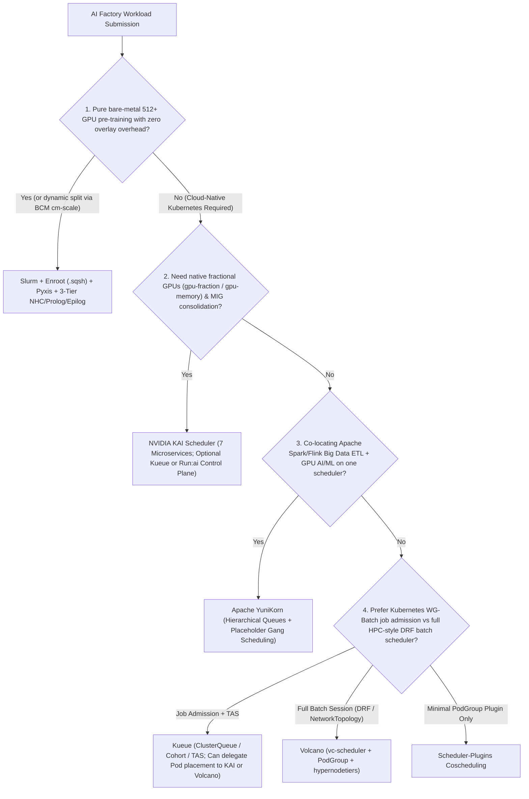

# 11.20 Scheduler comparison guide: KAI, Kueue, Volcano, YuniKorn and Slurm

| | |
|---|---|
| Level | Intermediate |
| Priority tier | 1 |
| Lab venue | GCP / GKE |
| Part | Part 11: GPUs on Kubernetes, scheduling and virtualization |
| Coverage file | `planning/coverage/chapters/11-20.md` |

## Why this matters for AI infrastructure

Sooner or later, every AI platform team faces the same expensive architectural decision. Picture a team that runs research notebooks, foundation-model training, data engineering, and production serving on 500 to 4,096 GPUs. Leadership has to choose the scheduling control plane for that fleet. A control plane here is the software layer that decides which job runs where and when. The first decision is whether to standardize on bare-metal Slurm or on Kubernetes. Bare metal means the software runs directly on the server, with no virtual layer in between. If the team chooses Kubernetes, it must then select between NVIDIA KAI Scheduler, Kueue, Volcano, Apache YuniKorn, and the Coscheduling plugin. A plugin is an add-on that extends a program's behavior without changing its core code.

Choosing the wrong scheduler, or relying on the default Kubernetes scheduler for distributed GPU work, causes failures right away. Consider a researcher who submits a 16-GPU distributed training job to vanilla Kubernetes while only 8 GPUs are free. The default scheduler starts 8 pods immediately and leaves 8 pods pending. A pod is the smallest unit that Kubernetes runs. The running ranks wait for collective rendezvous, which is the moment every worker in the job has found the others. Then they crash with NCCL timeout errors. NCCL is the library that moves data between GPUs. The allocated GPUs are wasted for that entire time, and the researcher sees only a timeout.

At larger scales, hardware physics makes the problem worse. Picture a 512-node cluster with 4,096 GPUs. Each node has a 1,000-day mean time between failures, or MTBF, which is the average time a node runs before it fails. Across the whole fleet, a node or link fault arrives every 1.95 days. Without gang scheduling, topology awareness and automated pre-job health gating, a single degraded optical transceiver stalls all 4,095 peer GPUs inside collective spinlocks. A transceiver is the small module that turns electrical signals into light for a fiber link. A spinlock is a wait in which the processor keeps checking a condition in a tight loop instead of sleeping, so a stuck GPU looks busy when it is not doing useful work.

Read the block below as a short list of what goes wrong at scale.

```text
Scale Failures That Force Purpose-Built Scheduling & Health Gating:
- Partial-Allocation Deadlock: 16-GPU or 64-GPU job submitted when 8 or 30 GPUs are free -> running ranks crash in NCCL Timeout loops.
- Inverse Cluster MTBF Scaling: 512 nodes (4,096 GPUs) with 1,000-day (~3-year) single-node MTBF -> 1,000 / 512 = 1.95 days between hardware faults.
- Silent Collective Straggler: 1 throttled GPU or degraded 400G transceiver stalls peer GPUs inside ncclKernel_AllReduce at 100% spinlock utilization, doubling step time from 1.2 s to 2.4 s.
```

Each line in the block names a different way that a scheduler can fail under load. The first is a partial start, where some of a job's pods begin and the rest never do. The second is a statistical effect, where a rare failure on one node becomes a regular event across the whole cluster. The third is a silent slowdown, where one weak part drags down every other part without causing a visible crash.

This chapter brings Chapters 11.7 through 11.19 together into one six-way scheduler comparison. It covers Coscheduling, Kueue, Volcano, NVIDIA KAI Scheduler, Apache YuniKorn, and Slurm. Before you select a scheduler for your cluster, compare your workload mix and operational maturity with the architectural boundaries of each engine. Operational maturity here means how much your team already knows how to run, monitor, and repair the system.

## Prerequisites and outcomes

A reader who opens this chapter cold may not know which earlier chapter introduced a term. This chapter builds on several earlier ones. The prerequisites tell you what to read first, and the outcomes paragraph describes what the chapter walks through.

### Prerequisites

- Read Chapters 11.7 through 11.9 first. They cover gang scheduling, Kueue, Volcano, Coscheduling, JobSet, LeaderWorkerSet, PyTorchJob, and MPI Operator.
- Then read Chapters 11.13 through 11.19, which cover NVIDIA KAI Scheduler and the Run:ai platform view.
- Finally, get comfortable with distributed training collectives and leaf-spine network topologies. A leaf-spine network is a two-level switch layout where every leaf switch connects to every spine switch.

### Outcomes

A platform lead often receives a slide deck that lists six schedulers in one table and asks which one to buy. This chapter helps you read that table with the right questions in mind. It compares Coscheduling, Kueue, Volcano, NVIDIA KAI Scheduler, Apache YuniKorn, and Slurm across nine architectural dimensions. It then explains when Apache YuniKorn fits a mixed Spark and PyTorch cluster, and how Kueue admission can work together with KAI Scheduler or Volcano pod placement. Next comes the bare-metal Slurm container stack, with three-tier health gating, NVIDIA Xid Catalog automation, and BCM Auto Scaler coexistence. The chapter closes with the six-stage Solutions Architect methodology and the DGX H100 SuperPOD sizing rules that you apply in an enterprise design review.

## Concepts: basics to intermediate to advanced

### 1. Basics: The 6-scheduler taxonomy and complete feature comparison

Picture a platform team that evaluates schedulers by reading feature checklists. It installs two or three controllers, and each one believes it owns the same pods. The controllers then fight over which node a pod should bind to, and the pods sit in a pending state with no clear reason. Feature lists alone hide this kind of conflict. When platform teams evaluate schedulers from feature checklists alone, they often deploy overlapping controllers that fight over pod bindings. To avoid these control-plane conflicts, classify each scheduler by how it integrates with Kubernetes or the host operating system. The four classes below are the simplest way to do that.

1. In-process scheduler framework plugins, such as Coscheduling, extend the default `kube-scheduler` binary. The `kube-scheduler` is the standard Kubernetes component that places each pod on a node. These plugins add lightweight pod-group gang scheduling, with no queue trees and no fractional GPUs.
2. Job-level admission controllers, such as Kueue, sit above pod scheduling. They toggle job suspension based on cluster queues and cohorts, and they delegate pod binding to a secondary scheduler. A cohort is a group of queues that can lend unused quota to one another.
3. Standalone, session-based Kubernetes batch schedulers, such as Volcano, NVIDIA KAI Scheduler, and Apache YuniKorn, evaluate entire queues and pod groups in periodic scheduling cycles. A session is one full pass over the queues, and a pod group is a set of pods the scheduler treats as one unit.
4. Bare-metal HPC workload managers, such as Slurm, run directly on the Linux host OS through `slurmctld` and `slurmd`. HPC means high-performance computing. In Slurm, `slurmctld` is the central controller and `slurmd` is the daemon that runs on each compute node. They run without CNI overlays and launch unprivileged containers through NVIDIA Enroot and Pyxis. A CNI overlay is the virtual network layer that Kubernetes builds on top of the physical network.

The four classes answer one question each. Does the scheduler live inside Kubernetes, sit on top of it, run beside it, or replace the host's own workload manager? Once you know the class, you know which other tools it can work with and which ones it will fight with.

The flowchart below turns these four classes into a sequence of yes-or-no questions. Each question either sends you to a scheduler or moves you to the next question. Read it from the top. The first question is the most demanding one, because it asks for a pure bare-metal setup. Each later question narrows the choice further.



The flowchart is a rough guide, not a verdict. A team that answers yes to the first question may still choose a hybrid design, and a team that answers no to every question may still need the gang behavior of a batch scheduler. Use the chart to start the conversation, and then check the matrix below.

#### Comprehensive 6-Scheduler Comparison Matrix

This matrix compares four primary Kubernetes batch schedulers. It then adds Apache YuniKorn and bare-metal Slurm to that comparison. Each row is one dimension, and each column is one scheduler. Read a row across to see how the six options differ on that dimension, and read a column down to see the full profile of one option.

| Dimension | Coscheduling Plugin | Kueue | Volcano | NVIDIA KAI Scheduler | Apache YuniKorn | Slurm (`+ Enroot / Pyxis`) |
|---|---|---|---|---|---|---|
| **Architecture** | `kube-scheduler` framework plugin | Job-level admission controller (`Workload` CRD) | Full replacement batch scheduler (`vc-scheduler` sessions) | `7`-microservice GPU-native scheduler (`kai-scheduler`, `pod-grouper`, `binder`) | Unified batch + streaming replacement scheduler | Bare-metal HPC controller (`slurmctld` / `slurmd` / `slurmdbd`) |
| **Gang Scheduling** | `PodGroup` CRD (`minMember` all-or-nothing) | All-or-nothing job-level admission (`suspend` toggle) | `PodGroup` (`minMember`, `minTaskMember`, `minResources`) | `PodGroup` + hierarchical `SubGroup` / `PodSet` gang constraints | Task-group gang scheduling via placeholder pods | Native millisecond-synchronized whole-job launch (`sbatch` / `srun`) |
| **Queue Management** | None (external queue required) | `ClusterQueue`, `LocalQueue`, `Cohort` hierarchies | Hierarchical `Queues` with `capability`, `weight`, `deserved` | `2`-level `Queue` tree (`Department -> Project`) with `quota`, `limit`, `overQuotaWeight` | Hierarchical queues with guaranteed & max capacities | Multi-factor Fair-Share Tree (`Account -> User`) + `Partitions` + `QoS` |
| **Resource Sharing & Fairness** | None | `Cohort` fair sharing with flavor borrowing limits | Dominant Resource Fairness (`DRF`), `Proportion`, `Capacity` | Guaranteed `quota` + weighted over-quota borrowing + staleness reclamation | `Fair` (spread) and `BinPacking` node sorting + dynamic quotas | Historical usage-decay fair-share + `cgroups v2` (`ConstrainDevices=yes`) |
| **Preemption** | Basic Kubernetes `PriorityClass` only | Priority-based reclamation & preemption across `Cohort` | Priority + gang-aware `PodGroup` preemption & `reclaim` action | `Preempt` (in-queue priority) + `Reclaim` (over-quota fairness) | Priority & queue-capacity preemption across hierarchy | Graceful `SIGTERM` / `SIGKILL` (`UnkillableStepTimeout=60`) or requeue |
| **Topology-Aware Scheduling** | None (node-local `TopologyManager` only) | Topology-Aware Scheduling (`TAS`) via `Topology` & `ResourceFlavor` | `NetworkTopology` CRD (`hypernodetiers`) + `binpack` | `Topology` CRD + `SubGroup` rack / leaf / NVLink domain placement | Rack/zone placement rules & node sorting | `TopologyPlugin=topology/tree` + `SelectType=select/cons_tres` |
| **GPU Optimization** | Integer `nvidia.com/gpu` only | `ResourceFlavor` quota per GPU model / MIG profile | GPU sharing / MIG / vGPU plugins | **Native fractional GPUs** (`gpu-fraction`, `gpu-memory`) via `binder` reservation pods + MIG consolidation | Converges CPU Big Data (`Spark`/`Flink`) + integer/MIG GPU workloads | `AutoDetect=nvml` GRES, bare-metal IB/NVLink, Enroot `98-nvidia.sh` & `99-mellanox.sh` hooks |
| **Maturity & Adoption** | Kubernetes SIG Scheduling subproject | CNCF Kubernetes WG-Batch standard; high K8s-native adoption | CNCF graduated/incubating HPC-on-K8s standard | Open-sourced by NVIDIA (Apache 2.0, 2025) from battle-tested Run:ai engine | Apache Software Foundation top-level project (strong in Spark + AI clouds) | Decades-proven supercomputing standard (`Top500` & DGX SuperPOD) |
| **Operational Complexity** | **Low** | **Medium** | **Medium-High** | **Medium** | **Medium** | **High** for K8s-only teams; **Low/Standard** for HPC teams |

Use this matrix to rule out any scheduler that lacks the GPU sharing or gang scheduling primitives you require, before you run a proof of concept. A proof of concept is a small, short test that shows whether an idea works in your setting before you commit to it.

The matrix is easier to use when you think in terms of the winning case for each choice. Coscheduling wins when your need is small. If you only need a set of pods to start together, and you do not need queues or fractional GPUs, the plugin keeps the moving parts few. Kueue wins when the hard problem is deciding who may start a job and in what order. It is the right layer when you already trust another scheduler to place pods, and you want a single place to manage quotas across teams. Volcano wins when you want a full batch scheduler that works in session cycles and understands topology, and you are ready to run its session cycles. KAI Scheduler wins when GPUs must be shared finely, with fractions and MIG, and when the quota tree is hierarchical. YuniKorn wins when the same cluster must run Spark or Flink pipelines next to GPU training. Slurm wins when the workload is a large, tightly coupled training run on hardware that you control end to end, and your team already runs HPC software.

The operational column matters as much as the features. A scheduler that is powerful but unfamiliar to your operators can cause more outages than a simpler one. Slurm is rated high for Kubernetes-only teams for this reason, and it is rated low or standard for teams that already run HPC clusters.

---

### 2. Intermediate: Apache YuniKorn, hybrid Kueue composition, and Slurm containers

Real AI platforms rarely run isolated PyTorch jobs. Data engineering teams run large Apache Spark and Flink tokenization pipelines next to GPU training. Tokenization is the step that splits raw text into the units a model reads. HPC teams, meanwhile, need container reproducibility on Slurm without the risks of a root daemon. A root daemon is a background service that runs with full administrator rights, so a bug in it can affect the whole machine.

#### 1. When to Choose Apache YuniKorn

Suppose one Kubernetes cluster runs Apache Spark and Flink pipelines alongside PyTorch training. If you keep a separate scheduler for each, the cluster capacity gets split into pieces. One scheduler holds the big-data nodes, another holds the GPU nodes, and each one sits idle when the other is busy. Apache YuniKorn fixes that by placing big-data batch and streaming jobs and AI workloads under one hierarchical queue model. That model is inspired by Hadoop YARN. A hierarchical queue model means queues sit inside other queues, so a team's share can be split again for its sub-teams.

YuniKorn gives you gang scheduling through task groups and placeholder pods. Before a distributed job starts, YuniKorn puts placeholder pods on the target nodes, and those pods hold the full gang capacity. A placeholder pod is a stand-in that reserves room without doing real work. Once every slot is locked, YuniKorn swaps in the real driver and worker pods. Administrators can choose the node sorting. `Fair` spreads latency-sensitive services across nodes, while `BinPacking` packs GPU batch jobs onto the fewest nodes. Spreading keeps one busy node from slowing a service that needs quick replies, and packing leaves whole nodes free for the large jobs that need them.

Here is the simple test for YuniKorn. If your cluster runs a mix of data pipelines and GPU training, and you want one queue model for both, YuniKorn is the candidate to evaluate. If the cluster is only GPU training, its strength in big-data placement goes unused.

#### 2. Composing Kueue with KAI Scheduler or Volcano

You do not have to pick either Kueue or a pod-group scheduler such as KAI Scheduler or Volcano. A common enterprise pattern uses Kueue for multi-team job admission and resource-flavor quota accounting. A resource flavor is a named type of hardware, such as one GPU model, that a queue can draw from. The pod-level placement then goes to KAI Scheduler or Volcano.

Here is how the pieces fit together. A researcher submits a PyTorchJob with a Kueue local queue label, and sets `schedulerName: kai-scheduler` in the pod template. A local queue label is a tag on the job that tells Kueue which queue the job belongs to. Kueue keeps the job suspended until cohort and flavor quotas are available, and then it unsuspends the job. A suspended job exists in the cluster but has no pods running. KAI Scheduler groups the newly unsuspended pods and binds them across NVLink domains, leaf switches, or fractional GPU reservation pods. An NVLink domain is a set of GPUs connected by the fast NVLink links inside a server or across a rack.

The split of duties is the important idea. Kueue decides whether the job is allowed to begin, and it decides by team quota. KAI Scheduler decides where each pod lands, and it decides by topology and by fractional GPU need. Neither one does the other's job, which is why the two can work together without a fight.

#### 3. How Slurm Runs Containers at Bare-Metal Speed: NVIDIA Enroot and Pyxis

Historically, running containers on bare-metal Slurm clusters was painful. Docker required a privileged root daemon, and its virtual network bridges broke InfiniBand RDMA. A bridge is a software switch that joins virtual networks. RDMA, or remote direct memory access, lets one machine read or write another machine's memory without going through the operating system, and InfiniBand is a high-speed network that supports it. A bridge in the path adds work between the card and the application, so the fast path is lost. **NVIDIA Enroot and Pyxis give Slurm clusters cloud-native container reproducibility at bare-metal speed without a root daemon or overlay network.**

Enroot turns OCI container images into unprivileged squashfs files that end in `.sqsh`. OCI is the open standard format that most container images follow. Squashfs is a compressed, read-only file system format, so an image becomes one file that is easy to copy around. That conversion makes imports 3x to 5x faster than standard layer extraction. Layer extraction is the slower process of unpacking each image layer one at a time. By default, Enroot does not unshare the network, PID, IPC, or UTS namespaces. A namespace is a kernel feature that gives a process its own view of a resource, such as the network or the process list. NCCL inside the container therefore talks straight to the host InfiniBand adapters, while Slurm's `cgroups v2` tree still tracks every process. A cgroup is a Linux mechanism that groups processes and limits what they can use. Pyxis is a Slurm SPANK plugin. A SPANK plugin is a hook that lets Slurm add new command-line options and behavior. Pyxis adds `--container-image` and `--container-mounts` flags directly to `srun` and `#SBATCH` commands.

The result is that a researcher can ask for a container image in the same command that asks for GPUs. The image is pulled once and shared, and the job runs at close to the speed it would have on the bare machine. That is the reason HPC teams accept the extra moving parts.

The block below lists the operating rules for Enroot and Pyxis on Slurm.

```text
NVIDIA Enroot and Pyxis Operational Rules on Slurm:
1. Enroot Configuration Directories (/etc/enroot, ENROOT_SYSCONF_PATH) & Required File Extensions:
   - environ.d/*.env   (Environment variables)
   - mounts.d/*.fstab  (Filesystem bind mounts)
   - hooks.d/*.sh      (Pre-start execution hooks)
2. Standard Hardware Injection Hooks:
   - 98-nvidia.sh: Invokes libnvidia-container (NVIDIA_VISIBLE_DEVICES) to expose allocated GPUs.
   - 99-mellanox.sh: Injects host-matched MLNX_OFED user-space libraries and selects IB HCAs via MELLANOX_VISIBLE_DEVICES.
3. NVIDIA NGC Authentication ($ENROOT_CONFIG_PATH/.credentials, chmod 600):
   - Must include BOTH endpoints or pulls fail:
     machine nvcr.io login $oauthtoken password <token>
     machine authn.nvidia.com login $oauthtoken password <token>
4. Avoiding HTTP 429 Registry Rate Limits at 500-Node Scale:
   - Run enroot import once on a build/login node to create /shared/containers/pytorch.sqsh on Lustre/NFS rather than pulling from 500 nodes simultaneously.
5. Critical Pyxis SPANK Upgrade & Escape Rules:
   - Since Slurm 21.08, Pyxis (pyxis.so) must be recompiled against the exact spank.h header of the deployed Slurm release during every Slurm upgrade.
   - In #SBATCH directives, escape the '#' character in image URIs: #SBATCH --container-image nvcr.io\#nvidia/pytorch:21.12-py3
```

Read the block as three kinds of rule. The first kind tells Enroot where its settings live and which file types it reads. The second kind lists the two hooks that connect the container to the GPU and to the InfiniBand card. The third kind covers credentials, registry load, and the upgrade rule for Pyxis. The upgrade rule is the one that surprises teams most, because nothing looks broken until the next Slurm upgrade.

When you operate Slurm at scale, import shared `.sqsh` images onto Lustre once, and rebuild Pyxis during every Slurm version upgrade. Lustre is the parallel file system that many nodes can read at the same time. Importing once keeps the registry from being hit by hundreds of nodes at the same moment.

---

### 3. Advanced: Cluster MTBF, 3-tier Slurm health gating, SuperPOD sizing, and BCM Auto Scaler

#### 1. The Physics of Scale: Cluster MTBF and Silent Stragglers

Why do large training clusters spend so much effort on automated health gating before and after each job? The reason is simple arithmetic. Cluster mean time between failures shrinks as the node count of a job grows, because it scales inversely with the number of nodes. Inversely means that doubling the nodes halves the time between failures, if each node fails at the same average rate.

A failure in one node is rare on its own. Across hundreds of nodes, the same rare failure becomes a regular event. A team that plans around the single-node number will be surprised every week. The formula below turns that idea into a number that a planner can use.

```text
Cluster MTBF and Silent Straggler Math:
- Formula: Cluster MTBF = Single Node MTBF / N
- 512-Node (4,096-GPU) Example: 1,000-day (~3-year) single-node MTBF / 512 nodes = 1.95 days between hardware/link faults.
- Silent Straggler Impact (128-node, 1,024-GPU 405B training run):
  * 1 GPU slows by 20% due to thermal throttling or InfiniBand retransmits.
  * All 1,023 healthy GPUs busy-wait inside ncclKernel_AllReduce spinlocks, reporting 100% DCGM_FI_DEV_GPU_UTIL while step time doubles from 1.2 seconds to 2.4 seconds.
- Prometheus Straggler Detection Rule (GPUStragglerDetected):
  * Alerts when (avg by (instance) (DCGM_FI_PROF_PIPE_TENSOR_ACTIVE) - DCGM_FI_PROF_PIPE_TENSOR_ACTIVE) > 0.15 (15%) for 5m while DCGM_FI_DEV_GPU_UTIL > 80, or when IB PortXmitWait spikes > 3 sigma across peers.
```

The formula gives the expected interval between faults, and the straggler case shows how one slow GPU can hold back the whole job. A straggler is a worker that runs slower than the others, and in a synchronized job every other worker waits for it. The alert rule in the block is the tool for catching that case early, before a long run is wasted.

> **dcgm-exporter 4.9.0 version note.** dcgm-exporter 4.9.0 (2026-11-06) renamed many default metrics and changed some units. For example `DCGM_FI_DEV_GPU_UTIL` (percent) became `DCGM_FI_DEV_GPU_UTIL_RATIO` (0 to 1), and `DCGM_FI_DEV_FB_USED` (MiB) became `DCGM_FI_DEV_FB_USED_BYTES`. The metric names in this chapter are the 4.8.x names. On a 4.9.0 exporter use the [full mapping in 17.4](../part-17-operations/04-dcgm-exporter-and-interpreting-gpu-metrics.md#14-what-dcgm-exporter-490-renamed), and change thresholds together with the unit. The exporter is the small service that turns GPU readings into metrics that Prometheus can scrape, and a scrape is one read of those metrics. A renamed metric breaks any alert that still uses the old name, so check the names before you copy a rule.

Production Slurm clusters use three tiers of health gating to catch hard hardware faults and silent stragglers before they ruin a multi-node job. Think of the three tiers as three checkpoints on the way in and out of a job. Tier 1 runs the Node Health Check daemon every 300 seconds in the background. It catches a node that drifts out of health while no job is using it. Tier 2 runs a fast pre-job `Prolog` script in under 10 seconds, before job allocation. A `Prolog` script runs before the job starts on each node. If any GPU, ECC, NVLink, or 400G InfiniBand check fails, that script drains the node and requeues the job. ECC stands for error-correcting code, the memory protection that the GPU uses. Draining a node means Slurm stops giving it new work, and requeuing means the job goes back in line. Tier 3 runs a post-job `Epilog` script. It cleans up residual processes, resets GPUs, and audits kernel logs against the NVIDIA Xid Catalog. The `Epilog` runs after the job ends, and it leaves the node clean for the next user.

The block below lists the exact checks and settings for each tier.

```text
3-Tier Slurm Health Gating Architecture & DCGM Diagnostic Run Levels:
- Tier 1 Background NHC (HealthCheckProgram=/usr/sbin/nhc, HealthCheckInterval=300):
  * Verifies NFS mounts, 2 TB (2,000,000,000 kB) host RAM, slurmd daemon, PCIe ACS disabled (ACSCtl), and 400 Gb/s IB ports (check_hw_ib 400 mlx5_0:1).
- Tier 2 Pre-Job Prolog (< 10 s, target < 8 s, PrologFlags=Alloc, PrologEpilogTimeout=300):
  * Gate 1: 8 responsive GPUs (timeout 5s nvidia-smi)
  * Gate 2: 0 volatile uncorrectable ECC errors (ecc.errors.uncorrected.volatile.total)
  * Gate 3: 0 active thermal/hardware slowdowns (clocks_event_reasons.hw_slowdown / sw_thermal_slowdown)
  * Gate 4: 8 active 400G NDR IB HCA ports (ibstat)
  * Gate 5: 0 inactive NVLinks (nvidia-smi nvlink --status)
  * Gate 6: Orphan PID cleanup from prior exclusive jobs
  * Gate 7: Fast DCGM Level 1 check (dcgmi diag -r 1 -j) -> drains node (State=DRAIN) and exits 1 on failure
- Tier 3 Post-Job Epilog (UnkillableStepTimeout=60):
  * Kills residual user PIDs (pkill -9 -u), resets GPUs (nvidia-smi --gpu-reset), purges /scratch/job_$SLURM_JOB_ID and /dev/shm, and audits journalctl -k against the NVIDIA Xid Catalog.
- Four DCGM Diagnostic Run Levels:
  * Level 1 (-r 1, seconds): Software/NVML/InfoROM/Fabric Manager readiness (safe for pre-job Prolog).
  * Level 2 (-r 2, ~2 minutes): Adds memory and PCIe/NVLink bandwidth checks for failed-job triage.
  * Level 3 (-r 3, ~15 minutes): Hardware stress, power, and bandwidth tests on drained nodes.
  * Level 4 (-r 4, xlong burn-in): Extended burn-in and post-mortem hardware validation.
```

The three tiers are built around one idea. The cheapest checks run most often, and the most thorough checks run only when a node is about to be trusted again. Tier 2 is the one that matters most for a single job, because it is the last check before the job's first step. The DCGM run levels at the end of the block show the same trade-off. Level 1 is quick enough to run before every job, and the higher levels are kept for investigation or for a node that has been pulled out for repair. DCGM stands for NVIDIA Data Center GPU Manager, the tool set that runs these diagnostics.

The Xid table below lists each code with its immediate action and its investigatory action. An Xid is a numbered error that the NVIDIA driver writes to the kernel log when a GPU reports a problem. Notice that the two actions are listed separately. The immediate action is what the system should do now, and the investigatory action is what an operator should look into afterward.

| NVIDIA Xid Code | Catalog Description | Catalog Immediate Action | Catalog Investigatory Action |
|---|---|---|---|
| **`Xid 13` / `31` / `94`** | Graphics Engine Exception / Memory Page Fault / Contained Memory Error | **`RESTART_APP`** (Do NOT drain node for app fault) | `WORKFLOW_XID_13` / `31` / `IGNORE (sympathetic)` |
| **`Xid 44` / `63`** | Context Switch Engine Fault / Row Remapping Event | **`IGNORE`** | `CONTACT_SUPPORT` / `IGNORE` |
| **`Xid 48`** | Double-Bit Uncorrectable ECC Error | **`WORKFLOW_XID_48`** (Drain & isolate) | `WORKFLOW_XID_48` |
| **`Xid 62` / `64` / `95` / `109`** | Microcontroller Halt / Remap Failure / Uncontained Memory / Context Switch Timeout | **`RESET_GPU`** | `CONTACT_SUPPORT` / `IGNORE (sympathetic)` |
| **`Xid 74`** | NVLink Error | **`WORKFLOW_NVLINK_ERR`** (Drain & inspect fabric) | `CONTACT_SUPPORT` |
| **`Xid 79`** | GPU Has Fallen Off the Bus | **`RESTART_BM`** (Cold/warm bare-metal reboot & drain) | `CONTACT_SUPPORT` |
| **`Xid 119` / `120`** | GSP RPC Timeout / GSP Error | **`RESET_GPU`** | `INVESTIGATE_SW` |

Read the table with one question in mind. Is this error a fault in the application, or is it a fault in the hardware? Application faults such as `Xid 13` and `Xid 31` usually mean the program did something wrong, so restarting the application is the right fix and draining the node is not. Hardware faults such as `Xid 48` for double-bit ECC, or `Xid 79` for a GPU that has fallen off the bus, justify taking the node out of service. The Xid table is the rule book that keeps a healthy node from being drained after a user's bug.

#### 2. DGX H100 SuperPOD Reference Facts and BCM Auto Scaler

Suppose you present a hybrid Slurm and Kubernetes design to executives. They will want the physical layout to be concrete, and they will ask whether the numbers add up. Ground the physical layout in the verified NVIDIA DGX H100 SuperPOD reference architecture and in Base Command Manager 11 capabilities. Base Command Manager, or BCM, is NVIDIA's cluster management software, and version 11 is the one this section describes. The DGX H100 SuperPOD is a reference design built from DGX H100 servers, each with eight GPUs.

```text
DGX H100 SuperPOD Reference Architecture & BCM 11 Coexistence Facts:
1. Scalable Units (SUs) and the 128 vs 127 Node UFM Detail:
   - Nominal Sizing: 1 SU = 32 nodes (256 GPUs); 4 SUs = 128 nodes (1,024 GPUs), scaling to > 64 SUs (>= 2,000 nodes).
   - Compute-Fabric Table Detail: 1 DGX node is removed to accommodate UFM connectivity -> 1 SU shows 31 nodes and 4 SUs show 127 nodes (1,016 GPUs).
   - Host CPU Core Allocation: Dual-socket 112-core (2 x 56) DGX H100 provides 14 CPU cores per GPU.
2. Four Dedicated Network Fabrics:
   - Compute InfiniBand: Rail-aligned in groups of 32 nodes.
   - Storage InfiniBand: MQM9700-NS2F switches sized for > 40 GB/s per node (1:1 at storage, ~4:3 on the DGX side).
   - In-Band Management Ethernet: SN4600C switches.
   - Out-of-Band (OOB) Management Ethernet: SN2201 switches to BMCs; Redfish /redfish/v1/Managers/BMC/LogServices/SEL/Entries returns 75 entries/page and requires 13 to 20 character passwords.
3. Power & Rack Density Math:
   - Single DGX H100 max power = 10.2 kW with 6 x 3.3 kW power supplies (reference rack exceeds 40 kW).
   - Customer 30 kW Rack Cap: floor(30 / 10.2) = 2 DGX H100 systems (20.4 kW <= 30 kW) per rack before switch power.
4. Dynamic Slurm + Kubernetes Coexistence & Head-Node HA in BCM 11:
   - BCM Auto Scaler (cm-scale, BCM 11 Section 8): Monitors pending Slurm and Kubernetes queues and dynamically switches free nodes between Slurm and Kubernetes using configuration overlays (not manual cmsh category edits).
   - BCM Head-Node HA (cmha-setup, BCM 11 Section 15): Uses BMC power-control fencing (STONITH), node quorum check, dedicated heartbeat link, and shared NAS storage (not Pacemaker/Corosync/DRBD), with boot and provisioning roles.
```

Read the rack and fabric numbers as a set. The 128-node and 127-node figures differ because one DGX node is removed for UFM connectivity in the compute-fabric table. UFM is the fabric manager that keeps track of the InfiniBand network, so one node is set aside to host it. The power math is a useful reminder that a rack is limited by power as much as by space. A rack that fits many servers on paper may still hold only two of them once the power limit is applied.

The auto scaler is the part that lets one set of nodes serve two schedulers. BCM Auto Scaler watches the pending work in both queues and moves free nodes to whichever side needs them. Without it, a team must split the nodes by hand and live with the split. Moving nodes by overlay means the change is made in configuration, not by editing each node's category by hand. That keeps the change repeatable.

#### 3. Applying the 6-Stage Solutions Architect Methodology to Scheduler Selection

Say a chief information officer asks you to recommend a scheduling architecture for a new GPU cluster. Do not jump straight to a product name. Follow the six-stage Solutions Architect methodology, and model all six critical paths before you compare options. A critical path here is a chain of steps that must all work for a request to succeed. Starting with a product name skips the questions that decide the answer, such as who the users are, what fails together, and where the state lives.

1. Stage 1, Discover, separates mathematical requirements from unproven assumptions, hard facility constraints, trade-offs, and hardware failure domains. A failure domain is the group of parts that can fail together, such as a rack that shares one power feed.
2. Stage 2, Model, maps the six critical paths across Data and Request flow, Control plane scheduling, Trust and Identity, Persistent State, Failure Domains, and Observability.
3. Stage 3, Compare, evaluates Option A, a hybrid Slurm and Kubernetes cluster with `cm-scale` Auto Scaler overlays, against Option B, a standardized Kubernetes cluster running KAI Scheduler, Kueue, or YuniKorn.
4. Stage 4, Recommend, selects the architecture that matches the customer's workload physics and operational maturity.
5. Stage 5, Validate, runs an acceptance proof of concept that measures `nccl-tests` bandwidth and straggler fault recovery before production cutover. Cutover is the moment production traffic moves to the new system.
6. Stage 6, Adopt, delivers Day-2 runbooks covering `Prolog` and `Epilog` Xid gating, Pyxis rebuilds on Slurm upgrades, and KAI `PodGroup` triage. A Day-2 runbook is the set of steps operators follow once the system is running.

The six stages move from questions to proof to operations. Stage 1 and Stage 2 are about understanding the problem. Stage 3 and Stage 4 are about the choice. Stage 5 and Stage 6 are about proving the choice and keeping it running. Skipping any stage tends to show up later as a surprise in production.

Before you move production workloads, validate your recommended scheduler with a live multi-node `nccl-tests` run and a fault-injection proof of concept. Fault injection means deliberately causing a fault, such as a slow link, so you can see how the system responds.

## Commands and configurations that matter

Picture a Slurm administrator who must change one line in the main configuration file and then reload every node. The configurations below control how Slurm places jobs, launches containers and admits GPU work. Each block is shown as written. None of them was run on a live cluster, so treat them as starting points to check against your own system.

### 1. Slurm Topology, cons_tres, and 3-Tier Health Gate Configuration

Start with the `slurm.conf` excerpt, which you can read as the Slurm side of the design. The file is Slurm's main configuration, and this excerpt sets the topology plugin, the GPU selection, and the Prolog, Epilog and health-check options that the three tiers rely on. A plugin here is the module that Slurm loads to handle one job of the scheduler, such as topology.

```ini
# /etc/slurm/slurm.conf excerpt for an NVIDIA DGX H100 AI Factory
TopologyPlugin=topology/tree
SelectType=select/cons_tres
SelectTypeParameters=CR_Core_Memory,CR_CORE_DEFAULT_DIST_BLOCK
GresTypes=gpu,mps

Prolog=/etc/slurm/prolog.sh
Epilog=/etc/slurm/epilog.sh
PrologFlags=Alloc
PrologEpilogTimeout=300
UnkillableStepTimeout=60

HealthCheckProgram=/usr/sbin/nhc
HealthCheckInterval=300
HealthCheckNodeState=ANY
```

The `Prolog` and `Epilog` lines point to the scripts behind Tiers 2 and 3. The HealthCheck lines drive the background check in Tier 1. If you change one of these lines, the change affects every node that reads the file, so test it on a small partition first.

### 2. Multi-Node PyTorch Launch on Slurm via Pyxis and Enroot

To launch a containerized PyTorch job across four nodes, you run one `srun` command and set a few environment variables. The variables set the NCCL transport before the job starts. The transport is the path NCCL uses to send data, and here the variables steer it toward the InfiniBand cards.

```bash
# Launch a 4-node (32-GPU) containerized PyTorch job via Slurm + Pyxis + Enroot
export NCCL_NET=IB
export NCCL_IB_HCA=mlx5_0:1,mlx5_1:1,mlx5_2:1,mlx5_3:1,mlx5_4:1,mlx5_5:1,mlx5_6:1,mlx5_7:1
export NCCL_IB_TIMEOUT=22

srun --nodes=4 --ntasks-per-node=8 --gpus-per-node=8 \
     --cpus-per-task=12 --exclusive --mpi=pmix \
     --container-image=/shared/containers/pytorch.sqsh \
     --container-mounts=/shared/datasets:/data,/shared/checkpoints:/checkpoints \
     --container-workdir=/workspace \
     python3 train.py
```

Each node reads the same `.sqsh` file from shared storage, so the job does not pull the image from the registry on every node. The `--container-mounts` flag maps the shared dataset and checkpoint folders into the container, so the training code can read and write them without copying anything.

### 3. Composing Kueue Job Admission with NVIDIA KAI Scheduler Pod Placement

Kueue admission and KAI Scheduler placement can work on the same job. The manifest below shows both in one PyTorchJob. A PyTorchJob is the Kubernetes object that the Kubeflow training operator uses to describe a distributed PyTorch run.

```yaml
# kueue-plus-kai-scheduler-pytorchjob.yaml
apiVersion: kubeflow.org/v1
kind: PyTorchJob
metadata:
  name: llm-finetune-composed
  namespace: team-a
  labels:
    kueue.x-k8s.io/queue-name: team-a-local-queue
    kai.scheduler/queue: proj-team-a
spec:
  runPolicy:
    suspend: true   # Kueue controls job-level admission via suspend
  pytorchReplicaSpecs:
    Worker:
      replicas: 4
      template:
        spec:
          schedulerName: kai-scheduler   # KAI Scheduler handles PodGroup & topology placement
          containers:
            - name: pytorch
              image: nvcr.io/nvidia/pytorch:24.08-py3
              resources:
                limits:
                  nvidia.com/gpu: 8
```

If you look at the `suspend: true` line, you see that Kueue controls admission through it. The `schedulerName` field decides which scheduler binds the pods. The two lines work as a pair. Kueue holds the job until quota is free, and KAI Scheduler does the placement once the job is released.

## How it fails

Across both Kubernetes and Slurm clusters, production scheduling failures come from one of five causes. You may see missing gang semantics, silent collective stragglers, misclassified Xid codes, SPANK plugin version mismatches, or a job cancelled before hang forensics are collected. The table lists each failure with its symptom, its root cause and its fix. Each of these causes shows up first as a symptom that someone notices on a dashboard or in a log, so the table starts from the symptom and works backward.

| Failure mode | Exact symptom & command evidence | Root cause boundary | Remediation |
|---|---|---|---|
| **1. `16`-GPU job on vanilla Kubernetes has `8` Pods `Running` and `8` Pods `Pending`, then crashes with `NCCL Timeout`** | `kubectl get pods` shows `worker-0..7` `Running` and `worker-8..15` `Pending`; running workers crash after `10–30 min` waiting for rank rendezvous. | **Missing Gang Scheduling in Default `kube-scheduler`:** `kube-scheduler` schedules pods one by one without `PodGroup` all-or-nothing semantics. | Deploy **KAI Scheduler**, **Volcano**, **Kueue**, **YuniKorn**, or **Coscheduling** so all `16` pods are held until all `16` GPUs can be allocated simultaneously. |
| **2. `128`-node (`1,024`-GPU) training step time doubles from `1.2 s` to `2.4 s` while all GPUs show `100%` utilization** | No node crashes and `DCGM_FI_DEV_GPU_UTIL` is `100%` everywhere, but `DCGM_FI_PROF_PIPE_TENSOR_ACTIVE` on one GPU lags the node average by `> 0.15` (`15%`) and IB `PortXmitWait` spikes. | **Silent Straggler Behind `AllReduce` Spinlock:** One GPU (thermal slowdown or degraded `400G` optical transceiver falling back or retransmitting) stalls all `1,023` peers inside `ncclKernel_AllReduce`. | Set `export NCCL_NET=IB` (so NCCL fails fast instead of falling back to TCP), alert on `DCGM_FI_PROF_PIPE_TENSOR_ACTIVE` lag `> 0.15` for `5m` and `PortXmitWait > 3σ`, and gate `400G` IB rates + NVLink health in `Prolog`. |
| **3. Slurm `Epilog` drains healthy nodes whenever a user's PyTorch script hits `CUDA out of memory`** | Fleet capacity shrinks rapidly during hyperparameter sweeps because every user OOM or `Xid 31` / `Xid 13` triggers `State=DRAIN`. | **Conflating User-Space Application Faults with Hardware Xids:** `Xid 13` and `Xid 31` (and `Xid 44` `IGNORE`) are application/context faults (`RESTART_APP`), not dead silicon. | Follow the **NVIDIA Xid Catalog**: only drain/escalate on hardware/bus/ECC faults (`Xid 48`, `62`, `64`, `74`, `79`, `95`, `109`, `119`, `120`), while cleaning up user processes and leaving the node `IDLE` after user OOMs (`Xid 31`). |
| **4. After upgrading Slurm (`>= 21.08`), `srun --container-image=...` fails to load the Pyxis plugin** | `slurmd` logs `spank: pyxis.so: incompatible plugin version` and rejects containerized jobs after a minor Slurm upgrade. | **Pyxis SPANK ABI Tie (`Slurm >= 21.08`):** Pyxis must be compiled against the exact `spank.h` header of the running Slurm release. | Include rebuilding and redeploying the `pyxis` package across all compute nodes in every Slurm upgrade playbook before restarting `slurmd`. |
| **5. `64`-node NCCL run freezes at `0%` GPU utilization while Slurm shows the job `RUNNING`** | `squeue` shows `RUNNING`, GPU utilization drops to `0%`, and operators are tempted to `scancel` and restart immediately. | **Uncollected Hang Forensics:** Restarting before running `ncclras` (NCCL `>= 2.24` RAS client) and checking `dmesg` destroys the evidence of which rank is `MISMATCH` or `INCOMPLETE`. | Run `ncclras` twice a few seconds apart to identify `MISMATCH` / `INCOMPLETE` ranks, check `ulimit -l` (`unlimited` for `ibv_reg_mr`), grep `NVRM: Xid` in `dmesg`, and check `ibstat` error counter deltas before terminating the job. |

Read the table row by row, and start from the symptom you can check with your own commands. Each row pairs what you see with the cause behind it and the fix to apply. If you start with the symptom column, each row leads you to its cause and fix.

The first row is the one that surprises teams the most. A job that is half running looks busy, and the operators wait for it to finish. The symptom is a split between running and pending pods, and the cause is that the default scheduler never promised all-or-nothing starts. The second row is the quietest. Nothing crashes, and every GPU reports full use. Only a per-GPU comparison exposes the one slow card. The third row shows how a noisy alert can cost real capacity. The fourth row is a version-coupling problem that appears only after an upgrade. The fifth row is about evidence. A hung job can look like a dead job, and restarting it immediately erases the clues that would explain the hang.

## Hands-on lab

### Venue and scope

Picture a reviewer who wants proof that the comparison table and the arithmetic still agree before the design goes to an architecture board. You can run this lab locally with only the Python 3 standard library. It uses `code/part11/scheduler_comparison_guide.py` and `code/part11/scheduler_comparison_guide_lab.py`. The checks fall into three groups. The first verifies the six-scheduler comparison matrix and the workload-to-scheduler decision engine. The second covers the 512-node cluster MTBF math and the NVIDIA Xid Catalog classifier. The third checks the DGX H100 SuperPOD reference architecture sizing calculator and the `cm-scale` Auto Scaler coexistence rules. The cluster and Slurm commands were not run on live hardware. The lab checks the reasoning and the arithmetic in the chapter, but it does not prove how a real Slurm or Kubernetes cluster behaves.

### Step 1: Run the self-checking scheduler comparison guide lab

The lab prints one line per check and a summary at the end. Each check repeats a claim from this chapter, so a failing line points you to the claim that needs a second look. Start from the repository root and run the lab script.

```bash
python3 code/part11/scheduler_comparison_guide_lab.py
```

The block below shows what a passing run prints, so you can compare your own output against it.

```text
=== Chapter 11.20 Lab: Scheduler Comparison (KAI, Kueue, Volcano, YuniKorn, Slurm) ===
  [PASS] Comparison matrix covers all 6 schedulers (Coscheduling, Kueue, Volcano, KAI, YuniKorn, Slurm)
  [PASS] Coscheduling is a Low-complexity kube-scheduler framework plugin with PodGroup gang scheduling only
  [PASS] Kueue acts as a job-level admission controller using ClusterQueue, LocalQueue, Cohort, and TAS
  [PASS] Volcano provides session-based DRF/Proportion/Capacity scheduling and NetworkTopology hypernodetiers
  [PASS] KAI Scheduler provides 7 microservices, Department->Project Queues, SubGroup topology, and native fractional GPUs
  [PASS] Apache YuniKorn unifies Spark/Flink data processing and AI/ML task-group gang scheduling with Fair/BinPacking sorting
  [PASS] Slurm pairs TopologyPlugin=topology/tree and SelectType=select/cons_tres with Enroot/Pyxis containers
  [PASS] 512+ GPU bare-metal pre-training recommends Slurm + Enroot/Pyxis with BCM Auto Scaler (cm-scale) coexistence
  [PASS] Multi-tenant Kubernetes cluster needing dynamic fractional GPUs (gpu-fraction/gpu-memory) recommends KAI Scheduler
  [PASS] Cluster co-locating Apache Spark/Flink ETL and PyTorch GPU training recommends Apache YuniKorn
  [PASS] Cloud-native team wanting job-level quota admission that composes with kube-scheduler/KAI/Volcano selects Kueue
  [PASS] Minimalist cluster needing only all-or-nothing PodGroup placement selects Coscheduling plugin
  [PASS] 512-node (4,096-GPU) cluster with 1,000-day single-node MTBF experiences a fault every 1.95 days (1000/512)
  [PASS] DGX H100 SuperPOD reference has 4 SUs of 32 nodes (128 nodes, 1,024 GPUs) and 127 nodes (1,016 GPUs) with 1 UFM node removed
  [PASS] DGX H100 maximum power is 10.2 kW (6 x 3.3 kW PSUs), so a 30 kW rack fits at most 2 DGX H100 nodes (20.4 kW <= 30 kW)
  [PASS] SuperPOD reference architecture uses 4 fabrics (SN4600C in-band, SN2201 OOB, MQM9700-NS2F >40 GB/s storage IB at 1:1 and 4:3)
  [PASS] Redfish BMC SEL endpoint returns 75 entries per page and requires 13 to 20 character passwords
  [PASS] Enroot imports OCI images into squashfs (.sqsh) with 3x to 5x speedup and uses 98-nvidia.sh and 99-mellanox.sh hooks
  [PASS] Enroot .credentials requires both nvcr.io and authn.nvidia.com entries with $oauthtoken, and Pyxis must be rebuilt per Slurm >= 21.08
  [PASS] DCGM diagnostics span 4 run levels: r1 (seconds), r2 (~2 min), r3 (~15 min), and r4 (xlong burn-in)
  [PASS] Prometheus GPUStragglerDetected alerts when DCGM_FI_PROF_PIPE_TENSOR_ACTIVE lags node average by > 0.15 (15%) for 5m at GPU util > 80%
  [PASS] Slurm Prolog (< 10s, PrologEpilogTimeout=300, UnkillableStepTimeout=60, HealthCheckInterval=300) checks 8 GPUs, 0 ECC, 8 NDR 400G IB ports, and 0 inactive NVLinks
  [PASS] NVIDIA Xid Catalog maps Xid 13/31/94 to RESTART_APP, Xid 44/63 to IGNORE, Xid 64/95/109/119/120 to RESET_GPU, and Xid 79 to RESTART_BM
  [PASS] NVIDIA Xid Catalog maps Xid 48 (Double-Bit ECC) to WORKFLOW_XID_48 and Xid 74 (NVLink Error) to WORKFLOW_NVLINK_ERR
  [PASS] Volume 8 Ch 1 defines the 6-stage Architecture Methodology Framework (Discover, Model, Compare, Recommend, Validate, Adopt) and 6 Critical Paths

Summary: 25 passed, 0 failed out of 25 checks.
```

Read the summary line first. If it reads 25 passed and 0 failed, every check matched the chapter. If a line fails, find the matching claim, then compare the numbers on both sides before you change anything.

### Exercises

1. Open `code/part11/scheduler_comparison_guide.py` and contrast Coscheduling, Kueue, Volcano, KAI Scheduler, Apache YuniKorn, and Slurm. Compare the six across Architecture, Gang Scheduling, Queue Management, Topology Awareness, and GPU Optimization.
2. Decide which scheduler you would recommend for 512-GPU bare-metal pre-training. Then decide for multi-tenant Kubernetes that needs dynamic fractional GPUs. Next, choose one for a shared Apache Spark plus PyTorch cluster. Finally, give your choice for cloud-native job admission that composes with secondary pod schedulers, and for minimal PodGroup placement.
3. Explain why Enroot leaves the network namespace unshared by default. Then name the three `/etc/enroot` configuration directories and their mandatory file extensions. Identify the two hooks that inject GPUs and InfiniBand MOFED. Finally, state the two machine entries that `.credentials` needs for NGC.
4. Work out the cluster MTBF for 512 nodes, assuming a 1,000-day single-node MTBF. Then list the seven pre-job checks in the Slurm `Prolog`. Last, explain how the Prometheus `GPUStragglerDetected` rule catches a silent straggler when `DCGM_FI_DEV_GPU_UTIL` reads 100 percent.
5. Look up the NVIDIA Xid Catalog Immediate Action for each code in the list below. The codes are Xid 13, Xid 31, Xid 44, Xid 48, Xid 63, Xid 64, Xid 74, Xid 79, Xid 94, Xid 95, Xid 109, Xid 119 and Xid 120. Then explain why draining a node on Xid 31 or Xid 44 counts as an operational anti-pattern.
6. Explain why the 4-SU DGX H100 SuperPOD reference architecture shows 128 nodes in the overview but 127 nodes in the compute-fabric table. Then calculate how many 10.2 kW DGX H100 nodes fit in a 30 kW rack. Finish by explaining how `cm-scale` moves nodes between Slurm and Kubernetes.

## Checkpoint questions

<details>
<summary>**1. How does Kueue's architectural role differ from Volcano, NVIDIA KAI Scheduler, and Apache YuniKorn?**</summary>

Kueue is a job-level admission controller. It decides when a job is unsuspended, based on `ClusterQueue`, `LocalQueue`, and `Cohort` quotas. It hands the actual Pod-to-Node binding to `kube-scheduler`, KAI Scheduler, or Volcano. Volcano, KAI Scheduler, and YuniKorn are full pod-group batch schedulers, and they bind Pods to Nodes directly.
</details>

<details>
<summary>**2. What makes NVIDIA KAI Scheduler unique among the Kubernetes schedulers compared in this chapter?**</summary>

KAI Scheduler is built for GPU optimization, and its seven microservices do that work. It combines hierarchical `SubGroup` gang and topology placement with native fractional GPU scheduling. That scheduling is backed by `binder` reservation pods and dynamic MIG consolidation.
</details>

<details>
<summary>**3. When should a platform architect choose Apache YuniKorn, and how does YuniKorn implement gang scheduling?**</summary>

You should choose Apache YuniKorn when a Kubernetes cluster runs Apache Spark or Flink big-data pipelines next to PyTorch and Kubeflow AI workloads, all under one hierarchical queue scheduler. YuniKorn implements gang scheduling with task groups and placeholder pods. It reserves all the resources a job needs on nodes with lightweight placeholder pods, then swaps in the real application pods.
</details>

<details>
<summary>**4. How can a platform team combine Kueue and KAI Scheduler or Volcano in the same cluster?**</summary>

Configure Kueue to handle job-level quota admission, `Cohort` fair-sharing, and `ResourceFlavor` selection. That admission works through `suspend: true`. Set `schedulerName: kai-scheduler` or `volcano` in the workload's Pod template. After Kueue admits and unsuspends the job, KAI Scheduler or Volcano handles fine-grained `SubGroup` topology placement and fractional or MIG GPU bin-packing.
</details>

<details>
<summary>**5. Why does submitting a 16-GPU distributed training job to vanilla Kubernetes when only 8 GPUs are free result in NCCL Timeout crashes?**</summary>

Picture the default `kube-scheduler` with no gang scheduling. It starts 8 pods right away and leaves 8 pods pending. The 8 running ranks initialize `torch.distributed` and NCCL, then wait for the 8 missing ranks. When the collective timer expires, they fail with an NCCL timeout, and you lose the 8 allocated GPUs for the whole time.
</details>

<details>
<summary>**6. What are the six stages of the Architecture Methodology Framework and the six critical paths to model?**</summary>

- The six stages are Discover, Model, Compare, Recommend, Validate, and Adopt.
- The six critical paths are the Data and Request Path, Control Path, Trust and Identity Path, Persistent State, Failure Domains, and Observability Path.
</details>

<details>
<summary>**7. How does NVIDIA Enroot differ from Docker or containerd on a shared Slurm cluster, and why does it leave --net off by default?**</summary>

Enroot is a daemonless, unprivileged sandbox tool with no setuid binary. It unpacks `.sqsh` images with a 3x to 5x import speedup. It runs directly under the user's UID and inside Slurm's `cgroups v2` tree. It leaves `--net` off by default, so multi-node NCCL jobs share the host network namespace. Those jobs then talk directly to bare-metal InfiniBand and Ethernet NICs with zero overlay latency.
</details>

<details>
<summary>**8. What are the three configuration directories under /etc/enroot with their required file extensions and the two standard hooks that expose GPUs and InfiniBand?**</summary>

- The three directories and their required extensions are `environ.d/*.env`, `mounts.d/*.fstab`, and `hooks.d/*.sh`.
- The two standard hardware hooks are `98-nvidia.sh`, which exposes GPUs through `libnvidia-container`, and `99-mellanox.sh`, which injects host `MLNX_OFED` libraries and selects InfiniBand HCAs.
</details>

<details>
<summary>**9. What two machine entries are required in Enroot's .credentials file to import images from NVIDIA NGC, and how do you avoid HTTP 429 rate limits on a 500-node Slurm job?**</summary>

1. Both `nvcr.io` and `authn.nvidia.com` machine entries with `$oauthtoken` are required in `$ENROOT_CONFIG_PATH/.credentials`.
2. To avoid HTTP 429 registry rate limits, run `enroot import` once on a login or build node. That writes `/shared/containers/pytorch.sqsh` to shared storage, and you pass that file path to `srun --container-image`.
</details>

<details>
<summary>**10. What happens to the Pyxis Slurm plugin when you upgrade Slurm?**</summary>

Since Slurm 21.08, Pyxis has to be compiled against the exact `spank.h` header of the Slurm release you deployed. If it is not, `slurmd` refuses to load `pyxis.so`. That is why every Slurm upgrade playbook must rebuild and redeploy Pyxis across all compute nodes.
</details>

<details>
<summary>**11. Using the cluster MTBF formula, how often does a 512-node cluster experience a node fault if a single node has an illustrative 1,000-day MTBF?**</summary>

```text
Cluster MTBF = Single Node MTBF / N = 1,000 days / 512 nodes = 1.95 days.
```
</details>

<details>
<summary>**12. Why should a multi-node Slurm sbatch script set export NCCL_NET=IB instead of relying on NCCL_IB_DISABLE=0?**</summary>

`NCCL_IB_DISABLE=0` is already the default. With it, NCCL can silently fall back to slow kernel TCP sockets when InfiniBand initialization fails. That turns the node into a massive silent straggler. Setting `export NCCL_NET=IB` forces the InfiniBand transport plugin instead. If InfiniBand is unavailable, you see the job fail fast at startup.
</details>

<details>
<summary>**13. Compare the four DCGM diagnostic run levels.**</summary>

- `-r 1` is Level 1. It runs in seconds and checks NVML libraries, device access, row remap, InfoROM, and Fabric Manager, which makes it safe for pre-job `Prolog` readiness.
- `-r 2` is Level 2. It runs in about 2 minutes and adds memory and PCIe or NVLink bandwidth tests for investigating failed workloads.
- `-r 3` is Level 3. It runs in about 15 minutes and adds hardware stress, power, and bandwidth plugins for drained-node isolation and post-repair acceptance.
- `-r 4` is Level 4. It runs extended burn-in and post-mortem hardware diagnostics.
</details>

<details>
<summary>**14. Why does a 1,024-GPU training job with one slow straggler GPU still report 100% DCGM_FI_DEV_GPU_UTIL on all 1,024 GPUs, and how does the Prometheus GPUStragglerDetected rule catch it?**</summary>

When one GPU runs slow, the other 1,023 GPUs busy-wait inside the `ncclKernel_AllReduce` CUDA spinlock. That spinning shows up as 100 percent `DCGM_FI_DEV_GPU_UTIL`, so you cannot spot the straggler from the utilization number alone. The `GPUStragglerDetected` rule compares `DCGM_FI_PROF_PIPE_TENSOR_ACTIVE` with the node average instead. It alerts when a GPU lags by more than 0.15 for 5 minutes while GPU utilization is above 80 percent.
</details>

<details>
<summary>**15. What seven pre-flight checks are executed by the production Slurm Prolog script?**</summary>

1. GPU enumeration verifies that all 8 GPUs respond within 5 seconds.
2. Volatile uncorrectable ECC verifies that `ecc.errors.uncorrected.volatile.total` equals 0.
3. Thermal and hardware slowdown verifies 0 active throttling flags.
4. InfiniBand HCA port state verifies all 8 compute ports are Active at 400G NDR line rate.
5. NVLink status verifies 0 inactive links.
6. Orphan process cleanup terminates leftover PIDs from prior exclusive jobs.
7. Fast DCGM Level 1 diagnostics verify zero failed test statuses.
</details>

<details>
<summary>**16. According to the NVIDIA Xid Catalog table, what is the Immediate Action for Xid 13/31/94, Xid 44/63, Xid 48, Xid 64/95/109/119/120, Xid 74, and Xid 79?**</summary>

- Xid 13, Xid 31, and Xid 94 map to `RESTART_APP`. They are application or contained memory faults, so you should not drain the node for them.
- Xid 44 and Xid 63 map to `IGNORE`.
- Xid 48 maps to `WORKFLOW_XID_48` for double-bit ECC isolation.
- Xid 62, Xid 64, Xid 95, Xid 109, Xid 119, and Xid 120 map to `RESET_GPU`.
- Xid 74 maps to `WORKFLOW_NVLINK_ERR`.
- Xid 79 maps to `RESTART_BM` for a bare-metal reboot and support escalation.
</details>

<details>
<summary>**17. In the NVIDIA DGX SuperPOD H100 reference architecture, what are the four network fabrics, and why does a 4-SU design show 128 nodes in one table and 127 nodes in the compute-fabric table?**</summary>

- The four fabrics are Compute InfiniBand, Storage InfiniBand using MQM9700-NS2F switches at over 40 GB/s per node, In-Band Management Ethernet using SN4600C switches, and Out-of-Band Management Ethernet using SN2201 switches.
- Each Scalable Unit, or SU, is nominally 32 nodes. For example, 4 SUs make 128 nodes and 1,024 GPUs. In the full compute-fabric table, one DGX node is removed for UFM connectivity. That leaves 31 nodes in 1 SU and 127 nodes with 1,016 GPUs across 4 SUs.
</details>

<details>
<summary>**18. What is the maximum power specification of a single DGX H100 system, and how many DGX H100 systems fit into a 30 kW customer rack?**</summary>

A single DGX H100 is rated at 10.2 kW maximum. It runs on six 3.3 kW power supplies. The reference rack layout exceeds 40 kW. In a 30 kW customer rack, at most 2 DGX H100 systems fit, totaling 20.4 kW, before you account for switch power.
</details>

<details>
<summary>**19. How does NVIDIA Base Command Manager 11 dynamically share hardware between Slurm and Kubernetes, and how does BCM implement head-node High Availability?**</summary>

- For dynamic node repurposing, BCM 11 uses the BCM Auto Scaler, or `cm-scale`. It inspects pending work in Slurm and Kubernetes, then switches free nodes between the two using configuration overlays.
- For head-node HA, `cmha-setup` uses BMC power-control fencing, a node quorum check, a dedicated heartbeat link, and shared NAS storage instead of Pacemaker or DRBD.
</details>

<details>
<summary>**20. Walk through the evidence-driven hang triage procedure for a frozen 64-node training run where GPU utilization is 0%.**</summary>

1. Confirm the Slurm allocation is intact and that no participating node was drained.
2. Confirm all ranks are alive. Then check that `ulimit -l` inside a step is `unlimited`, so RDMA memory registration succeeds.
3. Run `ncclras` twice, a few seconds apart, before you kill the job. That identifies `MISMATCH` or `INCOMPLETE` ranks.
4. Grep for `NVRM: Xid` across all participating nodes' kernel logs.
5. Check `ibstat` port states, Subnet Manager health, and port error counter deltas across two samples before you terminate the job.
</details>

## Sources and review notes

```text
Primary sources read in full for this chapter:
- Book sources from the local TOON-RAG corpus:
  * Roland Huß et al., Generative AI on Kubernetes (O'Reilly, 2026), Chapter 7 (Job Scheduling Optimization, Table 7-1 Comparison of Kubernetes scheduling solutions, "Apache YuniKorn", and Kueue + Volcano/KAI Scheduler composition).
- Author's Volume 1, Volume 8, and Volume 10 notes:
  * nvidia-zero-to-hero/volume-01/chapter-05-ai-infrastructure-landscape.md (Kubernetes vs Slurm comparison table, 500-GPU / 64-GPU scenario, 16-GPU 8 Running / 8 Pending NCCL Timeout deadlock, and Kueue/Volcano/Run:ai + Enroot/Pyxis convergence).
  * volume-08/01-architecture-design-masterclass.md (6-stage Architecture Methodology Framework Discover -> Model -> Compare -> Recommend -> Validate -> Adopt, 6 critical paths, and Option A vs Option B Slurm/Kubernetes trade-off matrix).
  * volume-10/00c-slurm-bcm-interview-lab.md (DGX H100 SuperPOD 4 SUs = 128 nodes / 1,024 GPUs vs 127 nodes / 1,016 GPUs and 31 nodes/SU for UFM; 4 fabrics SN4600C, SN2201, MQM9700-NS2F > 40 GB/s at 1:1 and 4:3; 10.2 kW max DGX H100 power with 6 x 3.3 kW PSUs and > 40 kW rack; Redfish BMC URIs with 75 SEL entries/page and 13-20 char passwords; BCM 11 cmha-setup HA, boot/provisioning roles, cm-scale Auto Scaler overlays; and ncclras 64-node hang triage).
  * volume-10/08-enroot-and-pyxis-containers-for-hpc.md (Enroot unprivileged .sqsh sandboxes, 3x to 5x import speedup, /etc/enroot environ.d/*.env, mounts.d/*.fstab, hooks.d/*.sh, 98-nvidia.sh and 99-mellanox.sh, nvcr.io + authn.nvidia.com .credentials, and Pyxis SPANK flags and Slurm >= 21.08 rebuild rule).
  * volume-10/09-job-provisioning-health-gating-and-workflow-orchestration.md (512-node 4,096-GPU cluster MTBF 1,000 / 512 = 1.95 days, slurm.conf TopologyPlugin=topology/tree and SelectType=select/cons_tres, cgroups v2 ConstrainDevices=yes, 112-core 2x56 DGX H100 14 cores/GPU, NCCL_NET=IB, 3-tier NHC/Prolog/Epilog health gates, DCGM -r 1..4 run levels, GPUStragglerDetected > 0.15 Tensor Core lag, 1.2 s -> 2.4 s 405B straggler scenario, and the NVIDIA Xid Catalog table).
- Related source files mapped in MIGRATION_MAP.md:
  * No separate nvidia-devops file was exclusively mapped to 11.20 in brief.py; this chapter integrates Generative AI on Kubernetes Chapter 7, volume-01/chapter-05, volume-08/01, volume-10/00c, volume-10/08, and volume-10/09.
```

### Run here

- `python3 code/part11/scheduler_comparison_guide_lab.py` passes all 25 checks.

### Explicitly labelled inferences

- Combining Table 7-1 of *Generative AI on Kubernetes* with the book's Apache YuniKorn section and the Volume 10 Slurm, Enroot, and Pyxis stack into a unified six-scheduler matrix is a synthesis verified by `code/part11/scheduler_comparison_guide_lab.py`.

### Not verified on live hardware

- All `srun` (`--container-name`, `--container-writable`, `/etc/slurm/plugstack.conf.d/pyxis.conf` from `github.com/NVIDIA/pyxis`), `sbatch`, `enroot` (`github.com/NVIDIA/enroot`, `ENROOT_UNSHARE_NET=no`, `--ipc`, `--pid`, `--uts`), `dcgmi` (`DCGM-Exporter`), `ncclras` (`mlx5_0..7`, `ibv_create_qp`, `RoCEv2`, `SR-IOV`, `NET/Socket`), Redfish `curl` (`CMDaemon`), and `kubectl` manifests (`ClusterQueues`, `LocalQueues`, `ResourceFlavors`, `PodGroups`, `BindRequest`, `PreFilter`, `ServiceAccounts`, `queue-controller`, `pod-group-controller`, `kai.scheduler/v1alpha1`, `kueue.x-k8s.io/v1beta1`, `resource.k8s.io/v1`, `SCHEDULER_COMPARISON_MATRIX`, `XID_CATALOG_ACTIONS`, `PoC` `50` / `90`% gates, cross-referenced with Chapter `2.1`) are marked untested here and were not executed on live SuperPOD hardware.

### Not in the corpus

- Proprietary cloud-provider managed Slurm control-plane internals beyond standard SchedMD Slurm and NVIDIA Base Command Manager 11 are outside the local corpus.

### Corrections to the author's notes

- Corpus coverage: Apache YuniKorn is covered in Chapter 7 of *Generative AI on Kubernetes*; verify release-specific configuration parameters against upstream Apache YuniKorn documentation.
- KAI Scheduler check: this chapter's KAI details were compared with the upstream documentation as summarized in Chapter 11.14 and Chapter 11.17.
- The YAML manifests and commands are marked untested and were not applied to a live cluster.
- Vendor-verified corrections preserved from Volume 10: BCM 11 uses `cmha-setup` with fencing, quorum, and shared NAS rather than Pacemaker or DRBD, `boot` and `provisioning` roles rather than BitTorrent, and `cm-scale` Auto Scaler overlays rather than manual category edits. Enroot injects GPUs and InfiniBand via `hooks.d/98-nvidia.sh` and `99-mellanox.sh`, and Xid 44 maps to `IGNORE` while Xid 109 maps to `RESET_GPU` in the NVIDIA Xid Catalog.
