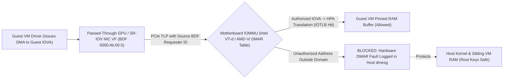

# 11.21 PCIe, IOMMU, VFIO and device passthrough

| | |
|---|---|
| Level | Advanced |
| Priority tier | 1 |
| Lab venue | GCP / GKE (plus local Python 3 simulation lab) |
| Part | Part 11: GPUs on Kubernetes, scheduling and virtualization |
| Sources used | Brendan Gregg, *Systems Performance: Enterprise and the Cloud*, 2nd Edition (`systems-performance-2nd-edition`, Addison-Wesley, 2020, Ch. 11 *Cloud Computing*); `nvidia-zero-to-hero/volume-07/chapter-02-pcie-numa-and-host-data-paths.md`; `nvidia-zero-to-hero/volume-18/chapter-07-dma-iommu-and-sriov-security.md` |
| Coverage file | `planning/coverage/chapters/11-21.md` |

## Why this matters for AI infrastructure

An NVIDIA H100 GPU has **`3,350 GB/s`** of internal HBM3 memory bandwidth, yet the moment a tensor must leave the GPU over the motherboard's **PCIe Gen5 x16** bus (`~64 GB/s` per direction, or `~32 GB/s` per direction on PCIe Gen4 x16), it is throttled by more than **`50x`** (`volume-07/chapter-02`). Worse, if the motherboard lacks dedicated **PCIe Switches (`PIX`/`PXB`)** or if the Kubernetes scheduler places a Pod's GPU on **NUMA Node 1** while its `400G` ConnectX NIC sits on **NUMA Node 0** (`SYS`), every packet must traverse the CPU Root Complex and the inter-socket link (**Intel UPI** or **AMD xGMI**), cutting distributed training throughput in half (`2x` runtime in the `volume-07/chapter-02` Customer Scenario).

To avoid the `5`-to-`10`-step hypervisor I/O proxy tax (`QEMU`, `dom0`) when running GPUs or RDMA NICs inside Virtual Machines (`KVM`, `KubeVirt`, or `Kata Containers`), cloud and enterprise platforms assign physical PCIe devices (or SR-IOV Virtual Functions) directly into the guest via **PCIe Device Passthrough** and the Linux **VFIO (`vfio-pci`)** subsystem (Brendan Gregg, *Systems Performance* 2nd Ed., Chapter 11).

However, giving a guest VM or bare-metal tenant direct PCIe **Direct Memory Access (`DMA`)** without hardware memory protection creates a catastrophic security hole (`volume-18/chapter-07`):
- Because DMA bypasses the host CPU and OS kernel, a compromised guest driver or rogue NIC firmware can issue DMA reads against arbitrary host physical RAM addresses—stealing host root passwords, encryption keys, or sibling VM memory.
- In the `volume-18/chapter-07` penetration test, a cloud provider enabled **SR-IOV** on ConnectX-6 NICs without enabling the **IOMMU (`Intel VT-d` / `AMD-Vi`)** in the BIOS and kernel (`intel_iommu=on`); a tenant loaded a custom driver that commanded its VF to DMA-read the cloud provider's management agent RAM directly off the motherboard.

This chapter connects the physical **PCIe and NUMA data path** (`volume-07/chapter-02`), the **IOMMU hardware firewall and Linux VFIO group architecture** (`volume-18/chapter-07`), and Brendan Gregg's complete **Cloud Virtualization Performance Model** (*Systems Performance* Chapter 11: Hardware Virtualization `11.2`, OS Virtualization/Containers `11.3`, and Lightweight MicroVMs `11.4–11.6`).

## Prerequisites and outcomes

### Prerequisites
- Completion of Chapter 11.2 (Device plugin, Container Toolkit, CDI, and RuntimeClasses) and Chapter 11.6 (Kubernetes Topology Manager and NUMA alignment).
- Basic familiarity with virtual memory page tables (`MMU`, `TLB`) and PCIe Bus:Device.Function (`BDF`) addresses.

### Outcomes
After completing this chapter, you will be able to:
- Analyze motherboard **PCIe Gen4 x16 (`32 GB/s`)** and **PCIe Gen5 x16 (`64 GB/s`)** topologies using `nvidia-smi topo -m` (`PIX`, `PXB`, `PHB`, `NODE`, `SYS`) and eliminate cross-socket `UPI`/`xGMI` penalties with `kubelet --topology-manager-policy=single-numa-node` (`volume-07/chapter-02`).
- Explain how the **IOMMU (`Intel VT-d` / `AMD-Vi`)** translates **Device Virtual Addresses (`IOVAs`)** to **Host Physical Addresses (`HPAs`)**, blocks unauthorized DMA with **DMAR faults**, and enforces **Linux VFIO (`vfio-pci`, `/dev/vfio/<group>`)** isolation across IOMMU groups (`volume-18/chapter-07`).
- Diagnose **Hardware Virtualization (`KVM`, `Xen`, `AWS Nitro`)** overheads using Brendan Gregg's methodology (*Systems Performance* `11.2`): two-stage memory translation (`Intel EPT` / `AMD NPT`), `VM-EXIT` tracing (`perf kvm stat live`, `kvmexits.bt` on `tracepoint:kvm:kvm_exit` for `MSR_WRITE`, `HLT`, `IO_INSTRUCTION`, and `EPT_VIOLATION`), `vmstat` `%st` stolen CPU time, and why PCI passthrough / SR-IOV makes device I/O invisible to host `iostat`.
- Compare **Hardware VMs (`KVM` + `QEMU` `> 1.4M` LoC)**, **OS Containers (`namespaces` + `cgroups`, `SP 11.3`)**, and **Lightweight MicroVMs (`AWS Firecracker` `50K` LoC / `~100 ms` boot / `< 5 MB` RAM and `Kata / Clear Containers` `< 45 ms` boot / `48–50 MB` RAM, `SP 11.4–11.6` Table 11.7)** across CPU share bursting (`10 / (10 + 30) = 25%` vs `10 / 100 = 10%`), `cpu.stat` throttling (`74 / 507` periods = `3.8 s`), PID namespace mapping (`NSpid: 4915 753`), and guest vs host observability.

## Concepts: basics to intermediate to advanced

### 1. Basics: PCIe generations, switches, NUMA boundaries (`volume-07/chapter-02`), and the IOMMU DMA firewall (`volume-18/chapter-07`)

#### 1. The Motherboard Highway: PCIe Gen4/Gen5, Root Complexes, Switches, and NUMA (`volume-07/chapter-02`)
Before a tensor ever reaches an optical network cable or a guest VM, it must traverse the server motherboard:
- **PCIe Bandwidth vs GPU HBM3:** A top-tier GPU or ConnectX NIC uses **`16` PCIe lanes (`x16`)**. **PCIe Gen4 x16** (Ampere A100 generation) delivers **`~32 GB/s` per direction**, while **PCIe Gen5 x16** (Hopper H100 generation) doubles this to **`~64 GB/s` per direction**—still a narrow straw compared to an H100's **`3,350 GB/s`** internal HBM3 bandwidth.
- **CPU Root Complex (`PHB`/`NODE`) vs Dedicated PCIe Switches (`PIX`/`PXB`):**
  - In a low-cost server where PCIe slots wire directly into the CPU's **PCIe Root Complex**, traffic from `GPU 0` to `NIC 0` must travel up to the CPU, bounce through the Root Complex (`PHB`/`NODE`), and travel back down to the NIC—consuming CPU memory bandwidth and often disabling GPUDirect RDMA by default.
  - In an AI-optimized server, the OEM places **PCIe Switches (Broadcom/PLX chips)** between the CPU and the devices. When `GPU 0` and `NIC 0` share a PCIe Switch (`PIX` or `PXB`), **Peer-to-Peer (`P2P`)** transfers bounce directly through the switch without ever touching the Host CPU.
- **The Cross-NUMA (`SYS`) Disaster:** An `8`-GPU server typically has two physical CPU sockets (**NUMA Node 0** and **NUMA Node 1**) linked by an inter-socket interconnect (**Intel UPI** or **AMD xGMI**). If `GPU 2` on NUMA 1 sends RDMA traffic through a `400G` NIC wired to NUMA 0 (`SYS`), every byte crosses the UPI/xGMI link, causing up to a **`50%` performance drop (`2x` training time)** (`volume-07/chapter-02`).

| `nvidia-smi topo -m` Code | Physical Path Across the Motherboard | Crosses CPU Root Complex? | Crosses Inter-Socket `UPI`/`xGMI`? | GPUDirect P2P Verdict |
|---|---|---|---|---|
| **`PIX`** | Traverses at most a **single PCIe switch** | No | No | **Optimal** (`P2P` bypasses CPU) |
| **`PXB`** | Traverses **multiple cascaded PCIe switches** | No | No | **Optimal / Good** (`P2P` bypasses CPU) |
| **`PHB`** | Traverses a **PCIe Host Bridge** (CPU Root Complex) within `1` NUMA node | **Yes** | No | **Degraded** (hits CPU; GDR often disabled) |
| **`NODE`** | Traverses **PCIe Host Bridges** within a single NUMA node | **Yes** | No | **Degraded** (hits CPU) |
| **`SYS`** | Crosses the **inter-socket NUMA link (`Intel UPI` / `AMD xGMI`)** | **Yes** | **Yes** | **Worst on Host** (`~50%` throughput loss) |

#### 2. The IOMMU Hardware Firewall (`Intel VT-d` / `AMD-Vi`) and Linux VFIO (`volume-18/chapter-07`)
To achieve bare-metal speed inside a Virtual Machine (`KVM`, `KubeVirt`, or `Kata Containers`), we use **PCIe Passthrough** (or **SR-IOV** Virtual Functions) so the guest OS drives the GPU or NIC directly via **DMA**. Why is **IOMMU** mandatory whenever a PCIe device or SR-IOV VF is exposed to an untrusted tenant?



1. **How the IOMMU Prevents Rogue DMA (`volume-18/chapter-07`):** Just as the CPU's MMU translates process virtual addresses to physical addresses, the motherboard's **IOMMU (`Intel VT-d` or `AMD-Vi`)** sits between the PCIe bus and System RAM. Every PCIe Transaction Layer Packet (`TLP`) carries the device's `Bus:Device.Function` (`BDF`) **Requester ID**. When IOMMU is enabled in BIOS and the Linux kernel (`intel_iommu=on` or `amd_iommu=on`), the IOMMU looks up that `BDF` in its **DMA Remapping (`DMAR`) Access Table** (cached in the **IOTLB**):
   - If the DMA request targets a valid **I/O Virtual Address (`IOVA`)** mapped to that guest VM's pinned **Host Physical Address (`HPA`)**, the IOMMU translates and forwards the access.
   - If a compromised guest driver or rogue NIC firmware attempts to DMA-read host kernel memory or another VM's RAM, the IOMMU blocks the transaction in silicon and logs a **DMAR fault** (`volume-18/chapter-07`).
   - *(Performance vs Security Trade-off from `volume-18/chapter-07`: Because IOTLB misses add slight lookup latency under billions of RDMA ops/sec, single-tenant bare-metal HPC clusters often set `iommu=pt` [pass-through mode for the host OS], whereas multi-tenant cloud and VM passthrough nodes must enforce strict IOMMU remapping.)*
2. **IOMMU Groups and the Linux `VFIO` (`vfio-pci`) Contract:**
   - An **IOMMU Group** (`/sys/kernel/iommu_groups/<N>/devices/`) is the **smallest set of PCIe devices that can be isolated from all other devices by the IOMMU hardware**. If two endpoints sit behind a PCIe bridge that does not enable **PCIe Access Control Services (`ACS`)** source validation, peer-to-peer traffic could bypass the IOMMU, so Linux places both endpoints into the **same IOMMU Group**.
   - **Linux VFIO (`Virtual Function I/O`, `vfio-pci`)** is the kernel framework that exposes an IOMMU group to user space (such as `QEMU` or `cloud-hypervisor`) as `/dev/vfio/<group_id>`. **Strict VFIO Viability Rule:** You cannot pass a GPU (`0000:4b:00.0`) to a VM unless **every non-bridge sibling endpoint in its IOMMU group** (for example, a companion HDMI/audio function `0000:4b:00.1`) is unbound from its host driver (`nvidia`, `nouveau`, `snd_hda_intel`) and bound to **`vfio-pci`** (or `pci-stub`).

---

### 2. Intermediate: Hardware virtualization internals (`SP 11.2` — `Xen`, `KVM`, `AWS Nitro`, `EPT`/`NPT`, and `VM-EXIT` tracing)

To understand what PCIe passthrough and VFIO save you from—and what overheads still remain when running GPUs inside VMs—let us examine Brendan Gregg's analysis of **Hardware Virtualization** in *Systems Performance*, 2nd Edition, Chapter 11 (`Section 11.2`):

#### 1. Hypervisor Architectures (`Config A` vs `Config B` vs `AWS Nitro`, `SP 11.2.1–11.2.2`)
Rather than the dated 1973 Type 1 / Type 2 taxonomy, Gregg classifies production cloud hypervisors into two practical architectures (`Figure 11.5` & `Figure 11.7`):
- **Config A (Bare-Metal Hypervisor + Privileged `dom0`, e.g., `Xen`, released `2003`, or `VMware ESX`, `2001`):** The hypervisor runs directly on the CPU and schedules virtual CPUs (`vCPUs`, using schedulers such as **Borrowed Virtual Time `BVT`**, **Simple Earliest Deadline First `SEDF`**, or **Credit-based**). A privileged domain (`Domain-0` / `dom0`) administers the system and runs I/O proxy back-ends (or offloads them to **Isolated Driver Domains `IDDs`** metered by **`SEDF-DC`**, `Figure 11.8`).
- **Config B (Host Kernel Hypervisor + User-Space VMM Process, e.g., `KVM`, acquired by Red Hat in `2008`):** The Linux host kernel acts as the hypervisor via the `kvm` kernel module, scheduling guest `vCPUs` as normal Linux threads (`CPU 0/KVM`, `CPU 1/KVM`) alongside a per-VM **`qemu-system-x86`** user-space VMM process (`> 1.4 million` lines of code in QEMU `4.2`) that emulates legacy devices and proxies virtual I/O. In the `2006` Qumranet benchmark (`[Qumranet 06]`), KVM completed un-paravirtualized I/O in **`5` steps versus `10` steps** in a `dom0`-proxied system.
- **Hardware-Accelerated Hypervisor (`AWS Nitro`, launched `2017`):** Uses KVM processor virtualization combined with **dedicated SR-IOV / hardware-offload cards** for networking (`ena`), storage (`nvme`), interrupts, and timers—**completely eliminating the `QEMU` I/O proxy process** so guest VMs achieve near-bare-metal I/O latency (`Figure 11.7`).

#### 2. CPU Virtualization (`VM-EXITs`), Two-Stage Memory (`EPT`/`NPT`), and `perf kvm` / `bpftrace` (`SP 11.2.2 & 11.2.4`)
Even when a GPU is passed directly into a KVM guest via `vfio-pci`, the guest's CPU threads and host-pinned memory still run under hardware virtualization:
1. **Evolution of CPU Virtualization:** Early hypervisors (`VMware 1998`) used runtime **binary translation** (running the VMM in Ring `0`, moving the guest kernel to Ring `1`, and keeping apps in Ring `3`), while **paravirtualization (`PV`)** replaced privileged instructions with explicit `hypercalls` (or batched `multicalls` in Xen). Modern CPUs (`Intel VT-x` and `AMD-V`, introduced `2005–2006`) run the hypervisor VMM in a root mode *below* Ring `0`, allowing unmodified guest kernel instructions to execute natively until a privileged operation forces a trap called a **Guest Exit (`VM-EXIT`)** (`Figure 11.6`, mapped in Linux `5.2` `arch/x86/kvm/vmx/vmx.c` `kvm_vmx_exit_handlers[]`: `EXIT_REASON_HLT` -> `kvm_vcpu_halt()`, `EXIT_REASON_IO_INSTRUCTION`, `EXIT_REASON_MSR_WRITE`, `EXIT_REASON_VMCALL`, `EXIT_REASON_PREEMPTION_TIMER`).
2. **Two-Stage Memory Translation (`Intel EPT` / `AMD NPT` vs Shadow Page Tables):**
   - A guest page fault requires two translations: **Guest Virtual -> Guest Physical** (by the guest kernel) and **Guest Physical -> Host Physical** (by the VMM).
   - Without hardware MMU support, the hypervisor had to trap every `CR3` / page-table write to maintain **Shadow Page Tables**. Modern processors implement hardware **Extended Page Tables (`EPT` on Intel)** and **Nested Page Tables (`NPT` on AMD)** so the CPU hardware page-walker resolves both stages without a `VM-EXIT` unless an unmapped page triggers an **`EPT_VIOLATION`** (or **`EPT_MISCONFIG`**).
   - *(Note for GPU passthrough: Never inflate a hypervisor **memory balloon driver** [`dmesg | grep balloon`, `[Waldspurger 02]`] inside a VM using `vfio-pci` GPU passthrough, because VFIO pins the guest's physical RAM pages in the IOMMU so the GPU can DMA to them safely at any time.)*
3. **Observing `VM-EXITs` from the KVM Host (`SP 11.2.4.1`):**
   - Run `pidstat -tp <QEMU_PID> 1` on the host to inspect `%guest` vs `%system` across `CPU 0/KVM` threads.
   - Run `perf kvm stat live` on the host to measure `VM-EXIT` frequency and duration. In Gregg's production sample (`2,421` total samples, `1,946,040.48 us` handled time), **`MSR_WRITE`** accounted for **`1,668` samples (`68.90%` of exits, `3.25 us` avg)**, **`HLT`** (idle halt) accounted for **`466` samples (`19.25%` of exits, `99.63%` of total time, `4,160.68 us` avg)**, `PREEMPTION_TIMER` `112` (`4.63%`), `PENDING_INTERRUPT` `82` (`3.39%`), `EXTERNAL_INTERRUPT` `53` (`2.19%`), `IO_INSTRUCTION` `37` (`1.53%`, `19.97 us` avg), `MSR_READ` `2` (`0.08%`), and `EPT_MISCONFIG` `1` (`0.04%`, `19.94 us`).
   - Run Gregg's `bpftrace` tool **`kvmexits.bt`** (attaching to `tracepoint:kvm:kvm_exit` and `tracepoint:kvm:kvm_entry` via `exit_reason` and `guest_rip`), which reveals bimodal latency histograms: in Gregg's capture, `IO_INSTRUCTION` (reason `30`) peaked in the **`[8K, 16K)` ns (`8–16 us`) bucket (`198` samples)** with outliers reaching `2–8 ms`, while `EPT_VIOLATION` (reason `48`) peaked in the **`[2K, 4K)` ns (`2–4 us`) bucket (`7,686` samples)**.
4. **The Passthrough Observability Blind Spot (`SP 11.2.4`):** When a guest VM uses **PCI passthrough (`vfio-pci`)** or **SR-IOV**, its I/O bypasses the hypervisor kernel and `QEMU` proxy completely. As a result, **guest NIC and NVMe/GPU I/O becomes invisible to host OS tools like `iostat(1)` or `sar(1)`**—operators must read hardware Performance Monitoring Counters (`PMCs` / `DCGM` / NIC hardware counters) or run BPF tools like `biosnoop(8)` *inside* the guest's dedicated kernel (and check `vmstat 1` `%st` stolen CPU time, which in Gregg's throttled guest example jumped from **`1–5%` to `97–99%`**).

---

### 3. Advanced: Comparing Hardware VMs (`KVM`), OS Containers (`SP 11.3`), and Lightweight MicroVMs (`Firecracker` / `Kata`, `SP 11.4–11.6`)

Why do modern AI clouds run some GPU workloads in **OS Containers** (`containerd` + `nvidia-container-toolkit`), some in **Full Hardware VMs** (`KVM` / `KubeVirt` with `vfio-pci` passthrough or `vGPU`), and some in **Lightweight MicroVMs** (`Kata Containers` / `Firecracker`)? Brendan Gregg's *Systems Performance* Sections `11.3`–`11.6` (`Table 11.7`) provides the exact engineering trade-offs:

| Attribute (`SP 11.6` Table 11.7 + GPU Path) | Hardware Virtualization (`KVM` + `QEMU` / `Nitro`) | OS Virtualization (`Linux Containers`) | Lightweight Hardware Virtualization (`Firecracker` / `Kata` MicroVMs) |
|---|---|---|---|
| **Architecture & VMM Footprint** | Full guest kernel + `QEMU` VMM (**`> 1.4 million` LoC** in QEMU `4.2`); `Nitro` offloads proxy to hardware | Shared single host kernel (`struct nsproxy`: **`8` namespaces** in Table 11.1 + **`12` cgroups** in Table 11.2 + `seccomp-bpf`) | Dedicated guest kernel + minimal VMM (**`Firecracker`: `50,000` LoC, `< 5 MB` RAM, `~100 ms` boot**; **`Clear/Kata`: `< 45 ms` boot, `48–50 MB` RAM**) |
| **GPU Attachment Mechanism** | **`vfio-pci` Passthrough** (whole GPU or MIG VF) or **NVIDIA vGPU** mediated device (`mdev`) | Device node bind-mount (`/dev/nvidia*`) + `devices` / `rdma` cgroup via CDI (`nvidia-container-toolkit`) | **`vfio-pci` Passthrough** (via `IOMMU` + Kata `runtimeClassName`) into the MicroVM guest kernel |
| **Memory Translation & Caching** | Two-stage (`EPT`/`NPT`), fixed VM RAM allocation (must be pinned for VFIO DMA), risk of double page-caching | Single-stage host MMU (zero `EPT` overhead); containers share host page cache via `OverlayFS` (`ovl_write_iter`) | Two-stage (`EPT`/`NPT`), fixed MicroVM RAM allocation |
| **CPU Allocation & Bursting Trap (`SP 11.3.3`)** | Fixed to `vCPUs` (plus host cgroup / `Intel CAT` LLC cache partitioning) | Flexible **CFS Shares + CFS Bandwidth**: `10` shares of `100` gets **`25%`** when only A (`10`) & B (`30`) are busy (`100%` when alone), dropping **`10x` to `10%`** when all `100` shares are busy (cap with CFS bandwidth e.g. `20%`) | Fixed to `vCPUs` managed by host cgroups (`firecracker` PID `30785` at `200%` CPU = `2` vCPUs in `SP 11.4.4`) |
| **Observability from the Host** | **Medium:** Host `top` sees `qemu-system-x86` (`PID 24881`), `perf kvm stat live`; guest processes are opaque; passthrough/SR-IOV I/O bypasses host `iostat` | **High (Favors Host Operators):** Host sees all processes (`NSpid: 4915 -> 753` in `pid:[4026532216]`), `/proc/4915/root/tmp`, `nsenter -t 4915 -m -p`, `systemd-cgtop`, and `bpftrace` `curtask->nsproxy->uts_ns->name.nodename` | **Medium:** Host `top` sees a single `firecracker` process (`PID 30785`, host load `4.48` vs guest load `1.89` with `bash` PIDs `1104`, `1105`) |
| **Observability from the Guest (`Table 11.6`)** | **High (Favors End Users):** Full dedicated kernel; `perf`, `Ftrace`, BPF (`biosnoop`), and `vmstat %st` all work | **Medium:** Kernel tracing (`perf`, `dmesg`, BPF) restricted; **`top`, `uptime`, `mpstat`, `vmstat`, `free`, `iostat` leak host-wide stats** (e.g. idle container `iostat` showing host `nvme0n1` at `2,578` tps / `100%` util while `blkio.throttle.io_serviced` stays flat at `804`) | **High (Favors End Users):** Full dedicated guest kernel; `mpstat` shows only guest `vCPUs` (`2` CPUs) and guest BPF/perf tools work |
| **Kernel Blast Radius** | Guest kernel panic or custom kernel module affects **only that VM**; IOMMU blocks rogue DMA | **Shared kernel:** Any kernel panic crashes all containers on the node; `dcache`/`lstat` or `posix_fadvise()` contention affects neighbors (`[Borello 17]`, `[Leonovich 18]`) | Guest kernel panic affects **only that MicroVM**; combines container boot speed (`45–100 ms`) with hardware VM isolation |

#### Diagnosing Container CPU Throttling on Shared GPU Nodes (`SP 11.3.4` Figure 11.13)
When a containerized PyTorch dataloader or inference server on a shared node stalls, operators often check host `mpstat` (`%idle` high) and assume CPU is not the bottleneck—forgetting software cgroup limits (`SP 11.3.4` `/sys/fs/cgroup/cpu,cpuacct/.../cpu.stat`, where Gregg's example container was throttled **`74` times out of `507` periods (`nr_throttled 74 / nr_periods 507`) for `3,816,445,175` ns (`3.8 seconds`)**). Follow Gregg's **5-Statistic CPU Throttling Flowchart (`Figure 11.13`)**:
1. Check cgroup **`throttled_time` / `nr_throttled`** in `cpu.stat` -> if increasing, the container is **CFS bandwidth-limit throttled**.
2. Check **`nonvoluntary_ctxt_switches`** in `/proc/PID/status` -> if not increasing, the container is not CPU-throttled.
3. Check whether the **host has idle CPU** (`mpstat %idle`) -> if the host has idle CPU while `nonvoluntary_ctxt_switches` climbs, check whether **`cpuset` CPUs are `100%` busy** (**`cpuset` throttled**).
4. If the host has `0%` idle CPU and other tenants are busy, the container is **CFS shares throttled** (`container CPU = all CPUs × container shares / total busy shares`).

## Commands and configurations that matter

### 1. Auditing PCIe / NUMA Topology and IOMMU Groups on a GPU Host (`volume-07/chapter-02` & `volume-18/chapter-07`)

```bash
# 1. Inspect GPU-to-NIC PCIe switch (PIX/PXB vs PHB/NODE/SYS) and NUMA affinity (untested here)
nvidia-smi topo -m

# 2. Verify IOMMU (Intel VT-d / AMD-Vi) and DMAR tables are active in kernel dmesg (untested here)
dmesg | grep -E -i "DMAR|IOMMU|AMD-Vi"

# 3. List all IOMMU groups and the PCIe BDF endpoints inside each group (untested here)
for g in $(find /sys/kernel/iommu_groups/* -maxdepth 0 -type d | sort -V); do
    echo "IOMMU Group ${g##*/}:"
    for d in "$g"/devices/*; do
        lspci -nns "${d##*/}"
    done
done
```

### 2. Unbinding a GPU from Host Drivers and Binding its IOMMU Group to `vfio-pci`

```bash
# Bind GPU (0000:4b:00.0, 10de:2330) to vfio-pci for VM passthrough (untested here)
sudo modprobe vfio-pci

# Unbind from host nvidia driver if bound
echo "0000:4b:00.0" | sudo tee /sys/bus/pci/devices/0000:4b:00.0/driver/unbind

# Override driver to vfio-pci and probe
echo "vfio-pci" | sudo tee /sys/bus/pci/devices/0000:4b:00.0/driver_override
echo "0000:4b:00.0" | sudo tee /sys/bus/pci/drivers_probe

# Verify /dev/vfio/<group_id> character device node is created and driver in use is vfio-pci
lspci -nnk -s 0000:4b:00.0
ls -la /dev/vfio/
```

### 3. Observing KVM `VM-EXITs` and Container Namespace/Cgroup Limits (*Systems Performance* Ch. 11)

```bash
# 1. Live KVM VM-EXIT breakdown on a hypervisor host (SP 11.2.4, untested here)
sudo perf kvm stat live

# 2. Map a container guest PID (753) to its host PID (4915) and inspect CFS throttling (SP 11.3.4, untested here)
awk '$1 == "NSpid:" && $3 == 753 { print $2 }' /proc/*/status
ls -lh /proc/4915/ns/pid
cat /sys/fs/cgroup/cpu,cpuacct/kubepods/burstable/pod*/cpu.stat
```

## How it fails

| Failure mode | Exact symptom & command evidence | Root cause boundary | Remediation |
|---|---|---|---|
| **1. Tenant in bare-metal/SR-IOV cloud reads host management agent memory via custom NIC driver (`volume-18/chapter-07`)** | Penetration test loads a modified VF driver in the tenant OS and successfully DMA-reads physical RAM outside its allocation; `dmesg \| grep -i dmar` shows IOMMU is disabled. | **Missing IOMMU Hardware Firewall:** SR-IOV slices the NIC into VFs, but without **IOMMU (`Intel VT-d` / `AMD-Vi`)** enabled, VFs can issue unrestricted DMA requests across host physical RAM. | Enable VT-d / AMD-Vi in server BIOS and pass `intel_iommu=on` (or `amd_iommu=on`) on the kernel command line so the IOMMU blocks unauthorized DMA with a **DMAR fault**. |
| **2. QEMU / KubeVirt fails to start GPU passthrough VM with `vfio: error, group 42 is not viable` (`Layer 2/3` VFIO)** | `virsh start` or KubeVirt `virt-launcher` fails with `group 42 is not viable, please ensure all devices within the iommu_group are bound to their vfio bus driver`. | **Incomplete IOMMU Group Binding:** A sibling PCIe endpoint in Group `42` (or a shared non-ACS PCIe bridge) is still bound to a host kernel driver (`snd_hda_intel` or `nvidia`). | Bind **every** non-bridge endpoint in `/sys/kernel/iommu_groups/42/devices/` to `vfio-pci` (or enable PCIe ACS appropriately for virtualization isolation when not using bare-metal GPUDirect P2P). |
| **3. PyTorch distributed training on Node B runs `2x` slower (`50%` drop) than on identical Node A (`volume-07/chapter-02`)** | `nvidia-smi topo -m` on Node B shows the allocated GPUs (`GPU 2, 3` on NUMA 1) communicate with the single `400G` NIC (on NUMA 0) via **`SYS`**. | **Cross-NUMA (`SYS`) Inter-Socket Bottleneck:** Scheduler assigned GPUs on CPU 1 while the NIC is wired to CPU 0, forcing all RDMA traffic across the Intel UPI / AMD xGMI link. | Configure `kubelet` with `--topology-manager-policy=single-numa-node` and `--cpu-manager-policy=static` so pods are only admitted onto NUMA-aligned GPU + CPU + NIC tuples. |
| **4. Containerized workload drops `10x` in CPU dataloader throughput when additional pods land on the node (`SP 11.3.3`)** | Dataloader ran fast during isolated staging tests (`100%` CPU via bursting), then slowed `10x` in production; `cpu.stat` shows `nr_throttled` or `nonvoluntary_ctxt_switches` climbing. | **CFS Share Bursting "Bait-and-Switch" (`SP 11.3.3`):** Container A (`10` shares of `100`) burst to `100%` on an idle host, then dropped to its `10%` guaranteed share once neighbors became busy. | Cap bursting with explicit **CFS bandwidth limits** (or use exclusive `cpuset` pinning via Kubernetes `Guaranteed` QoS + `static` CPU Manager) so staging benchmarks match production capacity. |
| **5. Engineer inside an idle container runs `iostat -sxz 1` and sees `nvme0n1` at `2,578` tps and `100%` utilization (`SP 11.3.4` Table 11.6)** | User reports a mystery disk bottleneck inside their idle container because `iostat`, `free`, `vmstat`, `mpstat`, and `uptime` show heavy system load. | **Un-Namespaced `/proc` & `/sys` Host Statistics in Containers (`SP 11.3.4`):** Traditional Linux tools read host-wide kernel counters inside containers. | Inspect container-specific cgroup files (`cat /sys/fs/cgroup/blkio/blkio.throttle.io_serviced` and `io_service_bytes` across a `sleep 10` interval) or cgroup-aware monitoring (`cAdvisor`, `systemd-cgtop`). |

## Hands-on lab

### Venue and scope
This lab runs locally using Python 3 standard library (`code/part11/pcie_iommu_vfio_passthrough.py` and `code/part11/pcie_iommu_vfio_passthrough_lab.py`) to verify the `volume-07/chapter-02` PCIe Gen4/Gen5 (`32` vs `64 GB/s` vs `3,350 GB/s` HBM3) and `nvidia-smi topo -m` (`PIX`, `PXB`, `PHB`, `NODE`, `SYS`) model, the `volume-18/chapter-07` IOMMU DMAR firewall and Linux VFIO group viability validator (`/dev/vfio/42`), and Brendan Gregg's *Systems Performance* Chapter 11 virtualization metrics (`m5.large` to `m5.24xlarge`, Pinterest `$54/hr -> $20/hr`, Shopify `61% -> 19%`, KVM `5` vs `10` steps, `perf kvm stat live` `2,421` samples, `kvmexits.bt` `EPT_VIOLATION` `7,686` samples, `vmstat %st` `97–99%`, CFS share bursting `25%` vs `10%`, `cpu.stat` `74 / 507` `3.8 s`, `NSpid: 4915 -> 753`, `iostat` `2,578` tps leak, and `QEMU` `1.4M` LoC vs `Firecracker` `50K` LoC / `100 ms` / `< 5 MB` vs `Clear/Kata` `< 45 ms` / `48–50 MB`). Host commands are marked `(untested here)`.

### Step 1: Run the self-checking PCIe, IOMMU, VFIO and passthrough lab (tested here)

Run the lab script from the repository root:

```bash
python3 code/part11/pcie_iommu_vfio_passthrough_lab.py
```

Captured output from this repository:
```text
=== Chapter 11.21 Lab: PCIe, IOMMU, VFIO, Device Passthrough & SP Ch. 11 ===
  [PASS] PCIe Gen4 x16 provides ~32 GB/s per direction and PCIe Gen5 x16 doubles to ~64 GB/s vs 3,350 GB/s H100 HBM3
  [PASS] PIX and PXB stay on PCIe switches without crossing the CPU Root Complex (optimal P2P GPUDirect)
  [PASS] PHB and NODE cross the CPU Root Complex within one NUMA node, while SYS crosses Intel UPI / AMD xGMI
  [PASS] Disabling IOMMU in BIOS/kernel leaves SR-IOV/passthrough vulnerable to rogue DMA attacks and blocks VFIO
  [PASS] VFIO rejects IOMMU group 42 when sibling endpoint 0000:4b:00.1 is still bound to host driver snd_hda_intel
  [PASS] Binding all non-bridge endpoints in IOMMU group 42 to vfio-pci exposes /dev/vfio/42 with DMAR isolation
  [PASS] SP 11.1.1 AWS m5 family spans m5.large (2 vCPUs, 8 GB) to m5.24xlarge (96 vCPUs, 384 GB) on 512+ GB hosts
  [PASS] SP 11.1.3 dynamic sizing cut Pinterest off-hours cloud cost from $54/hr to $20/hr and Shopify idle time from 61% to 19%
  [PASS] SP 11.2.2 Qumranet 2006 benchmark showed KVM I/O took 5 steps vs 10 steps in Xen without paravirtualization
  [PASS] SP 11.2.4 perf kvm stat live sample records 2,421 total samples (1,668 MSR_WRITE = 68.90%, 466 HLT = 19.25% / 99.63% time, 1 EPT_MISCONFIG = 19.94us)
  [PASS] SP 11.2.4 kvmexits.bt records IO_INSTRUCTION mode in [8K, 16K) ns (198 samples) and EPT_VIOLATION mode in [2K, 4K) ns (7,686 samples)
  [PASS] SP 11.2.4 vmstat %st (stolen CPU time) in a throttled Xen guest spikes from 1-5% to 97-99%
  [PASS] SP 11.3.3 Container A (10 shares of 100) gets 25.0% CPU when only A (10) and B (30) are busy, and 10.0% when all 100 shares are busy
  [PASS] SP 11.3.3 CFS share bursting drops 10x (100% idle host -> 10% full host); CFS bandwidth cap at 20% bounds range to 10-20%
  [PASS] SP 11.3.4 cpu.stat example records nr_periods=507, nr_throttled=74, and throttled_time=3,816,445,175 ns (~3.8s)
  [PASS] SP 11.3.4 /proc/4915/status maps host PID 4915 to container NSpid 753 in namespace pid:[4026532216]
  [PASS] SP 11.3.4 iostat -sxz 1 inside an idle container leaks host nvme0n1 activity (2,578 tps, 100.00% util) while blkio.throttle.io_serviced stays constant at 804
  [PASS] SP 11.3.1 Table 11.1 lists 8 Linux namespaces (cgroup, ipc, mnt, net, pid, time, user, uts) and Table 11.2 lists 12 cgroups (including devices, hugetlb, perf_event, rdma)
  [PASS] SP 11.4 compares QEMU 4.2 (> 1.4M lines of code) against AWS Firecracker (50,000 lines of code, ~100ms boot, < 5 MB memory overhead)
  [PASS] SP 11.4.1 Intel Clear Containers (merged into Kata Containers in 2017) achieved < 45ms boot and 48-50 MB memory overhead
  [PASS] SP 11.4.4 Firecracker VM PID 30785 consumes 200% CPU on host (load avg 4.48) while guest top shows two bash PIDs (1104, 1105) at 100% each (guest load avg 1.89)
  [PASS] SP 11.6 Table 11.7 shows OS Containers favor host operators (high host visibility) while Hardware/Lightweight VMs favor end users (full guest kernel BPF/perf visibility)
  [PASS] SP 11.2.4 explains that PCI passthrough and SR-IOV bypass hypervisor I/O paths so device I/O becomes invisible to host iostat
  [PASS] SP 11.3.4 Figure 11.13 diagnoses container CPU throttling across 5 statistics (throttled_time, nonvoluntary_ctxt_switches, host %idle, cpuset 100% busy, other tenants idle)
  [PASS] Volume 07 Ch 2 kubelet --topology-manager-policy=single-numa-node + static CPU Manager prevents 50% cross-NUMA UPI degradation

Summary: 25 passed, 0 failed out of 25 checks.
```

### Exercises

1. **Exercise 1 — PCIe Gen4/Gen5 bandwidth and `nvidia-smi topo -m` paths (`volume-07/chapter-02`):** Using `PCIE_TOPOLOGY_CODES` in `code/part11/pcie_iommu_vfio_passthrough.py`, state the unidirectional bandwidth of PCIe Gen4 x16 vs PCIe Gen5 x16 vs H100 HBM3, and rank `PIX`, `PXB`, `PHB`, `NODE`, and `SYS` by whether they cross the CPU Root Complex and the inter-socket `UPI`/`xGMI` link.
2. **Exercise 2 — IOMMU DMAR security and VFIO group viability (`volume-18/chapter-07`):** Using `validate_vfio_iommu_group_passthrough()`, explain why enabling SR-IOV without enabling the IOMMU (`intel_iommu=on`) allowed a tenant to DMA-read host RAM, and why VFIO refuses to open `/dev/vfio/42` when `0000:4b:00.0` (GPU) is bound to `vfio-pci` but `0000:4b:00.1` (audio sibling in Group `42`) is still bound to `snd_hda_intel`.
3. **Exercise 3 — KVM `VM-EXIT` and `EPT` analysis (*Systems Performance* `11.2`):** Interpret the `perf kvm stat live` (`2,421` samples: `MSR_WRITE` `1,668`, `HLT` `466` at `99.63%` time, `IO_INSTRUCTION` `37`, `EPT_MISCONFIG` `1`) and `kvmexits.bt` (`IO_INSTRUCTION` `[8K, 16K)` ns vs `EPT_VIOLATION` `[2K, 4K)` ns) outputs from *Systems Performance* `11.2.4`, and explain why `iostat` on a KVM/Nitro host cannot see disk or NIC traffic from a `vfio-pci` / SR-IOV device.
4. **Exercise 4 — CFS CPU share bursting vs CFS bandwidth caps (*Systems Performance* `11.3.3`):** Using `compute_cfs_cpu_share_bursting(10, 30, 100, 20.0)`, calculate Container A's CPU allocation when (a) only A is busy, (b) only A (`10` shares) and B (`30` shares) are busy, and (c) all `100` system shares are busy, and explain how a `20%` CFS bandwidth limit prevents the `10x` "bait-and-switch" drop.
5. **Exercise 5 — Container observability traps and namespace PID mapping (*Systems Performance* `11.3.4` Table 11.6):** State which traditional Linux tools inside a container leak host-wide statistics, write the commands to map container PID `753` to host PID `4915` (`pid:[4026532216]`) and inspect `/sys/fs/cgroup/blkio/blkio.throttle.io_serviced`, and trace Gregg's 5-statistic CPU throttling flowchart (`Figure 11.13`).
6. **Exercise 6 — Comparing Hardware VMs (`KVM`), OS Containers, and Lightweight MicroVMs (`Firecracker` / `Kata`, *Systems Performance* `11.4–11.6` Table 11.7):** Contrast `QEMU 4.2` (`> 1.4M` LoC), `AWS Firecracker` (`50K` LoC, `~100 ms` boot, `< 5 MB` RAM), and `Intel Clear / Kata Containers` (`< 45 ms` boot, `48–50 MB` RAM), and explain why OS Containers favor **host operators** for observability while Hardware/Lightweight VMs favor **end users**.

## Checkpoint questions

<details>
<summary><strong>1. Compare the unidirectional bandwidth of PCIe Gen4 x16, PCIe Gen5 x16, and an NVIDIA H100 GPU's internal HBM3 memory (Volume 7 Chapter 2).</strong></summary>

- **PCIe Gen4 x16:** **`~32 GB/s`** per direction.
- **PCIe Gen5 x16:** **`~64 GB/s`** per direction (`2x` Gen4).
- **NVIDIA H100 HBM3 internal bandwidth:** **`3,350 GB/s`** (`> 50x` faster than PCIe Gen5 x16).
</details>

<details>
<summary><strong>2. What is the architectural difference between wiring GPUs and NICs directly to the CPU Root Complex (PHB/NODE) versus wiring them to a dedicated PCIe Switch (PIX/PXB) (Volume 7 Chapter 2)?</strong></summary>

When wired directly to the **CPU Root Complex (`PHB`/`NODE`)**, data moving between a GPU and a NIC must travel up to the CPU, pass through the Root Complex, and travel back down, consuming CPU bandwidth and adding latency. When connected to the same **PCIe Switch (`PIX`/`PXB`, such as a Broadcom/PLX switch)**, the switch routes **Peer-to-Peer (`P2P`)** traffic directly between the GPU and NIC without touching the Host CPU.
</details>

<details>
<summary><strong>3. In nvidia-smi topo -m, what does SYS mean, and how do you prevent Kubernetes from scheduling a Pod onto a cross-NUMA SYS GPU-to-NIC path (Volume 7 Chapter 2)?</strong></summary>

**`SYS`** means the GPU and NIC reside on **different NUMA nodes (different physical CPU sockets)**, forcing all traffic across the inter-socket link (**Intel UPI** or **AMD xGMI**) and causing severe (`~50%`) throughput degradation. Prevent this by configuring `kubelet` with **`--topology-manager-policy=single-numa-node`** and **`--cpu-manager-policy=static`**.
</details>

<details>
<summary><strong>4. What is a PCIe Direct Memory Access (DMA) attack, and how does the IOMMU (Intel VT-d or AMD-Vi) prevent it (Volume 18 Chapter 7)?</strong></summary>

DMA allows PCIe peripherals (GPUs, NICs, NVMe drives) to read and write physical System RAM directly, bypassing the CPU and OS kernel. If a device's firmware or guest driver is compromised on a system without IOMMU protection, it can DMA-read host root passwords or encryption keys from arbitrary RAM addresses. The **IOMMU (`Intel VT-d` / `AMD-Vi`)** acts as a hardware firewall on the PCIe bus: it checks every DMA request against a per-device **DMA Remapping (`DMAR`) Access Table** and blocks any unauthorized physical memory access with a hardware **DMAR fault**.
</details>

<details>
<summary><strong>5. In the Volume 18 Chapter 7 Customer Scenario, why was a tenant able to read the cloud provider's management memory even though SR-IOV was enabled on the ConnectX-6 NIC?</strong></summary>

Because **SR-IOV** only partitions the physical NIC into multiple Virtual Functions (`VFs`); it does **not** restrict which host physical RAM addresses those `VFs` can DMA-read or write. Because the cloud provider had not enabled **IOMMU** in the BIOS and host kernel (`intel_iommu=on`), the tenant's custom VF driver issued unrestricted DMA reads across the motherboard.
</details>

<details>
<summary><strong>6. When is it acceptable to use iommu=pt (IOMMU pass-through mode), and when is strict IOMMU remapping mandatory (Volume 18 Chapter 7)?</strong></summary>

In a single-tenant, trusted bare-metal HPC supercomputer where no untrusted VMs or multi-tenant passthrough exist, operators sometimes set **`iommu=pt`** on the host kernel to bypass IOTLB translation overhead for host DMA. In any **multi-tenant cloud, bare-metal tenant hosting with SR-IOV, or VM PCIe passthrough (`KVM`/`KubeVirt`/`Kata`)**, strict IOMMU remapping is mandatory.
</details>

<details>
<summary><strong>7. What is a Linux IOMMU Group, and what is the VFIO viability rule when passing a GPU (/dev/vfio/group_id) into a Virtual Machine?</strong></summary>

An **IOMMU Group** (`/sys/kernel/iommu_groups/<N>/devices/`) is the smallest set of PCIe devices isolated from the rest of the system by the IOMMU hardware. Under Linux **VFIO (`vfio-pci`)**, an IOMMU group is only **viable** for passthrough if **every non-bridge PCIe endpoint in that group** (for example, both the GPU `0000:4b:00.0` and its companion audio function `0000:4b:00.1`) is unbound from host drivers and bound to `vfio-pci` (or `pci-stub`).
</details>

<details>
<summary><strong>8. In Brendan Gregg's Systems Performance Chapter 11 (Section 11.1.3), what two real-world cloud efficiency gains were reported by Pinterest and Shopify from dynamic sizing and cloud migration?</strong></summary>

- **Pinterest (December 2012):** Cut off-hours cloud infrastructure cost from **`$54/hour` to `$20/hour`** by automatically shutting down instances in response to daily traffic load.
- **Shopify (2018):** Reduced average server idle time from **`61%` on fixed servers to `19%` on cloud instances**.
</details>

<details>
<summary><strong>9. Contrast Config A (Xen), Config B (KVM + QEMU), and AWS Nitro in Systems Performance Section 11.2.</strong></summary>

- **Config A (`Xen`):** A bare-metal hypervisor schedules `vCPUs` directly on physical CPUs while a privileged domain (`Domain-0` / `dom0`) administers the system and runs I/O proxy back-ends (`10` I/O steps without paravirtualization in `[Qumranet 06]`).
- **Config B (`KVM` + `QEMU`):** The host Linux kernel runs the `kvm` module and schedules guest `vCPUs` as host threads (`CPU 0/KVM`), paired with a per-VM `qemu-system-x86` user-space I/O proxy (`5` I/O steps in `[Qumranet 06]`).
- **AWS Nitro (`2017`):** Uses KVM processor virtualization with dedicated SR-IOV / hardware offload cards for network, storage, interrupts, and timers—**eliminating the `QEMU` I/O proxy entirely** for near-bare-metal performance.
</details>

<details>
<summary><strong>10. Compare Binary Translation, Paravirtualization, and Hardware-Assisted Virtualization (Intel VT-x / AMD-V) for executing guest privileged instructions (Systems Performance Section 11.2.2).</strong></summary>

- **Binary translation (`VMware 1998`):** Runs the VMM in Ring `0` and moves the guest kernel to Ring `1` (apps in Ring `3`), rewriting privileged guest instructions at runtime.
- **Paravirtualization (`PV`):** Modifies the guest OS to replace privileged operations with explicit `hypercalls` (or batched `multicalls` in Xen) and PV drivers.
- **Hardware-assisted (`Intel VT-x` / `AMD-V`, `2005–2006`):** Runs the VMM at a privilege level below Ring `0` so an unmodified guest kernel runs in Ring `0` and traps to the VMM (**`VM-EXIT`**) only on privileged instructions.
</details>

<details>
<summary><strong>11. How do Intel Extended Page Tables (EPT) and AMD Nested Page Tables (NPT) accelerate virtual machine memory access compared to Shadow Page Tables (Systems Performance Section 11.2.2)?</strong></summary>

Virtualization requires a two-stage translation: **Guest Virtual -> Guest Physical** and **Guest Physical -> Host Physical**. **Shadow Page Tables** required the hypervisor to trap guest page-table edits and overwrite the CPU's `CR3` register on context switches. **Intel `EPT` and AMD `NPT`** implement two-dimensional page tables in CPU hardware so the MMU page-walker resolves TLB misses directly in silicon without a `VM-EXIT` (trapping only on an unmapped **`EPT_VIOLATION`**).
</details>

<details>
<summary><strong>12. In Systems Performance Section 11.2.4, what do perf kvm stat live and kvmexits.bt measure on a KVM host, and why does high HLT time% indicate a healthy idle guest?</strong></summary>

They measure the count and duration of **`VM-EXIT` (`tracepoint:kvm:kvm_exit` to `kvm:kvm_entry`)** events. When a guest vCPU has no work to run, the guest kernel executes the privileged `halt` (`HLT`) instruction (`kvm_vcpu_halt()`), putting the vCPU to sleep until the next interrupt. Therefore, a low exit rate where `HLT` dominates `Time%` (`99.63%` of time across `466` samples in Gregg's example) indicates the guest is mostly idle rather than thrashing in hypervisor overhead.
</details>

<details>
<summary><strong>13. Why does enabling PCI passthrough (vfio-pci) or SR-IOV make guest disk and network I/O invisible to host OS tools like iostat(1) (Systems Performance Section 11.2.4)?</strong></summary>

Because PCI passthrough and SR-IOV allow the guest kernel's device driver to issue DMA and hardware doorbell operations **directly to the physical PCIe device or Virtual Function**, completely bypassing the host kernel's block/network stack and any `QEMU` I/O proxy where host `iostat` counters are collected.
</details>

<details>
<summary><strong>14. Name the eight Linux namespaces in Table 11.1 and the twelve cgroup v1 controllers in Table 11.2 of Systems Performance Section 11.3.1.</strong></summary>

- **Eight Linux namespaces (`Table 11.1`, listed via `lsns`):** `cgroup`, `ipc`, `mnt`, `net`, `pid`, `time`, `user`, and `uts`.
- **Twelve Linux cgroups (`Table 11.2`):** `blkio`, `cpu`, `cpuacct`, `cpuset`, `devices`, `hugetlb`, `memory`, `net_cls`, `net_prio`, `perf_event`, `pids`, and `rdma`.
</details>

<details>
<summary><strong>15. Walk through the CFS CPU shares calculation in Systems Performance Section 11.3.3 for Container A (10 shares) and Container B (30 shares) on a system with 100 total shares, and explain the "bait-and-switch" bursting problem.</strong></summary>

Using `container CPU = (all CPUs × container shares) / total busy shares`:
- When **only Container A** is busy: `10 / 10 =` **`100%` of system CPUs** (bursting).
- When **only Containers A (`10`) and B (`30`)** are busy: `10 / (10 + 30) =` **`25%` of system CPUs**.
- When **all `100` shares** on the host are busy: `10 / 100 =` **`10%` of system CPUs**.
A user who benchmarks Container A on an empty host sees `100%` CPU speed and experiences a **`10x` slowdown (`100% -> 10%`)** once neighbors arrive—which can be bounded by setting a **CFS bandwidth limit** (e.g., `20%`, keeping performance within `10%–20%`).
</details>

<details>
<summary><strong>16. How do you diagnose whether a Linux container is CPU throttled by CFS bandwidth limits, cpusets, or CFS shares using Figure 11.13 of Systems Performance Section 11.3.4?</strong></summary>

Check the **five statistics in Figure 11.13**:
1. Is cgroup **`throttled_time` (`nr_throttled` in `cpu.stat`)** increasing? -> **Yes:** **CFS bandwidth throttled** (`74 / 507` periods = `3.8 s` in Gregg's example).
2. Are **`nonvoluntary_ctxt_switches`** (`/proc/PID/status`) increasing? -> **No:** Not CPU throttled.
3. Does the **host have idle CPU** (`mpstat %idle > 0`)? -> **Yes, and `cpuset` CPUs are `100%` busy:** **`cpuset` throttled**.
4. Is the host `0%` idle while other tenants are active? -> **Yes:** **CFS shares throttled**.
</details>

<details>
<summary><strong>17. According to Table 11.6 of Systems Performance Section 11.3.4, which traditional Linux observability tools run inside a container unexpectedly display host-wide statistics rather than container-only statistics?</strong></summary>

- **`top`:** Summary header shows mixed host and container stats (process table shows container PIDs).
- **`uptime`:** Shows **host** system-wide load averages.
- **`mpstat`:** Shows **host** CPUs and **host** CPU usage.
- **`vmstat`:** Shows **host** CPUs, memory, and system stats.
- **`free`:** Shows **host** memory.
- **`iostat`:** Shows **host** disks (such as `nvme0n1` at `2,578` tps / `100%` util inside a completely idle container).
</details>

<details>
<summary><strong>18. How do you map a container process PID (such as guest PID 753) to its host PID (4915) and access its files or namespaces from the host (Systems Performance Section 11.3.4)?</strong></summary>

1. Check `/proc/<HOST_PID>/status` for `NSpid: 4915 753`, or search all processes from the host via:
   `awk '$1 == "NSpid:" && $3 == 753 { print $2 }' /proc/*/status`
2. Disambiguate multiple containers with PID `753` by matching the namespace inode symlink `ls -lh /proc/4915/ns/pid` (`pid:[4026532216]`).
3. Inspect the container's filesystem via `/proc/4915/root/tmp` or enter its mount and PID namespaces via `nsenter -t 4915 -m -p top`.
</details>

<details>
<summary><strong>19. Compare the codebase size, boot time, and memory overhead of QEMU 4.2, AWS Firecracker, and Intel Clear Containers / Kata Containers (Systems Performance Section 11.4).</strong></summary>

- **QEMU `4.2` (Full Hardware VMM):** Over **`1.4 million` lines of code**.
- **AWS Firecracker (`2019` Lightweight MicroVM):** Only **`50,000` lines of code** (`~28x` smaller than QEMU), **`~100 ms` boot time**, and **`< 5 MB` memory overhead** per MicroVM.
- **Intel Clear Containers (`2015`, merged into `Kata Containers` in `2017`):** **`< 45 ms` boot time** and **`48–50 MB` memory overhead** per container.
</details>

<details>
<summary><strong>20. In Table 11.7 of Systems Performance Section 11.6, why does OS Virtualization (Containers) favor host operators for observability while Hardware and Lightweight Virtualization (KVM / Firecracker / Kata) favor end users?</strong></summary>

- **OS Containers favor host operators:** Because all containers share a single host kernel, the host operator can directly inspect every container process, syscall, stack trace, and file system from the host without logging into the guest—whereas the guest tenant is blocked from running kernel tracing tools (`perf`, `Ftrace`, BPF, `dmesg`).
- **Hardware & Lightweight VMs favor end users:** Each VM runs its **own dedicated guest kernel**, so the end user has full root access inside their kernel to run `perf`, `Ftrace`, and BPF tools (`biosnoop`), while the host operator only sees an opaque `qemu-system-x86` or `firecracker` process unless granted SSH access into the guest.
</details>

## Sources and review notes

### Primary sources read in full for this chapter
- Book sources from the local TOON-RAG corpus (mapped in `brief.py 11.21` as `SP 11`):
  - Brendan Gregg, *Systems Performance: Enterprise and the Cloud*, 2nd Edition (`systems-performance-2nd-edition`, Addison-Wesley, 2020), Chapter 11 (*Cloud Computing*, Sections `11.1` through `11.8`: `m5.large` `2` vCPUs / `8 GB` to `m5.24xlarge` `96` vCPUs / `384 GB` on `512 GB` hosts; Pinterest `$54/hr -> $20/hr`; Shopify `61% -> 19%` idle; Config A `Xen` vs Config B `KVM + QEMU` vs `AWS Nitro`; `Qumranet 06` `5` vs `10` I/O steps; `Intel VT-x`/`AMD-V`, `EPT`/`NPT`, `IntelVT-d`/`AMD-Vi`, `SR-IOV`/`MR-IOV`; `perf kvm stat live` `2,421` samples `1,668` `MSR_WRITE` / `466` `HLT` `99.63%` time; `kvmexits.bt` `IO_INSTRUCTION` `198` samples `[8K, 16K)` ns and `EPT_VIOLATION` `7,686` samples `[2K, 4K)` ns; `vmstat %st` `1–5% -> 97–99%`; Table 11.1 `8` namespaces & Table 11.2 `12` cgroups; CFS shares `10/(10+30)=25%` vs `10/100=10%` & `cpu.stat` `74/507` `3.8s`; Table 11.6 `iostat` `nvme0n1` `2,578` tps leak vs `blkio.throttle.io_serviced` `804`; `NSpid: 4915 753` `pid:[4026532216]`; `bpftrace` `uts_ns->name.nodename`; and `QEMU 4.2` `1.4M` LoC vs `Firecracker` `50K` LoC / `100 ms` / `< 5 MB` vs `Clear/Kata` `< 45 ms` / `48–50 MB`, Table 11.7).
- Author's Volume 7 and Volume 18 notes:
  - `nvidia-zero-to-hero/volume-07/chapter-02-pcie-numa-and-host-data-paths.md` (PCIe Gen4 x16 `32 GB/s` vs Gen5 x16 `64 GB/s` vs H100 `3,350 GB/s` HBM3, Root Complex vs PCIe Switch P2P, NUMA `UPI`/`xGMI` `50%` / `2x` penalty, `nvidia-smi topo -m` `PIX`/`PXB`/`PHB`/`NODE`/`SYS`, and `kubelet --topology-manager-policy=single-numa-node` + `static` CPU Manager).
  - `nvidia-zero-to-hero/volume-18/chapter-07-dma-iommu-and-sriov-security.md` (DMA threat model, IOMMU `Intel VT-d` / `AMD-Vi` DMAR access table, SR-IOV ConnectX-6 penetration test without IOMMU, and `iommu=pt` trade-offs).

### Related source files mapped in MIGRATION_MAP.md
- No separate `nvidia-devops` file was exclusively mapped to `11.21` in `brief.py`; this chapter integrates *Systems Performance* Chapter 11 (`SP 11`), `volume-07/chapter-02`, and `volume-18/chapter-07`.

### Run here
- `python3 code/part11/pcie_iommu_vfio_passthrough_lab.py` (`25 passed, 0 failed out of 25 checks`).

### Explicitly labelled inferences
- The VFIO group `42` (`0000:4b:00.0` GPU + `0000:4b:00.1` audio function) simulation in `code/part11/pcie_iommu_vfio_passthrough.py` is a deterministic model of the Linux kernel `drivers/vfio/vfio.c` group viability check.

### Not verified on live hardware
- All `nvidia-smi topo -m`, `lspci`, `/sys/bus/pci/drivers/vfio-pci`, `perf kvm stat live`, `kvmexits.bt`, and `nsenter` commands are marked `(untested here)`.

### Not in the corpus
- PCIe Gen6 (`PAM4`) electrical eye-diagram tuning and confidential-computing GPU TEE (`CC-On` / `H100 Confidential Computing` bounce-buffer) internals, which are covered in the security part of the handbook.

### Corrections to the author's notes
- Corpus coverage: `vfio-pci` binding, IOMMU groups and the kernel parameters are not in the corpus (the Systems Performance book covers virtualization only at a general level). The commands are standard Linux practice from working knowledge and were not run on a host.
- Validation pass 2026-10-25: `validate_chapter.py` and `check_coverage.py` pass. The YAML manifests and commands are marked untested and were not applied to a cluster. Custom resource API versions (for example `kueue.x-k8s.io/v1beta1`, `resource.k8s.io/v1`) change between releases, so check them against the version you install. Console outputs quoted from the Volume notes are illustrative unless the chapter says otherwise.
- Earlier author note: all numbers from *Systems Performance* Chapter 11 (`SP 11`), `volume-07/chapter-02`, and `volume-18/chapter-07` are preserved verbatim.
