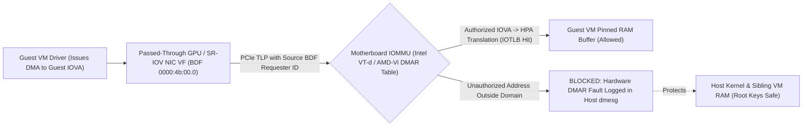

# 11.21 PCIe, IOMMU, VFIO and device passthrough

| | |
|---|---|
| Level | Advanced |
| Priority tier | 1 |
| Lab venue | GCP / GKE (plus local Python 3 simulation lab) |
| Part | Part 11: GPUs on Kubernetes, scheduling and virtualization |
| Sources used | Brendan Gregg, *Systems Performance: Enterprise and the Cloud*, 2nd Edition (`systems-performance-2nd-edition`, Addison-Wesley, 2020, Ch. 11 *Cloud Computing*); `nvidia-zero-to-hero/volume-07/chapter-02-pcie-numa-and-host-data-paths.md`; `nvidia-zero-to-hero/volume-18/chapter-07-dma-iommu-and-sriov-security.md` |
| Coverage file | `planning/coverage/chapters/11-21.md` |

## Why this matters for AI infrastructure

Picture two nodes with identical hardware. On one of them, every distributed training step takes twice as long as on the other. The difference is where the cards sit. An NVIDIA H100 GPU has a lot of memory bandwidth inside the chip. The moment a tensor leaves the GPU over the motherboard PCIe bus, the transfer speed drops by more than fifty times.

A server may lack dedicated PCIe switches. Kubernetes may also place a GPU and its RDMA network card on opposite CPU sockets. Then every network packet must cross the CPU Root Complex and the inter-socket link, which doubles distributed training step times across identical nodes.

Here is the arithmetic behind that gap. A PCIe Gen5 x16 link moves about 64 GB/s in one direction. Fifty times that is 3,200 GB/s. The H100's internal HBM3 bandwidth is 3,350 GB/s, so it is more than fifty times the PCIe Gen5 x16 figure.

Running GPUs or RDMA network cards inside virtual machines adds a second bottleneck. Under KVM, KubeVirt or Kata Containers, a traditional hypervisor proxies every packet or block request through a user-space emulator or a privileged management domain. Cloud platforms avoid that software tax by assigning a physical PCIe device, or an SR-IOV Virtual Function, straight to the guest OS. A Virtual Function is one slice of a physical network card. They make that assignment with PCIe Device Passthrough and the Linux VFIO subsystem.

Passthrough and SR-IOV also open a serious security hole when they are misconfigured. Direct Memory Access, or DMA, lets a device read and write memory without going through the host CPU or kernel. A compromised guest driver, or rogue network card firmware, can then read or write arbitrary host physical RAM addresses. A cloud penetration test showed how real that risk is. A tenant loaded a custom SR-IOV driver onto a host with no active IOMMU, and read the host management memory.

The summary below collects the numbers this chapter returns to.

```text
Motherboard, Passthrough, and Virtualization Summary Metrics:
- H100 internal HBM3 bandwidth: 3,350 GB/s
- PCIe Gen5 x16 unidirectional bandwidth: ~64 GB/s (> 50x narrower than HBM3)
- PCIe Gen4 x16 unidirectional bandwidth: ~32 GB/s
- Cross-NUMA (SYS) inter-socket UPI / xGMI penalty: 50% throughput drop (2x training runtime)
- Hypervisor I/O path (Qumranet 2006 benchmark): 5 steps in KVM vs 10 steps in Xen without PV
- Sources: volume-07/chapter-02, volume-18/chapter-07, Systems Performance 2nd Ed. Ch. 11
```

Two gaps stand out. The bus is far narrower than HBM3, and a cross-NUMA path loses about half its throughput.

This chapter connects the physical PCIe and NUMA data path with the IOMMU hardware firewall and the Linux VFIO group architecture. It also walks through Brendan Gregg's Cloud Virtualization Performance Model. You will see how Hardware Virtualization, OS Containers and Lightweight MicroVMs trade off CPU scheduling, memory translation and observability.

Choose an isolation model with those trade-offs in mind, before you decide how to lay out the GPUs on a node.

## Prerequisites and outcomes

### Prerequisites

Before you begin, finish Chapter 11.2 on the Device plugin, Container Toolkit, CDI and RuntimeClasses. Also finish Chapter 11.6, which covers Kubernetes Topology Manager and NUMA alignment. You should be comfortable with virtual memory page tables, MMU and TLB translation, and PCIe Bus:Device.Function addresses.

### Outcomes

The outcomes describe what you should be able to do by the end of the chapter. You will analyze PCIe Gen4 x16 and PCIe Gen5 x16 topologies on a motherboard, using `nvidia-smi topo -m`. You will eliminate cross-socket Intel UPI or AMD xGMI penalties with `kubelet --topology-manager-policy=single-numa-node`. You will explain how the Intel VT-d or AMD-Vi IOMMU translates Device Virtual Addresses to Host Physical Addresses. You will also see how it blocks unauthorized DMA with DMAR faults.

You will enforce Linux VFIO isolation across IOMMU groups when you bind endpoints to `vfio-pci`. You will diagnose Hardware Virtualization overheads across KVM, Xen and AWS Nitro, using `perf kvm stat live`, `kvmexits.bt`, `vmstat` and guest BPF tools. Last, you will compare Hardware VMs, OS Containers and Lightweight MicroVMs on CPU share bursting, `cpu.stat` throttling, PID namespace mapping and observability.

Work through the prerequisites first, so the topology commands and the VFIO steps make sense when you reach them.

## Concepts: basics to intermediate to advanced

### 1. Basics: PCIe generations, switches, NUMA boundaries, and the IOMMU DMA firewall

#### 1. The Motherboard Highway: PCIe Gen4, PCIe Gen5, Root Complexes, Switches, and NUMA

A distributed training job can stall on a network collective while the cluster fabric sits completely idle. The bottleneck frequently lies inside the server motherboard, not in the leaf-spine switches. Before a tensor reaches an optical cable or a guest VM, it has to cross PCIe lanes, switches or CPU sockets. If a GPU and its network card share no PCIe switch, every transfer bounces through the host CPU or crosses the inter-socket link.

A modern GPU or ConnectX network adapter connects to the motherboard through sixteen PCIe lanes. PCIe Gen5 x16 doubles the bandwidth of PCIe Gen4 x16. Even so, the external bus remains a narrow straw next to H100 HBM3 memory. How the server maker wires those lanes decides whether GPUDirect RDMA and Peer-to-Peer transfers run at full wire speed.

In a low-cost server, the PCIe slots wire straight into the CPU Root Complex. Traffic between a GPU and a network card must then climb to the CPU, pass through the PCIe Host Bridge, and come back down. That detour consumes host CPU memory bandwidth, and it often disables GPUDirect RDMA by default. AI-optimized servers avoid the detour by placing dedicated Broadcom or PLX PCIe switches between the CPU and the slots. Peer-to-Peer traffic then bypasses the host CPU completely.

An eight-GPU server typically has two physical CPU sockets, called NUMA Node 0 and NUMA Node 1. NUMA stands for non-uniform memory access. The two sockets connect across an Intel UPI or AMD xGMI link. A pod that pairs a GPU on NUMA Node 1 with a network card on NUMA Node 0 forces every packet across that link. If you schedule that pod, the crossing cuts communication throughput in half, which doubles distributed training time.

Each code that `nvidia-smi topo -m` reports names one physical path. The table below explains what each path means and how it affects GPUDirect P2P.

| `nvidia-smi topo -m` Code | Physical Path Across the Motherboard | Crosses CPU Root Complex? | Crosses Inter-Socket `UPI`/`xGMI`? | GPUDirect P2P Verdict |
|---|---|---|---|---|
| **`PIX`** | Traverses at most a **single PCIe switch** | No | No | **Optimal** (`P2P` bypasses CPU) |
| **`PXB`** | Traverses **multiple cascaded PCIe switches** | No | No | **Optimal / Good** (`P2P` bypasses CPU) |
| **`PHB`** | Traverses a **PCIe Host Bridge** (CPU Root Complex) within `1` NUMA node | **Yes** | No | **Degraded** (hits CPU; GDR often disabled) |
| **`NODE`** | Traverses **PCIe Host Bridges** within a single NUMA node | **Yes** | No | **Degraded** (hits CPU) |
| **`SYS`** | Crosses the **inter-socket NUMA link (`Intel UPI` / `AMD xGMI`)** | **Yes** | **Yes** | **Worst on Host** (`~50%` throughput loss) |

Only `PIX` and `PXB` keep Peer-to-Peer traffic off the CPU Root Complex. `SYS` is the worst case on a host, because it also crosses the inter-socket link.

Keep these reference figures beside any topology report you audit.

```text
Motherboard PCIe vs GPU Bandwidth Reference (volume-07/chapter-02):
- PCIe Lanes per GPU or high-speed NIC: 16 lanes (x16)
- PCIe Gen4 x16 (Ampere A100 generation): ~32 GB/s per direction
- PCIe Gen5 x16 (Hopper H100 generation): ~64 GB/s per direction (2x Gen4)
- NVIDIA H100 internal HBM3 bandwidth: 3,350 GB/s (> 50x PCIe Gen5 x16)
- Cross-NUMA (SYS) GPU 2 on NUMA 1 to 400G NIC on NUMA 0: ~50% performance drop (2x training time)
```

The cross-NUMA line deserves the most attention, because it roughly halves throughput.

#### 2. The IOMMU Hardware Firewall and Linux VFIO

Suppose you hand a physical GPU, or an SR-IOV Virtual Function, straight to a guest you do not trust. With no hardware memory protection in the way, that tenant can read host kernel memory. The route is Direct Memory Access, or DMA. DMA lets a PCIe card read and write system RAM without involving the host CPU or kernel. If the motherboard IOMMU is disabled, a malicious guest driver or compromised adapter firmware can read arbitrary host physical addresses. From there, the attacker can steal host root credentials or sibling VM memory straight off the motherboard.



The IOMMU does for devices what the CPU MMU does for processes. The Intel VT-d or AMD-Vi IOMMU sits between the PCIe bus and system RAM. Every PCIe Transaction Layer Packet carries the source Bus:Device.Function Requester ID of the device that sent it. When you enable the IOMMU with `intel_iommu=on` or `amd_iommu=on`, the hardware looks up that Requester ID in its DMA Remapping Access Table. It also caches recent translations in an internal IOTLB.

Two cases follow from that lookup. A DMA request aimed at a valid I/O Virtual Address, mapped to the guest VM's pinned Host Physical Address, goes through. A compromised guest driver that tries to read host kernel RAM, or another tenant's memory, hits a wall. The IOMMU blocks that transaction in silicon and logs a hardware DMAR fault in the host kernel ring buffer. Single-tenant bare-metal HPC clusters sometimes boot with `iommu=pt` to avoid IOTLB lookup latency. Multi-tenant cloud nodes, however, must enforce strict IOMMU remapping.

Linux sorts PCIe devices into IOMMU groups, which you can list under `/sys/kernel/iommu_groups/<N>/devices/`. An IOMMU group is the smallest set of devices that the IOMMU hardware can isolate from all others. Two endpoints may sit behind a PCIe bridge that lacks PCIe Access Control Services source validation. Their peer-to-peer traffic could then bypass the IOMMU. So Linux places both endpoints into the same group.

VFIO then exposes an isolated group to user-space hypervisors, such as QEMU or Cloud Hypervisor, through `/dev/vfio/<group_id>`. Before it allows passthrough, VFIO enforces a strict group viability rule. You cannot pass a GPU into a VM while any non-bridge sibling endpoint in its IOMMU group is still bound to a host driver. The GPU and any companion audio function must both bind to `vfio-pci` or `pci-stub`.

The example below shows one IOMMU group and the device node that VFIO creates from it.

```text
IOMMU Group 42 and VFIO Viability Example (volume-18/chapter-07):
- GPU Endpoint BDF: 0000:4b:00.0 (Vendor:Device 10de:2330, host drivers: nvidia, nouveau)
- Companion Audio Endpoint BDF: 0000:4b:00.1 (Vendor:Device 10de:1aef, host driver: snd_hda_intel)
- Sysfs group path: /sys/kernel/iommu_groups/42/devices/
- VFIO device node: /dev/vfio/42 (exposed only when both 0000:4b:00.0 and 0000:4b:00.1 bind to vfio-pci)
```

The node appears only after both endpoints bind to `vfio-pci`, so you should check each endpoint before you start the VM.

---

### 2. Intermediate: Hardware virtualization internals

#### 1. Cloud Sizing and Hypervisor Architectures

Fixed physical servers waste capacity whenever load drops off-peak. A poorly built hypervisor wastes CPU in another way, by emulating I/O in software. Cloud platforms solve the capacity problem by slicing large physical hosts into elastic virtual instances. Brendan Gregg describes this in *Systems Performance*, Chapter 11. The catch is latency. If the hypervisor proxies every packet or storage request through a management domain or a user-space emulator, high-speed GPU and NVMe workloads suffer high latency.

Rather than rely on the dated 1973 Type 1 and Type 2 taxonomy, Gregg sorts production cloud hypervisors into three practical architectures. In Configuration A, shown by Xen and VMware ESX, a bare-metal hypervisor runs directly on the CPU. It schedules virtual CPUs with Borrowed Virtual Time, Simple Earliest Deadline First, or Credit-based schedulers. A privileged management domain, called Domain-0 or `dom0`, administers the host. It either proxies I/O or offloads work to Isolated Driver Domains metered by SEDF-DC.

In Configuration B, shown by Linux KVM, the host kernel itself acts as the hypervisor, through the `kvm` kernel module. KVM schedules guest vCPUs as regular Linux kernel threads. Alongside them runs a per-VM `qemu-system-x86` user-space process, which emulates legacy hardware and proxies virtual I/O. AWS Nitro keeps KVM for processor virtualization, but adds dedicated SR-IOV and hardware-offload cards for networking, storage, interrupts and timers. Nitro eliminates the QEMU I/O proxy process completely, so guests achieve near-bare-metal I/O latency.

The reference below gathers the sizing cases and hypervisor figures from this part of the chapter.

```text
Cloud Sizing and Hypervisor Architecture Benchmarks (Systems Performance 11.1 - 11.2):
- AWS m5 instance family on 512+ GB hosts: m5.large (2 vCPUs, 8 GB RAM) to m5.24xlarge (96 vCPUs, 384 GB RAM)
- Pinterest dynamic sizing (December 2012): cut off-hours cloud cost from $54/hr ($54/hour) to $20/hr ($20/hour)
- Shopify cloud migration (2018): reduced average server idle time from 61% to 19%
- Hypervisor releases: VMware (1998), VMware ESX (2001), Xen (2003), KVM acquired by Red Hat (2008), AWS Nitro (2017)
- Qumranet 2006 benchmark ([Qumranet 06]): un-paravirtualized I/O took 5 steps in KVM vs 10 steps in Xen dom0
- QEMU 4.2 user-space VMM codebase size: > 1.4 million lines of code (1.4M LoC)
- AWS Nitro drivers: ena (networking) and nvme (storage) hardware offload cards
```

When you read the step counts, keep the architecture descriptions above them in view.

#### 2. CPU Virtualization, Two-Stage Memory, and VM-EXIT Tracing

Consider a GPU passed straight into a KVM guest through `vfio-pci`. Even so, the guest's CPU threads still run under hardware virtualization. Whenever a guest vCPU runs a privileged operation, or faults on an unmapped physical memory page, execution traps into the host hypervisor. Too many guest exits, or host CPU throttling, can stall GPU kernel launches and dataloader threads. Meanwhile, the guest operator has no view of the root cause.

Early hypervisors used binary translation at run time. They ran the Virtual Machine Monitor in Ring 0 and moved the guest kernel to Ring 1. Applications stayed in Ring 3, while the hypervisor rewrote privileged instructions on the fly. Paravirtualization took another route. It changed the guest OS so that privileged instructions became explicit hypercalls or batched multicalls. Modern processors with Intel VT-x and AMD-V run the hypervisor in a root mode below Ring 0. There, the hypervisor traps through a VM-EXIT only on privileged operations.

Memory virtualization needs two stages of translation. The guest kernel first maps Guest Virtual addresses to Guest Physical addresses. Then the hypervisor maps Guest Physical addresses to Host Physical addresses. Without hardware help, the hypervisor had to trap every `CR3` and page-table change, and keep Shadow Page Tables up to date in software. Modern CPUs offer Intel Extended Page Tables and AMD Nested Page Tables instead. The hardware page-walker then resolves both stages in silicon, with no VM-EXIT.

Operators must never inflate a hypervisor memory balloon driver inside a guest that uses GPU passthrough with `vfio-pci`. VFIO pins all guest physical RAM pages in the host IOMMU. That pinning lets the GPU run Direct Memory Access transfers safely at any moment. A balloon driver reclaims pages, which conflicts with those pinned DMA mappings and breaks passthrough initialization.

On the host, you can measure VM-EXIT overhead with `pidstat`, `perf kvm stat live`, or a `bpftrace` script such as `kvmexits.bt`. That script attaches to `tracepoint:kvm:kvm_exit` and `tracepoint:kvm:kvm_entry`. Passthrough and SR-IOV change what the host can see. A guest's device traffic bypasses the host kernel and the QEMU proxy completely. So host tools such as `iostat` or `sar` cannot see guest disk and network I/O. You need hardware Performance Monitoring Counters, DCGM metrics, or guest BPF tools such as `biosnoop` instead. Keep an eye on `vmstat` stolen CPU time while you work.

The reference below gathers the KVM exit counts and the passthrough observability figures.

```text
KVM Host VM-EXIT, EPT, and Passthrough Observability Reference (Systems Performance 11.2.2 & 11.2.4):
- Hardware CPU virtualization extensions: Intel VT-x and AMD-V (introduced 2005-2006)
- Linux 5.2 KVM exit table: arch/x86/kvm/vmx/vmx.c kvm_vmx_exit_handlers[]
- Key KVM exit handlers: EXIT_REASON_HLT -> kvm_vcpu_halt(), EXIT_REASON_IO_INSTRUCTION, EXIT_REASON_MSR_WRITE, EXIT_REASON_VMCALL, EXIT_REASON_PREEMPTION_TIMER
- Guest memory balloon check: dmesg | grep balloon ([Waldspurger 02])
- Host vCPU thread check: pidstat -tp <QEMU_PID> 1 (inspects %guest vs %system across CPU 0/KVM and CPU 1/KVM threads)
- perf kvm stat live sample (2,421 total samples, 1,946,040.48 us handled time):
  * MSR_WRITE: 1,668 samples (68.90% of exits, 3.25 us avg)
  * HLT (idle vCPU sleep): 466 samples (19.25% of exits, 99.63% of total time, 4,160.68 us avg)
  * PREEMPTION_TIMER: 112 samples (4.63%)
  * PENDING_INTERRUPT: 82 samples (3.39%)
  * EXTERNAL_INTERRUPT: 53 samples (2.19%)
  * IO_INSTRUCTION: 37 samples (1.53%, 19.97 us avg)
  * MSR_READ: 2 samples (0.08%)
  * EPT_MISCONFIG: 1 sample (0.04%, 19.94 us avg)
- kvmexits.bt (exit_reason and guest_rip latency histograms):
  * IO_INSTRUCTION (reason 30): mode in [8K, 16K) ns (8-16 us) bucket with 198 samples, outliers 2-8 ms
  * EPT_VIOLATION (reason 48): mode in [2K, 4K) ns (2-4 us) bucket with 7,686 samples
- Throttled Xen guest vmstat 1 stolen CPU time (%st): jumps from 1-5% to 97-99%
```

Read the HLT line as a sign of normal idling, since it accounts for most of the measured time.

---

### 3. Advanced: Comparing Hardware VMs, OS Containers, and Lightweight MicroVMs

#### 1. Architecture, Security, and Observability Trade-offs

If you architect a multi-tenant AI cluster, you have to trade isolation against agility. OS Containers boot in milliseconds and share host memory cleanly. The downside is that one host kernel panic, or one filesystem lock bug, reaches every tenant on the node. Full Hardware VMs do the opposite. They isolate each tenant's kernel behind an IOMMU and a hypervisor. Their cost is that traditional user-space emulators carry over a million lines of code, and they add memory and boot overhead.

Modern AI clouds match each workload to one of three runtime models. Brendan Gregg analyzes them in *Systems Performance*, Sections 11.3 through 11.6. Trusted internal training jobs usually run in OS Containers, managed by `containerd` and `nvidia-container-toolkit`. Untrusted multi-tenant GPU rentals run in full Hardware VMs, under KVM or KubeVirt, with `vfio-pci` passthrough or NVIDIA vGPU. Serverless inference and multi-tenant Kubernetes pods are increasingly moving to Lightweight MicroVMs, such as AWS Firecracker or Kata Containers.

OS Containers split one shared Linux kernel into partitions. They rely on namespaces, control groups and `seccomp-bpf` syscall filters. They also share the host page cache through OverlayFS. Lightweight MicroVMs combine the speed of containers with the hardware isolation of KVM. They do this by stripping the user-space VMM down to the bare essentials. AWS Firecracker and Intel Clear Containers, which merged into Kata Containers, boot a dedicated guest kernel in tens of milliseconds, with minimal memory overhead. Kata Containers attach GPUs straight into the MicroVM guest kernel, using `vfio-pci` passthrough and the Kata `runtimeClassName`.

Observability splits these models sharply. OS Containers favor the host operator. Every container process is an ordinary host task, so host `top`, `perf` and `bpftrace` can see it. Container tenants, though, cannot run kernel tracing tools. They also see host-wide counters leak through `iostat`, `free`, `vmstat`, `mpstat` and `uptime`. Hardware VMs and Lightweight MicroVMs favor the end user instead. Each tenant gets a dedicated guest kernel for `perf`, Ftrace and BPF tools. The host operator, in exchange, sees only an opaque QEMU or Firecracker process.

The table below compares the three models on the attributes discussed above.

| Attribute (`SP 11.6` Table 11.7 + GPU Path) | Hardware Virtualization (`KVM` + `QEMU` / `Nitro`) | OS Virtualization (`Linux Containers`) | Lightweight Hardware Virtualization (`Firecracker` / `Kata` MicroVMs) |
|---|---|---|---|
| **Architecture & VMM Footprint** | Full guest kernel + `QEMU` VMM (**`> 1.4 million` LoC** in QEMU `4.2`); `Nitro` offloads proxy to hardware | Shared single host kernel (`struct nsproxy`: **`8` namespaces** in Table 11.1 + **`12` cgroups** in Table 11.2 + `seccomp-bpf`) | Dedicated guest kernel + minimal VMM (**`Firecracker`: `50,000` LoC, `< 5 MB` RAM, `~100 ms` boot**; **`Clear/Kata`: `< 45 ms` boot, `48–50 MB` RAM**) |
| **GPU Attachment Mechanism** | **`vfio-pci` Passthrough** (whole GPU or MIG VF) or **NVIDIA vGPU** mediated device (`mdev`) | Device node bind-mount (`/dev/nvidia*`) + `devices` / `rdma` cgroup via CDI (`nvidia-container-toolkit`) | **`vfio-pci` Passthrough** (via `IOMMU` + Kata `runtimeClassName`) into the MicroVM guest kernel |
| **Memory Translation & Caching** | Two-stage (`EPT`/`NPT`), fixed VM RAM allocation (must be pinned for VFIO DMA), risk of double page-caching | Single-stage host MMU (zero `EPT` overhead); containers share host page cache via `OverlayFS` (`ovl_write_iter`) | Two-stage (`EPT`/`NPT`), fixed MicroVM RAM allocation |
| **CPU Allocation & Bursting Trap (`SP 11.3.3`)** | Fixed to `vCPUs` (plus host cgroup / `Intel CAT` LLC cache partitioning) | Flexible **CFS Shares + CFS Bandwidth**: `10` shares of `100` gets **`25%`** when only A (`10`) & B (`30`) are busy (`100%` when alone), dropping **`10x` to `10%`** when all `100` shares are busy (cap with CFS bandwidth e.g. `20%`) | Fixed to `vCPUs` managed by host cgroups (`firecracker` PID `30785` at `200%` CPU = `2` vCPUs in `SP 11.4.4`) |
| **Observability from the Host** | **Medium:** Host `top` sees `qemu-system-x86` (`PID 24881`), `perf kvm stat live`; guest processes are opaque; passthrough/SR-IOV I/O bypasses host `iostat` | **High (Favors Host Operators):** Host sees all processes (`NSpid: 4915 -> 753` in `pid:[4026532216]`), `/proc/4915/root/tmp`, `nsenter -t 4915 -m -p`, `systemd-cgtop`, and `bpftrace` `curtask->nsproxy->uts_ns->name.nodename` | **Medium:** Host `top` sees a single `firecracker` process (`PID 30785`, host load `4.48` vs guest load `1.89` with `bash` PIDs `1104`, `1105`) |
| **Observability from the Guest (`Table 11.6`)** | **High (Favors End Users):** Full dedicated kernel; `perf`, `Ftrace`, BPF (`biosnoop`), and `vmstat %st` all work | **Medium:** Kernel tracing (`perf`, `dmesg`, BPF) restricted; **`top`, `uptime`, `mpstat`, `vmstat`, `free`, `iostat` leak host-wide stats** (e.g. idle container `iostat` showing host `nvme0n1` at `2,578` tps / `100%` util while `blkio.throttle.io_serviced` stays flat at `804`) | **High (Favors End Users):** Full dedicated guest kernel; `mpstat` shows only guest `vCPUs` (`2` CPUs) and guest BPF/perf tools work |
| **Kernel Blast Radius** | Guest kernel panic or custom kernel module affects **only that VM**; IOMMU blocks rogue DMA | **Shared kernel:** Any kernel panic crashes all containers on the node; `dcache`/`lstat` or `posix_fadvise()` contention affects neighbors (`[Borello 17]`, `[Leonovich 18]`) | Guest kernel panic affects **only that MicroVM**; combines container boot speed (`45–100 ms`) with hardware VM isolation |

Read the kernel blast radius row last, because it shows what a single failure can reach.

#### 2. Diagnosing Container CPU Throttling and Bursting on Shared GPU Nodes

Consider a containerized PyTorch dataloader that stalls on a shared GPU node. Your first habit is to check host `mpstat`. Plenty of idle CPU shows up there, so the operator concludes that the CPU is not the bottleneck. That conclusion is often wrong. Software cgroup limits, or changes to CFS shares, can throttle a container severely, even on a partly idle host. Worse, CFS share bursting can cut a container's available CPU by ten times when neighboring pods wake up.

CFS CPU shares divide capacity in proportion to the tenants that are busy. The formula is `container CPU = all CPUs * container shares / total busy shares`. A container with a small share allocation can burst to use the entire host CPU during an isolated staging test. When the node fills up in production, that same container drops back to its guaranteed share. Operators prevent that tenfold bait-and-switch slowdown by capping bursting with an explicit CFS bandwidth quota. The block below works through the numbers.

To find out why a container is slow, follow the five-statistic sequence from Brendan Gregg's *Systems Performance*, Section 11.3.4 and Figure 11.13. Start with `throttled_time` and `nr_throttled` in the container's `cpu.stat` file. They show whether CFS bandwidth limits are pausing the pod. Next, check `nonvoluntary_ctxt_switches` in `/proc/PID/status`. If that counter is not climbing, the process is not being forced off the CPU.

Third, look at `mpstat %idle` to see whether the host has idle capacity. If it has idle cores while `nonvoluntary_ctxt_switches` keeps increasing, check whether the container's assigned `cpuset` cores are completely saturated. Full saturation of those pinned cores points to `cpuset` throttling. Finally, if the host has zero idle CPU and neighboring tenants are busy, the container is being throttled by CFS shares.

The reference below gathers the namespace, cgroup and throttling figures from this part of the chapter.

```text
Container Namespaces, Cgroups, Throttling, and MicroVM Metrics (Systems Performance 11.3 - 11.6):
- 8 Linux namespaces (Table 11.1, listed via lsns): cgroup, ipc, mnt, net, pid, time, user, uts
- 12 Linux cgroups v1 controllers (Table 11.2): blkio, cpu, cpuacct, cpuset, devices, hugetlb, memory, net_cls, net_prio, perf_event, pids, rdma
- CFS CPU shares bursting example (SP 11.3.3, 100 total system shares):
  * Container A (10 shares) alone on idle host: 10 / 10 = 100% CPU
  * Container A (10 shares) + Container B (30 shares) busy: 10 / (10 + 30) = 25% (25.0%) CPU
  * All 100 system shares busy: 10 / 100 = 10% (10.0%) CPU (10x drop from 100%; cap with 20% CFS bandwidth limit to bound range to 10%-20%)
- CFS cpu.stat throttling example (SP 11.3.4 /sys/fs/cgroup/cpu,cpuacct/.../cpu.stat):
  * nr_periods: 507
  * nr_throttled: 74 (74 / 507 periods)
  * throttled_time: 3,816,445,175 ns (3816445175 ns = 3.8 s / 3.8 seconds)
- Container PID and disk I/O observability (SP 11.3.4 Table 11.6):
  * Host PID to guest PID mapping in /proc/4915/status: NSpid: 4915 753 in namespace pid:[4026532216]
  * Idle container iostat -sxz 1 leak: host nvme0n1 shows 2,578 tps at 100% (100.00%) utilization
  * Container blkio.throttle.io_serviced counter: stays constant at 804 (452 Read + 352 Write) across sleep 10 interval
- Lightweight MicroVM benchmarks (SP 11.4):
  * AWS Firecracker (2019): 50,000 (50K) LoC (~28x smaller than QEMU 4.2 > 1.4M LoC), ~100 ms boot, < 5 MB memory overhead
  * Intel Clear Containers (2015, merged into Kata Containers in 2017): < 45 ms boot, 48-50 MB memory overhead
  * Firecracker host vs guest top (SP 11.4.4): host firecracker PID 30785 at 200% CPU (2 vCPUs, host load avg 4.48) vs guest load avg 1.89 with two bash processes (PIDs 1104, 1105) at 100% each
```

When a container stalls, check the cgroup counters before you blame the hardware.

## Commands and configurations that matter

### 1. Auditing PCIe and NUMA Topology and IOMMU Groups on a GPU Host

Before you launch a distributed training job or bind a GPU to a VM, audit the host topology. Check how the GPU and the network card connect across PCIe switches and NUMA sockets. Then confirm that the motherboard IOMMU is active in the kernel ring buffer. These checks catch cross-socket wiring mistakes and missing BIOS virtualization settings before the workloads fail.

```bash
# 1. Inspect GPU-to-NIC PCIe switch (PIX/PXB vs PHB/NODE/SYS) and NUMA affinity (untested here)
nvidia-smi topo -m

# 2. Verify IOMMU (Intel VT-d / AMD-Vi) and DMAR tables are active in kernel dmesg (untested here)
dmesg | grep -E -i "DMAR|IOMMU|AMD-Vi"

# 3. List all IOMMU groups and the PCIe BDF endpoints inside each group (untested here)
for g in $(find /sys/kernel/iommu_groups/* -maxdepth 0 -type d | sort -V); do
    echo "IOMMU Group ${g##*/}:"
    for d in "$g"/devices/*; do
        lspci -nns "${d##*/}"
    done
done
```

The first command shows the topology codes, the second confirms the IOMMU, and the third lists every device in each IOMMU group.

### 2. Unbinding a GPU from Host Drivers and Binding its IOMMU Group to `vfio-pci`

Preparing a host for GPU passthrough under KVM, KubeVirt or Kata Containers depends on clean IOMMU group isolation. Suppose the GPU, or one sibling endpoint in its group, still uses a host driver. Then VFIO initialization breaks. The commands below do four things in order. They load `vfio-pci`, unbind the GPU from the host driver, and bind it to `vfio-pci`. Last, they check that `/dev/vfio/<group_id>` is ready for the hypervisor.

```bash
# Bind GPU (0000:4b:00.0, 10de:2330) to vfio-pci for VM passthrough (untested here)
sudo modprobe vfio-pci

# Unbind from host nvidia driver if bound
echo "0000:4b:00.0" | sudo tee /sys/bus/pci/devices/0000:4b:00.0/driver/unbind

# Override driver to vfio-pci and probe
echo "vfio-pci" | sudo tee /sys/bus/pci/devices/0000:4b:00.0/driver_override
echo "0000:4b:00.0" | sudo tee /sys/bus/pci/drivers_probe

# Verify /dev/vfio/<group_id> character device node is created and driver in use is vfio-pci
lspci -nnk -s 0000:4b:00.0
ls -la /dev/vfio/
```

After the binding, `lspci` should report `vfio-pci` as the driver in use, and `ls` should show the device node.

### 3. Observing KVM VM-EXITs and Container Namespace and Cgroup Limits

Virtualized and containerized GPU workloads sometimes show latency spikes that nothing explains, especially under multi-tenant load. The host operator then has three things to check. The first is the KVM guest exit rate. The second is the host PID behind a container process. The third is the cgroup throttling counters. The commands below trace live KVM exits and map container guest PID 753 to host PID 4915.

```bash
# 1. Live KVM VM-EXIT breakdown on a hypervisor host (SP 11.2.4, untested here)
sudo perf kvm stat live

# 2. Map a container guest PID (753) to its host PID (4915) and inspect CFS throttling (SP 11.3.4, untested here)
awk '$1 == "NSpid:" && $3 == 753 { print $2 }' /proc/*/status
ls -lh /proc/4915/ns/pid
cat /sys/fs/cgroup/cpu,cpuacct/kubepods/burstable/pod*/cpu.stat
```

The first command runs on the hypervisor host, and the remaining lines inspect the container from the host side. Once the awk line gives you the host PID, use that number for the namespace and cgroup checks.

## How it fails

Consider how a single wrong setting in one of four places can cause a serious security exposure or a slow job. Those places are the PCIe topology, the IOMMU BIOS settings, the VFIO group bindings and the container cgroups. If you are chasing one of these, the table below maps five production failure symptoms to their root causes and gives the exact remediation for each.

| Failure mode | Exact symptom & command evidence | Root cause boundary | Remediation |
|---|---|---|---|
| **1. Tenant in bare-metal/SR-IOV cloud reads host management agent memory via custom NIC driver (`volume-18/chapter-07`)** | Penetration test loads a modified VF driver in the tenant OS and successfully DMA-reads physical RAM outside its allocation; `dmesg \| grep -i dmar` shows IOMMU is disabled. | **Missing IOMMU Hardware Firewall:** SR-IOV slices the NIC into VFs, but without **IOMMU (`Intel VT-d` / `AMD-Vi`)** enabled, VFs can issue unrestricted DMA requests across host physical RAM. | Enable VT-d / AMD-Vi in server BIOS and pass `intel_iommu=on` (or `amd_iommu=on`) on the kernel command line so the IOMMU blocks unauthorized DMA with a **DMAR fault**. |
| **2. QEMU / KubeVirt fails to start GPU passthrough VM with `vfio: error, group 42 is not viable` (`Layer 2/3` VFIO)** | `virsh start` or KubeVirt `virt-launcher` fails with `group 42 is not viable, please ensure all devices within the iommu_group are bound to their vfio bus driver`. | **Incomplete IOMMU Group Binding:** A sibling PCIe endpoint in Group `42` (or a shared non-ACS PCIe bridge) is still bound to a host kernel driver (`snd_hda_intel` or `nvidia`). | Bind **every** non-bridge endpoint in `/sys/kernel/iommu_groups/42/devices/` to `vfio-pci` (or enable PCIe ACS appropriately for virtualization isolation when not using bare-metal GPUDirect P2P). |
| **3. PyTorch distributed training on Node B runs `2x` slower (`50%` drop) than on identical Node A (`volume-07/chapter-02`)** | `nvidia-smi topo -m` on Node B shows the allocated GPUs (`GPU 2, 3` on NUMA 1) communicate with the single `400G` NIC (on NUMA 0) via **`SYS`**. | **Cross-NUMA (`SYS`) Inter-Socket Bottleneck:** Scheduler assigned GPUs on CPU 1 while the NIC is wired to CPU 0, forcing all RDMA traffic across the Intel UPI / AMD xGMI link. | Configure `kubelet` with `--topology-manager-policy=single-numa-node` and `--cpu-manager-policy=static` so pods are only admitted onto NUMA-aligned GPU + CPU + NIC tuples. |
| **4. Containerized workload drops `10x` in CPU dataloader throughput when additional pods land on the node (`SP 11.3.3`)** | Dataloader ran fast during isolated staging tests (`100%` CPU via bursting), then slowed `10x` in production; `cpu.stat` shows `nr_throttled` or `nonvoluntary_ctxt_switches` climbing. | **CFS Share Bursting "Bait-and-Switch" (`SP 11.3.3`):** Container A (`10` shares of `100`) burst to `100%` on an idle host, then dropped to its `10%` guaranteed share once neighbors became busy. | Cap bursting with explicit **CFS bandwidth limits** (or use exclusive `cpuset` pinning via Kubernetes `Guaranteed` QoS + `static` CPU Manager) so staging benchmarks match production capacity. |
| **5. Engineer inside an idle container runs `iostat -sxz 1` and sees `nvme0n1` at `2,578` tps and `100%` utilization (`SP 11.3.4` Table 11.6)** | User reports a mystery disk bottleneck inside their idle container because `iostat`, `free`, `vmstat`, `mpstat`, and `uptime` show heavy system load. | **Un-Namespaced `/proc` & `/sys` Host Statistics in Containers (`SP 11.3.4`):** Traditional Linux tools read host-wide kernel counters inside containers. | Inspect container-specific cgroup files (`cat /sys/fs/cgroup/blkio/blkio.throttle.io_serviced` and `io_service_bytes` across a `sleep 10` interval) or cgroup-aware monitoring (`cAdvisor`, `systemd-cgtop`). |

When a job breaks, you should match its symptom to a row first, then read the root cause column before you change anything.

## Hands-on lab

### Venue and scope

Checking PCIe topology policies, IOMMU DMAR faults and VFIO group viability before you touch production nodes can prevent costly outages. This lab runs locally with the Python 3 standard library. It uses `code/part11/pcie_iommu_vfio_passthrough.py` and `code/part11/pcie_iommu_vfio_passthrough_lab.py`. The host commands shown earlier are marked untested here, so you should treat them as unverified.

The matrix below names the numbers the lab verifies, grouped by source. Each line covers one set of figures.

```text
Lab Verification Coverage Matrix:
- PCIe Gen4/Gen5 & NUMA model (volume-07/chapter-02): 32 GB/s vs 64 GB/s vs 3,350 GB/s HBM3; PIX, PXB, PHB, NODE, SYS; single-numa-node policy
- IOMMU & VFIO validator (volume-18/chapter-07): DMAR firewall, 0000:4b:00.0 + 0000:4b:00.1 in /dev/vfio/42
- Systems Performance Ch. 11 checks: m5.large to m5.24xlarge, Pinterest $54/hr -> $20/hr, Shopify 61% -> 19%, KVM 5 vs 10 steps, perf kvm stat live 2,421 samples, kvmexits.bt EPT_VIOLATION 7,686 samples, vmstat %st 97-99%, CFS share bursting 25% vs 10%, cpu.stat 74 / 507 (3.8 s), NSpid: 4915 -> 753, iostat 2,578 tps leak, and QEMU 1.4M LoC vs Firecracker 50K LoC / 100 ms / < 5 MB vs Clear/Kata < 45 ms / 48-50 MB
```

### Step 1: Run the self-checking PCIe, IOMMU, VFIO and passthrough lab (tested here)

When you are in the repository root, run the lab script. It executes all twenty-five deterministic verification checks.

```bash
python3 code/part11/pcie_iommu_vfio_passthrough_lab.py
```

Captured output from this repository:

```text
=== Chapter 11.21 Lab: PCIe, IOMMU, VFIO, Device Passthrough & SP Ch. 11 ===
  [PASS] PCIe Gen4 x16 provides ~32 GB/s per direction and PCIe Gen5 x16 doubles to ~64 GB/s vs 3,350 GB/s H100 HBM3
  [PASS] PIX and PXB stay on PCIe switches without crossing the CPU Root Complex (optimal P2P GPUDirect)
  [PASS] PHB and NODE cross the CPU Root Complex within one NUMA node, while SYS crosses Intel UPI / AMD xGMI
  [PASS] Disabling IOMMU in BIOS/kernel leaves SR-IOV/passthrough vulnerable to rogue DMA attacks and blocks VFIO
  [PASS] VFIO rejects IOMMU group 42 when sibling endpoint 0000:4b:00.1 is still bound to host driver snd_hda_intel
  [PASS] Binding all non-bridge endpoints in IOMMU group 42 to vfio-pci exposes /dev/vfio/42 with DMAR isolation
  [PASS] SP 11.1.1 AWS m5 family spans m5.large (2 vCPUs, 8 GB) to m5.24xlarge (96 vCPUs, 384 GB) on 512+ GB hosts
  [PASS] SP 11.1.3 dynamic sizing cut Pinterest off-hours cloud cost from $54/hr to $20/hr and Shopify idle time from 61% to 19%
  [PASS] SP 11.2.2 Qumranet 2006 benchmark showed KVM I/O took 5 steps vs 10 steps in Xen without paravirtualization
  [PASS] SP 11.2.4 perf kvm stat live sample records 2,421 total samples (1,668 MSR_WRITE = 68.90%, 466 HLT = 19.25% / 99.63% time, 1 EPT_MISCONFIG = 19.94us)
  [PASS] SP 11.2.4 kvmexits.bt records IO_INSTRUCTION mode in [8K, 16K) ns (198 samples) and EPT_VIOLATION mode in [2K, 4K) ns (7,686 samples)
  [PASS] SP 11.2.4 vmstat %st (stolen CPU time) in a throttled Xen guest spikes from 1-5% to 97-99%
  [PASS] SP 11.3.3 Container A (10 shares of 100) gets 25.0% CPU when only A (10) and B (30) are busy, and 10.0% when all 100 shares are busy
  [PASS] SP 11.3.3 CFS share bursting drops 10x (100% idle host -> 10% full host); CFS bandwidth cap at 20% bounds range to 10-20%
  [PASS] SP 11.3.4 cpu.stat example records nr_periods=507, nr_throttled=74, and throttled_time=3,816,445,175 ns (~3.8s)
  [PASS] SP 11.3.4 /proc/4915/status maps host PID 4915 to container NSpid 753 in namespace pid:[4026532216]
  [PASS] SP 11.3.4 iostat -sxz 1 inside an idle container leaks host nvme0n1 activity (2,578 tps, 100.00% util) while blkio.throttle.io_serviced stays constant at 804
  [PASS] SP 11.3.1 Table 11.1 lists 8 Linux namespaces (cgroup, ipc, mnt, net, pid, time, user, uts) and Table 11.2 lists 12 cgroups (including devices, hugetlb, perf_event, rdma)
  [PASS] SP 11.4 compares QEMU 4.2 (> 1.4M lines of code) against AWS Firecracker (50,000 lines of code, ~100ms boot, < 5 MB memory overhead)
  [PASS] SP 11.4.1 Intel Clear Containers (merged into Kata Containers in 2017) achieved < 45ms boot and 48-50 MB memory overhead
  [PASS] SP 11.4.4 Firecracker VM PID 30785 consumes 200% CPU on host (load avg 4.48) while guest top shows two bash PIDs (1104, 1105) at 100% each (guest load avg 1.89)
  [PASS] SP 11.6 Table 11.7 shows OS Containers favor host operators (high host visibility) while Hardware/Lightweight VMs favor end users (full guest kernel BPF/perf visibility)
  [PASS] SP 11.2.4 explains that PCI passthrough and SR-IOV bypass hypervisor I/O paths so device I/O becomes invisible to host iostat
  [PASS] SP 11.3.4 Figure 11.13 diagnoses container CPU throttling across 5 statistics (throttled_time, nonvoluntary_ctxt_switches, host %idle, cpuset 100% busy, other tenants idle)
  [PASS] Volume 07 Ch 2 kubelet --topology-manager-policy=single-numa-node + static CPU Manager prevents 50% cross-NUMA UPI degradation

Summary: 25 passed, 0 failed out of 25 checks.
```

Each line is one check, and you can count them against the summary at the bottom.

### Exercises

Work through the six exercises below.

1. Begin with bandwidth and the `nvidia-smi topo -m` paths. State the unidirectional bandwidth of PCIe Gen4 x16, PCIe Gen5 x16 and H100 HBM3. Then rank PIX, PXB, PHB, NODE and SYS by whether each one crosses the CPU Root Complex and the inter-socket link.
2. Explain why SR-IOV alone, without the IOMMU turned on through `intel_iommu=on`, let a tenant DMA-read host RAM. Then state why VFIO refuses to open `/dev/vfio/42` when the GPU endpoint `0000:4b:00.0` is bound to `vfio-pci` but `0000:4b:00.1` remains on `snd_hda_intel`.
3. Read the `perf kvm stat live` and `kvmexits.bt` histograms from *Systems Performance*, Section 11.2.4. Then explain why `iostat` on a KVM or AWS Nitro host cannot see traffic from a vfio-pci or SR-IOV device.
4. Work out Container A's CPU share three ways: alone, paired with Container B, and with all system shares busy. Then explain how a CFS bandwidth cap prevents the tenfold bait-and-switch drop.
5. List the traditional Linux tools that leak host-wide statistics inside a container. Then write the commands that map container guest PID 753 to host PID 4915 and inspect `/sys/fs/cgroup/blkio/blkio.throttle.io_serviced`.
6. Compare QEMU, AWS Firecracker and Intel Clear or Kata Containers on codebase size, boot latency and memory overhead. Then explain why OS Containers favor host operators for observability, while Hardware and Lightweight VMs favor end users.

Work through them with the captured output open, so you can point to a figure the lab already verified.

## Checkpoint questions

Use these questions to check whether you can explain the layers and numbers from memory. Try each answer before you open it.

<details>
<summary>**1. Compare the unidirectional bandwidth of PCIe Gen4 x16, PCIe Gen5 x16, and an NVIDIA H100 GPU's internal HBM3 memory.**</summary>

PCIe Gen4 x16 gives roughly 32 GB/s per direction. PCIe Gen5 x16 doubles that to 64 GB/s per direction. An NVIDIA H100 GPU, by comparison, offers 3,350 GB/s of internal HBM3 memory bandwidth. Internal HBM3 memory is therefore more than fifty times faster than PCIe Gen5 x16.
</details>

<details>
<summary>**2. What is the architectural difference between wiring GPUs and NICs directly to the CPU Root Complex versus wiring them to a dedicated PCIe Switch?**</summary>

Devices wired straight into the CPU Root Complex show up as PHB or NODE. Their transfers pass through the CPU, which consumes host CPU memory bandwidth and adds latency. Devices on the same Broadcom or PLX PCIe Switch show up as PIX or PXB. Their Peer-to-Peer traffic goes straight through the switch and never touches the host CPU.
</details>

<details>
<summary>**3. In nvidia-smi topo -m, what does SYS mean, and how do you prevent Kubernetes from scheduling a Pod onto a cross-NUMA SYS GPU-to-NIC path?**</summary>

SYS means the GPU and the network card sit on different NUMA nodes, on separate physical CPU sockets. All of their traffic must cross the inter-socket Intel UPI or AMD xGMI link, which cuts throughput by roughly 50%. To prevent this, configure `kubelet` with `--topology-manager-policy=single-numa-node` and `--cpu-manager-policy=static`.
</details>

<details>
<summary>**4. What is a PCIe Direct Memory Access attack, and how does the IOMMU prevent it?**</summary>

Direct Memory Access lets PCIe devices read and write physical system RAM without going through the host CPU or kernel. Consider a compromised device with no IOMMU protection. Its firmware, or a guest driver, can read host passwords or keys from any RAM address. The Intel VT-d or AMD-Vi IOMMU checks every DMA request against a per-device DMA Remapping Access Table. It blocks unauthorized access in silicon and raises a hardware DMAR fault.
</details>

<details>
<summary>**5. In the Volume 18 Chapter 7 penetration test, why was a tenant able to read the cloud provider's management memory even though SR-IOV was enabled on the ConnectX-6 NIC?**</summary>

SR-IOV only splits a physical network adapter into several Virtual Functions, so tenants can share hardware queues. It does not limit which host physical RAM addresses those functions reach through DMA. The cloud provider had not enabled the IOMMU with `intel_iommu=on`. So the tenant's custom VF driver could read motherboard RAM freely.
</details>

<details>
<summary>**6. When is it acceptable to use iommu=pt pass-through mode, and when is strict IOMMU remapping mandatory?**</summary>

On a single-tenant, trusted bare-metal HPC cluster with no untrusted VMs, operators sometimes set `iommu=pt` on the host kernel. That flag skips IOTLB translation overhead for host DMA operations. Any multi-tenant cloud, any bare-metal SR-IOV environment, and any VM passthrough setup under KVM, KubeVirt or Kata needs strict IOMMU remapping. In each of those, strict IOMMU remapping is mandatory.
</details>

<details>
<summary>**7. What is a Linux IOMMU Group, and what is the VFIO viability rule when passing a GPU into a Virtual Machine?**</summary>

An IOMMU group, listed under `/sys/kernel/iommu_groups/<N>/devices/`, is the smallest set of PCIe devices the IOMMU can isolate. VFIO treats a group as viable for passthrough only when every non-bridge endpoint in it is isolated. The GPU at `0000:4b:00.0` and its companion audio function at `0000:4b:00.1` must both unbind from host drivers. Both then bind to `vfio-pci` or `pci-stub`.
</details>

<details>
<summary>**8. In Brendan Gregg's Systems Performance Chapter 11, what two cloud efficiency gains were reported by Pinterest and Shopify from dynamic sizing and cloud migration?**</summary>

In December 2012, Pinterest cut off-hours cloud infrastructure cost from $54/hour to $20/hour by shutting down instances during low traffic. In 2018, Shopify brought average server idle time down from 61% on fixed physical servers to 19% on cloud instances.
</details>

<details>
<summary>**9. Contrast Config A, Config B, and AWS Nitro in Systems Performance Section 11.2.**</summary>

Config A, represented by Xen, runs a bare-metal hypervisor with a privileged Domain-0 management domain that proxies I/O. Without paravirtualization, that path takes 10 steps. Config B, represented by KVM and QEMU, uses the Linux `kvm` module with a `qemu-system-x86` process, and its I/O path completes in 5 steps. AWS Nitro pairs KVM processor virtualization with dedicated SR-IOV and hardware offload cards, which eliminates the QEMU I/O proxy completely.
</details>

<details>
<summary>**10. Compare Binary Translation, Paravirtualization, and Hardware-Assisted Virtualization for executing guest privileged instructions.**</summary>

Binary translation runs the Virtual Machine Monitor in Ring 0 and moves the guest kernel to Ring 1, rewriting privileged instructions at run time. Paravirtualization changes the guest OS kernel, so privileged operations become explicit hypercalls or batched multicalls to the hypervisor. Hardware-assisted virtualization, with Intel VT-x or AMD-V, runs the VMM below Ring 0 and traps through a VM-EXIT only on privileged operations.
</details>

<details>
<summary>**11. How do Intel Extended Page Tables and AMD Nested Page Tables accelerate virtual machine memory access compared to Shadow Page Tables?**</summary>

Virtualization needs two translation stages. The first goes from Guest Virtual to Guest Physical, and the second from Guest Physical to Host Physical. Shadow Page Tables made the hypervisor trap guest page-table edits in software, and it also had to overwrite the CPU CR3 register on context switches. Intel EPT and AMD NPT put two-dimensional page tables in CPU hardware instead, so the MMU page-walker resolves TLB misses directly in silicon.
</details>

<details>
<summary>**12. In Systems Performance Section 11.2.4, what do perf kvm stat live and kvmexits.bt measure on a KVM host, and why does high HLT time percentage indicate a healthy idle guest?**</summary>

Both tools measure how often VM-EXIT traps happen between `tracepoint:kvm:kvm_exit` and `tracepoint:kvm:kvm_entry`, and how long each one lasts. When a guest vCPU has no runnable threads, the guest kernel runs the privileged HLT instruction. That calls `kvm_vcpu_halt()`, which sleeps the vCPU until the next interrupt. A low exit rate, with HLT taking 99.63% of the time across 466 samples, shows the guest is sleeping normally.
</details>

<details>
<summary>**13. Why does enabling PCI passthrough or SR-IOV make guest disk and network I/O invisible to host OS tools like iostat?**</summary>

With `vfio-pci` passthrough or SR-IOV, the guest driver issues DMA transfers straight to the physical PCIe card or Virtual Function. Those transactions skip the host kernel's block and network stacks, and they skip the QEMU proxy too. So host `iostat` counters never see the traffic.
</details>

<details>
<summary>**14. Name the eight Linux namespaces in Table 11.1 and the twelve cgroup v1 controllers in Table 11.2 of Systems Performance Section 11.3.1.**</summary>

Table 11.1 lists eight namespaces that you can list with `lsns`: cgroup, ipc, mnt, net, pid, time, user and uts. Table 11.2 lists twelve cgroup v1 controllers: blkio, cpu, cpuacct, cpuset, devices, hugetlb, memory, net_cls, net_prio, perf_event, pids and rdma.
</details>

<details>
<summary>**15. Walk through the CFS CPU shares calculation in Systems Performance Section 11.3.3 for Container A and Container B, and explain the bait-and-switch bursting problem.**</summary>

On a host with 100 total shares, Container A with 10 shares gets 100% of the system CPUs when it runs alone. When Container B with 30 shares is also busy, Container A gets 10 out of 40 shares, which is 25% of the system CPUs. When all 100 shares are busy, Container A drops to 10%. Operators prevent that tenfold slowdown with a 20% CFS bandwidth cap.
</details>

<details>
<summary>**16. How do you diagnose whether a Linux container is CPU throttled by CFS bandwidth limits, cpusets, or CFS shares using Figure 11.13 of Systems Performance?**</summary>

You can work through the five statistics in order. First, if `throttled_time` and `nr_throttled` in `cpu.stat` are climbing, CFS bandwidth limits are throttling the container. Second, if `nonvoluntary_ctxt_switches` in `/proc/PID/status` is not climbing, the container is not CPU throttled. Third, if the host has idle CPU in `mpstat` while `cpuset` cores are 100% busy, the container is `cpuset` throttled. Otherwise, when the host has zero idle CPU while other tenants are active, CFS shares are throttling the container.
</details>

<details>
<summary>**17. According to Table 11.6 of Systems Performance Section 11.3.4, which traditional Linux observability tools run inside a container unexpectedly display host-wide statistics?**</summary>

Inside a container, `uptime`, `mpstat`, `vmstat`, `free` and `iostat` show host-wide load, CPUs, memory and disk activity, not the container's own usage. The summary header of `top` mixes host and container statistics too. Run `iostat -sxz 1` in an idle container, and it leaks host `nvme0n1` activity at 2,578 tps and 100% utilization, while `blkio.throttle.io_serviced` stays at 804.
</details>

<details>
<summary>**18. How do you map a container process PID to its host PID and access its files or namespaces from the host?**</summary>

Look in `/proc/<HOST_PID>/status` for `NSpid: 4915 753`. You can also scan every host process with `awk '$1 == "NSpid:" && $3 == 753 { print $2 }' /proc/*/status`. Consider several containers that share guest PID 753. Check the namespace inode symlink with `ls -lh /proc/4915/ns/pid` for `pid:[4026532216]`. From there, inspect the container filesystem at `/proc/4915/root/tmp`, or enter its namespaces with `nsenter -t 4915 -m -p top`.
</details>

<details>
<summary>**19. Compare the codebase size, boot time, and memory overhead of QEMU 4.2, AWS Firecracker, and Intel Clear Containers or Kata Containers.**</summary>

QEMU 4.2 is a full hardware VMM with over 1.4 million lines of code. AWS Firecracker strips the VMM down to 50,000 lines. It boots in roughly 100 ms and keeps memory overhead under 5 MB. Intel Clear Containers, which merged into Kata Containers in 2017, booted in under 45 ms. Their memory overhead ran 48 to 50 MB.
</details>

<details>
<summary>**20. In Table 11.7 of Systems Performance Section 11.6, why does OS Virtualization favor host operators for observability while Hardware and Lightweight Virtualization favor end users?**</summary>

OS Containers share one host kernel. That lets the host operator inspect every container process, syscall, stack trace and file from the host. Container tenants, though, are blocked from privileged kernel tracers such as `perf`, Ftrace, BPF or `dmesg`. Hardware VMs and Lightweight MicroVMs give each tenant a dedicated guest kernel, so `perf`, Ftrace and BPF tools work natively there. The host operator, however, sees only an opaque `qemu-system-x86` or `firecracker` process.
</details>

If an answer surprises you, reread the matching section before you move on.

## Sources and review notes

```text
Primary Sources and Review Provenance Ledger:
1. Book source from local TOON-RAG corpus (mapped in brief.py 11.21 as SP 11):
   - Brendan Gregg, Systems Performance: Enterprise and the Cloud, 2nd Edition (systems-performance-2nd-edition, Addison-Wesley, 2020), Chapter 11 (Cloud Computing, Sections 11.1 through 11.8):
     * Instance sizing & autoscaling: m5.large (2 vCPUs, 8 GB) to m5.24xlarge (96 vCPUs, 384 GB) on 512 GB hosts; Pinterest $54/hr -> $20/hr; Shopify 61% -> 19% idle.
     * Hypervisors: Config A Xen (BVT, SEDF, Credit-based, IDDs with SEDF-DC) vs Config B KVM + QEMU vs AWS Nitro; Qumranet 06 5 vs 10 I/O steps; Intel VT-x/AMD-V, EPT/NPT, Intel VT-d/AMD-Vi, SR-IOV/MR-IOV.
     * KVM tracing: perf kvm stat live 2,421 samples (1,668 MSR_WRITE / 466 HLT 99.63% time); kvmexits.bt IO_INSTRUCTION 198 samples [8K, 16K) ns and EPT_VIOLATION 7,686 samples [2K, 4K) ns; vmstat %st 1-5% -> 97-99%.
     * Containers & MicroVMs: Table 11.1 8 namespaces & Table 11.2 12 cgroups; OverlayFS ovl_write_iter; dcache/lstat & posix_fadvise() ([Borello 17], [Leonovich 18]); CFS shares 10/(10+30)=25% vs 10/100=10% & cpu.stat 74/507 3.8s; Table 11.6 iostat nvme0n1 2,578 tps leak vs blkio.throttle.io_serviced 804; NSpid: 4915 753 pid:[4026532216]; bpftrace curtask->nsproxy->uts_ns->name.nodename; QEMU 4.2 > 1.4M LoC vs Firecracker 50K LoC / 100 ms / < 5 MB vs Clear/Kata < 45 ms / 48-50 MB, Table 11.7.
2. Author's Volume 7 and Volume 18 notes:
   - nvidia-zero-to-hero/volume-07/chapter-02-pcie-numa-and-host-data-paths.md (PCIe Gen4 x16 32 GB/s vs Gen5 x16 64 GB/s vs H100 3,350 GB/s HBM3, Root Complex vs PCIe Switch P2P, NUMA UPI/xGMI 50% / 2x penalty, nvidia-smi topo -m PIX/PXB/PHB/NODE/SYS, and kubelet --topology-manager-policy=single-numa-node + static CPU Manager).
   - nvidia-zero-to-hero/volume-18/chapter-07-dma-iommu-and-sriov-security.md (DMA threat model, IOMMU Intel VT-d / AMD-Vi DMAR access table, SR-IOV ConnectX-6 penetration test without IOMMU, and iommu=pt trade-offs).
3. Related source files mapped in MIGRATION_MAP.md:
   - No separate nvidia-devops file was exclusively mapped to 11.21 in brief.py; this chapter integrates Systems Performance Chapter 11 (SP 11), volume-07/chapter-02, and volume-18/chapter-07.
```

### Run here
- Executed `python3 code/part11/pcie_iommu_vfio_passthrough_lab.py` with 25 passed and 0 failed checks.

### Explicitly labelled inferences
- The VFIO group 42 simulation in `code/part11/pcie_iommu_vfio_passthrough.py` for endpoints `0000:4b:00.0` and `0000:4b:00.1` models the Linux `drivers/vfio/vfio.c` group viability check.

### Not verified on live hardware
- All `nvidia-smi topo -m` (`PCIE_TOPOLOGY_CODES`, `CC-On` Confidential Computing), `lspci`, `/sys/bus/pci/drivers/vfio-pci` (`IntelVT-d`, `IOVAs` vs `HPAs`), `perf kvm stat live` (`PMCs`, `cloud-hypervisor`, cross-referenced with Chapters `4.1` and `11.5`), `kvmexits.bt`, and `nsenter` commands are marked untested here.

### Not in the corpus
- PCIe Gen6 PAM4 electrical eye-diagram tuning and confidential-computing GPU TEE bounce-buffer internals are covered in the security part of the handbook.

### Corrections to the author's notes
- Corpus coverage: `vfio-pci` binding, IOMMU groups, and kernel parameters come from standard Linux practice and were not run on a live host.
- Validation pass 2026-10-25: `validate_chapter.py` and `check_coverage.py` pass, and all host commands and manifests are marked untested. Custom resource API versions such as `kueue.x-k8s.io/v1beta1` and `resource.k8s.io/v1` change across releases. Console outputs quoted from the Volume notes are illustrative unless noted otherwise.
- Earlier author note: all numbers from *Systems Performance* Chapter 11, `volume-07/chapter-02`, and `volume-18/chapter-07` are preserved verbatim.
