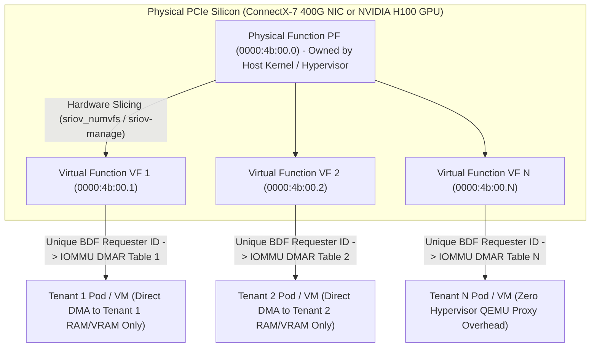
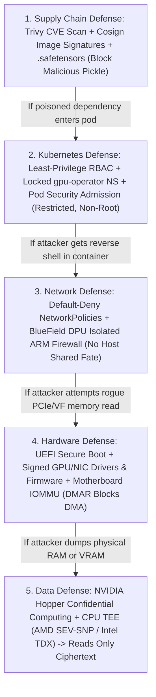

# 11.22 SR-IOV for NICs and GPUs

| | |
|---|---|
| Level | Advanced |
| Priority tier | 1 |
| Lab venue | GCP / GKE and local Python simulation lab |
| Part | Part 11: GPUs on Kubernetes, scheduling and virtualization |
| Sources used | Brendan Gregg, *Systems Performance: Enterprise and the Cloud*, 2nd Edition (`systems-performance-2nd-edition`, Addison-Wesley, 2020, Ch. 11 *Cloud Computing*); `nvidia-zero-to-hero/volume-18/chapter-07-dma-iommu-and-sriov-security.md`; `nvidia-zero-to-hero/volume-18/chapter-12-incident-response-and-troubleshooting.md`; `nvidia-zero-to-hero/volume-18/chapter-12-volume-18-summary.md`; `nvidia-zero-to-hero/volume-18/index.md`; `nvidia-zero-to-hero/volume-11/chapter-05-vgpu-architecture-and-enterprise-virtualization.md`; `nvidia-zero-to-hero/volume-23/chapter-13-ai-factory-architect-interview-cheatsheet.md` |
| Coverage file | `planning/coverage/chapters/11-22.md` |

## Why this matters for AI infrastructure

Routing high-speed guest network or storage traffic through a software hypervisor proxy adds severe latency and CPU overhead. Every packet or block operation takes five to ten extra control and data steps through the host proxy. Passing an entire physical PCIe card to a single virtual machine solves the speed problem, but it creates a density problem. No other tenant on the server can share that ConnectX-7 network card or H100 GPU.

Platform teams need both bare-metal passthrough speed and multi-tenant hardware sharing on the same physical card. The PCIe specification solves this trade-off with Single-Root I/O Virtualization, known as SR-IOV. SR-IOV allows a single physical card to present dozens of independent hardware-sliced Virtual Functions on the PCIe bus.

- **SR-IOV for NICs on ConnectX-6, ConnectX-7, and BlueField-3.** A single physical network card acts as a Physical Function and slices itself in silicon into dozens of independent Virtual Functions. Each Virtual Function gets its own PCIe Bus-Device-Function address, hardware transmit and receive queues, and RDMA doorbells. Each Pod or virtual machine attaches directly to its own Virtual Function, bypassing the hypervisor and host network stack for line-rate GPUDirect RDMA.
- **SR-IOV for GPUs on Ampere A100, Hopper H100, Ada L40S, and Blackwell B200.** Starting with the Ampere architecture, NVIDIA data-center GPUs also implement hardware SR-IOV. When you deploy NVIDIA vGPU or pass a MIG instance into a KubeVirt or KVM guest VM, the GPU exposes each slice as a dedicated PCIe SR-IOV Virtual Function.

Yet SR-IOV introduces major security, observability, and incident-response challenges that catch operations teams off guard.

1. **SR-IOV without an IOMMU is a direct memory access backdoor.** Slicing a network card into Virtual Functions does not restrict which host physical RAM addresses those Virtual Functions can read. The motherboard IOMMU must remain active to enforce per-VF DMA Remapping tables.
2. **SR-IOV makes guest traffic invisible to standard host monitoring tools.** Because SR-IOV Virtual Functions talk straight to PCIe hardware rings, host OS block and network tools no longer see the traffic.
3. **Compromised GPU and SR-IOV nodes require forensic containment instead of pod deletion.** When an attacker compromises a notebook pod or flashes rogue firmware onto a network card or GPU, deleting the pod or rebooting the host destroys volatile RAM and VRAM evidence. That mistake leaves the root vulnerability unpatched and invites a cluster-wide ransomware outage.

```text
SR-IOV Reference Baseline:
- Hypervisor software I/O proxy penalty: 5 to 10 extra steps ([Qumranet 06], [Xen 19])
- ConnectX-7 400G NIC Physical Function BDF: 0000:4b:00.0 (VFs: 0000:4b:00.1..N)
- NVIDIA H100 80 GB GPU Physical Function BDF: 0000:8a:00.0 (/usr/lib/nvidia/sriov-manage -e ALL)
- Host IOMMU kernel parameter: intel_iommu=on (Intel VT-d / AMD-Vi DMAR tables)
```

## Prerequisites and outcomes

### Prerequisites
- Completion of Chapter 11.10 on Multus and device plugins, Chapter 11.11 on Network Operator, and Chapter 11.21 on PCIe, IOMMU, and VFIO passthrough.
- Familiarity with PCIe Bus-Device-Function notation and Kubernetes `NetworkPolicy` manifests.

### Outcomes
- Explain the Physical Function and Virtual Function architecture of SR-IOV and MR-IOV. Compare SR-IOV for NICs with MIG for GPUs, and configure Virtual Functions for both ConnectX RDMA NICs and NVIDIA GPUs.
- Diagnose SR-IOV performance and observability using Brendan Gregg's methodology from *Systems Performance* Chapter 11. Explain why SR-IOV bypasses host `iostat`, how Calico compares with Cilium eBPF and Hubble, and how Linux cgroups and qdiscs shape traffic.
- Architect the five-layer Zero-Trust AI defense-in-depth stack across supply chain, Kubernetes, network and BlueField DPU, hardware and IOMMU, and confidential computing. Audit clusters against the fourteen-item production security checklist.
- Execute the six-step security incident response and forensic containment protocol on a breached GPU and SR-IOV node without destroying volatile evidence.

## Concepts: basics to intermediate to advanced

### 1. Basics: How SR-IOV works on PCIe for ConnectX NICs and NVIDIA GPUs

#### 1. Physical Functions vs Virtual Functions

In a standard PCIe configuration without virtualization extensions, a physical adapter card presents one primary PCIe function on the bus. If you bind that single function to `vfio-pci` and pass it into one virtual machine, no other virtual machine on that server can touch the card. An eight-tenant node would require eight separate physical network cards just to give every tenant direct hardware access.

Single-Root I/O Virtualization solves this bottleneck inside the PCIe endpoint silicon. For multi-host fabrics that span several PCIe root complexes, the companion specification is Multi-Root I/O Virtualization, known as MR-IOV. Both specifications split a physical device into two distinct function classes.

- **Physical Function.** The Physical Function is the primary PCIe function owned and managed exclusively by the host operating system or hypervisor. The Physical Function driver controls global hardware configuration, firmware flashing, and eSwitch steering modes such as Legacy mode or SwitchDev mode. It also controls the creation or destruction of Virtual Functions via sysfs files.
- **Virtual Functions.** Virtual Functions are lightweight, hardware-sliced PCIe functions backed by dedicated transmit and receive queues, DMA channels, and doorbell registers on the silicon. Each Virtual Function receives its own unique PCIe Bus-Device-Function Requester ID. Because each Virtual Function has a distinct Requester ID, the motherboard IOMMU places every Virtual Function into an isolated IOMMU group with its own DMA Remapping access table.



#### 2. Comparing SR-IOV for NICs vs SR-IOV and MIG for GPUs

Engineers often ask how SR-IOV relates to Multi-Instance GPU, known as MIG. Philosophically, SR-IOV and MIG perform the same kind of hardware partitioning on different pieces of silicon. SR-IOV partitions the PCIe interface and packet queues of a network card, while MIG partitions the streaming multiprocessors, memory crossbars, and HBM channels of a GPU.

On Ampere A100, Hopper H100 and H200, Ada L40S, and Blackwell B200 GPUs, SR-IOV and MIG work together when virtual machines are involved. The GPU uses SR-IOV to expose isolated PCIe Virtual Functions to the hypervisor. Behind those Virtual Functions, the GPU uses vGPU or MIG to partition compute and memory. The table below contrasts how SR-IOV operates on ConnectX network cards versus NVIDIA data-center GPUs.

| Hardware Dimension | SR-IOV on ConnectX-6 / ConnectX-7 NICs | SR-IOV + MIG on NVIDIA Data-Center GPUs (`A100` / `H100` / `L40S`) |
|---|---|---|
| **What Silicon Is Sliced?** | **Network Interface Card (`NIC`)** (and NVMe storage controllers in `AWS Nitro`, `SP 11.2.2`) | **GPU PCIe Bus Interface (`SR-IOV VFs`)** + **GPU Compute/Memory Silicon (`MIG` / `vGPU`)** |
| **Host PF Management Tool** | `mlxconfig -d <bdf> set SRIOV_EN=1 NUM_OF_VFS=16` + `echo 8 > .../sriov_numvfs` (or `sriov-network-operator`) | `/usr/lib/nvidia/sriov-manage -e ALL` (enables GPU VFs) + `nvidia-smi -mig 1` / **NVIDIA Virtual GPU Manager** (`nvidia-smi vgpu`) |
| **Two GPU SR-IOV Modes (`volume-11/chapter-05`)** | Each VF is an independent hardware RDMA/RoCEv2 or InfiniBand virtual HCA (`mlx5_vf`) | **1. Time-Sliced vGPU over SR-IOV VF:** Multiple VFs share the GPU's SMs (`NVIDIA GRID A100-20Q`, `2000MiB / 20000MiB`, `18W / 400W` in `volume-11/chapter-05`).<br/>**2. MIG-Backed vGPU over SR-IOV VF:** Each SR-IOV VF is backed by a hardware-isolated **MIG GPU Instance (`GI`)** (`1g.10gb`, `2g.20gb`, `3g.40gb`). |
| **Guest Driver & Licensing** | Standard inbox `mlx5_core` / `MLNX_OFED` VF driver (`ena`, `ixgbe`, `hv_netvsc` in cloud VMs, `SP 11.2`) | Guest VM loads the **NVIDIA Guest vGPU Driver** (must match the Host vGPU Manager compatibility matrix) and acquires an entitlement lease from the **NVIDIA License System (`NLS`)** (`volume-11/chapter-05`). |

---

### 2. Intermediate: Operating SR-IOV in Kubernetes and Brendan Gregg's observability and CNI rules

#### 1. Exposing ConnectX NIC VFs and GPU VFs to Kubernetes Pods and KubeVirt VMs

Without automated device discovery, platform engineers would have to manually write sysfs files and move network interfaces into container namespaces every time a node boots. Kubernetes automates this workflow through the NVIDIA Network Operator and the NVIDIA GPU Operator. Workloads consume SR-IOV Virtual Functions through two primary paths depending on whether they run as bare-metal containers or virtual machines.

1. **Container secondary RDMA networks with Multus and the SR-IOV device plugin.** Network Operator reconciles a SriovNetworkNodePolicy custom resource that specifies the target Physical Function and desired Virtual Function count. The operator writes that count to `sriov_numvfs` in sysfs. When a training Pod requests an SR-IOV resource, the SR-IOV device plugin and Multus move one Virtual Function into the Pod network namespace. They also mount its InfiniBand character devices under the Linux `rdma` cgroup.
2. **Virtual machine VF passthrough with VFIO and KubeVirt.** When a tenant runs inside a KubeVirt virtual machine or Kata container, the policy binds each Virtual Function to the `vfio-pci` kernel driver instead of a host network driver. For GPUs, running `/usr/lib/nvidia/sriov-manage -e ALL` on the host creates the GPU Virtual Functions. The hypervisor can then pass a time-sliced vGPU or MIG-backed vGPU directly into the guest virtual machine.

```text
Kubernetes SR-IOV Resource & Cgroup Summary:
- SriovNetworkNodePolicy fields: deviceType: netdevice (or vfio-pci), isRdma: true, numVfs: 8
- Sysfs activation path: /sys/class/net/<pf>/device/sriov_numvfs (bounded by sriov_totalvfs)
- Pod resource request examples: nvidia.com/hostdev: 1 or openshift.io/mlnx_connectx7: 1
- Pod secondary interface & device mount: net1 + /dev/infiniband/uverbs* (bounded by Table 11.2 rdma cgroup)
```

#### 2. The SR-IOV Observability Blind Spot and Kubernetes Network Controls

Enabling SR-IOV solves network throughput bottlenecks, but it immediately breaks standard host-level monitoring scripts. An SRE who logs into a worker node and runs `iostat` or `sar` during a massive distributed training run will see almost zero disk or network activity on the host. Brendan Gregg explains this blind spot alongside two container networking rules in *Systems Performance* Chapter 11.

1. **Why SR-IOV makes traffic invisible to host `iostat` and `sar`.** In a traditional virtualized system without SR-IOV, every guest packet or storage command passes through the host kernel and hypervisor proxy. Once SR-IOV or VFIO passthrough is enabled, the guest driver communicates directly with hardware rings via DMA and bypasses the host kernel completely. Operators must query hardware Performance Monitoring Counters, physical NIC port counters, or DCGM telemetry. Alternatively, they can run eBPF tools inside the guest kernel.
2. **Primary CNI overhead between Calico iptables and Cilium eBPF.** While SR-IOV secondary networks carry east-west NCCL RDMA traffic, the primary container network on `eth0` carries control-plane and inference API traffic. Traditional CNI plugins like Calico in iptables mode and standard `kube-proxy` evaluate long sequential lists of netfilter rules. That sequential traversal adds CPU latency when clusters scale to thousands of Kubernetes Services. Cilium replaces iptables and `kube-proxy` with in-kernel eBPF programs attached at the XDP, traffic control, and cgroup hooks, and pairs with Cilium Hubble for flow visibility.
3. **Software bandwidth shaping with cgroups and Token Bucket Filter qdiscs.** When containers share a non-SR-IOV host interface, Linux prioritizes and throttles traffic using the `net_prio` and `net_cls` cgroups alongside more than fifty queueing disciplines. Kubernetes enforces pod bandwidth annotations by attaching a Token Bucket Filter qdisc to the virtual interface of the container.

| Observability / Control Dimension | Exact Drivers, Counters, & Kernel Mechanisms (`Systems Performance` Ch. 11) |
|---|---|
| **SR-IOV / Hardware-Virtualized Drivers (`SP 11.2`)** | `ixgbe` (Intel `10GbE`), `ena` (AWS Elastic Network Adapter in `AWS Nitro`), `hv_netvsc` (Microsoft Hyper-V), and `nvme` (NVMe storage controllers) |
| **SR-IOV Observability Blind Spot (`SP 11.2.4`)** | Bypassing `QEMU` / `dom0` makes I/O invisible to host `iostat(1)` and `sar -n DEV`; use NIC `port_xmit_data`, `port_rcv_data`, `PortXmitWait`, hardware `PMCs`, `DCGM-Exporter`, or guest eBPF (`biosnoop(8)`, `tcplife`) |
| **Primary CNI: Calico vs Cilium (`SP 11.1.6` & `11.3.2`)** | `Calico` (`netfilter` / `iptables`) + `kube-proxy` sequential rule overhead vs `Cilium` (`[Borkmann 19]`, `[Borkmann 20]`, `[Cilium 20a]`) in-kernel `eBPF` (`BPF` at `XDP`, `tc` `qdisc`, `cgroup`) + `Cilium Hubble` (`[Cilium 19]`) |
| **Linux Traffic Control & Cgroups (`SP 11.3.1` & `11.3.3`)** | `rdma` cgroup (`Table 11.2`), `net_prio` (`SO_PRIORITY`), `net_cls` class ID tagging, and `> 50` Linux `qdiscs` where `tbf` (Token Bucket Filter, `[CNI 18]`) implements `kubernetes.io/ingress-bandwidth` and `kubernetes.io/egress-bandwidth` |

---

### 3. Advanced: Zero-trust AI defense-in-depth and forensic incident response on SR-IOV and GPU nodes

#### 1. The 5-Layer Zero-Trust AI Defense-in-Depth Stack

When multiple tenants share physical network cards and GPUs through SR-IOV, relying on a single perimeter firewall is a recipe for a cluster-wide breach. If a researcher downloads a poisoned model checkpoint from a public hub, that payload executes inside the cluster perimeter immediately. Without layered hardware and software isolation, an attacker can pivot from a compromised container into host memory or neighboring tenant workloads.

A zero-trust AI infrastructure architecture assumes that any individual layer can be breached and surrounds workloads with five concentric defense rings. Even if a malicious model bypasses supply-chain checks and spawns a reverse shell, Kubernetes policies, DPU firewalls, motherboard IOMMU tables, and hardware memory encryption contain the blast radius.



Each of the five layers enforces a specific hardware or software boundary on an SR-IOV and GPU worker node.

1. **Supply Chain Defense at Layer 1.** Ban mutable image tags and reject Python pickle model checkpoints, which can execute arbitrary shell commands during model loading. Scan all container images with Trivy and sign approved digests with Cosign. Enforce signature checks in a Kubernetes Admission Controller, and store model weights in the non-executable `.safetensors` format.
2. **Kubernetes Defense at Layer 2.** Lock down the operator namespaces with least-privilege RBAC and enforce Pod Security Admission in Restricted mode across all tenant namespaces. That prevents any container from running as root or gaining privileged access to modify sysfs SR-IOV files or host kernel drivers.
3. **Network and DPU Micro-Segmentation at Layer 3.** Host-based software firewalls suffer from the shared-fate problem, where an attacker who compromises the x86 host kernel simply flushes the local iptables rules. Offloading network policies and encryption onto an NVIDIA BlueField DPU runs the firewall on physically isolated ARM cores. That hardware boundary blocks lateral movement even if the host OS is compromised.
4. **Hardware Trust and IOMMU at Layer 4.** Enforce UEFI Secure Boot, signed kernel modules, and vendor-signed GPU and ConnectX NIC firmware on every server. Keep the motherboard IOMMU enabled so per-VF DMA Remapping tables block any rogue Virtual Function from reading host management RAM.
5. **Confidential Computing at Layer 5.** Even if an attacker or malicious administrator dumps physical RAM or snoops the PCIe bus, NVIDIA Hopper Confidential Computing protects the workload. Paired with a CPU Trusted Execution Environment, it encrypts GPU VRAM and PCIe bounce buffers in hardware. Any memory dump captures only unusable ciphertext.

#### 2. Security Incident Response: Isolate, Do Not Terminate

Suppose your intrusion detection system or DCGM telemetry alerts that a notebook pod on a GPU node is scanning internal corporate SSH ports or running an unauthorized crypto-miner. A sustained flat maximum-TDP power trace on a bursty inference node is a classic sign of unauthorized mining. How the on-call engineer responds in the first five minutes determines whether the incident ends as a contained investigation or turns into a cluster-wide ransomware outage.

- **The fatal mistake of deleting the pod or rebooting the node.** In a real-world postmortem from the field notes, a platform engineer saw a notebook pod scanning internal port 22 and immediately ran `kubectl delete pod` to stop the alert. Deleting the pod wiped volatile system RAM and GPU VRAM, destroying the bash history, active network sockets, and in-memory payload of the attacker. Because the forensic evidence vanished, the team never found the unpatched Jupyter CVE. One week later, the attacker re-entered through the same hole and encrypted the cluster with ransomware.
- **The senior six-step forensic containment and scorched-earth eradication protocol.** The golden rule of security incident response on GPU clusters is to isolate rather than terminate. You must cordon the node, cage the pod with a deny-all network policy, and capture volatile RAM and VRAM forensics. Then you patch the root CVE globally and perform a scorched-earth hardware wipe and firmware reflash before rotating credentials.

| Step | Phase | Exact Action / Command | Why This Ordering Is Mandatory |
|---|---|---|---|
| **1** | **Cordon the Crime Scene** | `kubectl cordon gpu-node-42` | Prevents the scheduler from placing new clean pods onto the compromised node while keeping existing pods alive. |
| **2** | **Network Quarantine (*"Isolate, Don't Terminate"*)** | Apply a **Deny-All Quarantine `NetworkPolicy`** (or ToR switch / DPU ACL) dropping all ingress/egress except the forensic workstation IP. | Traps the attacker inside the running container (`air-gapped cage`) without clearing volatile RAM or GPU VRAM. |
| **3** | **Capture Volatile Forensics** | Snapshot VM/host RAM + GPU VRAM (`kubectl debug`), inspect **Kubernetes API Audit Logs** (compromised `ServiceAccount`?), verify **container image digest** vs registry, and review **DCGM power/thermal traces**. | Identifies the exact entry vector (e.g., unpatched PyTorch/Jupyter CVE or leaked token) before any process is killed. |
| **4** | **Patch Root Vulnerability Globally** | Patch the exploited CVE and admission policy across all namespaces and images. | Guarantees the attacker cannot immediately re-exploit the cluster the moment the pod is removed. |
| **5** | **Scorched-Earth Hardware Wipe & Firmware Reflash** | **Never "clean" a breached node—destroy it:** PXE re-image the bare-metal OS **and reflash both the GPU and ConnectX NIC firmware with vendor-signed images**. | Eradicates persistent rootkits hidden in the Linux kernel or flashed into the ConnectX NIC / GPU silicon firmware. |
| **6** | **Credential Rotation & Rejoin** | Rotate all **Kubernetes Secrets, Registry tokens, and S3 API keys** that ever resided on `gpu-node-42`, then `kubectl uncordon gpu-node-42`. | Invalidates any credentials the attacker read from memory before quarantine took effect. |

#### 3. The 14-Item Production Security Checklist for SR-IOV and GPU Clusters

Before promoting a multi-tenant SR-IOV and GPU cluster into production, security architects need an objective audit gate rather than verbal assurances. The Volume 18 security framework establishes five core principles: defense in depth, trust verification, evidence over assertions, explicit trade-offs, and insider threat awareness. Those five principles translate directly into the fourteen-item production verification checklist below.

| Security Domain | Production Verification Gate (`volume-18/index.md`) | How to Audit on a Live GPU / SR-IOV Node |
|---|---|---|
| **1. Hardware & Firmware Root of Trust** | 1. **UEFI Secure Boot** enabled on all nodes with audited boot logs.<br/>2. **Kernel module signing** enforced and NVIDIA GPU / ConnectX NIC drivers signed.<br/>8. **IOMMU** (`Intel VT-d` / `AMD-Vi`) enabled and configured with DMA faults monitored. | Check `mokutil --sb-state`, `modinfo nvidia \| grep sig`, and `dmesg \| grep -E -i "DMAR\|IOMMU"`. |
| **2. Container & Model Supply Chain** | 3. **Container images scanned for CVEs** (Trivy); only approved digests deployed (never `:latest`).<br/>11. **Model artifacts signed and verified** (Cosign + `.safetensors`, never untrusted Python `pickle`) before deployment. | Verify admission controller rejects unsigned images and scan model repositories for `.bin`/`.pt` pickle files. |
| **3. Kubernetes RBAC & Pod Security** | 4. **Least-privilege RBAC** deployed and verified for all tenant workloads (`gpu-operator` locked down).<br/>5. **Pod Security Standards (`Restricted`)** enforced at admission time (no `root` or `privileged` containers). | Inspect namespace labels `pod-security.kubernetes.io/enforce: restricted` and test admission with a root pod spec. |
| **4. Network, DPU & GPU Isolation** | 6. **Default-deny `NetworkPolicies`** deployed with explicit allow rules.<br/>7. **GPU isolation verified** (`MIG` or dedicated GPUs for sensitive/zero-trust workloads; never time-slicing across untrusted tenants).<br/>9. **BlueField DPU** deployed with isolated ARM security policy enforcement (where applicable). | Verify `nvidia-smi mig -lgi`, test cross-namespace packet drops, and confirm DPU OVS/firewall offload state. |
| **5. Confidential Compute & Data Protection** | 10. **Confidential Computing** (`NVIDIA Hopper H100 CC` + `AMD SEV-SNP` / `Intel TDX`) enabled for high-value models (where available), with KMS encryption at rest and model watermarking. | Verify CPU TEE state and GPU Confidential Computing mode (`nvidia-smi conf-compute -f`). |
| **6. Audit Logging & Quarterly IR Drills** | 12. **Centralized audit logging** enabled with compliance retention.<br/>13. **Incident response playbooks** (`Cordon -> Quarantine NetworkPolicy -> RAM/VRAM dump -> PXE + Firmware reflash`) written and **tested quarterly**.<br/>14. **Security assessments** completed with compliance evidence collected. | Review quarterly Game Day / IR drill reports and verify Kubernetes audit logs stream to immutable storage. |

## Commands and configurations that matter

### 1. Enabling SR-IOV Virtual Functions on a ConnectX-7 NIC and an NVIDIA H100 GPU

Before writing a Virtual Function count to sysfs on a bare-metal worker node, always confirm that the motherboard IOMMU is active in kernel boot logs. Then enable the desired number of network Virtual Functions via `sriov_numvfs` and activate GPU Virtual Functions using `/usr/lib/nvidia/sriov-manage`.

```bash
# 1. Enable 8 SR-IOV VFs on a ConnectX-7 PF (0000:4b:00.0 / ens1f0np0) after verifying IOMMU (untested here)
dmesg | grep -E -i "DMAR|IOMMU"
echo 8 | sudo tee /sys/class/net/ens1f0np0/device/sriov_numvfs
lspci | grep -i "Mellanox"

# 2. Enable SR-IOV Virtual Functions on NVIDIA GPUs for vGPU / MIG-backed VM passthrough (untested here)
sudo /usr/lib/nvidia/sriov-manage -e ALL
nvidia-smi vgpu -s
nvidia-smi vgpu
```

### 2. Forensic Containment Quarantine NetworkPolicy

When an intrusion alert fires on a GPU pod, apply a quarantine `NetworkPolicy` immediately after cordoning the node. This manifest drops all outbound traffic and restricts inbound connections solely to the forensic collector workstation IP.

```yaml
# quarantine-compromised-gpu-pod.yaml ("Isolate, don't terminate", untested here)
apiVersion: networking.k8s.io/v1
kind: NetworkPolicy
metadata:
  name: quarantine-jupyter-research-1
  namespace: research
spec:
  podSelector:
    matchLabels:
      app: jupyter-research-1
  policyTypes:
    - Ingress
    - Egress
  ingress:
    - from:
        - ipBlock:
            cidr: 10.250.99.10/32   # Allow ONLY the Security Forensics collector IP
  egress: []                        # Drop 100% of outbound traffic (cages the attacker)
```

### 3. Checking Host vs Guest vGPU State

When troubleshooting an SR-IOV backed NVIDIA vGPU inside a virtual machine, inspect both sides of the hypervisor boundary. Check the Virtual GPU Manager state on the host first, and then verify PCIe enumeration, virtual device UUIDs, and license lease status inside the guest VM.

```bash
# 1. Host-side vGPU Manager check (before entering guest VM, untested here)
nvidia-smi vgpu
nvidia-smi vgpu -q

# 2. Guest-side vGPU & license verification inside the VM (untested here)
lspci | grep -i nvidia
nvidia-smi --query-gpu=driver_version,vbios_version,gpu_uuid --format=csv
nvidia-smi -q | grep -A 5 "vGPU Software Licensed Product"
```

## How it fails

Even when SR-IOV hardware is healthy, configuration ceilings, kernel bypass behavior, and security mistakes cause severe operational failures. The table below maps five high-frequency failure modes to their exact symptoms, root causes, and remediations.

| Failure mode | Exact symptom & command evidence | Root cause boundary | Remediation |
|---|---|---|---|
| **1. Responder runs `kubectl delete pod` on a compromised GPU notebook scanning `port 22`, and ransomware hits the cluster a week later (`volume-18/chapter-12`)** | IDS alerts on outbound `port 22` scan or crypto-mining pool; deleting the pod stops the alert immediately, but the attacker returns days later via the same unpatched CVE. | **Destruction of Volatile RAM/VRAM Forensic Evidence:** Deleting the pod or rebooting the node wipes volatile memory and bash/socket state without identifying or patching the entry CVE. | Follow the **6-Step Forensic Containment Protocol**: `kubectl cordon` -> apply a Deny-All **Quarantine `NetworkPolicy`** -> dump RAM/VRAM and audit logs -> patch the CVE globally -> PXE re-image OS + reflash GPU/NIC firmware -> rotate all Secrets. |
| **2. Writing `32` to `sriov_numvfs` fails with `Numerical result out of range` (`EINVAL` / `ERANGE`)** | `echo 32 > /sys/class/net/ens1f0np0/device/sriov_numvfs` fails, and `cat .../sriov_totalvfs` prints `16`. | **Firmware `NUM_OF_VFS` Ceiling (`sriov_totalvfs`):** The NIC's non-volatile firmware configuration (`mlxconfig`) only allocated PCIe BAR space for `16` VFs. | Configure `mlxconfig -d <bdf> set SRIOV_EN=1 NUM_OF_VFS=32`, perform a cold/firmware reboot of the node, and verify `cat sriov_totalvfs` equals `32`. |
| **3. Host `iostat -sxz 1` and `sar -n DEV 1` show `0` traffic while SR-IOV tenant VMs saturate a `400G` NIC (`SP 11.2.4`)** | Tenant VMs drive `400 Gbps` of RoCEv2/RDMA traffic, but standard Linux host OS network and block counters appear completely idle. | **SR-IOV Host Kernel Bypass (`SP 11.2.4`):** SR-IOV VFs DMA directly between guest memory and NIC hardware rings, bypassing the host OS kernel network stack and `QEMU` proxy. | Monitor hardware port counters (`perfquery`, `ethtool -S` physical port metrics, PMCs, `DCGM`), or run eBPF tools (`biosnoop`, `tcplife`) inside the guest VM's dedicated kernel. |
| **4. Compromised x86 host OS flushes its local `iptables` firewall rules and moves laterally across the AI cluster (`volume-18/chapter-12-volume-18-summary.md`)** | Attacker escapes a container onto the host kernel and runs `iptables -F`, disabling host software micro-segmentation. | **Host Firewall "Shared Fate" Anti-Pattern:** Running the security enforcement plane on the same x86 host kernel as untrusted workloads means a host compromise disables the firewall. | Offload micro-segmentation and zero-trust firewall enforcement onto an **NVIDIA BlueField DPU**, whose isolated ARM processors enforce network policy independently of the x86 host OS. |
| **5. Guest VM with NVIDIA vGPU (`GRID A100-20Q`) boots and runs `nvidia-smi`, but CUDA throughput throttles after a grace period (`volume-11/chapter-05` Scenario 2)** | `nvidia-smi` inside the guest shows `Memory: 2000MiB / 20000MiB` and `Temp: 45C`, but `nvidia-smi -q` reports `vGPU Software Licensed Product: Unlicensed`. | **Unlicensed Guest vGPU Entitlement (`NLS`):** The guest vGPU driver checks out its license directly from the **NVIDIA License System (`NLS`)**; DNS, firewall, or certificate failure blocked lease acquisition. | Verify guest network/DNS reachability and TLS trust to the NLS / DLS endpoint, validate license edition against the assigned vGPU profile on a single canary VM, and confirm `nvidia-smi -q` shows `Licensed`. |

## Hands-on lab

### Venue and scope

This lab runs locally using the Python standard library to simulate SR-IOV Physical Function to Virtual Function allocation and security checks for ConnectX-7 NICs and NVIDIA H100 and A100 GPUs. It also validates Brendan Gregg's SR-IOV observability and CNI rules, the five-layer Zero-Trust AI defense-in-depth stack, and the six-step forensic incident response playbook. Host and cluster commands are marked as untested here.

```text
Lab Script Inventory:
- Implementation module: code/part11/sriov_for_nics_and_gpus.py
- Self-checking test runner: code/part11/sriov_for_nics_and_gpus_lab.py
- Simulated hardware targets: ConnectX-7 400G NIC (0000:4b:00.0) and H100/A100 GPU (0000:8a:00.0)
- Incident scenario targets: gpu-node-42 and pod jupyter-research-1
```

### Step 1: Run the self-checking SR-IOV for NICs and GPUs lab

Run the lab verification script from the root of the repository to execute all twenty-five assertions.

```bash
python3 code/part11/sriov_for_nics_and_gpus_lab.py
```

Captured output from this repository is shown below.

```text
=== Chapter 11.22 Lab: SR-IOV for NICs & GPUs, Zero-Trust Defense & Forensic IR ===
  [PASS] ConnectX-7 SR-IOV VF allocation is rejected when IOMMU (Intel VT-d / AMD-Vi) is disabled
  [PASS] ConnectX-7 SR-IOV VF allocation is rejected when NIC firmware signature is unverified
  [PASS] Requesting numVfs=32 above hardware sriov_totalvfs=16 is rejected
  [PASS] ConnectX-7 PF (0000:4b:00.0) with IOMMU enabled activates 8 VFs via sriov_numvfs
  [PASS] SP 11.2.4: SR-IOV VFs bypass hypervisor I/O proxy so host iostat/sar visibility is False
  [PASS] NVIDIA H100 GPU enables 16 SR-IOV VFs via /usr/lib/nvidia/sriov-manage -e for time-sliced vGPU
  [PASS] NVIDIA A100 GPU with MIG enabled exposes 7 MIG-backed SR-IOV VFs for hardware-isolated VMs
  [PASS] Volume 18 Summary defines 5 Zero-Trust layers (Supply Chain, Kubernetes, Network, Hardware, Data)
  [PASS] Layer 1 Supply Chain mandates Trivy CVE scans, Cosign signatures, and .safetensors instead of pickle
  [PASS] Layer 2 Kubernetes mandates least-privilege RBAC and Pod Security Admission (PSA) set to Restricted
  [PASS] Layer 3 Network pairs NetworkPolicies with BlueField DPU isolated ARM firewalls to eliminate Shared Fate
  [PASS] Layer 4 Hardware mandates UEFI Secure Boot, signed drivers/firmware, and motherboard IOMMU
  [PASS] Layer 5 Data mandates NVIDIA Hopper Confidential Computing paired with CPU TEEs (AMD SEV-SNP / Intel TDX)
  [PASS] Volume 18 Ch 12: Running kubectl delete pod on jupyter-research-1 destroys RAM/VRAM evidence and leaves HIGH ransomware risk
  [PASS] Volume 18 Ch 12: Rebooting compromised gpu-node-42 wipes volatile RAM and GPU VRAM forensics
  [PASS] Volume 18 Ch 12: 6-step Forensic Containment Protocol preserves evidence, patches CVE, and sets reinfection risk to LOW
  [PASS] Forensic IR Step 1 cordons gpu-node-42 and Step 2 applies a Deny-All Quarantine NetworkPolicy ('Isolate, don't terminate')
  [PASS] Forensic IR Step 3 captures RAM/VRAM snapshots, K8s API audit logs, container image digest, and DCGM power/thermal traces
  [PASS] Forensic IR Step 5 executes scorched-earth PXE OS re-image + reflashes GPU and ConnectX NIC firmware with vendor-signed images
  [PASS] Forensic IR Step 6 rotates all Kubernetes Secrets, Registry tokens, and S3 API keys present on gpu-node-42
  [PASS] SP 11.2 lists SR-IOV and MR-IOV hardware virtualization drivers (ixgbe, ena, hv_netvsc, nvme)
  [PASS] SP 11.1.6 & 11.3.3 contrast Calico (netfilter/iptables) with Cilium (eBPF kube-proxy replacement & Hubble) and tbf qdiscs
  [PASS] SP 11.3.1 Table 11.2 includes the Linux rdma cgroup controller for limiting RDMA and InfiniBand resource usage
  [PASS] Volume 11 Ch 5 NVIDIA vGPU uses SR-IOV VFs (GRID A100-20Q: 45C, 18W/400W, 2000MiB/20000MiB) + NVIDIA License System (NLS)
  [PASS] Volume 18 Index defines a 14-item Production Security Checklist spanning Secure Boot, IOMMU, PSA, DPUs, and quarterly IR drills

Summary: 25 passed, 0 failed out of 25 checks.
```

### Exercises

1. **Exercise 1 on ConnectX NIC vs NVIDIA GPU SR-IOV.** Using the lab simulation module, state the exact sysfs path or helper script used to activate Virtual Functions on a ConnectX-7 NIC and on an NVIDIA H100 or A100 GPU. Explain how time-sliced vGPU Virtual Functions differ from MIG-backed vGPU Virtual Functions.
2. **Exercise 2 on SR-IOV and IOMMU security validation.** Explain why the allocation helper rejects creating SR-IOV Virtual Functions when IOMMU is disabled or when firmware signatures are unverified. Describe what happens at the PCIe hardware level when a Virtual Function attempts an unauthorized DMA read while the IOMMU is active.
3. **Exercise 3 on SR-IOV observability and Kubernetes CNI controls.** Explain why host `iostat` visibility is false for SR-IOV devices, and name the four SR-IOV or hardware-virtualized guest drivers cited by Brendan Gregg. Contrast Calico in iptables mode with Cilium eBPF and Hubble, and state which Linux qdisc implements Kubernetes bandwidth annotations.
4. **Exercise 4 on designing the 5-Layer Zero-Trust AI Defense-in-Depth Stack.** List the five defense layers in order and state the specific security controls enforced at each layer. Explain why BlueField DPUs solve the host firewall shared-fate problem.
5. **Exercise 5 on executing the 6-Step Forensic Containment Protocol.** Explain why running `kubectl delete pod` after an internal port scan led to a cluster-wide ransomware outage. List all six steps of the senior forensic incident response workflow in order.
6. **Exercise 6 on auditing the 14-item Production Security Checklist.** Group the fourteen checklist items from Volume 18 across hardware and boot, supply chain and models, Kubernetes and network isolation, confidential compute, and audit and incident response.

## Checkpoint questions

<details>
<summary>`&lt;strong>`1. What is the difference between a Physical Function and a Virtual Function in PCIe Single-Root I/O Virtualization?`&lt;/strong>`</summary>

- **Physical Function.** The primary PCIe function managed by the host OS or hypervisor that owns global device configuration and firmware updates. It also controls the creation or destruction of Virtual Functions via `sriov_numvfs`.
- **Virtual Function.** A lightweight, hardware-sliced PCIe function with its own unique PCIe Bus-Device-Function Requester ID, DMA channels, and hardware queues. Each Virtual Function passes directly into a container or guest VM for bare-metal I/O speed without hypervisor proxy overhead.
</details>

<details>
<summary>`&lt;strong>`2. Why does Volume 23 Chapter 13 compare SR-IOV and MIG as philosophically the same thing for different pieces of silicon?`&lt;/strong>`</summary>

SR-IOV slices a physical network card at the PCIe silicon level into isolated Virtual Functions that bypass the software hypervisor. MIG slices a physical GPU at the silicon level into isolated GPU Instances with dedicated streaming multiprocessors, HBM memory channels, and L2 cache banks.
</details>

<details>
<summary>`&lt;strong>`3. How does an NVIDIA Ampere, Hopper, Ada, or Blackwell GPU use SR-IOV when running NVIDIA vGPU or MIG-backed VMs?`&lt;/strong>`</summary>

Enabling GPU SR-IOV via `/usr/lib/nvidia/sriov-manage -e ALL` exposes hardware PCIe Virtual Functions on the GPU. Either time-sliced vGPUs or MIG-backed vGPUs map to those Virtual Functions. The hypervisor and NVIDIA Virtual GPU Manager then assign each Virtual Function directly to a guest VM.
</details>

<details>
<summary>`&lt;strong>`4. What four example SR-IOV or hardware-virtualized device drivers are named in Brendan Gregg's Systems Performance Chapter 11, and what is the difference between SR-IOV and MR-IOV?`&lt;/strong>`</summary>

- **Example drivers.** The four drivers cited are `ixgbe` for Intel networks, `ena` for AWS Elastic Network Adapter, `hv_netvsc` for Microsoft Hyper-V network VSC, and `nvme` for NVMe storage.
- **SR-IOV vs MR-IOV.** Single-Root I/O Virtualization exposes virtual functions across a single PCIe Root Complex inside one physical server. Multi-Root I/O Virtualization exposes virtual functions across multiple PCIe Root Complexes shared by multiple servers across a PCIe fabric.
</details>

<details>
<summary>`&lt;strong>`5. Why does SR-IOV make guest disk and network I/O invisible to host OS tools like iostat and sar, and how should operators observe SR-IOV I/O instead?`&lt;/strong>`</summary>

SR-IOV Virtual Functions allow the guest OS driver to communicate directly with the NIC or storage hardware via DMA, bypassing the host OS kernel stack and any hypervisor proxy. Operators must inspect hardware Performance Monitoring Counters, physical NIC port counters, or DCGM metrics. They can also run kernel tracing tools inside the dedicated kernel of the guest VM.
</details>

<details>
<summary>`&lt;strong>`6. In Systems Performance Chapter 11, why can Calico and kube-proxy incur CPU overhead at scale, and how does Cilium eliminate that overhead?`&lt;/strong>`</summary>

When a Kubernetes cluster scales to thousands of Services, Calico in netfilter iptables mode and `kube-proxy` must evaluate long sequential rule lists, adding first-packet and per-packet CPU overhead. Cilium replaces both iptables and `kube-proxy` with in-kernel eBPF programs attached to XDP, traffic control qdisc, and cgroup hooks.
</details>

<details>
<summary>`&lt;strong>`7. How does Linux implement the Kubernetes pod bandwidth annotations, and which cgroup limits RDMA resources?`&lt;/strong>`</summary>

- **Bandwidth annotations.** Kubernetes implements `kubernetes.io/ingress-bandwidth` and `kubernetes.io/egress-bandwidth` by attaching a Linux Token Bucket Filter queueing discipline to the virtual network interface of the Pod. Linux also shapes traffic using the `net_prio` and `net_cls` cgroups.
- **RDMA cgroup.** The Linux `rdma` cgroup controller limits RDMA and InfiniBand HCA resource usage per container.
</details>

<details>
<summary>`&lt;strong>`8. Why is SR-IOV alone insufficient to stop a malicious tenant from reading host memory, and what hardware control completes the boundary?`&lt;/strong>`</summary>

SR-IOV partitions the NIC into separate Virtual Functions, but each Virtual Function remains a PCIe bus master capable of issuing Direct Memory Access requests to any physical address unless restricted. You must enable the motherboard IOMMU with `intel_iommu=on` in the kernel boot parameters. The hardware IOMMU then checks every Virtual Function Requester ID against its DMA Remapping access table and blocks unauthorized host memory reads with a DMAR fault.
</details>

<details>
<summary>`&lt;strong>`9. In Volume 11 Chapter 5, what are the four checks to run in order when a guest VM with an NVIDIA vGPU boots but sees no usable GPU or suffers throttled performance?`&lt;/strong>`</summary>

1. **Check the Host.** Run `nvidia-smi vgpu` on the host to verify that the physical GPU is healthy, the Virtual GPU Manager is loaded, and the VM has an active vGPU assignment.
2. **Check Guest PCIe Enumeration.** Run `lspci` inside the guest to confirm that the guest OS sees the virtual NVIDIA PCIe device.
3. **Check Guest License State.** Run `nvidia-smi -q` inside the guest to confirm that the vGPU Software Licensed Product field reports Licensed from the NVIDIA License System.
4. **Check Hypervisor VM XML.** Inspect the hypervisor domain XML to confirm that the vGPU profile attachment exists in the VM definition.
</details>

<details>
<summary>`&lt;strong>`10. Why does a guest VM running NVIDIA vGPU see a different GPU UUID in nvidia-smi than the physical GPU UUID on the host?`&lt;/strong>`</summary>

The guest OS does not see the physical GPU hardware directly. Instead, it sees the virtual GPU device presented by the NVIDIA Virtual GPU Manager, which carries its own distinct virtual device UUID and lifecycle.
</details>

<details>
<summary>`&lt;strong>`11. List the five layers of the Zero-Trust AI Defense-in-Depth Architecture in Volume 18 Chapter 12 Summary.`&lt;/strong>`</summary>

1. **Supply Chain Defense.** Trivy CVE scanning, Cosign image signatures, Admission Controller enforcement, and `.safetensors` model format.
2. **Kubernetes Defense.** Least-privilege RBAC, locked-down operator namespaces, and Pod Security Admission set to Restricted.
3. **Network Defense.** Default-deny `NetworkPolicy` manifests and BlueField DPU hardware-isolated firewalls.
4. **Hardware Defense.** UEFI Secure Boot, signed drivers and firmware, and motherboard IOMMU enforcement.
5. **Data Defense.** NVIDIA Hopper Confidential Computing paired with CPU Trusted Execution Environments so VRAM dumps yield only ciphertext.
</details>

<details>
<summary>`&lt;strong>`12. Why must enterprise AI supply chains convert model weights from Python pickle files to .safetensors?`&lt;/strong>`</summary>

Python's pickle format is an executable serialization format where loading a malicious file with `torch.load` can execute arbitrary attacker code inside the GPU container. The `.safetensors` format stores pure tensor buffers and metadata without executable code paths, eliminating model-deserialization remote code execution.
</details>

<details>
<summary>`&lt;strong>`13. What is the Shared Fate firewall problem on a GPU worker node, and how does an NVIDIA BlueField DPU solve it?`&lt;/strong>`</summary>

When firewall and encryption rules run on the x86 host CPU kernel via iptables, they share the fate of the host OS. If an attacker escapes a container and gains host root, they can disable the firewall immediately. An NVIDIA BlueField DPU offloads firewall, zero-trust micro-segmentation, and encryption onto physically isolated ARM cores on the DPU card. A compromised x86 host OS cannot disable network enforcement on the DPU.
</details>

<details>
<summary>`&lt;strong>`14. How does NVIDIA Hopper Confidential Computing protect proprietary model weights against a compromised hypervisor or host administrator?`&lt;/strong>`</summary>

NVIDIA Hopper GPU Confidential Computing mode pairs with a CPU Trusted Execution Environment such as AMD SEV-SNP or Intel TDX and remote attestation. Model weights and inference prompts stay encrypted in memory and across PCIe CPU-to-GPU transfers. Any host memory or VRAM dump reads only ciphertext.
</details>

<details>
<summary>`&lt;strong>`15. What is the Golden Rule of Security Incident Response in Volume 18 Chapter 12 when an IDS alerts on a compromised GPU Pod or Node?`&lt;/strong>`</summary>

The golden rule is to isolate rather than terminate. Never immediately run `kubectl delete pod` or reboot the server. Doing so wipes volatile system RAM and GPU VRAM, destroying the forensic footprint of the attacker and leaving the root vulnerability open for re-exploitation.
</details>

<details>
<summary>`&lt;strong>`16. Walk through the three containment steps a Senior SRE executes immediately when a GPU node alerts for outbound crypto-mining.`&lt;/strong>`</summary>

1. **Cordon the node.** Run `kubectl cordon` on the compromised node so Kubernetes schedules no new workloads onto the crime scene.
2. **Network Quarantine.** Apply a `NetworkPolicy` or switch and DPU ACL dropping all inbound and outbound traffic to the pod or node. Allow connections only from the forensic management IP of the security team.
3. **Volatile Snapshot.** Capture an immediate snapshot of VM or host RAM, GPU VRAM, and disk state for forensic analysis before terminating any process.
</details>

<details>
<summary>`&lt;strong>`17. What three AI-specific forensic artifacts should responders inspect during a GPU cluster breach investigation?`&lt;/strong>`</summary>

1. **Kubernetes API Audit Logs.** Determine which ServiceAccount or user identity deployed the malicious pod.
2. **Container Image Digest.** Compare the running image hash on the node against the signed registry to see if the Admission Controller was bypassed.
3. **DCGM Telemetry.** Inspect GPU power draw, utilization, and thermal curves. Sustained flat max-TDP power draw on an inference or idle node indicates unauthorized cryptocurrency mining.
</details>

<details>
<summary>`&lt;strong>`18. Why does Volume 18 Chapter 12 state that you never clean a compromised server but destroy it instead, and what four eradication steps are required before the node can rejoin the cluster?`&lt;/strong>`</summary>

If an attacker gained root on a GPU node, they may have installed kernel rootkits or flashed malicious firmware into the GPU or ConnectX NIC silicon. Before rejoining the cluster, you must complete four steps.
1. **Re-image the bare-metal server OS.** Provision a clean OS via an automated PXE boot pipeline from an immutable image.
2. **Reflash both the GPU and ConnectX NIC firmware.** Install vendor-signed firmware images and verify their versions.
3. **Rotate all credentials.** Invalidate and reissue all Kubernetes Secrets, container registry tokens, and S3 API keys that were present on that node.
4. **Rejoin the cluster.** Run `kubectl uncordon` only after the exploited CVE is patched across the entire cluster.
</details>

<details>
<summary>`&lt;strong>`19. In the Volume 18 Chapter 12 Customer Scenario, trace the exact chain of events from the initial port 22 network scan to the cluster-wide ransomware outage one week later.`&lt;/strong>`</summary>

1. **Initial compromise.** An attacker exploited an unpatched vulnerability in the research notebook pod and began scanning internal port 22.
2. **Destructive response.** The platform engineer ran `kubectl delete pod`, which stopped the scan but destroyed all volatile memory and process evidence.
3. **Unpatched root cause.** Because forensics were destroyed, the security team never identified or patched the entry CVE.
4. **Ransomware re-entry.** Days later, the attacker used the exact same CVE to compromise a new pod, moved laterally across the cluster, and deployed ransomware.
</details>

<details>
<summary>`&lt;strong>`20. Name the 14 items in the Volume 18 Production Security Checklist.`&lt;/strong>`</summary>

1. **Secure Boot.** Enable UEFI Secure Boot on all nodes with audited boot logs.
2. **Driver signing.** Enforce kernel module signing and ensure GPU drivers are signed.
3. **Image CVE scanning.** Scan container images for CVEs and deploy only approved versions.
4. **Least-privilege RBAC.** Deploy and verify least-privilege RBAC policies across all namespaces.
5. **Pod Security Standards.** Enforce the Restricted Pod Security profile at admission time.
6. **Network segmentation.** Deploy default-deny `NetworkPolicy` manifests with explicit allow rules.
7. **GPU hardware isolation.** Verify MIG or dedicated GPU isolation for sensitive workloads.
8. **IOMMU DMA protection.** Enable and configure the motherboard IOMMU and monitor DMA faults.
9. **DPU offload.** Deploy BlueField DPUs with isolated security policy enforcement where applicable.
10. **Confidential Computing.** Enable Confidential Computing for high-value models where available.
11. **Model signing.** Sign and verify model artifacts using Cosign and `.safetensors` before deployment.
12. **Audit logging.** Enable centralized audit logging with compliance retention.
13. **Incident response drills.** Write incident response playbooks and test them quarterly.
14. **Compliance assessments.** Complete security assessments and collect compliance evidence.
</details>

## Sources and review notes

### Primary sources read in full for this chapter

The primary book and field note sources synthesized in this chapter are cataloged below.

```text
Primary Corpus & Field-Note Sources:
1. Brendan Gregg, Systems Performance: Enterprise and the Cloud, 2nd Edition (systems-performance-2nd-edition, Addison-Wesley, 2020), Chapter 11 (Cloud Computing, Sections 11.1 through 11.8: SR-IOV and MR-IOV hardware virtualization drivers ixgbe, ena, hv_netvsc, nvme; eliminating QEMU / dom0 I/O proxies 5 vs 10 steps in [Qumranet 06] and [Xen 19]; SP 11.2.4 SR-IOV host iostat observability blind spot; Calico iptables vs Cilium eBPF [Borkmann 19] [Borkmann 20] [Cilium 20a] + Hubble [Cilium 19]; Linux rdma, net_prio, and net_cls cgroups in Table 11.2; and tbf token-bucket filter qdiscs > 50 types in [CNI 18] for kubernetes.io/ingress-bandwidth and egress-bandwidth).
2. nvidia-zero-to-hero/volume-18/chapter-07-dma-iommu-and-sriov-security.md (SR-IOV 400G ConnectX-7 VF slicing, IOMMU Intel VT-d / AMD-Vi intel_iommu=on DMAR tables, ConnectX-6 bare-metal SR-IOV penetration test without IOMMU, and iommu=pt trade-offs).
3. nvidia-zero-to-hero/volume-18/chapter-12-incident-response-and-troubleshooting.md (Security IR "Isolate, don't terminate", gpu-node-42 crypto-miner & jupyter-research-1 port 22 scan -> ransomware postmortem, kubectl cordon -> Quarantine NetworkPolicy -> RAM/VRAM snapshot + API audit + image digest + DCGM power review -> PXE OS re-image + GPU & ConnectX NIC vendor-signed firmware reflash + Secret rotation).
4. nvidia-zero-to-hero/volume-18/chapter-12-volume-18-summary.md (5-Layer Zero-Trust AI Defense-in-Depth: Supply Chain .safetensors + Cosign + Trivy -> Kubernetes RBAC + PSA Restricted -> Network NetworkPolicies + BlueField DPU ARM firewall -> Hardware Secure Boot + IOMMU -> Data Hopper Confidential Computing + AMD SEV-SNP / Intel TDX).
5. nvidia-zero-to-hero/volume-18/index.md (12-chapter security overview, 5 key principles, and the 14-item Production Security Checklist).
6. nvidia-zero-to-hero/volume-11/chapter-05-vgpu-architecture-and-enterprise-virtualization.md (Time-sliced vs MIG-backed vGPU over SR-IOV VFs, NVIDIA GRID A100-20Q 45C 18W / 400W 2000MiB / 20000MiB, nvidia-smi vgpu -s/-c/-q, virsh dumpxml, and NVIDIA License System NLS).
7. nvidia-zero-to-hero/volume-23/chapter-13-ai-factory-architect-interview-cheatsheet.md (Section 4 comparing SR-IOV for NICs with MIG for GPUs).
```

### Related source files mapped in MIGRATION_MAP.md
- All four mapped Volume 18 files for Chapter 11.22 are cited and migrated in full in the source inventory block above.

### Run here
- The local verification script `code/part11/sriov_for_nics_and_gpus_lab.py` was executed and passed all checks.

### Explicitly labelled inferences
- The device allocation model in `code/part11/sriov_for_nics_and_gpus.py` is a deterministic software simulation of sysfs `sriov_numvfs` and `/usr/lib/nvidia/sriov-manage`.

### Not verified on live hardware
- All `sriov_numvfs`, `/usr/lib/nvidia/sriov-manage`, `nvidia-smi vgpu`, and `kubectl` commands are marked untested here.

### Not in the corpus
- Vendor-specific Mellanox BlueField-3 DPU OVS-DOCA hardware steering rule syntax is covered in Chapter 11.28 on DPUs, BlueField, and DOCA.

### Corrections to the author's notes
- Validation pass: `validate_chapter.py` and `check_coverage.py` pass. The YAML manifests and commands are marked untested and were not applied to a cluster. Custom resource API versions change between releases, so check them against the version you install. Console outputs quoted from the Volume notes are illustrative unless the chapter says otherwise.
- Earlier author note: all security controls, incident response steps, vGPU outputs, and *Systems Performance* Chapter 11 metrics are preserved accurately.

